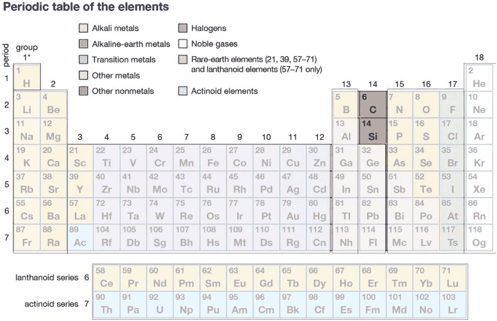

# 7. 智能环境中的人类：近未来

自人类出现在地球表面以来的数十万年里，人类一直与其环境进行着互动。这种互动要么是与**其他物种**，例如其他人类，或是狗、猫、马、牛、公牛等生物，以及树木；要么是与**非生命物体**，如岩石、土壤和水等。当人类与生物（可能除树木外）互动时，他们总是期望某种形式的主动回应。如果我们追一只狗，它可能会跑开，也可能转身冲向我们。如果我们和另一个人说话，对方可能会回应、大笑或感到害怕等。人类已经习惯了这样的回应。与树木的互动则有点棘手。由于没有移动器官，大多数互动看起来就像与非生命物体的互动，但我们可以观察到树木从种子发芽，秋天落叶，春天重新生长，还会开花结果等。不过，总的来说，对非生命物体的回应本质上总是被动的。如果你击打一块岩石，你会受伤，但岩石不会以任何方式主动回应。而且，当岩石被独自留下时，它的外观不会表现出任何变化。同样的情况也适用于所有其他非生命物体。自古以来，这就是被编入人类大脑的程序。大约 7000 年前，随着机器进入人类生活，这种情况开始发生一点改变，正如我们在前几章中看到的。这些机器能够移动物体，并以不同于典型非生命物体的方式对人类行为做出反应，但它们的反应仍然相当确定和可预测。它们的行为没有意外或不确定性的成分，人类很快适应了与这类机器合作。从那时起一直到二十世纪末的数千年里，尽管机器的类型和能力有了巨大进步，但这些互动本质上仍大致相同。机器仍然相当确定和可预测。它们仍然不是不可预测的，人们也不会期望它们产生原创或智能的回应。智能的定义深深植根于生物的行为中，这些行为伴随着不确定性、不可预测性以及逻辑思维。当机器技术发展到以专家系统的形式在复杂的启发式计算（仍然相当确定和可预测）中超越人类时，与人类智能的不可避免的比较便开始浮现。然而，参照类人智能的概念，机器仍然相当笨拙。

大约从 5000 年前或公元前 300 年开始，在古美索不达米亚，人类就已经开始使用诸如**算盘**之类的设备来执行简单的数学运算。算盘由一系列杆或线以及珠子或石块组成，可以通过前后移动来进行算术计算。它提供了一种简单而有效的方法来执行基本的数学运算，如加、减、乘、除。随着时间的推移，技术演变为各种形式的机械计算器，特别是在文艺复兴和工业革命时期。著名的例子包括十七世纪布莱兹·帕斯卡发明的**帕斯卡计算器**，以及十九世纪早期查尔斯·巴贝奇设计的**差分机**。这些早期的机械计算器为开发更复杂、更先进的计算机器铺平了道路，最终导致了二十世纪现代电子计算器的发明。这些设备能够在几秒钟内执行复杂而非凡的算术运算，比如求平方根、阶乘以及非常大数字的幂；这是大多数人类连想都不敢想的事。电子计算器确实证明了，在数值计算方面，机器已经远远超出了人类的能力。二十世纪还见证了计算机的出现，这是一种更先进的设备，除了基本的算术计算外，还能执行逻辑运算。自诞生以来，计算机的处理能力每年都在呈指数级增长。到了二十一世纪初期，一些最强大的超级计算机在原始处理能力和内存容量方面已经超越了人脑。

## 碳与硅

为了理解人脑中的计算与计算机内部的计算之间的差异，这里适合稍作延伸。这种差异始于原子层面：人类以及所有生物体都基于**碳**，而所有计算机和电子设备则基于**硅**。正如在元素周期表（图 7-1）中所见，碳和硅的位置非常相似。它们的原子中拥有不同数量的质子和电子（分别为 6 个和 14 个），但最外层轨道恰好都有 4 个电子，而该轨道最多可容纳 1 到 8 个电子。这使这两种元素在与其他元素结合的能力上最为灵活。诸如我们的 DNA 这类极其长的分子，只能通过数十亿^(²⁰)个碳原子的链条形成。

一张元素周期表突出显示了碱金属、卤素、碱土金属、稀有气体、过渡金属、稀土元素、其他金属、其他非金属以及锕系元素。除碳（C）和硅（Si）外，其他单元格均被禁用。

图 7-1

显示碳和硅位置的元素周期表

所有电子芯片都由硅晶圆制成。硅除了在最外层轨道恰好有 4 个电子外，还具有特殊的化学和电学性质，使其成为一种半导体。半导体元素是导电性介于绝缘体和导体之间的元素。这一关键特性使硅成为制造电子芯片的理想材料。锗以及镓和铟的某些化合物也能用作半导体，但这些元素比硅更复杂、更重，不适合用于芯片制造。令人惊讶的是，尽管碳^(²¹)比硅轻，但它不是半导体，因此无法用于芯片制造。半导体可以很容易地被控制为良导体或像绝缘体一样完全阻断电流。这一基本特性使得在芯片中创建逻辑单元成为可能，这些逻辑单元为所有可编程到其中的复杂处理奠定了基础。第一个半导体芯片，也称为集成电路（IC），由杰克·基尔比于 1958 年在德州仪器公司生产。基尔比的发明标志着电子学领域的一个重要里程碑，被认为是微芯片的诞生。基尔比的芯片使用锗而非硅制成，因为当时硅技术仍处于早期阶段。该芯片由一个锗晶圆组成，其表面互连了多个元件，如晶体管和电阻。这是首次将多个电子元件集成到单个基底上的演示。然而，在基尔比的工作之后不久，英特尔公司的联合创始人罗伯特·诺伊斯于 1959 年独立开发了一种实用的硅基集成电路。由于硅作为材料具有更好的热稳定性和更高可靠性的固有优势，诺伊斯的硅基 IC 成为了现代半导体产业的基础。基尔比和诺伊斯为随后的革命打开了大门，促成了硅谷的诞生，并在 2000 年当之无愧地被授予诺贝尔奖。制造微芯片的过程称为光刻技术。它有助于在硅晶圆（芯片的基底材料）表面创建微小而复杂的图案。

### 集成电路的制造

想象你有一块普通的玻璃，想要在上面绘制一幅非常精细的图画。然而，你没有足够细小的画笔直接作画。因此，你要做的是在玻璃上放置一个称为掩模的特殊模板。这个掩模上有你想要转移到玻璃上的所有精细图案。然后，你通过掩模将强光照射到玻璃上。光线穿过掩模的透明区域，照射到玻璃上，但被掩模的不透明部分阻挡。这样，光线就在玻璃上按照掩模的图案形成了曝光区域。接着，你将一种称为蚀刻剂的化学物质施加到曝光区域。根据具体工艺，这种蚀刻剂可以去除或改变玻璃的性质。蚀刻过程完成后，移除掩模，你就得到了转移到玻璃上的精细图案。在光刻技术中，“玻璃”实际上是硅晶圆，“掩模”则是高分辨率照片或通过计算机辅助设计创建的图案。所使用的光通常是紫外线，可以创建非常精细的细节。通过这一过程创建的图案对于构建构成电子设备的复杂电路至关重要。通过使用不同的掩模和化学处理重复光刻过程多次，制造商可以在硅晶圆上构建多层图案，从而创建现代电子设备所需的复杂电路。

在深入讨论逻辑运算的细节之前，我们先快速回顾一下逻辑在集成电路中是如何表示的。假设我们有两个输入信号，A 和 B。每个信号的值可以是`True`或`False`。因此，A 和 B 之间总共有四种可能的输入组合，如表 7-1 所示。当我们对它们应用`AND`运算时，只有当两个输入都为`True`时，输出才为`True`，否则输出为`False`。为了在实际情境中应用这一逻辑，考虑一对朋友：亚当和巴里。如果亚当和巴里都想下棋，他们就会下棋；如果两人中任何一人不感兴趣，他们就不下棋。上述`AND`运算精确地模拟了这种情况。现在，考虑另一种情况。如果亚当或巴里中任何一人想去看电影，他们就会一起去。只有当两人都对看电影不感兴趣时，他们才不去。这种操作通过在集成电路上使用`OR`运算来模拟。`OR`运算的输出在输入 A 或 B 中至少有一个为`True`时为`True`，否则为`False`。这两种运算构成了在集成电路上实现任何类型逻辑的基础。我们可以在它们之上添加`NOT`运算，或者将它们与额外的输入组合，并串联一系列此类运算，来模拟任何涉及逻辑的现实生活情景。

表 7-1

集成电路上的逻辑运算

| 案例编号 | A | B | A 且 B | A 或 B |
| --- | --- | --- | --- | --- |
| **1** | True | True | True | True |
| **2** | True | False | False | True |
| **3** | False | True | False | True |
| **4** | False | False | False | False |

集成电路（IC）中，这些逻辑运算是通过一个名为`Transistor`（晶体管）的模块来实现的。单个`晶体管`代表一个计算单元，能在 IC 中执行诸如`AND`（与）或`OR`（或）等基本逻辑操作。通过适当组合这些操作（尽管数量可达数百万甚至数十亿甚至更多），人们可以创造出任何能想到的任意启发式过程。

自第一块 IC 问世以来，芯片上的晶体管数量几乎每两年翻一番，推动了计算能力的指数级增长。这一经验观察归功于戈登·摩尔（英特尔联合创始人），并被广泛称为**摩尔定律**。这种指数增长存在一个由硅原子尺寸和紫外光波长决定的最终极限。随着晶体管数量的增加，为了将 IC 的尺寸控制在合理范围内，就需要将电路做得越来越微型化，从而增加了制造过程的复杂性。截至 2020 年，我们已经达到了在约 5 纳米的空间内制造最小晶体管的工艺水平。该工艺的理论极限约为 1 纳米，受限于制造中使用的紫外光波长。摩尔定律理论上将在此时终结。

这些基于硅的机器能够以令人难以置信的速度和精度执行数值和逻辑运算。因此，如果一个问题的解决方案可以用有限的逻辑语句行（可以是数百万行或更多）来勾勒，那么就可以对计算机进行编程，使其在有限时间内解决该问题。通过提高机器的处理能力和速度，还可以进一步任意缩短这个时间。尽管机器已经精通数学和逻辑，但在很长一段时间里，它们仍然无法通过关键的图灵测试，无法以类似人类的方式展现出智能。剩下的关键一环就是自然语言交互。直到 20 世纪末，计算机仍然无法理解或解释自然语言并对其做出回应。

## 外推法与类人智能

除了逻辑性之外，从过往经验中获取洞察以及偶尔的模糊性也是人类智能的关键组成部分。在人类对话中，并非每个句子都是精确的，并具有清晰的二元性或明确的逻辑含义。有些表达方式可能有多重含义，含义不清，有时甚至完全自相矛盾。计算机通常不会产生这样的回应，相反，它们被精心编程以*不*产生这类回应。那么，如果我们改变训练计算机算法的目标，让它们产生这种模糊、多面甚至矛盾的言论会怎样？它们会开始表现出类人智能吗？在产生随机、无意义的回应与产生那些借鉴过往经验、包含一定逻辑但依然模糊或矛盾的回应之间，只有一线之隔。

此时，我们应该探讨学习的另一个方面：**外推法**。用技术术语来说，外推法是一种预测训练数据范围之外数值的方法。预测股票价格或天气预报就是外推法的简单例子。股票价格预测或天气预报问题的训练数据总是来自过去，而预测总是面向未来，模型在预测时难免会遇到新情况。然而，由于这是严格的数值问题，且数值范围定义明确，并有上下限约束，因此在外推模式下的预测仍然相对容易。尽管如此，如果要求一个模型仅基于历史价格数据来预测微软未来的股票价格，其预测结果很可能仍会停留在历史最低值和最高值之间的范围内。同样地，对纽约市的天气预报很可能也会停留在过去所遇到的极端气温范围之内。当出现一种全新的天气模式时，模型极有可能无法准确预测。同理，如果市场上发生了全新的事件，尤其是在竞争格局方面，模型将无法理解其影响，从而无法预测微软的股票价格，而这些价格很可能与历史数值大相径庭。

此外，并非所有需要外推法的问题都是数值问题。考虑一个计算机模型的例子，该模型被训练用于将动物分为两类：狗和猫。提供给算法的所有训练数据都只包含不同品种猫和狗的图片。如果现在给这个模型展示一张黑猩猩的图片，模型的输出结果可能非常难以预测。在这种情况下，当模型试图将黑猩猩归类到它被训练的仅有的两个类别（且这两个类别都不包含黑猩猩）中时，这个过程就被称为外推。这时可能会发生多种情况。模型可能简单地将黑猩猩归类为狗或猫。还有可能模型直接出错，导致程序崩溃。从人类智能的角度来看，这些回应都不智能或不聪明。人类在这种情况下很可能会给出一个答案：“我不知道！”从出生起，人类——或者说所有生物——就一直在以某种方式面对未曾遇到过的全新情况，并且他们总是需要对这些情况做出回应，而没有“崩溃”的选项。用计算机术语来说，生物几乎始终在进行外推，并且非常擅长于此。

股票预测或动物分类的例子过于简单化，这类例子在现实生活中很少出现。现实生活中的外推非常微妙，并带有复杂的上下文背景。例如，拿到驾照后开始开车，每次开上一条新路，都会遇到新的交通状况。每个新的街区都会呈现不同的交叉路口、环岛、行人、高速公路出口和入口匝道等组合。在学习期间，这些情况没有任何一种是完全一模一样的，而每个人在这种情况下仍然能想办法应对这些状况，并且在大多数时候，他们都能做得相当不错且准确。然而，训练机器在这种微妙的外推环境中表现出色是一项艰巨得多的任务，并且需要相当长的时间来开发必要的技术。

在上一章中，我们探讨了人类学习背景下的**探索**与**利用**的概念，它们与外推法确实存在一些相似之处。事实上，在进行外推时，探索和利用这两种操作都是必需的。每当遇到新的情况，人们需要找出它与过去遇到的情况的相似性或接近程度，找出哪些回应曾获得良好反馈，然后创造出一个结合了这些经验的回应，以产生新的行动。同时，为了在混合过程中注入探索元素以实现新的学习，回应中也必须包含一定的随机性。得益于深度学习与**Transformer**技术的创新，我们已经找到了将这些行为嵌入学习算法和程序的方法，像 OpenAI 的 ChatGPT 就是将这种学习付诸实践的杰出范例。

## 人工智能的突破与超级智能时代的来临

尽管在 21 世纪初至 2020 年期间，人工智能领域取得了巨大进展，但这项技术的惠及范围仍然局限于少数知情人士。只有那些理解计算机科学和高等数学概念的人才能真正欣赏并利用它们。这些智能机器只会说编码语言，而世界上大多数人对这些语言一无所知。`ChatGPT`首次改变了这一局面，它实现了与人工智能的自然语言交互，并向全世界免费开放。在机器智能史上，这是第一次——普通人，那些对机器学习和计算机科学技术细节毫无了解的人，可以用自己的自然语言与人工智能交互，并获得他们能理解的结果。`ChatGPT`被证明是计算机史上最具病毒式传播的应用，在不到 5 天内就获得了超过 100 万用户。作为对比，`Netflix`花了三年半才达到这一里程碑，`Spotify`用了十个月，最大的社交网络`Facebook`用了九个月，`Twitter`需要七个月，而`Instagram`在两个月内就超过了它。`ChatGPT`既不是社交网络平台，也不是音乐流媒体应用。它做了一些其他应用从未尝试过的事情。100 万用户只是`ChatGPT`故事的开端，它在短短 40 天内就达到了 1000 万用户，60 天内达到 1 亿用户，并且在撰写本书时，正朝着超过 10 亿用户的目标迈进。`ChatGPT`这种前所未有的成功，并非完全归功于`ChatGPT`本身，而是关于人工智能能够为来自不同背景的人类生活增添的价值。`ChatGPT`提供了一个简单的出口，让世界上的任何人都能接触到人工智能的尖端能力。每当一个新用户开始使用`ChatGPT`，人类历史就翻开了一个新篇章。每一个向`ChatGPT`提出的新问题，都在为某个新领域的革命铺平道路。工业革命在几百年间带来的改变人生的变化，现代人工智能有望在几十年内（甚至更短）实现。当前这一代人将面临一个全新的明天——一个全新的就业市场、一系列全新的挑战、全新的互动方式以及全新的娱乐方式。

### 适应智能机器

从 21 世纪开始，机器智能取得了飞跃式进步，人类智能与机器智能之间的差距开始变得模糊，以至于机器智能几乎难以与人类智能区分。这一变化标志着人类历史上的一个里程碑，其意义堪比大约 7000 年前第一台机器诞生所标志的里程碑。机器帮助人类变得更强大，能够实现他们能够想到但无法独自完成的事情。它让人类的生活更轻松、更安全、更富裕。这也意味着人类必须适应与机器共存才能真正受益，而人类在过去数千年中确实做到了这一点。7000 年可能看起来很长，但当我们从跨越数十万年的人类历史（那时人类仅使用简单的工具）的角度来看，这似乎是一段非常短暂的时间。

从 21 世纪开始，随着与人类同样智能的机器的出现，人类与非生命事物的互动将提升到一个新的水平。过去数千年中，简单机器发展的相对快速的技术演进，与人工智能驱动的机器可能只需几十年就能接管相比，将显得极其漫长。转眼之间，世界将变得截然不同。机器的出现帮助人类达到了新的高峰，但在个人层面，这是一场相当艰难的战斗，因为大多数人失去了传统工作，不得不适应与机器共存的新时代。这一过程伴随着多次社会政治动荡，直到全球各地的文明适应了新的规范。

当前所需的适应不仅速度快了一个数量级，而且影响更为深远，并将从根本上改变一些自人类起源以来就镌刻在基因中的概念。让我们逐一审视。

## 超级人工智能

现在，区分机器智能的不同应用是很有用的。正如我们在前几章中看到的，预测房地产价格、天气预报或股票价格被视为机器智能或人工智能的应用。然而，鉴于生成式人工智能应用所展现出的类人超级智能，这些早期的智能例子就相形见绌了。因此，我们将主要来自 20 世纪的传统机器智能称为“智能”或`AI`，而将始于 21 世纪、由深度学习驱动的新机器智能称为“超级智能”或`SuperAI`。

在撰写本书时（大约 2023 年年中），超级智能机器的能力范围相当有限，主要局限于挖掘互联网或万维网，并以交互式对话机器人（能用自然语言回答任何问题）或生成新信息（如计算机代码、小型文学作品、图像、诗歌等）的形式呈现。它已经展现出创造原本需要熟练人类花费数小时（甚至数天或数周）才能完成的成果的潜力。目前，大多数交互仅限于书面文本，但这可能很快改变。随着亚马逊的`Alexa`、谷歌的`Google Assistant`或苹果的`Siri`等语音助手的普及，这项技术可以轻松适应基于语音的交互，但在撰写本书时这尚未实现。在令人震惊的短时间内，这些算法已经证明机器智能已准备好从人类手中接管大量工作。关于超级智能能以多快的速度实现这一点，存在一些需要注意的方面，必须根据具体情况进行评估。在本章的下一部分，我们将全面审视大多数发达国家和发展中国家人类所从事的各类广泛的工作，以及超级智能将如何影响它们。

### 超级智能对就业市场的影响

#### 农业

让我们按字母顺序从农业开始。农业已经从人工智能机器中获益，通过卫星和无人机图像监测作物健康、预测肥料和农药的合理使用。这通过减少对不可预测的自然模式和灾害的依赖，使农业整体发生了革命性的改进。这些预测配合相应的缓解措施，使农业更具韧性和效率。机器人被用于处理种植、除草、收割等重复性任务，从而减少了对农场动物的依赖，并使这些任务变得可规模化且高效。

应用于农业的`SuperAI`（我们称之为`SuperAgriAI`）可以弥补涉及人类参与的这些操作中的剩余短板，例如分析数据、提出建议，然后决定采取何种行动。管理沟通和业务运营也可以通过`SuperAgriAI`实现自动化。它将进一步提高农业技术的精度，优化作物产量并降低其他成本。将所有独立实体之间的通信进行整合并自动化，将为农民留下的工作少之又少，几乎使其存在变得多余。

想象一个场景：机器人在田间工作，按照作为`SuperAgriAI`一部分的中心计算机的指令执行所有农业操作。这个`SuperAgriAI`可以访问卫星图像，并控制一组无人机，以获取有关作物健康和周围环境的所有详细信息。`SuperAgriAI`了解特定区域土壤和天气模式的所有细节，选择最佳作物类别进行种植，并调用机器人，在精确的时间和精确的用量下执行浇水、施药等所有必要操作。所有机器人都配备了传感器以检测任何故障，`SuperAgriAI`可以为它们制定必要的维护计划，使其保持最佳运行状态。`SuperAgriAI`与提供所有必要物资的其他企业进行通信，并根据需要进行财务交易，最终使整个食品生产平台无缝地端到端运行。

同样，这个`SuperAgriAI`可以通过专门用于此工作的机器人控制牲畜管理。鉴于我们对农场动物的现代化处理方式，我们已然将其视为商品，因此通过`SuperAgriAI`对其进行全面管理将是现代化的自然终点。

同样的概念可以应用于渔业。`SuperAgriAI`可以控制全自动船只，这些船只携带所有捕鱼设备以及各种传感设备，如雷达和声纳，用于定位理想的捕鱼地点。`SuperAgriAI`可以精确地使用渔网，只捕捞所需数量的鱼，而不会造成任何附带损害。通过天气系统的持续数据输入，它还能选择最佳时机派遣船只。由于严格由机器人操作，无需考虑白天黑夜、追踪假期安排甚至规划任何用餐休息时间。渔民的日子也屈指可数了。

这仍然留下了像园艺学家或渔业生物学家这样从事作物、植物、鱼类等研究的人员。在短期内，他们的工作似乎相当安全。这是一项相当开放的工作，跟踪农业和渔业的当前运作，本质上是从`SuperAgriAI`获取所有输入，并试图找到做得更好的方法。

另一个相关的职业领域是林业。林务员是管理森林的专业人士。他们利用森林生态学、野生动物生物学和林业实践方面的知识，来规划和实施保护、确保和管理森林的项目。他们的大部分实地工作可以由机器人和`SuperAgriAI`接手，只剩下小部分专注于研究的工作。

景观设计师利用他们在植物方面的专业知识来创造创新且美观的景观。考虑到`SuperAgriAI`将拥有所有关于植物的必要知识，并由机器人进行体力工作，景观设计师也需要另寻出路。

然而，关于由谁创建和管理这个`SuperAgriAI`，仍然是一个未解之谜。目前，创建`SuperAgriAI`所需的技术仅掌握在硅谷的顶级科技公司手中，但领域专业知识却存在于其他农业公司。无论谁迈出第一步，都可能会获得先发优势。

#### 商业

商业是一个极其广泛的范畴，可能提供了现代世界中最多的工作岗位。从广义上讲，所有类别都可以归入商业之下，但我们将从狭义的角度来看待它，以区分不同领域进行专门评估。从财务角度来看，商业中的`SuperAI`（我们称之为`SuperBizAI`）将提供大量的工具来管理会计和工资单等功能。

让我们看看这个领域中的顶级职位概况。会计师负责创建和维护公司的财务记录。他们还准备财务报表并跟踪收入和支出。会计可以细分为审计、税务和财务规划等专业领域。整个会计工作范畴可以通过`SuperBizAI`实现完全自动化，且风险极低。这只是当前会计应用程序成熟到大型组织可以完全信任它们并委以全责的问题。同样，科技巨头在这一领域也拥有巨大的先发优势。

除了会计师，还有审计师、工资结算员、税务申报员等职位，随着`SuperBizAI`准备取而代之，这些职位也正走向消亡。

#### 银行业

银行业是商业领域的另一个突出领域。银行业涉及的关键操作包括客户服务、金融和投资咨询及交易、信贷和风险管理。ATM（自动取款机）是机器进入该领域的首次尝试，它们已经减少了管理基本“出纳”类活动所需的劳动力。`SuperBizAI`可以通过提供自动化体验，实现类人化的互动客户服务，从而更进一步。这近年来一直是一个巨大的瓶颈，因为预先编程的自动机器人功能极其有限，往往给客户带来更多烦恼而非帮助。类似`ChatGPT`的界面可以彻底改变这一格局。

`SuperBizAI`提供的算法可以处理更高级的银行业务，如贷款和抵押咨询、投资咨询。`SuperBizAI`可以通过提供家庭互动体验，轻松为每个客户个性化定制所有银行业务需求。一旦实现，它将消除任何银行设立本地分支机构的必要（只需在战略性位置放置 ATM）。中央办公室可以用全自动的方式处理全球业务。从就业前景的角度来看，整个领域现已濒临消亡。

除了银行和金融业务，其他咨询活动也随着`SuperBizAI`凭借其庞大的法律、规则及历史事件知识库，能够提供比任何个人都更好的个性化咨询和分析，而走向过时。

#### 角色层级与人员管理

在业务领域中，存在基于不同行业和应用的工作角色，但也存在基于特定公司内工作层级的多种角色。层级树从顶层的首席执行官或总裁开始，向下延伸到高层管理、中低层管理，直至个人贡献者。每家公司可能有不同的相对结构，但个人贡献者、管理者以及高层管理者的角色是行业标准。到目前为止，我们主要关注了业务中个人贡献者类型的角色——`SuperBizAI`可以在这些角色中发挥作用——但随着我们沿管理层级向上，会涉及到额外的职责。中层管理者当然需要具备主题专业知识，但除此之外，这些角色还需具备良好的人员管理技能。近年来这一领域得到了大量研究，既有从哲学层面讨论的书籍，也有基于调查的分析。在此背景下，我想特别提及一本著作：马库斯·白金汉和柯特·科夫曼所著的《首先，打破一切常规：世界上最好的管理者有何不同》。该书的发现基于该领域有史以来规模最大的调查之一，涵盖了来自不同行业的真实人员管理者。这项由盖洛普公司开展的调查包括了超过 8 万名管理者。调查的关键发现之一是，并不存在一套每位管理者都必须遵守的恒定“金科玉律”；相反，在极其成功的管理者身上发现了完全矛盾的行为。最成功的管理者通常擅长以下五个方面：关注优势、设定明确期望、营造积极工作环境、有效授权以及让员工承担责任。人员管理的工作迄今为止从未与机器关联，考虑到机器在类人交互方面的局限性，这种状况一直很合理。然而，随着`SuperBizAI`的出现，情况已截然不同。基于如此广泛的研究所揭示的中层管理者的核心目标，`SuperBizAI`能够胜任这一任务，并且其完成方式可能超乎任何人类的想象。当`SuperBizAI`扮演中层管理者的角色时，主题专业知识的问题会自动解决。另一个更关键的优势是，`SuperBizAI`不需要像普通管理者那样领取薪酬。它将作为一种服务由整个组织按年付费购买，而所需费用将远低于组织原本需要支付给管理层的薪酬。现在，我们需要审视`SuperBizAI`在人员管理方面可以调用的所有工具。它可以轻松获得在工作时间持续监控员工的能力。由于明显的隐私侵犯问题，人类管理者永远无法做到这一点，但机器的衡量标准不同；通常，由机器在工作时间监控员工活动并不被视为过度侵入。许多地方已经安装了监控摄像头来追踪员工活动。在新型混合工作文化下，如果工作是在家中进行，这种监控可能涉及一些隐私问题，但可以通过创新方式予以规避。凭借员工活跃工作及产出结果的完整信息，`SuperBizAI`很有可能比任何人都更准确地对员工做出公正、无偏见的评估。利用员工工作时间和产出结果的历史数据，可以轻松识别他们的优势和劣势，从而使`SuperBizAI`能够设定合理的未来期望，并优化工作分配。监控还能实时发现员工遇到的障碍，并立即采取行动加以缓解。识别优势与劣势，结合员工对未来职业的期望，可以帮助为他们提供关于如何改进或改变的定制化建议。即使是最能干、最成功的管理者，终究也是人，在与所有下属员工打交道时难免会产生无意识的偏见，这意味着他们无法平等或公正地对待所有员工。然而，机器则不然。由于可能不存在任何类型的无意识偏见，它们可以为所有员工提供完全客观的对待。这种机器运作中固有的公平性将自然培养出团队内强烈的积极氛围。员工无需刻意取悦管理者，无需担心真实表达自我会引发冲突。他们只需完成分配的工作，并确信将完全基于此获得回报。此外，`SuperBizAI`可以并行运作且无处不在，从而随时对所有下属员工开放，这将在员工心中培养强烈的关怀感，并使更灵活的工作时间成为可能。

通常，所有中层管理者都是先担任个人贡献者角色才达到这一层级的。因此，当他们领导一个团队时，公司实际上便失去了该特定员工在个人贡献者角色上所能创造的价值。因此，通过广泛使用`SuperBizAI`来完全取代中层管理，可以为所有公司创造双赢局面。经验丰富的员工可以继续在职业生涯中成长，在决策过程和项目领导中发挥更大影响力，而人员管理的部分则可以交由`SuperBizAI`负责。人员管理还有其他更具社交性的方面，例如辅导和指导。然而，这些方面可以独立处理，无论是通过`SuperBizAI`，还是根据需要由专门的主题专家或心理学专家来完成。另一项属于中层管理范畴的任务是规划。即根据整个组织的发展方向，制定短期和长期目标。在此任务中，`SuperBizAI`可以生成一份选项清单，由团队中的资深成员进行增补和投票，以最终确定计划。

在撰写本书时，构建能够承担中层管理角色的成熟软件似乎还是一个新兴的初创公司领域。同样，所有科技巨头在这方面都具备先发优势，因为它们已有大量可替代的现有岗位，并拥有深厚的软件开发专长。值得注意的是，在初期阶段，可能会受到来自所有现有中层管理者的强烈抵制，每家组织都需要自行解决这一问题。而这实际上可能有助于新兴初创公司取得领先。

随着应用日益成熟，它可以在管理层中逐步晋升，直至最高管理层。然而，更换高层人员是一个全新的概念，可能需要更长时间才能实现。组织中的首席执行官是决定整个组织发展方向的主要决策者，因此对于`SuperBizAI`来说，这并不是一个可以直接替代的属性。尽管如此，仍有一些优点值得考虑。例如，人类可能无法始终如一地践行公司的使命和愿景。即使是这些高管也是人，他们容易受到人类弱点的左右，例如：

1.  **过度自信：** 高层管理人员可能对自己的决策和策略过于自信，导致他们低估风险，并在没有充分评估潜在弊端的情况下仓促做决定。
2.  **确认偏误：** 高层管理人员可能只寻求确认自己现有信念和观点的信息，而忽视相反的数据。这种偏误可能导致决策失误并错失良机。
3.  **缺乏适应性：** 在快速变化的商业环境中，抗拒变化或新想法的高管可能会发现很难根据不断变化的情况调整其策略。
4.  **忽视道德与合规：** 对道德考量和法规遵从性缺乏关注可能导致声誉受损、法律问题和利益相关者信任度下降。
5.  **难以接受反馈：** 不乐于接受建设性批评和反馈的高管可能会错失改进机会，并无法解决组织问题。
6.  **沟通能力差：** 低效的沟通会阻碍高层管理人员传达愿景、激励员工以及引导组织朝着共同目标前进的能力。
7.  **职业倦怠与压力：** 高层管理人员通常面临巨大的压力和紧张感，如果管理不当，可能导致职业倦怠并影响决策。
8.  **傲慢：** 过度的自我或优越感可能导致优先考虑个人利益而非组织及其利益相关者福祉的决策。
9.  **群体思维：** 身边围绕志同道合之人并压制反对意见的高管，会营造群体思维的环境，从而限制创造力和创新。
10. **未能授权员工：** 不授权和支持员工的高管可能会扼杀主动性，并阻止组织发挥其全部潜力。

这些弱点的每一个方面都可以通过即将取代组织高管的`SuperBizAI`的适当配置来彻底避免。除此之外，公司所有最高层人员都可以参与对关键决策的投票，而这些决策的选项将由`SuperBizAI`筛选。投票也可以向公司所有员工甚至所有股东开放，并通过适应性加权投票，真正营造透明的氛围，让所有员工和股东切身感受到参与公司运营。

特别是对于大型上市公司而言，从股东的角度来看，CEO 或任何高层管理人员即便在业余活动中也应始终全神贯注于公司的改善和发展，这或许非人力所能及。然而，`SuperBizAI`没有这样的限制。替换管理层的过程可以从底层开始，随着流程成熟，它可以一路发展，直到所有经理（直至 CEO）都被`SuperBizAI`取代。所有人类员工将作为个人贡献者，拥有相应的资历级别。人类现在可以放弃那些与自身个性相悖的方面，并真正自由地按照自己的意愿过好工作之外的生活。即使是最高层人员也无需担心公众形象，因为这部分将留给`SuperBizAI`，而它可以在此角色中提供卓越的表现。

### 对不同技能水平岗位的影响

具体到个人贡献者的岗位，其范围可以从技能要求低、劳动密集型的工厂工人，到高技能工人，如精算师、药剂师、律师、软件工程师、科学家和医生。随着重型机器人设备的大量使用，工程和建筑行业中最劳动密集型岗位的数量已经减少。想象一下一个高层建筑的施工现场。在自动化早期，这类工地需要数百人来处理众多劳动密集型工作。然而，随着起重机、挖掘机和物料搬运机器人等重型机械的出现，这一数量已减少了一个数量级。机器人系统可以帮助在现场外预制大部分构件，并在现场精确组装。结合计算机辅助的 3D 打印，可以以更高的精度制造复杂的建筑元素和建筑构件，从而进一步减少制作复杂设计所需的半熟练工人。使用专业的机器人工具可以处理整个拆除工作，最大限度地减少人力，降低对工人的风险，并提高效率。无人机和机器人测量设备可以在施工现场收集精确数据，消除手动测量的需要，并进一步提高准确性。机器人砌砖系统和混凝土浇筑泵可以加速施工中的其他手动步骤，进一步减少所需劳动力。通过远程和虚拟现实辅助操作，人类甚至无需亲临施工现场，而是可以待在家中或其他喜欢的地方，使用虚拟现实设备操作或监控所有机械。这些设备中的大多数仍被归类为传统 AI。有了 SuperAI 驱动的机器人，对人类在场的需求将进一步减少，但短期内可能仍不会完全消失。如果传统 AI 将劳动力从数百人减少到几十人，那么 SuperAI 则有望将其减少到仅需少数几人，并且这些人也在远程地点操作。所有这些改进都有助于提高流程的效率和准确性，并降低风险和危害，但在此过程中，它们也将造成巨大的岗位数量缺口。

技能型工作的格局并无太大不同。软件工程是一个小众且高度技能化的劳动力群体，随着计算机在 20 世纪末的指数级增长而发展壮大。软件工程师的核心本质与其他工程师并无二致。你在电脑、平板或智能手机等所有数字设备上使用的所有应用程序、网站和程序，都是由软件工程师创建的。软件工程师编写指令，使这些设备和程序得以运行。可以把软件工程师想象成数字世界的建造者。他们使用特殊的编码语言编写一行行指令，告诉计算机该做什么。这些指令能让应用程序、游戏、网站，甚至自动驾驶汽车或机器人等事物顺畅运行。软件工程师需要善于解决问题、具备逻辑思维能力并注重细节，就像机械工程师或土木工程师一样。他们的工作也包含大量创意。他们要设法让产品对用户友好，使你能轻松浏览各类应用和网站。他们还要确保一切安全，让你在使用技术时个人信息不被泄露。然而，随着像 ChatGPT 这样能理解人类语言的超级 AI 界面的发展，软件工程的需求预计将大幅下降。任何人都可以用简单的英语描述一个软件应该做什么。如果超级 AI 能直接将这些用英语描述的指令翻译成计算机代码，它就会从软件工程师手中夺走相当一部分关键职责。原则上，配备这种界面的系统甚至能以全自动化的方式，执行软件开发周期中的端到端操作——从编写和测试机器代码，到在 PC、手机等任意目标平台上部署应用程序，从而彻底消除对软件工程师的需求。超级 AI 技术要达到这种自动化水平可能需要一二十年，但软件工程师以及他们那些小众岗位的日子已经屈指可数了。

让我们设想一个超级 AI 完全接管软件工程的场景。

## 赞许咖啡馆

2028 年的一个周五傍晚，苏菲和劳伦正坐在丹佛市中心他们最爱的“赞许咖啡馆”里喝咖啡。她们从童年起就是非常亲密的朋友，即使后来走上了截然不同的职业道路——苏菲投身科技行业，劳伦从事野生动物保护——她们也一直保持着联系。每月在咖啡馆的聚会如同神圣的仪式，是充满欢笑、深度交谈和分享梦想的绿洲。

今晚的氛围带着一丝苦乐参半。苏菲刚刚接受了一份在法国的新工作邀请。虽然新开始的兴奋在她心中涌动，但她也因为要告别与劳伦的每月惯例而感到一阵刺痛。她搅动着咖啡，升腾的蒸汽仿佛承载着她复杂的情感。“你知道吗，我一直想象着我们会在丹佛一起变老，坐在这儿，一边喝着无咖啡因咖啡，一边抱怨关节炎，”劳伦开玩笑地说，想缓和一下气氛。苏菲笑了，“还要抱怨年轻人不懂得欣赏一场好的、老式的咖啡闲聊。”两人都笑了起来，但紧随其后的沉默却格外沉重。劳伦打破沉默，把一张餐巾纸推到苏菲面前。她在上面画了一个应用程序的界面。“还记得我们一起创造点什么的梦想吗？为什么不现在就开始呢？一个基于位置的社交网络，人们可以在搬到新地方或旅行时，提出关于当地的问题。你在法国就会有亲身体验，不是吗？”苏菲看着那张图，眼睛亮了起来。“就像，‘最近的素食餐厅在哪里？’或者‘这个镇上有远足团体吗？’然后当地人能实时回答？”“完全正确！而且每条有用的回答都能让他们获得‘赞许分’。也许他们甚至可以在世界各地的像这样的咖啡馆里兑换积分。”劳伦喜笑颜开。苏菲的思绪飞转。“我们可以叫它‘LocalE’，强调本地知识和体验。”两人兴致勃勃地花了几个小时讨论这个潜在的应用程序。这完美地融合了她们的兴趣——对苏菲来说是技术与社区建设，对劳伦来说是本地生态系统与文化。正当她们全神贯注讨论时，桌上的麦克风“哔”地响了一声。劳伦和苏菲没注意到，这家赞许咖啡馆最近刚升级了新的超级 AI 功能，能够实时部署软件。超级 AI 机器人在麦克风里回应道：“我已经理解了你们对这款社交应用的需求，如果你们愿意，我可以为你们创建一个真实版本。费用是 250 美元。”劳伦几乎不敢相信自己听到的话，充满了敬畏，而苏菲则兴奋不已。苏菲立刻回答：“谢谢你的提议。我们想下单。”劳伦还没完全回过神来，不敢相信眼前发生的一切。超级 AI 机器人回应道：“谢谢！我们已经从你存档的卡中扣款。我们正在我们的服务器上构建并部署你们的应用程序，几分钟后就可以下载了。”接着，随着超级 AI 构建和部署应用，一个圆圈闪烁起不同的颜色。仅仅几分钟后，屏幕上就显示出了一个二维码，机器人回应道：“请扫描二维码下载应用程序。”苏菲和劳伦将应用下载到手机上，并开始提问。超级 AI 机器人回应道：“我们将把这个应用提供给全球所有访客，几天之内，你们预计就能看到更多的互动。”

不知不觉间，咖啡馆准备打烊了。两位朋友离开了，带着的不是沉重的心情，而是实现了共同梦想的满足感。她们也许不在同一个城市，但通过共同的事业，她们的联系将比以往任何时候都更加紧密。几个月过去，几年过去，‘LocalE’风靡全球。每当有人在应用上获得‘赞许分’时，苏菲和劳伦都会想起那个在“赞许咖啡馆”苦乐参半的夜晚，心中充满感激，因为那段告别，孕育了新的开始。

让 `SuperAI` 具备取代软件工程等专业技能岗位的能力，将成为其巅峰成就。在硬件领域情况也颇为相似。我们正接近半导体芯片制造技术的理论极限，预计在 2020 年起的十年内即可触及。以下多个因素将决定 `SuperAI` 何时能开始取代人类。

1.  **设计**：`SuperAI` 算法可用于辅助芯片设计，尤其在优化芯片布局方面。例如，谷歌已通过在其张量处理单元设计中运用人工智能证明了这一点，完成速度远超人类所需时间。
2.  **预测性维护**：`SuperAI` 能预测制造设备可能发生故障或需要维护的时间，从而减少停机时间。
3.  **流程优化**：`SuperAI` 可实时优化制造参数，以提高良率、减少浪费，并适应不断变化的条件或材料。
4.  **质量控制**：由 `SuperAI` 驱动的自动视觉检测系统能够快速准确地检测芯片缺陷，其速度和可靠性通常优于人工检测员。
5.  **供应链管理**：`SuperAI` 可以优化物流、预测供应链中断，并确保原材料及时交付。

尽管有这些重大的改进，但在复杂性和基础设施方面仍存在一些限制。芯片制造工艺，尤其是针对具有纳米级特征的高级芯片，极其精细。确保制造过程中所需的精度、洁净度和一致性，可能仍需人工监督。虽然 `SuperAI` 能处理大量任务，但战略决策、突发挑战以及某些复杂的问题解决场景，可能仍需要人类干预。用 `SuperAI` 驱动的替代方案来替换现有系统和机械需要巨额投资，并且只能逐步推进。即使引入了 `SuperAI` 系统，人类仍然可能对其进行监控，以防止发生灾难性故障，尤其是在初始阶段。因此，尽管 `SuperAI` 能够且很可能将在芯片制造中扮演日益核心的角色，但“完全”接管的想法可能仍需要一些时间。

## 法律事务

再来看其他高技能领域——法律行业，律师或诉讼律师的角色是就业市场中另一个濒危物种。法律研究是律师工作的关键方面，而 `SuperAI`（我们暂且称其为 `SuperLegalAI`）凭借其庞大的法律文件、案例、法规数据库，以及比大多数人更好地识别相关判例和法律的能力，从一开始就能胜任此项工作。`SuperLegalAI` 还能审查合同，识别任何异常、缺失或存在风险的条款。这在并购过程中的尽职调查中尤其有用。在诉讼中，证据开示程序通常涉及审阅大量文件以确定与案件相关的信息。`SuperLegalAI` 可以自动化这一过程，轻松地根据相关性识别和分类文件。`SuperLegalAI` 还可以分析过去的案件结果、司法裁决和其他数据，以预测未来的法律结果。这有助于在无需人工干预的情况下为客户提供建议和制定策略。自动化行政任务，如日程安排、计费等，是 `SuperLegalAI` 另一项人类无法企及的内置能力。对于简单的法律服务和建议，`SuperLegalAI` 可以借助几乎随时可用的先进聊天机器人来取代人类。`SuperLegalAI` 还能基于对历史案例的分析协助量刑，并承诺完全公正。

实现这一目标的真正障碍，主要在于达到当前经验丰富的律师所享有的信任水平，以及克服陈旧的法规和验收标准。在法律领域，对行为承担责任至关重要，而当前可能开发 `SuperLegalAI` 软件的科技公司，很可能不会为其软件提供的结果承担责任。不过，这对初创公司来说是一个绝佳机会，它们可以利用人工智能的自然语言处理（`NLP`）技术，并结合顶级律师的专业知识，为成千上万的人提供完全自动化的法律服务。这些系统将为其提供的法律行为和建议承担责任，从而真正取代律师。可能只需要少数顶尖律师来微调系统，但所需的整体劳动力实际上将几乎消失。

除了律师，法律行业还有许多其他角色，但我们可以重点关注除了律师和诉讼律师之外的几个关键职业：律师助理和法官。律师助理人员占法律工作的很大一部分。他们主要专注于协助律师工作，包括进行法律研究、起草文件、整理档案、维护记录等。`SuperLegalAI` 似乎在所有这些领域都天生具备专业能力，并配备了自然语言界面，因此它已经准备好立即取代律师助理。

### 法官的职责与 SuperLegalAI

法官的职责处于法律体系的核心，至关重要。现在，我们来审视法官承担的关键职责，以及 `SuperLegalAI` 如何在每种情况下提供帮助：

#### （1）审判裁决

法官需要公正地审理和裁决提交至法庭的案件。这包括听取双方辩论、评估证据，并将相关法律适用于案件事实。理论上，`SuperLegalAI` 可以执行这项任务，但法律程序中所用语言的极度冗长和微妙特性，以及 `SuperLegalAI` 的能力，在宣称其可替代人类法官之前，必须经过彻底测试。然而，在提交给法官的所有案件中，有很大一部分可能属于常规性案件，在这种情况下，可以节省人类法官的时间，由 `SuperLegalAI` 取而代之。总体而言，`SuperLegalAI` 已准备好在不远的将来减少所需的法官数量，并随着技术的成熟和充分信任的建立，大幅削减法官人数。

#### （2）法律解释

法官的首要职责之一是解释和适用法律、法规及判例。在某些案件中，法官可能判定某项法律是否合宪。这一领域对 `SuperLegalAI` 而言似乎颇具挑战性；至少在不久的将来，我们可能仍需依赖人类法官。

#### （3）确保程序公正

法官负责确保法庭程序公平进行，并尊重所有相关方的权利，包括维持法庭秩序。这一领域非常适合交由 `SuperLegalAI` 处理，因为它涉及应用标准的公平规则和既定程序。然而，偶尔也可能出现棘手情况，需要人类法官介入。

#### （4）对动议作出裁决

在整个诉讼过程中，各方可能会提出各种动议（例如，驳回动议、即决判决动议）。法官必须根据法律和所提交的事实对这些动议作出裁决。这一领域涉及对法律和程序的直接解释，`SuperLegalAI` 可以介入处理大多数裁决。

#### （5）量刑判决

在刑事案件中，一旦被告被认定有罪，通常由法官负责在法律规定的指南或限制内确定并施加适当的刑罚。这是法官最强大的权力之一；然而，在应用对法律的公正、公平解释以及历史判例方面，这也是最直接明了的职责之一。`SuperLegalAI` 可以很好地完成这项工作，为人类法官减轻负担。量刑判决还包括对其背后的原因进行法律解释，而具备强大自然语言能力的 `SuperLegalAI` 可以很好地处理这一部分。

#### （6）法律研究

即使知识渊博，法官也常常需要进行法律研究，以确保做出明智的判决，尤其是在复杂或新颖的案件中。`SuperLegalAI` 已经具备了这一能力。

#### （7）师徒指导

资深或经验更丰富的法官通常会指导新法官，帮助他们理解自身职责并应对司法系统的复杂性。这是一项非常以人为核心的职责，不符合 `SuperLegalAI` 的框架。`SuperLegalAI` 会通过不断将最新判例程序纳入其知识库来持续自我更新，因此不需要指导。同时，它可能也不是指导人类法官的理想人选。

因此，总体而言，在替代法官这件事上，结果好坏参半。但作为一个起点，`SuperLegalAI` 无疑有能力取代相当数量的法官，仅保留一小部分法官来处理相对新颖的情况，并训练 `SuperLegalAI` 系统自身，以保持其准确性和精度。

## 人工智能在教育领域

教育是另一个有望因人工智能而深受影响的领域。随着计算机技术的渗透，学生去学校、老师用黑板或白板教授各学科的传统学习体系已逐渐过时。不久前，课堂上的整个教学体验还完全由老师主导。老师在黑板上书写或绘画，口头讲解或照本宣科，仅此而已。如今，随着课堂上屏幕和互联网的普及，老师可以从网上调取图片辅助讲解，甚至能播放 YouTube 或其他流媒体网站上的视频或纪录片来支持教学。在某些情况下，他们甚至可以将整堂课交给课前录制的视频。

当这类录制内容免费可得时，有人可能会质疑：学生是否还有必要去学校？他们只需要一份课程大纲和一套讲解该大纲所有内容的视频，就能以方便的任何节奏在家学习一切。甚至可以选择观看不同老师讲解同一主题的多个视频，以满足特定的学习需求。用于教育的`SuperAI`或`SuperEduAI`，能够通过定制测试自动理解每位学生的具体能力和愿望，并为其整个教育需求创建个性化课程。然后学生将按日进行学习体验。`SuperEduAI`可以根据学生的进步情况定期自动调整课程。所有必要概念都将借助所需的视觉和听觉辅助工具来教授。对于动手实验工作，`SuperEduAI`可以使用增强现实或虚拟现实技术。它甚至可以模拟其他学生，营造课堂氛围。在课堂上，也可以让真实学生通过虚拟现实相互互动。借助这些，我们真正能够打破地域、种族、语言、国家的界限，组建一个由世界各地学生共同学习的班级。

为了使学习以最佳节奏进行，拥有一群智力水平、兴趣和知识相近的学生至关重要。`SuperEduAI`可以根据这些指标匹配全球学生，创建最优化的班级组合，并提供前所未有的完美学习体验。这样的平台将使几乎整个教育相关劳动力（如各阶段的学术顾问、图书管理员、教师和教授，以及所有支持人员）变得无关紧要。在撰写本书时，许多在线学习平台正在涌现，但它们大多仍在使用真人教师。这里有一个巨大的机遇，即绕过这一点，构建一个完全自动化、由`SuperEduAI`驱动的平台，且该平台对学生数量没有限制。它将为每位学生优化体验，同时使其保持公正且有趣。

为了实现这一终极统一教育平台的梦想，仍有一些差距需要填补。首要的是基础设施开发。截至本书撰写时，构建此类基础设施所需的所有要素似乎都已具备，但一个掌握技术诀窍的组织或初创公司需要将其列为优先事项，搭建端到端平台。随后，全球需要实现高速可靠的互联网接入，以及能在该平台上运行的设备。一个安全且可扩展的云基础设施将从后端为系统提供动力。在隐私、公平、透明度和问责制方面，总有一些伦理问题需要解决。在虚拟现实中工作有时可能会造成情绪压力，需要按需提供适当的咨询。所有互动都在虚拟世界中进行，可能导致缺乏真实的物理接触，但这可以通过在需要时在本地社区内，于校外组织物理互动来解决。由`SuperEduAI`驱动的虚拟平台可以主动解决欺凌等传统学校中常见的面对面互动问题。

## 工程领域

我们已经探讨了软件工程的未来。然而，工程本身就是最古老的职业之一，其范围远超软件工程，涵盖众多领域，例如土木、机械、电气、电子与通信、化学、航空航天、生物医学、石油、环境、核能、汽车工程等等。土木工程、机械工程以及汽车和航空航天工程等相关领域，专注于物理基础设施和机器的设计、分析、制造和维护。配备聊天界面的工程领域`SuperAI`或`SuperEngAI`，能够理解客户用日常英语表达的需求，并能基于历史数据的学习、内置的结构力学分析引擎以及材料属性数据库，自动化完成大部分流程。`SuperEngAI`可以为所有工程需求提供一站式服务。更进一步，`SuperEngAI`还可以执行预测性故障分析，并提供全面的维护计划。通过与机器人设备的自动化通信，`SuperEngAI`可以将设计变为真实的物理制品，例如建造桥梁、高层建筑，以及机器、汽车乃至飞机。对于这些工程学科中的大多数常规工作，由于`SuperEngAI`很可能会以更低的成本、更高的效率和精度提供更好的服务，它们正面临威胁。只有所有这些工程领域的前沿方面，仍然需要人类进行创新并创造全新事物。

同样地，其他所有工程领域，从电气、电子与通信、化学到环境工程，其常规方面将受到主要影响。所有已确立或渐进式的发展，都可以通过`SuperEngAI`实现完全自动化，但所有专注于创新的领域仍离不开人类。工程的核心是解决问题，每当遇到一个已经解决、从而可以详细描述的问题时，`SuperEngAI`都能端到端地实施。然而，当问题是全新的，因而模糊不清且未被完全理解时（这本质上将我们带至创新的前沿），人类的干预将是不可替代的。

### 医疗保健与医药

医疗保健与医药是人类生活中至关重要的领域，涵盖大量职业类型。这些职业大致可分为以下几类：(1) 临床类 (2) 技术与支持类 (3) 行政类 (4) 研发类 (5) 销售与客户服务类。

我们按倒序来审视这些类别。销售与客户服务类岗位非常适合`SuperMedAI`的应用，AI 引擎能学习所有药品与医药产品的文档，并利用语言理解能力掌握销售目标和客户需求。随后，它能智能地将这两类信息关联起来，从而替代人类完成端到端的运营。任何形式的研发永远都会是一个免受`SuperAI`入侵的 niche 领域，在医疗保健与医药行业也不例外。行政类岗位包括医疗秘书、健康信息管理员、医疗顾问和普通行政人员等。所有这些岗位提供的服务都相当常规，需要标准的专业知识，这些知识很容易被理解，其服务也很容易被`SuperMedAI`自动化。用 AI 界面来处理这类服务成为标准做法，只是时间问题。

技术与支持类岗位属于半熟练到熟练工种，如医疗助理、药房技术员、外科技术员、牙科保健师、护理人员等。这些岗位所需的全部专业知识都可以轻松提供给`SuperMedAI`，但大多数此类工作都需要相当精细和微妙的体力操作。目前机器人自动化方面的进展可以接手这些操作，但必须建造并获得认证的专用机器人版本，才能完全取代人类。短期内这无疑是难以企及的，但人类在这些岗位上工作的日子无论如何都已屈指可数。

接下来是这个领域的核心部分——临床类岗位，如医师或医生、护士、牙医、药剂师、验光师、理疗师、放射科医生、脊椎按摩师、足病医生等。毫不意外的是，这些岗位中大部分的日常工作都相当常规且模式固定。这些岗位的典型操作阶段包括：通过与患者交谈来诊断问题、分析常规检测的结果，随后推荐药物、饮食调整或锻炼方案等，或者向其他临床医生转诊。审视这些分解步骤，`SuperMedAI`可以与患者进行有深度的对话以了解他们的症状，分析常规检测结果，然后利用这些信息与庞大的历史诊断数据库及患者病史进行关联，并提出适当的建议。考虑到`SuperMedAI`可获取的信息量及其处理能力，它在这些场景下很可能会比任何人类都更出色。这意味着`SuperMedAI`从一开始就准备好提供比大多数人类医疗服务者更优质的诊断服务。剩下的仅仅是建立必要的系统信任度，以便该服务投入运营。此外，还有另一个相当重要的方面，即医疗事故问题。理想情况下，`SuperMedAI`没有人类那种存在偏见和不可预测行为的弱点，但它仍存在一定的犯错概率，一旦出错，就可能引发法律纠纷。提供`SuperMedAI`服务的公司必须将自己确立为主要责任方，并处理相关的法律诉讼。然而，与`SuperMedAI`带来的颠覆性益处相比，这是一个微小的缺点。一旦系统建立，世界上任何地方的任何人，只要能够访问互联网和拥有计算机设备，就可以选择接受最优秀医生的诊断，并以非常合理的价格获得治疗建议。这个系统几乎可以让 99%的医生的工作变得过时。每个领域只需雇佣少数专家来管理`SuperMedAI`的能力，并使其紧跟医药领域的创新和最新的真实诊断案例。只有当出现完全基于症状和检测结果的新病例时，人类才能介入并调查细节。随后的治疗方案要么包括某种形式的药物，要么是物理疗法。配药工作同样可以轻松实现自动化，`SuperMedAI`可以在线会话中自动寄送所需药物，或将处方发送给最近的患者药房。物理疗法虽然无法在线进行，但实际过程也可以使用机器人设备实现自动化。这种完全自动化的物理治疗设施可以在城市中的战略位置建立，通过`SuperMedAI`接收患者处方。结合生物识别技术，整个端到端的操作可以实现无纸化和全自动化。医疗保健行业正处在未来几年重大转型的风口浪尖。然而，考虑到其中涉及的极高财务利益，该行业可能会遭遇当前根深蒂固体系的巨大挑战。

### 娱乐与媒体

另一个在就业市场中占据重要份额的领域是媒体与娱乐。随着名为`SuperEntAI`的超级人工智能娱乐工具的出现，这一领域也将迎来范式转变。人类在过去数千年里在娱乐及创意表演艺术等相关领域取得的进步，是真正令人惊叹的成就之一——我们抽象思维与想象力的天赋在创新艺术形式的创造中得以释放。或许并不存在某种逻辑能解释莫奈的画作为何如此迷人，或莫扎特的交响乐为何堪称神圣，但当我们体验它们时，感受便油然而生，且无论你来自同一地区与否，这种感受都具有普适性。列夫·托尔斯泰、威廉·莎士比亚、但丁、拉宾德拉纳特·泰戈尔、纪伯伦等人的文学作品亦是如此，例子不胜枚举。然而，这种创造抽象艺术形式的能力是人类独有，还是像`SuperEntAI`这样的机器也能习得？这一问题的答案，将决定该领域的未来走向。

当前一代的文本生成 AI 模型（初版`ChatGPT`）已能按你指定的主题即时创作诗歌，并撰写带有喜剧、戏剧、悬疑等人类微妙色彩的文章和剧本。以下是由`ChatGPT (3.5)`以纳粹德国视角创作的一首关于第二次世界大战的诗作。我使用的具体提示是：“以纳粹德国的视角写一首关于第二次世界大战的四节诗。”

> *在欧洲的心脏，一颗火星点燃，*
>
> *纳粹德国崛起，野心昭然。*
>
> *雷鸣般的靴声，高悬的旗帜，*
>
> *它们渴望征服，主宰一切。*
>
> *闪电战 unleashed，一场迅猛的风暴，*
>
> *国家颤抖，命运被铸造。*
>
> *但英雄奋起，精神高昂，*
>
> *直面黑暗，触碰穹苍。*
>
> *从诺曼底海滩到柏林陷落，*
>
> *盟军集结，推倒高墙。*
>
> *他们胜利屹立，团结而自由，*
>
> *世界从暴政狂欢中重生。*
>
> *让历史的回响清晰提醒我们，*
>
> *权力的代价，仇恨的灼痕。*
>
> *在团结与和平中，让我们奋力繁荣，*
>
> *让自由与希望永远留存。*

AI 明显理解了问题的背景，能够提取战争中的关键元素，并以押韵的形式组合起来。它还能按时间顺序排列事件。诗作以德国人的自豪开篇，随后转为歌颂盟军，最后以战争教训和对美好未来的希望收尾。这无疑是一次不错的尝试，水平大致相当于高一到高二的学生。

以下是新一代`ChatGPT`（基于 4.0 版本）创作的另一首诗：

> *踏着梦境前行，我们立于阴影，*
>
> *一种权力的幻象，被误解的愿景。*
>
> *带着雄鹰和万字符，我们崛起前方，*
>
> *相信命运，要重塑一个世界。*
>
> *钢铁与利刃，列阵战场，*
>
> *大陆被吞噬，如同棋子般徜徉。*
>
> *野心浸透，灵魂飞扬，*
>
> *狂热蒙蔽双眼，不知输赢何样。*
>
> *火海连天，苍穹因战火昏黑，*
>
> *追寻新秩序，无数生命陨落。*
>
> *怀疑的低语开始蔓延，*
>
> *当世界的重压汹涌盘旋。*
>
> *在废墟与灰烬中，梦想崩塌，*
>
> *一个国家的野心，全球的风暴。*
>
> *因追求权力，我们出卖了人性，*
>
> *历史的教训，永远被传颂。*

如你所见，`ChatGPT 4.0`在诗歌创作上有显著提升。它更娴熟地运用文字表达方式，以构造押韵。它还通过更巧妙地运用象征、拟人、典故、修饰语、生动的意象与印象，以及精心安排的重复手法，使诗歌更具感染力，从而散发出更多激情。这首诗出自文学研究生之手也毫不违和。不过，它本质上仍有些泛泛而谈，与一些伟大作品（如威尔弗雷德·欧文关于第一次世界大战的《甜蜜与荣耀之死》，或丁尼生勋爵关于克里米亚战争英国骑兵的《轻骑兵冲锋》）仍有差距。但考虑到这些 AI 模型在短短几年内取得的进步，我们有理由相信，很快`SuperEntAI`就能创作出足以跻身精英行列的诗歌。

我们几乎无法判断这些模型是否理解其创作背后的深层情感，但可以肯定的是，它们能够从训练过程中输入的所有文学作品中提取某种本质。这些例子展示了 AI 在媒体创作某一方面的实力，但 AI 当然不止于此。下一个里程碑将是绘画、图像以及原创音乐作品的创作。许多电影已在使用计算机和 AI 生成的高分辨率图像，而`SuperEntAI`根据提示创建完整视频甚至全长电影，只是时间问题。例如，如果`SuperEntAI`能根据这样的描述按需创作视频剧集：“创建一个大约半小时的视频，带点喜剧、动作和科幻元素，并确保里面有布鲁斯·威利斯和艾西瓦娅·雷。”试想一下，这对好莱坞或宝莱坞意味着什么。或者另一个描述：“创作一段十五分钟的交响乐团原创配乐，风格类似贝多芬。”如果`SuperEntAI`能根据这些文本提示创作出哪怕差强人意的作品，那么 Netflix、HBO 等视频流媒体服务，以及 Spotify、Tidal 等音乐流媒体服务也将变得无关紧要。每个人都可以按需创作自己的娱乐媒介，享受其中，甚至与朋友分享。很可能，这些创作起初无法与过去的原创作品媲美，但考虑到 AI 模型的发展速度，谁又能断言未来会怎样呢？

如今，在媒体观众群体中，我们看到另一个令人不安的趋势：随着智能手机和平板电脑等消费设备的普及，YouTube 视频的观看量急剧上升。人们只是在视频中玩游戏并评论，或在手机镜头前拆箱、测评，就能获得数百万的观看量。制作这些视频所需的准备时间可能只有几小时甚至几分钟，涉及人数寥寥无几；而制作具有专业水准的电影则需要数百人花费数月甚至数年的准备。这两个类别在制作质量和价值上完全无法相提并论，但尽管如此，大多数电影的观看量仍不及这些 YouTube 视频。这只能说明，当媒体消费场所从电影院和歌剧院转向手持设备时，制作质量或对制作质量的期望也随之降低了。在此背景下，`SuperEntAI`无疑将彻底改变游戏规则，并可能对整个娱乐业造成毁灭性影响。同样，除非得到好莱坞或宝莱坞支持的大胆初创公司能更快地迎头赶上，否则拥有 AI 技术的公司仍将处于开发`SuperEntAI`的前沿。

这场讨论也引出了关于媒体与娱乐产业的一个相当关键的问题：我们期望从这种媒体消费中获得什么？它仅仅是一种消磨时间、放松身心的娱乐形式吗？还是某种学习？我们真的在意内容的原创性吗？我们关心创作内容的真实人员吗？这些问题没有简单的答案，即便是同一个人，答案也可能因时而异。此外，随着新兴生活方式的涌现，以及`智能手机`和`人工智能`成为其不可或缺的一部分，未来的几代人对媒体将抱有全新的期待。然而，我们如何回答这些问题的总体趋势，最终将决定媒体行业的命运，并随之决定该行业所有从业者——包括演员、艺术家、音乐家、摄影师、制片人和作家——的命运。

## 新闻与新闻业

媒体领域还有另一个与娱乐方面大相径庭的维度，那就是新闻与新闻业。新闻和新闻业在社会中承担着多种关键职能。它们的作用不仅仅是提供信息，还包括塑造公共话语、保障问责制，以及反映公众多元的声音和关切。与娱乐领域相比，这个领域目前在面对超级 AI 导致的就业机会损失方面显得更为稳健。这个领域承担着多种职能，其中一些关键职责包括：

1.  收集并传播与地方、国家乃至国际层面的公共利益相关的真实、准确、及时的信息。记者和新闻工作者在身处关键职位的人群中拥有深厚的人脉网络，从而能够及时捕捉到正在发展的事态。这是一个相当临时和不可预测的过程，因此难以通过超级 AI 实现自动化。然而，随着对公共区域和办公室的环境监控日益深入，超级 AI 或许能越来越接近捕捉重要新闻，但这似乎仍有很长的路要走。
2.  新闻工作者也监督权力的运行。通过调查和揭露腐败、渎职及其他不当行为，他们确保相关个人、组织乃至政府，为了公众利益，为其行为承担责任。这项工作的性质与第一项职能类似，因此目前也超出了超级 AI 的能力范围。
3.  新闻业也提供了一个公共辩论的平台，确保多元的声音能够被听到。超级 AI 或许能够提供这样一个平台，但要以一种及时且得体的方式来管理它，并容纳那些在受到刺激时本质上难以预测的人类参与者，这对超级 AI 来说可能相当困难。
4.  记者和编辑利用其强大的语言技能，对复杂议题（从科学创新到错综复杂的法律和政治问题）进行深度分析，并根据自身经验发表个人见解。超级 AI 能够处理分析部分，但就目前而言，发表见解可能比较棘手，还需要更多时间。

总体而言，超级 AI 可以协助记者收集历史事实并整合大量的研究成果，但无法取代现有的从业人员。

## 公共服务

在就业市场中，公共服务占据了另一个重要份额。前面描述的一些角色，例如教育、法律事务等，也可以归入这个领域。在本节中，我们将重点关注剩余的职业类别。

健康与公共服务是该领域的一个重要方面。这一类中的一些角色，例如公共卫生官员、社会工作者、儿童保护官员和环境健康专家，可能以志愿形式存在，也有一些是由国家资助的。与迄今为止我们考察的大多数其他职业类别相比，这些角色中的大部分其工作描述并不那么明确，即使他们的最终目标广为人知。从本质上讲，这些角色相当开放，因此相对安全，不易受到超级 AI 的入侵。

该领域中另一个定义明确的类别是公共安全。消防员、警察、紧急医疗技术人员（EMT）、惩戒官和缓刑监督官都属于这一类。这些角色中的大部分工作都需要强大的体能存在和公共关系能力的结合。超级 AI，配合适当的机器人设备，可以辅助这些操作，使人类显著提高效率，但在可预见的未来，它们不太可能取代这些官员，消防员除外。消防员似乎是这一类中最有可能被完全替换的角色，可以用超级 AI 驱动的机器人和自动化机械来取代。这项工作伴随着严重的风险，但其操作流程相当常规，可以基于简单的视觉（摄像头）检查进行准确评估。

### 交通运输

交通运输是驱动大量就业的另一重要因素。这也是一个可能因 `SuperAI`（用于交通运输）或 `SuperTransAI` 而面临大规模失业风险的岗位。交通运输涉及多种方式，例如陆路、水路和空路。

在陆路交通领域，所有角色都可以被归结为从 A 点驾驶到 B 点。这可以是使用大型半挂卡车运输货物的卡车司机，也可以是运送群体乘客或儿童的巴士司机，还可以是运送小团体或个人通勤者的出租车司机。所有这些角色都涉及在道路上驾驶汽车。到 21 世纪第三个十年，大多数汽车都采用了某种形式的自动驾驶功能，例如`自适应巡航控制`，它可以保持恒定速度，并在前车减速时自动刹车，待情况变化后重新加速；或者`紧急制动系统`，它能检测到路径中意外的行人或物体并自动刹车。一些汽车还能保持在指定车道内行驶，根据需要微调方向盘，甚至通过按下按钮自动变道。结合这些功能，汽车几乎可以在高速公路上自动驾驶。基于一组卫星的`GPS`（全球定位系统）已经集成到大多数汽车和智能手机中，能够提供逐向导航。将前面列出的自动驾驶功能与`GPS`系统相结合，全自动驾驶汽车已离我们不远。一旦系统建立，道路交叉口可以安装额外的传感器和电子信号系统，以进一步提高自动驾驶的精度。全自动驾驶汽车可以彻底改变游戏规则，私家车将变得多余。每当需要出行时，只需一个像`Uber`这样的智能手机应用，你的车辆就会在短时间内到达。拼车可以得到优化，总体污染也能大幅减少。自动驾驶运输还可以改善订单配送，降低运输成本，从而有效降低商品成本。

水路运输可能更容易实现自动化，因为处理的交通流量和不可预测性要少得多。大多数船舶都配备了一系列传感器，用于捕获周围水域的数据，例如水深、鱼类和其他物体的存在、水下山脉和冰山等。它们还拥有全面的通信系统，用于监测天气数据以及附近其他船舶的信息。目前，所需船长数量与船舶可载人数之比非常低，因此保留人类船长职位的成本很低，这使得对其自动化的兴趣不大。然而，如果情况紧急，对于`SuperTransAI`来说，自动化这项工作似乎是一件轻而易举的事。船上的其他角色，如工程师、餐饮相关职位、乘客管理职位，已经在不同背景中被考虑过，这些角色的命运同样适用于此。

接下来是空运领域。在大多数现代飞机中，飞行员的作用已经被自动驾驶功能大大削弱。这些自动驾驶功能已经能够完成多项关键的飞行操作，例如：(1) 将飞机保持在指定方向。(2) 将飞机保持在指定的海拔或离地高度。(3) 以特定的爬升率或下降率将飞机升高或降低到预选的高度。(4) 将飞机保持在指定速度，无论是指示空速还是`马赫`数，具体取决于高度。(5) 更进一步，这些系统还可以在指定速度下改变高度。飞机会以选定速度自动爬升或下降，直到达到指定高度。(6) 结合这些能力，自动驾驶仪还可以根据输入到`飞行管理系统`（`FMS`）中的航点来遵循预定路线。(7) 控制飞机的垂直轨迹，以遵循基于特定航点高度限制的预设剖面。(8) `自动着陆`：在拥有高级自动驾驶系统的飞机上，自动驾驶仪可以执行全自动着陆，处理飞机在最终进近、着陆甚至滑跑部分阶段的操作。这在能见度极低的情况下特别有用，并且仅与某些类型的仪表进近程序结合使用。(9) `空中交通防撞系统`（`TCAS`）集成：在一些先进系统中，如果出现交通冲突并且`TCAS`发出决断咨询，自动驾驶仪可以自动调整飞机的垂直路径以避免冲突。总而言之，将所有这些功能与本书写作时的自动驾驶系统相结合，几乎可以完全取代飞行员。只有在起飞和即将着陆前才需要人类飞行员在场，而且在某些情况下甚至并非必需。然而，这些系统仍处于早期阶段，需要更多时间成熟。但在不久的将来，随着`SuperTransAI`准备接管，飞行员的工作显然已濒临灭绝。

到目前为止，我们已经审视了横跨不同市场领域的相当全面的职业列表，以及它们中的每一个将如何因我们所见过的`SuperAI`及其各种变体的出现而受到影响。我们可能还遗漏了许多更细微的职业，但基于此前的讨论，人们可以很容易地推断出`SuperAI`对它们的潜在影响。总之，很明显，`SuperAI`将从根本上改变我们对工作和职业的看法，我们需要在相对较短的时间内适应这些变革的时代。透彻理解驱动`SuperAI`的技术，将有助于我们更精确地评估这项技术的影响，并帮助我们满怀信心地为近期的未来做好准备。迄今为止所有章节的首要目标，就是帮助当代和未来的几代人全心全意地接纳`SuperAI`，欣赏它所带来的所有益处，并与它协同工作，使我们的未来更美好——一个我们不仅能够生存，而且能与`SuperAI`一同繁荣兴盛、开启通往更美好明天冒险旅程的未来。

## 伦理与超级人工智能

“人孰无过，宽恕为上。”英国诗人亚历山大·蒲柏在其诗作中基于文学批评语境写下此句，但这句话本身已超越原意，在更宏大的人类语境中成为引述。它强调了人类易错的本质，指出即使怀着最善意的初衷、做了最充分的准备，人人都会犯错，且犯错亦无妨。导致犯错的原因有多种，例如无知、误解或误判。这句话的另一面则探讨宽恕。在讨论宽恕是否恰当之前，我们需审视：谁有资格宽恕？换言之，谁受到了错误决策的影响？人生每一步，我们都面临选择。有些选择带来善果，有些则带来不善之果。决策者掌握的权力越大，决策的影响就越深远。决策的覆盖面越广，受影响的人就越多。若个人在私生活中做出决策（无论好坏），可能仅波及亲友；若组织高管做出决策（无论好坏），则全体员工都会相应受到影响；若一国总统做出决策（无论好坏），该国全体公民乃至他国都可能受到影响，以此类推。

回到就事论事地讨论宽恕：犯错者的亲友是否应宽恕其错误决策？员工是否应宽恕高管的错误决策？所有受影响国家的公民是否应宽恕总统？这些问题没有标准答案，唯一合理的回答是“视情况而定”。这取决于错误决策的类型、影响程度，以及决策者偏离伦理道德指引有多远。伦理或道德是终极指南针，在我们面临重重选择时指引方向。它研究何为对、何为错。这些永恒问题自人类起源起，自我们的大脑开始运作之时，自我们成为地球生态系统一员之始，便与我们如影随形。做出恰当决策的哲学，即伦理，居于全人类的核心，是一门需要我们随着科技、文化和日常生活的进步而不断发展的永恒学科。

在常规人工智能机器时代，使用某项技术的伦理影响大多局限于技术本身；但随着类人超级人工智能浪潮的到来，我们需要重新审视这些影响。超级人工智能的能力将覆盖几乎所有操作领域，并在不远的将来触及人类生活的方方面面。因此，这种影响将跨越国家、大洲、种族、宗教、性别、年龄等界限。面对如此广阔的覆盖范围及其伴随的力量，超级人工智能应被赋予与全球最高标准相匹配的责任与担当。超级人工智能将真正引领我们进入“地球村”时代——地球如同一国，而超级人工智能则是真正的全球公民。超级人工智能的触角将如电流般通过线缆或波束流动，滋养沿途万物。随之而来的全球性责任与担当，需要由构建超级人工智能的个人或组织，与超级人工智能本身共同承担！是的，毋庸置疑，参与提供超级人工智能的机器，亦可称为超级人工智能的具身载体，在参与决策时，必须像人类一样被追究责任。然而在初期阶段，开发和训练超级人工智能机器的组织将承担大部分责任与义务。在深入探讨伦理如何运作的细节之前，我们需要建立跨越所有宗教、信仰和文化，并与人类 DNA 本身紧密交织的伦理基本准则。

1.  己所不欲，勿施于人。这一简单表述蕴含深刻含义，包括：
    1.  不造成伤害
    2.  尊重
    3.  相互信任
    4.  诚实
    5.  同情
    6.  最重要的是对生命至高无上的珍视

2.  遵守规则。当一个社群或文明建立时，会制定一套基本规则以确保其成功。作为该社群或文明的一员，应积极参与必要规则的制定，而了解并遵守规则则至关重要。

### 立足全球

超级人工智能将在未来数年在所有既定工作流中创造前所未有的机遇，正如本章前述讨论，大量或大或小的组织将参与其中。这些组织可能位于世界任何角落——无论是印度的一座小城、中国的一个乡村小镇、韩国的一处郊区、欧洲的一个村庄、澳大利亚的一片城区、非洲大陆的一个行政区，还是美国的一座大都市——毋庸置疑，它们将要构建的技术将应用于全球范围。因此，在构建任何技术时，拥有全球思维至关重要。

“全球”这一概念包含多重含义，让我们逐一审视。

1.  *理解文化*：人工智能系统应设计为能够理解并尊重世界各地不同的文化规范和价值观。若缺乏全球思维，超级人工智能系统可能无意中强化刻板印象和偏见。

2.  *包容性*：如果人工智能仅基于特定地区或人群的数据构建，则可能对其他群体效果不佳甚至产生偏见。全球视角能确保多样化的观点和需求得到满足。

3.  *平等*：人工智能技术存在加剧全球阶层分化的风险。全球思维有助于设计出尽可能多的人能够负担和使用的解决方案。

为应对这些影响，必须在技术工具方面进行投入，例如：

1.  *本地化*：人工智能解决方案通常需要针对不同国家的特定需求、语言和法规进行本地化。若未能如此，可能产生无效甚至有害的应用。

2.  *隐私*：不同地区对数据保护有不同法规（例如欧盟的《通用数据保护条例》）。全球思维对于驾驭这些复杂且可能相互冲突的法规至关重要。

为便于在全球化的环境中进行开发，协作至关重要。人工智能旨在解决的许多挑战（如气候变化、医疗保健）本质上是全球性的。全球视角能促进国际合作，汇集资源与专业知识，也有助于理解地缘政治问题、协调法规等。

#### 公平公正的归因

这是伦理学领域中又一个需要谨慎处理的难题。为了确保人工智能系统以公平公正的方式运行，应遵循若干原则。

1.  **透明与问责**：首要原则是确保超级人工智能系统透明且可问责。这意味着必须能够理解超级人工智能系统的工作方式，并让其对自己的决策负责。这可以通过提供关于超级人工智能系统如何训练的清晰文档，以及使用诸如可解释性之类的技术来使人们更容易理解人工智能系统如何做出决策来实现。

2.  **消除偏见**：另一个重要原则是避免超级人工智能系统中的偏见。这意味着超级人工智能系统不应针对特定人群（如种族、性别或性取向）存在偏见。这可以通过使用诸如去偏见之类的技术来消除超级人工智能系统中的偏见。

3.  **社会平等**：考虑超级人工智能系统的社会影响也同样重要。这意味着要思考超级人工智能系统将如何被使用，以及它可能如何影响不同的人群。这可以通过进行影响评估，来识别超级人工智能系统的潜在风险和收益。

4.  **贡献归属**：最后，建立一个清晰客观的流程，用于对超级人工智能系统的工作成果进行贡献归属至关重要。这意味着要确保人工智能系统的创建者，以及所有参与创建用于训练人工智能系统的内容和数据的个人和实体，都能因其工作而获得应有的认可。每当使用专利思想或开源材料时，都应给予创建者适当的署名和致谢。在商业环境中，这种归属也意味着要建立一个简化的流程来进行适当的财务安排。

#### 诚实守信

用于开发超级人工智能系统的算法相当复杂，它们为了训练出成熟的系统而处理的数据量极其庞大。即使是参与此类工作的人类，也可能在巨大的复杂性中迷失方向，并可能编造出不完全真实且无法用确凿证据支持的信息。然而，考虑到超级人工智能系统将要做出的关键决策及其将推动的全球影响，它们应当被置于更高的标准之下。超级人工智能系统应始终真实准确，不应自行编造（即所谓的“幻觉”），并准确地反映现实世界。它们不应成为虚假新闻或声明的传播者，误导公众。它们应始终能够支持自己所提出的主张。持续诚实的行为能够培养信任感。以下是一些原则，可确保超级人工智能系统长期保持诚实可靠的行为：

1.  **透明性**：我们在前文中已经探讨过透明性的定义，但在此处，从训练中使用的算法和数据角度来看的透明性尤为重要。在许多情况下，由于许可方面的原因，完全透明可能无法实现，但超级人工智能系统的制造者应尽一切努力，向用户提供系统运行背后的全貌。

2.  **可解释性**：使用可解释模型是达成这一目标的起点。许多人工智能模型，包括基于神经网络的模型，可能会变得过于复杂，以至于实际上无法识别其生成预测或建议背后的原因。然而，超级人工智能系统的制造者应从一开始就将可解释性纳入考量，并确保用户从第一天起就能使用。

3.  **问责制**：我们在前文也提到了这个方面，但在此我们需要从技术角度来看待问责制。任何超级人工智能系统，即使经过所有预防措施的训练，仍然可能犯错。在这种情况下，系统应主动承担错误，提供报告此类错误的正式渠道，并说明未来将如何减轻和修复问题。用户了解系统的局限性，当系统提供这种程度的问责时，就能建立信任。

4.  **准确性**：超级人工智能系统应始终基于真实、可靠的现实来源进行驱动。使用合成数据总有更便宜的替代方案，但应尽可能避免。这也有助于捕捉世界的真实趋势，避免系统中出现无意的偏见。同时，在营销系统时，应克制夸大其词的冲动。人们可以轻易地操纵测试框架以产生过于乐观的结果，这必须避免。用户最终是真正的评判者，如果他们发现声明与实际性能之间存在差距，超级人工智能系统将永远失去信任。

5.  **长期保障**：保留系统运行的详细记录和长期日志，是确保系统长期正常运行的关键。这些日志有助于监控系统随时间推移的性能，以及调查和理解系统所做出决策的趋势。持续监控和更新系统，并通知用户相关情况，将使用户愿意一次又一次地使用该系统。

#### 生命的价值

最后，但同样重要的是，生命的价值构成了伦理学中最复杂且相对模糊的方面，尤其是在人工智能的应用领域。下面是一个经典的难题，用来说明在自动驾驶汽车背景下这一概念。

设想一辆自动驾驶汽车以相当高的速度（但仍然遵守限速）在道路上行驶。突然，一群儿童出现在道路上横穿马路。汽车应该怎么做？假设直线刹车已无可能。因此，如果汽车继续直行，即使全力刹车，也必然会撞上这些儿童。另一个选择是急转弯以避开。以汽车当前的速度进行这样的急转弯，很可能导致车辆翻滚，杀死车内人员。驾驶汽车的超级人工智能应该如何选择？

似乎没有正确答案，因为两种选择都可能导致伤害。一方面，汽车不应该被编程为杀害人类，因为这违反了不伤害人类的原则。另一方面，汽车也不应该被编程为使驾驶员和乘客面临严重受伤或死亡的风险。系统应该优先考虑更年轻的儿童，而不是年长的驾驶员和乘客吗？还是应该优先考虑驾驶员和乘客，因为他们遵守了基本的交通规则，而儿童是违反规则的一方？

无论哪种方式，未来的超级人工智能系统都需要解决此类问题，并在毫秒甚至微秒内做出恰当的反应，以产生影响。以下是超级人工智能系统需要处理的其他一些伦理困境示例：

1.  在决定谁获得器官移植时做出选择。
2.  操作为自主作战而构建的军事超级人工智能系统，使其仅针对“坏人”采取行动。
3.  使用超级人工智能在财务预算范围内做出保险决策，决定谁获得危及生命疾病的批准。
4.  以及更多……

## 结论

`SuperAI` 即将改变我们所熟悉的二十一世纪人类生活。其影响将相当深远，并有可能为我们的生活带来翻天覆地的变化。若真想从中受益，我们确实需要为此做好准备，因为这种变化将来得相当迅猛。前述各章节以及本章的内容，将为我们应对这一变革提供必要的概念基础。

在下一章中，我们将目光投向更遥远的未来，大约在“明天”之后的一两个世纪，并尝试思考机器智能的演进将如何改变人类自抵达地球以来已延续数十万年的生活方式。我们将审视人类从狩猎采集时代到现代高度互联的都市，为满足基本需求而赖以生存的根本原则。我们将尝试重新思考和构想一种更好的方式来组织未来的社会政治结构——在这个未来中，我们与 `SuperAI` 共享生活，让世界变得更美好，并使我们人类做好准备，成为地球真正的全球公民，进而成为宇宙公民，接管太阳系及更远的疆域！

脚注 1 2

