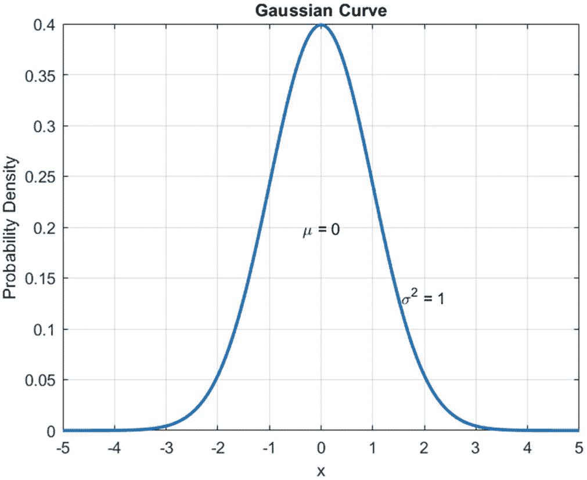
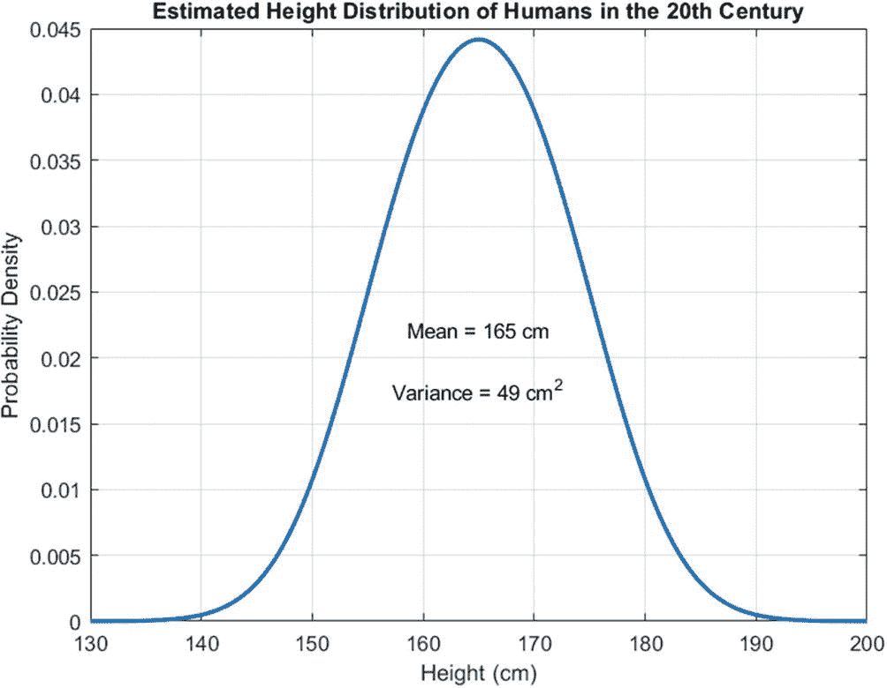
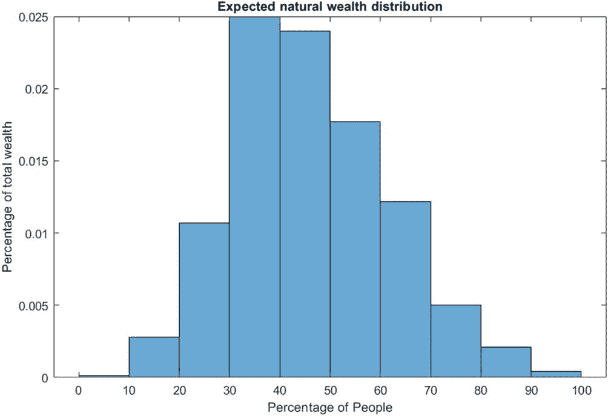
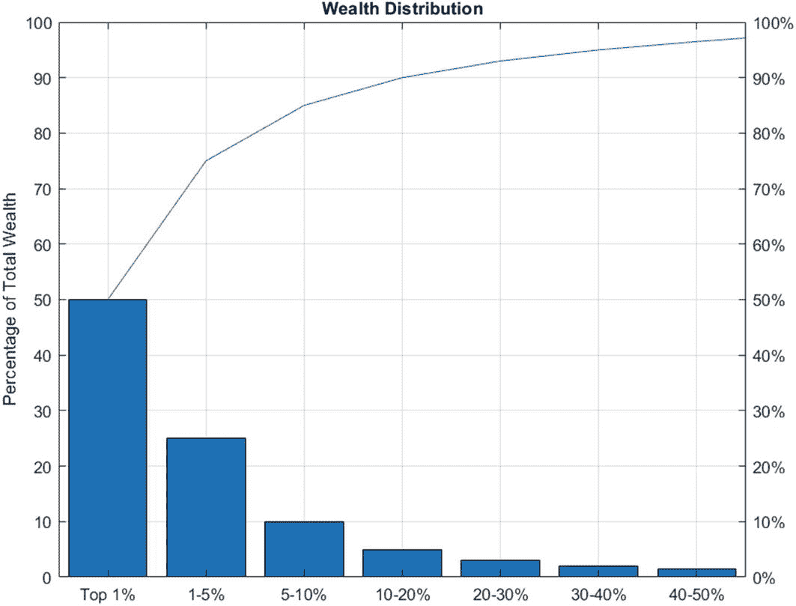

# 8. 智慧人类

## 超越与展望

在探索理解智能的征程中，我们从地球生命的起源出发，审视了历史如何引领我们走到今天。我们甚至探讨了随着机器智能向类人 `SuperAI` 演进，潜伏在地平线上的变化，以及如何做好准备、应对挑战，走向更美好的明天。在本章中，我们将超越明天的地平线，望向更远方——未来数百年乃至数千年的景象。

多数时候，我们固然必须活在当下，解决眼前的问题，但仅凭这种短视可能并不足够。作为地球上最聪明的物种，我们还需要看得更远，为明天、后天以及更远的未来做好规划和准备。确保我们走上繁荣而非灭绝的长期道路，这并非一厢情愿，而是我们的必要之举。预测近期未来并保持与现实一致总是相对容易，但要评估更遥远的未来则通常异常困难，以至于几乎沦为纯粹的虚构。每一年都建立在前一年的基础之上，随着每年的变化不断累积，时间走得越远，预测就变得越不可靠、越不确定。诚然，当我们向未来推进得越远，我们所依据的假设就越多，很快这一切就可能感觉像是与现实脱节的凭空想象。尽管如此，我们仍将诚实地尝试一番。评估和判断更长期的未来涉及多个方面。日常生活的某些方面，在数千年后很难预测，就如同中世纪鼎盛时期（公元 1000 年至 1250 年）的人们无法预测我们二十一世纪的日常生活一样。然而，那个时代的人们仍能在人性的基本原则方面与我们产生共鸣，例如以食物和住所为形式的生存基本需求、肉欲与繁衍能力、从生到死的生命周期、追求幸福与安宁的动机、与他人社交、探索新机遇与娱乐等等。我们将基于这些根本支柱展开讨论，以评估和探索超越当下、远在前方的事物。

在深入探讨之前，让我们花点时间来敬畏进化的宏伟壮丽——人类正是其中闪耀的杰作。作为这份遗产的守护者，我们肩负着庄严的责任，确保这部壮丽的史诗不会过早落幕。

## 人类 DNA

尽管世界各地不同种族、不同地区的人们呈现出千差万别，但地球上的所有人类共享着同样的 DNA，其最大差异仅有微不足道的 0.1%，即千分之一的差异。具体来说，在我们的 DNA 所包含的 30 亿个核苷酸中，预计只有大约 300 万个核苷酸存在差异。简而言之，所有人类都极其相似。那么，创造圣雄甘地、特蕾莎修女、马丁·路德·金或纳尔逊·曼德拉的基因，与创造某些世界上最恶劣的罪犯和恐怖分子的基因几乎是相同的！那么，我们又如何解释他们行为上的鲜明反差呢？唯一合理的解释是，他们成长环境的极端差异、童年早期经历的不同，以及从出生起就受到周围人影响而产生的互动，才是罪魁祸首。所有人类婴儿出生时都如同一张白纸，一张由几乎相同的遗传物质构成的朴素画布，随时准备适应任何抛向它们的事物。那么，为什么有些画布上绘出了美丽的图画，而有些则上演了恐怖的篇章？所有这些婴儿所面对的环境为何会发生如此剧烈的变化？这并非在几年、几十年甚至几个世纪内发生的突变。这是数千年来逐渐酝酿的结果！

### 双刃剑

我们将互联网的到来称为信息革命，但真正意义上的第一次信息革命远比这要早得多。那是数千年前发明的终极工具，它让我们得以超越地球上所有其他物种；它保存并承载着偶然或通过其他方式获得的、跨越数百代人的每一点知识；它赋能每一代新人，帮助他们避免重蹈前人的覆辙，并迈向更高的高度。我们几乎没有意识到，正是这同一件工具，也负责承载着前代所有的恐怖、欺骗、暴行和淫秽，并让每一代新人背负着越来越多的愤怒、沮丧和复仇的理由。它将数千年的污秽注入他们的血脉，引导他们犯下骇人听闻的暴行！那就是书写技能的发现！！在文字发明之前，人类数千年来与其他灵长类动物并无太大区别，在智力优越性方面也几乎没有表现出什么进步。

与人类行为形成对比的是，我们不会看到一个黑猩猩群体计划攻击邻近群体，为其祖先几百年前的行为复仇；我们只可能看到它们在今天食物短缺，而其他群体的区域有更丰富的食物资源时，才会攻击邻近群体。我们不会看到几只鹦鹉兄弟攻击另一只鹦鹉，因为它们的曾祖父在 50 年前曾卷入一场求偶竞争。对于所有其他物种，所有诸如打斗、冲突、分歧甚至杀戮之类的恶行，都会在极短的时间内被遗忘；最多持续到当前这一代结束。每一代新生命几乎都能从零开始，无需背负前代过多的包袱。

有了文字，我们可以记录信息，在人类大群体中分享，并且信息在记录者死后依然留存。信息本质上变得永恒了。这个看似简单的创造将我们与其他所有物种区分开来，造就了今天的我们！没有其他物种能够记录并将信息代代相传，除了通过基因传递的那些。世界上潜伏的大多数邪恶，确实源于数代前发生且未受惩罚的不公。恐怖分子的诞生，正是由于这些过去未被减轻的恐怖不断地被重申，它们回来纠缠着后代。在道德的岸边浮现出问题：因为祖先的过错而惩罚后代，这公正或合适吗？通过对后代施加类似的恐怖，能纠正一代人所犯的错误或罪行吗？从暴行中走出来，成长并繁荣，难道不是一种最好的复仇吗？向世人展示前代所遭受的罪行并未拖慢后代的脚步，反而让他们更加专注，使他们比以往任何时候都更强大、更繁荣，难道不是最合适的了结吗？

文字还有另一个非常关键的缺陷：它所传达的信息并不包含完整的背景。这些信息几乎总是带有偏见、片面，并且在大多数情况下是不完整的。信息将作者的思想和主观观点与真实事件和轶事交织在一起，编织出一幅看似历史却难以捉摸的图景。此外，阅读信息的人会在解读信息时混合自己的观点和倾向，使其进入另一个层次的抽象。我们经常看到信息在多人传递游戏中是如何被扭曲的，最终揭示出最后一个玩家所感知的版本；再加上数百年的时间跨度，以及来自不同地区、语言细微差别发生变化的人们参与其中，然后想象一下信息会被扭曲成什么样子。从这些信息中学习，以提高我们当下的技能，让我们的生活更美好、更安全，这是一回事；但当我们利用这些信息，以某种方式将自己代入其中的角色，并想着利用这些被扭曲的信息，在几十年或几百年后寻求复仇时，那完全是另一回事了。换句话说，书面信息无法传达完整的背景，而不完整的背景跟没有背景一样糟糕。因此，对待书面信息应有的精神是，只将其中信息用于改善今天和明天，而不是其他目的。

要真正解决核心问题，我们需要让这把双刃剑的一侧变钝，同时让另一侧一如既往地锋利；或者换句话说，我们需要在保留所有美好、发明和创造的同时，忘却过去的恐怖。这不是一项容易的工作，相反，如果我们立志要解决它，这可能是我们面临过的最艰难的任务之一。所有古老和历史性的恐怖都与当代的社会建制相关联，而我们一直在经历着它的渐进式演变，从而使其背景得以延续。令人惊叹的是，过去所有好的部分，比如所有的创新和创造，都是自足且脱离背景的；只有过去的恐怖才需要背景，而且是破碎的背景。这里的背景概念指的是社会、政治和宗教环境。即使我们能找到数百个不同的例子，过去大多数暴行的主要根源可归因于：（1）扩张领土以增加财富、权力或控制的意图；（2）传播意识形态、宗教或生活方式；或（3）报复因前述因素之一而发生的过去暴行。

在解决我们社会结构这一错综复杂的织锦时，重新构想我们框架的基础或许会有所裨益。想象一位艺术家，凝视着一块崭新的画布，准备创作一幅杰作。这个新的范式，受不可改变的自然法则约束，以我们共同人性的本质为基础，可以为我们未来的社会提供一个充满希望的前景。当我们为这座重建的大厦铺设砖石时，我们就开始了愈合的过程，远离过去岁月的阴影。虽然我们这一代人的集体记忆可能带着历史的印记，但未来的几代人可能会将它们视为古老的民间传说，是与他们的现实脱节的故事。可以把它想象成清理我们历史阁楼中的杂物，为新的故事腾出空间，同时装备着我们时代最先进的工具和知识。这些来自过去的教训，虽然宝贵，但可以取其精神而非拘泥于具体的轶事，就像来自遥远星系的传说一样。正如探险家梦想在异星土地上重新开始一样，我们可以用自身人类 DNA 的惊人力量，以及数十万年的学习成果，武装自己，就在地球上重新定义和复兴我们自己的文明。这样一场变革性的旅程不会凭空发生；它需要一个有原则的路线图。我希望在接下来的章节中，为这个新时代的迁移提供一个全面的蓝图。

### 正态分布

1777 年，在德国的一个小镇上，诞生了一个有朝一日将改变科学和数学世界的孩子。他的名字叫卡尔·弗里德里希·高斯，被认为是古往今来最杰出的数学家和科学家之一。高斯是个神童。他能在脑中完成复杂的数学问题，并且在很小的时候就能够在天文学家发现彗星之前预测出它的轨道。成年后，高斯在数学、物理学和天文学等多个领域做出了开创性的贡献。然而，高斯最广泛使用但相对仍被低估的发现之一，是一种概率分布，即正态分布或高斯分布。该分布遵循一条钟形曲线，如图 8-1 所示。它经常被用来描述许多现象的分布，例如任何人群的身高分布、股票价格的涨跌分布、新生婴儿的体重、多次抛硬币的结果等等。简而言之，高斯分布具有一些非常优美的性质。首先，它是一个对称分布，对称轴和曲线的中点都在峰值处。峰值位于分布的中心意味着具有平均值的样本数量，相对高于那些远离平均值的样本数量。而且，当我们远离中心时，两侧的样本数量都会减少。整个分布仅由两个参数定义：均值（`μ`）和方差（`σ²`）（或标准差（`σ`），即方差的平方根）。均值是分布中心的值，方差定义了当我们从中心向任一方向移动时，数值下降的速率。换句话说，它提供了关于分布反差的信息。如果方差值为 0，那么我们会得到一个平坦或均匀的分布，所有样本都具有相同的值。随着方差值的增加，分布会变得更加陡峭，两侧急剧下降。

一个折线图，标题为高斯曲线，显示了概率密度与 `x` 的关系。它绘制了一条钟形曲线，x 轴从负 5 到 5，其中 `mu = 0` 且 `sigma square = 1`。

**图 8-1** 高斯分布

当存在数百种其他可能的分布时，为什么这个分布如此特殊？这个问题的答案在于另一位不太知名的数学家亚伯拉罕·棣莫弗的发现，该发现后来由皮埃尔-西蒙·拉普拉斯进一步完善。这个发现被称为“中心极限定理”。为了理解这个概念，我们需要深入一点数学，但请耐心听我解释，我们很快就会回到对一般概念的描述上。

中心极限定理为“分布的分布”提供了一个数学框架。用专业术语来说，它指出：如果你取任意一个分布（不一定是高斯分布，如指数分布、泊松分布、伽马分布等），然后取该分布的平均值（也称为均值），并观察这个平均值在多个分布中的分布情况，那么当分布的数量趋近于一个非常大的数时，最终的分布总是一个高斯分布。这意味着，无论你观察的是何种类型的过程，只要样本量足够大，该过程的参数都将遵循钟形曲线。这一定理对统计和概率分析产生了深远的影响，并使高斯分布成为事实上的标准工具。那么，为什么在一本关于人类进化和人工智能的书中，我们要探讨高斯曲线和中心极限定理呢？我们现在就来谈谈这个问题。

现在让我们忽略所有理论陈述和抽象的数学，来看一些现实生活中的例子。如果我们收集了一大组数据，其中包含人类所展现的不同特征的定量测量值，例如他们的身高、体重、手的大小、手指长度，甚至智商等等。考虑一个示例图，如图 8-2 所示，它展示了地球上所有人类身高的分布。X 轴或水平轴表示身高，Y 轴或垂直轴表示具有该身高的人数。如果我们为所有其他特征绘制类似的图形，最终都会得到相同的钟形曲线，只是均值和方差的数值不同。如果我们将类别扩展到其他生物过程，例如血压、酶活性、衰老，或者不涉及人类的物种特征，例如动物体长、树木的叶子大小、微生物生长速率、种子萌发时间等等，并绘制它们的分布，我们总会得到高斯钟形分布。这并非巧合，也不是大自然展现的某种怪癖，我们可以用数学方法通过中心极限定理证明，只要这些特征不是被刻意控制的，它们就必然会以这种方式分布。看到数学与大自然如此亲密和谐地共舞，真是一件令人着迷的事情。

一个折线图，标题为二十世纪人类身高估计分布，显示了概率密度与身高（单位：厘米）的关系。它绘制了一条钟形曲线，x 轴从 130 到 200，其中均值 = 165 厘米，方差 = 49 平方厘米。

**图 8-2** 该分布基于世界卫生组织（WHO）及其他研究收集的结果

当我们从这些自然产生的事物转向人造事物时，情况发生了显著的变化。人类创造的基本特征之一，也是现代资本主义世界的核心，是个人拥有的财富量。人们可能会认为，既然其他所有物理和抽象的人类特征（如智商、身高、体重、体力）都遵循高斯分布，财富也会按高斯分布。一小部分财富会属于最富的人和最穷的人，而中产阶级则拥有大部分的财富。这里需要注意的一点是，当我们谈论财富的百分比时，人的数量是与累积财富相乘的，因此，在图表中会产生偏向富人的趋势，因为即使富人和穷人的数量相等，富人群体也会乘以一个更大的数值。图 8-3 显示了这种分布，略微向左（即富人方向）偏斜。

一个直方图，标题为预期自然财富分布，显示了总财富百分比与人口百分比的关系。x 轴上 30 到 40 之间的值占比最高，而 0 到 10 之间的值占比最低。

**图 8-3** 基于潜在正态分布的预期财富分布

然而，这是一个重大的“然而”：人类所拥有的财富并不遵循高斯分布！不是略有偏差，甚至毫不接近！在世界各地，尽管存在种族、宗教、地理位置、技术进步等方面的差异，但这一观察结果无一例外。财富最常遵循的分布被称为帕累托分布，如图 8-4 所示（该图仅显示前 50%的数据，但正如你所见，剩下的一半人口总共拥有的财富不到 4%，以至于代表他们财富的柱状图甚至无法可见）。这种分布的核心在于，大部分财富集中在极少数人手中，而剩下的大多数人总共只拥有极小比例的财富，中产阶级则恰好处于中间位置。当然，每个社会对该分布都会有些许变异，但无论如何，其形状在原则上非常相似。

一幅帕累托图，标题为“财富分布”，展示了总财富百分比与前 1%到 50%人群的关系。图中绘制了一条呈上升趋势的线，以及按递减顺序排列的柱状图。前 1%人群的百分比最高，而 40%到 50%人群的百分比最低。

**图 8-4** 任何社会中的财富分布。图表在 50%处结束，因为剩下的一半人口所拥有的财富不到 4%，其柱状图将无法可见。

世界上任何大国家的人口，无论从哪个角度看，无疑都是一个庞大的数字，因此中心极限定理应该同样适用，就像它适用于我们之前看到的所有其他特征一样，并且我们应该得到正态分布。但事实并非如此！这里甚至没有一点高斯分布的影子。这难道不是一个异常现象吗？这难道不自然吗？这难道不是完全错误，乃至我们整个经济体系的巨大失败吗？当所有驱动地球生命形式进化、最终创造人类的生物过程都遵循着一条基本规则——一条自然法则时，人类却成功地打破了它。这个例子恰恰展示了人类的又一项非凡成就。但这是为了人类的福祉吗？打破这条规则是“好”事吗？答案将会是非常强烈的“不”！！任何心智正常的理性人士都无法争辩说，让一个人流落街头、没有食物和住所，而仅仅几百米之外另一个人却住在价值数百万美元的豪宅里、浪费掉满满一盘子食物是“公平”的。或许，前者可能在一生中犯过一些错误，而后者则做了许多了不起的事情；但这些差异足以证明这种极端对比是合理的吗？更有趣的问题是，这些错误和善行是否是他们当前处境差异的唯一原因，还是我们社会的人为规则也起了作用？从整体层面来看，人类行为仍然会遵循高斯分布，因此，观察到的财富分配极端差异必定归因于社会和文明的人为规则，这使得它们相当不自然、不公平或不公正。

## 货币的起源

毋庸置疑，人类文明的现状相比几千年前已经有了巨大的进步。从最初由狩猎采集者组成的小型社区开始——他们为了资源和领土不断相互争斗——我们无疑已经走过了漫长的道路。在狩猎采集阶段，人类的主要目标是满足生存的基本需求，如食物、水和住所。社区不断地寻找这些生活必需品。由于他们没有有效的方法来为这些必需品未雨绸缪，只要生命存续，这种挣扎就一直在持续。尽管如此，改善狩猎和采集技术以及保存收集到的物资的努力从未停止，并且随着时间的推移，这些努力以我们之前章节讨论过的众多发明的形式取得了成果。农业出现了，从而提供了更稳定的食物供应。改进的建筑和工程技术提供了更可持续的住所，以及从河流和湖泊经更长距离输送的稳定水源。凭借这些发明，我们基本上走出了狩猎采集阶段。我们得以在更大的区域扩展我们的文明，并以或多或少自动化的方式提供所有基本需求。然而，数千年的执着已经刻入了人类的 DNA，不容易摆脱。即使在实现了对基本必需品的控制之后，对更多的渴望并未消亡。它非但没有平息，反而以对更多事物贪得无厌的贪婪形式找到了新的机会。随着可持续基本资源的存在，新型文明出现了。最有权势的精英建立了基于君主制的文明，并控制了管理日益庞大的人类群体的权力。随着文明更加稳固，狩猎采集时代的物物交换系统演变成了基于货币的交换系统。随着货币的出现，财富的概念也随之产生。现在，人类不再狩猎和采集食物与水，而是狩猎和采集财富。然而，狩猎和采集的心态在失去了其原始需求和背景的情况下依然存在。那种对明天的挥之不去的恐惧，尽管不切实际，却不断推动着狩猎和采集的边界。对更多的贪婪不断增长，仿佛是在为史前人类古老的失败复仇。经过从规模各异的王国到现代世界大战之间数千场战斗和战争，对更多的贪婪依然持续。然而，自第二次世界大战以及它以核弹带来的莫名毁灭性灾难而戏剧性地结束以来，人类似乎稍微有所警醒。截至本书撰写之时，距离第二次世界大战开始已近 80 年。人类距离和平相处仍然相当遥远，但情况比上个世纪要好得多。

我们从过去的错误中学到了很多，但至今仍保留着一些从狩猎采集时代传承下来的基本目标，这些目标驱动着我们日常的决策。为了看清这一点，让我们回到一切开始的时代。狩猎是为了获取食物、水和住所。采集则主要是为了储备这些必需品，以便在狩猎不成功时使用。然而，在那个时代的大部分时间里，技术还不够成熟，大多数物品都是易腐烂的，因此采集的保质期很短。当不同的人甚至群体之间这些物品出现不平衡时，以物易物的制度很常见，双方通过交换商品来满足各自的需求。这些交易的公平性总是难以判断，但这种制度在数千年里运作得非常有效。

快进到文明开始扎根的时代，货币或广义的财富概念诞生了。它的目的是在复杂的交易环境中形成一个标准参照。然而，由于可以用钱买到任何东西，而且钱越多能买到的东西也越多，因此从狩猎和采集的角度来看，钱成了唯一的焦点。此外，在古代，货币通常由金属制成，寿命非常长，这意味着它完全不会腐烂。因此，我们发明了一个了不起的工具，作为我们永不满足的狩猎和采集需求的最终体现。以前，由于商品的易腐烂性，采集超过一定限度是没有意义的。但是，有了由金属制成的永恒货币，我们希望积累足够多的财富，以满足一生甚至子孙后代的需求。这基本上解除了我们狩猎和采集欲望上的所有限制。积累更多的钱不仅能让你获得购买更多商品的能力，还能让你获得控制他人的权力，因为别人为了换取金钱愿意为你做事。于是，货币不再仅仅是交易的参考单位，也成了一种控制他人的武器。它也成为盗窃的唯一目标。偷钱比偷商品更好，因为商品会腐烂，而钱是永恒的。有了钱，你可以随时随心所欲地购买任何东西。

那么问题就来了：货币可以有多少？在早期，货币与稀有金属（如金、银）或宝石紧密挂钩。由于任何王国或国家的这些"商品"数量有限，货币的总量也就有限。后来，当携带金属硬币变得过于困难时，纸币被发明出来；但它仍然由银或金作为支撑，纸币只是由该王国或国家批准使用的一种凭证形式。这种货币被称为商品支撑货币。这种货币的定义显然没有将人们能提供的服务和其他自然资源、能采集的物品、或能制造的工具及其他人工制品纳入默认价值，从而限制了文明所能积累的财富规模。随着时间的推移，随着现代文明开始扎根，商品支撑货币的局限性变得明显，这一概念进一步演变成了我们今天使用的形式。它被称为法定货币。

尽管法定货币使用的最早记录可以追溯到 11 世纪的中国，但现代世界首次使用它是在 17 世纪，当时阿姆斯特丹银行发行了不由黄金或白银支撑的纸币。如果货币不由黄金、白银或任何其他商品支撑，那么显而易见的问题就是：谁来决定货币的总量？为了回答这个问题，让我们看看"fiat"这个词的含义。它是一个拉丁词，意思是"让它被完成"。这里严格遵循了这个含义。当一个国家创造了一定数量的货币时，它就被该国的管理机构宣布为法定货币。法定货币的价值基于人们对发行它的政府的信任。

首先，法定货币解除了货币必须依赖于固定商品可用性的限制，理论上这种货币可以无限供应。然而，这种灵活性带来了多种风险，例如货币价值的波动性，这取决于政府的稳定性、人民对政府的信任度，甚至国际贸易形势。通常，人们期望政府能以最佳方式处理货币，但有很多例子表明，一个国家的货币在短短几个月甚至几周内完全崩溃，使得人们一生积累的财富在短时间内几乎一文不值。

通常，任何稳定政府创造的法定货币数量取决于五个因素：（1）经济增长：当经济增长时，需要更多的货币，这是政府或央行印刷更多货币的充分理由。（2）通货膨胀：通货膨胀被定义为物价普遍上涨，从而导致货币购买力下降。通货膨胀本身是一个波动且相当难以预测的实体。然而，当通货膨胀高涨时，政府可能会创造更多法定货币以试图刺激经济。（3）政府支出：政府可能仅仅为了资助其自身的支出（例如社会项目或基础设施项目）而决定创造更多法定货币。（4）金融或政治危机：这些是波动性情况的额外例子，可能与通货膨胀大不相同。在这种情形下，政府同样可以创造更多法定货币，以期稳定经济。然而，创造额外货币来修复糟糕的经济状况，本身也可能成为使情况恶化的根本原因，从而形成一个恶性循环。

### 商品本位货币的隐性问题

任何商品本位货币的另一个隐性问题在于，总体财富受限于某种固定商品的可得性。在这种有限的财富之下，所有公民都会自动陷入零和博弈。零和博弈是指整个系统中总收益与总损失相加为零的状态。在这样的系统里，一个人或实体的收益成为另一个人或实体的损失，从而将所有个体置于彼此对立的位置。原则上，这培育了一种竞争环境，使得双赢局面变得不可能。这不仅造成了固有的敌意，还为社区所能创造的总财富量施加了不自然的限制。任何对自然资源的新创造或发现，实际上并不会增加社会所衡量的财富。

想象两个拥有等量黄金的王国，但其中一个文明的人们极其勤劳，生产着高品质的食物、工具和住所，而另一个文明的人们只是虚度光阴。这两个文明应该有同等的财富吗？一个商品本位系统会回答："是的"！即使这对我们来说显然是不合理的，我们却生活在非常类似的环境中。法定货币试图通过允许按需创造额外财富来解决这个问题。然而，这些财富的创造由单一实体管理，因此更多货币/财富的创造与社会的创新成果并无直接关联，而且在大多数情况下，这种财富的增发只会稀释货币价值，实际上使得总体财富保持不变。

我们不知不觉地把自己束缚在了闪亮硬币的黄金枷锁之中。通过创造货币，我们并未真正提升人类所能实现的潜力，反而将其限制在了一个微不足道的有限总和上。货币的创造剥夺了本应由自然和我们自身能力赋予的无限财富。

## 股票市场与进一步的抽象化

在法定货币带来的复杂性之上，金融行业又通过股票市场或证券的形式，看到了另一层抽象维度。股票本质上是一家公司的一小部分。一家公司可以拥有成千上万的此类股票。人们可以在一个名为股票市场的市场上买卖这些股票。任何在股票市场上市交易的股票的公司都称为上市公司，它现在由所有持有其股票的人共同拥有。这是为公司运营筹集资金的一种方式。股票市场的起源以及股票的整体概念备受争议，但一些早期的例子包括十七世纪初荷兰和英国东印度公司的创立。

股票的概念本质上是在法定货币之上创建了一层处理公司单位或部分的抽象层。现在，我们讨论的不再是由政府发行的货币，而是对一家公司的估值。因此，根据公司在市场上的表现，其估值或股价可能会以基础货币计价波动，而基础货币本身也如我们之前所见是波动的。

尽管东印度公司开创了股票的概念，但现代股票市场直到十九世纪工业革命启动全球经济增长时才建立。美国的第一批证券交易所成立于十九世纪初，特别是纽约证券交易所（NYSE）成立于 1817 年。很快，管理金钱就成为了管理股票市场投资的同义词。

如前所述，人类狩猎和采集的永不满足的贪婪，在股票市场中得到了更为迅猛的滋养。积累起金钱后，如果把钱存在银行，其增长相当有限；但如果你投资股票，就有机会在不实际付出任何劳动的情况下，以更快的速度增加你的财富。公司及其员工在完成所有工作，而如果你能设法识别出一家在近期或长期内会比竞争对手表现更好的公司，你便投资其股票，它就会随着该公司的增长而增长。

然而，要理解市场并系统地预测哪家公司表现更好，需要进行广泛的研究，这本身可能花费大量资金。没有这样的研究，人们只能碰运气，或根据可获取的部分信息做出稍显明智的猜测。但与那些在市场研究上投入更多精力的机构相比，基于纯粹运气或片面信息的猜测长期来看总是会输，这无需任何复杂公式来证明。因此，只有富人才能更好地理解股票市场，从而变得更加富有。

为了使系统更为复杂，还有共同基金和期权链等概念。共同基金由不同比例的多个公司的股票组成。人们现在可以购买一只共同基金的股票，实质上就是用一定比例购买了数百家公司的零碎股票。期权则是在个股之上的又一抽象层次。随着股票市场的发展演变，经济的公平性再次遭受了巨大打击。这并不令人意外，因为股票概念的起源本身也植根于主要为精英服务的东印度公司的基础之上。

21 世纪初，一种新型货币开始流行，被称为加密货币。加密货币是一种使用密码学^(²²)确保安全的数字或虚拟货币。加密货币的一个决定性特征（可以说也是其最吸引人的特征）是它的去中心化本质。它不由任何中央机构或政府发行，理论上不受政治干预或操纵。这同时也可能成为其弱点，因为唯一能决定该货币某些基本参数的实体，是创建该货币的个人或群体。通常，这些个人不如任何国家政府值得信赖。然而，如果有大量的人开始支持这种货币，信任就会增长。作为一种纯数字和分布式的货币，它原则上也不局限于某个特定国家或国家集团。但是，个别国家可能会限制其使用。加密货币使用去中心化控制，而非中心化货币和中央银行系统。每种加密货币的去中心化控制通过区块链运作，区块链是一个公共交易数据库，充当分布式账本。这一概念使货币极其透明，所有使用该货币的人都可以获得所有交易记录，从而极难进行欺诈或伪造。第一种加密货币——比特币，于 2009 年由化名为中本聪（疑似在日本）的匿名个人或团体创建。比特币被设计为一种点对点的电子现金系统，意味着它可以用于在没有第三方（如银行）的情况下发送和接收付款。加密货币的价值基于多种因素，包括：(1)**稀缺性**：大多数加密货币的供应量有限，这意味着它们是稀缺的。这种稀缺性可以推高加密货币的价格。(2)**需求**：对加密货币的需求也是其估值的因素。如果对某种加密货币的需求很大，价格就会上涨。(3)**实用性**：加密货币的实用性也是其估值的因素。如果某种加密货币有用，并且人们开始用它来购买和销售商品及服务，那么更多人会使用它，从而推高价格。

加密货币的创造是通过一个称为挖矿的过程完成的。挖矿是解决复杂数学问题以验证交易并将新区块添加到区块链的过程。矿工因其工作而获得加密货币奖励。加密货币的交易是通过一个称为交易的过程完成的。交易是指在交易所买卖加密货币。交易所是人们可以买卖加密货币的网站或平台。加密货币也伴随着其自身的风险，包括：(1)**波动性**：加密货币的价格波动很大，这意味着它可能剧烈波动。这可能使得投资加密货币具有风险。没有监管机构能在价值过快变化时停止交易，这与法定货币和股票市场的监管方式不同。此外，加密货币可以全天候交易，而银行或股票市场在特定时间关闭。(2)**安全性**：加密货币是一种相对较新的技术，仍存在相关的安全风险。例如，如果你的加密货币钱包被黑客攻击，你可能会失去所有的加密货币。(3)**监管**：加密货币的监管仍在发展之中。这意味着未来如何监管加密货币存在一些不确定性。

原则上，加密货币试图解决各国使用的常规“法定”货币中的一些根本性缺陷，但它也有自身的缺点。最重要的一个问题是创造更多货币的基础。它基于机器执行的工作这一事实使其相当随意。加密货币的另一个局限性在于，其可被挖出的硬币最大数量被限制在某个任意数字（就比特币而言，是 2100 万^(²³)）。这个限制被硬编码在其协议中，无法更改。这使得货币稀缺且有价值，但同时也给最大允许财富增加了一个任意的上限。许多其他项目效仿了这一概念来创建自己的加密货币，但大多数流行的加密货币确实都有类似的最大货币供应上限。这两个缺点限制了加密货币的范围，并且它很可能永远不会取代由政府发行的法定货币。

21 世纪第二个十年左右，另一种新的财富所有权概念出现了，被称为 NFT 或非同质化代币。这些也是完全数字化的资产，使用与加密货币类似的区块链技术，但在此用于记录所有权。所有权可以是任何东西，从数字艺术品到房地产。NFT 是全球唯一的，永远无法被替换或复制。这使得它们从收藏家的角度来看非常有吸引力。它们确实代表财富，但没有系统的创造和估值机制。因此，它与其他货币并列，保持其独特地位。

### 排版后内容

总体而言，为了解决商品本位货币的弊端，我们创造了一个极其不稳定、且更关键的——极其复杂的金融怪兽。为了维持这种货币体系的稳定与平衡，需要全国乃至全球成千上万的人以及众多组织持续监控其状态。这催生了银行及类似金融机构的诞生。接着，我们将其扩展为一个跨国、多货币的复杂生态系统。为了应对货币价值的波动，人们必须不断进行投资，以使货币价值跟上不断变化的估值。这些复杂性催生了一整套全新的职业领域，例如替他人管理资金的**资金管理人**、指导人们理财的**财务顾问**、分析市场波动的**金融分析师**、利用数学和统计技术制定保险费的专精数学家——**精算师**，此类职业不胜枚举。货币作为交易参考单位的原始概念被如此抽象化，以至于它本身变成了一种独立的事物。我们目前就生活在这样一个抽象且矛盾的境况中：一方面，我们懂得拥有更多金钱的好处；而当未能达成目标时，又往往告诉自己金钱并非万能，它只是购买我们真正所需物品的*工具*。人们会以为，拥有如此先进、精密而复杂的财富管理系统，应该能让它变得真正公平正义，并且对大多数人而言几乎是自动化的。然而，结果似乎恰恰相反。这个领域中有许多薪酬极高的职位，在满足人们基本需求方面却毫无意义。相反，绝大多数直接负责满足基本需求的工作，却是收入最低的。所有好处都被那些由日益复杂化的系统所催生的表面性工作吸走了。多年来，系统非但没有变得更好或更公平，其日益增长的复杂性，反而只帮助了那些参与使其变得更复杂的人，并由此形成了一个自我吞噬的恶性循环。

举一个具体的例子，根据皮尤研究中心的报告，2021 年，收入最高的 1%的人口掌握了整个国家 32.3%的财富，而 2020 年这一数字为 30.8%。这一趋势已持续数十年，并在近年来加速发展。造成这种极端对比的主要原因，是由于包括股票市场在内的过于复杂的金融体系，为富人提供了不公平的优势。此外，这些积累的财富会代代相传，使得穷人毫无追赶的机会。近年来，工会的力量也有所削弱，降低了对工资的控制力。这些发现并非秘密，政府试图通过更新税收结构以惩罚富人、提高最低工资等措施来解决这个问题。但税收结构本身也相当复杂，富人们普遍能找到漏洞，使得加税政策形同虚设。而提高后的最低工资也通常处于极低水平，仅能让工人勉强生存。这些措施都极为表面，并未真正触及我们资本主义经济体系的核心问题。任何体系能走多远总有个限度。一旦越过临界点，迎接它的将是社会动荡和内战。我们很快就要面临对体系进行根本性变革的时刻，而我相信**人工智能**能提供帮助。

## 文明的崛起

伴随着经济原则，文明的崛起也催生了社会政治原则和意识形态。在过去的几千年里，我们在这方面也取得了显著的进步。我们从简单的狩猎采集群落开始，当时没有明确的角色分工或结构化的组织。随着农耕和定居点的建立，群落开始采用更协调的行动方式，很快，一种原始的社会意识形态——**酋邦**诞生了。酋邦是最原始的社会政治系统之一，由一位酋长统治整个群落。酋长通常由人民选出，有权为群落做出决策，并执行群落的规则或法律。随着群落的发展，酋邦演变成了王国和帝国。在一个王国或帝国中，会有一位最高领袖，也称为国王或皇帝，类似于酋邦中的酋长，但拥有更大的权力和更大的统治群落。通常，国王或皇帝会与一群精选的精英一起统治整个王国或帝国的人民，而领导权通常通过朴素的血统世袭方式代代相传。这种体系也称为**君主制**，按现代定义并不真正被视为一种社会政治意识形态，但它是通向更精细、更周全的社会政治体系的垫脚石。通常认为，这类体系在欧洲一直存在到大约九世纪，与罗马帝国的衰落同时期。然而，类似体系在世界各地的小范围内又延续了许多个世纪。例如，印度在十八世纪英国入侵将整个印度次大陆统一在同一领导之下前，仍有许多小王国；而中国直到二十世纪还有历史上的清朝君主制。大约在王国衰落的同时，欧洲出现了称为**封建制度**的体系，一直持续到约十五世纪，为资本主义等更现代的社会政治意识形态铺平了道路。

每一个新体系，人们都试图纠正先前意识形态的问题和缺陷；在许多情况下，新体系确实解决了这些问题，却又产生了自身的新问题，或者所提供的解决方案未能经受住时间的考验。尽管如此，这些意识形态为组织社会、确定权力结构以及定义个人与社会之间的关系提供了框架。在人类历史中，我们看到过相当广泛的此类意识形态，但最终它们收敛为为数不多的几种。即便在当今的二十一世纪初，我们也至少能在不同国家看到几种不同意识形态的实际运作。

### 资本主义

一方面，通常被称为**右**派，我们拥有资本主义。资本主义本质上是一种以市场为基础的经济体制，它提倡私有制，并假设资源会根据市场供需平衡自动分配。尽管大多数现代资本主义体系确实始于对平等的宣告，但这种平等仅限于拥有平等的基本权利，例如自由和追求幸福等，但对于其他所有方面，则没有明确规定，而是留给系统自动管理。资本主义下的所有权延伸至开展业务运营所需的一切，例如土地、资本、其他自然资源和人力资源。自动分配的观念避免了需要任何管理机构来决定谁获得什么。在这种相当开放的设定下，任何个体的最终动机都归结为利润。这鼓励所有个体进行竞争，并激励他们做到最好。理论上，这应该会带来创新、效率和增长。仍然需要一个管理机构来防止对系统的滥用，但只需进行最低限度的监督。政府的角色仅限于强制执行所有个体的权利、确保贸易和合同的公平性，并通过提供法律框架来维护健康竞争。资本主义给予所有个体实质性的自由和广泛的选择，让他们能在法律体系的框架内追求自身利益、选择他们想要的职业，以及决定如何花费他们挣得的财富。这看起来几乎是一个完美的体系。然而，所有这些好处也伴随着一些弊端。资本主义最根本的弊端之一就是阶级的产生。需要记住的是，资本主义在其定义中并未在任何地方界定阶级，它反而侧重于平等。但是，正如我们在欧洲和美利坚合众国所有实践中所看到的，阶级结构是该体系不可避免的结果。总体而言，在早期阶段，资本主义展现出了强大的前景，其所有好处似乎都行之有效并结出硕果。在资本主义早期，财富分配并不那么极端，更倾向于我们之前讨论的自然分配，基本上，社会中的大多数人是快乐的。然而，即使有政府的调节，该体系也开始变得越来越不公平、不公正，并导致阶级之间反差加剧，从而形成帕累托式的财富分配。金钱开始集中于越来越小的群体，加剧了不平等，并且这种趋势强烈地指向一个方向，没有自然的逆转方式。最终，这可能导致社会动荡和内战。

### 共产主义

另一方面，通常被称为**左**派，我们拥有共产主义。俄罗斯和中国是遵循这一学说的主要国家典范，此外世界各地还有一些小规模的实践。当今的共产主义自 19 世纪中期由德国哲学家卡尔·马克思和弗里德里希·恩格斯首次提出以来，已经经过了两百多年的演变。虽然源于同一个源头，但正如我们在俄罗斯和中国所看到的，其具体实践存在一些差异。根据制度按时间顺序的演进来衡量，共产主义是最现代的体系，事实上，卡尔·马克思正是为了克服资本主义的弊端而专门提出了它。共产主义的主要驱动原则是创建一个无阶级的社会。马克思主义的共产主义特别将社会划分为两个阶级：资产阶级或生产资料所有者，以及无产阶级或工人阶级。根据马克思主义的共产主义，生产资料是集体所有的。财富和资源根据“各尽所能，按需分配”的原则进行分配。共产主义假设社会中的所有个体都是平等的，因此他们都应该被平等对待。没有等级制度或阶级存在的空间。它还强烈主张废除自然和人造商品的私有制，并提倡集体所有的理念。平等延伸到生活的方方面面，例如获取食物、住所、医疗保健和教育等资源的权利。甚至一个人能得到的机会也被强行要求平等，无论其社会或经济背景如何。为了实现这一点，它建议使用中央计划，即所有关于生产、分配和资源使用的关键决策都由集体制定。共产主义也提倡国家的概念。这里国家的概念相当微妙且复杂。它通常被称为无产阶级专政或整个工人阶级的专政。在这种语境下，国家是阶级统治的工具，被用来镇压资产阶级或资本家阶级，并捍卫工人阶级。国家的概念定义可能与其自身的平等原则相矛盾，但共产主义仅将国家用作一种过渡机制，用以压制现存的资本家阶级，直到整个社会转变为一个单一的工人阶级，即共产主义原则的最终实现。马克思主义共产主义有一个宏伟的期望：一旦过渡完成，国家应自动消亡。在那之前，国家对所有决策拥有完全权威，并由执政党控制。现实中，没有一个共产主义国家成功地实现了国家的消亡。相反，国家为执政党提供了一条在平等伪装下走向独裁的后门，赋予他们不受控制的权力。正如英国历史学家阿克顿勋爵的至理名言：“权力导致腐败，绝对的权力导致绝对的腐败”，国家从未能够放弃权力。尽管存在这些令人生畏的弊端，共产主义提出了一些真正新颖且超前的概念。其中之一就是真正的国际主义。共产党宣言以“全世界无产者，联合起来！”作为结束语。

还有许多其他意识形态，其原则介于这两个左和右的极端之间。所有这些意识形态的许多方面从表面价值来看似乎公平公正，但这些定义中缺失的关键部分是它们的实施方式以及治理这些制度所涉及的人。共产主义将平等推行到了极致。诚然，从 DNA 变异来看，所有新生儿在生物学上有 99.9%是相同的，但从那时起，每个婴儿都经历不同的环境和体验，因此当他们成年时，他们的大脑已经大不相同。此外，追求个体的独特性是人类生活区别于低等物种的关键方面之一。共产主义试图在社会中对一切进行均等分配，从一个人能吃多少食物、必须做多少工作和什么类型的工作，到一个人必须拥有多少财富。均等分配在理论上也是一种高斯分布，但方差为零。正如我们之前所见，人类天生就不是均等分布的，强迫他们在所有方面平等是不自然的。此外，渴望与众不同赋予了人类生活目标和动力。共产主义试图从根源上扼杀这一点。

### 知识人文主义

结合资本主义与共产主义，以及我们从各自实践中汲取的教训，再借助无处不在的`SuperAI`，我们已准备好迈向下一代社会政治体系。当我们以新纪元文明为目标展望数千年未来时，需要将想象的弓弦向后拉伸数千年，以确保我们的目标有足够的力量准确而权威地抵达终点。

资本主义引领我们走上创新之路，在过去数百年间，我们目睹了创新在全球范围内产生的惊人影响。但它也导致了社会阶层的分化，且随着时间推移，阶层间的鸿沟日益加深。资本主义还使我们更以自我为中心，而非以社群为中心。其背后的根本假设是：如果社会中的每个个体都成功了，那么社群必然成功。然而，成功的分配并非自然均匀（如钟形曲线），而是向上层阶级倾斜，且代代相传，差距不断扩大。因此，即便我们在创新和技术领域取得了巨大进步，从社会整体来看，局面却喜忧参半。我们今天所看到的问题，诸如对地下水资源、石油、天然气等自然资源的不可持续利用，甚至过度的渔业捕捞和狩猎行为，都已对环境造成了深远且在某些情况下不可逆转的影响，例如大气中二氧化碳水平升高、海洋生态系统岌岌可危，进而危及数百万人的生命。造成这一局面的唯一原因，就是为了少数行业和个体的利润增长，而对环境乃至人类自身遭受的负面影响完全漠视。在资本主义社会中，本该管控商业活动的法律体系和治理机构，在这方面彻底失职了。

共产主义试图通过将社会重新置于中心位置来解决这个问题，但在此过程中，它强制推行了不自然的绝对平等，并忽视了个体的成长与幸福。除此之外，"国家"这一本应促进从资本主义的阶层分化社会向统一的工人阶级社会过渡的实体，其概念仍然模糊不清，并为独裁统治留下了后门。

我们需要结合这两种制度的优点，构建一个新体系。该体系以全人类的成长与繁荣为核心，同时通过给予个体发展、成长和幸福以恰当的优先权，来保护个性、个体成长与幸福。以下是构建新纪元文明所依据的基本原则，我们将其称为"知识人文主义"。智慧与人性是这个体系的两大基石。这里所说的"智慧"，并非指个人智商这种肤浅的概念，而是指使人类得以优越的集体智慧，以及我们所创造的机器智能。我们将将其与铭刻在我们 DNA 中、将全球地球上所有人团结在一起的古老人文主义原则相结合，以创建一个最自然、经得起时间考验的社会政治体系。

以下是其基本原则：

1.  **人类至上**：基于知识人文主义的文明将主要植根于"人类至上"的哲学。地球上以及地球之外（如果届时人类已扩散至其他星球）的所有人类都将处于其核心位置。地球上人类苦难的根源众多，但最首要的因素是贫困、战争与冲突、疾病、歧视以及教育匮乏。我们将通过知识人文主义的基本原则，以及将在本节稍后解释的全球文明组织的具体细节，逐一解决这些问题。借助前一章详述的由人类管理的无处不在的`SuperAI`，所有人类都将享有作为其与生俱来权利的、有保障的基本必需品供应，这包括食物、水、住所及所需的基本药物。"人类至上"的哲学不止于此；所有顶层决策的做出，都将以"如何整体上造福人类"作为首要指导参数。这些决策包括：仅以负责任的方式使用自然资源，使其能够自然再生；以及与其他物种的互动，确保始终存在某种共生关系。

2.  **平等**：从出生起，所有人类婴儿都将被平等对待，他们在成长、教育、体育以及当时所有其他课程和课外活动中，都将获得相似水平的资源。在整个教育过程中，将密切关注他们的个性、内在偏好、自然倾向和个人目标。每年，他们将根据这些因素获得可选方向，以帮助他们获得最佳且令人满意的教育。教育的最终目标是培养他们成为全球知识人文主义社会的自豪公民，并以他们可能的最佳方式为其成功做出贡献。

3.  **透明**：在无处不在的`SuperAI`的监控下，人类和机器进行的所有操作都将完全透明。在私人时间及家中，隐私仍将受到尊重；但所有公共区域将由`SuperAI`进行持续监控，以确保一个持续守法、无犯罪的环境。工作中的透明将确保持续公平地对待劳动者并给予相应回报。

4.  **无限机遇**：从教育开始，所有公民将定期收到关于自身进展的更新以及对未来步骤的建议。然而，每个个体都有权选择自己想学习或从事的工作。在`SuperAI`的帮助下，每个个体都将获得一整套关于可用工作的全面选项。工作的可用性可分为三类：(1) 维持系统持续运行所必需的工作；(2) 文明中其他成员以娱乐、艺术等形式明确请求的工作；(3) 完全新颖、纯属个体想象（且被证明对文明有积极影响）的工作。根据每个人的能力和兴趣，会期望其完成一定的最低限度强制性工作。在`SuperAI`的帮助下，这个限度将非常之低。此后，每个个体都可以通过以自己的方式做出贡献，自由地帮助文明。

5. **阶级融合**：根据定义，知性人文主义中的所有个体，按照马克思主义的定义都是个体贡献者或劳动者，但同时，他们也是自己所从事工作的所有者。所有组织都将采用扁平化结构，没有明确的等级制度。年资将受到尊重，并体现在他们的报酬中，但劳动力的管理将完全由无处不在的`SuperAI`结合同伴反馈来处理。这样的体系将鼓励每个人真正专注于自己真正热爱的事情。任何人都可以在合理的时间间隔内，在指定的时间点更换自己的工作领域，以确保工作的连续性。创业或启动新项目将受到高度鼓励，所有此类请求都将定期接受评估。基于同行评审和感兴趣的追随者，一个新项目可以启动并成长。这样的体系将真正创造单一阶级的文化，对所有个体来说都应该是自然而然且令人解放的。

6. **分布式经济**：面对新的分布式信用体系，法定货币、商品支持货币甚至加密货币的概念都将不得不退出历史舞台。这一体系将借鉴这些系统的实施经验，但会加以改进。所有个体在出生时都会获得固定数量的信用点，并在整个童年和教育期间以固定速率定期补充。他们需要在教育期间，通过完成精心设计、适合其年龄的强制性任务（同样有可选择的选项）来回馈文明。一旦完成教育，他们将面临三个职业方向的选择，如前所述。奖励范围将经过精心设计以确保公平，同时与工作的努力程度和影响力相匹配。奖励将以信用点的形式发放，这些信用点与个体直接关联，并由`SuperAI`通过生物识别技术进行追踪，无需明确的银行业务操作。这些信用点可以像我们通常花钱购买商品或服务一样使用。信用点的处理与追踪将完全自动化，无需为此投入额外精力。这一经济体系的另一个重要方面是没有遗产继承。个体一生中赚取但未使用的所有信用点都将被系统回收。在知性人文主义中，每个人类婴儿来到世界时都将从零开始，像其他任何婴儿一样塑造自己的身份。这是经济体系的一个关键方面，对于以自然方式平衡财富分配至关重要。想象一个世界，所有人类都为了自身或他人的福祉而努力，并获得合理回报；仅仅通过做他们天生擅长的事情，而无需担心竞争。人口越多，创造的财富就越多，越多的人相互帮助，使文明更强大、更富裕、更快乐。这种新的财富概念将从根源上消除不健康的竞争，为真正的进步铺平道路。

凭借这些原则，我们可以开始描绘新时代文明的细致图景。我们首先要定义，按照当今的标准，全人类将代表一个单一国家。我们需要打破国界的限制，让全人类相互拥抱，无需经历护照、签证等障碍。我们仍然需要确保所有人类的行为都要对全球负责，这将通过无处不在的`SuperAI`对所有人类进行生物识别，以完全自动且非侵入性的方式实现。世界将是一个遍布全球、由自给自足的殖民地（`SSCs`）组成的巨大联合体。`SSCs`类似于当今美国、印度等大多数国家的州的概念。每个`SSC`在其所有居民的基本生活需求方面都将自给自足，但它仍然是全球文明体系中不可或缺的一环，一个不可替代的齿轮。`SSCs`之间通过跨`SSC`的商业运作相连，就如同各州之间的运作一样。

每个`SSC`都将拥有一套自己的治理机构，按照前述的扁平化结构运作。所有代表都将由`SSC`的成员选举产生。所有治理机构的会议和运作都将公开透明，以实现完全透明。决策过程将由`SuperAI`辅助，并考虑每位成员的投票。每个`SSC`可以根据当地具体情况，在全球法律的基础上，制定自己的一套法律。`SuperAI`可以确保从全球层面到`SSC`层面的所有法律保持一致，没有冲突。跨`SSC`的旅行可以使用个人信用点用于休闲，或基于可选的工作调动。每个个体在特定时期后也将获得迁移到另一个`SSC`的选择权。这些迁移将由`SuperAI`通过在全球范围内优化资源来处理。

这种包罗万象的、基于知性人文主义的体系不可能突然从天而降。它需要从建立第一个`SSC`开始，然后第一个`SSC`的成功将推动许多其他州和国家一个接一个地加入。直到整个世界都成为新体系的一部分，这个基于知性人文主义的联合体将作为一个国家行事，并与其他国家进行适当的交往。

一旦过渡完成，世界将真正进入人类文明的新时代，一个符合时代要求、配得上人类的时代——人类是自然选择进化的巅峰之作。我们向自然致敬，并恭敬地接过下一步的掌控权。进化已经完成了它的使命，创造出了最先进的物种，不仅在地球表面，而且在整个宇宙表面。现在，当人类凭借其才智和`SuperAI`接过掌控权时，进化应该安息了！！

## 结论

与本书其他所有章节相比，本章朝着截然不同的方向进行了激进的转变。然而，它建立在前面所有内容的基础之上。它展示了人类一个近乎理想的未来，而这只在`SuperAI`的帮助下才有可能实现。历史上所有的哲学家、理论家和领导者可能都梦想过人类能这样生活，但由于缺乏一个既智能又没有自身不可告人动机的实体而未能实现。对`SuperAI`进行民主化的分布式控制，可以解决以知性人文主义形式创建梦想中的人类文明的所有根本问题，并为人类成为真正的宇宙公民提供一条道路！

脚注 1 2

