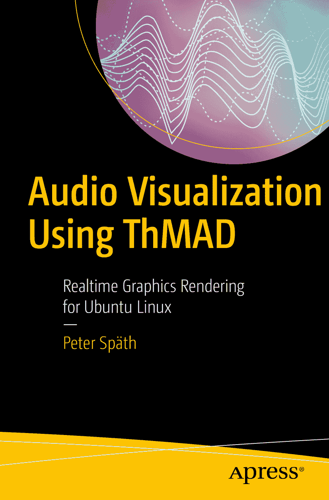

 Peter Späth 《使用 ThMAD 进行音频可视化：Ubuntu Linux 下的实时图形渲染》

本书作者引用的任何源代码或其他补充材料，读者均可通过 GitHub 在图书产品页面获取，网址为[`www.apress.com/978-1-4842-3167-8`](http://www.apress.com/978-1-4842-3167-8)。如需更详细信息，请访问[`http://www.apress.com/source-code`](http://www.apress.com/source-code)。`ISBN` `978-1-4842-3167-8` 电子书 `ISBN` `978-1-4842-3168-5` [`doi.org/10.1007/978-1-4842-3168-5`](https://doi.org/10.1007/978-1-4842-3168-5) 美国国会图书馆控制号：2017960214 © Peter Späth 2017 本作品受版权保护。出版商保留所有权利，无论涉及材料的全部或部分，特别是翻译、重印、插图复用、朗诵、广播、缩微胶片复制或任何其他物理形式复制，以及以电子方式改编、计算机软件或现在已知或以后开发的类似或不同方法进行传输、信息存储与检索。本书中可能出现商标名称、标识和图像。对于商标名称、标识或图像的每次出现，我们并未使用商标符号，而是仅在编辑风格下使用这些名称、标识和图像，以利于商标所有者，无意侵犯商标权益。本出版物中使用商号、商标、服务标记及类似术语，即使未明确标识，也不应视为对其是否受所有权保护的表达。尽管本书中的建议和信息在出版时被认为是真实准确的，但作者、编辑和出版商均不对可能存在的错误或遗漏承担任何法律责任。出版商对本书内容不作任何明示或暗示的保证。本书采用无酸纸印刷。全球图书贸易由 Springer Science+Business Media New York 发行，地址：233 Spring Street, 6th Floor, New York, NY 10013。电话：1-800-SPRINGER，传真：(201) 348-4505，电子邮件：`orders-ny@springer-sbm.com`，或访问`www.springeronline.com`。Apress Media, LLC 是加利福尼亚有限责任公司，其唯一成员（所有者）是 Springer Science + Business Media Finance Inc (`SSBM Finance Inc`)。`SSBM Finance Inc` 是特拉华州公司。

