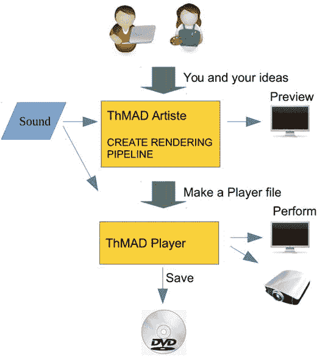

# 引言

音频可视化，就是捕捉来自外部的声音（使用麦克风或声卡的线性输入接口），或捕捉来自内部的声音（当计算机播放音频文件时）。ThMAD 软件套件允许以图形化方式构建音频处理管线，从而根据声音实时生成图形，产生美丽且有趣的输出。本章作为引言，将描述这样一个系统，介绍目标读者，并给出关于文本约定和本书推荐阅读方式的一些提示。

## 关于音频可视化与 ThMAD

你可以购买 CD 或收听广播电台，或者通过流媒体或其他方式收听音乐。如果你喜欢某段音乐，它会带给你情感和/或智力上的感受，类似于一部好电影给你的感觉。就电影而言，音乐声音与视觉有着明显的结合——电影配有音轨，音轨与屏幕故事越匹配，带来的综合愉悦感就越强。制作电影通常意味着你首先编排好场景和对白，然后添加音轨。当然，如果你想制作一部好电影，并实现视觉与听觉两种感官的完美结合，这是一门高超的艺术。如果结合得非常好，两者会以某种方式相互增强。

至于音频可视化，你的感官会同时接收到视觉和听觉的输入。但它的实现方式与电影不同。顺序不同，且耦合方式看起来更为自动化。对于音频可视化，声音是首要的，然后基于声音，由某个程序生成联合艺术作品的视觉部分。至于第二种假设，我特意用了“看起来自动化”这个说法，因为一旦你拥有一个渲染程序，你可以启动它，坐在椅子上什么都不做，就能欣赏音乐的可视化效果。还有第三个区别：电影的音轨是基于情节的，绝不可能在改变情节的同时使用相同的音轨。而对于音频可视化，同一个可视化方案可以输入不同的声音，你仍能得到有趣的最终结果。

为了获得一个漂亮的可视化效果，并使其真正出彩，你必须用某种计算机语言构建一个渲染管线，这本身可能就是一种艺术。这需要手动完成。它的好处在于，你一开始并不需要是艺术大师或软件大师，因为入门并不复杂，使用正确的程序，你很快就能上手。

Thinking Machine Audio Dreams（ThMAD，发音为“Thee-Mad”）软件套件正是这样一个程序。一旦你学会了基础知识，你就可以从一些简单易用的渲染设置开始；如果你有足够的时间去学习、实验并构建复杂的渲染管线，你最终将获得惊艳的音频可视化效果。

ThMAD 基本上包含一个名为`Artiste`的程序，用于生成渲染管线，以及一个名为`Player`的程序，用于在可视化演出中运行该管线。在`Artiste`中工作时，你能实时看到操作的结果，它会根据你做出的更改迅速且恰当地对输入的声音做出反应，这极大地提高了你的工作效率。ThMAD 及其周边系统如图 1 所示。



图 1. ThMAD 及其周边系统

ThMAD 软件基于 Vovoid Media Technologies®公司的开源软件 VSXu，遵循 GNU GPL 许可证（[`https://www.gnu.org/licenses/gpl-3.0.txt`](https://www.gnu.org/licenses/gpl-3.0.txt)）。该分支取自版本`0.5.0`。此后对其进行了大量工作，但引入了一些代码以允许正确加载和解释 VSXu 状态。

ThMAD 采用 GNU GPL 许可证，因此源代码对所有人开放。根据 GNU GPL，你不能出售它或将其用于你出售的产品中。但你可以将其用于个人或职业的娱乐，或在此基础上进行开发，并（仅！）以 GNU GPL 许可软件的形式分发它或你自己的衍生作品。你可以在此处找到源代码：[`https://sourceforge.net/projects/thmad/`](https://sourceforge.net/projects/thmad/)。

**注意**  
VSXu 是瑞典 Vovoid Media Technologies AB 公司的注册商标或未注册商标。Dr. Peter Späth 独立于 Vovoid Media。


## ThMAD 系统要求与概述

`ThMAD` 是为 Linux，更准确地说是 Ubuntu 设计的。不过，你可以通过在 Windows 或其他系统下的虚拟机中运行 Ubuntu，并在此环境中进行开发和实验。但不要期望这样的设置能提供高性能。对于严肃的应用，强烈建议你使用一台 Ubuntu 主机。如今，购买一台预装 Ubuntu 的 PC 或笔记本电脑，或者自行安装 Ubuntu，都不困难。后者有时可能会比较棘手，在特定情况下，你需要阅读大量文档和博客才能使其顺利运行。当然，Ubuntu 主页会提供帮助，你也可以从可启动的 CD 运行试用版开始。除 Ubuntu 外的其他 Linux 发行版也可以运行，但你需要从源代码自行编译。就本书而言，`ThMAD` 仅在 Ubuntu 上测试过。

在底层，软件使用了 `OpenGL`，这是一个在复杂图形渲染（包括制造业和计算机游戏）中广泛采用的行业标准。你将能够使用多种显卡来运行 `ThMAD`。不过，对廉价硬件要谨慎，尤其是老旧显卡或过于精简的系统。你不能期望每个渲染管线都能流畅运行，一些更高级的管线甚至可能失败。请对自己好一些，至少多花点钱买一台中等配置的电脑和不错的图形硬件。

本书基于 `ThMAD` 版本 1.0.0。截至撰写时，相关的 `OpenGL` 版本为 3.0。

## 本书的目标读者

本书面向具有一定 IT 背景的艺术家，或具有艺术倾向的开发者。开发经验并非必需，但对于一些高级功能（如着色器编程）肯定有帮助。不过，使用 `ThMAD` 完全不需要这些，如果涉及着色器源代码，本书还会通过示例帮助你作为工作基础。

本书不是开发指南，因此关于实际实现的提示较少出现，仅作为那些可能想要深入开发的人的锚点。

为了完全理解 `ThMAD` 以及基于 `OpenGL` 的软件，你需要了解 2D 和 3D 图形及坐标系的基础知识。不过，大多数几何概念都会在书中得到一定程度的解释。

## 安装

`ThMAD` 的安装过程在第 2 章“可视化基础”中讨论。

## 本书使用的约定

使用 `ThMAD` 涉及使用其模块，这些模块以树状结构组织。

模块通常被命名为 `maths → converters → 4float_to_float4`。或者，如果模块在模块树中的位置在上下文中是明确的，则可以用等宽字体简写为 `4float_to_float4`。

“状态”（State）是在构建渲染管线时的常见概念。完成的状态也称为“可视化效果”。对示例状态（包括安装提供的相关代码）的引用，以及一般的信息提示，都像这样突出显示：

注意

此示例作为源文件，位于 `TheArtOfAudioVisualization` 文件夹内的 `A-3.2.1_Visualization_basics_basic_samples_basic_2d_sample` 下。

信息提示则将“注意”标签替换为“提示”。在本文中，“文件夹”指的是在模块列表或浏览器中显示的文件夹。重要的说明和陷阱标记如下：

警告

由于反馈，很容易发生……

…… … …

代码和脚本片段，以及终端输入和输出，通常以等宽字体显示，如下所示：

```
apt-get install libc6 libfreetype6 libgcc1 libpulse0 libstdc++6 libglfw3
```

非常短的代码片段直接出现在文本中。如果一行代码太长无法显示在一行中，代码每行末尾的 `┐` 表示在实际输入时，必须删除 `┐` 并忽略随后的换行符。例如，

```
echo "cmd [...] rectangle ┐ abc [...]"
```

应输入为：

```
echo "cmd [...] rectangle abc [...]"
```

在许多地方，星号 `*` 被用作通配符来表示任意字符串。这通常用于指代文件夹内的所有文件或文件名模式。首次启动时，`ThMAD Artiste` 会在以下位置为你的所有状态和可视化效果创建一个数据文件夹：

```
/home/[USER]/.local/share/thmad
```

以及一个位于以下位置的符号链接：

```
/home/[USER]/thmad
```

此链接指向上文提到的数据文件夹。如果你在本书中引用该数据文件夹，则使用链接位置。

## 如何阅读本书

本书可以按顺序阅读。第 1 章至第 4 章作为介绍，其中第 2 章“可视化基础”可能最重要，因为它描述了基本的系统设置和两个重要的简单可视化示例。

第 5 章“故事——基础级”和第 6 章“故事——高级级”包含一系列独立的故事或教程，你可以按任意顺序学习。

第 7 章和第 8 章是参考手册，当你在学习故事过程中有疑问或问题时可以查阅，当然，你也可以用它们来加深对模块的了解，并为你自己的可视化效果获取灵感。


好的，作为一名高级文档工程师和翻译员，我将严格按照您提供的注意事项和示例，将给定的英文文本翻译成中文。


```markdown
## 目录

# 第 1 章：声音输入

### 准备声音输入 1
### 理解声音结构 2
### 时间拉伸表示法 3
### 频率-功率表示法 3
### 从声卡获取的输入数据 4
### 总结 5

# 第 2 章：可视化基础

### 工具链 7
### 安装 ThMAD 7
### 将 PulseAudio 声音连接到 ThMAD 11
### 录制视频 15
### 从录制内容制作 DVD 21
### 基本示例 21
### 基本 2D 示例 21
### 基本 3D 示例 29
### 总结 35

# 第 3 章：程序操作

### ThMAD Artiste 操作 37
### 启动和使用不同模式 37
### 停止 ThMAD Artiste 42
### 启动时出现错误 42
### ThMAD Player 操作 43
### 启动和使用不同模式 43
### 停止 ThMAD Player 47
### 创建和安装推子 47
### 总结 49

# 第 4 章：3D 概念

### 坐标系 51
### 空间映射 54
### 空间操作：平移、旋转和缩放 57
### 曝光与光照 58
### 眼睛与摄像机 61
### ThMAD 网格 64
### ThMAD 粒子系统 64
### 总结 65

# 第 5 章：实践：基础水平

### 更多 3D 渲染管线 67
### 变换 67
### 线框图 79
### 海洋模块 86
### 纹理映射 90
### 自动纹理坐标 92
### 浮动纹理 I 99
### 浮动纹理 II 106
### 斑点，斑点，还是斑点 108
### 基本斑点 109
### Perlin 噪声斑点 113
### 总结 116

# 第 6 章：实践：进阶水平

### 回馈纹理 117
### 二维模糊效果 117
### 自相似性 129
### 粒子系统 145
### 瀑布 146
### 图像位粒子 154
### 中心固定粒子系统 159
### 带状粒子 161
### 发光物体 163
### 总结 169

# 第 7 章：ThMAD GUI 参考

### ThMAD Artiste GUI 171
### 启动和停止 GUI 171
### ThMAD 桌面及其组件 171
### 窗口模式 174
### 全窗口模式 175
### 性能模式 176
### 全屏模式 176
### 主菜单 177
### 模块选择器 181
### 模块列表 181
### 图形化模块选择器 183
### 助手 184
### 对象检视器 186
### 保存和加载状态 186
### 模块 188
### 模块类型 188
### 放置和删除模块 189
### 连接模块 190
### 克隆模块 190
### 模块锚点：参数与连接器 190
### 在锚点之间绘制连接 192
### 枚举输入作为模块参数 194
### Float 输入作为模块参数 194
### Float3 输入作为模块参数 195
### Float4 输入作为模块参数 197
### 四元数输入作为模块参数 198
### 字符串输入作为模块参数 198
### 资源作为模块参数 199
### 序列输入作为模块参数 200
### 导出状态 203
### 宏 203
### 备注 206
### ThMAD Player 206
### 启动和停止 GUI 206
### Player GUI 操作 206
### 总结 207

# 第 8 章：ThMAD 模块参考

### 屏幕 211
### `screen0` 212
### 位图 212
### 滤镜 212
### 生成器 219
### 加载器 222
### 修改器 223
### 虚拟模块 223
### 数学模块 225
### 累加器 225
### 算术运算 226
### 数组 232
### 颜色 233
### 转换器 234
### 虚拟模块 236
### 插值 237
### 限制器 239
### 振荡器 240
### 网格 247
### 虚拟模块 247
### 生成器 248
### 导入器 249
### 修改器：颜色 251
### 修改器：转换器 251
### 修改器：变形器 252
### 修改器：辅助工具 255
### 修改器：拾取器 255
### 修改器：变换 256
### 粒子 258
### Segmesh 259
### 实体 259
### 纹理 265
### 顶点 266
### Xtra 269
### 粒子系统 269
### 分形 269
### 生成器 271
### 修改器 275
### 渲染器 278
### 基础 279
### 网格 283
### OpenGL 修改器 288
### 示波器 300
### 粒子系统 301
### 着色器 306
### 文本 308
### Xtra 309
### 选择器 310
### 声音 319
### `input_visualization_listener` 319
### `midi → aka_apc40_controller` 321
### `ogg_sample_*` 321
### `raw_sample_*` 322
### 字符串 323
### 系统 323
### 纹理 329
### 缓冲区 329
### 虚拟模块 334
### 特效 334
### 加载器 335
### 修改器 337
### OpenGL 341
### 粒子 343
### 宏 344
### 总结 344

## 索引 345

## 关于作者和技术审校者

### 关于作者
### 关于技术审校者
```


