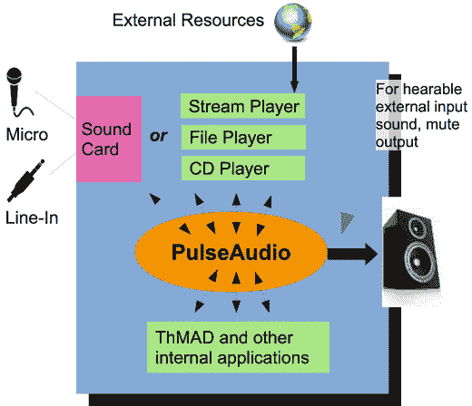
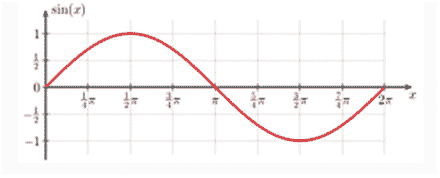

# 声音输入

在本章中，我们将深入了解计算机如何准备捕捉传入的声音或产生的声音、声音在内部如何表示，以及数据如何到达 `ThMAD`。我们区分了直观的**空气压力随时间变化**的表示形式，以及**功率随频率变化**的表示形式（即频谱）。

## 准备声音输入

当你购买一台装有 Ubuntu Linux 的 PC 或笔记本电脑后，或者在电脑上安装了 Ubuntu Linux 之后，基本上有两种选择——你可以使用外部音频源，或者让计算机自己播放声音。对于后者，你可以使用 PC 的 CD 播放器、播放 U 盘或硬盘中的文件，或者通过互联网或其他方式流式传输音频文件。

请注意，其他 Linux 发行版也可能适用。不妨一试——你很有可能会找到类似的程序、工具和设置来实现相同的目标。

如果你希望使用外部音频源，则需要一个麦克风或具有线路输入功能的声卡进行连接。尤其是笔记本电脑，其内置麦克风质量并非最高，但可能足以满足你的需求。实际上，你并不需要精确还原声音，而是要对声音做出反应，因此拥有完全线性的输入曲线并不那么重要。另一方面，如果你不想因为廉价麦克风而失去低音中重要的冲击力，那么购买一个像样的麦克风可能会帮助你避免意外。同时请记住，在某些情况下，音频可视化可能会因输入声音的结构而变得不稳定。

通常情况下，你希望避免这种情况，并且最终输出结果应对任何类型的音乐输入都能产生有趣的效果。通过不同的录音进行检查很容易做到这一点。但例如，如果由于麦克风缺失低音，导致低音永远无法以合适程度通过音频硬件，那么你的渲染管线可能会对输入声音的重要组成部分缺乏响应能力。相反，如果对于外部声音输入，你只需将某个音频源连接到电脑的线路输入插孔，就能自动确保安全。

如果你想使用电脑的 CD 播放器播放 CD、播放音频文件或流式传输音频内容（例如使用浏览器），那么很可能你无需做任何事，只需启动合适的程序或让操作系统自动为你完成即可。对于较大的声音文件集合，一个用于管理的程序可能会很方便。Ubuntu 上预装的 `RhythmBox` 是一个不错的选择。

`ThMAD` 的当前版本 `1.0.0` 主要依赖于 `PulseAudio`，这是一个音频路由服务器，负责处理你计算机内的所有声音流。它知晓所有被捕捉或录制的声音，以及所有被播放的声音。Ubuntu Linux 预装并自动启动了 `PulseAudio`；对于其他 Linux 发行版，你可能需要先安装它。

`ThMAD` 也可以连接到 `ALSA`（一种与声音硬件通信的低级技术），以及连接到 `JACK`（音乐专业人士通常偏好的声音服务器）。然而，与 `PulseAudio` 相比，使用这些选项要困难得多，因此我们将 `PulseAudio` 作为文本中的标准案例来使用。

关于标准 `PulseAudio` 声音链的图形描述，请参见图 1-1。

图 1-1. Ubuntu 系统中的 `PulseAudio` 声音服务器

## 理解声音结构

声音是由耳朵接收的空气压力振荡。从数学或物理角度来看，声音有不同的表示形式——**时间-伸长量**（或时间-压力）表示形式和**频率-功率**表示形式。以下小节将对这两种表示形式进行讨论。

### 时间-伸长量表示

在一个以 x 轴表示时间、y 轴表示压力的图表中，对于正弦波，时间-伸长量表示可能如图 1-2 所示。

图 1-2. 正弦波

在计算机系统中，我们需要对这种正弦波进行数字表示。其思路如下：我们将时间划分为微小的时间步长，例如每秒 `44,100` 个步长，对于每个时间步长，记录下当前的空气压力（即 y 值），并将其保存在一个数组中。这有时被称为模数转换（`ADC`）。请注意，`44,100` 是一个广泛采用的行业标准，例如，它被用于音乐 CD。由于我们有两只耳朵且喜爱立体声，我们会分别对左耳和右耳进行两次这种转换。这样一来，我们最终会得到 `88,200` 个数字，这些数字以数字形式表示一秒钟的立体声。对于压力或 y 值的表示，我们使用整数值（范围从 `-32,768` 到 `32,767`），较低的值代表负压力偏移（例如可能为 `0.997` 巴），较高的值代表正压力偏移（例如 `1.003` 巴）。

根据我们可以自由定义的缩放比例，这些值可以映射为 `0.997` 巴 -> `y=-1000` 和 `1.003` 巴 -> `y=+1000`。所有其他数字都是介于这些值之间的平均压力。当然，我们可以使用除 `-32,768 … 32,767` 之外的其他数值范围，但我们在这里选择的这个范围在内部正好由两个字节的数据表示，计算机对此非常青睐。这也是一种权衡：较少的数值意味着较低的分辨率和较差的音质，而较多的数值则意味着更高的存储需求。

当然，在现实中，出于节省空间的考虑，音乐以多种不同的格式存储，包括 `MP3`、`Ogg Vorbis` 等。每秒 `88,200` 个数字会迅速累积起来。但是，如果让像 `ThMAD` 这样的应用程序访问 `PulseAudio` 数据，它将接收到未压缩、未转换的原始格式数据。这很不错，因为这样 `ThMAD` 就不需要额外的逻辑来处理不同的声音格式了。

### 频率-功率表示法

声音的一种不太直观的表示方式，是记录每个时刻的频率分布。

假设在听某段音乐时，考虑时间范围 `[10s;10.1s]`。与其报告每个瞬间（如 `10.000s`、`10.001s`、`10.002s`）的气压振幅，不如报告在时间范围 `[10s;10.1s]` 内传入我们耳朵的音调频率混合情况：`A ∙ 100Hz + b ∙ 200Hz + c ∙ 300Hz + …`。其中 `x Hz` 表示每秒 `x` 次的正弦振荡频率，而 `a`、`b`、`c`…… 是权重或功率系数。数值越小，贡献越小；数值越大，贡献越大。

以数学上简洁的方式完成这一过程被称为**傅里叶变换**，事实证明它是一种完全等价的声音描述方式。实际上，如果我们以“压力-时间”形式表示声音，可以应用傅里叶变换将其转换为“功率-频率”形式，且不会丢失任何信息。这意味着该过程是可逆的，我们还有类似**逆傅里叶变换**的方法可以反方向转换回去。这里我们不展示数学细节；你可以在其他书籍和互联网上找到大量相关内容。

我们在此提及傅里叶变换，是因为它对我们实现音频可视化的目标非常重要。与其让可视化响应于形变（虽然可以做到，但由于变化发生太快，存在丢失信息的风险），不如响应于频率的功率。只需设想一下：对低音节拍做出一种反应，而对高音旋律做出完全不同的反应。由于节拍发生的频率低得多（可能每秒两次左右），与快速变化的气压振荡相比，声音对可视化的影响会更加明显。

要在 `ThMAD` 中使用这种表示方式，来自 `PulseAudio` 的输入会经过傅里叶变换，我们从中获得的与频率相关的功率，可作为可视化设置的输入。稍后我们会向你展示相关细节。

### 来自声卡的输入数据

无论如何，应用程序首先从声卡对应的软件——声音驱动——接收到的，是一个大小为 `N` 的形变数据数组。例如，如果在 `t0` 时刻，我们以 `44,100 Hz` 向声音驱动请求 `512x2` 个样本（其中乘数 `"2"` 表示我们想获取双声道立体声数据），这意味着我们获取了从 `t0 -0.0116` 到 `t0` 的 `512/44,100 = 0.0116 秒` 的数据。这表明，如果我们不想丢失任何数据，在向声音驱动请求下一块数据之前，至少需要间隔 `0.0116 秒`，以此类推。

对于第一种声音表示法（压力-时间），我们只需将从声音驱动获取的输入数组提供给可视化管线即可；而对于功率-频率表示法，我们需要将这个数组通过傅里叶变换处理。我们会得到一个包含频率 `1 ∙ f[0]`、`2 ∙ f[0]`、`3 ∙ f[0]`…… 对应的功率数组。对于 `44,100 Hz` 采样频率和 `512 ∙ 2` 个采集样本的情况，`f0` 计算为 `f0 = 44,100 / 512 = 86.13 Hz`。由于某些傅里叶变换算法的内在机制，最高频率的功率对应的并非 `44,100 Hz`，而只是它的一半——`22,100 Hz`。因此，对于大小为 `512` 的输入，傅里叶变换将产生 `256` 个功率值。

## 总结

你了解了声音数据如何到达你的系统，以及这些声音在系统内部是如何表示的。你还了解到 `ThMAD` 主要依赖于 Ubuntu 内部运行的标准声音服务器——`PulseAudio`。

在下一章中，你将研究构建音频可视化所需的工具链。你还将学习如何在你的系统上安装 `ThMAD`，以及需要进行哪些配置才能让一切顺利运行。本章以两个可在 `ThMAD` 中运行的基本示例作为开端。