# 2. 可视化基础

本章介绍用于音频可视化项目的工具链，并提供两个使用 ThMAD 的基本音频可视化示例。

如果你想成为一名艺术家，首先要做的事情之一就是学习如何使用工具来完成作品。你不会一开始就使用最复杂的设置，也许除了激发一下食欲之外，你应当从简单的事情做起。然后，你逐步提高熟练度，或许可以学习其他艺术家越来越复杂的作品示例，最终希望能实现自己的想法，无论这些想法有多复杂。当然，有些人更喜欢将不同阶段混合起来，从更复杂的设置入手学习。这完全取决于你。但无论哪种方式，学习工具都是不可避免的。

## 工具链

工具链告诉我们，从输入（在此例中为声音）到输出（图形）的完整工作和呈现设置需要哪些程序。后者可能显示在显示器、投影仪上，或者如果声音和图形合并的话，也可能出现在视频文件中。

实际上，你不需要太多东西。`Ubuntu Linux` 已经为你提供了相当多的内容。无论是播放外部内容还是从外部捕获内容，一切都已经就绪。在 `Ubuntu` 内部运行的声音服务器 `PulseAudio` 已经知晓这些，并向需要它的程序（如 `ThMAD`）提供声音数据。

剩下的就是建立从 `PulseAudio` 到 `ThMAD` 的连接，`ThMAD` 本身将输出提供给显示器或投影仪，以及一个可以录制并生成视频的程序（如果你需要的话）。

### 安装 ThMAD

从 [`https://sourceforge.net/projects/thmad/`](https://sourceforge.net/projects/thmad/) 将 `ThMAD` 下载为 `Ubuntu` 能够识别的 Debian 软件包（`Debian` 是 `Ubuntu` 的母发行版），其后缀名为 `.deb` 后，你需要确保所有依赖项均已满足。

未来的版本可能会自动执行此操作，但目前你需要手动完成。`ThMAD` 依赖以下软件包，带有 ■ 标记的条目很可能在你的 `Ubuntu Linux` 系统中已经预装：

- `libglfw3` (≥ 3.1)
- ■`libc6` (≥ 2.17)
- ■`libfreetype6` (≥ 2.2.1)
- ■`libgcc1` (≥ 1:4.1.1)
- ■`libgl1-mesa-glx` (≥ 11.2.0)（或 `libgl1`）
- ■`libglew1.13` (≥ 1.13.0)
- ■`libglu1-mesa` (≥ 9.0.0)（或 `libglu1`）
- ■`libjpeg8` (≥ 8c)
- ■`libpng12-0` (≥ 1.2.13-4)
- ■`libpulse0` (≥ 0.99.1)
- ■`libstdc++6` (≥ 5.2)

要安装这些软件包，请在终端中以 `root` 身份登录。按下 `Ctrl+Alt+T`，然后在终端中输入 `sudo su`。系统会要求你输入密码，输入后回车，再执行以下命令：

```
apt-get install libc6 \
libfreetype6 libgcc1 \
libgl1-mesa-glx libglew1.13 \
libglu1-mesa libjpeg8 libpng12-0 \
libpulse0 libstdc++6 libglfw3
```

其中 `\` 表示忽略紧随其后的换行符（当你按下 `Enter` 或 `Return` 时）。如果你想在一行内输入命令，只需忽略反斜杠即可。

如果输出显示你已安装了 `...`，无需担心；再次尝试安装软件包不会造成任何影响，命令会直接忽略你系统中已有的软件包。

至于安装 `ThMAD` 本身，假设你通过浏览器下载了它，并且文件位于家目录的 `Downloads` 文件夹中，那么你仍需以 `root` 身份，通过以下命令进行安装：

```
dpkg -i /home/[USER]/Downloads/thmad_1.0.0_amd64.deb
```

或你所获得的任何其他版本。`[USER]` 应替换为你的 Linux 用户名。所有文件最终将位于 `/opt/thmad` 目录下。之后，按 `Ctrl+D` 注销 `root` 身份。这一步很重要，以避免后续操作搞乱你的系统。

为了方便起见，系统提供了启动器；你可以通过以下命令将它们放置在桌面上：

```
cp /opt/thmad/share/applications/thmad-artiste*.desktop \
~/Desktop/
cp /opt/thmad/share/applications/thmad-player*.desktop \
~/Desktop/
```

要检查一切是否正常运行，请使用 `Artiste` 的启动器，或者在终端中输入以下命令：

```
/opt/thmad/thmad_artiste
```

此时应会弹出一个窗口，如图 2-1 所示。恭喜！`ThMAD` 现在已成功在你的系统上运行。


图 2-1. `ThMAD` `Artiste` 启动窗口

虽然主安装文件夹可以重命名，但启动器依赖于安装在 `/opt/thmad` 目录下。不过，如果你认为选择不同的安装文件夹更合适，你也可以相应地编辑启动器。

在实际使用 `ThMAD Artiste` 之前的最后一个准备步骤是，你可以考虑将 `Alt` 键从操作系统中释放出来。默认的 `Ubuntu` 窗口管理器 `Unity` 使用 `Alt` 键启动平视显示器 (HUD)，但 `ThMAD` 也将其用于各种图形用户界面操作。要禁用 `Ubuntu` 使用 `Alt` 键打开 HUD，或更改按键绑定，请进入“系统设置”的“键盘”部分，选择“快捷键”选项卡，然后进入“启动器”菜单。选中 `Key to Show the HUD` 条目，按 `Backspace` 键将其禁用，或者选择一个新的按键或组合键来更改绑定。参见图 2-2。

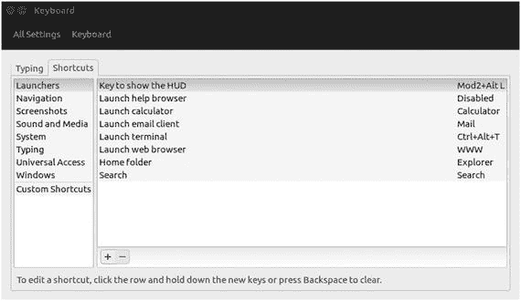

图 2-2. 在 `Ubuntu Unity` 中释放 `Alt` 键 在点击 `Key to Show the HUD` 并按下 `Backspace` 后，该功能将被禁用。或者你也可以输入一个不同的按键或组合键来更改绑定。

作为一项内部细节，供感兴趣者了解，`ThMAD 1.x.x` 版本依赖 `OpenGL 3.x.x` 版本。要查看你的系统拥有哪个 `OpenGL` 版本，可以安装 `mesa-utils` 软件包：

```
sudo apt-get install mesa-utils
```

然后输入：

```
glxinfo | grep 'version'
```

这将显示类似如下的信息：

```
server glx version string: 1.4
client glx version string: 1.4
GLX version: 1.4
Max core profile version: 3.3
Max compat profile version: 3.0
Max GLES1 profile version: 1.1
Max GLES[23] profile version: 3.0
OpenGL core profile version string: 3.3 (Core Profile) Mesa 12.0.6
OpenGL core profile shading language version string: 3.30
OpenGL version string: 3.0 Mesa 12.0.6
OpenGL shading language version string: 1.30
OpenGL ES profile version string: OpenGL ES 3.0 Mesa 12.0.6
OpenGL ES profile shading language version string: OpenGL ES GLSL ES 3.00
```

`OpenGL core profile version string` 这一行会指出当前使用的 `OpenGL` 版本。

### 将 PulseAudio 声音连接到 ThMAD

要将 `ThMAD` 连接到 `Ubuntu` 的声音服务器 `PulseAudio`，有几件事值得注意。

要了解 `PulseAudio` 如何连接设备，`pavucontrol` 这款应用程序会很有帮助。它需要被安装，若要通过终端安装，请按 `Ctrl+Alt+T` 打开终端窗口并输入：

```
sudo apt install pavucontrol
```

系统会提示你输入密码。你也可以使用安装启动器  并输入 `pavucontrol`。安装完成后，你可以从启动器中运行它。按下 `Windows` 键，然后输入 `pavucontrol` 并点击启动器图标。

`PulseAudio` 在内部处理以下对象，这些对象会反映在 `pavucontrol` 程序中：

- **回放**：向 `PulseAudio` 发送声音数据的应用程序属于回放对象。即使没有运行音乐播放程序，你也仍然会有一个条目，名为“系统声音”，它属于操作系统。当音乐播放器（例如 `RhythmBox`，它随标准 `Ubuntu` 安装）运行时，情况将如图 2-3 所示。

  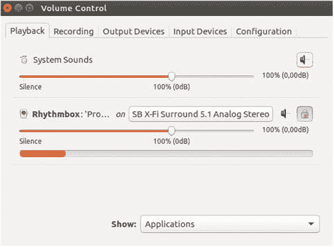

  图 2-3. `PulseAudio` 回放对象 通过观察 `RhythmBox` 下方的橙色计量条，你可以看到它当前正在向名为 `SB X-Fi` 的声卡发送数据。

- **录制**：读取声音数据的应用程序将在此列出。`ThMAD` 稍后会出现在这里。

- **输出设备**：你系统上安装的声卡会显示在这里，更准确地说是它们的回放通道。对我来说，它列出了 `SB X-Fi Surround 5.1 Analog Stereo` 等设备。

- **输入设备**：你系统上安装的声卡会显示在这里，更准确地说是它们的录制通道。

输入通道是麦克风，但也包括监听器，它们连接到声卡的输出端，例如扬声器或耳机。对我来说，它列出了 `Monitor of SB X-Fi Surround 5.1 Analog Stereo` 等设备。见图 2-4。这很重要，因为这就是 `ThMAD` 要连接的地方。

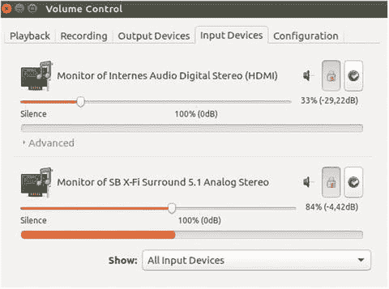

图 2-4. `PulseAudio` 输入设备对象 在图 2-4 中，通过观察 `Monitor of SB X-Fi` 下方的橙色计量条，你可以看到 `PulseAudio` 当前正在向该监听器提供声音数据。

要实际进行连接，请启动 `ThMAD Artiste`，然后从左侧模块菜单中的“声音”部分，将 `input_visualization_listener` 菜单项拖拽到画布上。要使其显示出来，请点击左侧菜单中的“声音”以打开子菜单。模块 `input_visualization_listener` 将会出现，你可以将它拖拽到画布上。见图 2-5。你可以使用鼠标滚轮放大或缩小画布，以使模块符号显示得更大。

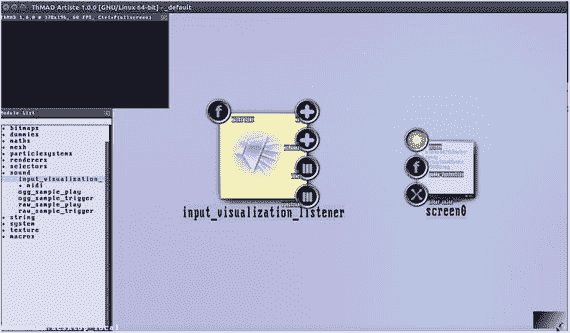

图 2-5. 打开 `ThMAD` 声音模块

然后打开 `pavucontrol`（如果尚未打开）。转到“录制”部分，并将 `thmad` 连接到你可听到的声卡输出通道的监听器上，如图 2-6 所示。

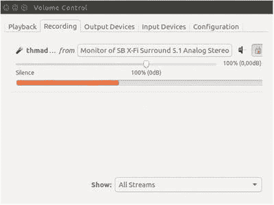

图 2-6. 将 `ThMAD` 连接到 `PulseAudio` 监听器 通过观察其下方的橙色计量条，你可以看到名为 `Monitor of SB X-Fi` 的监听器正在向 `ThMAD` 发送一些声音数据。

此连接将自动保存，因此你以后不必再重复所有步骤。只需播放一些音乐并启动 `ThMAD`（无论是 `Artiste` 还是 `Player`），它就会自动连接到你在配置步骤中提供的相同声音源。

### 录制视频

特别是当你制作出异常美丽的可视化效果后，也许你想从中创建一个视频文件。目前尚无法直接从 `ThMAD` 创建视频文件，但 `Ubuntu` 可以帮助你解决这个问题。所以思路是：启动 `ThMAD`，播放一个音乐文件，然后让 `Linux` 创建视频。

首先，使用 `Ubuntu` 软件中心  安装 `SimpleScreenRecorder` 程序。你也可以从终端启动它。（记住，按 `Ctrl+Alt+T` 打开终端并输入 `sudo su` 以成为 `root` 用户。）然后使用以下命令：

```
apt-get install \
simplescreenrecorder
```

不要因为名称中的 `simple` 就认为它“简陋”。实际上，这个工具相当强大且可靠——它能创建高分辨率的视频文件，并包含来自 `PulseAudio`、`ALSA` 或 `JACK` 的声音。

启动 `ThMAD`，打开你的可视化效果，调整窗口大小（可能调至监视器的最大可用尺寸），然后通过 `Ctrl+F` 切换到全窗口模式。你还可以通过 `Alt+T` 移除状态栏。然后，按 `Windows` 键并输入 `simplescreen` 来启动 `SimpleScreenRecorder` 程序。其初始页面如图 2-7 所示。

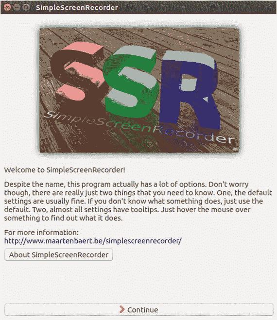

图 2-7. `SimpleScreenRecorder` 页面 I

点击“继续”。下一页显示要捕获的屏幕部分的输入参数；见图 2-8。

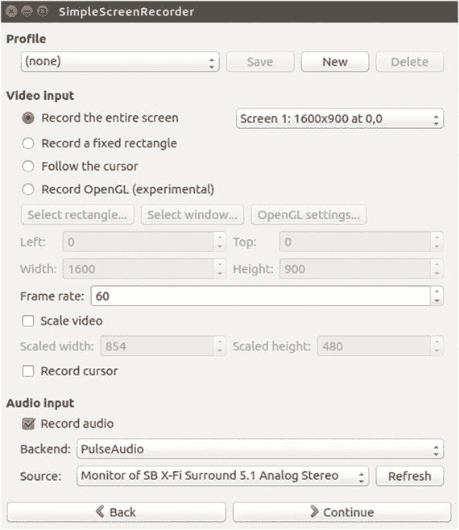

图 2-8. `SimpleScreenRecorder` 页面 II

选择 `Record a Fixed Rectangle`（录制固定矩形），然后点击 `Select Window…`（选择窗口……）按钮，再点击 `Select Rectangle…`（选择矩形……）按钮。接着，在 `ThMAD` 窗口内部区域的左上角位置点击并按住鼠标按钮，拖拽至右下角位置后释放鼠标按钮。如果点击 `ThMAD` 窗口的某个位置，最终可能会录制到窗口的标题栏和边框。如果你愿意，也可以选择模式。在此步骤之后，请不要移动或调整 `ThMAD` 窗口的大小；否则，将会录制到屏幕的错误部分。在同一页面上，可以指定帧率。通常默认值 60 就效果很好，但你可以将其更改为 100 以获得更好的质量，或更改为 20 以获得更小的视频文件体积。

确保勾选 `Record Audio`（录制音频）复选框，选择 `PulseAudio` 作为后端（Backend），并选择合适的声音监听器。

再次点击“继续”。在下一页（见图 2-9），输入视频文件的文件名。所有其他值可以设置为图中所示的值，但你当然也可以尝试其他值：

- 将容器类型更改为不同的视频格式。对于 `Linux`，`Matroska` 格式效果很好；对于其他操作系统，其他值可能效果更佳。如果将鼠标悬停在方框上，会显示更多信息。
- 将编解码器类型更改为不同的视频压缩类型。`H.264` 在此是一个不错的选择。同样，将鼠标悬停在方框上会显示更多信息。
- 对于音频编解码器，选择推荐值 `Vorbis`。如需了解其他值的信息，请将鼠标悬停在方框上。默认速率 `128 Kbps` 是一个合理的速率，但你可以选择不同的值。


图 2-9. `SimpleScreenRecorder` 页面 III

点击“继续”以显示最后一页，如图 2-10 所示。如果如图所示启用了录制热键，你可以通过某些键盘序列开始录制。图中显示的是 `Ctrl+R`，但你当然也可以尝试其他组合。

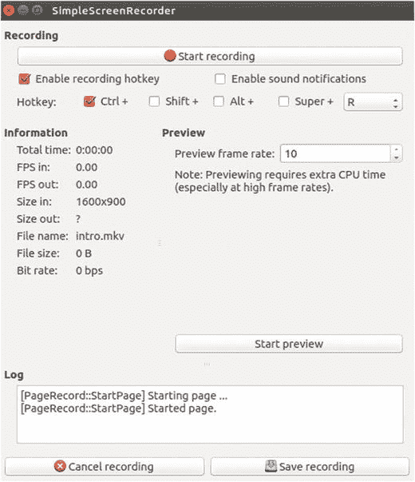

图 2-10. `SimpleScreenRecorder` 页面 IV

# 开始录制

点击`开始录制`或按下快捷键即可开始录制。紧接着启动你的音乐播放器。此时视频正在录制。请确保`FPS In`和`FPS Out`的值相近，且接近你指定的帧率。否则，你的系统可能性能不足，应在`SimpleScreenRecorder`中为性能相关参数选择更保守的值，尤其是录制窗口大小和帧率。

当你的表演结束后，点击`保存录制`，即可完成。

如果最后一步你想将其制作成 DVD，下一小节讨论的程序可以帮你实现。

## 从录制内容制作 DVD

如果你想要从音频文件创建 DVD，有几种选择。打开 Ubuntu 软件中心  并输入`dvd`即可获取列表。

对我来说效果不错的一款软件是`DeVeDe`。如果你想尝试，安装后从启动器按下 Windows 键并输入`devede`即可启动。在启动界面选择`VideoDVD`。添加本章生成的 MKV 文件，如果有多个文件且想刻录到同一张 DVD 上，可以添加多个。然后点击`前进`按钮。在此处选择一个用于存储中间数据的文件夹——你输入的内容无关紧要，但该文件夹之前不应存在。点击`确定`。在中间文件创建完成后，你可以选择直接将其刻录到 DVD 上。不言而喻，此选项需要你的电脑配备 DVD 刻录机。

该程序还支持定制菜单。此处不作详细说明，但你可以点击`帮助`按钮。帮助内容会出现在启动界面，并为你提供关于`DeVeDe`高级功能的相当不错的介绍。

另一个软件叫`DVD Styler`。如果你希望 DVD 菜单外观精美，它比`DeVeDe`拥有更多选项。它还在`帮助`菜单中附带了很好的介绍和详尽手册。

# 基础示例

本节将展示两个基础示例，一个用于 2D，另一个用于 3D。

## 基础 2D 示例

作为第一个示例，我们将描述一个渲染管线的配置，它由一个简单的 2D 矩形组成，并对来自音乐播放器的声音输入做出反应。

**注意**

本示例的源文件位于 `TheArtOfAudioVisualization` 文件夹下的 `A-2.2.1_Visualization_basics_basic_samples_basic_2d_sample` 路径中。你可以通过右键点击画布空白区域，选择 `打开…` 来加载它。

首先启动 `ThMAD Artiste`。如果你按照本章所述方式安装，可以双击桌面上的启动器图标，或通过 `Ctrl+Alt+T` 打开终端并输入 `/opt/thmad/thmad_artiste`。如果使用终端，你会看到一些诊断输出，特别是显示声卡驱动上下文的信息。这在某些情况下可能会有所帮助。

`ThMAD Artiste` 画布将会显示。如果你是首次启动且没有之前的工作内容，画布中央只会显示一个极小的模块图标。`ThMAD` 中所有 GUI 元素（包括文本字体）的大小都是相对的，因此你可以先最大化窗口以提高可读性。接下来你可以缩放场景并平移视图来移动视口。缩放时，可以按键盘上的 `W` 和 `R` 键或使用鼠标滚轮。平移时，可以使用方向键或 `S`、`D`、`F`、`E` 键，也可以点击画布空白区域并拖拽鼠标。此时屏幕将如图 2-11 所示。

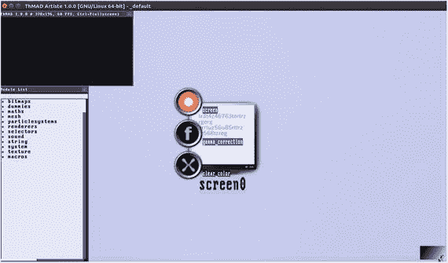

图 2-11. ThMAD Artiste 启动界面（已放大）

在右下角，显示了最小化的助手。按 `Tab` 键可在不同大小之间切换。虽然助手会显示一些关于如何使用 GUI 的信息，但更完整的 GUI 描述请参见第 7 章“Artiste GUI 参考”。助手有不同模式并显示不同内容。你可以通过右键点击助手并选择出现的条目来更改模式或内容；参见图 2-12 和图 2-13。

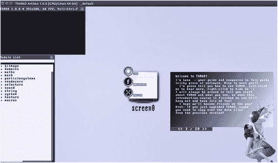

图 2-13. 助手

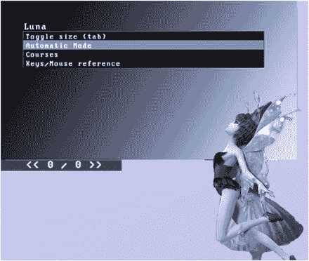

图 2-12. 助手模式

如果选择 `自动模式`，助手随后会显示上下文相关的信息。每当你点击画布上的某个模块图标，助手内就会显示关于该模块的信息。点击 `课程` 可以阅读一系列帮助提高 GUI 使用熟练度的课程。选择 `键位/鼠标参考` 则会显示键鼠使用参考。

在本书的其余部分，我们将助手保持最小化。请记住，你可以通过多次按 `Tab` 键来实现这一操作。

现在我们来绘制一些东西。为此，点击左侧模块菜单中的 `渲染器`，然后点击 `基础`。在弹出的项目中，点击 `彩色矩形` 并将其拖拽到画布上，放到 `screen0` 模块旁边。参见图 2-14。

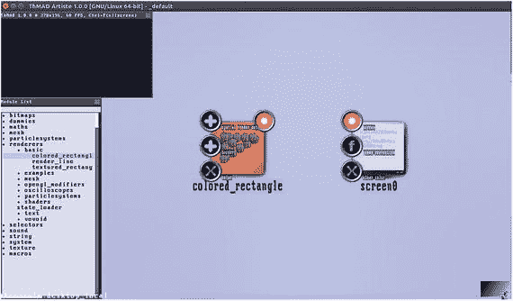

图 2-14. 在画布上放置一个矩形 为了在黑色预览窗口中看到内容，这些模块仍需进行连接。

目前还没有任何显示。你首先需要将 `colored_rectangle` 的输出连接到 `screen0` 的输入。看到模块边框上的锚点了吗？通常来说，形状和颜色相同的锚点是可以连接的，这正是我们接下来要做的操作。`colored_rectangle` 的一个锚点标有 `render_out`，`screen0` 的一个锚点标有 `screen`，它们看起来相似。要连接它们，请单击其中任一锚点，然后将其拖拽至另一个锚点。连接完成后，画布上会显示连接线，左上角的预览窗口则会显示这个矩形。见图 2-15。

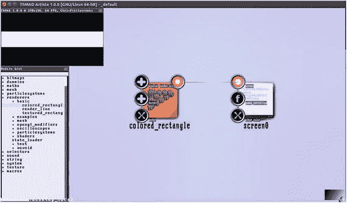

**图 2-15. 连接并绘制矩形**

你可能想知道 ThMAD 中的绘制大小和位置是如何确定的。对于 3D 草图来说会更复杂，但我们稍后会再讨论。对于当前这个 2D 草图，绘制画布覆盖了 x-y 平面内从左下角(-1;-1)到右上角(+1;+1)的坐标区域，矩形的放置位置使其中心与画布中心(0;0)对齐。此外，它首次被放置到画布上时的大小为 2.0 x 0.6。不同的形状遵循不同的惯例，但通常形状的默认中心位置都是(0;0)。

绘制输出已经显示在画布左上角的一个小窗口中，但你可以更改视图模式。按下 `Ctrl+F` 可以最大化预览窗口，随后如果你愿意，可以按下 `Alt+F` 创建一个覆盖层。这个覆盖层将图形输出和模块画布完全融合在一起，并保留所有 GUI 输入功能。这是一个极其强大的特性，因此被称为性能模式。再次按下 `Alt+F` 或 `Ctrl+F` 将恢复到之前的视图模式。

接下来，我们想利用声音来动态改变这个矩形的朝向。为此，我们将 `input_visualization_listener` 模块放置在画布上。你可以在左侧模块的“Sound”（声音）部分找到它。点击“Sound”就能看到。或者，你也可以在窗口的搜索栏中输入模块名称。点击“Module List”（模块列表）标题下方的空白区域，然后输入 `input_visualization_listener` 或其适当的部分。你会发现只需输入前三个字母，就能将整个列表筛选到我们正在寻找的模块。如果你想禁用筛选功能，清除搜索栏即可。可以使用常规的退格键或删除键进行清除，或者按一次 `Ctrl+Del` 键。此外，定位模块的第三种方法是，双击画布的空白区域以打开图形化模块浏览器（见图 2-16）。在那里你也能找到它。在浏览器中，点击空白处并拖动鼠标进行导航。将鼠标悬停在一个条目上可查看其信息，点击并拖动一个条目可将其放置在画布上。右键点击空白处可关闭浏览器。

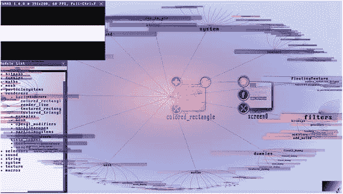

**图 2-16. 模块浏览器**

将 `input_visualization_listener` 模块拖拽到画布上之后，你需要将当前声音音量连接到矩形的绘制角度。看到 `input_visualization_listener` 右上角的 `vu` 锚点，以及 `colored_rectangle` 模块左上角的 `spatial` 锚点了吗？它们都是所谓的复合锚点，用 `+` 号表示。它们包含子锚点。你不能连接复合锚点，只能连接非复合锚点或子锚点。要显示模块的子锚点，请点击它们；见图 2-17。现在，将 `input_visualization_listener` 模块的任意一个 `vu` 子锚点连接到 `colored_rectangle` 模块的 `angle` 子锚点。

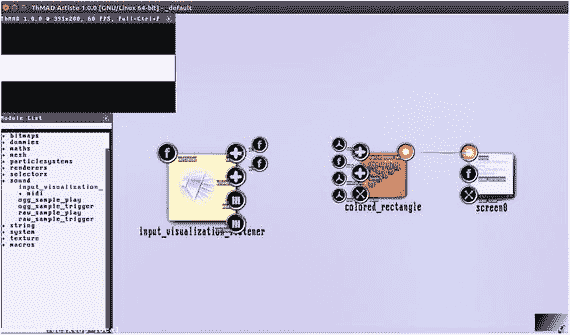

**图 2-17. 已打开的子锚点**

如果正在播放声音并且一切设置正确，你就会看到矩形随着音乐的节奏摆动起来；见图 2-18。

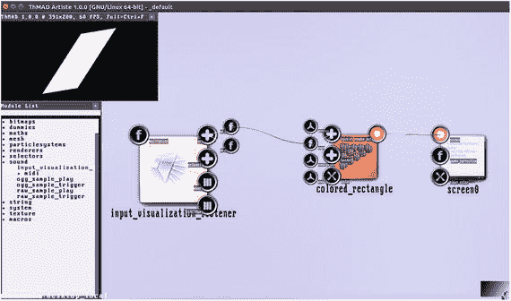

**图 2-18. 摆动的矩形**

恭喜你，你刚刚完成了第一个音频可视化！要保存它，只需将光标移动到画布的空白处，然后按 `Ctrl+S`。屏幕会短暂闪烁，提示你管道已保存。

如果看不到矩形摆动，请检查 PulseAudio 音频服务器是否正在运行，并且是否正在向 ThMAD 发送数据。如果它没有运行，你不仅无法在 PulseAudio 下听到任何音乐播放，而且 Ubuntu 桌面的声音图标应该看起来像这样：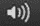，即不是灰色或带有叉号，像这样：。

要检查 PulseAudio 是否向 ThMAD 发送数据，请交叉参考第 1.2 节。作为最后的检查手段，按 `Ctrl+Alt+T` 从终端启动 ThMAD Artiste。然后输入 `/opt/thmad/thmad_artiste`。在终端内部，你应该能看到类似以下的诊断输出：

```
rtaudio_record.h audioprobe()
Audio Type = Linux PulseAudio
Available APIs:
Linux ALSA
Linux PulseAudio
Current API: Linux PulseAudio
Found 1 device(s) ...
Device Name = PulseAudio
Probe Status = Successful
Output Channels = 2
Input Channels = 2
Duplex Channels = 2
This is the default output device.
This is the default input device.
Natively supported data formats:
16-bit int
32-bit int
32-bit float
Supported sample rates = 8000 16000
22050 32000 44100 48000 96000
```

这个列表中特别重要的几项是：

*   `Found 1 device(s)`（或更多个）。如果是 0，意味着 ThMAD 无法连接到音频服务器。
*   `Device Name = PulseAudio`。这是默认的音频服务器。若要实际为 ThMAD 配置非 PulseAudio 驱动（如 ALSA 和 JACK），预计需要做更多工作。至少你需要添加 `-sound_type_alsa` 或 `-sound_type_jack` 选项来使用 ALSA 或 JACK。如果你没有使用默认设备，还必须指定 `-snd_rtaudio_device=<NUMBER>`，其中 `<NUMBER>` 可以从终端程序输出中确定。
*   如果 16 位 `int` 不是支持的格式，你可能使用了非常罕见的声卡，或者声卡驱动有问题。如果 44100 不在支持的采样率列表中，你可以要求 ThMAD 使用不同的采样率。这只能在从终端启动 ThMAD 时完成，你只需要添加例如 `-snd_sample_rate=48000` 参数。

### 基础 3D 示例

`ThMAD` 运行于 `OpenGL` 之上，`OpenGL` 是一种 3D 渲染技术，广泛应用于游戏以及工业级软件项目和产品中。据此，如果 `ThMAD` 无法提供 3D 渲染能力，我们会感到相当失望。好消息是，它具备这个能力。

然而，有必要说明的是，为了在 `ThMAD` 的 3D 世界中看到任何东西，从一开始就需要考虑一些重要的方面：

-   在许多情况下，我们需要定义物体的表面材质。
-   我们需要处理因被其他物体遮挡而不可见的物体表面部分。
-   在许多情况下，我们需要光源。
-   我们需要一个摄像机来将 3D 场景投影到 2D 显示器上。

关于 3D 渲染，还有很多可以讨论的内容，你可以通过阅读第 5 章“3D 概念”来获得更深入的理解。但为了指出最基本、最重要的方面，我们提供了一个非常基础的 3D 渲染管线。

但在此之前，如果你按照步骤构建了 2D 示例草图，你可能会错过关于文件命名的说明。`ThMAD` 中的草图通常被称为状态（state），并且必须保存在内部。原因是，当 `ThMAD` 以其默认配置启动时，它会自动加载一个名为 `_default` 的状态，并且当你随时按下 Ctrl+S 时，当前状态将再次以 `_default` 的名称保存。可以将 `_default` 视为状态的临时工作名称。但是，如果你想妥善保存以供日后使用，你应该给它起一个合适的名称。为此，请启动 `ThMAD Artiste`（如果它尚未运行并显示你想保存的状态），在某个空白处右键单击，然后从弹出菜单中选择“另存为...”。在出现的弹出窗口的第一行，为你的状态输入一个名称。在其他行也输入一些内容；它们都是必填项。然后点击“确定”按钮。

**注意**

此示例作为源代码提供，位于 `TheArtOfAudioVisualization` 文件夹下的 `A-2.2.2_Visualization_basics_basic_samples_basic_3d_sample` 路径中。

现在退出 `ThMAD Artiste` 并重新启动它。在窗口标题中，你会再次看到它加载了 `_default` 状态。如果 `_default` 状态不为空，为了从一个空状态开始，请在画布的空白处右键单击，导航到“新建 ➤”，然后点击“空项目”。现在，除了 `screen0` 模块之外的所有模块都应该消失了。

请注意，`ThMAD` 的这种启动行为，更准确地说，是自动且无条件地加载 `_default` 状态，可以在主弹出菜单的配置中进行调整。在那里，你可以将其设置为加载最后保存的状态，而不是默认状态。对于 3D 管线，现在请按如下步骤开始：

1.  `OpenGL` 和 `ThMAD` 中的 3D 物体由构成网格（mesh）的点来定义，而网格则定义了物体的表面。例如，一个立方体网格由六个面和八个点组成。我们从这样一个立方体网格开始，它在 `ThMAD` 中被称为 `mesh_box`。在模块菜单中，你可以通过选择 Mesh → Solid → `mesh_box` 或在模块浏览器中相同的路径找到它。请记住，双击画布可以打开图形化模块浏览器。将 `mesh_box` 拖放到画布上。
2.  `mesh_box` 定义了 3D 物体，但它不会渲染它。一个合适的渲染器叫做 `mesh_basic_render`，你可以通过 Renderers → Mesh → `mesh_basic_render` 找到它。将其放置在 `mesh_box` 模块旁边，并将它们连接起来——将前者的“mesh”锚点连接到后者的“mesh_in”锚点。
3.  接下来，你需要告诉 `ThMAD` 处理隐藏面。将模块 Renderers → `opengl_modifiers` → `backface_culling` 放到画布上，并将其连接到 `mesh_basic_render` 的 `render_out` 锚点。将 `backface_culling` 的状态锚点切换为 `ENABLED`。
4.  现在，3D 物体需要表面属性：导航到 Renderers → `opengl_modifiers` → `material_param`。将其放到画布上，并连接到 `backface_culling`。
5.  为了摆脱永恒的黑暗，你需要光源。在 `ThMAD Artiste` 中，选择 Renderers → `opengl_modifiers` → `light_directional`。将光源放在 `backface_culling` 旁边，并将它们连接起来。点击打开“属性”复合锚点，然后将 `light_directional` 的 enabled 锚点切换为 `YES`。
6.  你差不多完成了。为了真正看到 3D 场景，我们还需要一个摄像机。有几种可供选择，我们选择这个：Renderers → `opengl_modifiers` → cameras → `orbit_camera`。将其放在光源旁边，并将它们连接起来。
7.  最后，将 `orbit_camera` 连接到 `screen0`。

现在你终于能看到一些东西了；见图 2-19。这个结果有点单调，因为我们正对着 x-y 平面，所以只能看到立方体的一个面。

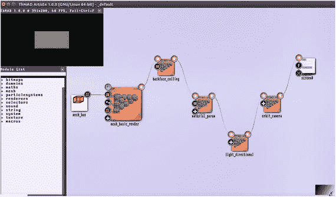

**图 2-19.** 第一个 3D 状态

为了解决这个问题，首先改变光源的颜色。同样在 `light_directional` 的“属性”复合锚点内，右键单击 `diffuse_color` 锚点，并从弹出菜单中选择“颜色控制”。从该控件中——参见图 2-20——选择你喜欢的任何颜色。点击并拖动左上角区域选择色相，然后点击大的方形区域选择饱和度和明度。你也可以在该区域拖动，以在预览窗口中看到即时变化。双击右上角区域退出控件。

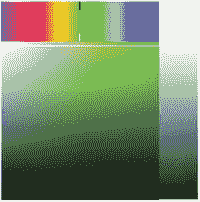

**图 2-20.** 颜色选择控件

你可能已经注意到，它看起来不太像立方体的一个面，反而更像一个矩形棱柱的一个面。这是因为你的显示器很可能具有非 1:1 的宽高比。有一个简单的解决办法：打开 `orbit_camera` 模块的“摄像机”复合锚点，并将“透视校正”锚点切换为 `YES`。

不过，它看起来仍然不太像 3D 物体。为了释放第三维度的力量并将其显示为一个立方体，你需要旋转摄像机位置，从一个不同的角度观察场景。为此，请打开 `orbit_camera` 模块名为“摄像机”的复合锚点。在里面你会找到一个名为“旋转”的锚点。右键单击它并选择“轴视图”。将会出现一个彩色的十字；参见图 2-21。

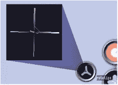

**图 2-21.** 轴视图锚点控件

在其中心附近点击并拖动，你会看到摄像机围绕场景中心旋转，该中心恰好也是立方体的中心。满意后，双击即可关闭控制。你的结果可能与图 2-22 类似。

# 本章总结

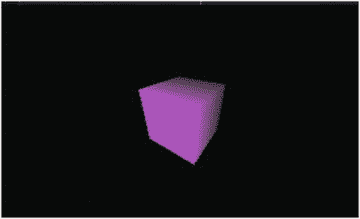
图 2-22. 精细化的三维场景

作为最后一步，你将添加对声音的响应。将`sound → input_visualization_listener`放置在`screen0`模块附近。对模块`maths → converters → 4float_to_float4`也执行相同操作，它将帮助我们控制颜色。

将`4float_to_float4`的输出锚点`result_float4`连接到`screen0`的输入锚点`clear_color`。同时将`input_visualization_listener`的`vu`下的一个`vu_*`子锚点连接到`4float_to_float4`的第三个输入锚点。参见图 2-23。

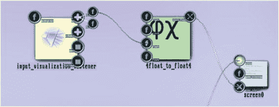
图 2-23. 三维草图的声音输入

`input_visualization_listener`的`Multiplier`输入锚点控制对声音的灵敏度。要为其赋予除默认值`1.0`以外的值，双击该锚点，然后在出现的旋钮上点击并拖动。然后赋予一个新值，例如`0.3`。双击关闭旋钮。

`4float_to_float4`的四个输入锚点负责解复用屏幕清除颜色，因此它们分别代表背景颜色的RED（红）、GREEN（绿）、BLUE（蓝）和ALPHA（透明度）通道。再次通过点击锚点并使用旋钮更改其值，将RED和GREEN锚点设置为`0.0`。将ALPHA值保留为`1.0`。

启动声音输入，你应该会看到背景根据声音输入呈现蓝色闪烁效果。如果没有看到，说明你的音量可能太低，应该为`input_visualization_listener`的输入乘数分配一个更高的值。

当然，你可以对任何使用中的颜色值执行相同操作，例如灯光颜色或材质颜色。请随意尝试这些操作。你也可以从`input_visualization_listener`的`vu/vu_*`锚点引出多条连接，连接到其他模块的不同输入锚点。这是ThMAD中的一个强大功能，适用于许多模块的大量锚点。反过来，将不同模块的多个输出锚点连接到一个特定模块的单个输入锚点，根据模块和锚点类型也是可行的。例如，多个管线中的多个渲染器可以并行连接到唯一的`screen0`输入。

转到画布上的空白处，按`Ctrl+S`将其保存为`_default`状态，或者右键点击画布空白处并选择“另存为…”，为其命名。请记住，下次启动ThMAD Artiste时，`_default`状态会自动打开。但为了将来参考，请使用“另存为…”并为其指定一个持久的名称。

在本书的其余部分，为了尽可能清晰地说明问题，我们将经常使用锚点值表格列表。请注意，默认锚点值仅在对理解状态有显著帮助时才进行解释。此外，连接到其他模块的锚点通常会在正文中描述，仅在少数情况下出现在表格中。

当前状态的锚点值表格呈现如表2-1、2-2、2-3、2-4和2-5所示。

表 2-5. `sound → input_visualization_listener`

| 锚点 | 值 | 描述 |
| --- | --- | --- |
| `multiplier` | `0.3` | 取决于音量大小。 |

表 2-4. `maths → converters → 4float_to_float4`

| 锚点 | 值 | 描述 |
| --- | --- | --- |
| `floatc` | 锚点连接到其他模块。 | |
| `floata` | `0.0` | 将映射为RED颜色值 |
| `floatb` | `0.0` | 将映射为GREEN颜色值 |
| `floatd` | `1.0` | 将映射为ALPHA值 |

表 2-3. `renderers → opengl_modifiers → cameras → orbit_camera`

| 锚点 | 值 | 描述 |
| --- | --- | --- |
| `camera / perspective_correct` | `yes` | 根据屏幕修正宽高比。 |
| `camera / rotation` | `0.71; 0.46; 0.53` | 对于轨道摄像机，表示摄像机的位置。它将朝向目标点。 |
| `camera / distance` | `2.0` | 摄像机到目标点的距离。 |
| `camera / destination` | `0; 0; 0` | 摄像机看向的位置，即三维场景的中心。 |

表 2-2. `renderers → opengl_modifiers → light_directional`

| 锚点 | 值 | 描述 |
| --- | --- | --- |
| `properties /light_id` | `0` | 只有在使用多个光源时才需要更改此项。 |
| `properties /enabled` | `YES` | 启用该模块。 |
| `properties /position` | `0; 0; 1` | 表示光线从xy平面上方照射。 |
| `properties /ambient_ color` | `0; 0; 0; 1` | 非定向光，黑色=关闭。 |
| `properties /diffuse_ color` | `0.9; 0.6; 0.8;1` | 具有漫反射的定向光。可自行选择。 |
| `properties /specular_ color` | `0; 0; 0; 1` | 具有精确反射的定向光。对于仅有平面表面的对象意义不大。 |

表 2-1. `renderers → opengl_modifiers → backface_culling`

| 锚点 | 值 | 描述 |
| --- | --- | --- |
| `status` | `ENABLED` | 启用该模块 |

在本章中，我们了解了运行和使用ThMAD所需的工具，以及如何安装和配置它。我们还了解了如何从可视化中创建DVD，并介绍了使用ThMAD创建的前两个基本可视化示例。

在下一章中，我们将更深入地探讨ThMAD的操作方面，包括其各个部分如何启动，以及可以使用哪些选项来满足特定需求。


