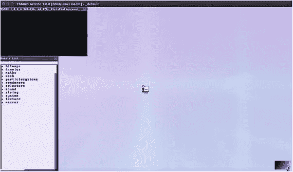
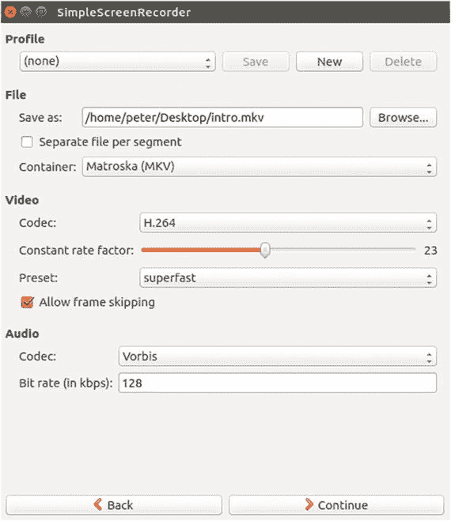

# 2. 可视化基础

本章介绍用于音频可视化项目的工具链，并提供两个使用 ThMAD 的基本音频可视化示例。

如果你想成为一名艺术家，首先要做的事情之一就是学习如何使用工具来完成作品。你不会一开始就使用最复杂的设置，也许除了激发一下食欲之外，你应当从简单的事情做起。然后，你逐步提高熟练度，或许可以学习其他艺术家越来越复杂的作品示例，最终希望能实现自己的想法，无论这些想法有多复杂。当然，有些人更喜欢将不同阶段混合起来，从更复杂的设置入手学习。这完全取决于你。但无论哪种方式，学习工具都是不可避免的。

## 工具链

工具链告诉我们，从输入（在此例中为声音）到输出（图形）的完整工作和呈现设置需要哪些程序。后者可能显示在显示器、投影仪上，或者如果声音和图形合并的话，也可能出现在视频文件中。

实际上，你不需要太多东西。Ubuntu Linux 已经为你提供了相当多的内容。无论是播放外部内容还是从外部捕获内容，一切都已经就绪。在 Ubuntu 内部运行的声音服务器 PulseAudio 已经知晓这些，并向需要它的程序（如 ThMAD）提供声音数据。

剩下的就是建立从 PulseAudio 到 ThMAD 的连接，ThMAD 本身将输出提供给显示器或投影仪，以及一个可以录制并生成视频的程序（如果你需要的话）。


### 安装 ThMAD

从 [`https://sourceforge.net/projects/thmad/`](https://sourceforge.net/projects/thmad/) 将 ThMAD 下载为 Ubuntu 能够识别的 Debian 软件包（Debian 是 Ubuntu 的母发行版），其后缀名为 `.deb` 后，你需要确保所有依赖项均已满足。

未来的版本可能会自动执行此操作，但目前你需要手动完成。ThMAD 依赖以下软件包，带有 ■ 标记的条目很可能在你的 Ubuntu Linux 系统中已经预装：

- `libglfw3` (≥ 3.1)
- ■`libc6` (≥ 2.17)
- ■`libfreetype6` (≥ 2.2.1)
- ■`libgcc1` (≥ 1:4.1.1)
- ■`libgl1-mesa-glx` (≥ 11.2.0)（或 `libgl1`）
- ■`libglew1.13` (≥ 1.13.0)
- ■`libglu1-mesa` (≥ 9.0.0)（或 `libglu1`）
- ■`libjpeg8` (≥ 8c)
- ■`libpng12-0` (≥ 1.2.13-4)
- ■`libpulse0` (≥ 0.99.1)
- ■`libstdc++6` (≥ 5.2)

要安装这些软件包，请在终端中以 root 身份登录。按下 `Ctrl+Alt+T`，然后在终端中输入 `sudo su`。系统会要求你输入密码，输入后回车，再执行以下命令：

```
apt-get install libc6 \
libfreetype6 libgcc1 \
libgl1-mesa-glx libglew1.13 \
libglu1-mesa libjpeg8 libpng12-0 \
libpulse0 libstdc++6 libglfw3
```

其中 `\` 表示忽略紧随其后的换行符（当你按下 `Enter` 或 `Return` 时）。如果你想在一行内输入命令，只需忽略反斜杠即可。

如果输出显示你已安装了 `...`，无需担心；再次尝试安装软件包不会造成任何影响，命令会直接忽略你系统中已有的软件包。

至于安装 ThMAD 本身，假设你通过浏览器下载了它，并且文件位于家目录的 `Downloads` 文件夹中，那么你仍需以 root 身份，通过以下命令进行安装：

```
dpkg -i /home/[USER]/Downloads/thmad_1.0.0_amd64.deb
```

或你所获得的任何其他版本。`[USER]` 应替换为你的 Linux 用户名。所有文件最终将位于 `/opt/thmad` 目录下。之后，按 `Ctrl+D` 注销 root 身份。这一步很重要，以避免后续操作搞乱你的系统。

为了方便起见，系统提供了启动器；你可以通过以下命令将它们放置在桌面上：

```
cp /opt/thmad/share/applications/thmad-artiste*.desktop \
~/Desktop/
cp /opt/thmad/share/applications/thmad-player*.desktop \
~/Desktop/
```

要检查一切是否正常运行，请使用 Artiste 的启动器，或者在终端中输入以下命令：

```
/opt/thmad/thmad_artiste
```

此时应会弹出一个窗口，如图 2-1 所示。恭喜！ThMAD 现在已成功在你的系统上运行。



图 2-1. ThMAD Artiste 启动窗口

虽然主安装文件夹可以重命名，但启动器依赖于安装在 `/opt/thmad` 目录下。不过，如果你认为选择不同的安装文件夹更合适，你也可以相应地编辑启动器。

在实际使用 ThMAD Artiste 之前的最后一个准备步骤是，你可以考虑将 `Alt` 键从操作系统中释放出来。默认的 Ubuntu 窗口管理器 Unity 使用 `Alt` 键启动平视显示器 (HUD)，但 ThMAD 也将其用于各种图形用户界面操作。要禁用 Ubuntu 使用 `Alt` 键打开 HUD，或更改按键绑定，请进入“系统设置”的“键盘”部分，选择“快捷键”选项卡，然后进入“启动器”菜单。选中 `Key to Show the HUD` 条目，按 `Backspace` 键将其禁用，或者选择一个新的按键或组合键来更改绑定。参见图 2-2。


图 2-2. 在 Ubuntu Unity 中释放 `Alt` 键 在点击 `Key to Show the HUD` 并按下 `Backspace` 后，该功能将被禁用。或者你也可以输入一个不同的按键或组合键来更改绑定。

作为一项内部细节，供感兴趣者了解，ThMAD 1.x.x 版本依赖 OpenGL 3.x.x 版本。要查看你的系统拥有哪个 OpenGL 版本，可以安装 `mesa-utils` 软件包：

```
sudo apt-get install mesa-utils
```

然后输入：

```
glxinfo | grep 'version'
```

这将显示类似如下的信息：

```
server glx version string: 1.4
client glx version string: 1.4
GLX version: 1.4
Max core profile version: 3.3
Max compat profile version: 3.0
Max GLES1 profile version: 1.1
Max GLES[23] profile version: 3.0
OpenGL core profile version string: 3.3 (Core Profile) Mesa 12.0.6
OpenGL core profile shading language version string: 3.30
OpenGL version string: 3.0 Mesa 12.0.6
OpenGL shading language version string: 1.30
OpenGL ES profile version string: OpenGL ES 3.0 Mesa 12.0.6
OpenGL ES profile shading language version string: OpenGL ES GLSL ES 3.00
```

`OpenGL core profile version string` 这一行会指出当前使用的 OpenGL 版本。


### 将 PulseAudio 声音连接到 ThMAD

要将 ThMAD 连接到 Ubuntu 的声音服务器 PulseAudio，有几件事值得注意。

要了解 PulseAudio 如何连接设备，`pavucontrol` 这款应用程序会很有帮助。它需要被安装，若要通过终端安装，请按 `Ctrl+Alt+T` 打开终端窗口并输入：

```
sudo apt install pavucontrol
```

系统会提示你输入密码。你也可以使用安装启动器  并输入 `pavucontrol`。安装完成后，你可以从启动器中运行它。按下 Windows 键，然后输入 `pavucontrol` 并点击启动器图标。

PulseAudio 在内部处理以下对象，这些对象会反映在 `pavucontrol` 程序中：

- **回放**：向 PulseAudio 发送声音数据的应用程序属于回放对象。即使没有运行音乐播放程序，你也仍然会有一个条目，名为“系统声音”，它属于操作系统。当音乐播放器（例如 RhythmBox，它随标准 Ubuntu 安装）运行时，情况将如图 2-3 所示。

  

  图 2-3. PulseAudio 回放对象 通过观察 RhythmBox 下方的橙色计量条，你可以看到它当前正在向名为 SB X-Fi 的声卡发送数据。

- **录制**：读取声音数据的应用程序将在此列出。ThMAD 稍后会出现在这里。

- **输出设备**：你系统上安装的声卡会显示在这里，更准确地说是它们的回放通道。对我来说，它列出了 `SB X-Fi Surround 5.1 Analog Stereo` 等设备。

- **输入设备**：你系统上安装的声卡会显示在这里，更准确地说是它们的录制通道。

输入通道是麦克风，但也包括监听器，它们连接到声卡的输出端，例如扬声器或耳机。对我来说，它列出了 `Monitor of SB X-Fi Surround 5.1 Analog Stereo` 等设备。见图 2-4。这很重要，因为这就是 ThMAD 要连接的地方。


图 2-4. PulseAudio 输入设备对象 在图 2-4 中，通过观察 `Monitor of SB X-Fi` 下方的橙色计量条，你可以看到 PulseAudio 当前正在向该监听器提供声音数据。

要实际进行连接，请启动 ThMAD Artiste，然后从左侧模块菜单中的“声音”部分，将 `input_visualization_listener` 菜单项拖拽到画布上。要使其显示出来，请点击左侧菜单中的“声音”以打开子菜单。模块 `input_visualization_listener` 将会出现，你可以将它拖拽到画布上。见图 2-5。你可以使用鼠标滚轮放大或缩小画布，以使模块符号显示得更大。


图 2-5. 打开 ThMAD 声音模块

然后打开 `pavucontrol`（如果尚未打开）。转到“录制”部分，并将 `thmad` 连接到你可听到的声卡输出通道的监听器上，如图 2-6 所示。


图 2-6. 将 ThMAD 连接到 PulseAudio 监听器 通过观察其下方的橙色计量条，你可以看到名为 `Monitor of SB X-Fi` 的监听器正在向 ThMAD 发送一些声音数据。

此连接将自动保存，因此你以后不必再重复所有步骤。只需播放一些音乐并启动 ThMAD（无论是 Artiste 还是 Player），它就会自动连接到你在配置步骤中提供的相同声音源。

### 录制视频

特别是当你制作出异常美丽的可视化效果后，也许你想从中创建一个视频文件。目前尚无法直接从 ThMAD 创建视频文件，但 Ubuntu 可以帮助你解决这个问题。所以思路是：启动 ThMAD，播放一个音乐文件，然后让 Linux 创建视频。

首先，使用 Ubuntu 软件中心  安装 `SimpleScreenRecorder` 程序。你也可以从终端启动它。（记住，按 `Ctrl+Alt+T` 打开终端并输入 `sudo su` 以成为 root 用户。）然后使用以下命令：

```
apt-get install \
simplescreenrecorder
```

不要因为名称中的 `simple` 就认为它“简陋”。实际上，这个工具相当强大且可靠——它能创建高分辨率的视频文件，并包含来自 PulseAudio、ALSA 或 JACK 的声音。

启动 ThMAD，打开你的可视化效果，调整窗口大小（可能调至监视器的最大可用尺寸），然后通过 `Ctrl+F` 切换到全窗口模式。你还可以通过 `Alt+T` 移除状态栏。然后，按 Windows 键并输入 `simplescreen` 来启动 SimpleScreenRecorder 程序。其初始页面如图 2-7 所示。


图 2-7. SimpleScreenRecorder 页面 I

点击“继续”。下一页显示要捕获的屏幕部分的输入参数；见图 2-8。


图 2-8. SimpleScreenRecorder 页面 II

选择 `Record a Fixed Rectangle`（录制固定矩形），然后点击 `Select Window…`（选择窗口……）按钮，再点击 `Select Rectangle…`（选择矩形……）按钮。接着，在 ThMAD 窗口内部区域的左上角位置点击并按住鼠标按钮，拖拽至右下角位置后释放鼠标按钮。如果点击 ThMAD 窗口的某个位置，最终可能会录制到窗口的标题栏和边框。如果你愿意，也可以选择模式。在此步骤之后，请不要移动或调整 ThMAD 窗口的大小；否则，将会录制到屏幕的错误部分。在同一页面上，可以指定帧率。通常默认值 60 就效果很好，但你可以将其更改为 100 以获得更好的质量，或更改为 20 以获得更小的视频文件体积。

确保勾选 `Record Audio`（录制音频）复选框，选择 `PulseAudio` 作为后端（Backend），并选择合适的声音监听器。

再次点击“继续”。在下一页（见图 2-9），输入视频文件的文件名。所有其他值可以设置为图中所示的值，但你当然也可以尝试其他值：

- 将容器类型更改为不同的视频格式。对于 Linux，Matroska 格式效果很好；对于其他操作系统，其他值可能效果更佳。如果将鼠标悬停在方框上，会显示更多信息。
- 将编解码器类型更改为不同的视频压缩类型。`H.264` 在此是一个不错的选择。同样，将鼠标悬停在方框上会显示更多信息。
- 对于音频编解码器，选择推荐值 Vorbis。如需了解其他值的信息，请将鼠标悬停在方框上。默认速率 `128 Kbps` 是一个合理的速率，但你可以选择不同的值。



图 2-9. SimpleScreenRecorder 页面 III

点击“继续”以显示最后一页，如图 2-10 所示。如果如图所示启用了录制热键，你可以通过某些键盘序列开始录制。图中显示的是 `Ctrl+R`，但你当然也可以尝试其他组合。


图 2-10. SimpleScreenRecorder 页面 IV


