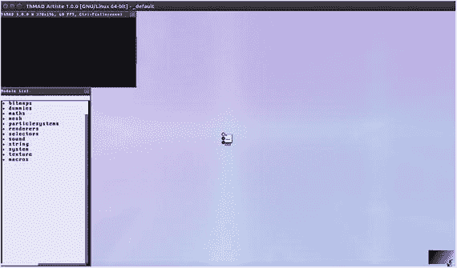
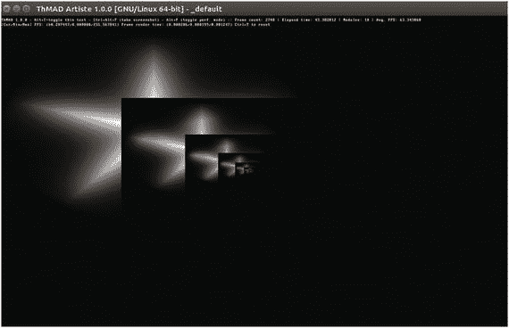
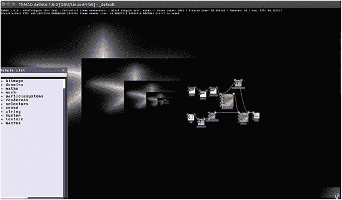
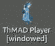
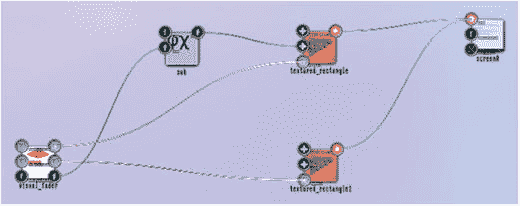

# 3. 程序操作

ThMAD 套件主要由两个程序组成——ThMAD Artiste 和 ThMAD Player。我们将描述如何启动和停止这些程序，包括所有用于控制程序运行的选项。此外，我们还将描述渐变控制器（faders），它用于在 Player 内部的多个可视化之间进行过渡。

## ThMAD Artiste 操作

ThMAD Artiste 是用于创建可视化草图（称为状态）并在预览模式中查看它们的程序。

### 启动与使用不同模式

如果您按照第 2 章“可视化基础”中的安装说明操作，桌面上会找到两个启动器：它们实际上只是指向以下内容的链接。

 以窗口化模式启动 Artiste

 以全屏模式启动 Artiste

窗口化模式：

```
/opt/thmad/thmad_artiste
```

全屏模式：

```
/opt/thmad/thmad_artiste -f
```

这些内容将在本章中详细说明。

从终端启动——您可以通过 `Ctrl+Alt+T` 打开终端——其概要如表 3-1 所示。

| `/opt/thmad/thmad_artiste [选项 1 选项 2 ...]` |
| --- |
| `选项` | `描述` |
| `<无>` | 以窗口化模式启动 Artiste。显示用于创建草图的画布、一个小预览窗口和一个模块列表。 |
| `-help` | 显示帮助信息并立即退出程序。 |
| `-h` | 与 `-help` 相同。 |
| `-sm` | 打印所有检测到的显示器并立即退出程序。您可以使用输出来为 `-m` 选项指定显示器编号。 |
| `-m mon` | 在全屏模式下使用编号为 `mon` 的显示器。如果未与 `-f` 选项同时使用，则无效。 |
| `-f` | 以全屏模式启动 Artiste。无法在程序内部切换至全屏模式。您可以通过按下 `Escape` 键退出此模式。可与 `-ff` 和 `-fn` 选项结合使用。 |
| `-ff` | 以全窗口模式启动 Artiste。图形输出将使用完整的窗口空间。之后您可以通过按下 `Ctrl+F` 切换回非全窗口标准模式。 |
| `-fn` | 如果在全窗口模式下，则隐藏标题区域中的信息文本。 |
| `-s 1024x860` | 在窗口化模式下设置窗口大小。`1024x860` 仅为一个示例；请参阅 `-sm` 选项的输出以获取可能的值。 |
| `-p 200x100` | 设置窗口位置；`200x100` 仅为一个示例。 |
| `-novsync` | 实验性。禁用双缓冲。 |
| `-gl_debug` | 实验性。激活特殊的 OpenGL 调试功能。 |
| `-port 3267` | 启动一个 TCP/IP 端口，用于从外部向 ThMAD 发送控制命令。`3267` 仅为一个示例。该协议的细节不属于本书范畴。 |
| `-sound_type_alsa` | 直接使用 ALSA API，而非 PulseAudio。 |
| `-sound_type_jack` | 使用 JACK 声音服务器端点进行连接。 |
| `-snd_rtaudio_device=5` | 如果使用 ALSA 或 JACK，则指定要使用的音频设备。音频设备在启动时列出，但必须存在 `audio_visualization_listener` 模块。 |

如果您使用了 Artiste 桌面启动器，或者在终端中输入 `/opt/thmad/thmad_artiste` 来启动 Artiste，它将在一个窗口中显示，如图 3-1 所示。在此窗口化模式下，左上角会有一个小的输出子窗口，图形将在其中绘制。您可以通过在该预览窗口内点击并拖动来在画布上移动它，并通过点击并拖动其边框或角来更改其大小。



有关如何使用 GUI 的详细信息，请参阅第 7 章，其中包含 ThMAD GUI 参考指南。

在 Ubuntu 中，您可以通过按下 `Print` 键（带或不带 `Shift` 键）来截取窗口或窗口部分内容的快照。在窗口内部，您可以通过按下组合键 `Ctrl+F` 切换到全窗口模式。此时 GUI 元素会消失，输出将使用完整的窗口空间。如图 3-2 所示。



默认情况下，全窗口模式会在标题区域显示一些状态信息。要禁用或启用此状态显示，您可以按下一次或两次 `Alt+T`。

您也可以使用 `-fn` 选项启动 Artiste，以便从一开始就禁用状态信息。要从全窗口模式返回到窗口化模式，请再次按下 `Ctrl+F`。

还有一种性能模式，它会叠加显示状态创建画布和图形输出，如图 3-3 所示。



要启用性能模式，请以全窗口模式启动，或切换到全窗口模式，然后按下 `Alt+F`。从构建角度讲，性能模式功能完备。当您编辑渲染管线时，草图的输出将实时绘制在整个背景上。再次按下 `Alt+F` 即可退出性能模式。在性能模式中，您也可以通过按下一次或两次 `Alt+T` 来切换标题信息行的可见性。

Artiste 也可以以全屏模式启动；为此，请使用桌面上相应名称的启动器，或通过以下命令从终端启动 Artiste：

```
/opt/thmad/thmad_artiste -f
```

可以包含您想要添加的任何其他选项。在全屏模式下，所有窗口快捷键均可使用。

要在任何模式下退出程序，请按下 `Escape` 键，或者如果有关闭按钮，点击窗口的关闭按钮，或者在画布空白处右键单击后使用弹出的主菜单窗口。

目前无法让 ThMAD 直接将图形数据渲染到视频文件中，但您可以使用其他程序来实现此目的；更多信息请参阅第 2 章。

### 停止 ThMAD Artiste

可以通过以下方法停止 ThMAD Artiste：

- 在画布空白处右键单击弹出的主菜单中，点击**退出（Exit）**。ThMAD 会检测您是否保存了更改，如果未保存，将询问您是否真的要退出。
- 按下 `Escape` 键。同样，如果有未保存的更改，ThMAD 会提示您。
- 渲染管线中有一个名为 `system → shutdown` 的模块，您可以将其放置在画布上并连接到屏幕模块 `screen0`。一旦该模块的输入值超过 1.0，系统将关闭。

#### 注意

`shutdown` 模块毫不留情——所有未保存的数据都将丢失。如果您以任何方式使其输入在下一次状态启动时接收到大于 1.0 的数字，您将永远无法再次打开该状态，除非您使用文本编辑器手动更改状态文件。但这很容易——只需从状态文件中删除 `component_create system;shutdown ...` 这一行即可。

请注意，关于 `shutdown` 模块，ThMAD 的一个常见特性是，如果某个模块未连接到最终通向 `screen0` 模块的子管线，它将永远不会运行。这就是为什么它必须连接到（例如）`screen0` 本身才能正常运行，即使它不产生图形数据。

### 启动时出现错误

如果出现错误消息提示无法加载某个模块，原因可能是您的状态文件来自 ThMAD 的早期版本。虽然我们在向后兼容 ThMAD 前身方面付出了大量努力，但某些旧模块可能遗留下来，在这些情况下 Artiste 将显示一个空状态。

您仍有机会使用系统程序进行修复。使用文本编辑器从以下文件中打开状态文件：

```
/home/[USER]/thmad/[VERSION]/data/states
```

并删除以以下内容开头的相应行：

```
component_create [NAME]
```

之后，启动 Artiste GUI 时将显示状态文件的其余部分。如果该模块很重要，请尝试从模块列表或模块浏览器中寻找替代品。

# ThMAD 播放器操作

完成 Artiste 中的状态后，您可以使用其导出功能将状态转换为可视化内容。具体操作为：在画布的空白处右键单击，从弹出的 Artiste 主上下文菜单中选择 `编译 → 音乐可视化` 命令。

## 启动与使用不同模式

在默认操作模式下，播放器会递归注册其在用户数据文件夹中找到的所有可视化内容，并逐一播放。如果您习惯使用 ThMAD 的前身 VSXu（该软件默认在安装文件夹中查找），则需要了解这一差异。

此外，与 Artiste 的操作不同，播放器支持渐变器。当从一个可视化切换到另一个时，渐变器会引入过渡效果。本章后续部分将对其进行说明。这里仅提及：渐变器通过 Artiste 创建，并使用 `编译 → 音乐可视化渐变器` 菜单命令导出。它们最终位于 `faders` 文件夹中。

播放器不会自动检测您的导出内容，因为播放器和 Artiste 的数据空间是分开的。为了使导出的状态可用于 ThMAD 播放器，您需要将可视化内容和渐变器从以下文件夹：

```
/home/[用户]/thmad/[版本]/data/visuals
/home/[用户]/thmad/[版本]/data/faders
```

复制到以下文件夹：

```
/home/[用户]/thmad/[版本]/data/player_visuals
/home/[用户]/thmad/[版本]/data/player_faders
```

或者，您也可以将它们复制到其他位置，并通过启动选项告知播放器查找路径；`-path` 标志将在稍后说明。

默认情况下，安装时只有少量可视化内容和渐变器可供播放器使用。您可以在以下文件夹中找到更多可视化内容和渐变器：

*   `/opt/thmad/share/thmad/player_visuals`
*   `/opt/thmad/share/thmad/example_visuals`
*   `/opt/thmad/share/thmad/player_faders`
*   `/opt/thmad/share/thmad/example_faders`

您可以将它们复制到 `player_visuals` 和 `player_faders` 文件夹中。请注意，其中一些内容仅在有音频输入时才会显示明显的输出效果。

如果您按照第 2 章的安装说明操作，桌面会出现两个启动图标：

 以窗口模式启动播放器

 以全屏模式启动播放器

它们是以下命令的链接。

窗口模式：

```
/opt/thmad/thmad_player
```

全屏模式：

```
/opt/thmad/thmad_player -f
```

您也可以直接在终端中调用这些命令。如果选择这样做，包括 `-f` 标志在内的完整选项列表可在表 3-2 中查看。

**表 3-2. 来自终端的 ThMAD 播放器选项**

| `/opt/thmad/thmad_player [选项 选项 ...]` |
| --- |
| 选项 |  |
| `<none>` | `/home/[用户]/thmad/[版本]/data/player_visuals` 使用 `/home/[用户]/thmad/[版本]/data/player_faders` 中找到的所有渐变器。可视化内容和渐变器以随机顺序播放，每个持续 30 秒。请注意，`/home/[用户]/thmad` 是 `/home/[用户]/.local/share/thmad` 的符号链接。 |
| `-help` | 显示帮助信息并立即退出程序。 |
| `-h` | 与 `-help` 相同。 |
| `-path PATH` | 不从本地用户数据路径加载可视化内容。请参考 `<none>` 选项。改为从路径 `PATH/player_visuals` 加载所有可视化内容，并使用 `PATH/player_faders` 中找到的所有渐变器。 |
| `-dr` | 禁用随机化器。播放器将不再自动循环切换可用可视化内容。但选中的可视化内容仍然是随机的。 |
| `-rb 20` | 如果随机化器未被禁用，则在切换到下一个可视化之前至少等待 20 秒（或您选择的任何其他数字）。如果未提供此选项，默认值为 30 秒。 |
| `-rr 10` | 如果随机化器未被禁用，则对其进行随机化。可视化运行时长将在 `-rb` 选项的基础数值与 `-rb` 数值加上 `-rr` 数值之间随机选择。在此示例中，范围为 20 到 30 秒。如果未提供此选项，默认值为 0 秒。 |
| `-f` | 以全屏模式启动。 |
| `-sm` | 列出可用的显示器及显示器模式。 |
| `-m 2` | 如果在全屏模式下，使用 2 号显示器（可自由选择）。 |
| `-fm` | 列出全屏模式下的可用视频模式。取决于所选显示器（参见 `-m` 选项）。 |
| `-p 300x200` | 如果在窗口模式下，将窗口位置设置为 (300;200)。可自由选择。 |
| `-s 640x480` | 如果在窗口模式下，指定窗口大小。640x480 仅为示例；您可以选择任意大小。 |
|  | 如果在全屏模式下，此选项可用于请求分辨率。ThMAD 随后会尝试找到最佳匹配。参见 `-fm` 选项查看可用视频模式列表。如果未提供此选项，且请求了全屏模式和可能的显示器，视频模式将根据您当前设置自动选择。让系统自动选择是推荐做法。¹ |
| `-no` | 无启动画面和覆盖层。意味着将立即从第一个可视化开始播放，并且不在其开始时显示可视化名称。 |
| `-lv` | 列出播放器识别的可视化内容。如果使用了 `-path` 选项，则取决于该选项。 |
| `-lf` | 列出播放器识别的渐变器。如果使用了 `-path` 选项，则取决于该选项。 |
| `-port 3267` | 启动一个 TCP/IP 端口，用于接收从外部控制 ThMAD 的命令。3267 仅为示例。协议细节不属于本书范围。 |
| `-sound_type_alsa` | 直接使用 ALSA API，而非 PulseAudio。 |
| `-sound_type_jack` | 连接至 JACK 声音服务器端点。 |
| `-snd_rtaudio_device=5` | 如果使用 ALSA 或 JACK，指定要使用的音频设备。音频设备会在启动时列出，但必须存在 `audio_visualization_listener` 模块。 |

¹ 如果在全屏模式下请求特定分辨率，可能导致 ThMAD 程序终止，并以新分辨率显示桌面。如果希望切换回您习惯的分辨率，可能需要手动恢复分辨率设置或重启桌面。

与 ThMAD Artiste 不同，在播放器中，可视化内容会立即覆盖整个窗口或屏幕，并且没有类似 Artiste 的上下文菜单。不过，您可以按 `F1` 键获取一些基本的屏幕帮助信息。

## 停止 ThMAD 播放器

可以通过以下方法之一停止 ThMAD：

*   当焦点在 ThMAD 播放器窗口上时，按 `Escape` 键。在全屏模式下，无需焦点。
*   如果在构建状态时，将 `模块系统 → 关闭` 放置在画布上并连接到 `screen0`，那么一旦该模块的输入值超过 1.0，系统将会关闭。

### 创建与安装淡入淡出效果器

淡入淡出效果器是当播放器从一种视觉画面切换到另一种时，实现平滑过渡的程序。它们通过 Artiste 创建，并导出为特殊的淡入淡出视觉效果器，随后即可供播放器使用。

构建并安装自定义淡入淡出效果器的详细步骤如下：

1.  启动 ThMAD Artiste，使用一个仅包含 `screen0` 模块的洁净画布。
2.  从主上下文菜单中，右键点击画布的空白区域，然后选择“`New → Transition for ThMAD Player`”菜单项。
3.  此时会呈现一个状态，并以 `Module System → visual_fader` 作为其主模块启动；参见图 3-4。该模块负责控制淡入淡出过程。将其两个纹理类型输入视为盲输入——当淡入淡出效果器在播放器内运行时，这两个输入将接收正在过渡的两个状态。你在此处可能连接的任何内容都将被静默忽略。真正重要的是它的两个输出——当淡入淡出效果器运行时，它们将两个正在过渡的状态以纹理形式呈现给渲染进程，并最终按照 ThMAD 的常规流程进入 `screen0` 模块。

    

    **图 3-4.** 一个基本的淡入淡出过渡状态

    另一个名为 `fade_pos_out` 的输出锚点，用于提供过渡的状态。当过渡开始时，其值为 `0.0`，过渡结束时为 `1.0`。请注意，仅在 Artiste 中构建淡入淡出效果器时，该值看起来是振荡的。这仅用于演示目的——当它在播放器中运行时，从 `0.0` 到 `1.0` 的过渡仅在两个视觉画面之间发生一次。
4.  `transition_length` 输入锚点指定了过渡所用的秒数。
5.  如果你希望之后继续处理该状态，则必须在首次保存它。在这种情况下，如果未保存就关闭 Artiste 将导致数据丢失。下次加载它时，Artiste 会像处理任何其他状态一样处理它，包括在关闭时检查可能的数据丢失。
6.  如果你想安装该淡入淡出效果器以供播放器使用，请通过主上下文弹出菜单导出它。记住，你需要右键点击画布的空白区域，然后选择“`Compile → Music Visual Fader`”。之后，你可以在 `/home/[USER]/thmad/[VERSION]/data/faders` 文件夹中找到该淡入淡出效果器。使新的视觉淡入淡出效果器对播放器可用。如果你希望播放器使用其默认数据路径，则将其复制到 `/opt/thmad/share/thmad/player_faders`，或者复制到以下路径：

    ```
    /home/[USER]/thmad/[VERSION]/data/player_faders
    ```

    关于工作中使用的 `-path` 选项，请参阅本章前面的“启动和使用不同模式”一节。

## 本章小结

在本章中，你学习了如何调用 ThMAD Artiste 和 Player，以及从终端内使用启动器时有哪些选项。你了解到 Artiste 可以在窗口内运行，也可以覆盖整个屏幕。它还可以在同一屏幕上混合输入和输出。

在下一章中，你将学习 ThMAD 中使用的 3D 概念：坐标系、空间映射、光照以及 ThMAD 视角下的 3D 对象。

