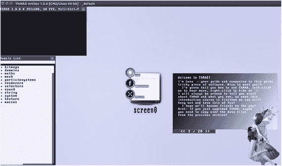
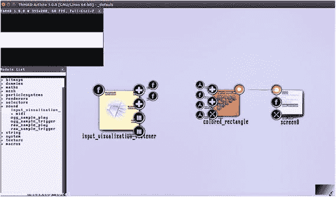
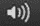
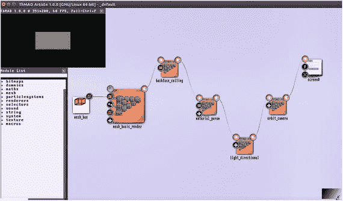
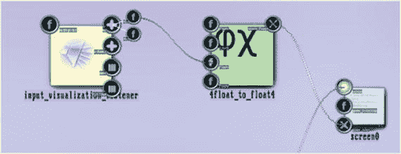

# 基础示例

本节将展示两个基础示例，一个用于 2D，另一个用于 3D。

## 基础 2D 示例

作为第一个示例，我们将描述一个渲染管线的配置，它由一个简单的 2D 矩形组成，并对来自音乐播放器的声音输入做出反应。

**注意**

本示例的源文件位于`TheArtOfAudioVisualization`文件夹下的`A-2.2.1_Visualization_basics_basic_samples_basic_2d_sample`路径中。你可以通过右键点击画布空白区域，选择`打开…`来加载它。

首先启动`ThMAD Artiste`。如果你按照本章所述方式安装，可以双击桌面上的启动器图标，或通过`Ctrl+Alt+T`打开终端并输入`/opt/thmad/thmad_artiste`。如果使用终端，你会看到一些诊断输出，特别是显示声卡驱动上下文的信息。这在某些情况下可能会有所帮助。

`ThMAD Artiste`画布将会显示。如果你是首次启动且没有之前的工作内容，画布中央只会显示一个极小的模块图标。`ThMAD`中所有 GUI 元素（包括文本字体）的大小都是相对的，因此你可以先最大化窗口以提高可读性。接下来你可以缩放场景并平移视图来移动视口。缩放时，可以按键盘上的`W`和`R`键或使用鼠标滚轮。平移时，可以使用方向键或`S`、`D`、`F`、`E`键，也可以点击画布空白区域并拖拽鼠标。此时屏幕将如图 2-11 所示。


图 2-11. ThMAD Artiste 启动界面（已放大）

在右下角，显示了最小化的助手。按`Tab`键可在不同大小之间切换。虽然助手会显示一些关于如何使用 GUI 的信息，但更完整的 GUI 描述请参见第 7 章“Artiste GUI 参考”。助手有不同模式并显示不同内容。你可以通过右键点击助手并选择出现的条目来更改模式或内容；参见图 2-12 和图 2-13。



图 2-13. 助手


图 2-12. 助手模式

如果选择`自动模式`，助手随后会显示上下文相关的信息。每当你点击画布上的某个模块图标，助手内就会显示关于该模块的信息。点击`课程`可以阅读一系列帮助提高 GUI 使用熟练度的课程。选择`键位/鼠标参考`则会显示键鼠使用参考。

在本书的其余部分，我们将助手保持最小化。请记住，你可以通过多次按`Tab`键来实现这一操作。

现在我们来绘制一些东西。为此，点击左侧模块菜单中的`渲染器`，然后点击`基础`。在弹出的项目中，点击`彩色矩形`并将其拖拽到画布上，放到`screen0`模块旁边。参见图 2-14。


图 2-14. 在画布上放置一个矩形 为了在黑色预览窗口中看到内容，这些模块仍需进行连接。


目前还没有任何显示。你首先需要将`colored_rectangle`的输出连接到`screen0`的输入。看到模块边框上的锚点了吗？通常来说，形状和颜色相同的锚点是可以连接的，这正是我们接下来要做的操作。`colored_rectangle`的一个锚点标有`render_out`，`screen0`的一个锚点标有`screen`，它们看起来相似。要连接它们，请单击其中任一锚点，然后将其拖拽至另一个锚点。连接完成后，画布上会显示连接线，左上角的预览窗口则会显示这个矩形。见图 2-15。


**图 2-15. 连接并绘制矩形**

你可能想知道 ThMAD 中的绘制大小和位置是如何确定的。对于 3D 草图来说会更复杂，但我们稍后会再讨论。对于当前这个 2D 草图，绘制画布覆盖了 x-y 平面内从左下角(-1;-1)到右上角(+1;+1)的坐标区域，矩形的放置位置使其中心与画布中心(0;0)对齐。此外，它首次被放置到画布上时的大小为 2.0 x 0.6。不同的形状遵循不同的惯例，但通常形状的默认中心位置都是(0;0)。

绘制输出已经显示在画布左上角的一个小窗口中，但你可以更改视图模式。按下`Ctrl+F`可以最大化预览窗口，随后如果你愿意，可以按下`Alt+F`创建一个覆盖层。这个覆盖层将图形输出和模块画布完全融合在一起，并保留所有 GUI 输入功能。这是一个极其强大的特性，因此被称为性能模式。再次按下`Alt+F`或`Ctrl+F`将恢复到之前的视图模式。

接下来，我们想利用声音来动态改变这个矩形的朝向。为此，我们将`input_visualization_listener`模块放置在画布上。你可以在左侧模块的“Sound”（声音）部分找到它。点击“Sound”就能看到。或者，你也可以在窗口的搜索栏中输入模块名称。点击“Module List”（模块列表）标题下方的空白区域，然后输入`input_visualization_listener`或其适当的部分。你会发现只需输入前三个字母，就能将整个列表筛选到我们正在寻找的模块。如果你想禁用筛选功能，清除搜索栏即可。可以使用常规的退格键或删除键进行清除，或者按一次`Ctrl+Del`键。此外，定位模块的第三种方法是，双击画布的空白区域以打开图形化模块浏览器（见图 2-16）。在那里你也能找到它。在浏览器中，点击空白处并拖动鼠标进行导航。将鼠标悬停在一个条目上可查看其信息，点击并拖动一个条目可将其放置在画布上。右键点击空白处可关闭浏览器。


**图 2-16. 模块浏览器**

将`input_visualization_listener`模块拖拽到画布上之后，你需要将当前声音音量连接到矩形的绘制角度。看到`input_visualization_listener`右上角的`vu`锚点，以及`colored_rectangle`模块左上角的`spatial`锚点了吗？它们都是所谓的复合锚点，用`+`号表示。它们包含子锚点。你不能连接复合锚点，只能连接非复合锚点或子锚点。要显示模块的子锚点，请点击它们；见图 2-17。现在，将`input_visualization_listener`模块的任意一个`vu`子锚点连接到`colored_rectangle`模块的`angle`子锚点。



**图 2-17. 已打开的子锚点**

如果正在播放声音并且一切设置正确，你就会看到矩形随着音乐的节奏摆动起来；见图 2-18。


**图 2-18. 摆动的矩形**

恭喜你，你刚刚完成了第一个音频可视化！要保存它，只需将光标移动到画布的空白处，然后按`Ctrl+S`。屏幕会短暂闪烁，提示你管道已保存。

如果看不到矩形摆动，请检查 PulseAudio 音频服务器是否正在运行，并且是否正在向 ThMAD 发送数据。如果它没有运行，你不仅无法在 PulseAudio 下听到任何音乐播放，而且 Ubuntu 桌面的声音图标应该看起来像这样：，即不是灰色或带有叉号，像这样：。

要检查 PulseAudio 是否向 ThMAD 发送数据，请交叉参考第 1.2 节。作为最后的检查手段，按`Ctrl+Alt+T`从终端启动 ThMAD Artiste。然后输入`/opt/thmad/thmad_artiste`。在终端内部，你应该能看到类似以下的诊断输出：

```
rtaudio_record.h audioprobe()
Audio Type = Linux PulseAudio
Available APIs:
Linux ALSA
Linux PulseAudio
Current API: Linux PulseAudio
Found 1 device(s) ...
Device Name = PulseAudio
Probe Status = Successful
Output Channels = 2
Input Channels = 2
Duplex Channels = 2
This is the default output device.
This is the default input device.
Natively supported data formats:
16-bit int
32-bit int
32-bit float
Supported sample rates = 8000 16000
22050 32000 44100 48000 96000
```

这个列表中特别重要的几项是：

*   `Found 1 device(s)`（或更多个）。如果是 0，意味着 ThMAD 无法连接到音频服务器。
*   `Device Name = PulseAudio`。这是默认的音频服务器。若要实际为 ThMAD 配置非 PulseAudio 驱动（如 ALSA 和 JACK），预计需要做更多工作。至少你需要添加`-sound_type_alsa`或`-sound_type_jack`选项来使用 ALSA 或 JACK。如果你没有使用默认设备，还必须指定`-snd_rtaudio_device=<NUMBER>`，其中`<NUMBER>`可以从终端程序输出中确定。
*   如果 16 位`int`不是支持的格式，你可能使用了非常罕见的声卡，或者声卡驱动有问题。如果 44100 不在支持的采样率列表中，你可以要求 ThMAD 使用不同的采样率。这只能在从终端启动 ThMAD 时完成，你只需要添加例如`-snd_sample_rate=48000`参数。


### 基础 3D 示例

`ThMAD` 运行于 `OpenGL` 之上，`OpenGL` 是一种 3D 渲染技术，广泛应用于游戏以及工业级软件项目和产品中。据此，如果 `ThMAD` 无法提供 3D 渲染能力，我们会感到相当失望。好消息是，它具备这个能力。

然而，有必要说明的是，为了在 `ThMAD` 的 3D 世界中看到任何东西，从一开始就需要考虑一些重要的方面：

-   在许多情况下，我们需要定义物体的表面材质。
-   我们需要处理因被其他物体遮挡而不可见的物体表面部分。
-   在许多情况下，我们需要光源。
-   我们需要一个摄像机来将 3D 场景投影到 2D 显示器上。

关于 3D 渲染，还有很多可以讨论的内容，你可以通过阅读第 5 章“3D 概念”来获得更深入的理解。但为了指出最基本、最重要的方面，我们提供了一个非常基础的 3D 渲染管线。

但在此之前，如果你按照步骤构建了 2D 示例草图，你可能会错过关于文件命名的说明。`ThMAD` 中的草图通常被称为状态（state），并且必须保存在内部。原因是，当 `ThMAD` 以其默认配置启动时，它会自动加载一个名为 `_default` 的状态，并且当你随时按下 Ctrl+S 时，当前状态将再次以 `_default` 的名称保存。可以将 `_default` 视为状态的临时工作名称。但是，如果你想妥善保存以供日后使用，你应该给它起一个合适的名称。为此，请启动 `ThMAD Artiste`（如果它尚未运行并显示你想保存的状态），在某个空白处右键单击，然后从弹出菜单中选择“另存为...”。在出现的弹出窗口的第一行，为你的状态输入一个名称。在其他行也输入一些内容；它们都是必填项。然后点击“确定”按钮。

**注意**

此示例作为源代码提供，位于 `TheArtOfAudioVisualization` 文件夹下的 `A-2.2.2_Visualization_basics_basic_samples_basic_3d_sample` 路径中。

现在退出 `ThMAD Artiste` 并重新启动它。在窗口标题中，你会再次看到它加载了 `_default` 状态。如果 `_default` 状态不为空，为了从一个空状态开始，请在画布的空白处右键单击，导航到“新建 ➤”，然后点击“空项目”。现在，除了 `screen0` 模块之外的所有模块都应该消失了。

请注意，`ThMAD` 的这种启动行为，更准确地说，是自动且无条件地加载 `_default` 状态，可以在主弹出菜单的配置中进行调整。在那里，你可以将其设置为加载最后保存的状态，而不是默认状态。对于 3D 管线，现在请按如下步骤开始：

1.  `OpenGL` 和 `ThMAD` 中的 3D 物体由构成网格（mesh）的点来定义，而网格则定义了物体的表面。例如，一个立方体网格由六个面和八个点组成。我们从这样一个立方体网格开始，它在 `ThMAD` 中被称为 `mesh_box`。在模块菜单中，你可以通过选择 Mesh → Solid → `mesh_box` 或在模块浏览器中相同的路径找到它。请记住，双击画布可以打开图形化模块浏览器。将 `mesh_box` 拖放到画布上。
2.  `mesh_box` 定义了 3D 物体，但它不会渲染它。一个合适的渲染器叫做 `mesh_basic_render`，你可以通过 Renderers → Mesh → `mesh_basic_render` 找到它。将其放置在 `mesh_box` 模块旁边，并将它们连接起来——将前者的“mesh”锚点连接到后者的“mesh_in”锚点。
3.  接下来，你需要告诉 `ThMAD` 处理隐藏面。将模块 Renderers → `opengl_modifiers` → `backface_culling` 放到画布上，并将其连接到 `mesh_basic_render` 的 `render_out` 锚点。将 `backface_culling` 的状态锚点切换为 `ENABLED`。
4.  现在，3D 物体需要表面属性：导航到 Renderers → `opengl_modifiers` → `material_param`。将其放到画布上，并连接到 `backface_culling`。
5.  为了摆脱永恒的黑暗，你需要光源。在 `ThMAD Artiste` 中，选择 Renderers → `opengl_modifiers` → `light_directional`。将光源放在 `backface_culling` 旁边，并将它们连接起来。点击打开“属性”复合锚点，然后将 `light_directional` 的 enabled 锚点切换为 `YES`。
6.  你差不多完成了。为了真正看到 3D 场景，我们还需要一个摄像机。有几种可供选择，我们选择这个：Renderers → `opengl_modifiers` → cameras → `orbit_camera`。将其放在光源旁边，并将它们连接起来。
7.  最后，将 `orbit_camera` 连接到 `screen0`。

现在你终于能看到一些东西了；见图 2-19。这个结果有点单调，因为我们正对着 x-y 平面，所以只能看到立方体的一个面。



**图 2-19.** 第一个 3D 状态

为了解决这个问题，首先改变光源的颜色。同样在 `light_directional` 的“属性”复合锚点内，右键单击 `diffuse_color` 锚点，并从弹出菜单中选择“颜色控制”。从该控件中——参见图 2-20——选择你喜欢的任何颜色。点击并拖动左上角区域选择色相，然后点击大的方形区域选择饱和度和明度。你也可以在该区域拖动，以在预览窗口中看到即时变化。双击右上角区域退出控件。


**图 2-20.** 颜色选择控件

你可能已经注意到，它看起来不太像立方体的一个面，反而更像一个矩形棱柱的一个面。这是因为你的显示器很可能具有非 1:1 的宽高比。有一个简单的解决办法：打开 `orbit_camera` 模块的“摄像机”复合锚点，并将“透视校正”锚点切换为 `YES`。

不过，它看起来仍然不太像 3D 物体。为了释放第三维度的力量并将其显示为一个立方体，你需要旋转摄像机位置，从一个不同的角度观察场景。为此，请打开 `orbit_camera` 模块名为“摄像机”的复合锚点。在里面你会找到一个名为“旋转”的锚点。右键单击它并选择“轴视图”。将会出现一个彩色的十字；参见图 2-21。


**图 2-21.** 轴视图锚点控件


在其中心附近点击并拖动，你会看到摄像机围绕场景中心旋转，该中心恰好也是立方体的中心。满意后，双击即可关闭控制。你的结果可能与图 2-22 类似。


图 2-22. 精细化的三维场景

作为最后一步，你将添加对声音的响应。将`sound → input_visualization_listener`放置在`screen0`模块附近。对模块`maths → converters → 4float_to_float4`也执行相同操作，它将帮助我们控制颜色。

将`4float_to_float4`的输出锚点`result_float4`连接到`screen0`的输入锚点`clear_color`。同时将`input_visualization_listener`的`vu`下的一个`vu_*`子锚点连接到`4float_to_float4`的第三个输入锚点。参见图 2-23。



图 2-23. 三维草图的声音输入

`input_visualization_listener`的`Multiplier`输入锚点控制对声音的灵敏度。要为其赋予除默认值`1.0`以外的值，双击该锚点，然后在出现的旋钮上点击并拖动。然后赋予一个新值，例如`0.3`。双击关闭旋钮。

`4float_to_float4`的四个输入锚点负责解复用屏幕清除颜色，因此它们分别代表背景颜色的 RED（红）、GREEN（绿）、BLUE（蓝）和 ALPHA（透明度）通道。再次通过点击锚点并使用旋钮更改其值，将 RED 和 GREEN 锚点设置为`0.0`。将 ALPHA 值保留为`1.0`。

启动声音输入，你应该会看到背景根据声音输入呈现蓝色闪烁效果。如果没有看到，说明你的音量可能太低，应该为`input_visualization_listener`的输入乘数分配一个更高的值。

当然，你可以对任何使用中的颜色值执行相同操作，例如灯光颜色或材质颜色。请随意尝试这些操作。你也可以从`input_visualization_listener`的`vu/vu_*`锚点引出多条连接，连接到其他模块的不同输入锚点。这是 ThMAD 中的一个强大功能，适用于许多模块的大量锚点。反过来，将不同模块的多个输出锚点连接到一个特定模块的单个输入锚点，根据模块和锚点类型也是可行的。例如，多个管线中的多个渲染器可以并行连接到唯一的`screen0`输入。

转到画布上的空白处，按`Ctrl+S`将其保存为`_default`状态，或者右键点击画布空白处并选择“另存为…”，为其命名。请记住，下次启动 ThMAD Artiste 时，`_default`状态会自动打开。但为了将来参考，请使用“另存为…”并为其指定一个持久的名称。

在本书的其余部分，为了尽可能清晰地说明问题，我们将经常使用锚点值表格列表。请注意，默认锚点值仅在对理解状态有显著帮助时才进行解释。此外，连接到其他模块的锚点通常会在正文中描述，仅在少数情况下出现在表格中。

当前状态的锚点值表格呈现如表 2-1、2-2、2-3、2-4 和 2-5 所示。

**表 2-5.** `sound → input_visualization_listener`

| 锚点 | 值 | 描述 |
| --- | --- | --- |
| `multiplier` | `0.3` | 取决于音量大小。 |

**表 2-4.** `maths → converters → 4float_to_float4`

| 锚点 | 值 | 描述 |
| --- | --- | --- |
| `floatc`锚点连接到其他模块。 | | |
| `floata` | `0.0` | 将映射为 RED 颜色值 |
| `floatb` | `0.0` | 将映射为 GREEN 颜色值 |
| `floatd` | `1.0` | 将映射为 ALPHA 值 |

**表 2-3.** `renderers → opengl_modifiers → cameras → orbit_camera`

| 锚点 | 值 | 描述 |
| --- | --- | --- |
| `camera / perspective_correct` | `yes` | 根据屏幕修正宽高比。 |
| `camera / rotation` | `0.71; 0.46; 0.53` | 对于轨道摄像机，表示摄像机的位置。它将朝向目标点。 |
| `camera / distance` | `2.0` | 摄像机到目标点的距离。 |
| `camera / destination` | `0; 0; 0` | 摄像机看向的位置，即三维场景的中心。 |

**表 2-2.** `renderers → opengl_modifiers → light_directional`

| 锚点 | 值 | 描述 |
| --- | --- | --- |
| `properties /light_id` | `0` | 只有在使用多个光源时才需要更改此项。 |
| `properties /enabled` | `YES` | 启用该模块。 |
| `properties /position` | `0; 0; 1` | 表示光线从 xy 平面上方照射。 |
| `properties /ambient_ color` | `0; 0; 0; 1` | 非定向光，黑色=关闭。 |
| `properties /diffuse_ color` | `0.9; 0.6; 0.8;1` | 具有漫反射的定向光。可自行选择。 |
| `properties /specular_ color` | `0; 0; 0; 1` | 具有精确反射的定向光。对于仅有平面表面的对象意义不大。 |

**表 2-1.** `renderers → opengl_modifiers → backface_culling`

| 锚点 | 值 | 描述 |
| --- | --- | --- |
| `status` | `ENABLED` | 启用该模块 |

## 总结

在本章中，我们了解了运行和使用 ThMAD 所需的工具，以及如何安装和配置它。我们还了解了如何从可视化中创建 DVD，并介绍了使用 ThMAD 创建的前两个基本可视化示例。

在下一章中，我们将更深入地探讨 ThMAD 的操作方面，包括其各个部分如何启动，以及可以使用哪些选项来满足特定需求。

