# 4. 3D 概念

如果你想要关于 3D 计算机图形概念的详尽参考，互联网和书店中有大量资料可用。作为 ThMAD 底层技术的 OpenGL 是一个庞大的概念，对其所有主题的完整介绍超出了本书的范围。即便如此，从我们关于音频可视化的特殊视角入手进行介绍也是值得的。此外，本章稍后将描述 ThMAD 如何处理某些图形子管线以及它在 OpenGL 之上自定义图形概念的一些特性。

## 坐标系

三维中的变换涉及空间操作，如平移、缩放和旋转。但在我们开始讨论空间操作之前，我们需要知道如何用计算机程序能够理解的方式来表现 3D 对象，而这会立刻引导我们思考坐标系。

为了简化问题，我们从二维开始。如果你看着电脑屏幕，我们将你看到的平面定义为 `x-y` 平面，该平面上某点的 `x` 坐标表示该点到左边界垂直线的水平距离，`y` 坐标表示该点到底部边界水平线的垂直距离。参见图 4-1。

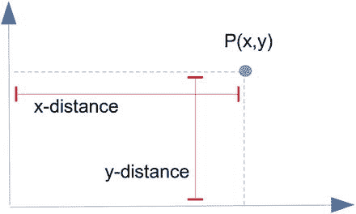

**图 4-1.** X-Y 坐标系

作为 `x` 距离参考的垂直线也称为 `y` 轴，而作为 `y` 距离参考的水平线称为 `x` 轴。我们说我们使用屏幕边界作为轴，但实际上这是一个任意的决定；我们可以使用任何平行于它们的直线。ThMAD 中另一个常见且经常使用的选择是使用屏幕中心的轴，如图 4-3 所示。轴的交点称为原点 `O`，其坐标为 `O(0.0, 0.0)`，因为两个坐标的距离均为零。

图 4-3 中点 `P` 的坐标将被赋予什么数值？在中心点很容易；`x=0` 且 `y=0`。我们需要为远离 `O` 的点定义另一个标准，我们可以将右边界的 `x` 设为 `1.0`，将顶边界的 `y` 设为 `1.0`。由于将 `O` 放置在屏幕中央，作为结果，左边界自动成为 `x=-1.0`，底边界自动成为 `y=-1.0`。参见图 4-2。

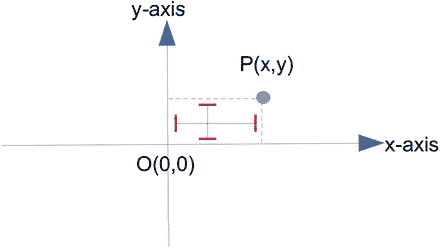

**图 4-3.** X-Y 坐标系，坐标原点位于屏幕中心

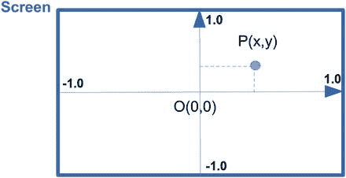

**图 4-2.** X-Y 坐标系，两个维度的缩放范围均为 -1 到 +1

`P(x, y)` 大约位于 `x = 0.4` 和 `y = 0.3`，因此我们现在可以写作 `P(0.4, 0.3)`。

现在我们已经具备了讨论二维点所需的一切。但是第三维和 `z` 轴呢？它必须垂直于 `x` 轴和 `y` 轴，因此它要么从屏幕的前方指向后方，要么指向屏幕内部。

OpenGL 是一个所谓的右手系，这意味着如果你让右手食指按照从 `x` 轴到 `y` 轴的顺序弯曲，那么你的拇指将指向 `z` 轴正方向。坐在屏幕前，从 `z` 轴正方向位置观察 `x-y` 平面。参见图 4-4。

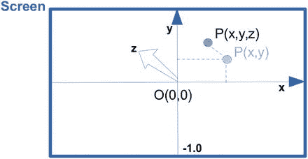

**图 4-4.** X-Y-Z 坐标系

`z` 轴的缩放并不那么明显——在二维屏幕上没有 `z` 轴边界。为了正确处理，OpenGL 执行如下操作：

1. 固定 `x-y` 宽高比。这会缩放 `x` 轴，使得作为输入的矩形：`(-a,-a) → (a,-a) → (a,a) → (-a,a)` 在屏幕上仍然显示为一个真正的正方形，所有边长相等。这显然会改变边界坐标值。假设底部和顶部边界仍然分别是 `-1` 和 `+1`，对于一个 5/4 比例的屏幕，左右边界现在分别是 `-1.25` 和 `+1.25`。
2. 以这样的方式缩放 `z` 轴：使得作为输入的立方体在经过空间任意旋转后，在屏幕上仍然显示为一个立方体，所有边的长度相等。

说了这么多，一个显而易见的定位对象的选项是前面为`(-1,-1,1) → (1,-1,1) → (1,1,1) → (-1,1,1)`，后面为`(-1,-1,-1) → (1,-1,-1) → (1,1,-1) → (-1,1,-1)`的立方体。

当然，您可以随意定位对象并使用任何您喜欢的坐标，但脑海中始终记住那个“双单位立方体”的概念有助于避免意外，例如对象无意且神奇地消失在视野之外。如果您为 3D 场景设置了其他边界框（即包含所有相关对象的最小可能尺寸的盒子），您可以使用平移和缩放将所有内容移入并压缩到单位空间，在那里进行任何所需操作，然后再缩放和平移回来。请参阅本章中题为“空间映射”和“空间操作：平移、旋转和缩放”的章节。

## 空间映射

任何类型的坐标空间，无论是二维还是三维，都可以映射到同类型的另一个空间中，这种映射方式使得构成它们的点之间的内部和相互关系得以以某种方式保持。

这种类型中最重要的变换称为**线性变换**，它由以下计算规则表示：

通过该规则，任意点`P(x, y, z)`被映射到点`P'(x', y', z')`。使用所谓的**齐次坐标**，数学家和我们在需要精确表达时，会通过平移部分扩展这一概念。我们最终使用以下矩阵表示法：

我们将`a14`、`a24`和`a34`替换为`t1`、`t2`和`t3`，以表达它们恒定的平移性质。中间的图形，为简洁起见，我们称之为`(aij, ti)`，称为**变换矩阵**；其余的称为**坐标向量**。点表示矩阵乘法。乘法的形式化规则如下：

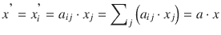

其中`x[1] = x`、`x[2] = y`和`x[3] = z`。符号`Σ[j]`遵循通常的数学规则“对所有`j`求和”。由矩阵表示的变换的优点是，组合变换——例如，先缩放，再旋转，最后平移——可以通过相乘的矩阵来表示：

`OpenGL`（在撰写本书时`Ubuntu`使用的`3.x`版本中）内部使用多个不同的矩阵堆栈。更新版本的`OpenGL`在一定程度上降低了它们的重要性，甚至将其移除，转而支持着色器语言结构，这些结构在`ThMAD`中也可用。本书不介绍着色器语言，但您可以在第 5 章和第 6 章的故事中找到一些使用着色器的示例。

在`ThMAD`中，您通常不直接接触矩阵。对于所有典型的矩阵操作，`ThMAD`都提供了模块——平移、缩放和旋转。您可以通过图形化方式连接任意数量的模块来堆叠它们。在内部，`ThMAD`当然会以上述矩阵乘法的方式组合所有这些操作。了解变换组合操作（或堆叠变换）的概念对您很重要，因为许多状态都使用此类组合变换。

从`ThMAD`的角度来看，变换组合的形式如下，这不仅是实用的，而且在某些用例中是必要的：

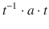

这表示： (1) 首先根据矩阵`t`进行变换，(2) 然后根据`a`进行变换，(3) 最后根据`t`的逆矩阵（由`t^-1`表示）进行变换。看起来像理论数学，不是吗？实际上，它很重要。考虑一个例子。

考虑一个大小为`0.1 x 0.1 x 0.1`、中心位于`(0.5; 0.5; 0.5)`的盒子。您想围绕其中心进行某种旋转`a`。这听起来很奇怪，但`ThMAD`中没有模块能直接做到这一点！但有一个模块可以围绕`(0;0;0)`进行旋转。在这种情况下我们不能使用那个旋转，因为最终盒子的中心会偏移，而我们希望它保持在`(0.5; 0.5; 0.5)`。那么，我们可以执行以下操作来完成这个任务：

1.  首先，通过平移向量`(-0.5; -0.5; -0.5)`移动盒子，使其中心位于`(0;0;0)`。
2.  现在，围绕`(0;0;0)`执行旋转。
3.  然后，通过平移向量`(0.5; 0.5; 0.5)`将其移回原位。

这正是`t^(-1) ∙ a ∙ t`所表达的含义。除了数学符号或手动计算坐标之外，您应该习惯于从图形角度理解“包裹变换”的概念；请参见图 4-5。

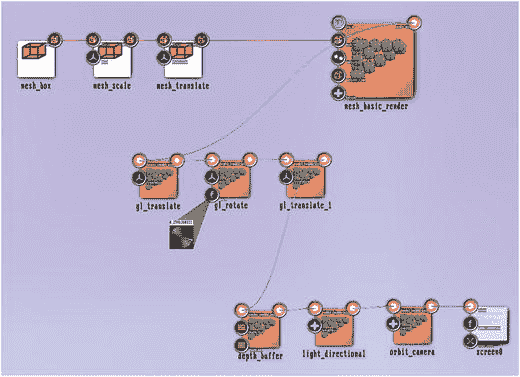

图 4-5.

包裹变换 顶部子管线的功能是生成一个偏离原点的盒子并绘制它。底部子管线仅移除隐藏的表面，放置光源和相机，并将其发送到屏幕。有趣的部分是中间的子管线：它将盒子移回原点，然后围绕原点旋转，再将其移回原位。左侧模块的“平移”锚点值为`(-0.5; -0.5; -0.5)`，右侧模块的相同锚点值为`(0.5; 0.5; 0.5)`。此处打开的“角度”锚点现在可用于绕盒子中心旋转盒子。

注意：此示例作为源代码可在`TheArtOfAudioVisualization`文件夹下的`A-4.2_Embracing_Transformation`中找到。

对于想要了解以下示例中`t`是什么样子的读者（请参阅关于如何构造平移矩阵的章节）：

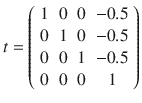

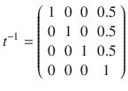

顺便说一下，`t^(-1)`被称为`t`的逆矩阵，因为它们的乘积是单位矩阵：

后者被称为**单位矩阵**，因为对于任何矩阵或向量`a`，都有`a ∙ I = I ∙ a = a`。

# 空间操作：平移、旋转与缩放

现在你已经掌握了上一节中的符号表示，可以轻松地表达平移和缩放操作了。

利用我们引入的矩阵表示方法，沿向量 `(a,b,c)` 平移可得到如下矩阵：

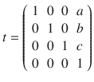

以缩放因子 `(s[1],s[2],s[3])` 进行缩放：

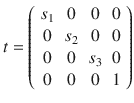

其中，对于使用单个缩放因子 `s` 进行的均匀缩放，分量 `s[1]`、`s[2]` 和 `s[3]` 均相等：`s[1] = s[2] = s[3] = s`。

旋转则略微复杂——我们需要定义旋转的方式。例如，我们可以绕从原点出发的轴 `(u,v,w)`，以某个角度 `φ` 进行旋转。该情况下的公式如下：

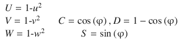

另一种可能性是先绕 `x` 轴旋转一定角度，再绕 `y` 轴旋转一定角度，最后绕 `z` 轴旋转一定角度。相应的变换矩阵可以通过分别设置 `(u,v,w) = (1,0,0) / (0,1,0) / (0,0,1)` 从该公式中轻松推导出来。ThMAD 主要使用组合公式以保持简洁。

描述旋转的第三种可能性是使用四元数。虽然四元数背后的理论并不容易理解，但对于此处目的而言，只需知道四元数是一个由四部分组成的数即可：

`q = (q[1], q[2], q[3], w)`

在给出一系列特殊的四元数计算规则的前提下，它就足以描述空间中的旋转。这只是另一种说法，即对于四元数，我们不需要矩阵运算，而是可以使用专门为其引入的这套新计算规则。

要了解如何在 ThMAD 中执行此类变换，请参考第 5 章。

# 光照暴露

在现实世界中，物体之所以可见，是因为它们反射照射在其上的光。因此，我们需要光源来使物体显现。在 `OpenGL` 和 `ThMAD` 中也是如此，但有两个例外。第一个例外是，某些简单的状态不需要光照。然而，在很多情况下，添加光源并无坏处，并且拥有光源是一种良好的实践。第二个例外是，在 `OpenGL` 和 `ThMAD` 中，你实际上永远无法直接看到光源，只能看到它的反射光。

严格来说，这与现实世界并没有太大不同——如果你看着一盏灯，你看到的光主要来自那里，是因为光线从灯的各个部分反射回来。只有当你有类似点光源的东西时，你才可能在没有任何反射物体的情况下看到光。这种极端情况并不令人尴尬，因此且为简单起见，在 `ThMAD` 或 `OpenGL` 中，不提供直接可见的光源。请注意，仍然存在表面材质自身发光的概念，但这在概念上与材质属性相关，而非光源。详细内容稍后介绍。

因此，在 `OpenGL` 和 `ThMAD` 中，我们有两种与光照相关的对象：灯光（或光源）和材质。

## 光源的类型

从光源的角度来看，为了营造逼真的场景，灯光有四种类型：

### 环境光

可以将其视为无处不在的非定向光。如果你在一个昏暗的房间里，只有一丝光线从窗帘缝隙中透进来，你仍然能看到一种暗淡的光线，它似乎均匀地照亮了房间里的所有物体，又似乎来自四面八方却又无处可寻。只有经验告诉我们，光线来自被照亮的缝隙。这就是环境光的含义，`ThMAD` 和 `OpenGL` 处理它的方式是为所有表面添加一个恒定的颜色值。然而，实际情况要稍微复杂一些，因为材质属性也参与了表面环境光颜色的计算。

### 漫反射光

想象一个位于某点的光源。如果光从该点照射到材质表面，然后从那里均匀地散射到所有可能的方向，这就是漫反射光。这种漫反射通常与表面的材质性质相关。除非你的表面需要完美地 100% 反射照射到它上面的任何光线，否则你的场景中通常都会包含漫反射光成分。因此，它几乎存在于所有 3D 场景中。

### 镜面反射光

如果一束光线照射到材质表面，并以相同的角度从表面反射出去，我们称之为镜面反射光。你需要镜面反射光成分来让你的场景看起来更有光泽、更有趣。

### 屏幕的清除颜色

每帧渲染任何其他内容之前，该颜色将应用于整个场景。因此，它会作为背景颜色显示，并且只有在物体完全或部分透明时，它才会透过物体显现出来。关于不同的光照模式，请参见图 4-6。

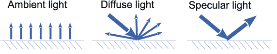

图 4-6.

# 光照反射模式

用于计算反射光的材质参数如下：

-   光源定义的`环境光`对应一种环境反射颜色。最终像素颜色的整体环境光部分，将由光源的环境光颜色的每个`RGB`分量与定义为材质参数的环境光颜色的乘积得出。
-   对于`漫反射光`，某个材质点的像素颜色结果，是通过将入射漫反射光的每个颜色分量与匹配的材质参数的漫反射颜色分量相乘计算得出的。与环境光照不同，光源和表面在空间中的位置对漫反射光而言不起作用，但对于漫反射光，物体的三维特性就展现出来了。
-   当光线照射到表面某点时，`镜面光`不像漫反射光那样向所有方向反射，而是像镜子一样，在法线另一侧以完全相同的角度被反射，参见图 4-6。其计算方式与环境光或漫反射光类似：每个材质参数的`RGB`分量与光照模块相应的`RGB`分量相乘。
-   尤其是对于镜面反射，我们还有一个额外的概念：`shininess`（光泽度），它描述了观察者位置与反射光束之间模糊程度的大小。
-   `自发光`。材质可以在没有专门开启光源的情况下发光。自发光类似于环境光的贡献，但它不与相应的光源参数结合；它是独立的，并添加到所有其他由材质和光源产生的光中。此外，它不会在其他物体上产生任何反射。

示例物体如图 4-7 所示。光线从表面部分发出的方式当然不仅取决于光照和表面属性，还取决于我们观察它的角度。这在内部由投影变换处理，下一节将对此进行介绍。

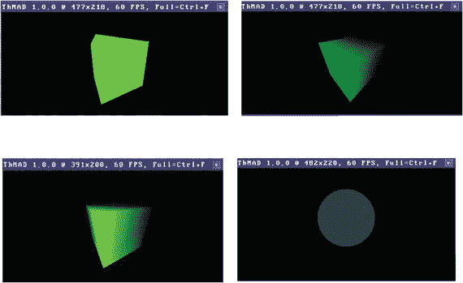

**图 4-7.** 采用不同光照反射模式的物体。在图 4-7 中，左上为环境光，右上为漫反射光，左下为漫反射光和镜面光，右下为自发光，显示了一个三维球体。

## 眼睛与摄像机

当我们在场景中放置一些物体并添加光照和材质属性后，我们需要某种东西或某个人来实际观察场景。由于我们有一个平面屏幕作为这个过程的一部分，并且很明显计算机程序对此有最终影响，这就相当于一个关于将三维场景投影到一个平坦的二维矩形（即屏幕）上的规则。

描述此过程的常见 OpenGL 3.x 方法，是将其与摄影或相机设置进行比较。我们从在三维空间中排列物体开始，这相当于在房间里放置要拍摄的物体，参见图 4-8。

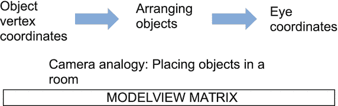

**图 4-8.** 模型视图变换

这部分过程的最终结果是得到观察者坐标系，并由模型视图矩阵栈控制。如果你在没有使用 ThMAD 的情况下进行 OpenGL 编程，你需要显式地告诉 OpenGL 使用模型视图矩阵栈。而使用 ThMAD 时，程序会在模块内部透明地为您完成这项工作。

接下来，摄像机被定位并指向场景，参见图 4-9。

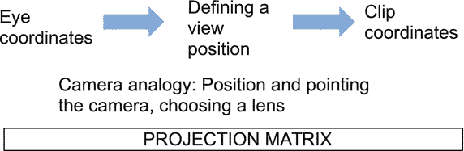

**图 4-9.** 投影变换

OpenGL 内部的这种投影变换还允许指定近裁剪面和远裁剪面，这是真实世界摄影过程中不存在的东西。使用它们，我们可以移除比近裁剪面更近或比远裁剪面更远的物体或物体部分。它们是投影矩阵子过程的一部分，因为在此阶段硬件很容易处理。

之后，OpenGL 系统应用所谓的`w`坐标。这些是内部数字，是矩阵和向量运算的一部分。细节超出了讨论范围——当我们说这里使用的齐次坐标允许使用矩阵进行平移，而三维物体的`3x3`矩阵无法做到这一点时，这足以满足我们的目的。其结果是二维屏幕世界的一部分，称为归一化设备坐标，参见图 4-10。

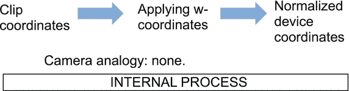

**图 4-10.** 设备归一化

这是一个没有参数的内部子过程，因此没有关联的矩阵步骤。

作为最后一步，选择并应用视口，即我们定义想要看到的实际区域，参见图 4-11。此步骤同样没有与物体相关的参数，因此也没有关联的矩阵栈。

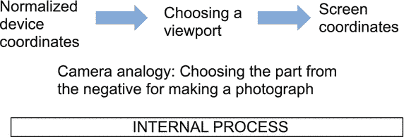

**图 4-11.** 屏幕坐标

注意，直到裁剪坐标和归一化设备坐标，每个顶点的`z`坐标都可被系统使用，并且需要用它来确定哪些内容因被其他物体遮挡而需要从后续渲染中剔除。用相机类比，物理世界为我们完成了这个技巧，但在 OpenGL 内部，这些`z`坐标（在此阶段称为深度）用于确定哪些顶点点可以被排除在后续的渲染过程之外。

遮挡物体的方式本身就是一个有趣的话题。图形硬件的设计投入了大量精力，它能有效计算出哪些内容需要从渲染过程中剔除，因为它们无法被观察者或摄像机看到。准确地说，有两个属性定义了这一点：

-   前述的`深度缓冲区`。这是一个在渲染步骤（即实际在屏幕上渲染像素的步骤）中追踪像素坐标的`z`坐标的缓冲区。也就是说，这是最后的渲染步骤。它的工作原理如下：在深度缓冲区被清除（通常与颜色缓冲区清除一起进行）后，任何新绘制的像素都会将其`z`坐标告知深度缓冲区，并导致以下情况之一：
    -   如果该点的深度缓冲区未初始化，则它将像素的`z`坐标保存到深度缓冲区并渲染该像素。
    -   如果该点的深度缓冲区已定义，且新像素点的`z`坐标大于或等于深度缓冲区中的值，则它将像素的`z`坐标保存到深度缓冲区并渲染该像素。
    -   如果该点的深度缓冲区已定义，且新像素点的`z`坐标小于深度缓冲区中的值，则它丢弃该新像素。由于我们知道更大的`z`坐标意味着离观察者更近，这有效地排除了那些将被遮挡的点。
-   `背面剔除`。这是排除像素的另一种方法，因为它们位于物体的背面。以立方体为例：它的六个面每个都由两个三角形组成（这是内部处理四边形的方式）。每个三角形有三个顶点。现在，如果我们小心地定义它们——如果从角度上看，这三个顶点描述了一个顺时针旋转，则它们被定义为位于背面，否则位于正面。由于这只是对每个表面部分的“是/否”判定，图形硬件可以非常高效地处理。

需要考虑到一些因素才能启用所有这些隐藏魔法，但`ThMAD`与 OpenGL 一起提供了两个专门为此设计的模块：一个背面剔除模块和一个深度缓冲区模块。

## ThMAD 网格

ThMAD 中的网格是对描述 3D 对象的点坐标集合的一种抽象。

要定义网格，需要定义某些类别的对象。相关的概念有：

- **顶点**。这是构成网格的点的三维位置向量数组。
- **顶点法线**。描述表面元素在空间中的朝向。用于正确照亮对象。
- **顶点颜色**。顶点通常会被赋予颜色。
- **顶点纹理坐标**。描述顶点到纹理坐标的映射关系。
- **面**。用于定义网格的预先计算好的表面原子片段。
- **面法线**。其含义与之前描述的顶点法线相同，但关联的是面。此特性不常用。
- **顶点切线**。在一些需要平行于表面元素的向量的模块中使用。

## ThMAD 粒子系统

粒子系统涉及成百上千甚至更多的小型 3D 对象进入场景，遵循一定的生成、移动、交互并最终消亡的规则。你可以使用它们来模拟雾、瀑布、蜡烛、爆炸、有趣的人造效果以及诸如此类的东西。

粒子系统的产生得益于过去几十年图形硬件性能的巨大提升。借助现代的先进（甚至只是中等水平的图形与计算硬件），可以使数十万个粒子同时工作。`OpenGL`内部并没有一个原生的粒子系统概念，但当然，由于需要处理如此多的 3D 对象，使用`OpenGL`概念的方式对于实现可接受的性能至关重要。

幸运的是，`OpenGL`提供了一些用于处理粒子系统的模块，这些模块在内部优化了`OpenGL`的使用方式。这些模块主要涉及：

- **生成粒子**。可以基于单个点或一组点来生成。
- **修改粒子及其轨迹**。包括随机改变粒子大小、精确控制所有粒子大小、施加风力、让其像流体粒子一样运动、使其受重力影响、使其弹跳以及使其旋转。
- **控制粒子的生命周期**。
- **控制粒子的渲染方式**。

尽管用粒子系统做实验既有趣又好玩，但本书并没有专门章节来讲解粒子系统。不过，在第 6 章中有一节内容，提供了更深入的见解并给出了一些示例。

## 总结

在本章中，你学习了 3D 坐标系、移动、缩放和旋转等变换操作，以及灯光和摄像机。此外，你还了解了 ThMAD 中用于 3D 草图绘制的网格和粒子系统。

下一章将包含一系列教程或案例，涵盖了使用 ThMAD 可以实现的大部分功能。

