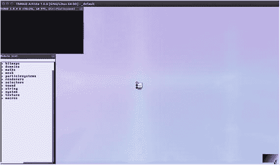
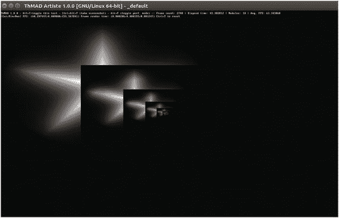
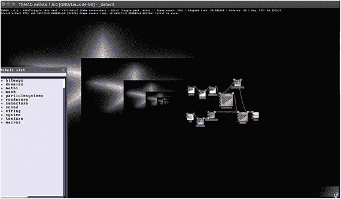

# 3. 程序操作

ThMAD 套件主要由两个程序组成——ThMAD Artiste 和 ThMAD Player。我们将描述如何启动和停止这些程序，包括所有用于控制程序运行的选项。此外，我们还将描述渐变控制器（faders），它用于在 Player 内部的多个可视化之间进行过渡。

## ThMAD Artiste 操作

ThMAD Artiste 是用于创建可视化草图（称为状态）并在预览模式中查看它们的程序。


### 启动与使用不同模式

如果您按照第 2 章“可视化基础”中的安装说明操作，桌面上会找到两个启动器：

它们实际上只是指向以下内容的链接。

 以窗口化模式启动 Artiste

 以全屏模式启动 Artiste

窗口化模式：

```
/opt/thmad/thmad_artiste
```

全屏模式：

```
/opt/thmad/thmad_artiste -f
```

这些内容将在本章中详细说明。

从终端启动——您可以通过 `Ctrl+Alt+T` 打开终端——其概要如表 3-1 所示。

| `/opt/thmad/thmad_artiste [选项 1 选项 2 ...]` |
| --- |
| **选项** | **描述** |
| `<无>` | 以窗口化模式启动 Artiste。显示用于创建草图的画布、一个小预览窗口和一个模块列表。 |
| `-help` | 显示帮助信息并立即退出程序。 |
| `-h` | 与 `-help` 相同。 |
| `-sm` | 打印所有检测到的显示器并立即退出程序。您可以使用输出来为 `-m` 选项指定显示器编号。 |
| `-m mon` | 在全屏模式下使用编号为 `mon` 的显示器。如果未与 `-f` 选项同时使用，则无效。 |
| `-f` | 以全屏模式启动 Artiste。无法在程序内部切换至全屏模式。您可以通过按下 Escape 键退出此模式。可与 `-ff` 和 `-fn` 选项结合使用。 |
| `-ff` | 以全窗口模式启动 Artiste。图形输出将使用完整的窗口空间。之后您可以通过按下 `Ctrl+F` 切换回非全窗口标准模式。 |
| `-fn` | 如果在全窗口模式下，则隐藏标题区域中的信息文本。 |
| `-s 1024x860` | 在窗口化模式下设置窗口大小。`1024x860` 仅为一个示例；请参阅 `-sm` 选项的输出以获取可能的值。 |
| `-p 200x100` | 设置窗口位置；`200x100` 仅为一个示例。 |
| `-novsync` | 实验性。禁用双缓冲。 |
| `-gl_debug` | 实验性。激活特殊的 OpenGL 调试功能。 |
| `-port 3267` | 启动一个 TCP/IP 端口，用于从外部向 ThMAD 发送控制命令。`3267` 仅为一个示例。该协议的细节不属于本书范畴。 |
| `-sound_type_alsa` | 直接使用 ALSA API，而非 PulseAudio。 |
| `-sound_type_jack` | 使用 JACK 声音服务器端点进行连接。 |
| `-snd_rtaudio_device=5` | 如果使用 ALSA 或 JACK，则指定要使用的音频设备。音频设备在启动时列出，但必须存在 `audio_visualization_listener` 模块。 |

如果您使用了 Artiste 桌面启动器，或者在终端中输入 `/opt/thmad/thmad_artiste` 来启动 Artiste，它将在一个窗口中显示，如图 3-1 所示。在此窗口化模式下，左上角会有一个小的输出子窗口，图形将在其中绘制。您可以通过在该预览窗口内点击并拖动来在画布上移动它，并通过点击并拖动其边框或角来更改其大小。



有关如何使用 GUI 的详细信息，请参阅第 7 章，其中包含 ThMAD GUI 参考指南。

在 Ubuntu 中，您可以通过按下 Print 键（带或不带 Shift 键）来截取窗口或窗口部分内容的快照。在窗口内部，您可以通过按下组合键 `Ctrl+F` 切换到全窗口模式。此时 GUI 元素会消失，输出将使用完整的窗口空间。如图 3-2 所示。



默认情况下，全窗口模式会在标题区域显示一些状态信息。要禁用或启用此状态显示，您可以按下一次或两次 `Alt+T`。

您也可以使用 `-fn` 选项启动 Artiste，以便从一开始就禁用状态信息。要从全窗口模式返回到窗口化模式，请再次按下 `Ctrl+F`。

还有一种性能模式，它会叠加显示状态创建画布和图形输出，如图 3-3 所示。



要启用性能模式，请以全窗口模式启动，或切换到全窗口模式，然后按下 `Alt+F`。从构建角度讲，性能模式功能完备。当您编辑渲染管线时，草图的输出将实时绘制在整个背景上。再次按下 `Alt+F` 即可退出性能模式。在性能模式中，您也可以通过按下一次或两次 `Alt+T` 来切换标题信息行的可见性。

Artiste 也可以以全屏模式启动；为此，请使用桌面上相应名称的启动器，或通过以下命令从终端启动 Artiste：

```
/opt/thmad/thmad_artiste -f
```

可以包含您想要添加的任何其他选项。在全屏模式下，所有窗口快捷键均可使用。

要在任何模式下退出程序，请按下 Escape 键，或者如果有关闭按钮，点击窗口的关闭按钮，或者在画布空白处右键单击后使用弹出的主菜单窗口。

目前无法让 ThMAD 直接将图形数据渲染到视频文件中，但您可以使用其他程序来实现此目的；更多信息请参阅第 2 章。

### 停止 ThMAD Artiste

可以通过以下方法停止 ThMAD Artiste：

- 在画布空白处右键单击弹出的主菜单中，点击**退出（Exit）**。ThMAD 会检测您是否保存了更改，如果未保存，将询问您是否真的要退出。
- 按下 Escape 键。同样，如果有未保存的更改，ThMAD 会提示您。
- 渲染管线中有一个名为 system → shutdown 的模块，您可以将其放置在画布上并连接到屏幕模块 `screen0`。一旦该模块的输入值超过 1.0，系统将关闭。

#### 注意

`shutdown` 模块毫不留情——所有未保存的数据都将丢失。如果您以任何方式使其输入在下一次状态启动时接收到大于 1.0 的数字，您将永远无法再次打开该状态，除非您使用文本编辑器手动更改状态文件。但这很容易——只需从状态文件中删除 `component_create system;shutdown ...` 这一行即可。

请注意，关于 `shutdown` 模块，ThMAD 的一个常见特性是，如果某个模块未连接到最终通向 `screen0` 模块的子管线，它将永远不会运行。这就是为什么它必须连接到（例如）`screen0` 本身才能正常运行，即使它不产生图形数据。

### 启动时出现错误

如果出现错误消息提示无法加载某个模块，原因可能是您的状态文件来自 ThMAD 的早期版本。虽然我们在向后兼容 ThMAD 前身方面付出了大量努力，但某些旧模块可能遗留下来，在这些情况下 Artiste 将显示一个空状态。

您仍有机会使用系统程序进行修复。使用文本编辑器从以下文件中打开状态文件：

```
/home/[USER]/thmad/[VERSION]/data/states
```

并删除以以下内容开头的相应行：

```
component_create [NAME]
```

之后，启动 Artiste GUI 时将显示状态文件的其余部分。如果该模块很重要，请尝试从模块列表或模块浏览器中寻找替代品。


