# 7. ThMAD GUI 参考手册

本章是 ThMAD GUI 操作的详尽手册。描述了 Artiste 的所有前端元素，包括主菜单、模块选择器、一些辅助小部件（即助手和检查器），以及不同的操作模式和键盘快捷键。随后介绍了用于描述可视化管线的状态保存与加载概念。我们探讨了什么是模块、模块的类型、如何控制它们以及如何将它们连接到其他模块。导出状态以便日后在 ThMAD Player 中使用、定义子管线的宏描述以及注释小部件的介绍，共同构成了 Artiste 章节的完整内容。

ThMAD Player 是 ThMAD 程序套件中负责展示已完成状态的部分，在 Player 的术语中，这些状态被称为可视化作品。在 Player 章节中，我们描述了所有 GUI 操作选项，更确切地说，是可用于控制 ThMAD Player 的键盘快捷键。

## ThMAD Artiste GUI

### 启动与停止 GUI

启动和停止 ThMAD Artiste 已在第 3 章“程序操作”中描述。本章其余部分假设 Artiste 正在运行。

### ThMAD 桌面及其组成部分

空白状态如图 7-1 所示。

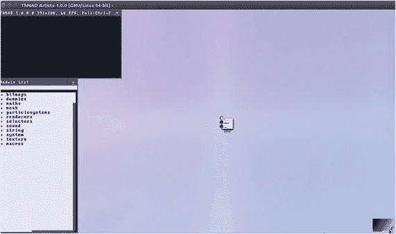

图 7-1. 空白状态

它有一个很大的空白区域，可以用于放置模块。这个区域通常被称为画布。您可以在中心看到一个模块——它是 `screen0` 模块，且始终存在。它代表屏幕输出，无法被删除。

左上角显示的是输出窗口或预览窗口；由于状态为空，因此呈现黑色。在输出窗口下方，您可以找到模块列表。您将使用此列表或图形化模块选择器来选择要放置在画布上的模块。在 Artiste 窗口的右下角，您可以看到最小化的助手。它将帮助您探索模块或参加课程，本章稍后将对此进行描述。

要控制视图，请确保画布获得输入焦点。当您将鼠标移动到画布的空白位置时，画布将获得焦点。请务必理解这一点——在某些用户界面操作下，画布可能不会立即获得焦点，直到您至少稍微移动一下鼠标。如果画布获得焦点，与未获得焦点时相比，它会显得稍微亮一些。

一旦画布获得焦点，您就可以使用表 7-1 中列出的键盘快捷键。

表 7-1. 键盘快捷键

| 按键 | 操作 |
| --- | --- |
| `S` 或 `←` | 向左平移 |
| `F` 或 `→` | 向右平移 |
| `E` 或 `↑` | 向上平移 |
| `D` 或 `↓` | 向下平移 |
| `W` 或 `Page ↓` | 缩小 |
| `R` 或 `Page ↑` | 放大 |
| `Ctrl+S` | 保存当前状态 |
| `Ctrl+F` | 切换全窗口模式 |
| `Ctrl+U` | 将当前状态保存到内存中作为撤销点。许多 GUI 操作会自动创建撤销点，因此您不需要使用 `Ctrl+U`。但某些操作（例如设置模块参数）不会。如果您希望这些操作也可撤销，请在执行操作前按下此键。自动撤销操作的列表在“菜单”部分给出。 |
| `Ctrl+Z` | 如果撤销缓冲区中有内容，则执行撤销。 |
| `Ctrl+C` | 关闭所有打开的控制器。 |
| `Ctrl+D` | 关闭所有打开的复杂锚点。 |
| `Ctrl+O` | 启用或禁用对象检查器。 |
| `Tab` | 更改助手的大小。 |
| `Escape` | 退出程序。如果 ThMAD 检测到未保存的更改，您必须先确认一条警告消息。 |

使用鼠标，您可以执行表 7-2 中列出的操作。

表 7-2. 鼠标操作

| 操作 | 描述 |
| --- | --- |
| 仅移动鼠标 | 如果您移动到预览窗口的调整大小手柄位置（即边缘或角落），则会高亮显示该位置。这是为了简化调整大小操作。如果您在模块列表上移动，则让模块列表获得焦点。如果您在空白画布上移动鼠标，则让画布获得输入焦点。 |
| 左键单击 | 如果该位置有一个模块，则选中它并让该模块获得焦点。如果没有模块，则从画布移除焦点。如果对象检查器已启用，则将其关闭（如果已显示）。 |
| 单击并拖动 | 如果您在模块上，则移动模块。如果您在画布的空白位置，则平移视图。如果您在预览窗口、模块列表窗口或便签的标题栏上，则移动该窗口或便签。如果您在预览窗口、模块列表窗口或便签的边缘或角落，则调整其大小。 |
| 右键单击 | 如果该位置有模块、模块锚点或连接线，则显示相应的上下文弹出菜单。否则，显示主菜单。 |
| 鼠标滚轮向下滚动 | 缩小。 |
| 鼠标滚轮向上滚动 | 放大。 |
| 左键单击窗口关闭按钮 | 退出程序。如果 ThMAD 检测到未保存的更改，您必须先确认一条警告消息。 |
| `Ctrl+Alt` + 单击并拖动 | 如果您在一个模块上，则克隆它。将原始模块拖出后释放鼠标键。克隆的模块将继承原始模块的所有参数，这非常有用。 |
| `Ctrl` + 单击并拖动 | 绘制一个多选矩形。矩形内的所有模块都将获得焦点，并且可以同时移动或删除。 |
| 双击 | 如果您在空白位置，则打开图形化模块选择器。 |
| `Ctrl`+双击 | 打开图形化模块选择器以加载新状态。如果当前状态有未保存的更改，用户必须首先确认一条警告消息。 |

### 窗口模式

ThMAD 有几种不同的窗口模式：

*   **标准桌面模式。** 这是在没有任何特殊标志启动 ThMAD Artiste 时看到的模式。您将看到带有预览窗口和模块列表的画布，如图 7-1 所示。
*   **全窗口模式。** 画布被废弃，预览窗口占据整个窗口区域。
*   **性能模式。** 这是桌面模式的一种特殊变体，其中预览窗口被关闭，其内容转而用作画布背景。您可以将其视为标准模式和全窗口模式的混合。
*   **全屏模式。** ThMAD 不是在操作系统桌面管理器的窗口内呈现，而是强制覆盖整个屏幕。只有在启动 ThMAD 时使用特殊标志才会进入此模式。

非标准模式将在以下小节中介绍。

### 全窗口模式

您可以通过按 `Ctrl+F` 切换到全窗口模式。要切换回来，请再次按 `Ctrl+F`。参见图 7-2。

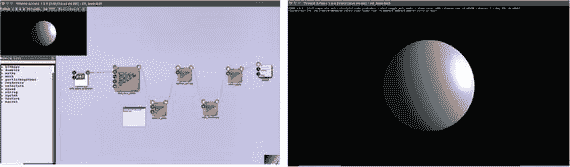

图 7-2. 标准模式和全窗口模式

如果在全窗口模式下，可以使用一些特殊按键，如表 7-3 所示。

表 7-3. 全窗口按键控制

| 按键 | 操作 |
| --- | --- |
| `Alt+T` | 切换标题信息可见性。在三种状态之间循环：隐藏/小字体/大字体。 |
| `Ctrl+T` | 重置信息聚合状态。 |
| `Ctrl+F` | 退出全窗口模式。 |
| `Ctrl+Alt+P` | 截取屏幕截图。然后您可以在 `/home/[USER]/thmad/[VERSION]/data/screenshots` 文件夹中找到它。 |
| `Alt+F` | 在全窗口模式下切换性能模式。 |
| `Ctrl+Alt+F` | 在标准模式和性能模式之间切换。与依次按下 `Ctrl+F` 和 `Alt+F` 效果相同。 |
| `Escape` | 如果没有未保存的更改，则退出 ThMAD。否则，退出全窗口模式并提示用户确认。 |

### 性能模式

在您通过按 `Alt+F` 从全窗口模式进入性能模式，或通过按 `Ctrl+Alt+F` 从标准模式进入性能模式后，您将看到类似图 7-3 的画面。

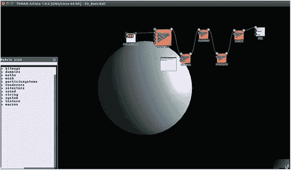

图 7-3. 性能模式

您对状态拥有完全控制权，与标准模式相同。要退出性能模式，请再次按 `Alt+F` 或 `Ctrl+Alt+F`，或按 `Ctrl+F` 退出全窗口模式。

### 全屏模式

按照第 3 章的描述，以全屏模式启动 ThMAD 后，您对状态拥有完全控制权，与标准模式相同。参见图 7-4。

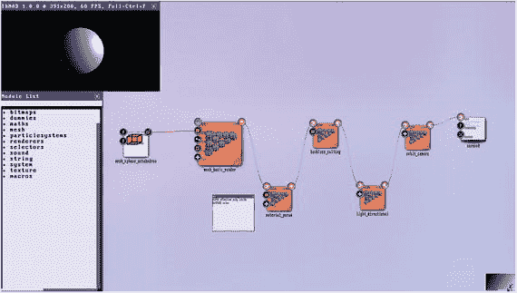

图 7-4. 全屏模式——注意没有操作系统窗口控件。

当然，您也可以在此模式下使用相同的按键切换到全窗口或性能模式。全屏模式与窗口模式相比，除了呈现方式之外，唯一的区别是没有窗口关闭按钮。您必须使用菜单或 `Escape` 键来退出 ThMAD。

### 主菜单

在画布上的任意空白处右键单击，将显示主菜单；参见图 7-5。

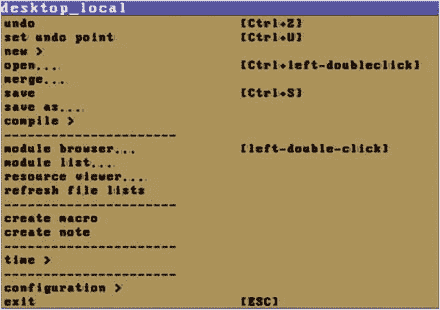

图 7-5. 主菜单

主菜单功能列于表 7-4 中。

表 7-4. 主菜单功能

| `Undo` | 撤销上一次更改。撤销点由自动撤销点设置或显式撤销点设置产生。自动撤销点由以下操作设定： − 加载新状态 − 在模块间绘制连接 − 删除模块间的连接 − 当锚点有多个输入连接时更改连接顺序 − 创建宏 − 创建组件 − 为宏分配组件 − 删除组件 − 清除状态（菜单：`New ➤ Empty Project`） − 加载模板（菜单：`New ➤ …`） |
| `Set Undo Point` | 设置一个撤销点，以便通过撤销操作将状态恢复到此点。仅当未设置自动撤销点时需要使用此功能。 |
| `New ➤` | `Empty project` | 以空状态开始。如果当前状态有未保存的更改，系统将询问用户确认。 |
| | `Visualization` | 以可视化项目开始。在画布上放置一些基础模块和笔记。如果当前状态有未保存的更改，系统将询问用户确认。 |
| | `Translation for ThMAD Player` | 用于从基本推子开始。如果当前状态有未保存的更改，系统将询问用户确认。 |
| `Open …` | 从文件系统打开新状态或可视化文件。仅查看 `/home/[USER]/thmad/[VERSION]/data/` 文件夹并显示图形选择器。如果当前状态有未保存的更改，系统将先询问用户确认。在图形选择器中，单击并拖动以导航，双击以选择，右键单击以取消。 |
| `Merge …` | 合并一个状态。显示与 `Open …` 相同的图形选择器，但不会替换当前状态，而是将合并状态中的所有组件添加到当前状态。仅适用于状态，不适用于可视化文件。 |
| `Save` | 以当前名称保存当前状态。 |
| `Save As …` | 以新名称保存当前状态。可以添加元信息，这些信息将与状态一起保存。此处只能保存为状态；要保存为可视化文件，请使用 `Compile` 功能。 |
| `Compile ➤` | `Music visual (…) As…` | 将当前状态导出为可视化文件到 `/home/[USER]/thmad/[VERSION]/data/visuals/` 文件夹。文件名将带有 `.vsx` 后缀，无论您在对话框中是否提供该后缀。如果需要，您可以随文件添加元信息。如果存在同名文件，则会添加时间戳进行备份。 |
| | `Music Visual Fader (…) As…` | 将当前状态导出为推子文件到 `/home/[USER]/thmad/[VERSION]/data/faders/` 文件夹。文件名将带有 `.vsx` 后缀，无论您在对话框中是否提供该后缀。如果需要，您可以随文件添加元信息。如果存在同名文件，则会添加时间戳进行备份。 |
| | `General Package (…) As…` | 将当前状态导出为可视化文件到 `/home/[USER]/thmad/[VERSION]/data/prods/` 文件夹。文件名将带有 `.vsx` 后缀，无论您在对话框中是否提供该后缀。如果需要，您可以随文件添加元信息。如果存在同名文件，则会添加时间戳进行备份。 |
| `Module Browser…` | 打开图形化模块浏览器。您可以通过单击并拖动鼠标进行导航，右键单击关闭，或通过单击并拖动鼠标至模块上选择模块。 |
| `Module List…` | 如果因任何原因关闭了画布左侧的模块列表窗口，可以通过此菜单项重新打开。 |
| `Resource Viewer…` | 查看 `/home/[USER]/thmad/[VERSION]/data/resources/` 文件夹内的资源。如果单击 `JPG` 或 `PNG` 文件，将显示预览窗口。右键单击可关闭。 |
| `Refresh File Lists` | 通知 `ThMAD` 刷新其状态、可视化文件和资源列表。如果您从外部更改或添加了文件，请使用此功能。在添加或更改资源后尤其有用。 |
| `Create Macro` | 创建一个空宏。 |
| `Create Note` | 创建一个空笔记。输入任意文本，通过单击并拖动标题栏将其放置到任意位置，单击关闭按钮关闭，通过单击并拖动任意边角调整大小。 |
| `Time ➤` | `Rewind` | 将序列计时器倒回至 `0.0`，然后停止。 |
| | `Play` | 如果序列计时器未运行，则启动它。 |
| | `Stop` | 如果序列计时器正在运行，则停止它。 |
| `Configuration ➤` | 更改配置条目。 |
| `Exit` | 退出 `ThMAD Artiste`。如果当前状态有未保存的更改，系统将询问用户确认。 |

# 模块选择器

模块是 `ThMAD` 的构建块——若要实现任何功能，您需要收集模块并通过连接器组装它们。`ThMAD` 有两个模块选择器——一个是具有层级结构的列表（在 `ThMAD Artiste` 启动时显示），另一个是按需提供的图形化模块选择器。

## 模块列表

`ThMAD Artiste` 默认显示模块列表；参见图 7-6。

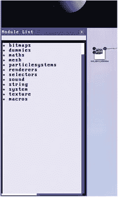

图 7-6. 模块列表

模块本身将在本书中描述，您可以在第 8 章找到参考。此处我们讨论使用模式。

每当 `ThMAD Artist` 启动时，列表窗口将显示在左侧。要移动它，请单击模块列表标题栏中间附近，按住鼠标按钮，并将鼠标移动到合适的位置。这就是我们所说的拖动。要调整其大小，请找到靠近任意边或角的位置并拖动。不幸的是，在 `ThMAD` 版本 1.0 中，没有图形反馈来提示开始拖动的正确位置——您只能尝试。可以通过拖动右侧或底部的两个白色滚动条来移动内部内容。上下滑动可以使用鼠标滚轮实现。

模块以层级结构呈现；在图 7-6 中，您只看到顶层。要深入结构，只需单击任意标签。要折叠结构，请再次单击标签。当深入足够层级后，您可以看到模块，将鼠标悬停在任一模块上时，将弹出信息提示。参见图 7-7。

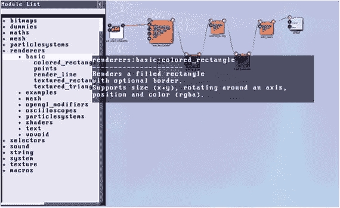

图 7-7. 展开的模块列表及鼠标悬停在模块标签上

一旦找到所需的模块，您可以通过将标签拖放到画布上来放置它，如图 7-8 所示。

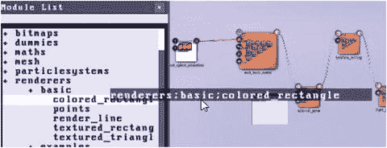

图 7-8. 模块列表，选择模块

在标题栏和较粗的黑色栏之间，您可以在图 7-8 中看到过滤器。单击它并输入一些字符，例如 `rect`。整个层级结构将过滤，仅显示标签中包含 `rect` 的项目；参见图 7-9。

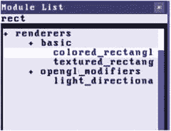

图 7-9. 模块列表，过滤

您可以通过使用 `Backspace` 或 `Del` 删除 `rect` 来禁用过滤器并切换回完整视图，或按 `Ctrl+Del` 一次性清除。

可以通过单击标题右侧边缘的符号来关闭模块列表。要重新打开它，请使用 `Module List…` 菜单。

## 图形化模块选择器

图形化模块选择器以双曲树形式呈现模块层次结构。您可以通过双击画布的空白区域启动它。请参阅图 7-10。

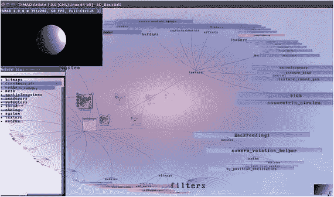

图 7-10. 图形化模块选择器

您可以通过点击并拖拽的方式在模块选择器内导航。如果将鼠标悬停在一个模块上，其描述将在工具提示中显示；请参阅图 7-11。

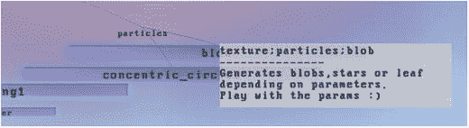

图 7-11. 图形化模块选择器，工具提示弹出

当您找到所需的模块后，将其拖拽到画布的空白区域。在大多数情况下，只需点击该模块、按住鼠标键、稍微移动鼠标然后松开鼠标键即可完成操作。如果您在使用模块选择器时进行此操作，可以通过右键单击它来退出。

## 助手

助手有助于理解模块的功能，并提供了一些简短入门课程以及可用的鼠标和键盘操作概览。

关于助手，最重要的一点是您可以按 `Tab` 键在不同的尺寸之间循环切换。

一旦您选择了喜欢的尺寸，右键单击它即可选择操作模式；请参阅图 7-12。

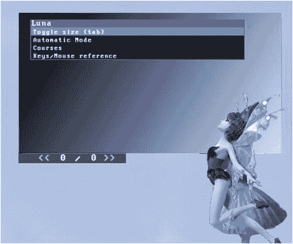

图 7-12. 助手的操作模式

详细信息请参见表 7-5。

**表 7-5. 助手模式**

| 自动模式 | 点击任何模块或模块锚点，即可在助手内查看其相关信息。 |
| --- | --- |
| 课程 | 选择以下之一： − 入门课程：关于如何使用 ThMAD 的基础手册 − 表演模式：关于表演模式的简要说明 − 宏：关于宏的信息 |
| 按键/鼠标参考 | 显示大多数键盘和鼠标命令的简明列表。 |

如果在任何模式下助手显示多于一页的内容，您可以点击其底部的任意页面控件：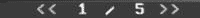，或者点击助手内部的任意位置以翻到下一页。

助手无法被禁用；如果您不需要它，只需按几次 `Tab` 键使其显示为最小尺寸即可。

## 对象检查器

对象检查器提供了模块和锚点更具技术性的视图，并允许您重命名模块别名以提高状态可读性；请参阅图 7-13。

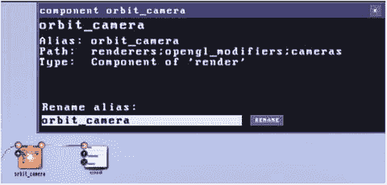

图 7-13. 对象检查器

您可以通过按 `Ctrl+O` 切换对象检查器的可见性，并可以在配置中默认启用它。对于后者，请选择配置菜单。

要重命名某项内容，请在编辑器字段中输入唯一名称，然后按 `Rename` 按钮。

# 保存和加载状态

除非您更改了配置，否则 `ThMAD Artiste` 在启动时将加载一个名为 `_default` 的状态，但您可以在配置菜单中将其更改为加载最后保存的状态。

在 `Artiste` 中，您可以通过在画布空白区域执行 `Ctrl+双击` 来加载任何状态、可视化效果或推子，或者通过打开主菜单（在画布空白区域右键单击）后使用 `Open…` 菜单来加载。

图形化文件选择器将出现，您可以通过双击来选择文件。要导航，请在其内部点击并拖拽；要取消操作，请右键单击。请参阅图 7-14。

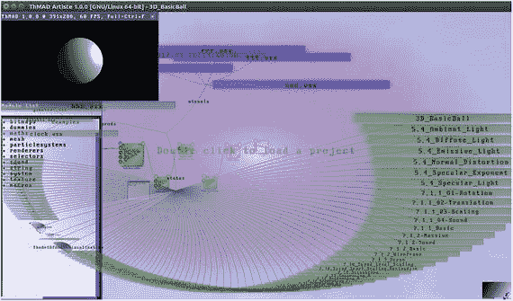

图 7-14. 文件选择器

从 `States` 文件夹内部加载状态将使您获得对其的完全控制。加载已编译的可视化效果则不同——一旦加载，您将收到一条消息，提示 ThMAD 继续以 `Detached` 模式运行。仅查看它是可以的，但如果您更改它，应使用 `Save As…` 将其保存为状态，以免丢失更改。

要以其当前名称保存状态，请按 `Ctrl+S` 或使用 `Save` 菜单。要保存新状态或以不同名称保存当前状态，请使用 `Save As` 菜单。

单击 `Save As` 后，将出现图 7-15 所示的对话框。您必须至少输入一个文件名；所有其他条目将与状态一起保存，并且是必需的。请注意，ThMAD 中的状态被视为内部状态，因此通常没有文件后缀。

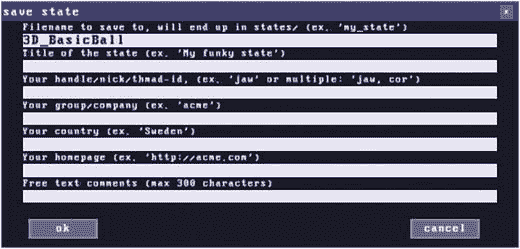

图 7-15. “另存为”对话框

要将状态另存为可视化效果，请使用 `Compile >` 菜单。

# 模块

模块告诉 `ThMAD` 显示什么、如何显示以及如何被控制。

## 模块类型

ThMAD 拥有表 7-6 中列出的模块类型。

**表 7-6. ThMAD 模块类型**

|  | 这代表物理屏幕。此模块类型始终只有一个实例，且无法删除。 |
| --- | --- |
| 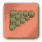 | 渲染器类型模块。任何产生可渲染输出（即生成图像数据并可连接到屏幕）的模块都属于此类型。 |
| 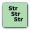 | 字符串类型模块。用于字符串操作——您不会经常用到它。 |
| 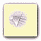 | 音频相关模块。 |
| 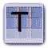 | 与纹理相关的模块。纹理是驻留在图形硬件上的图像数据。这使得它们功能强大且速度极快。 |
|  | 系统类型模块。包括时间控制、子流水线控制、文件系统访问、摇杆控制和程序化关机。 |
| 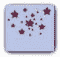 | 与粒子系统相关的模块使用此符号。 |
| 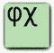 | 数学和参数控制模块使用此图标。 |
| 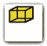 | 网格相关模块。包括网格生成器和修改器。 |
|  | 宏。用于对模块进行分组。 |
|  | 表示位图相关模块。 |

模块具有锚点，可在其中指定参数或连接其他模块。锚点将在本章后面介绍。

# 放置与删除模块

使用 `Artiste` 意味着放置（即实例化）模块、删除模块以及连接模块。

要在画布上放置模块，可使用 `ThMAD` 窗口左侧的模块列表，或通过 `Ctrl+双击` 画布空白处打开的图形化模块选择器。你也可以使用“模块列表”或“模块浏览器”菜单项。

模块可在画布上自由移动，但将属于同一逻辑组或需要相互连接的模块放置在一起会更合理。要移动单个模块，请在其上单击并拖动。要同时移动多个模块，请按以下步骤操作：按住 `Ctrl` 键，在包含待移动模块的矩形区域的左上角单击，然后将鼠标移动至矩形右下角。松开鼠标和按键，然后点击并拖动任意模块，为模块组选择新位置。

要删除模块，请单击该模块，然后按 `Del` 键。或者右键单击该模块，然后选择“删除”菜单项。要一次性删除多个模块，可以围绕它们画一个矩形。按住 `Ctrl` 键，在包含待删除模块的矩形区域的左上角单击，然后保持按键并移动鼠标至矩形右下角。松开按键，再按 `Del` 键即可全部删除。

## 连接模块

模块之间需要通过某种方式连接，以便数据在它们之间传输。连接器或锚点本身将在本章后面描述，但从状态构成的角度来看，`ThMAD` 施加了两个简单的规则：只有相同类型的锚点之间才能建立连接，并且输入连接始终位于模块的左侧，输出连接位于右侧。

这使得状态组合更加容易。例如，请看图 7-16：屏幕模块有三个不同类型的输入。上面一个是渲染器类型，它必须连接到一个具有渲染器类型输出的模块。

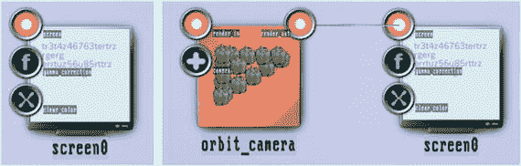

图 7-16. 连接模块

同样的原则也适用于其他锚点。在这种情况下，它们可以连接到其他模块相同类型的输出锚点，但并非必须连接到其他模块。

## 克隆模块

通过按住 `Ctrl+Alt` 键并将模块拖拽至画布的空白区域，可以克隆模块，即连同其属性一起复制。

## 模块锚点：参数与连接器

模块锚点如同模块的眼睛、耳朵和嘴巴。为了使模块能与其他模块通信，锚点需要连接到其他锚点。但它们也充当控制模块功能的参数旋钮。`ThMAD` 的主要原则之一是，许多锚点可以同时起到这两种作用，具体取决于它们是否被连接。

例如，请看图 7-16 中屏幕模块的中间输入锚点。它被称为 `gamma_correction`，如果用作参数，它将允许你精确配置屏幕的伽马校正属性。然而，你也可以将其连接到另一个模块相同类型的输出锚点，这样另一个模块就可以控制屏幕的伽马校正。对于屏幕模块而言，这种控制是动态的（即随时间变化）还是静态的（不变化）并不重要。

`ThMAD` 的模块拥有表 7-7 中所示的锚点类型。

**表 7-7. 锚点类型**

|  | 复合锚点。这是一个容器，包含其他锚点作为子元素。它是对前述规则的一个例外，因为它本身永远不能直接连接到其他锚点，也不能作为模块参数持有者。要查看或隐藏子锚点，请点击它们。当然，子锚点本身可以被控制或连接到其他锚点，除非它们本身也是复合锚点。 |
| --- | --- |
|  | 位图锚点。用于在模块之间交换位图数据。 |
|  | 枚举锚点。用于控制枚举条目，例如“是”和“否”。截至 `ThMAD` 1.0 版本，无法连接到其他模块。 |
|  | 浮点类型；一个浮点数，例如 `0.0`、`3.14` 或 `-0.0002`。 |
|  | float3 类型；由三个浮点数组成的一组数据，常用于表示三维空间中的点或向量坐标。 |
|  | float 或 float3 值的数组。 |
|  | float4 类型；由四个浮点数组成的一组数据，常与颜色值一起使用：红色、绿色、蓝色和 Alpha。 |
|  | 整数值。`ThMAD` 几乎在所有地方都使用浮点数，因此你不会遇到这种类型。 |
|  | float 值的数组。 |
|  | 描述 3D 对象的网格。 |
|  | 粒子系统。 |
|  | 描述空间旋转的四元数。 |
|  | 表示渲染数据。你会经常遇到此类型，因为它是渲染管线的基础。 |
|  | 描述资源，例如文件。主要用于图像文件，如 PNG 或 JPEG 文件，但也用于字体。 |
|  | segmesh。这在 `ThMAD` 中被认为是一个高度特殊的特性。你会发现有一些模块使用它，但它不是本书的主题。 |
|  | 数字序列。目前没有此类型的输出，因此它仅是一种参数控制器类型的锚点。 |
|  | 字符串。用于绘制文本，也用于提供着色器程序等。 |
|  | 纹理；表示图形硬件上的位图数据。 |

所有复合锚点都可以通过使用 `Ctrl+D` 键一次性折叠起来；当鼠标位于画布空白区域时，按 `Ctrl+C` 键可以关闭所有打开的控制器。

# 绘制锚点之间的连接

要连接一个模块的锚点到另一个模块相同类型的锚点，只需单击任意一个锚点，将鼠标移动到另一个目标锚点，然后在悬停于其上时释放鼠标按钮。

当你连接了复合锚点的子锚点并将其折叠后，看起来就像你画了一条到复合锚点的连接；见图 7-17。

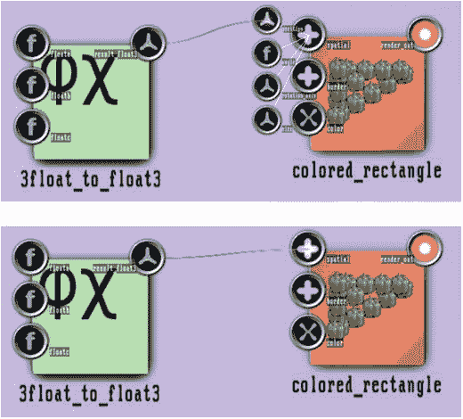

图 7-17. 使用复合锚点的锚点连接

然而，情况并非如此，复合锚点不能直接连接。要查看连接的实际去向，你必须通过点击来展开复合锚点。

要删除连接，请将鼠标移至连接线附近，然后右键单击并选择“断开连接”弹出菜单。见图 7-18。


图 7-18. 移除锚点连接

> 注意：要删除指向复合锚点内部某个锚点的连接，你必须先通过点击展开该复合锚点。

# 枚举型输入作为模块参数

若未连接至其他模块，可通过点击枚举类型输入锚点并在弹出菜单中选择相应条目来设定其值。

某些枚举类型被误用作一次性的重置或执行操作。将其设为 `Action` 值后，一旦该操作被执行，该值将自动恢复原状。模块是否采用此类枚举由其自行决定；第八章的模块参考中包含了相关细节。

# 浮点型输入作为模块参数

若未连接至其他模块，可通过双击`浮点类型输入锚点`并使用`控制器`来设定其值。

浮点型锚点会分配一个默认控制器，通常（但不一定）是一个`旋钮`。若要查看可用控制器并选择合适的类型，请右键点击锚点，并从`表 7-8`所列选项中选择一个。

## 表 7-8. 浮点数输入

| 控制器 | 图标 | 描述 |
|---|---|---|
| 旋钮 | | `旋钮`控制器。使用鼠标调整数值时，在靠近中心处单击并拖动（按住鼠标按钮移动鼠标）上下移动进行粗调，左右移动进行微调。另外，按住 `Shift` 键可让数值以 `0.1` 的倍数吸附。要直接更改数值，请点击数字并使用键盘输入数值。按 `Ctrl+Del` 清除字段。完成后按 `Enter`/`Return` 确认。如需在画布上移动旋钮，请点击并拖动黑色区域。双击旋钮可将其关闭。 |
| 滑块 | | `滑块`控制器。用于定义在浮点数值范围内操作的滑块。上方的`旋钮`定义浮点数值的最大值，下方的`旋钮`为最小值。每个`旋钮`的控制方式与单个`旋钮`控制器完全相同。可通过拖拽滑块手柄来调整滑块值。或者通过点击刻度上方数字并使用键盘输入数值（方式与单个`旋钮`控制器相同）来输入数值。如需在画布上移动滑块，请点击并拖动其中一个黑色区域。双击滑块任意位置可将其关闭。 |
| 直接输入 | | 使用键盘直接输入数值。点击数字并使用键盘输入新数值，然后按 `Enter` 或 `Return` 确认。先按 `Ctrl+Del` 清除字段。通过拖动黑色区域移动。双击可将其关闭。 |

# 三维浮点向量输入作为模块参数

若未连接至其他模块，可通过双击`三维浮点向量类型`输入锚点（通常表示三维坐标集）来调整其值。有几种控制器可供使用，但通常默认控制器会显示出来。

右键点击后所有可用的控制器类型列于表 7-9 中。

## 表 7-9. 三维浮点向量输入

| 控制器 | 图标 | 描述 |
|---|---|---|
| 滑块组 | | 三滑块组合。若锚点用于设定坐标，则三个滑块分别对应 `x`、`y` 和 `z` 坐标。每个上方的旋钮定义浮点数值的最大值，对应的下方旋钮为最小值。每个旋钮的控制方式与单个旋钮控制器完全相同。可通过拖拽滑块手柄来调整滑块值。或者通过点击刻度上方数字并使用键盘输入数值。如需在画布上移动滑块，请点击并拖动其中一个黑色区域。双击滑块任意位置可将其关闭。 |
| 轴视图 | | 旋转的图形化表示，显示为单位球面上的一个点。`x` 轴为白色，`y` 轴为紫色，`z` 轴为绿色，正向方向线条更粗。此控件对于定义向量范数应为 `1.0` 的方向非常强大，但在其他情况下可能带来风险。当然，您可以尝试它来了解使用此控件是否有意义。要调整方向，请在靠近中心处点击并拖动鼠标，向任意方向移动。通过拖动角落附近的黑色区域在画布上移动，双击可将其关闭。 |
| 颜色 | | 此控件在此处用途有限，因为无法设置第四个颜色值 `ALPHA`，因此`三维浮点向量锚点`通常不对应颜色值。不过，如果您希望在 `[0;1.0]` 范围内控制`三维浮点向量`的三个值，仍然可以使用它。要关闭，请双击右上角的方框。 |
| 平面板 | | 使用此平面板只能控制`三维浮点向量`的前两个值；第三个值将始终设置为 `0.0`。使用旋钮定义边界（设置方式与其他旋钮相同）。用鼠标点击任意点以设定两个坐标。通过拖动黑色区域在画布上移动；双击可将其关闭。 |
| 直接输入 | | 如需直接输入所有三个值，请使用此控件。点击每个数字并使用键盘输入新数值，按 `Enter` 或 `Return` 确认。先按 `Ctrl+Del` 清除字段。通过拖动黑色区域移动。双击可将其关闭。 |

# Float4 作为模块参数的输入类型

## 功能说明

`Float4` 参数通常用于定义颜色值。除非连接到其他模块，否则在双击 `float4` 类型的输入锚点  后，可以对其进行调整。有几种控制器可用，但颜色滑块通常显示为默认控制器。

右键单击将允许您使用表 7-10 中的任意选项。

## 控制器类型

表 7-10. `Float4` 输入

| 控制器 | 图标 | 说明 |
| :--- | :--- | :--- |
| 滑块 |  | 三重滑块。如果该锚点用于坐标设置，则三个滑块分别对应 `x`、`y` 和 `z` 坐标。每个上旋钮定义浮点值的范围；对应的下旋钮是最小值。每个旋钮的控制方式与单旋钮控制器相同。滑块值可通过拖动滑块手柄进行调整。或者，您可以点击刻度右侧的数字并输入值，使用键盘输入数值。要移动画布上的滑块，请点击并拖动黑色区域之一。双击滑块上的任意位置可将其关闭。 |
| 颜色 |  | 对于输入颜色值非常有用，并且通常是 `float4` 值的默认控制器。四个值中的任何一个都被限制在 `[0;1.0]` 范围内。要设置一个值，首先在顶部的色相选择器中点击并拖动，然后在其下方的大饱和度/明度框内的任意位置点击以完成 RGB（或色相-饱和度-明度）的选择。要选择阿尔法（Alpha）值，请在右下角的矩形内点击并拖动。最高点表示阿尔法值为 `1.0`；最低点表示阿尔法值为 `0.0`。任何拖动操作都是完全平滑的，这意味着您在移动鼠标时可以立即看到输出中的变化。要移动画布上的控件，请点击并拖动右上角的框。双击右上角的框可将其关闭。 |
| 直接输入 | 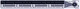 | 如果您想直接输入所有四个值，请使用此选项。点击每个数字并使用键盘输入新值。按 `Enter` 或 `Return` 确认。先按 `Ctrl+Del` 清除字段。通过拖动黑色区域来移动它。双击即可关闭。 |

# 四元数作为模块参数的输入类型

除非连接到其他模块，否则在双击四元数类型的输入锚点  后，可以对其进行调整。有几种控制器可用，但四重滑块通常显示为默认控制器。

右键单击将显示表 7-11 中的任意选项。

**表 7-11. 四元数输入**

| 滑块 |  | 四重滑块。表示 `x`、`y`、`z`、`w` 值。每个上旋钮定义浮点值的范围，对应的下旋钮是最小值。每个旋钮的控制方式与单旋钮控制器完全相同。滑块值可通过拖动滑块手柄进行调整。或者，您可以通过点击刻度上方的数字并输入值，使用键盘输入数值。要移动画布上的滑块，请点击并拖动黑色区域之一。双击滑块上的任意位置可将其关闭。 |
| 轴视图 |  | 在 ThMAD 中，四元数通常表示旋转。轴视图控件也是如此。组件的顺序是：白色、紫色、绿色。要调整代表旋转的旋转或四元数，请在中心附近任意位置点击并拖动鼠标，向任意方向移动。通过拖动靠近角落的黑色区域来移动画布上的控件，双击即可关闭。 |
| 直接输入 |  | 如果您想直接输入所有四个值 `x`、`y`、`z` 和 `w`，请使用此选项。点击每个数字并使用键盘输入新值。按 `Enter` 或 `Return` 确认。先按 `Ctrl+Del` 清除字段。通过拖动黑色区域来移动它。双击即可关闭。 |

# 字符串作为模块参数的输入类型

如果未连接到其他模块，可以通过双击字符串类型的输入锚点  来调整它。

此时会出现一个文本编辑器；请参见图 7-19。

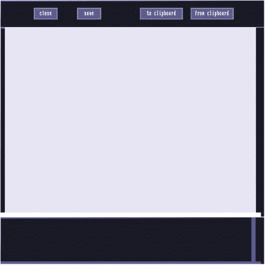

图 7-19. 字符串输入文本编辑器

您可以在其中输入任何文本；但编辑功能有限。您不能输入制表符，也不能选择文本范围来进行剪切粘贴或复制粘贴。至少可以使用`To Clipboard`和`From Clipboard`按钮从您喜欢的编辑器中前后复制文本。

完成后，您必须使用`Save`按钮使更改永久生效，然后点击`Close`关闭编辑器。如果仅点击`Close`，则会放弃所有更改，请务必小心。

# 资源作为模块参数的输入类型

可以通过双击资源类型的输入  来设置。

资源查看器将显示，如图 7-20 所示。


图 7-20. 资源选择器

在资源查看器中，从远离彩色框的任意位置开始点击并拖动进行导航。通过双击选择文件，或通过右键单击取消选择操作。

请注意，如果您从 ThMAD 外部更改了资源，则需要告知 ThMAD 刷新其文件列表。您可以通过从主菜单中选择 `Refresh File Lists` 来实现。

## 将序列输入作为模块参数

此控件用于需要 XY 序列的模块，例如浮点值随时间变化或类似情况。一个示例是输入参数`float_sequence`模块，位于 Maths ➤ oscillators ➤ `float_sequencer`，该振荡器输出值的序列在其中被定义。

当对应的参数编辑器打开时（可通过双击锚点或右键单击上下文菜单），将出现图 7-21 所示的图像。

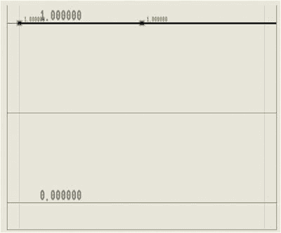
图 7-21. 序列编辑器

这是一个所有值都等于 1.0 的序列。序列的锚点是线条起点和中间的小矩形。开始时我们只有两个锚点。您可以通过左键单击锚点并拖动来自由移动它们。

要添加新锚点，只需单击线条上的任意位置并按住`Shift`键。要移除锚点，请在按住`Shift`键的同时右键单击它。结果可能如图 7-22 所示。


图 7-22. 锚点被移动和添加后的序列编辑器

在每个点上，插值类型决定了它如何与右侧的相邻点连接。默认是`无插值`，这意味着锚点会恰好在其位置（而非更早）突然强制将值改变。这可以在图 7-22 的第二个锚点处看到。由于我们目前是通过`Shift`+点击来添加锚点，这些锚点将对其右侧邻居显示线性插值，这意味着值从一个点到下一个点线性变化。您可以通过右键单击锚点并选择所需选项来更改插值类型。

插值类型包括：

- `无插值`：值保持恒定，直到到达下一个点的 x 坐标，然后突然改变其值。见图 7-23。

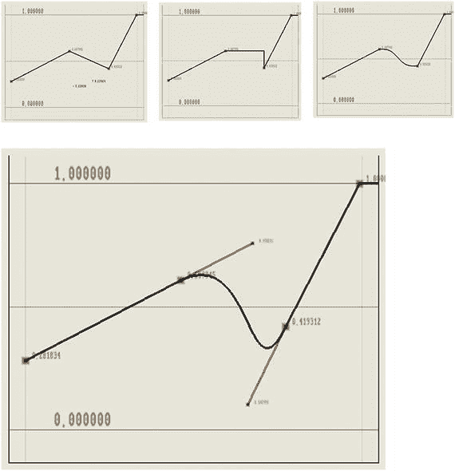
图 7-23. 不同序列编辑器锚点插值：线性、无、余弦和贝塞尔。线条延伸末端的贝塞尔锚点已被选择，以使线段平滑匹配。

- `线性插值`：默认选项。从一个点到下一个点线性变化。见图 7-23。

- `余弦插值`：一种平滑曲线，其函数参数为 0 或π，直到π或 2π，具体取决于值是减小还是增大。请注意，线段起点和终点的斜率为零。见图 7-23。

- `贝塞尔插值`：一种贝塞尔曲线，允许平滑的段间连接。一旦选择，贝塞尔段将添加两个用于贝塞尔参数的额外锚点，您可以选择、单击并拖动它们。这些额外的手柄很小，因此请务必放大以查看它们。见图 7-23。

在内部，出于性能考虑，序列的所有点都存储在一个包含 8192 个 XY 对的数组中。

## 导出状态

完成某个状态后，您可以将其保存到一个不可修改的文件单元中，称为视觉素材。若状态文件位于此文件夹内：

```
/home/[USER]/thmad/[VERSION]/data/states/
```

对于 ThMAD Artist 而言，视觉素材存放于以下文件夹之一：

- `/home/[USER]/thmad/[VERSION]/data/visuals/`
- `/home/[USER]/thmad/[VERSION]/data/prods/`
- `/home/[USER]/thmad/[VERSION]/data/faders/`

`visuals/`和`prods/`文件夹之间仅有逻辑上的区别；您将文件导出到`visuals/`以供后续在 ThMAD Player 中使用，而`prods/`更像是通用导出文件夹。`faders/`文件夹用于导出特殊的推杆状态，以供在 ThMAD Player 内部进行转场时使用。内部文件结构是相同的。

执行导出的步骤在“主菜单”部分的“编译 ➤ ”下进行了描述。

## 宏

`宏`是用于对模块进行分组的容器。除非展开，否则它们在画布上显示为单个符号，因此你可以使用它们来隐藏状态中的细节，提高可读性。此外，`宏`可以独立于状态单独保存，并在其他状态中重复使用。

要创建一个宏，请右键单击画布的空白区域，使用弹出的主菜单。点击`创建宏`项。

操作列表见表 7-12。

**表 7-12. 宏操作**

| 操作 | 说明 |
| :--- | :--- |
| 打开宏 | 右键单击宏，然后从弹出菜单中选择`打开/关闭`。 |
| 关闭宏 | 与打开宏相同。 |
| 移动宏 | 如果宏已关闭，只需像操作其他模块一样，单击并拖动它。如果宏已打开，则单击宏内的空白区域。 |
| 删除宏 | 单击宏，然后按`Del`键。或者右键单击宏并选择`删除 [del]`项。 |
| 重命名宏 | 确保已启用`对象检查器`（你可以通过在画布空白区域按`Ctrl+O`来切换其可见性）。单击宏，然后使用`对象检查器`中的`重命名`功能。 |
| 克隆宏 | 与模块类似，按住`Ctrl+Alt`键，然后将宏拖到画布的空白区域。克隆宏也会克隆其所有组成模块！ |
| 调整宏大小 | 右键单击并从出现的菜单中选择`双倍大小`或`一半大小`。这仅适用于已打开的宏（你可以在宏关闭时调整大小，但关闭的宏的符号大小不会改变）。 |
| 修改/控制宏内部的模块 | 打开宏，然后执行与组件在宏外部时相同的操作。 |
| 将单个模块移入宏 | 按住键盘上的`Ctrl+Shift`键，然后用鼠标左键将模块拖动到已打开的宏中（对已关闭的宏无效！）。一旦进入宏，只能通过删除来将模块从宏中移除。你不能将其移出（不过按`Ctrl+Z`撤销会有效）。 |
| 一次将多个模块移入宏 | 选择多个模块。可以按住`Ctrl`键的同时单击选择，或者在按住`Ctrl`键的同时围绕模块绘制一个矩形（按下`Ctrl`，然后按住鼠标左键从左上角开始，移动到右下角，然后松开鼠标按钮，最后松开`Ctrl`）。选择完成后，按住`Ctrl+Shift`键，并将其中一个选中的模块拖动到已打开的宏中（对已关闭的宏无效！）。一旦进入宏，只能通过删除来将模块从宏中移除；你不能将其移出（不过按`Ctrl+Z`撤销会有效）。 |

无论你是一次将单个模块还是多个模块移入宏，传入和传出的连接都会在宏的边缘显示为人工锚点。参见图 7-24。


图 7-24. 宏锚点

更多操作列于表 7-13。

**表 7-13. 宏扩展操作**

| 操作 | 说明 |
| :--- | :--- |
| 将内部模块的锚点暴露给外部世界 | 要暴露内部锚点（例如，你有一个内部模块带有输入锚点`xyz`，并且你想从宏外部控制它），将该锚点拖动到宏内的空白区域。 |
| 移除宏锚点 | 右键单击一个宏锚点，然后从菜单中选择`取消别名`。 |
| 保存宏 | 可以保存宏以便日后重用，方法是右键单击宏，然后从弹出菜单中选择`保存宏...`。下次重启 ThMAD 后，保存的宏将出现在模块列表中。 |
| 将保存的宏插入当前状态 | 从模块列表的`宏`部分拖出，如同操作普通组件一样。 |

保存的宏只能在 ThMAD 外部删除。请导航至以下文件夹并删除相应文件：

```
/home/[USER]/thmad/[VERSION]/data/macros/
```

## 备注

`备注`有助于记录你的状态或其部分内容。要创建备注，请右键单击画布的空白区域，然后在弹出菜单中选择`创建备注`。在那里添加任何文本。参见图 7-25。

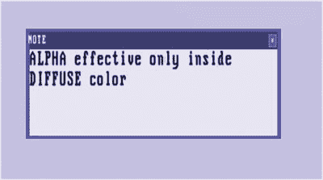
图 7-25. 一条备注

要移动备注，请拖动其标题栏。要删除备注，请单击其右上角的关闭框。要更改其大小，请单击并拖动其任一边或一角。（遗憾的是，没有用户界面反馈来帮助找到正确的鼠标位置；你只能尝试。）

请注意，你不能向宏中添加备注，并且备注不参与多选（按`Ctrl`键点击并绘制矩形）。此外，节点不能像模块一样被克隆。

## ThMAD 播放器

### 启动和停止 GUI

有关启动和停止 ThMAD 播放器的信息，请参见第 3 章。本章其余部分假设你已运行 ThMAD 播放器。

### 播放器 GUI 操作

播放器对鼠标移动没有反应，但你可以使用键盘上的几个按键来控制它。

播放器运行时，表 7-14 中列出的键盘操作可用。

**表 7-14. ThMAD 播放器控制**

| 键 | 功能 |
| :--- | :--- |
| `O` | 切换文本覆盖层的可见性。如果启用，当视觉效果切换时会短暂打印信息。默认为开启，除非通过程序调用禁用。 |
| `F1` | 显示帮助。自动启用文本覆盖层；之后按`O`可禁用它。 |
| `F` | 显示状态信息。自动启用文本覆盖层；之后按`O`可禁用它。 |
| 光标左/右 | 返回到列表中的上一个或前进到下一个视觉效果。 |
| 光标上/下 | 增加或减少对声音输入的灵敏度。 |
| 翻页上/下 | 加快/减慢速度。控制时间缩放因子。 |
| `R` | 启用/禁用随机化。如果禁用，则停留在一个视觉效果上。如果启用，则在随机时间间隔后随机切换视觉效果。 |
| `Ctrl+R` | 从列表中随机选择另一个视觉效果。 |
| 退出键 | 退出播放器。 |

## 总结

在本章中，你学习了 ThMAD Artiste 和 ThMAD 播放器的所有 GUI 功能。你了解了如何使用键盘控制一切，如何识别、放置和连接元素，以及如何使用参数控件来调整不同类型的模块参数。你还探讨了 Artiste 中的不同窗口模式和辅助小部件。你学习了文件处理方法，以及 Artiste 和播放器如何协同工作。

下一章将提供可用于创建视觉效果的所有模块的完整参考手册。


