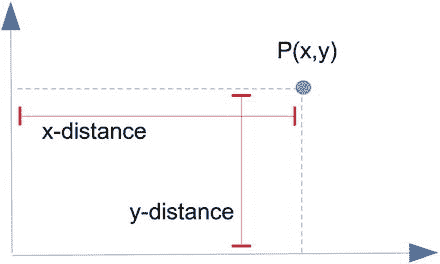
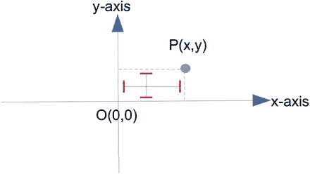
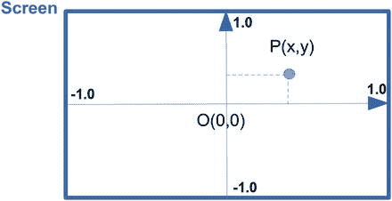
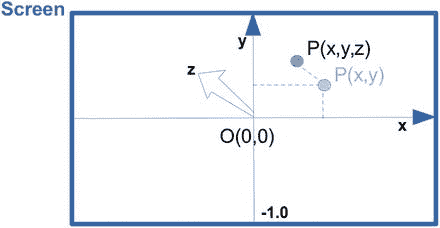
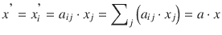
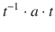
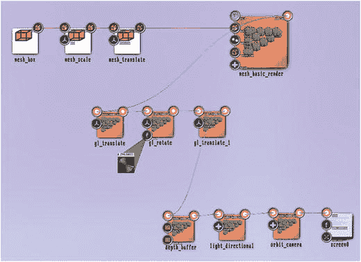
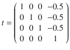
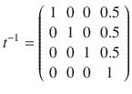

# 4. 3D 概念

如果你想要关于 3D 计算机图形概念的详尽参考，互联网和书店中有大量资料可用。作为 ThMAD 底层技术的 OpenGL 是一个庞大的概念，对其所有主题的完整介绍超出了本书的范围。即便如此，从我们关于音频可视化的特殊视角入手进行介绍也是值得的。此外，本章稍后将描述 ThMAD 如何处理某些图形子管线以及它在 OpenGL 之上自定义图形概念的一些特性。

## 坐标系

三维中的变换涉及空间操作，如平移、缩放和旋转。但在我们开始讨论空间操作之前，我们需要知道如何用计算机程序能够理解的方式来表现 3D 对象，而这会立刻引导我们思考坐标系。

为了简化问题，我们从二维开始。如果你看着电脑屏幕，我们将你看到的平面定义为 x-y 平面，该平面上某点的 x 坐标表示该点到左边界垂直线的水平距离，y 坐标表示该点到底部边界水平线的垂直距离。参见图 4-1。

**图 4-1.** X-Y 坐标系

作为 x 距离参考的垂直线也称为 y 轴，而作为 y 距离参考的水平线称为 x 轴。我们说我们使用屏幕边界作为轴，但实际上这是一个任意的决定；我们可以使用任何平行于它们的直线。ThMAD 中另一个常见且经常使用的选择是使用屏幕中心的轴，如图 4-3 所示。轴的交点称为原点 O，其坐标为 O(`0.0`, `0.0`)，因为两个坐标的距离均为零。

图 4-3 中点 P 的坐标将被赋予什么数值？在中心点很容易；`x=0` 且 `y=0`。我们需要为远离 O 的点定义另一个标准，我们可以将右边界的 `x` 设为 `1.0`，将顶边界的 `y` 设为 `1.0`。由于将 O 放置在屏幕中央，作为结果，左边界自动成为 `x=-1.0`，底边界自动成为 `y=-1.0`。参见图 4-2。

**图 4-3.** X-Y 坐标系，坐标原点位于屏幕中心

**图 4-2.** X-Y 坐标系，两个维度的缩放范围均为 -1 到 +1

P(x, y) 大约位于 `x = 0.4` 和 `y = 0.3`，因此我们现在可以写作 P(`0.4`, `0.3`)。

现在我们已经具备了讨论二维点所需的一切。但是第三维和 z 轴呢？它必须垂直于 x 轴和 y 轴，因此它要么从屏幕的前方指向后方，要么指向屏幕内部。

OpenGL 是一个所谓的右手系，这意味着如果你让右手食指按照从 x 轴到 y 轴的顺序弯曲，那么你的拇指将指向 z 轴正方向。坐在屏幕前，从 z 轴正方向位置观察 x-y 平面。参见图 4-4。

**图 4-4.** X-Y-Z 坐标系

z 轴的缩放并不那么明显——在二维屏幕上没有 z 轴边界。为了正确处理，OpenGL 执行如下操作：

1. 固定 x-y 宽高比。这会缩放 x 轴，使得作为输入的矩形：`(-a,-a) → (a,-a) → (a,a) → (-a,a)` 在屏幕上仍然显示为一个真正的正方形，所有边长相等。这显然会改变边界坐标值。假设底部和顶部边界仍然分别是 `-1` 和 `+1`，对于一个 5/4 比例的屏幕，左右边界现在分别是 `-1.25` 和 `+1.25`。
2. 以这样的方式缩放 z 轴：使得作为输入的立方体在经过空间任意旋转后，在屏幕上仍然显示为一个立方体，所有边的长度相等。

说了这么多，一个显而易见的定位对象的选项是前面为`(-1,-1,1) → (1,-1,1) → (1,1,1) → (-1,1,1)`，后面为`(-1,-1,-1) → (1,-1,-1) → (1,1,-1) → (-1,1,-1)`的立方体。

当然，您可以随意定位对象并使用任何您喜欢的坐标，但脑海中始终记住那个“双单位立方体”的概念有助于避免意外，例如对象无意且神奇地消失在视野之外。如果您为 3D 场景设置了其他边界框（即包含所有相关对象的最小可能尺寸的盒子），您可以使用平移和缩放将所有内容移入并压缩到单位空间，在那里进行任何所需操作，然后再缩放和平移回来。请参阅本章中题为“空间映射”和“空间操作：平移、旋转和缩放”的章节。

## 空间映射

任何类型的坐标空间，无论是二维还是三维，都可以映射到同类型的另一个空间中，这种映射方式使得构成它们的点之间的内部和相互关系得以以某种方式保持。

这种类型中最重要的变换称为**线性变换**，它由以下计算规则表示：

通过该规则，任意点`P(x, y, z)`被映射到点`P'(x', y', z')`。使用所谓的**齐次坐标**，数学家和我们在需要精确表达时，会通过平移部分扩展这一概念。我们最终使用以下矩阵表示法：

我们将`a14`、`a24`和`a34`替换为`t1`、`t2`和`t3`，以表达它们恒定的平移性质。中间的图形，为简洁起见，我们称之为`(aij, ti)`，称为**变换矩阵**；其余的称为**坐标向量**。点表示矩阵乘法。乘法的形式化规则如下：

其中`x[1] = x`、`x[2] = y`和`x[3] = z`。符号`Σ[j]`遵循通常的数学规则“对所有`j`求和”。由矩阵表示的变换的优点是，组合变换——例如，先缩放，再旋转，最后平移——可以通过相乘的矩阵来表示：

`OpenGL`（在撰写本书时`Ubuntu`使用的`3.x`版本中）内部使用多个不同的矩阵堆栈。更新版本的`OpenGL`在一定程度上降低了它们的重要性，甚至将其移除，转而支持着色器语言结构，这些结构在`ThMAD`中也可用。本书不介绍着色器语言，但您可以在第 5 章和第 6 章的故事中找到一些使用着色器的示例。

在`ThMAD`中，您通常不直接接触矩阵。对于所有典型的矩阵操作，`ThMAD`都提供了模块——平移、缩放和旋转。您可以通过图形化方式连接任意数量的模块来堆叠它们。在内部，`ThMAD`当然会以上述矩阵乘法的方式组合所有这些操作。了解变换组合操作（或堆叠变换）的概念对您很重要，因为许多状态都使用此类组合变换。

从`ThMAD`的角度来看，变换组合的形式如下，这不仅是实用的，而且在某些用例中是必要的：

这表示： (1) 首先根据矩阵`t`进行变换，(2) 然后根据`a`进行变换，(3) 最后根据`t`的逆矩阵（由`t^-1`表示）进行变换。看起来像理论数学，不是吗？实际上，它很重要。考虑一个例子。

考虑一个大小为`0.1 x 0.1 x 0.1`、中心位于`(0.5; 0.5; 0.5)`的盒子。您想围绕其中心进行某种旋转`a`。这听起来很奇怪，但`ThMAD`中没有模块能直接做到这一点！但有一个模块可以围绕`(0;0;0)`进行旋转。在这种情况下我们不能使用那个旋转，因为最终盒子的中心会偏移，而我们希望它保持在`(0.5; 0.5; 0.5)`。那么，我们可以执行以下操作来完成这个任务：

1.  首先，通过平移向量`(-0.5; -0.5; -0.5)`移动盒子，使其中心位于`(0;0;0)`。 
2.  现在，围绕`(0;0;0)`执行旋转。 
3.  然后，通过平移向量`(0.5; 0.5; 0.5)`将其移回原位。

这正是`t^(-1) ∙ a ∙ t`所表达的含义。除了数学符号或手动计算坐标之外，您应该习惯于从图形角度理解“包裹变换”的概念；请参见图 4-5。

图 4-5.

包裹变换 顶部子管线的功能是生成一个偏离原点的盒子并绘制它。底部子管线仅移除隐藏的表面，放置光源和相机，并将其发送到屏幕。有趣的部分是中间的子管线：它将盒子移回原点，然后围绕原点旋转，再将其移回原位。左侧模块的“平移”锚点值为`(-0.5; -0.5; -0.5)`，右侧模块的相同锚点值为`(0.5; 0.5; 0.5)`。此处打开的“角度”锚点现在可用于绕盒子中心旋转盒子。

注意：此示例作为源代码可在`TheArtOfAudioVisualization`文件夹下的`A-4.2_Embracing_Transformation`中找到。

对于想要了解以下示例中`t`是什么样子的读者（请参阅关于如何构造平移矩阵的章节）：

顺便说一下，`t^(-1)`被称为`t`的逆矩阵，因为它们的乘积是单位矩阵：

后者被称为**单位矩阵**，因为对于任何矩阵或向量`a`，都有`a ∙ I = I ∙ a = a`。

