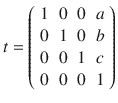
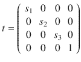
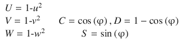

# 空间操作：平移、旋转与缩放

现在你已经掌握了上一节中的符号表示，可以轻松地表达平移和缩放操作了。

利用我们引入的矩阵表示方法，沿向量 `(a,b,c)` 平移可得到如下矩阵：

以缩放因子 `(s[1],s[2],s[3])` 进行缩放：

其中，对于使用单个缩放因子 `s` 进行的均匀缩放，分量 `s[1]`、`s[2]` 和 `s[3]` 均相等：`s[1] = s[2] = s[3] = s`。

旋转则略微复杂——我们需要定义旋转的方式。例如，我们可以绕从原点出发的轴 `(u,v,w)`，以某个角度 `φ` 进行旋转。该情况下的公式如下：

另一种可能性是先绕 `x` 轴旋转一定角度，再绕 `y` 轴旋转一定角度，最后绕 `z` 轴旋转一定角度。相应的变换矩阵可以通过分别设置 `(u,v,w) = (1,0,0) / (0,1,0) / (0,0,1)` 从该公式中轻松推导出来。ThMAD 主要使用组合公式以保持简洁。

描述旋转的第三种可能性是使用四元数。虽然四元数背后的理论并不容易理解，但对于此处目的而言，只需知道四元数是一个由四部分组成的数即可：

`q = (q[1], q[2], q[3], w)`

在给出一系列特殊的四元数计算规则的前提下，它就足以描述空间中的旋转。这只是另一种说法，即对于四元数，我们不需要矩阵运算，而是可以使用专门为其引入的这套新计算规则。

要了解如何在 ThMAD 中执行此类变换，请参考第 5 章。

