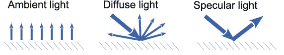

# 光照暴露

在现实世界中，物体之所以可见，是因为它们反射照射在其上的光。因此，我们需要光源来使物体显现。在 OpenGL 和 ThMAD 中也是如此，但有两个例外。第一个例外是，某些简单的状态不需要光照。然而，在很多情况下，添加光源并无坏处，并且拥有光源是一种良好的实践。第二个例外是，在 OpenGL 和 ThMAD 中，你实际上永远无法直接看到光源，只能看到它的反射光。

严格来说，这与现实世界并没有太大不同——如果你看着一盏灯，你看到的光主要来自那里，是因为光线从灯的各个部分反射回来。只有当你有类似点光源的东西时，你才可能在没有任何反射物体的情况下看到光。这种极端情况并不令人尴尬，因此且为简单起见，在 ThMAD 或 OpenGL 中，不提供直接可见的光源。请注意，仍然存在表面材质自身发光的概念，但这在概念上与材质属性相关，而非光源。详细内容稍后介绍。

因此，在 OpenGL 和 ThMAD 中，我们有两种与光照相关的对象：灯光（或光源）和材质。

从光源的角度来看，为了营造逼真的场景，灯光有四种类型：

*   **环境光**。可以将其视为无处不在的非定向光。如果你在一个昏暗的房间里，只有一丝光线从窗帘缝隙中透进来，你仍然能看到一种暗淡的光线，它似乎均匀地照亮了房间里的所有物体，又似乎来自四面八方却又无处可寻。只有经验告诉我们，光线来自被照亮的缝隙。这就是环境光的含义，ThMAD 和 OpenGL 处理它的方式是为所有表面添加一个恒定的颜色值。然而，实际情况要稍微复杂一些，因为材质属性也参与了表面环境光颜色的计算。
*   **漫反射光**。想象一个位于某点的光源。如果光从该点照射到材质表面，然后从那里均匀地散射到所有可能的方向，这就是漫反射光。这种漫反射通常与表面的材质性质相关。除非你的表面需要完美地 100% 反射照射到它上面的任何光线，否则你的场景中通常都会包含漫反射光成分。因此，它几乎存在于所有 3D 场景中。
*   **镜面反射光**。如果一束光线照射到材质表面，并以相同的角度从表面反射出去，我们称之为镜面反射光。你需要镜面反射光成分来让你的场景看起来更有光泽、更有趣。
*   **屏幕的清除颜色**。每帧渲染任何其他内容之前，该颜色将应用于整个场景。因此，它会作为背景颜色显示，并且只有在物体完全或部分透明时，它才会透过物体显现出来。关于不同的光照模式，请参见图 4-6。

图 4-6.

