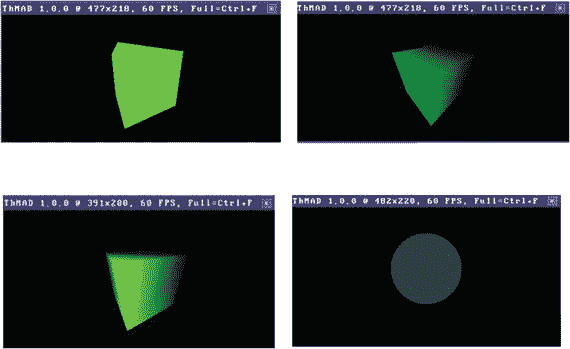
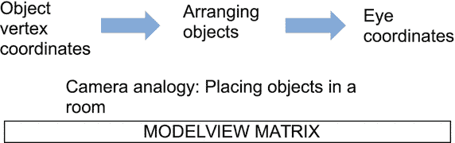
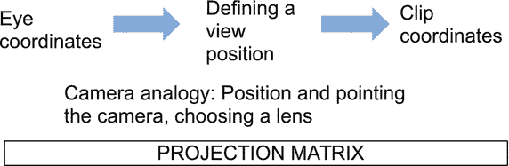
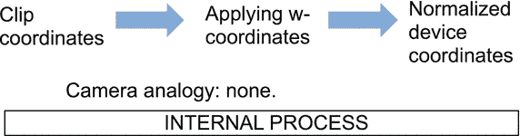
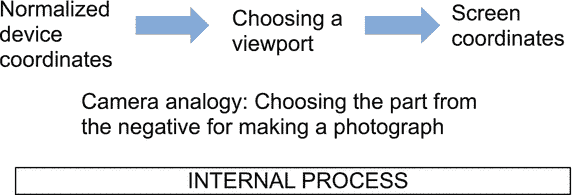

# 光照反射模式

用于计算反射光的材质参数如下：

-   光源定义的**环境光**对应一种环境反射颜色。最终像素颜色的整体环境光部分，将由光源的环境光颜色的每个 `RGB` 分量与定义为材质参数的环境光颜色的乘积得出。
-   对于**漫反射光**，某个材质点的像素颜色结果，是通过将入射漫反射光的每个颜色分量与匹配的材质参数的漫反射颜色分量相乘计算得出的。与环境光照不同，光源和表面在空间中的位置对漫反射光而言不起作用，但对于漫反射光，物体的三维特性就展现出来了。
-   当光线照射到表面某点时，**镜面光**不像漫反射光那样向所有方向反射，而是像镜子一样，在法线另一侧以完全相同的角度被反射，参见图 4-6。其计算方式与环境光或漫反射光类似：每个材质参数的 `RGB` 分量与光照模块相应的 `RGB` 分量相乘。
-   尤其是对于镜面反射，我们还有一个额外的概念：`shininess`（光泽度），它描述了观察者位置与反射光束之间模糊程度的大小。
-   **自发光**。材质可以在没有专门开启光源的情况下发光。自发光类似于环境光的贡献，但它不与相应的光源参数结合；它是独立的，并添加到所有其他由材质和光源产生的光中。此外，它不会在其他物体上产生任何反射。

示例物体如图 4-7 所示。光线从表面部分发出的方式当然不仅取决于光照和表面属性，还取决于我们观察它的角度。这在内部由投影变换处理，下一节将对此进行介绍。

**图 4-7.** 采用不同光照反射模式的物体。在图 4-7 中，左上为环境光，右上为漫反射光，左下为漫反射光和镜面光，右下为自发光，显示了一个三维球体。

## 眼睛与摄像机

当我们在场景中放置一些物体并添加光照和材质属性后，我们需要某种东西或某个人来实际观察场景。由于我们有一个平面屏幕作为这个过程的一部分，并且很明显计算机程序对此有最终影响，这就相当于一个关于将三维场景投影到一个平坦的二维矩形（即屏幕）上的规则。

描述此过程的常见 OpenGL 3.x 方法，是将其与摄影或相机设置进行比较。我们从在三维空间中排列物体开始，这相当于在房间里放置要拍摄的物体，参见图 4-8。

**图 4-8.** 模型视图变换

这部分过程的最终结果是得到观察者坐标系，并由模型视图矩阵栈控制。如果你在没有使用 ThMAD 的情况下进行 OpenGL 编程，你需要显式地告诉 OpenGL 使用模型视图矩阵栈。而使用 ThMAD 时，程序会在模块内部透明地为您完成这项工作。

接下来，摄像机被定位并指向场景，参见图 4-9。

**图 4-9.** 投影变换

OpenGL 内部的这种投影变换还允许指定近裁剪面和远裁剪面，这是真实世界摄影过程中不存在的东西。使用它们，我们可以移除比近裁剪面更近或比远裁剪面更远的物体或物体部分。它们是投影矩阵子过程的一部分，因为在此阶段硬件很容易处理。

之后，OpenGL 系统应用所谓的 `w` 坐标。这些是内部数字，是矩阵和向量运算的一部分。细节超出了讨论范围——当我们说这里使用的齐次坐标允许使用矩阵进行平移，而三维物体的 `3x3` 矩阵无法做到这一点时，这足以满足我们的目的。其结果是二维屏幕世界的一部分，称为归一化设备坐标，参见图 4-10。

**图 4-10.** 设备归一化

这是一个没有参数的内部子过程，因此没有关联的矩阵步骤。

作为最后一步，选择并应用视口，即我们定义想要看到的实际区域，参见图 4-11。此步骤同样没有与物体相关的参数，因此也没有关联的矩阵栈。

**图 4-11.** 屏幕坐标

注意，直到裁剪坐标和归一化设备坐标，每个顶点的 `z` 坐标都可被系统使用，并且需要用它来确定哪些内容因被其他物体遮挡而需要从后续渲染中剔除。用相机类比，物理世界为我们完成了这个技巧，但在 OpenGL 内部，这些 `z` 坐标（在此阶段称为深度）用于确定哪些顶点点可以被排除在后续的渲染过程之外。

遮挡物体的方式本身就是一个有趣的话题。图形硬件的设计投入了大量精力，它能有效计算出哪些内容需要从渲染过程中剔除，因为它们无法被观察者或摄像机看到。准确地说，有两个属性定义了这一点：

-   前述的**深度缓冲区**。这是一个在渲染步骤（即实际在屏幕上渲染像素的步骤）中追踪像素坐标的 `z` 坐标的缓冲区。也就是说，这是最后的渲染步骤。它的工作原理如下：在深度缓冲区被清除（通常与颜色缓冲区清除一起进行）后，任何新绘制的像素都会将其 `z` 坐标告知深度缓冲区，并导致以下情况之一：
    -   如果该点的深度缓冲区未初始化，则它将像素的 `z` 坐标保存到深度缓冲区并渲染该像素。
    -   如果该点的深度缓冲区已定义，且新像素点的 `z` 坐标大于或等于深度缓冲区中的值，则它将像素的 `z` 坐标保存到深度缓冲区并渲染该像素。
    -   如果该点的深度缓冲区已定义，且新像素点的 `z` 坐标小于深度缓冲区中的值，则它丢弃该新像素。由于我们知道更大的 `z` 坐标意味着离观察者更近，这有效地排除了那些将被遮挡的点。
-   **背面剔除**。这是排除像素的另一种方法，因为它们位于物体的背面。以立方体为例：它的六个面每个都由两个三角形组成（这是内部处理四边形的方式）。每个三角形有三个顶点。现在，如果我们小心地定义它们——如果从角度上看，这三个顶点描述了一个顺时针旋转，则它们被定义为位于背面，否则位于正面。由于这只是对每个表面部分的“是/否”判定，图形硬件可以非常高效地处理。

需要考虑到一些因素才能启用所有这些隐藏魔法，但 `ThMAD` 与 OpenGL 一起提供了两个专门为此设计的模块：一个背面剔除模块和一个深度缓冲区模块。

## ThMAD 网格

ThMAD 中的网格是对描述 3D 对象的点坐标集合的一种抽象。

要定义网格，需要定义某些类别的对象。相关的概念有：

- **顶点**。这是构成网格的点的三维位置向量数组。
- **顶点法线**。描述表面元素在空间中的朝向。用于正确照亮对象。
- **顶点颜色**。顶点通常会被赋予颜色。
- **顶点纹理坐标**。描述顶点到纹理坐标的映射关系。
- **面**。用于定义网格的预先计算好的表面原子片段。
- **面法线**。其含义与之前描述的顶点法线相同，但关联的是面。此特性不常用。
- **顶点切线**。在一些需要平行于表面元素的向量的模块中使用。

## ThMAD 粒子系统

粒子系统涉及成百上千甚至更多的小型 3D 对象进入场景，遵循一定的生成、移动、交互并最终消亡的规则。你可以使用它们来模拟雾、瀑布、蜡烛、爆炸、有趣的人造效果以及诸如此类的东西。

粒子系统的产生得益于过去几十年图形硬件性能的巨大提升。借助现代的先进（甚至只是中等水平的图形与计算硬件），可以使数十万个粒子同时工作。`OpenGL` 内部并没有一个原生的粒子系统概念，但当然，由于需要处理如此多的 3D 对象，使用 `OpenGL` 概念的方式对于实现可接受的性能至关重要。

幸运的是，`OpenGL` 提供了一些用于处理粒子系统的模块，这些模块在内部优化了 `OpenGL` 的使用方式。这些模块主要涉及：

- **生成粒子**。可以基于单个点或一组点来生成。
- **修改粒子及其轨迹**。包括随机改变粒子大小、精确控制所有粒子大小、施加风力、让其像流体粒子一样运动、使其受重力影响、使其弹跳以及使其旋转。
- **控制粒子的生命周期**。
- **控制粒子的渲染方式**。

尽管用粒子系统做实验既有趣又好玩，但本书并没有专门章节来讲解粒子系统。不过，在第 6 章中有一节内容，提供了更深入的见解并给出了一些示例。

## 总结

在本章中，你学习了 3D 坐标系、移动、缩放和旋转等变换操作，以及灯光和摄像机。此外，你还了解了 ThMAD 中用于 3D 草图绘制的网格和粒子系统。

下一章将包含一系列教程或案例，涵盖了使用 ThMAD 可以实现的大部分功能。

