# 5. 案例：基础篇

在本章中，我们将通过深入细致的讲解来探讨音频可视化的艺术，这些讲解涵盖了各个方面。我们无法描述所有可能的草图类型，但本章将提供一些技术，帮助你实现自己的想法。这些章节没有特定的先后顺序，你可以按顺序学习，也可以根据兴趣阅读——选择最适合你的方式即可。

## 更多 3D 渲染管线

ThMAD 构建于`OpenGL`之上，`OpenGL`是 3D 图形渲染的行业标准。`OpenGL`是满足你图形编程需求的基础技术，你可以用它完成很多事情。然而，与`OpenGL`不同的是，ThMAD 在更抽象的层面运作，涉及实例化、配置和连接模块。这种方法有利有弊——优点是你无需成为编程专家就能使用 ThMAD。缺点是你无法用 ThMAD 完成所有能用`OpenGL`实现的事情。

本章包含更多经过深入讲解的示例。本章还有一个额外的好处，那就是你最终会理解`OpenGL`的某些部分，因为在对象和参数中使用了相同或至少相似的概念和名称。

## 变换

此处的变换涉及平移、旋转和缩放。

**注意：** 本节中的示例源码可在`TheArtOfAudioVisualization`文件夹内以`A-5.1.1_*`名称获取。

能够对顶点坐标进行变换的模块列于表 5-1。

**表 5-1.** 变换模块

| 模块 | 访问路径 |
| --- | --- |
| `Translate` | `Renderers → opengl_modifiers → gl_translate` |
| `Rotate` | `Renderers → opengl_modifiers → gl_rotate` |
| `Rotate` | `Renderers → opengl_modifiers → gl_rotate_quat` |
| `Scale` | `Renderers → opengl_modifiers → gl_scale` |
| `Scale` (均匀缩放) | `Renderers → opengl_modifiers → gl_scale_one` |

我们从基础的 3D 设置开始。使用左侧菜单，将以下模块放置到画布上：

*   `Renderers → opengl_modifiers → cameras → orbit_camera`
*   `Renderers → opengl_modifiers → light_directional`
*   `Renderers → opengl_modifiers → auto_normalize`
*   `Renderers → opengl_modifiers → material_param`
*   `Renderers → opengl_modifiers → backface_culling`
*   `Renderers → opengl_modifiers → depth_buffer`
*   `RENDERERS → mesh → mesh_basic_render`
*   `Mesh → solid → mesh_box`

设置以下锚点值，未提及的值保持默认。参见表 5-2 至 5-8。

**表 5-8.**

| `mesh → solid → mesh_box` |
| --- |
| 要绘制的对象：一个立方体。 |
| 所有值均保持默认。 |

**表 5-7.**

| `renderers → mesh → mesh_basic_render` |
| --- |
| 所有值均保持默认。 |

**表 5-6.**

| `renderers → opengl_modifiers → depth_buffer` |
| --- |
| 确保隐藏的表面不被渲染。 |
| `depth_test` | `ENABLED` |
| `depth_mask` | `ENABLED` |

**表 5-5.**

| `renderers → opengl_modifiers → backface_culling` |
| --- |
| 确保背面不被渲染。说明请见 4.5。 |
| `status` | `ENABLED` | 开启背面剔除。 |

**表 5-4.**

| `renderers → opengl_modifiers → material_param` |
| --- |
| `specular_reflectance` | 任意颜色 | 高光颜色；通常使用白色或暗白色，或至少一种亮色。 |
| `diffuse_reflectance` | 任意颜色 | 通常是物体的基础颜色。 |
| `specular_exponent` | 30 | 最小值 0，最大值 128。指定高光反射效果的光泽度、聚光度或抗模糊度。 |

**表 5-3.**

| `renderers → opengl_modifiers → light_directional` |
| --- |
| `enabled` | `YES` | 开启灯光。 |

**表 5-2.**

| `renderers → opengl_modifiers → cameras → orbit_camera` |
| --- |
| `perspective_correct` | `yes` | 确保考虑了电脑屏幕的宽高比，使立方体看起来是立方体，所有边在屏幕上大小相同。 |

关于设置锚点值的一些说明：

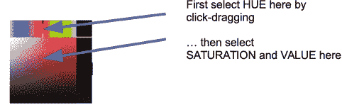

**图 5-1.** 用于输入颜色值的颜色立方体

*   某些锚点，例如`light_directional`的`enabled`锚点，默认情况下在模块中不可见。相反，它们是所谓“复合锚点”的一部分。可以通过点击复合锚点来展开其子锚点。
*   对于枚举类型值，只需点击它们并选择合适的值。`light_directional`的`enabled`锚点就是枚举值的一个例子。
*   对于颜色值，双击它们并选择颜色。如图 5-1 所示，点击并拖动颜色立方体的顶行以选择**色相（HUE）**值，然后在较大的左下方面板内点击一个点以选择**饱和度（SATURATION）**和**明度（VALUE）**。

这是 ThMAD 中始终使用的 HSV 颜色空间。在内部，它会被转换为 OpenGL 所需的红-绿-蓝（RGB）值。双击右上角的小方块可关闭它。

按图 5-2 所示连接模块。

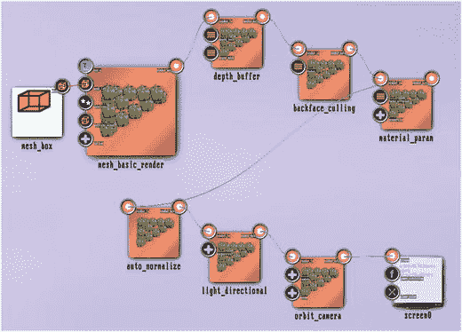

**图 5-2.** 基础变换设置。点击并拖动一个输出锚点，在要连接到的输入锚点上释放。

关于顺序的说明：ThMAD 底层使用的 OpenGL 是一个状态机，顺序并非在所有情况下都重要。但在很多情况下它确实很重要，尤其是在涉及矩阵运算时。在上面描述的状态中，`orbit_camera`和`light_directional`模块在空间中都有一个由矩阵描述的朝向。这里的顺序至关重要：如果我们把灯光放在相机之后，灯光的位置就会随相机旋转，就像灯光和相机被绑在一起一样。但我们期望的是，旋转相机时灯光保持固定，因此灯光需要在状态中位于相机之前。

这里新增了一个不起眼的模块叫`auto_normalize`。它负责在变换之后、应用光照之前修正法向量。在某些情况下，特别是涉及任何类型的缩放变换时，忘记它可能会给你带来奇怪的光照问题和无数个不眠之夜。

**注意：** 在任何可能存在缩放操作的 3D 状态中，务必在光照之前添加`Renderers → opengl_modifiers → auto_normalize`模块。

结果将是一个立方体的正面视图，如图 5-3 所示。

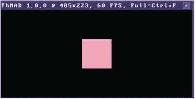

**图 5-3.** 基础状态输出结果

现在我们要做的是添加一个摇摆旋转，其幅度由输入的低音声音调制，并添加一个大小缩放，由输入的高音声音调制。我们从旋转开始。继续进行之前，先添加`Renderers → opengl_modifiers → gl_rotate`模块两次，并将它们都插入到`mesh_basic_render`和`depth_buffer`之间。操作方法是：右键单击它们之间的连线，选择“断开连接”（Disconnect），然后绘制如图 5-4 所示的新连接。

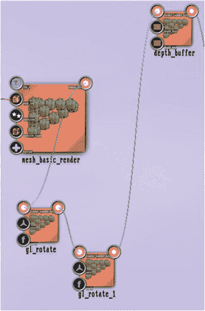

**图 5-4.** 添加旋转模块

当添加多个同类型模块时，ThMAD 会自动为它们编号。例如，对于我们刚刚添加两次的`gl_rotate`，第一个将被命名为`gl_rotate`，第二个为`gl_rotate_1`。下一个将被称为`gl_rotate_2`，依此类推。这是你在画布上模块下方看到的外部名称，也是其内部 ID，在模块被删除前不会改变。

旋转模块默认的旋转轴为`(0;0;1)`，即平行于 z 轴，旋转角度为`0.0`。相应的锚点分别称为`axis`和`angle`。我们现在将第一个旋转模块的轴更改为`(1;0;1)`：双击`axis`锚点并移动 x 滑块。这是第一个滑块，一直移到`1.0`。见图 5-5。

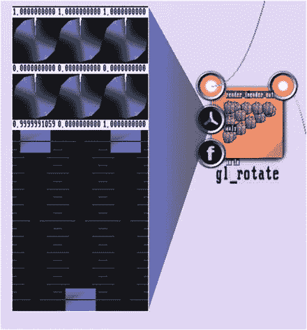

**图 5-5.** 旋转轴滑块

在滑块的任意位置双击以关闭三重滑块。保持另一个旋转模块的轴不变，这样它将绕默认的 z 轴旋转。为了实现稳定旋转的效果，我们添加两个`Maths → oscillators → oscillator`模块，并按照表 5-9 和 5-10 设置它们的锚点。

**表 5-10.**

| `maths → oscillators → oscillator` |
| --- |
| 第二个“旋转引擎” |
| `osc_type` | `saw` | 说明见下方。 |
| `freq` | 0.25 | 你也可以选择其他值。 |

**表 5-9.**

| `maths → oscillators → oscillator` |
| --- |
| 第一个“旋转引擎” |
| `osc_type` | `saw` | 说明见下方。 |
| `freq` | 0.55 | 也可以选择其他值。 |

现在将它们的输出连接到`gl_rotate`模块的`angle`输入锚点。参见图 5-6。

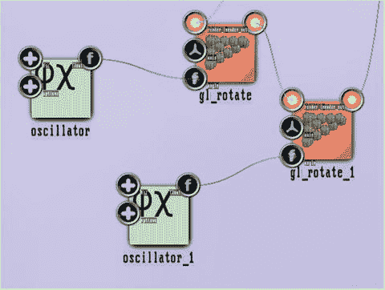

**图 5-6.** 稳定旋转

设置浮点类型锚点的值，需双击旋钮，然后点击并拖动它。点击旋钮后 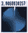，您可上下拖动鼠标进行粗略值调整，或左右拖动进行精细值调整。也可点击数字，用键盘修改数值，然后按 Enter 键（可随时使用`Ctrl+Del`清除字符串）。

我们使用锯齿振荡器的原因是其值能从`0.0`线性过渡到`1.0`，然后迅速跳回`0.0`。另一方面，角度输入是模`1.0`的，这意味着角度值`1.0`代表完整的一圈。这样，锯齿振荡器就能提供稳定均匀的旋转。现在进行平移，我们添加如下模块：

*   `Renderers` → `opengl_modifiers` → `gl_translate`
*   `Maths` → `converters` → `3float_to_float3`

将`gl_translate`模块放置在`gl_rotate_1`和`depth_buffer`模块之间，并将`3float_to_float3`模块连接到`gl_translate`模块的`translation`锚点上，如图 5-7 所示。

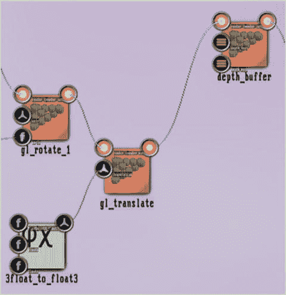

图 5-7.

已添加平移

`3float_to_float3`模块允许复用平移向量——平移的 x、y、z 分量可以各自独立寻址。对于运动马达，我们再添加一个振荡器：

`Maths` → `oscillators` → `oscillator`

将其连接到`3float_to_float3`的第一个输入锚点，并按表 5-11 设置其锚点。

表 5-11.

| `maths` → `oscillators` → `oscillator` |
| --- |
| 第二个振荡器，`oscillator_2` |
|   | `osc_type` | `sin` |   |
|   | `ofs` | `0.0` | 使其围绕`0.0`振荡。 |

作为最后一个变换模块，我们添加一个放大或缩小盒子的模块，名称中的`_one`表示在所有三个维度上均匀缩放：

`Renderers` → `opengl_modifiers` → `gl_scale_one`

将其放置在`gl_translate`和`depth_buffer`之间。见图 5-8。

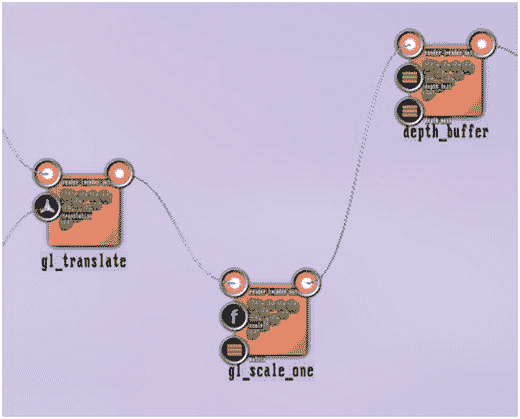

图 5-8.

已添加缩放

最后一步，我们添加对声音的敏感度。为此，在画布上放置`Sound` → `input_visualization_listener`模块，以及两个`maths` → `arithmetics` → `ternary` → `float` → `mult_add`模块。将`visualization listener`模块的`octaves_l_0`输出锚点连接到第一个`mult_add`模块的`float_in`锚点，类似地将`octaves_l_4`锚点连接到第二个`mult_add`模块。见图 5-9。`octaves_l_0`用于低音音调，`octaves_l_4`用于高音音调。其他输入锚点值用于音量缩放和设置基值。更具体地说，见表 5-12 和 5-13。

表 5-13.

| `maths` → `arithmetics` → `ternary` → `float` → `mult_add` |
| --- |
| 连接到高音音调和缩放模块的那个 |
|   | `first_mult` | `10.0` | 音量缩放 |
|   | `then_add` | `0.5` | 即使无声音也有一定尺寸 |

表 5-12.

| `maths` → `arithmetics` → `ternary` → `float` → `mult_add` |
| --- |
| 连接到低音音调和平移模块的那个 |
|   | `first_mult` | `3.0` | 音量缩放 |
|   | `then_add` | `0.1` | 即使无声音也有一定移动 |

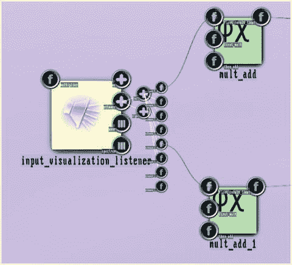

图 5-9.

已添加声音输入

最后，将低音`mult_add`的输出连接到`oscillator_2`的`amp`锚点，并将高音`mult_add`的输出连接到`gl_scale_one`模块的`scale`锚点。

播放一些音乐，您就能看到盒子随着传入的声音移动和膨胀，如图 5-10 所示。

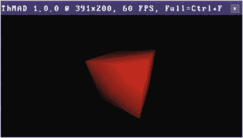

图 5-10.

添加声音输入后的效果

如果效果反应过于迟缓，请更改`visualization listener`的放大输入锚点`multiplier`。

盒子的移动和膨胀略显突兀，因为对传入声音的反应非常迅速。如果您在`mult_add`模块之后插入`maths` → `interpolation` → `float_smoother`模块，可以平滑该效果。这留作您的练习。

### 线框图

线框模型通过不绘制任何区域，而仅绘制物体的边缘，来降低渲染 3D 物体的复杂度。该模型最初用于调试目的，因为不绘制内部区域点能显著提升速度。但线框模型本身也可能展现出独特的美学价值。

**注意：** 本小节的示例源码可在`TheArtOfAudioVisualization`文件夹下的`A-5.1.2_*`中找到。

作为起点，我们绘制三种类型的球体并比较它们的线框。为此，我们首先构建基本的 3D 布局。

在`mesh_basic_render`和`depth_buffer`之间插入模块`Renderers → opengl_modifiers → blend_mode`。该模块是表达你想要组合多个子渲染管线的好方法。在这里，你还可以指定当多个物体重叠时像素颜色会发生什么变化。我们想要并排展示物体，所以预计不会出现重叠，但使用`blend_mode`作为组合器是结构化状态的好方法。记住，你可以通过首先删除现有连接来将模块插入到已有连接中。操作方法是右键点击连接并选择“断开连接”，然后按需重新连接所有内容。

在`mesh_basic_render`和`blend_mode`之间插入以下模块：

- `Renderers → opengl_modifiers → gl_scale_one`
- `Renderers → opengl_modifiers → gl_translate`

参见图 5-11。

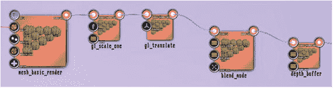

图 5-11. 准备线框视图

将`gl_scale_one`的`scale`锚点更改为 0.75，如表 5-14 所示。

**表 5-14.**

| `renderers → opengl_modifiers → gl_scale_one` |
| --- |
|  | `scale` | 0.75 |

将模块`gl_translate`的`translation`锚点的 x 坐标更改为 -1.8，如表 5-15 所示。

**表 5-15.**

| `renderers → opengl_modifiers → gl_translate` |
| --- |
|  | `translation` | (-1.8; 0; 0) |

为此，双击`translation`锚点，并使用左侧旋钮和左侧滑块调整 x 值，如图 5-12 所示。

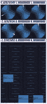

图 5-12. 三重值滑块

上方的旋钮指定滑块可用的范围，下方的旋钮指定偏移量。要更改旋钮的值，请单击并拖动它。垂直鼠标移动用于粗略更改，水平鼠标移动用于精细更改。因此，如果你将下方旋钮更改为类似 -2.0 的值，并将上方旋钮保留为默认值 1.0，则可以使用滑块实现所需的 -1.8。要移动滑块，也请单击并拖动它。通过双击三重控制器上的任意位置来关闭它。

删除你之前按照说明操作时得到的`box`模块。点击它，然后按键盘上的`Del`键。或者使用右键点击后出现的上下文菜单将其删除。现在将模块`mesh → solid → mesh_sphere`放置在`mesh_basic_render`旁边，并将球体连接到`mesh_basic_render`模块的`mesh_in`锚点。如表 5-16 所示更改球体的锚点。

**表 5-16.**

| `mesh → solid → mesh_sphere` |
| --- |
|  | `num_sectors` | 30 |
|  | `num_stacks` | 10 |

稍微调整相机设置后，我使用 2.8 作为距离，65.0 作为视场角，以稍微减弱透视效果。你可以在图 5-13 中看到这一点。

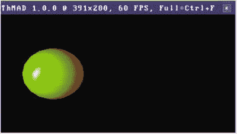

图 5-13. 一个基本的球体

对于另外两种球体类型，我们克隆`mesh_basic_render`、`gl_scale_one`和`gl_translate`模块。克隆是带有所有实际值的副本，它通常能帮你简化状态生成。要执行克隆，请按住`Ctrl`和`Alt`，然后点击并拖动相关模块。

对于克隆的模块，与原始模块类似地进行连接，将它们连接到`blend_mode`，这次添加`Mesh → solid → mesh_sphere_icosahedron`模块作为输入。将克隆的`gl_translate`的 x 平移值更改为 0.0。以完全相同的方式制作另一个克隆，但这次使用 +1.8 的 x 平移值，并添加`Mesh → solid → mesh_sphere_octahedron`。

至于球体的参数，请按表 5-17 和 5-18 所示设置值。

**表 5-17.**

| `mesh → solid → mesh_sphere_icosahedron` |
| --- |
|  | `subdivision_level` | 4.0 |
|  | `max_normalization_level` | 10 |

**表 5-18.**

| `mesh → solid → mesh_sphere_octahedron` |
| --- |
|  | `subdivision_level` | 4.0 |
|  | `max_normalization_level` | 10 |

状态生成器部分将如图 5-14 所示，输出如图 5-15 所示。现在，实际切换到线框模式视图很简单。在相机模块和屏幕模块之间，插入一个模块`Renderers → opengl_modifiers → rendering_mode`。

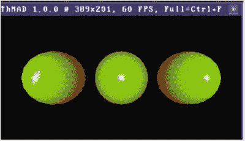

图 5-15. 三种不同类型的球体

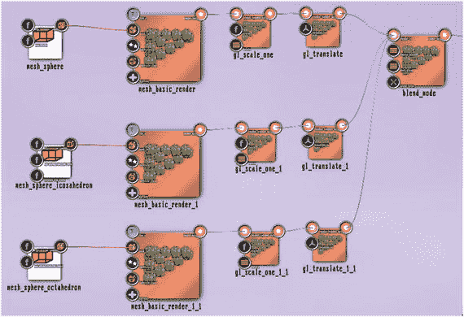

图 5-14. 三个球体：状态（部分）

按表 5-19 所示更改其锚点。

**表 5-19.**

| `renderers → opengl_modifiers → rendering_mode` |
| --- |
|  | `back_facing` | lines |
|  | `front_facing` | lines |

最终输出可见于图 5-16。你可以按`Ctrl+F`切换到全窗口模式并查看细节。

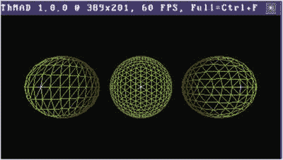

图 5-16. 三种不同类型的球体，处于线框模式

如果你想将其用作构建更动态、更丰富效果的基础，可以通过以下方式实现。移除生成器部分的八面体和二十面体，然后通过相应更改`gl_translate`的`translation`锚点的 x 坐标，将剩余的球体移回 (0; 0; 0)。

然后添加模块`Particlesystems → generators → basic_spray_emitter`，并按表 5-20 所示设置其锚点。

**表 5-20.**

| `particlesystems → generators → basic_spray_emitter` |
| --- |
|  | `num_particles` | 100 |
|  | `particles_per_second` | -1 | 因为 -1，由`num_particles`决定 |
|  | `spatial / size / speed / speed_x` | 9.0 |
|  | `spatial / size / particle_size_base` | 1.0 |
|  | `spatial / size / particle_size_random_weight` | 3.2 |
|  | `appearance / time / particle_lifetime_base` | 4.0 |
|  | `appearance / time / particle_lifetime_random_weight` | 1.0 |

这个粒子系统喷射发射器的作用是稳定地生成、移动，并在一定时间后销毁线框立方体。将`basic_spray_emitter`连接到`mesh_basic_render`的`particles`输入锚点以启动动态效果。输出将如图 5-17 所示。

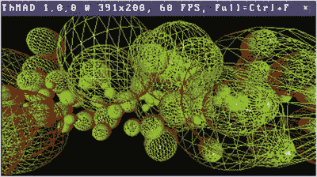

图 5-17. 大规模动态线框

关于粒子系统还有很多内容可讲，我们将在本文的多个地方再次遇到它们。

如本章前面所示，可以添加对声音的响应。只需将声音连接到任何输入锚点即可。速度、数量、基础尺寸和/或尺寸随机化都是合适的候选参数。

### 海洋模块

ThMAD 有一个非常吸引人的海洋模块，本节将对其进行说明。

从本章前面介绍的基本设置开始，直到`mesh_box`。但这里不需要那个节点。而是添加`Mesh → generators → ocean`模块，并将其连接到`mesh_basic_render`。对于锚点值，首先在屏幕模块中设置天空颜色，如表 5-21 所示。

**表 5-21.**

| `screen0` |
| --- |
|  | `clear_color` | `0.19； 0.40； 1.0； 1.0` | 天空 |

请注意，双击锚点会选择其默认输入方式。对于颜色，这通常是您已经熟悉的颜色控制器，但不适用于屏幕模块。此决定由每个模块单独做出。在这种情况下，会显示四重滑块组合，如图 5-18 所示。

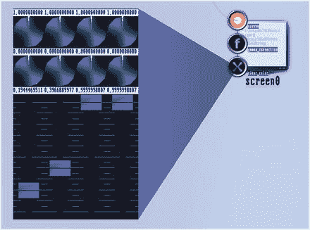

图 5-18. 四重滑块组合

在输入框中，您可以使用滑块设置每个颜色通道的值，每个滑块的范围由第一行的旋钮给出，其下方的旋钮提供最低值或偏移量。这些限制有默认值，对于自然范围在`0.0`到`1.0`之间的颜色值，设置范围 = `1.0`和偏移 = `0.0`是完全合理的。您无需在此处更改限制旋钮。或者，您可以单击滑块上方的文本滑块值，使用键盘输入值（使用`Ctrl + Del`组合键先清除输入框）。

或者，您可以通过右键单击锚点并选择`Color`来强制显示颜色选择器，如图 5-19 所示。

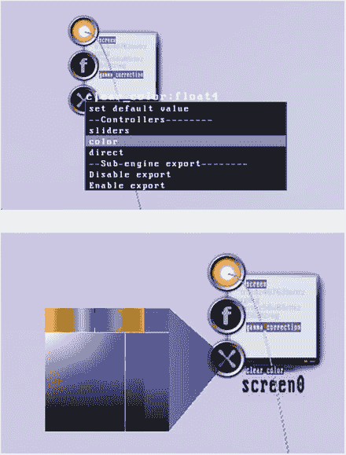

图 5-19. 访问图形颜色选择器

或者，您可以使用相同的上下文弹出窗口选择直接输入模式，如图 5-20 所示。

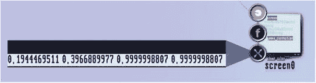

图 5-20. 直接颜色输入过程

然后您可以单击每个值，使用键盘进行更改，然后按`Enter`键确认。同样，使用`Ctrl + Del`组合键清除某个值。前三个值代表 RGB，每个分量在`[0.0；1.0]`范围内，最后一个值代表 ALPHA 值。像往常一样，双击控制器即可关闭它。海洋的其他模块锚点值如表 5-22 至 5-28 所示。

**表 5-28.**

| `mesh → generators ocean` |
| --- |
|  | `time_speed` | `3.2` | 波浪运动的时间乘数 |
|  | `wind_speed_x` | `5-0` |  |
|  | `wind_speed_y` | `12.0` |  |
|  | `lambda` | `1.12` | 波速 |
|  | `normals_only` | `no` |  |

**表 5-27.**

| `renderers → mesh → mesh_basic_render` |
| --- |
|  | `vertex_colors` | `no` | 让`material_param`模块定义颜色 |
|  | `use_display_list` | `no` |  |
|  | `use_vertex_colors` | `no` |  |
|  | `particles_size_center` | `no` |  |
|  | `particles_size_from_color` | `no` |  |
|  | `ignore_uvs_in_vbo_updates` | `no` |  |

**表 5-26.**

| `renderers → opengl_modifiers → depth_buffer` |
| --- |
|  | `depth_test` | `ENABLED` |
|  | `depth_mask` | `ENABLED` |

**表 5-25.**

| `renderers → opengl_modifiers → backface_culling` |
| --- |
|  | `status` | `DISABLED` | 由于内部错误，需要禁用它 |

**表 5-24.**

| `renderers → opengl_modifiers → material_param` |
| --- |
|  | `ambient_` | `0.21; 0.19; 0.06;` | 暗黄色环境色 |
|  | `reflectance` | `0.98` |  |
|  | `diffuse_` | `0.03; 0.13; 0.83;` | 蓝色漫反射色 |
|  | `reflectance` | `1.0` |  |
|  | `specular_` | `0.92; 0.91; 0.68;` | 浅黄色高光色 |
|  | `reflectance` | `1.0` |  |
|  | `specular_ exponent` | `20.0` |  |

**表 5-23.**

| `renderers → opengl_modifiers → light_directional` |
| --- |
|  | `position` | `-0.19; 0.71; 1.0` |  |
|  | `ambient_color` | `0.16; 0.22; 0.23; 0.42` | 蓝绿色环境色 |
|  | `diffuse_color` | `0.94; 0.92; 1.0; 1.0` | 海洋蓝色漫射色 |
|  | `specular_color` | `0.95; 0.94; 0.81; 1.0` | 略带黄色的亮高光色 |

**表 5-22.**

| `renderers → opengl_modifiers → cameras → orbit_camera` |
| --- |
|  | `rotation` | `0.0； -0.82； 0.12` | 我们需要一个合适的摄像机视角，因为 ThMAD 中的海洋面板是有限的，但我们希望营造出无边地平线的印象。 |
|  | `distance` | `20.0` |  |
|  | `fov` | `66.0` |  |

**注意：** 源代码位于`TheArtOfAudioVisualization`文件夹下的`A-5.1.3_Ocean`中。

结果如图 5-21 所示。

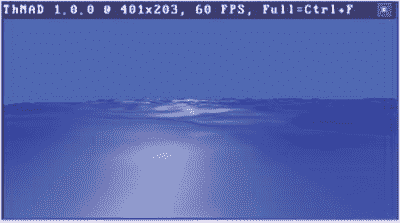

图 5-21. 海洋输出

### 纹理映射

纹理，更确切地说是纹理贴图，是一种使用预加载到图形硬件上的 2D 图像来有效描述 3D 对象各部分表面特征的方法。

这样做有一个技术原因。考虑一个真实世界中移动的 3D 对象。为了逼真地表示它，我们必须通过观察数百万个微小的彩色点来描述它。这些点中的每一个都在移动，并且每秒需要计算几十次。如果所有这些都在计算机的 CPU 中进行，那么每秒需要将过多的数据传输到图形硬件。相反，作为解决此困境的一个相当巧妙的方法，我们通过数量少得多的点或顶点（它们构成一个覆盖在表面上的网格）来描述每个 3D 对象，并将预加载的 2D 图像的合适部分映射到网格的每个面上。这有效地将每秒需要传输到图形硬件的数据量减少了几个数量级。

纹理映射的主要数学描述包括为构成形状的每个顶点分配两组坐标。例如，如果您绘制一个由以下坐标构成的四边形面

`(x1, y1, z1) → (x2, y2, z2) → (x3, y3, z3) → (x4, y4, z4) → (x1, y1, z1)`

并且您想要将 2D 纹理的一部分映射到其上，更准确地说是一个四边形：

`(u1, v1) → (u2, v2) → (u3, v3) → (u4, v4) → (u1, v1)`

那么这组双坐标正是您在程序内部必须提供的，以描述一个纹理贴图：

`(x1, y1, z1, u1, v1) → (x2, y2, z2, u2, v2) → (x3, y3, z3, u3, v3) → (x4, y4, z4, u4, v4) → (x1, y1, z1, u1, v1)`

图 5-22 以图形方式描绘了这一点。请注意，关于纹理还有很多要说的。纹理还有 1D、3D，甚至 4D 形式，以及针对不同分辨率的堆叠存储类型等等。在本书中，我们只描述所有这些功能的一部分，但您可以在互联网或其他书籍上阅读到的材料可能非常丰富，因此如果您愿意，可以随意使用其他来源扩展您的研究。

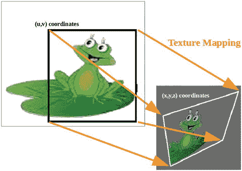

**图 5-22.** 基本纹理映射

首先，在 ThMAD 中，没有一种通用方法可以以被纹理化对象的结构和纹理所需的方式来描述这种逐点纹理映射。这是因为您通常不会输入点坐标，而是输入某种形式的形状，并且没有可靠的方法来猜测每个纹理点需要映射到哪里。但是，有一些变通方法可以涵盖一些有趣的情况，例如使用自动纹理坐标生成，以及 OpenGL 中一个称为着色器的功能。两者都能产生引人入胜的效果，并且对您的可视化构思至关重要。

### 自动纹理坐标

OpenGL 有一个名为 `glTexGen()` 的函数。它描述了一种古老的遗留技术，让渲染引擎自动生成纹理映射。现在它已被着色器取代，本书不涉及着色器。它在表现力方面存在一些不足。

**注意：** 此源码位于 `TheArtOfAudioVisualization` 文件夹内的 `A-5.2.1_Automatic_texture_coordinates` 目录下。

尽管如此，你仍可将其用于你的草图中，因为 ThMAD 中有一个模块涵盖了这个功能。该模块名为 `Texture → opengl → texture_coord_gen`。要使用它，你还需要一个基本的 3D 管线、一个网格和一个纹理。作为操作示例，以下章节描述了将纹理映射到球体以及立方体的一个面上。从这些模块开始：

- `orbit_camera`
- `light_directional`
- `material_param`
- `backface_culling`

将相机连接到屏幕模块 `screen0`。这是管线的后端。从另一端，如果你喜欢，可以选择画布的左侧。我们从一条链开始，并将它们全部连接起来：

- `Texture → loaders → png_tex_load`
- `Texture → modifiers → scale`
- `Texture → modifiers → tex_parameters`
- `Texture → modifiers → translate`
- `Renderers → mesh → mesh_basic_render`
- `Texture → opengl → texture_coord_gen`

同时，将 `texture_coord_gen` 模块的 `render_out` 锚点连接到 `material_param` 模块的 `render_in` 锚点。作为最后一个模块，我们添加 `Mesh → solid → mesh_sphere_octahedron`，并将其输出连接到 `mesh_basic_render` 模块的 `mesh_in` 锚点。参见图 5-23。

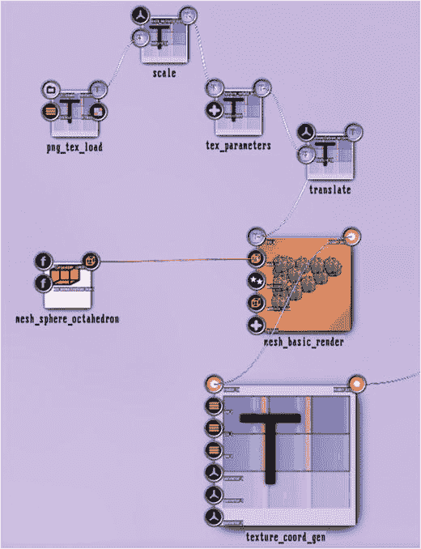

**图 5-23.** 自动纹理坐标

要准备这些锚点参数，请将一个 PNG 图像放置在此文件夹中：

```
[HOME]/thmad/[VERSION]/data/resources
```

确保其大小为 128x128 或 256x256，并使其背景透明。通常，让纹理在两个维度上尺寸相同且为 2 的幂次方是个好主意。我打算使用的小青蛙图已经在 `TheArtOfAudioVisualization` 文件夹中；它名为 `frosch2.png`。锚点参数如表 5-29 至 5-34 所示。

**表 5-34.** `texture → opengl → texture_coord_gen`

| | gen_s | `OBJECT_LINEAR` | 注意，OpenGL 中的纹理坐标通常用 S、T 和 R 表示。这不是笔误，奇怪的顺序是由于历史原因造成的。 |
| --- | --- | --- | --- |
| | gen_t | `OBJECT_LINEAR` | |
| | gen_r | `<any>` | 忽略，因为我们使用的是 2D 纹理。 |

**表 5-33.** `mesh → solid → mesh_sphere_octahedron`

| | max_normalization_level | 10.0 | 平滑度；在修改 `subdivision_level` 之前先调整此参数！ |
| --- | --- | --- | --- |
| | subdivision_level | 6.0 | 平滑度 |

**表 5-32.** `texture → modifiers → tex_parameter`

| | parameters / wrap_s | `repeat` | 稍后可以更改重复模式，以仅显示单个映射纹理，或显示一行、一列重复纹理。 |
| --- | --- | --- | --- |
| | parameters / wrap_t | `repeat` | |

**表 5-31.** `texture → modifiers → translate`

| | translation_vector | 0; 0; 0 | 纹理的映射位置——稍后可以调整这些值。 |
| --- | --- | --- | --- |

**表 5-30.** `texture → modifiers → scale`

| | scale_vector | 1; 1; 1 | 纹理的映射大小；稍后可以调整这些值。 |
| --- | --- | --- | --- |

**表 5-29.** `texture → loaders → png_tex_load`

| | filename | 来自资源的 PNG 图像 | 通过资源浏览器选择；双击你的选择。 |
| --- | --- | --- | --- |

在后端，确保 `backface_culling` 的 `status` 锚点切换到 `ENABLED`，在 `properties/enabled` 处开启光照，并在 `camera` 模块中开启透视校正。此外，你可以将相机旋转参数设置为 `(0.0; 0.0; 1.0)`。结果将类似于图 5-24 和图 5-25。

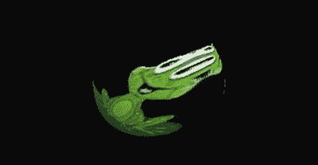

**图 5-25.** 自动纹理坐标，第 2 版

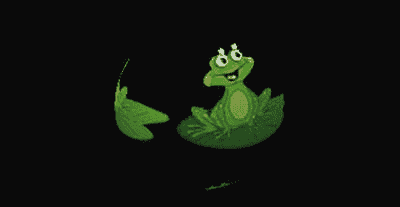

**图 5-24.** 自动纹理坐标，第 1 版

乍一看，这似乎是将图像正确地映射到了球体上。但实际上，所使用的公式并不真实。由于模块的 `OBJECT LINEAR` 模式，每个 (u,v) 坐标都被映射到 (x,y,z) 空间的线性组合：`u = a ∙ x + b ∙ y + c ∙ z` 和 `v = d ∙ x + e ∙ y + f ∙ z`。这仅在球体表面的中心附近，并且只有在直视 x,y 平面时才是真实的。通过调整缩放、平移和相机位置，图片可能看起来像图 5-25，揭示了这种自动纹理映射的缺陷。

`texture_coord_gen` 模块的其他模式行为不同。当使用 `EYE_LINEAR` 模式时，你可以在模块的 `parameter_s` 和 `parameter_t` 锚点中更改的 `a, b, c, d, e, f` 值会根据相机或眼睛位置进行投影。即便如此，在球体的边缘处投影也不正确，如图 5-26 所示。

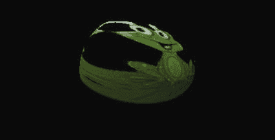

**图 5-26.** 自动纹理坐标，第 3 版

`NORMAL MAP` 模式乍看起来似乎正确，如图 5-27 所示。它使用每个网格片元的法向量来生成纹理的相应部分。不过，映射是粘附在相机位置上的，即它不固定在物体上。事实上，你会看到光照似乎在旋转，这是因为球体是旋转不变的。

`SPHERE_MAP` 和 `REFLECTION_MAP` 模式是边界情况，我们在此不讨论。当然，你仍然可以尝试它们。如果你想了解更多关于这些模式的信息，请查阅详细描述 `glTexGen` 函数的 OpenGL 规范。

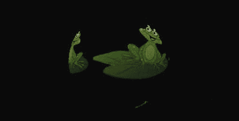

**图 5-27.** 自动纹理坐标，第 4 版

你也可以将纹理投影到立方体的表面。只需将同一个模块文件夹中的 `mesh_sphere_octahedron` 模块替换为 `mesh_box` 模块即可。你可能会猜想，之前在球体情况下遇到的 `OBJECT_LINEAR` 模式在边缘处出现不自然失真的缺陷可能会消失，事实确实如此。但这仅在我们观察六个面中的单个面，并且不允许映射到达边缘的情况下才成立。为什么呢？因为到达边缘时，映射公式停止推进，相邻的面将由边缘的像素填充，如图 5-28 所示。


**图 5-28.** 立方体上的自动纹理坐标

但是，如果你在 `tex_parameters` 中将两个坐标的重复模式都改为“clamp”，然后适当地缩放和平移纹理，你最终可能会在立方体的一个面上得到真实的纹理映射，如图 5-29 所示。

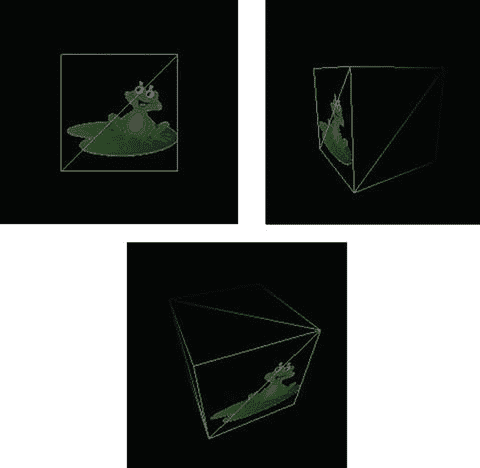

**图 5-29.** 立方体上的自动纹理坐标，第 2 版。为了说明目的，添加了线框以显示立方体的方向。

综上所述，`texture_coord_gen` 模块在平坦表面上可能运行良好，但对于弯曲表面则缺乏物理正确性。尽管如此，它仍然可以帮助你实现心中的特效。

### 浮动纹理 I

另一种我称之为浮动纹理的技术，使用了平面网格生成器。共有两种：

- `Mesh → solid → mesh_planes`
- `Mesh → solid → mesh_grid`

第一种用于生成任意数量的、填充了纹理的堆叠幻灯片。这能产生令人印象深刻的效果，但你也可以将数量仅设为 1，从而在三维空间中获得一个悬浮的单独幻灯片。这种在三维空间中悬浮或浮动的特性，正是“浮动纹理”名称的由来。第二个生成器 `mesh_grid` 不具备堆叠功能，因此它始终只生成单个幻灯片。然而，与 `mesh_planes` 不同的是，它由一个顶点网格组成，这些顶点均匀地映射到纹理坐标上。

**注意：** 源码位于 `TheArtOfAudioVisualization` 文件夹内的 `A-5.2.2_Floating_texture` 目录下。

我们首先描述 `mesh_planes` 组件。要使用它，请在画布上放置标准的 3D 链——`orbit_camera`、`light_directional`、`material_param`、`backface_culling`——并将相机连接到屏幕模块。添加以下模块：

- `Texture → loaders → png_tex_load`
- `Texture → modifiers → scale`
- `Texture → modifiers → tex_parameters`
- `Texture → modifiers → translate`
- `Renderers → mesh → mesh_basic_render`
- `Mesh → solid → mesh_planes`

如图 5-30 所示，将它们全部连接起来。为了准备锚点参数，请将一张 PNG 图像放入 `[HOME]/thmad/[VERSION]/data/resources` 文件夹内。

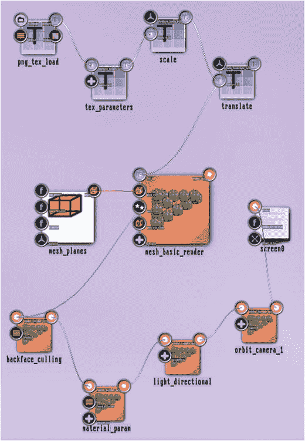

**图 5-30.** 已连接的浮动纹理模块。请注意，`backface_culling` 连接到 `mesh_basic_render` 的 `render_out` 锚点。

确保图像尺寸为 128x128 或 256x256，并将其背景设置为透明。通常，纹理在两个维度上尺寸相同且为 2 的幂次是个好主意。我将使用的那只小青蛙已经在 `TheArtOfAudioVisualization` 文件夹中了，它叫 `frosch2.png`。

锚点参数如表 5-35 至表 5-39 所示。

**表 5-35.** `texture → loaders → png_tex_load`

|                     |               |                                       |
|---------------------|---------------|---------------------------------------|
|                     | `filename`    | 来自资源的 PNG 图像                      |
|                     |               | 通过资源浏览器选择；双击您的选择。             |

**表 5-36.** `texture → modifiers → scale`

|                     | `scale_vector` | `1; 1; 1`                             |
|---------------------|---------------|---------------------------------------|
|                     |               | 纹理的映射尺寸——您可以稍后调整这些值。          |

**表 5-37.** `texture → modifiers → translate`

|                     | `translation_vector` | `0; 0; 0`                           |
|---------------------|---------------------|---------------------------------------|
|                     |                     | 纹理的映射位置——您可以稍后调整这些值。          |

**表 5-38.** `texture → modifiers → tex_parameter`

|                     | `parameters / wrap_s` | `clamp`                             |
|---------------------|----------------------|---------------------------------------|
|                     | `parameters / wrap_t` | `clamp`                             |
|                     |                      | 映射纹理时不要重复纹理。                      |

**表 5-39.** `mesh → solid → mesh_planes`

|                     | `num_planes`         | `1.0`                               |
|---------------------|----------------------|---------------------------------------|
|                     |                      | 平滑度，请在设置 `subdivision_level` 之前更改此值！ |
|                     | `normals`            | `0; 0; 1.0`                         |
|                     |                      | 不影响幻灯片的位置或旋转，但有助于根据上下文（如光照或与其他对象的对应关系）正确渲染幻灯片。 |
|                     | `diameter`           | `1.0`                               |
|                     |                      | 尺寸。您可以稍后调整它。                    |

在后端，确保 `backface_culling` 的 `status` 锚点切换为 `ENABLED`，灯光在 `properties / enabled` 处打开，并在 `camera` 模块中打开透视校正。此外，您可以将相机旋转参数设置为 `(0.0; 0.0; 1.0)`。到目前为止的结果将如图 5-31 所示。

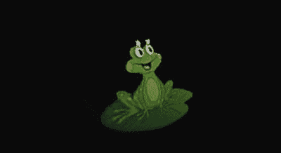

**图 5-31.** 浮动纹理输出

我们现在得到的是一个位于 x-y 平面上、穿过 `z=0` 的尺寸为 2x2 的幻灯片。如果您想要不同的尺寸，可以更改 `mesh_plane` 中的 `diameter` 锚点。为了将幻灯片移动到其他位置或旋转它，您可以通过以下两个附加修改器轻松实现：

- `Renderers → opengl_modifiers → gl_translate`
- `Renderers → opengl_modifiers → gl_rotate`

将它们放置在 `mesh_basic_render` 和 `backface_culling` 之间。

如果您查看目前的渲染管线，可能会注意到存在一个可识别的子管线，它可以被不同的纹理文件以及不同的尺寸、位置和方向重用。见图 5-32。

对于可重用的子管线，ThMAD 中存在一种称为宏的技术。要创建宏，请在画布空白处右键单击，然后从弹出菜单中**选择创建宏**。接着打开该宏。右键单击它，然后从弹出菜单中选择**打开**。现在选择图 5-32 中子管线的所有模块。

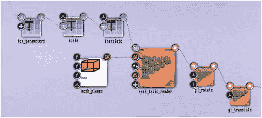

**图 5-32.** 浮动纹理子管线

点击所有这些模块时，请按住 Ctrl 键。或者确保所有其他模块远离它们，然后使用鼠标在其上画一个选择矩形，同样要按住 Ctrl 键。¹

现在按住 Shift 和 Ctrl 键，点击任一选中的模块，保持鼠标按下并拖入宏中。结果将如图 5-33 所示。

为这个新宏取一个合适的名称。点击它，在 ThMAD 窗口右上角出现的弹出菜单中，输入一个新名称，例如 `FloatingTexture`。见图 5-34。

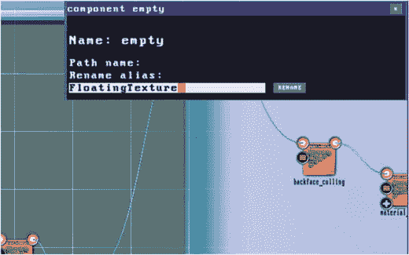

**图 5-34.** 为宏命名

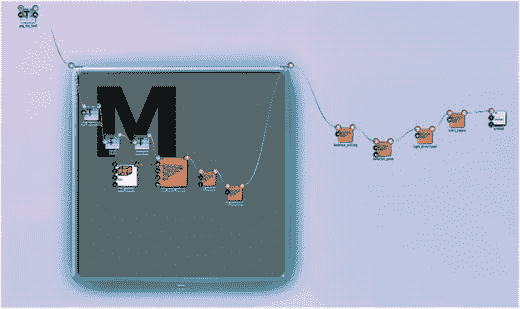

**图 5-33.** 将模块移动到宏中

点击**重命名**按钮后，新名称会立即显示在宏模块下方。

由于存在与外部模块的连接，宏自动获得了一个输入锚点和一个输出锚点。然而，如果我们不能建立更多的锚点（更具体地说是尺寸、位置和旋转），宏的用途将非常有限。为此，请从 `mesh_planes` 将 `diameter` 锚点拖到宏的空白处。点击该锚点，并在按住鼠标按钮的同时，将其移动到宏的空白处。宏的左侧就会出现一个新锚点，并且它连接到了 `mesh_planes` 的 `diameter` 锚点。对 `gl_rotate` 的 `axis` 和 `angle` 锚点以及 `gl_translate` 的 `translation` 锚点重复相同的过程。最终您将得到一个具有五个输入锚点的宏，如图 5-35 所示。

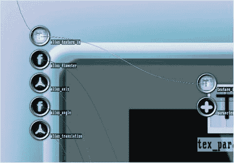

**图 5-35.** 具有所有输入锚点的宏。您可以根据需要重命名新锚点。点击其中任何一个，并使用弹出菜单进行重命名。

在宏的空白处右键单击，选择弹出菜单中的**关闭**，不会删除宏，而是将其最小化。然后您可以把它当作一个黑盒子来处理。见图 5-36。

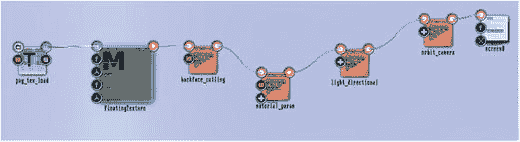

**图 5-36.** 带有最小化宏的新状态

宏可以独立于状态进行保存。右键单击宏并选择**保存宏**。输入一个合适的名称，例如 `FloatingTexture`。宏即被保存，可以在其他状态中使用，或在任意状态（包括当前状态）中多次使用。要在当前状态中立即第二次使用它，请先将鼠标移动到画布空白处，然后按 Ctrl+S 保存，再重启 ThMAD。从模块菜单中打开**宏**部分。重启是必要的，因为当前模块列表浏览器的实现无法对结构变化做出动态响应。

### 浮动纹理 II

对于另一个支持浮动纹理的模块 `Mesh → solid → mesh_grid`，请使用您觉得合适的方法，并用 `mesh_grid` 模块替换 `mesh_planes` 模块。

**注意**

本小节中的示例可在 `TheArtOfAudioVisualization` 文件夹下的 `A-5.2.3_Floating_texture*` 中找到。

使用表 5-40 中所示的值作为参数。

**表 5-40.**

| `mesh → solid → mesh_grid` |
| --- |
|   | `power_of_two_size` | `5.0` | 将网格坐标空间 `(0,0)` – `(1,1)` 细分为 `25 ∙ 25 = 32x32 = 1024` 个片段。 |
|   | `plane` | `XY` | 否则，相机看向 x-y 平面将不起作用。`Z` 将自动为 `0.0`。 |

之前能正常工作的所有设置在此更改下同样有效。但有一个重要区别：`mesh_grid` 模块在四边形 `(-0.5, -0.5, 0)` – `(0.5, 0.5, 0)` 内使用一个包含 `n ∙ n` 个顶点的单一平面网格，并将给定的纹理线性映射到所有顶点。到目前为止，这并没有区别，因为网格的所有片段都能正确映射到纹理的对应片段。但我们可以调整纹理坐标以实现扭曲效果。要查看一个示例，请删除 `mesh_grid` 和 `mesh_basic_render` 模块之间的连接线，在它们之间放置一个 `Mesh → texture → mesh_tex_sequ_distort` 模块，并将这三个模块连接起来，如图 5-37 所示。

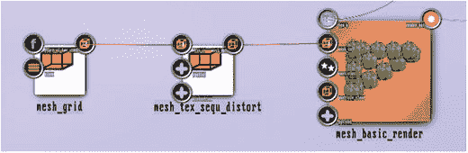

**图 5-37.** 网格纹理扭曲

`mesh_tex_sequ_distort` 有一个 `spatial` 复合锚点，包含 `scale_u`、`scale_v`、`translate_u` 和 `translate_v` 子锚点。按表 5-41 所示设置其值。

**表 5-41.**

| `mesh → texture → mesh_tex_sequ_distort` |
| --- |
|   | `spatial / scale_u` | `1.3` | 应用于纹理坐标的缩放。 |
|   | `spatial / scale_v` | `1.5` |
|   | `spatial / translate_u` | `0` | 应用于纹理坐标的平移。 |
|   | `spatial / translate_v` | `0` |
|   | `distortion / u_shape` | 见下文 | 塑造扭曲曲线，详情请参见本章后续内容。 |
|   | `distortion / v_shape` | 见下文 |

您之后可以调整所有这些值以微调纹理映射。请注意，在扭曲模块内部，平移发生在缩放之后。

另一个复合锚点 `distortion` 包含两个序列，分别用于沿 x 轴和 y 轴的扭曲。默认情况下，这些序列将 `0→1` 范围线性映射到 `0→1`，这意味着除了缩放和平移之外没有扭曲。要更改此设置，请参见第 6 章的详细描述。在您制作出类似于图 5-38 的效果后，输出可能如图 5-39 所示。

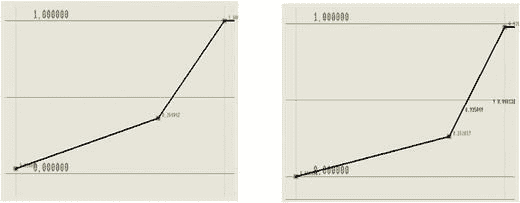

**图 5-38.** 扭曲序列 (左侧为 u 轴，右侧为 v 轴)

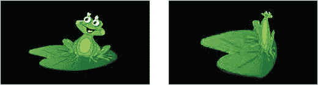

**图 5-39.** 带有扭曲的浮动纹理 (左侧为未扭曲图像)

图 5-38 中显示的扭曲处处具有正斜率；您也可以拥有部分区域为负斜率，这相当于在渲染时回退纹理，通过这种方式，您还可以模拟镜像效果，如图 5-40 和 5-41 所示。

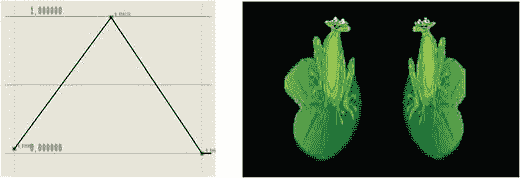

**图 5-41.** 模拟镜像的纹理扭曲 (u 轴)

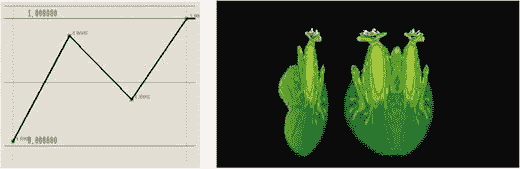

**图 5-40.** 具有负斜率的纹理扭曲 (u 轴)

### Blobs、Blobs、Blobs

Blobs 是 ThMAD 的主力军——您可以在任何需要绘制简单图形的地方使用它们。不要被“简单”这个词误导——借助 ThMAD 提供的所有功能，仅使用 blobs 就能绘制出非常有趣的草图。

根据参数的不同，blobs 可以是圆形、星形或叶形。技术细节可以在 `Bitmaps → Generators → Blob`（用于生成 blob 位图）和 `Texture → Particles → Blob`（用于生成直接发送到图形硬件以加速处理的 blob 纹理）的参考中找到。

在本节中，我们将描述不同的使用场景。其可能性是无穷无尽的，所以请继续尝试您自己的想法。

### 基本图斑

基本图斑是发送到位图或纹理的单一图形。本节将介绍位图。

**注意**

本节示例可在 `TheArtOfAudioVisualization` 文件夹下的 `A-5.3.1_*` 路径中找到。

从一个空白画布开始。右键单击任意空白区域，选择“新建”→“空项目”。在画布上放置以下模块，并将它们以及 `textured_rectangle` 模块全部连接到屏幕模块：

*   Bitmaps → generators → `blob`
*   Texture → loaders → `bitmap2texture`
*   Renderers → basic → `textured_rectangle`

按照表 5-42 所示设置参数。

| bitmaps → generators → `blob` | | | |
| --- | --- | --- | --- |
| | `color` | 1.0; 1.0; 1.0; 1.0 | 白色 |
| | `alpha` | yes | 若设置为 `yes`，图斑的形状由每个像素的 ALPHA 值适当定义。否则，ALPHA 设置为 1.0，形状由逐像素计算的颜色值定义。 |
| | `size` | 512x512 | |

我们也可以使用另一个图斑模块 texture → particles → `blob`，但首先将其作为位图可以获得更多来自位图修改模块的变体。稍后会详细介绍。

现在，调整 `arms`、`attenuation` 和 `star_flower` 锚点，您将获得不同的图斑形状，如图 5-42 所示。对应的状态如图 5-43 所示。

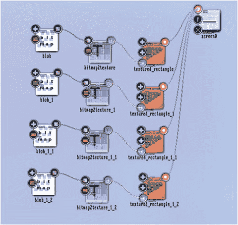

图 5-43. 不同变体的图斑状态

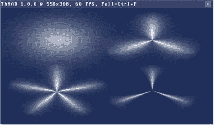

图 5-42. 不同变体的图斑

此状态下每个子管道的不同参数如表 5-43 至 5-46 所示。

| bitmaps → generators → `blob` |  |
| --- | --- |
| | `color`, `alpha`, `size` | 见上文 | |
| | `arms` | 3.0 | |
| | `attenuation` | 2.0 | |
| | `star_flower` | 3.9 | |

| bitmaps → generators → `blob` | 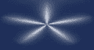 |
| --- | --- |
| | `color`, `alpha`, `size` | 见上文 | |
| | `arms` | 5.0 | |
| | `attenuation` | 2.14 | |
| | `star_flower` | 0.5 | |

| bitmaps → generators → `blob` | 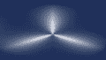 |
| --- | --- |
| | `color`, `alpha`, `size` | 见上文 | |
| | `arms` | 3.0 | |
| | `attenuation` | 2.14 | |
| | `star_flower` | 0.5 | |

| bitmaps → generators → `blob` |  |
| --- | --- |
| | `color`, `alpha`, `size` | 见上文 | |
| | `arms` | 0 | |
| | `attenuation` | 1.9 | |
| | `star_flower` | 0.12 | |

由于图斑针对性能进行了优化，它们是粒子系统（需要许多小对象）的良好候选。粒子系统将在第 6 章中介绍。

实现高性能图斑的基本构建块包括在图形硬件中存储和处理它们。这就是为什么没有像直接图斑渲染器这样的东西，而是称之为图斑纹理生成器。出于同样的原因，您通常不会直接将声音响应添加到图斑中。相反，您可以在处理纹理的状态位置添加声音响应，例如纹理变换、纹理映射，或者在合成纹理时。

尽管如此，请记住，这并不禁止您向图斑参数添加声音输入。只需记住，效果可能因系统性能而异。

尝试以下操作。使用之前的系统，删除除第一个图斑分支外的所有内容，然后添加以下模块，并按图 5-44 所示连接它们：

*   Maths → arithmetics → ternary → float → `mult_add`，两个
*   Sound → `input_visualization_listener`

参数使用表 5-47 和 5-48 中所示的值。

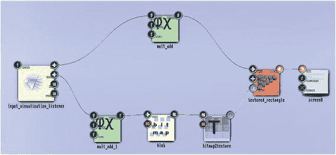

图 5-44. 具有声音感知的图斑状态

上方的 `mult_add` 连接到 `textured_rectangle` 的 `spatial / size` 锚点，以及 `input_visualization_listener` 的 `vu / vu_l` 锚点。下方的 `mult_add` 连接到模块 `blob` 的 `arms` 锚点，以及 `input_visualization_listener` 的 `octaves / left /octaves_left_0` 锚点。

| maths → arithmetics → ternary → float → `mult_add` |
| --- |
| 连接到模块 `blob` 的那个 |
| | `first_mult` | 20.0 |
| | `then_add` | 0.0 |

| maths → arithmetics → ternary → float → `mult_add` |
| --- |
| 连接到模块 `textured_rectangle` 的那个 |
| | `first_mult` | 1.0 |
| | `then_add` | 5.0 |

启动声音输入，您将看到图斑改变其大小和形状。

### 柏林噪声图斑

柏林噪声是一种算法，可以极大地改善具有起伏部分的 2D 或 3D 场景（如表面结构、水波、雾气或火焰）的自然外观。除了在场景内使用柏林噪声外，ThMAD 还允许您将其添加到图斑中。您将在此处了解如何实现这一点。

**注意**

本节示例可在 `TheArtOfAudioVisualization` 文件夹下的 `A-5.3.2_*` 路径中找到。

通过右键单击空白区域并选择“新建”→“空项目”来创建一个空状态。

然后在画布上放置以下模块：

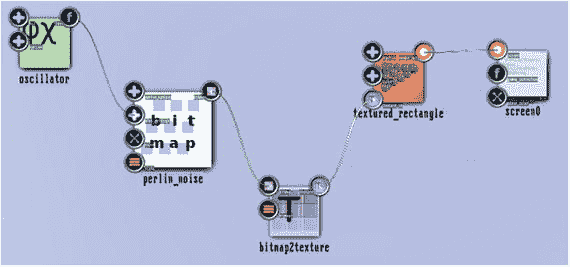

图 5-45. 柏林噪声图斑状态

振荡器连接到 `blob_settings/angle`。

*   Renderers → basic → `textured_rectangle`
*   Texture → loaders → `bitmap2texture`
*   Bitmaps → generators → `perlin_noise`
*   Maths → oscillators → `oscillator`

如图 5-45 所示连接它们。按照表 5-49 至 5-51 设置参数。

| maths → oscillators → `oscillator` |
| --- |
| | `osc / osc_type` | saw |
| | `osc / freq` | 1.0 |
| | `osc / amp` | 3.1415 |

| bitmaps → generators → `perlin_noise` |
| --- |
| | `perlin_options / rand_seed` | 4.0 | 更改以改变噪声的形状。 |
| | `perlin_options / perlin_strength` | 1.0 | 噪声量 – 0 表示无噪声（= 普通图斑） |
| | `perlin_options / octave` | 7 | 噪声粒度级别，1 = 非常粗糙，16 = 非常详细的计算 |
| | `perlin_options / frequency` | 4 | 噪声缩放比例 |
| | `blob_settings / enable_blob` | yes | |
| | `blob_settings / arms` | 3.0 | |
| | `blob_settings / attenuation` | 1.0 | |
| | `blob_settings / star_flower` | 0.0 | |
| | `blob_settings / angle` | - | 连接到振荡器 |

| `screen0` |
| --- |
| | `clear_color` | 0.08; 0.15; 0.31; 1.0 |

**警告**

通常出于性能原因，您不会向位图添加动态效果，然后再将其作为纹理传输到图形硬件。出于演示目的，或者如果您明确了解操作后果，当然可以这样做。

输出如图 5-46 所示。

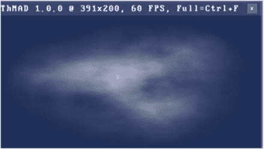

图 5-46. 柏林噪声图斑

## 总结

本章包含了一系列教程（或故事），涵盖了 ThMAD 的诸多方面并展示了其功能。你学习了多种 3D 技巧，包括变换、特殊图形渲染模式，以及一个名为 `ocean` 的非常特别的模块。本章还介绍了纹理和 blob。

虽然本章或多或少侧重于基础概念和技术，但第 6 章则是一系列更高级的故事。

脚注 1

按住 `Ctrl` 键。单击包含子流水线模块的矩形左上角，按住鼠标键，将光标移动至合适的右下角点。然后松开鼠标和 `Ctrl` 键。