# 6. 故事：高级篇

在本章中，我们将通过更详细的演练，深入探讨音频可视化的艺术，涵盖各个方面。我们绝不可能描述所有可能的草图类型，但本章的目标是为你提供一些技巧，这些技巧最终将帮助你实现自己的想法。各节之间没有特定顺序，因此你可以按顺序逐一阅读，或者交叉阅读——选择最适合你的方式即可。

## 回馈纹理

纹理可以描述为存储在图形硬件上的二维有序颜色集合。它们可以自由裁剪、拉伸、旋转、平移或以其他方式变换，最后一步渲染到输出屏幕上任意形状的多边形集合中。

你甚至可以更进一步，将纹理颜色误用于你能想到的任何用途，因为在图形硬件上运行的着色器程序内部，我们可以利用每个纹理坐标上的这四个颜色值做很多事情。考虑到这一点，聪明的人们很快意识到，纹理的使用场景远不止将图像覆盖到 3D 对象上。

ThMAD 提供了一种极其强大且通用的能力，可以将渲染数据回馈到渲染管线的更早阶段。这是可行的，因为图像数据可以被复制到纹理中，而该纹理可用于需要纹理作为输入的模块。实现这种回馈的模块叫做 `Texture → Buffers → render_surface_single`。关于此模块的技术描述，请参见第 8 章。

### 二维模糊

模糊使可视化效果看起来更华丽，也更有趣。这里的目标不是让对象变得不清晰，而是为它们引入一些光泽或创建特殊效果。

**注意**
此处显示的各种状态，其源文件位于 `TheArtOfAudioVisualization` 文件夹中的 `A-6.1.1_Blurring_*` 下。

目前，我们仅将纹理颜色值视为颜色，并希望利用这种回馈技术来实现模糊效果。

一个提醒：回馈以帧速率发生，即每秒 60 次。这使得使用回馈的状态对参数极其敏感。其中一些参数的微小变化可能会产生巨大的影响，也可能导致屏幕变得无聊、全黑或全白，让你成为失望的用户，需要花费数小时重新调整才能再次看到有意义的内容。因此，我会尽量详细解释所需的一切，以帮助你获得令人满意、甚至良好或极佳的体验。当然，尝试修改参数最终会让你体会到这种脆弱性，但一个经验法则是，你可以将这些修改的幅度控制在至少比你之前在 ThMAD 中习惯的数值小十倍以上。

我们从在屏幕上渲染一个旋转的矩形开始。为此，请打开一个干净的画布。如果画布不是偶然为空的，请右键单击空白处，然后选择 `New → Empty Project`。然后选择 `Save As...`。后者是为了确保你不会意外覆盖之前的工作。然后在屏幕上选择 `Renderers → Basic → colored_rectangle`。参数见表 6-1。

**表 6-1.**

| `renderers → basic → colored_rectangle` |
| :--- |
| spatial/ size | 0.77, 0.11, 0.0 |
| color | 0.2, 0.4, 0.9, 1 | 第四个值是 `ALPHA` 值，即不透明度。此处为 1.0。当 `ALPHA` 小于 1.0 时，需要调整其他一些值才能达到显著的模糊效果。除此之外，可自由选择。 |

在其旁边放置一个模块，选择 `Renderers → opengl_modifiers → gl_rotate`。将其连接到 `colored_rectangle` 模块。

在其旁边放置一个模块，选择 `Maths → oscillators → oscillator`。将振荡器的 `float` 锚点连接到 `gl_rotate` 的 `angle` 锚点。正确参数见表 6-2。

**表 6-2.**

| `maths → oscillators → oscillator` |
| :--- |
| osc/ freq | 0.10 |

在其旁边放置一个模块 `Renderers → opengl_modifiers → blend_mode`。将 `blend_mode` 模块连接到 `gl_rotate` 模块。参数见表 6-3。

**表 6-3.**

| `renderers → opengl_modifiers → blend_mode` |
| :--- |
| source_blend | `SRC_ALPHA` |
| dest_blend | `ONE` |

振荡器和混合模式模块在本书中是首次出现。虽然你可以在第 8 章找到技术细节，但这里值得一提几点。振荡器产生一个振荡的浮点值，我们用它来改变所绘制矩形的角度。这对于实际观察模糊效果的完整作用很重要。虽然模糊对静态对象也有效，但对于移动对象，效果会明显得多。然而，更重要的是混合模式模块。我们需要它来混合或融合来自矩形模块的原始像素数据，以及我们即将描述和添加的模糊子流水线的回馈数据。如果选择了错误的混合模式，你将看到错误的结果，或者可能什么也看不到。至于为什么我们选择 `SRC_ALPHA` 和 `ONE`，稍后会解释。现在我们继续描述状态。

将 `blend_mode` 模块连接到屏幕模块。现在你应该看到旋转的矩形，如图 6-1 所示。

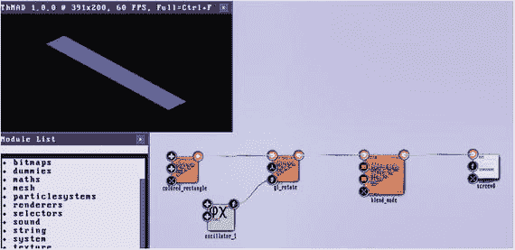

**图 6-1.** 模糊矩形（第一部分）

接下来，我们开始构建反馈渲染器。为此，将模块 `Mesh → solid → mesh_grid` 放置在画布上。稍后，这将允许你将反馈纹理投射到一个平面矩形网格上。我们在这里使用网格而不是简单矩形，原因在于网格能产生更有趣的扭曲效果。更多细节稍后介绍。参数请参见表 [6-4]。

1. 在旁边放置模块 `Mesh → texture → mesh_tex_sequ_distort` 并将它们连接起来。稍后，这将允许我们添加扭曲效果。目前，保持参数不变。
2. 在旁边放置模块 `Renderers → mesh → mesh_basic_render`，并将 `mesh_tex_sequ_distort` 的输出锚点连接到其输入锚点 `mesh_in`。此模块负责渲染 `mesh_grid` 网格。将其所有参数保持为默认值。
3. 在旁边放置模块 `Renderers → opengl_modifiers → gl_scale_one`，并将其连接到 `mesh_basic_render` 的输出。这会引入缩放效果，实际上非常重要。为了实现模糊，需要渲染图形的大小与反馈图形的大小紧密匹配。这里我们需要一个 2.0 的缩放比例，设置在 `scale` 锚点处。请参见表 [6-5]。缩放因子 2 源于 `colored_rectangle` 模块（它在 2 x 2 的矩形内绘制）与纹理坐标空间范围（读取 1 x 1）之间的差异。

**表 6-5.**

| `renderers → opengl_modifiers → gl_scale_one` |
| :--- |
| `scale` | 2.0 |

4. 将 `gl_scale_one` 的输出锚点连接到 `blend_mode` 模块的输入锚点 `render_in`。请参见图 [6-2]。

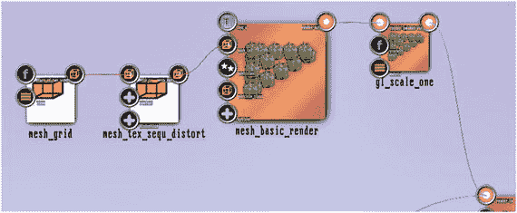

**图 6-2.** 模糊矩形（第二部分）

5. 这是引入反馈模块的关键点。该模块名为 `texture → buffers → render_surface_single`，它将允许将图形数据发送到纹理，而不是屏幕输出。在内部，会使用两个纹理来模拟 OpenGL 的双缓冲行为。后者意味着 OpenGL 渲染首先在隐藏的像素数据缓冲区中进行，只有在所有内容渲染完毕后，才会快速复制到物理屏幕上。这是为了避免闪烁。将模块放置在 `blend_mode` 附近，并从 `blend_mode` 模块的输出端向 `render_surface_single` 模块的输入端 `render_in` 绘制第二条连接。
6. 许多模块允许其输出被复用——在此例中，我们将输出从 `blend_mode` 同时渲染到屏幕和纹理缓冲区。确保 `options` 复合锚点下的 `support_feedback` 子锚点设置为“yes”。请参见表 [6-6]。

**表 6-6.**

| `texture → buffers → render_surface_single` |
| :--- |
| `options / support_feedback` | yes |
| `options / texture_size` | VIEWPORT_SIZE |
| `options / support_feedback` | yes （对于反馈功能正常工作非常重要。） |
| `options / clear_color` | 0, 0, 0, 0 （如果不全为零，背景将不会保持黑色） |

7. 在 `render_surface_single` 之后放置模块 `texture → effects → highblur` 并将它们连接起来。按照表 [6-7] 设置 `highblur` 的锚点。

**表 6-7.**

| `texture → effects → highblur` |
| :--- |
| `translation` | 0.43, -0.65, 0 （引入平移模糊效果，类似风吹） |
| `blowup_center` | 0.5, 0.5, 0 （爆破中心点） |
| `blowup_rate` | 80.0 （爆破速率） |
| `attenuation` | 200.0 （模糊衰减速率） |
| `texture_size` | VIEWPORT_SIZE |

关于此模块的更多细节可在第 [8] 章中找到。

**表 6-4.**

| `mesh → solid → mesh_grid` |
| :--- |
| `plane` | xy |

从 `highblur` 的 `texture_out` 锚点绘制一条连接到 `mesh_basic_render` 的 `tex_a` 输入锚点。反馈连接在此阶段实际上已经完成，但有一点很重要值得提及：数据进入 `blend_mode` 模块的顺序。绝对有必要让已渲染矩形的数据首先到达混合模式模块，然后反馈数据到达。否则，将不会产生模糊效果。为确保顺序正确，请双击 `blend_mode` 的输入锚点，如果顺序错误，可通过单击并拖动其中一个锚点来更改。请参见图 [6-3]。

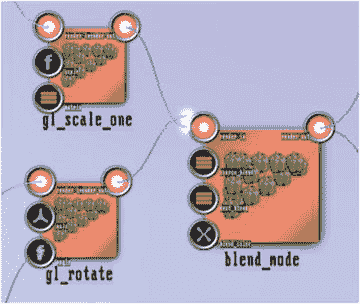

**图 6-3.** 模糊矩形（第三部分）—— 检查并修正混合顺序。`gl_rotate` 来自矩形的渲染器，`gl_scale_one` 来自反馈渲染器。`blend_mode` 的输入锚点已通过双击打开，可以通过单击并拖动其中一个锚点来更改连接的顺序。

**警告**
当存在多个传入图形（渲染器）连接时，输入顺序可能至关重要，因为该顺序只有在双击锚点后才会可见。因此，当你的流水线无法按预期工作时，请牢记这一点。

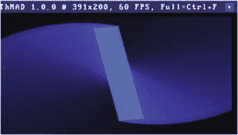

**图 6-4.** 模糊矩形（第四部分）—— 最终输出

如果一切设置正确，旋转的矩形将被模糊，如图 [6-4] 所示。完整的状态如图 [6-5] 所示。

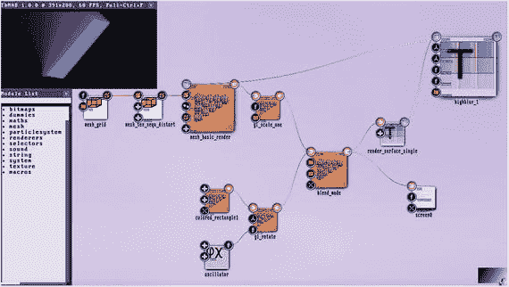

**图 6-5.** 模糊矩形完整状态

我之前说过，在 `blend_mode` 模块中设置的混合模式很重要。关于此模块（包括所有锚点）的简明描述在第 [8] 章的参考资料中给出，但此处先给出解释。`dest_blend` 锚点描述的是像素缓冲区中当前可见的内容，由于矩形的主渲染器是输入顺序中的第一个，因此 `dest_blend` 描述的是传入的完整且未模糊的矩形。此处设置的 `ONE` 值仅表示它不经改变地进入混合过程。第二个锚点 `source_blend` 连接到绘制在已有内容之上的内容，我们在此将其设置为 `ONE`，意味着我们只是将它们叠加。由于根据定义，源数据来自模糊子流水线，我们将首先绘制未模糊的数据，然后将模糊的数据叠加在其上。请注意，在某些情况下，涉及的颜色值和混合模式（包括顺序）可能会根据你的实际草图而变化。

为了展示一个比矩形或许更有趣的模糊效果，并了解如何通过纹理扭曲进行调整，请执行以下操作：

1. 断开与 `colored_rectangle` 的连接：右键单击连接线并选择“断开连接”。或者删除 `colored_rectangle`，右键单击选择它，然后按键盘上的 DEL 键。
2. 添加模块 `Texture → particles → blob` 并按照表 [6-8] 设置其参数。

**表 6-8.**

| `texture → particles → blob` |
| :--- |
| `settings / arms` | 5 |
| `settings / attenuation` | 7.0 |
| `settings / star_flower` | 0.4 |
| `settings / color` | 0.4, 0.7, 0.1, 1.0 （任意你喜欢的颜色，但不要太亮，以免过饱和） |
| `size` | VIEWPORT_SIZE |

3. 添加模块 `Renderers → basic → textured_rectangle` 并将其连接到 blob。其参数请参见表 [6-9]。

**表 6-9.**

| `renderers → basic → textured_rectangle` |
| :--- |
| spatial / size | 0.6 |
| color / global_alpha | 0.95 |

4. 将 `textured_rectangle` 连接到 `blend_mode` 的输入端。再次确保 `gl_rotate` 模块的连接位于 `gl_scale_one` 模块连接的上方；参见图 6-3。此时的输出结果将如图 6-6 所示。让我们通过为模糊方向添加一些动态效果，使其变得更有趣。为此，请遵循以下步骤：

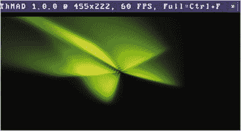

**图 6-6.** 模糊星形 — 第一部分

5. 将 `Maths → converters → 3float_to_float3` 模块放置在 `highblur` 附近。将其输出连接到 `translation` 锚点。
6. 在其旁边放置另一个 `Maths → oscillators → oscillator`。记住，我们已有一个用于旋转模块的振荡器。在第二个振荡器内部，按表 6-10 所示设置参数。

**表 6-10.**

| `maths → oscillators → oscillator` |
| :--- |
| osc / freq | 1.0 |
| osc / amp | 0.25 |

将其连接到 `3float_to_float3` 的 `floata` 和 `floatb` 两个输入锚点。此时，模糊效果应能周期性地改变方向，如图 6-7 所示。最后一步，我们为模糊效果添加扭曲：

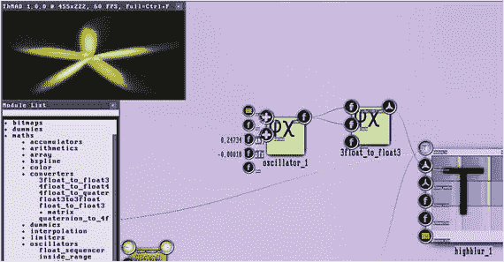

**图 6-7.** 模糊星形 — 第二部分

7. 将 `gl_rotate` 附近振荡器的 `osc_type` 子锚点更改为“SAW”。由于振荡器的内部时间值从 0.0 到 1.0，且 `gl_rotate` 的“angle”输入锚点将 1.0 映射为完整旋转，因此锯齿形状有效地实现了持续旋转效果。参见表 6-11。

**表 6-11.**

| `maths → oscillators → oscillator` (位于 `gl_rotate` 附近) |
| :--- |
| osc / freq | 0.10 |
| osc / type | SAW |

8. 将 `blob` 的 `arms` 输入锚点改为 6.0，以改善对称性。参见表 6-12。

**表 6-12.**

| `texture → particles → blob` |
| :--- |
| settings / arms | 6 |
| settings / attenuation | 7.0 |
| settings / star_flower | 0.4 |
| settings / color | 0.4, 0.7, 0.1, 1.0 | 任意喜欢的颜色，但不宜过亮，以免过饱和 |
| size | VIEWPORT_SIZE |

9. 打开 `mesh_sequ_distort` 模块的“distortion”复合锚点。通过双击打开 `u_shape` 和 `v_shape` 两个子锚点，并在序列编辑器中添加一些值锚点：在线上 Shift 点击，然后点击并拖动值锚点，如图 6-8 所示。另请参阅第 7 章。

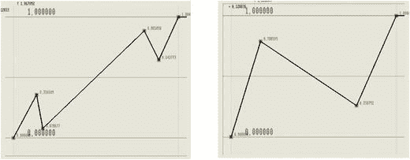

**图 6-8.** 模糊星形 — 第三部分：模糊扭曲

所有操作完成后的结果可能如图 6-9 所示。通过更改模块的锚点值，还可以产生许多其他有趣的效果。可能性几乎是无限的，因此请随意调整这些值。当然，你也可以轻松地为所有这些添加声音输入。只需实例化 `input_visualization_listener` 并使用其输出锚点来控制你能想到的任何参数。

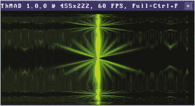

**图 6-9.** 模糊星形 — 第四部分：模糊扭曲输出

刚才展示的扭曲效果有一个漂亮的变体：将 `mesh_tex_sequ_distort` 模块替换为 `Mesh → texture → mesh_tex_bitmap_distort`，并添加一个额外的模块 `Bitmaps → loaders → png_bitm_load`，用于加载 `[HOME]/thmad/[VERSION]/data/resources` 文件夹中的任何 PNG 文件。见图 6-10 和 6-11。你还可以让声音输入控制扭曲速率。

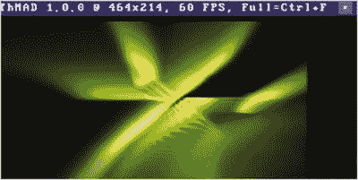

图 6-11. 通过位图实现的模糊扭曲 — 输出

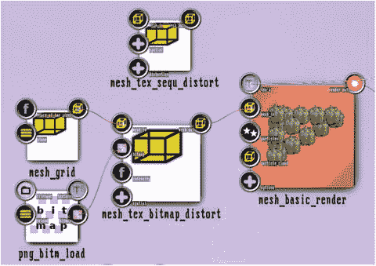

图 6-10. 通过位图实现的模糊扭曲 — 状态变化

注意：位于 `TheArtOfAudioVisualization` 文件夹内的 `A-6.1.1_Blurring_Star_E`。

## 自相似性

`自相似性`在自然界和艺术中都是极其重要的特征。就自然界而言，化学和生物过程都受其影响；而在艺术领域，你会在绘画、建筑、音乐、诗歌、摄影和设计中随处可见它的身影。

`自相似性`究竟是什么意思？它指的是在分析的不同层面上涌现出相同或相似种类与形状的结构。以一棵树为例。从远处看，你能看到树干和模糊的树冠。再靠近一点，或者深入一个层次观察，就能看到从树干分出的主要枝干。再近一些，再深入一个层次，就能看到从主要枝干分出的较小枝干。继续这个过程，最终能看到从最小枝干分出的树叶。因此，树木本质上展示了`自相似性`；另见图 6-12。或者观察一片雪花，它在不同层级上同样存在分形。

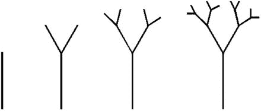

图 6-12. 树木中的自相似性

这两种自然现象都有其人工对应物。树木的历史悠久，毕达哥拉斯通过一个简单的构造规则构建了一棵分形树——只需在一个给定的方形上以固定角度添加两个较小的方形，并重复这一过程即可；见图 6-13。

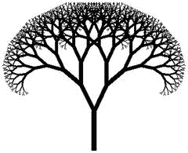

图 6-13. 一棵毕达哥拉斯树。每个线段分叉成两个大小为原线段 75%的线段，每个分叉角度为 50 度。

人造雪花由`科赫曲线`给出，它简单地将一条直线切分为三等份，并用一个三角形的两条边替换中间的那一段。这一过程对生成的新线段不断重复。见图 6-14。

对于`ThMAD`，我们有两种应用`自相似性`概念的选择。首先，我们可以获取帧缓冲区的内容，即屏幕上显示的内容，并将其反馈到渲染管线的更早阶段。其次，我们可以让某个渲染器使用分形算法来执行其工作。作为正确的后续步骤——在我们之前通过反馈来实现模糊效果的基础上——我们现在将专注于通过反馈来生成`自相似性`。另一种方式，即算法上的`自相似性`，将不在本书中讨论。

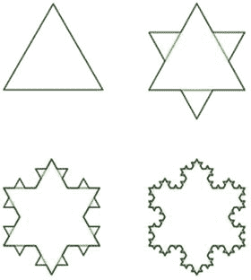

图 6-14. `科赫曲线`，一种人造雪花

我们从基础的`自相似性`管线开始，并在此基础上逐步使其更精美。保存之前所有的工作后，通过右键单击选择`新建 → 空白项目`来清理画布。然后立即用新名称保存，以确保它不会弄乱你已有的保存文件。现在将以下模块放置在画布上：

- `Bitmaps → generators → blob`
- `Texture → loaders → bitmap2texture`
- `Renderers → basic → textured_rectangle`
- `Renderers → opengl_modifiers → blend_mode`

将它们全部连接起来，并将`blend_mode`连接到屏幕。见图 6-15。在模块内部，按照表 6-13 至 6-16 所述设置参数。

**表 6-16. `output → screens → screen0`**
| 参数 | 值 | 说明 |
| :--- | :--- | :--- |
| `clear_color` | `0, 0, 0, 0` | 避免任何清除 |

**表 6-15. `renderers → opengl_modifiers → blend_mode`**
| 参数 | 值 | 说明 |
| :--- | :--- | :--- |
| `source_blend` | `SRC_ALPHA` | 传入的像素根据其 Alpha 值显示 |
| `dest_blend` | `ONE_MINUS_ SRC_ALPHA` | 已有的像素按 (1-传入像素的 Alpha 值) 的比例减弱 |

**表 6-14. `renderers → basic → textured_rectangle`**
| 参数 | 值 | 说明 |
| :--- | :--- | :--- |
| `spatial / position` | `-0.4; 0.27; 0.0` | 如果你还不习惯使用滑块控制器，一开始设置负数可能会有点棘手。解决办法是先降低第二排旋钮中的旋钮值，然后更改滑块。第一个旋钮是范围，第二个旋钮是偏移量。 |
| `spatial / size` | `0.6` | |

**表 6-13. `bitmap → generators → blob`**
| 参数 | 值 |
| :--- | :--- |
| `settings / arms` | `5` |
| `settings / attenuation` | `2.0` |
| `settings / alpha` | `yes` |
| `size` | `512x512` |

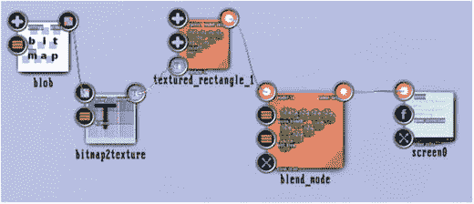

图 6-15. `自相似性`主生成管线、混合器与输出

你现在应该在输出屏幕的左上部分看到一颗星；见图 6-16。现在对于反馈子管线，将模块放置在画布上并绘制它们之间的连接；见图 6-17。

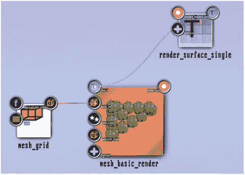

图 6-17. `自相似性`反馈管线

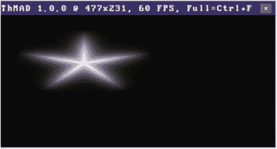

图 6-16. `自相似性`主生成管线，输出

- `Mesh → solid → mesh_grid`
- `Renderers → mesh → mesh_basic_render`
- `Texture → buffers → render_surface_single`

按照表 6-17 和 6-18 所示设置参数。

**表 6-18. `texture → buffers → render_surface_single`**
| 参数 | 值 | 说明 |
| :--- | :--- | :--- |
| `options / texture_size` | `512x512` | |
| `options / support_feedback` | `yes` | 如果没有设置为 `"yes"`，反馈将无法工作。 |
| `options / alpha_channel` | `yes` | |
| `options / clear_color` | `0, 0, 0, 1` | 纯黑色。使反馈的纹理可见，以便清晰观察。稍后我们可以将 `ALPHA` 改为 0 以模糊输出效果，见下文。 |

**表 6-17. `mesh → solid → mesh_grid`**
| 参数 | 值 | 说明 |
| :--- | :--- | :--- |
| `plane` | `xy` | 对于 2D 状态我们需要设置为 `"xy"`。 |

为了组合这两个子管线，从`blend_mode`的输出端画一条连接到`render_surface_single`的`render_in`锚点，再从`mesh_basic_render`的输出端画另一条连接到`blend_mode`的`render_in`锚点。双击后一个锚点，确保生成管线位于反馈管线的上方。如果不是这样，请垂直拖拽其中任何一个到正确位置。见图 6-18。

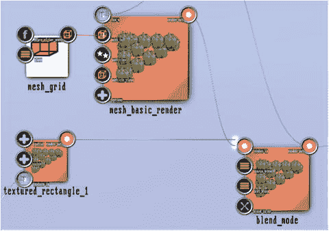

图 6-18. 组合主渲染管线与反馈管线

现在您应该会看到如图 6-19 所示的输出。这一结果明显展示了自相似性：使用½、½ ∙ ½、½ ∙ ½ ∙ ½等缩放因子放大图片，总能得到与原图一致的效果。接下来我将详细解释其原理。主渲染管线会绘制一颗星并将其置于屏幕左上角。其位置和大小由`textured_rectangle`模块的设置决定。`blend_mode`模块将其与反馈子管线的输出（目前为空）混合，并将整体结果同时发送至屏幕和`render_- surface_single`模块。后者将屏幕内容存储到图形硬件上的纹理存储器中。在下一帧中，`mesh_basic_render`模块将此存储纹理投影到由`mesh_grid`模块定义的平面网格上，该网格此时为`blend_mode`提供第二个输入。由于`mesh_grid`模块定义的网格坐标范围为(-0.5; -0.5)到(+0.5; +0.5)，而屏幕输出范围为(-1; -1)到(+1; +1)，因此反馈图像的尺寸仅为输入图像的一半。此时`blend_mode`拥有两个非空输入，输出原始图像与反馈图像的叠加结果。下一帧中，此过程将产生一个尺寸为 1/4 的克隆，再下一帧产生 1/16 尺寸的克隆，以此类推。

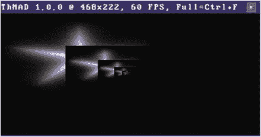

图 6-19. 自相似性基础状态输出

若想去除星形周围的黑色矩形（此处保留是为了更清晰地展示），只需将`render_surface_single`模块中`clear_color`锚点的`ALPHA`值设为 0.0；参见表 6-19。

**表 6-19. `texture → buffers → render_surface_single`**
| 参数 | 值 |
| :--- | :--- |
| `options / clear_color` | `0, 0, 0, 0` |

请记住，在`ThMAD`中`ALPHA`值始终是第四个颜色值。将其归零能有效阻止模块在每次绘制内部纹理缓冲区内容前清除其区域。

要改变此缩放因子并允许反馈图像平移，我们在`mesh_grid`模块与`mesh_basic_render`模块之间额外添加两个模块：`Mesh → modifiers → transformers → mesh_scale`与`Mesh → modifiers → transformers → mesh_translate`。后续可用它们调整自相似舞台的整体特性。

到目前为止的状态如图 6-20 所示。请将其保存为自己的状态，因为您可以把它作为多种不同实验的基础。

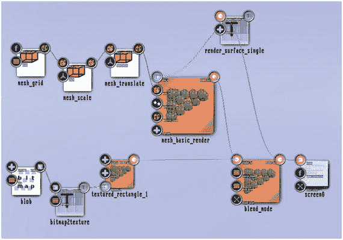

图 6-20. 自相似性基础状态注释

该反馈基础状态也可在`TheArtOfAudioVisualization`文件夹下的`A-6.1.2_Backfeeding_Basic`中找到。

为使效果更有趣，我们现在将使用类似于`科赫曲线`（见图 6-14）的算法构建一个状态。该方法与刚刚介绍的反馈原理相同，但存在一些差异，若从头开始构建则能更清晰地展现逻辑。最终我们将拥有三个子管线，先从第一个开始。

注意：以下状态也可在`TheArtOfAudioVisualization`文件夹下的`A-6.1.2_Backfeeding`中找到。

对于第一个子管线，请将以下模块放置在空白画布上：
* `Mesh → generators → ribbon`
* `Renderers → mesh → mesh_basic_render`
* `Renderers → opengl_modifiers → gl_color`
* `Renderers → opengl_modifiers → blend_mode`
* `Renderers → opengl_modifiers → gl_translate`

按此顺序连接所有模块，并将`gl_translate`连接至屏幕；参见图 6-21。请注意，`mesh_basic_render`有两个网格输入锚点——请使用名称为`mesh_in`的锚点。

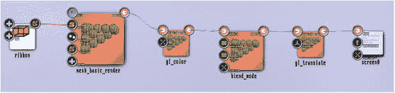

图 6-21.