# 精美的科赫曲线，管线 I

我们以`ribbon`（色带）模块作为绘制基础，因为它引入了一些形状修饰，并且会随时间移动。参数见表 6-20 至 6-24。

表 6-24.

| `renderers` → `opengl_modifiers` → `gl_translate` |
| --- |
|   | `translation` | 0, 0.3, 0.0 | 将混合后的输出移至屏幕中央。 |

表 6-23.

| `renderers` → `opengl_modifiers` → `blend_mode` |
| --- |
|   | `source_blend` | `SRC_ALPHA` |
|   | `dest_blend` | `ONE` |

表 6-22.

| `renderers` → `opengl_modifiers` → `gl_color` |
| --- |
|   | `color` | any | 任意你喜欢的颜色。 |

表 6-21.

| `renderers` → `mesh` → `mesh_basic_render` |
| --- |
|   | `options` / `vertex_colors` | no | 我们提供了自己的颜色，因此此处设为“no” |
|   | `options` / `use_display_list` | no |   |
|   | `options` / `use_vertex_colors` | no | 我们提供了自己的颜色，因此此处设为“no” |
|   | `options` / `particles_size_center` | no |   |
|   | `options` / `particles_size_from_color` | no |   |
|   | `options` / `ignore_uvs_in_vbo_updates` | no |   |

表 6-20.

| `mesh` → `generators` → `ribbon` |
| --- |
|   | `spatial` / `start_point` | -0.7, -0.5, 0 |
|   | `spatial` / `end_point` | 0.7, -0.5, 0 |
|   | `spatial` / `up_vector` | 0.8, 0.8, 0.9 |
|   | `shape` / `width` | 0.1 |
|   | `shape` / `skew_amp` | 4.0 |
|   | `shape` / `time_amp` | 1.5 |
|   | `shape` / `segm_count` | 60 |

这应能生成基本的飘动色带；见图 6-22。

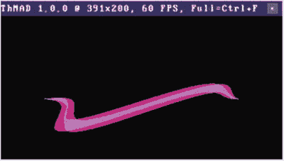

图 6-22. 精美的科赫曲线，管线 I 输出

`gl_color` 模块定义了色带的颜色。`ribbon` 模块本身不处理颜色，而且我们也告知 `mesh_basic_render` 不要处理颜色。

子管线二由以下模块组成：

* `Texture` → `buffers` → `render_surface_single`
* `Texture` → `modifiers` → `scale_one`
* `Texture` → `modifiers` → `rotate`
* `Renderers` → `basic` → `textured_rectangle`

`render_surface_single` 的状态与反馈循环前的基础状态相同。连接方式见图 6-23。

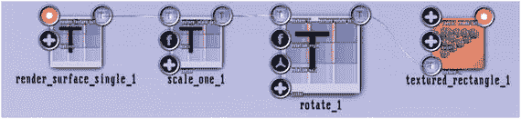

图 6-23. 精美的科赫曲线，管线 II

这些模块的参数见表 6-25 至 6-28。

表 6-28.

| `renderers` → `basic` → `textured_rectangle` |
| --- |
|   | 将所有锚点保留为默认值 |

表 6-27.

| `texture` → `modifiers` → `rotate` |
| --- |
|   | `rotation_angle` | 0.15 | 大约完整旋转的 1/6，即 60° |
|   | `rotation_axis` | 0, 0, 1 | 在 x-y 平面上旋转 |
|   | `center` / `use_rotate_center` | yes | 使用下方的旋转中心 |
|   | `center` / `rotate_center` | 0.66, 0.25, 0 | 用于形成图示 |

表 6-26.

| `texture` → `modifiers` → `scale_one` |
| --- |
|   | `scale` | 3.0 | 缩小至 1/3，与原始科赫曲线相同。 |
|   | `center` / `use_scale_center` | yes | 使用下方的缩放中心 |
|   | `center` / `scale_center` | 0.5, 0.25, 0 | 在色带中心进行缩放 |

表 6-25.

| `texture` → `buffers` → `render_surface_single` |
| --- |
|   | `options` / `texture_size` | 1024x1024 |   |
|   | `options` / `support_feedback` | yes | 反馈循环正常工作所必需 |
|   | `options` / `alpha_channel` | yes |   |
|   | `options` / `clear_color` | 0, 0, 0, 0 |   |

至于子管线三，克隆管线二中的所有模块——对每个模块，在按住 `Ctrl+Alt` 的同时点击并拖动。按照子管线二的连接方式，连接子管线三的模块。见图 6-24。

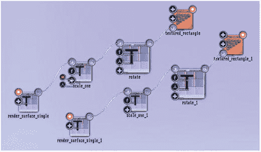

图 6-24. 精美的科赫曲线，管线 II + III

仅更改管线三的旋转模块，使其内容如表 6-29 所示。

表 6-29.

| `texture` → `modifiers` → `rotate` |
| --- |
|   | `rotation_angle` | 0.15 | 大约完整旋转的 1/6，即 60°。注意与管线 II 相比符号的差异 |
|   | `rotation_axis` | 0, 0, 1 | 在 x-y 平面上旋转 |
|   | `center` / `use_rotate_center` | yes | 使用下方的旋转中心 |
|   | `center` / `rotate_center` | 0.33, 0.25, 0 | 用于形成图示 |

将 `blend_mode` 的输出连接到管线 II 和管线 III 的 `render_surface_single` 模块。连接管线 II 和管线 III 中 `textured_rectangle` 模块的输出锚点。更改 `blend_mode` 的输入连接顺序，使管线 I 优先；见图 6-25。

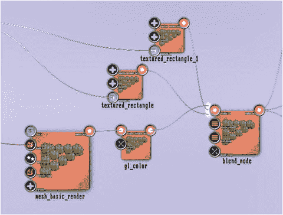

图 6-25. 精美的科赫曲线，`blend_mode` 输入顺序

此时输出应如图 6-26 所示。这是一个使用原始映射算法的正确科赫曲线，只是将线条换成了色带。目前看起来还不够引人入胜，但我们可以轻松地让它变得更有吸引力。只需更改表 6-30 至 6-33 中显示的锚点值。

表 6-32.

| `texture` → `modifiers` → `scale_one` |
| --- |
| 管线 III |
|   | `scale` | 1.2 | 放大。 |

表 6-31.

| `texture` → `modifiers` → `rotate` |
| --- |
| 管线 II |
|   | 无需更改，但你可以随意调整。 |

表 6-30.

| `texture` → `modifiers` → `scale_one` |
| --- |
| 管线 II |
|   | `scale` | 2.2 | 放大 |

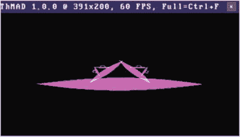

图 6-26. 精美的科赫曲线，输出

`ribbon` 模块的 `skew_amp` 临时减小到 0.0，以使显示更清晰。

表 6-33.

| `texture` → `modifiers` → `rotate` |
| --- |
| 管线 III |
|   | `rotation_angle` | -0.12 | 稍微改变角度 |
|   | `center` / `rotate_center` | 0.37, 0.25, 0 | 稍微改变 |

修改后的输出现在看起来精美多了；见图 6-27。从鸟瞰视角看，完整的状态如图 6-28 所示。

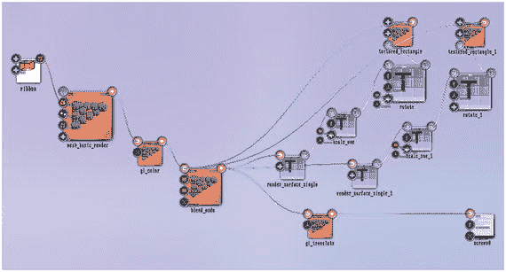

图 6-28. 精美的科赫曲线，完整状态

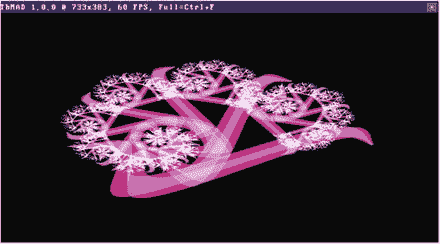

图 6-27. 修改后的精美科赫曲线，输出

这只是一个快照；所有色带都在飘动。

请随意调整锚点值，并尝试将某个锚点与声音输入连接。

### 注意

由于反馈循环的存在，输出屏幕很容易完全被白色填充。通常当反馈的图像数据缩小时不会发生这种情况，但如果你在调整值时遇到了，可能需要撤销更改、保存状态并重启 ThMAD，才能再次获得有意义的输出。或者，临时将 `blend_mode` 模块内的混合模式改为 `ZERO`/`ZERO`，然后再改回来。

## 粒子系统

粒子系统主要涉及两方面的内容：

- 对象的多样性
- 物理运动规律与碰撞规则

由于 ThMAD 不支持类似循环结构的功能，粒子系统的多样性属性是生成大量对象的唯一途径。此外，粒子系统可以遵循重力、风力或刚体墙壁反弹等物理规则。ThMAD 通过图 6-29 所示的方法，实现了具备这些特性的粒子系统。

一个 `发射器` 持续创建粒子——我们有以下发射器类型：

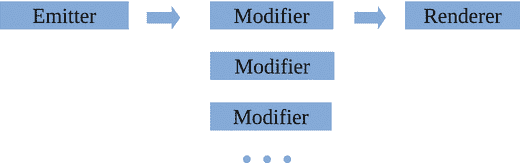

图 6-29. 粒子系统方法

- 喷雾发射器。在空间中的某个单点持续创建粒子。
- 位图发射器。将位图的每个像素（无论定义为前景色还是背景色）转换为一个与位图像素颜色相同的单一粒子。
- 网格发射器。类似于喷雾发射器，但使用网格的每个顶点作为潜在的源点。

一个 `修改器` 对现有粒子应用规则。这包括以下操作：

- 应用重力。
- 应用风力。
- 放置一堵墙，粒子在墙处停止运动或反弹。
- 应用粒子间的类流体相互作用。
- 应用粒子尺寸调整。

一个 `渲染器` 将粒子系统转换为可渲染的对象。只有在经过渲染器之后，粒子才成为图形对象——在此之前，它们只是数值的集合。ThMAD 通过以下方式之一进行渲染：

- 简单渲染。使用纹理将粒子转换为图形对象。通过在粒子的生命周期内定义尺寸如何演变、颜色如何演变，增强了修改步骤中可用的可能性。尽管名称中带有“简单”，但它实际上非常强大，你可以使用着色器程序来控制渲染操作。
- 中心渲染。这是一种特效变体，其中粒子团的一侧被固定到一个中心点。
- 带状渲染。另一种特效变体，粒子被转换为在 3D 空间中移动的带状物。
- 扩展渲染器。一种使用纹理、尺寸和颜色生命周期定义的渲染器，如果你想要自定义着色器语言控制的话。
- 火花渲染器。允许粒子与相互靠近的粒子发生交互，产生火花。

在本节的其余部分，我们将创建几个粒子系统示例。

# 瀑布

瀑布是粒子系统的绝佳应用场景。大量对象下落，遵循重力和风力等物理规律，最终落在瀑布的地面上。

> **注意：** 本小节的示例资源位于 `TheArtOfAudioVisualization` 文件夹下的 `A-6.2.1_Particlesystems_Waterfall*` 中。

为了模拟瀑布，我们在空白画布上放置以下模块。要创建画布，请右键点击并选择 “新建 → 空项目”：

- `渲染器` → `opengl_modifiers` → `摄像头` → `环绕摄像头`
- `渲染器` → `opengl_modifiers` → `方向光`
- `渲染器` → `opengl_modifiers` → `材质参数`
- `渲染器` → `opengl_modifiers` → `深度缓冲`
- `渲染器` → `opengl_modifiers` → `背面剔除`
- `渲染器` → `opengl_modifiers` → `混合模式`

将它们全部连接起来，并将摄像头连接到屏幕模块；见图 6-30。为这些模块调整以下参数。参见表 6-34 至 6-37。

表 6-37.

| `渲染器 → opengl_modifiers → 背面剔除` |
| --- |
| `状态` | `启用` |

表 6-36.

| `渲染器 → opengl_modifiers → 深度缓冲` |
| --- |
| `深度测试` | `启用` |
| `深度遮罩` | `启用` |

表 6-35.

| `渲染器 → opengl_modifiers → 材质参数` |
| --- |
| `环境反射率` | `0.2; 0.2; 0.2; 1.0` |
| `漫反射率` | `0; 0; 1; 1` |
| `镜面反射率` | `0.96; 0.82; 0.82; 1.0` |
| `自发光强度` | `0; 0; 0; 1` |
| `镜面反射指数` | `5.0` |

表 6-34.

| `渲染器 → opengl_modifiers → 方向光` |
| --- |
| `启用` | `是` |
| `位置` | `0.29; 0.29; 0.12` |
| `环境光颜色` | `0; 0; 0; 1` |
| `漫反射颜色` | `0.67; 0.69; 0.95; 1.0` |
| `镜面反射颜色` | `0.16; 0.79; 0.92; 1.0` |

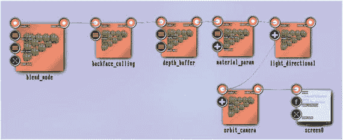

图 6-30. 瀑布，基础 3D 设置

`深度测试` 和 `背面剔除` 这两个模块在这里不太重要，因为我们只处理微小粒子。为了后续的特效或试验，我们还是会添加它们。

现在对于粒子系统子流程，添加以下模块：

- `纹理` → `粒子` → `斑点`
- `渲染器` → `粒子系统` → `简单`
- `粒子系统` → `修改器` → `地板`
- `粒子系统` → `修改器` → `基本风力变形器`
- `粒子系统` → `修改器` → `尺寸缩放`
- `粒子系统` → `修改器` → `基本重力`
- `粒子系统` → `生成器` → `基本喷雾发射器`

按照图 6-31 所示进行连接。

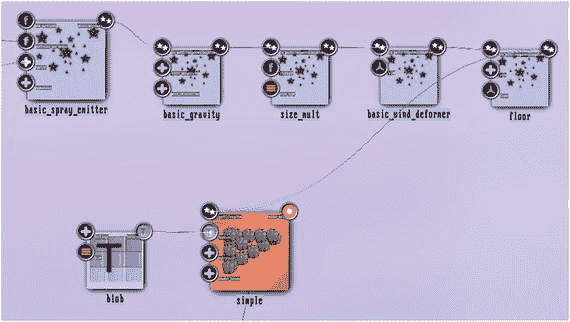

图 6-31. 瀑布，粒子系统子流程

对于这些参数，请按表 6-38 至 6-42 所示进行调整。

表 6-42.

| `particlesystems` → `generators` → `basic_spray_emitter` |
| --- |
| | `num_particles` | 10000 | 要使用的粒子数量。即使修改器或渲染器指示某个粒子必须消亡，该数值也保持不变。在这种情况下，粒子只会被重新初始化。 |
| | `particles_per_second` | 2000 | 后续将由声音控制。限制每秒初始化或重新初始化的粒子数量。如果该数值足够小，部分已消亡的粒子会在一段时间内保持未重新初始化状态。设置为 `-1` 可禁用此限制。 |
| | `spatial` / `emitter_position` | 0; 1; 0 | 粒子生成或重新初始化的位置。 |
| | `spatial` / `speed` / `speed_x` | 1.0 | 后续由声音输入控制。粒子生成或重新初始化时速度的 X 轴散布范围。 |
| | `spatial` / `speed` / `speed_y` | 0.45 | |
| | `spatial` / `speed` / `speed_z` | 0.07 | |
| | `spatial` / `speed_type` | `random_balanced` | 速度的分布方式。此处的值为 X 轴从 `[-speed_x; +speed_x]` 中选取一个随机数，其他轴同理。 |
| | `spatial` / `size` / `particle_size_base` | 0.03 | 粒子的基础大小 |
| | `spatial` / `size` / `particle_size_random_weight` | 0.01 | 大小随机化程度 |
| | `appearance` / `color` | 1;1;1;1 | 未使用 |
| | `appearance` / `time` / `particle_lifetime_base` | 3.48 | 粒子的基础生命周期（秒）。超过此时间，粒子将保持未定义状态，直到被重新初始化。 |
| | `appearance` / `time` / `particle_lifetime_random_weight` | 1.0 | 生命周期随机化程度 |

表 6-41

| `particlesystems` → `modifiers` → `basic_gravity` |
| --- |
| | `basic_parameters` / `center` | 0; -1.5; 0 | 重力中心 |
| | `basic_parameters` / `amount` | 0; 0.079; 0 | 仅沿 Y 轴的重力 |
| | `basic_parameters` / `friction` | 0.6; 0.6; 1.8 | 若该值非空，粒子将不会无限加速，而是受摩擦力影响。 |

表 6-40

| `particlesystems` → `modifiers` → `size_mult` |
| --- |
| | `strength` | 0.71 | 使粒子稍微变小 |

表 6-39

| `particlesystems` → `modifiers` → `basic_wind_deformer` |
| --- |
| | `wind` | 0.22; 0.0; 0.0 | 朝+X 方向吹的风 |

表 6-38

| `particlesystems` → `modifiers` → `floor` |
| --- |
| | `axis` / `y` / `y_floor` | yes | 启用 XZ 平面作为地面 |
| | `axis` / `y` / `y_bounce` | yes | 让粒子在地面上弹跳 |
| | `axis` / `y` / `y_loss` | 85.0 | 弹跳前损失的粒子百分比。若此数值太小，粒子行为将更像橡胶球而非水。 |
| | `axis` / `refraction` | yes | 水的行为不像刚性球体，撞击地面后会向各个方向扩散 |
| | `axis` / `refraction_amount` | 100; 10; 0 | 折射程度——水主要沿地面平行方向扩散 |
| | `floor` | 0; -0.97; 0 | 地面的位置 |

将此子流水线连接到基础 3D 渲染流水线：使用`simple`模块的`render_out`锚点和`blend_mode`模块的`render_in`锚点。这将产生一个瀑布效果，如图 6-32 所示。

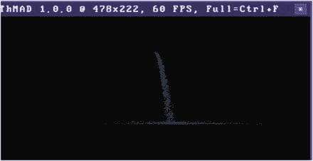

图 6-32. 瀑布，无声音控制

我们希望添加一些声音控制功能。为此，请添加以下模块：

* `Maths` → `limiters` → `float_clamp`
* `Maths` → `arithmetics` → `ternary` → `float` → `mult_add`，共两个
* `Sound` → `input_visualization_listener`

按照图 6-33 所示连接它们。并按表 6-43 至 6-45 所示应用参数。

表 6-44

| `maths mult_add` | → | `arithmetics` | → | `ternary` | → | `float` | → |
| --- | --- | --- | --- | --- | --- | --- | --- |
| 连接到`float_clamp`的那个。 | | | | | | | |
| | `first_mult` | 1000 |
| | `then_add` | 1000 |

表 6-43

| `maths` → `limiters` → `float_clamp` |
| --- |
| 确保每秒生成/重新初始化的粒子数在 1000 到 5000 之间 |
| | `low` | 1000 |
| | `high` | 5000 |

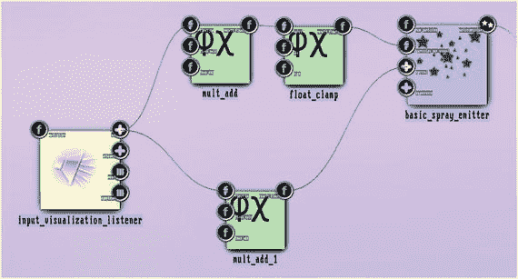

图 6-33. 瀑布，带声音控制。下方的`mult_add`模块连接到`basic_spray_emitter`的`speed_x`锚点。两个`mult_add`模块都连接到`sound_visualization_listener`的任意`vu`子锚点。

表 6-45

| `maths` → `arithmetics` → `ternary` → `float` → `mult_add` |
| --- |
| 另一个模块，连接到`basic_spray_emitter`的`x_speed`锚点。 |
| | `first_mult` | 0.4 |
| | `then_add` | 0.13 |

添加声音输入后，结果将是根据音量大小拥有更多质量和更宽幅度的瀑布。见图 6-34。

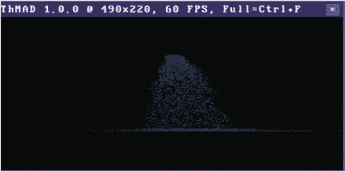

图 6-34. 瀑布，受声音控制，输出效果

到目前为止，瀑布看起来可能更像是由颗粒而非水流构成。为了增强其与自然水体的相似度，我们在刚才生成的基础上添加一个模糊效果作为变体。

模糊是关于混合渲染画面的较新和较旧实例。我们在本章前面部分已经学习了如何在二维空间中实现这一点。为了采用比之前更简单的方法，这里选择了`Texture` → `effects` → `blur`模块。我们仅在相机完成工作后应用模糊，这感觉就像是在 3D 中进行模糊操作。这是因为在 3D 中无法进行真正的模糊，因为我们的纹理只能处理二维。但在相机之后，我们在内部拥有了一个二维投影，因此可以利用二维模糊。我们需要三个模块来实现模糊效果：

* `Renderers` → `basic` → `textured_rectangle`
* `Texture` → `effects` → `blur`
* `Texture` → `buffers` → `render_surface_single`

将它们插入相机和屏幕之间，如图 6-35 所示。按表 6-46 至 6-48 所示应用参数。

表 6-48

| `texture` → `buffers` → `render_surface_single` |
| --- |
| | `texture_size` | 1024x1024 | 可以使用更小的尺寸来增强模糊效果 |

表 6-47

| `texture` → `effects` → `blur` |
| --- |
| | `start_value` | 2.2 | 在混合原始图像和旧图像时，应用于纹理坐标的偏移量 |
| | `attenuation` | 1.22 | 混合强度 |
| | `texture_size` | 1024x1024 | 可以使用更小的尺寸来增强模糊效果 |
| | `passes` | `TWO` | 与`ONE`相比，增强模糊效果 |

表 6-46

| `renderers` → `basic` → `textured_rectangle` |
| --- |
| | 所有参数保持默认值 |

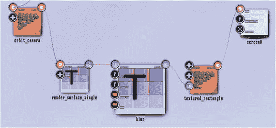

图 6-35. 瀑布，添加模糊效果

添加模糊后的瀑布将如图 6-36 所示。

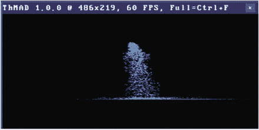

图 6-36. 瀑布，模糊后输出效果

作为附带效果，这个模糊的瀑布在不增加粒子数量的情况下，看起来水量更充沛一些。

### 位图粒子

`ThMAD` 包含一个模块 `Particlesystem → generators → bitmap2particlesystem`，你可以用它来让粒子系统根据位图的彩色像素生成。这里我们将提供一个示例。

**注**：本小节的示例作为源文件存放在 `TheArtOfAudioVisualization` 文件夹下的 `A-6.2.2_*` 路径中。

像往常一样，从一个空状态开始，你可以通过右键单击并选择 `New → Empty Project` 来创建一个。首先放置本章开头描述的基础 3D 模块，如图 6-30 所示，但请使用表 6-49 到 6-54 中所示的参数。

**表 6-54.**
| `renderers → opengl_modifiers → blend_mode` | |
| :--- | :--- |
| `source_blend` | `ONE` |
| `dest_blend` | `ONE_MINUS_SRC_ALPHA` |

**表 6-53.**
| `renderers → opengl_modifiers → backface_culling` | |
| :--- | :--- |
| `status` | `ENABLED` |

**表 6-52.**
| `renderers → opengl_modifiers → depth_buffer` | |
| :--- | :--- |
| `depth_test` | `ENABLED` |
| `depth_mask` | `ENABLED` |

**表 6-51.**
| `renderers → opengl_modifiers → material_param` | |
| :--- | :--- |
| 此处的值无关紧要，着色由着色器代码完成，见下文 | |

**表 6-50.**
| `renderers → opengl_modifiers → light_directional` | |
| :--- | :--- |
| 此处的值无关紧要，着色由着色器代码完成，见下文 | |

**表 6-49.**
| `renderers → opengl_modifiers → cameras → orbit_camera` | |
| :--- | :--- |
| `rotation` | `-0.03; 0.99; -0.11` |
| `distance` | `0.72` |
| `perspective_correct` | `yes` |

现在，为粒子系统子流水线添加以下模块：
*   `Renderers → particlesystems → render_particle_shader`
*   `Texture → particles → blob`
*   `Particlesystems → modifiers → basic_wind_deformer`
*   `Particlesystems → generators → bitmap_to_particlesystem`
*   `Bitmaps → loaders → png_bitm_load`

按照图 6-37 所示进行连接。这将从位图像素创建粒子，然后对其施加风效果。将参数设置为表 6-55 到 6-59 中的值。

**表 6-59.**
| `bitmaps → loaders → png_bitm_load` | | |
| :--- | :--- | :--- |
| `filename` | 任意 | 选择一个尺寸不超过 256x256 的 PNG 文件，以免给硬件带来过大负担。 |

**表 6-58.**
| `particlesystems → generators → bitmap_to_particlesystem` | | |
| :--- | :--- | :--- |
| `particles_per_second` | `10000` | 每秒可由位图产生的粒子数量 |
| `spatial / bitmap_size` | `1.0` | |
| `spatial / bitmap_normal` | `0; 1; 0` | 定义空间中的方向。此处我们定义位图位于 x-z 平面内。 |
| `spatial / bitmap_upvector` | `1; 0; 0` | 定义与法向量（作为轴）的角度。 |
| `spatial / bitmap_position` | `0; 0; -0.25` | 位图在空间中的位置。 |
| `spatial / speed / speed_x` | `0` | 我们让粒子在创建后立即静止。因此只有风模块会移动它们。 |
| `spatial / speed / speed_y` | `0` | |
| `spatial / speed / speed_z` | `0` | |
| `spatial / size / particle_size_base` | `0.1` | 粒子的大小。 |
| `spatial / size / particle_size_random_weight` | `0.01` | 粒子大小的随机贡献量。 |
| `appearance / time / particle_lifetime_base` | `1.16` | 粒子在消亡和/或需要重新初始化之前存活的秒数。 |
| `appearance / time / particle_lifetime_random_weight` | `1.0` | 粒子生命周期的随机贡献量。 |

**表 6-57.**
| `particlesystems → modifiers → basic_wind_deformer` | | |
| :--- | :--- | :--- |
| `wind` | `0; 0; 0` | 稍后我们将把它连接到音频输入，见下文 |

**表 6-56.**
| `texture → particles → blob` | | |
| :--- | :--- | :--- |
| `settings / alpha` | `yes` | |
| `size` | `8x8` | 由于粒子很小，我们可以使用小纹理 |

**表 6-55.**
| `renderers → particlesystems → render_particle_shader` | | |
| :--- | :--- | :--- |
| 通过编写自定义着色器程序，你可以实现极其有趣的效果。就我们当前目的而言，只需使用默认提供的纹理程序。 | | |
| `shader_params / vertex_program` | 保持默认 | 着色器管线的顶点着色器部分。默认程序将处理空间定位和获取粒子颜色。 |
| `shader_params / fragment_program` | 保持默认 | 着色器管线的片段着色器部分。默认程序将使用粒子颜色与纹理 `ALPHA` 混合，并丢弃纹理颜色。 |

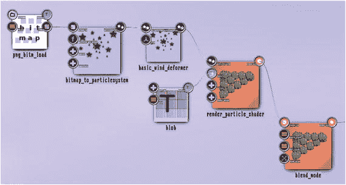
**图 6-37.** 位图粒子系统

PNG 文件必须存放在 `/home/[USER]/thmad/[VERSION]/data/resources` 目录下。

现在你已经可以看到粒子系统了——由于粒子尚未移动，你的图像似乎在模糊地飘动。这是由粒子的产生和消亡机制以及期间自动的大小变化造成的。见图 6-39。

为了引入声音控制，在画布上放置以下附加模块：
*   `Maths → converters → 3float_to_float3`
*   `Maths → interpolation → float_smoother`
*   `Audio → input_visualization_listener`

按照图 6-38 所示进行连接。应用以下参数，如表 6-60 到 6-62 所示。

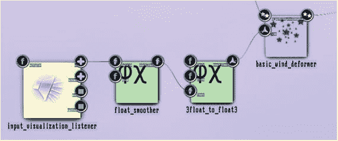
**图 6-38.** 位图粒子系统，声音控制。`float_smoother` 连接到监听器的 `vu / vu_l` 锚点。

**表 6-60.**
| `maths → converters → 3float_to_float3` | | |
| :--- | :--- | :--- |
| `floata` | `0` | 风的 x 分量 |
| `floatb` | `0` | 风的 y 分量 |
| `floatc` | `-` | 连接到声音监听器 |

**表 6-61.**
| `maths → interpolation → float_smoother` | | |
| :--- | :--- | :--- |
| `value_in` | `-` | 连接到声音监听器 |
| `speed` | `5.0` | 值越低，平滑程度越高 |

**表 6-62.**
| `sound → input_visualization_listener` | | |
| :--- | :--- | :--- |
| `multiplier` | `0.38` | 音量倍增器，根据你的需要更改。 |
| `vu / vu_l` | `-` | 作为输出连接到上述平滑器 |

播放一些音乐，你会看到位图粒子被吹散，如图 6-39 所示。

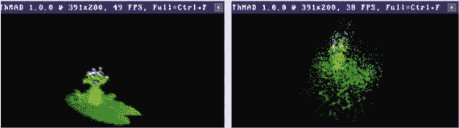
**图 6-39.** 位图粒子系统，无音频输入时的输出

### 中心钳制粒子系统

使用 `renderers → particlesystems → render_particle_center` 模块，我们能得到一个虽然不太现实但效果令人印象深刻的粒子系统变体。

其基本原理是将纹理定义的两个点钳制到一个中心点上。这里我们会提供一个示例，但与其一步步解释，不如请您参考安装时附带的源文件。本节仅从宏观角度进行说明，并指出一些重要的设置。

**注意**
本小节的示例作为源文件，位于 `TheArtOfAudioVisualization` 文件夹下的 `A-6.2.3_Particlesystems_Center*` 目录中。

将 `A-5.5.3_Particlesystems_Center_Blur` 状态加载到 Artiste 中，您将会看到如图 6-40 所示的画面。

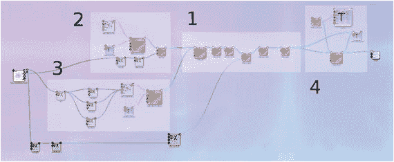
图 6-40. 中心钳制粒子系统，完整状态

标记为 (1) 的部分是常规的 3D 渲染管线。不过，`backface_culling`（背面剔除）和 `depth_buffer`（深度缓冲）都被禁用了；否则，纹理背景会与我们不希望看到的其他纹理重叠。灯光是开启的，且为全白，材质参数也均为全白，此外，`ALPHA`（透明通道）连接到了音频输入，这样图像会随着音量的增大而变得更加鲜明。

标记 (2) 的部分指定了我们将会看到的一组对象。其源是同心圆，在此例中，我们添加了一个由音频输入控制的绕 Y 轴旋转。

标记 (3) 的部分是另一组不同颜色的同心钳制圆，这次我们通过音频输入来控制它们的速度。

标记 (4) 的部分负责实现模糊效果。如果不使用模糊，粒子被钳制到原点且生命周期有限这一特性会带来一些令人不悦的躁动感。该效果通过 `highblur` 模块实现，该模块使用了反馈技术，本章的另一处也会对此进行介绍。您可以调整这个子管线的参数，其中一个非常重要的参数就是所选的混合模式。此处设定的值是 `ONE`/`ONE`，这意味着原始图像和反馈图像会相互叠加绘制。为了达到预期效果，锚点 `color/global_alpha`（此处为 0.89）至关重要，这个值的微小变化都会导致输出结果发生巨大的改变。

最终结果如图 6-41 所示，其中紫罗兰色的射线组根据音频的低频部分旋转，而黄色的射线组则会随着音量的增大而增强其贡献。

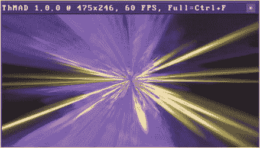
图 6-41. 中心钳制粒子系统，输出效果

### 带状粒子

`Renderers → particlesystems → render_particle_ribbon` 模块会沿着一条在空间中移动的、受类似重力运动法则驱动的带状路径发射粒子。

它可用于创造有趣的视觉效果，我们在此提供一个示例。与其提供逐步的操作指南，不如直接查看安装 ThMAD 后的最终状态，并解释其中的重要构建模块。

**注意**
本小节的示例状态作为源文件，位于 `TheArtOfAudioVisualization` 文件夹下的 `A-6.2.4_Particlesystems_Ribbon` 目录中。

该状态如图 6-42 所示，图中高亮显示了主要部分。
*   部分 (1) 是典型的 3D 子管线；不过，`depth_buffer`（深度缓冲）模块被禁用了。您可以尝试同时禁用 `backface_culling`（背面剔除）看看会发生什么。灯光和材质都具有全部三个光照分量：环境光、漫反射光和高光。灯光会由部分 (4) 控制绕场景旋转，其环境光强度则由音频输入控制。
*   部分 (2) 定义了粒子系统及其渲染器。渲染器本身不具备为渲染过程分配纹理的能力，但通过添加 `Texture → opengl → texture_bind` 模块，我们仍然可以实现这一点。这里我们分配了一个 `blob`（斑点）模块，这会使带状效果看起来像一个管子。此处，一些音频输入已被连接到带状宽度上。
*   部分 (3) 定义了一个恒定的主旋转，这会给场景带来深度感。振荡器设置为“saw”（锯齿波）模式，当我们希望以恒定角速度进行旋转时，经常使用这种模式。
*   部分 (4) 控制光源的旋转。它通过使用 `quat_mul` 模块组合两个旋转四元数来实现这一点。一个四元数内部由四个数字组成，完整定义了一个旋转轴和一个旋转角度。通过四元数乘法，我们可以精确实现绕两个不同轴、以两个不同角度进行两次连续旋转的效果。光源位置需要一个向量 (x, y, z)，如果使用 `float3_rotate_by_quat` 模块，从任意位置（如 (0,0,1)）开始，并利用上述组合后的四元数，输出将是 (0,0,1) 的一个旋转变体。通过将两个振荡器分别设置为“saw”（锯齿波）和“sine”（正弦波）模式，并给其中一个振荡器的角度添加一些音频输入，我们将获得一个稳定的旋转，加上一些受音频输入微弱影响的调制。后者是通过将音频音量累积相加到其中一个四元数旋转振荡器的 `phase`（相位）锚点上实现的。

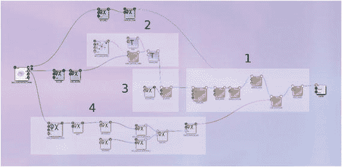
图 6-42. 沿带状渲染的粒子系统

输出将是一个旋转的、呈溅射状的管子世界，如图 6-43 所示。

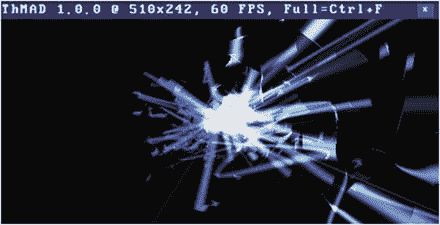
图 6-43. 沿带状渲染的粒子系统，输出效果

# 发光物体

通过在原始物体上叠加一个模糊版本，可以使物体获得闪亮的发光效果。作为示例，请将以下模块放置在画布上，并按图 6-44 所示进行连接。

- `Renderers → opengl_modifiers → blend_mode`
- `Renderers → opengl_modifiers → cameras → orbit_camera`
- `Renderers → opengl_modifiers → light_directional`
- `Renderers → opengl_modifiers → depth_buffer`
- `Renderers → opengl_modifiers → backface_culling`
- `Renderers → opengl_modifiers → material_param`
- `Renderers → mesh → mesh_basic_render`
- `Mesh → solid → mesh_box`

**注意：** 本小节的状态文件可在 `TheArtOfAudioVisualization` 文件夹下的 `A-6.3_Glowing_Objects` 中找到。

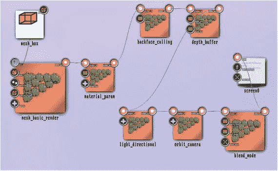

**图 6-44.** 带发光效果的物体，基本状态

## 参数设置

按表 6-63 至 6-68 设置参数。

### 表 6-68. `renderers → mesh → mesh_basic_render`

| | |
|---|---|
| | 将所有值保留为默认值 |

### 表 6-67. `renderers → opengl_modifiers → material_param`

| | |
|---|---|
| | `ambient_reflectance` | `0.2; 0.2; 0.2; 1.0` |
| | `diffuse_reflectance` | `0.95; 0.76; 0.35; 1.0` |
| | `specular_reflectance` | `0.95; 0.87; 0.87; 1.0` |
| | `emission_intensity` | `0; 0; 0; 1` |
| | `specular_exponent` | `13.0` |

### 表 6-66. `renderers → opengl_modifiers → backface_culling`

| | |
|---|---|
| | `status` | `ENABLED` |

### 表 6-65. `renderers → opengl_modifiers → depth_buffer`

| | |
|---|---|
| | `depth_test` | `ENABLED` |
| | `depth_mask` | `ENABLED` |

### 表 6-64. `renderers → opengl_modifiers → light_directional`

一个白色光源

| | |
|---|---|
| | `enabled` | `YES` |
| | `position` | `0.57; 0.25; 0.78` |
| | `ambient_color` | `0; 0; 0; 1` |
| | `diffuse_color` | `1; 1; 1; 1` |
| | `specular_color` | `1; 1; 1; 1` |

### 表 6-63. `renderers → opengl_modifiers → cameras → orbit_camera`

| | |
|---|---|
| | `rotation` | `0.52; 0.05; 0.85` |
| | `distance` | `3.5` |
| | `fov` | `30.0` |
| | `perspective_correct` | `yes` |

## 添加发光效果

输出结果将是一个如图 6-45 所示的盒子。现在向场景中添加以下模块：

- `Renderers → basic → textured_rectangle`
- `Texture → effects → blur`
- `Texture → buffers → render_surface_single`

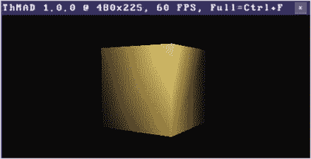

**图 6-45.** 带发光效果的物体，基本状态，输出结果

按图 6-46 所示进行连接和插入。请注意 `blend_mode` 输入锚点的顺序非常重要。通常您无法直接看到它，但为了检查和修正，请双击该锚点并将其拖放到某个子锚点上以更改顺序，参见图 6-47。

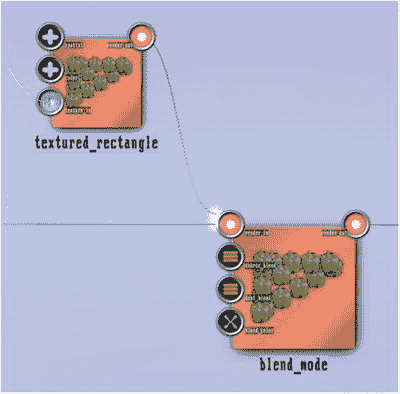

**图 6-47.** 带发光效果的物体，混合输入顺序

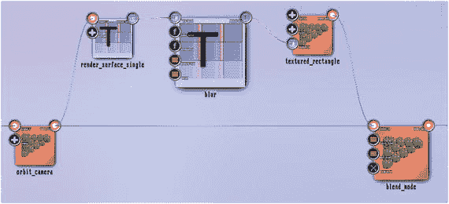

**图 6-46.** 带发光效果的物体，发光叠加

## 新增模块参数

按表 6-69 至 6-71 设置新增模块的参数。

### 表 6-71. `texture → buffers → render_surface_single`

| | |
|---|---|
| | `texture_size` | `VIEWPORT_SIZE` | 这很重要，因为原始物体和模糊物体的位置和大小必须匹配。 |

### 表 6-70. `texture → effects → blur`

| | |
|---|---|
| | `start_value` | `12` | 控制发光的大小。尝试将其改为 `20` 或 `30` 并观察效果。 |
| | `attenuation` | `1.15` | 控制发光的衰减速率。尝试将 `start_value` 改为 `30`，并将此值改为 `2.0` 以观察效果。使用较高值会产生卡通效果。 |
| | `texture_size` | `VIEWPORT_SIZE` | 这很重要，因为原始物体和模糊物体的位置和大小必须匹配。 |
| | `passes` | `TWO` | 使用 `TWO` 代替 `ONE` 会增强发光效果。 |

### 表 6-69. `renderers → basic → textured_rectangle`

| | |
|---|---|
| | `size` | `1.007` | 设为 `1.0` 也可以，增加少量数值会增强发光效果 |

发光效果的输出结果如图 6-48 所示。如参数表所述，夸大发光参数后，输出结果将如图 6-49 所示。

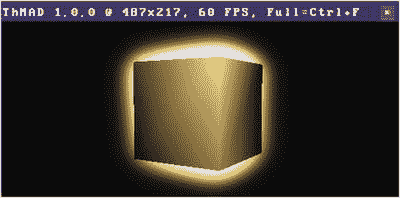

**图 6-49.** 带发光效果的物体，使用不同参数集时的输出结果。发光的 `start_value` 参数设为 `20.0`，`attenuation` 锚点设为 `1.6`。

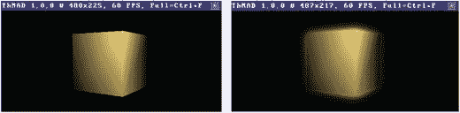

**图 6-48.** 带发光效果的物体，输出结果。左图显示未添加发光效果的原始输出。

## 总结

本章包含了一系列高级教程或案例，涵盖了 ThMAD 的更多方面并展示了其能力。第 7 章和第 8 章收录了 ThMAD Artiste 和 ThMAD Player 的 GUI 参考手册。