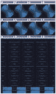
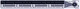

# Float4 作为模块参数的输入类型

`Float4` 参数通常用于定义颜色值。除非连接到其他模块，否则在双击 `float4` 类型的输入锚点  后，可以对其进行调整。有几种控制器可用，但颜色滑块通常显示为默认控制器。

右键单击将允许您使用表 7-10 中的任意选项。

表 7-10. Float4 输入

| 滑块 |  | 三重滑块。如果该锚点用于坐标设置，则三个滑块分别对应 `x`、`y` 和 `z` 坐标。每个上旋钮定义浮点值的范围；对应的下旋钮是最小值。每个旋钮的控制方式与单旋钮控制器相同。滑块值可通过拖动滑块手柄进行调整。或者，您可以点击刻度右侧的数字并输入值，使用键盘输入数值。要移动画布上的滑块，请点击并拖动黑色区域之一。双击滑块上的任意位置可将其关闭。 |
| 颜色 |  | 对于输入颜色值非常有用，并且通常是 `float4` 值的默认控制器。四个值中的任何一个都被限制在 `[0;1.0]` 范围内。要设置一个值，首先在顶部的色相选择器中点击并拖动，然后在其下方的大饱和度/明度框内的任意位置点击以完成 RGB（或色相-饱和度-明度）的选择。要选择阿尔法（Alpha）值，请在右下角的矩形内点击并拖动。最高点表示阿尔法值为 `1.0`；最低点表示阿尔法值为 `0.0`。任何拖动操作都是完全平滑的，这意味着您在移动鼠标时可以立即看到输出中的变化。要移动画布上的控件，请点击并拖动右上角的框。双击右上角的框可将其关闭。 |
| 直接输入 |  | 如果您想直接输入所有四个值，请使用此选项。点击每个数字并使用键盘输入新值。按 `Enter` 或 `Return` 确认。先按 `Ctrl+Del` 清除字段。通过拖动黑色区域来移动它。双击即可关闭。 |

