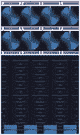

# 四元数作为模块参数的输入类型

除非连接到其他模块，否则在双击四元数类型的输入锚点  后，可以对其进行调整。有几种控制器可用，但四重滑块通常显示为默认控制器。

右键单击将显示表 7-11 中的任意选项。

表 7-11. 四元数输入

| 滑块 |  | 四重滑块。表示 `x`、`y`、`z`、`w` 值。每个上旋钮定义浮点值的范围，对应的下旋钮是最小值。每个旋钮的控制方式与单旋钮控制器完全相同。滑块值可通过拖动滑块手柄进行调整。或者，您可以通过点击刻度上方的数字并输入值，使用键盘输入数值。要移动画布上的滑块，请点击并拖动黑色区域之一。双击滑块上的任意位置可将其关闭。 |
| 轴视图 |  | 在 ThMAD 中，四元数通常表示旋转。轴视图控件也是如此。组件的顺序是：白色、紫色、绿色。要调整代表旋转的旋转或四元数，请在中心附近任意位置点击并拖动鼠标，向任意方向移动。通过拖动靠近角落的黑色区域来移动画布上的控件，双击即可关闭。 |
| 直接输入 |  | 如果您想直接输入所有四个值 `x`、`y`、`z` 和 `w`，请使用此选项。点击每个数字并使用键盘输入新值。按 `Enter` 或 `Return` 确认。先按 `Ctrl+Del` 清除字段。通过拖动黑色区域来移动它。双击即可关闭。 |

