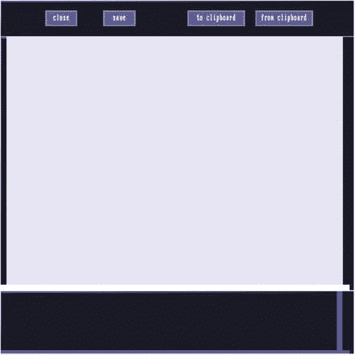

# 字符串作为模块参数的输入类型

如果未连接到其他模块，可以通过双击字符串类型的输入锚点  来调整它。

此时会出现一个文本编辑器；请参见图 7-19。

图 7-19. 字符串输入文本编辑器

您可以在其中输入任何文本；但编辑功能有限。您不能输入制表符，也不能选择文本范围来进行剪切粘贴或复制粘贴。至少可以使用 `To Clipboard` 和 `From Clipboard` 按钮从您喜欢的编辑器中前后复制文本。

完成后，您必须使用 `Save` 按钮使更改永久生效，然后点击 `Close` 关闭编辑器。如果仅点击 `Close`，则会放弃所有更改，请务必小心。

