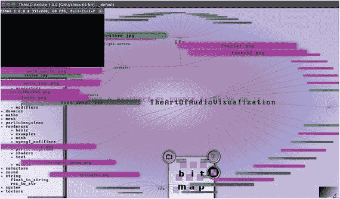
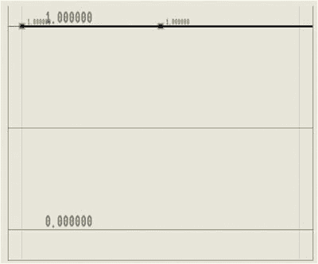
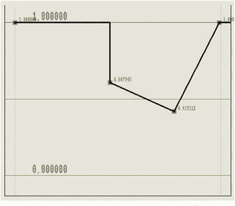
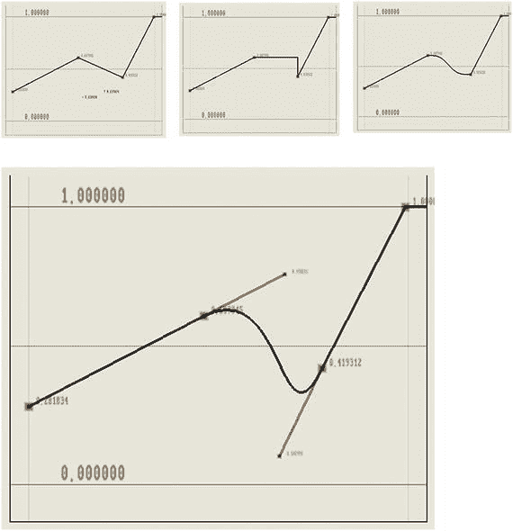
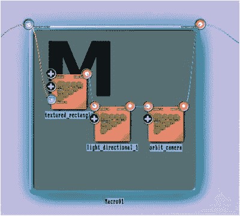
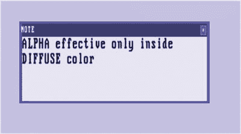

# 资源作为模块参数的输入类型

可以通过双击资源类型的输入  来设置。

资源查看器将显示，如图 7-20 所示。



图 7-20. 资源选择器

在资源查看器中，从远离彩色框的任意位置开始点击并拖动进行导航。通过双击选择文件，或通过右键单击取消选择操作。

请注意，如果您从 ThMAD 外部更改了资源，则需要告知 ThMAD 刷新其文件列表。您可以通过从主菜单中选择 `Refresh File Lists` 来实现。


### 将序列输入作为模块参数

此控件用于需要 XY 序列的模块，例如浮点值随时间变化或类似情况。一个示例是输入参数`float_sequence`模块，位于 Maths ➤ oscillators ➤ float_sequencer，该振荡器输出值的序列在其中被定义。

当对应的参数编辑器打开时（可通过双击锚点或右键单击上下文菜单），将出现图 7-21 所示的图像。



图 7-21.  
序列编辑器

这是一个所有值都等于 1.0 的序列。序列的锚点是线条起点和中间的小矩形。开始时我们只有两个锚点。您可以通过左键单击锚点并拖动来自由移动它们。

要添加新锚点，只需单击线条上的任意位置并按住`Shift`键。要移除锚点，请在按住`Shift`键的同时右键单击它。结果可能如图 7-22 所示。



图 7-22.  
锚点被移动和添加后的序列编辑器

在每个点上，插值类型决定了它如何与右侧的相邻点连接。默认是**无插值**，这意味着锚点会恰好在其位置（而非更早）突然强制将值改变。这可以在图 7-22 的第二个锚点处看到。由于我们目前是通过`Shift`+点击来添加锚点，这些锚点将对其右侧邻居显示线性插值，这意味着值从一个点到下一个点线性变化。您可以通过右键单击锚点并选择所需选项来更改插值类型。

插值类型包括：

- **无插值**：值保持恒定，直到到达下一个点的 x 坐标，然后突然改变其值。见图 7-23。

  

  图 7-23.  
  不同序列编辑器锚点插值：线性、无、余弦和贝塞尔。线条延伸末端的贝塞尔锚点已被选择，以使线段平滑匹配。

- **线性插值**：默认选项。从一个点到下一个点线性变化。见图 7-23。

- **余弦插值**：一种平滑曲线，其函数参数为 0 或π，直到π或 2π，具体取决于值是减小还是增大。请注意，线段起点和终点的斜率为零。见图 7-23。

- **贝塞尔插值**：一种贝塞尔曲线，允许平滑的段间连接。一旦选择，贝塞尔段将添加两个用于贝塞尔参数的额外锚点，您可以选择、单击并拖动它们。这些额外的手柄很小，因此请务必放大以查看它们。见图 7-23。

在内部，出于性能考虑，序列的所有点都存储在一个包含 8192 个 XY 对的数组中。

### 导出状态

完成某个状态后，您可以将其保存到一个不可修改的文件单元中，称为视觉素材。若状态文件位于此文件夹内：

```
/home/[USER]/thmad/[VERSION]/
data/states/
```

对于 ThMAD Artist 而言，视觉素材存放于以下文件夹之一：

- `/home/[USER]/thmad/[VERSION]/data/visuals/`
- `/home/[USER]/thmad/[VERSION]/data/prods/`
- `/home/[USER]/thmad/[VERSION]/data/faders/`

`visuals/`和`prods/`文件夹之间仅有逻辑上的区别；您将文件导出到`visuals/`以供后续在 ThMAD Player 中使用，而`prods/`更像是通用导出文件夹。`faders/`文件夹用于导出特殊的推杆状态，以供在 ThMAD Player 内部进行转场时使用。内部文件结构是相同的。

执行导出的步骤在“主菜单”部分的“编译 ➤ ”下进行了描述。


## 宏

`宏`是用于对模块进行分组的容器。除非展开，否则它们在画布上显示为单个符号，因此你可以使用它们来隐藏状态中的细节，提高可读性。此外，`宏`可以独立于状态单独保存，并在其他状态中重复使用。

要创建一个宏，请右键单击画布的空白区域，使用弹出的主菜单。点击`创建宏`项。

操作列表见表 7-12。

**表 7-12.** 宏操作

| 打开宏 | 右键单击宏，然后从弹出菜单中选择`打开/关闭`。 |
| 关闭宏 | 与打开宏相同。 |
| 移动宏 | 如果宏已关闭，只需像操作其他模块一样，单击并拖动它。如果宏已打开，则单击宏内的空白区域。 |
| 删除宏 | 单击宏，然后按`Del`键。或者右键单击宏并选择`删除 [del]`项。 |
| 重命名宏 | 确保已启用`对象检查器`（你可以通过在画布空白区域按`Ctrl+O`来切换其可见性）。单击宏，然后使用`对象检查器`中的`重命名`功能。 |
| 克隆宏 | 与模块类似，按住`Ctrl+Alt`键，然后将宏拖到画布的空白区域。克隆宏也会克隆其所有组成模块！ |
| 调整宏大小 | 右键单击并从出现的菜单中选择`双倍大小`或`一半大小`。这仅适用于已打开的宏（你可以在宏关闭时调整大小，但关闭的宏的符号大小不会改变）。 |
| 修改/控制宏内部的模块 | 打开宏，然后执行与组件在宏外部时相同的操作。 |
| 将单个模块移入宏 | 按住键盘上的`Ctrl+Shift`键，然后用鼠标左键将模块拖动到已打开的宏中（对已关闭的宏无效！）。一旦进入宏，只能通过删除来将模块从宏中移除。你不能将其移出（不过按`Ctrl+Z`撤销会有效）。 |
| 一次将多个模块移入宏 | 选择多个模块。可以按住`Ctrl`键的同时单击选择，或者在按住`Ctrl`键的同时围绕模块绘制一个矩形（按下`Ctrl`，然后按住鼠标左键从左上角开始，移动到右下角，然后松开鼠标按钮，最后松开`Ctrl`）。选择完成后，按住`Ctrl+Shift`键，并将其中一个选中的模块拖动到已打开的宏中（对已关闭的宏无效！）。一旦进入宏，只能通过删除来将模块从宏中移除；你不能将其移出（不过按`Ctrl+Z`撤销会有效）。 |

无论你是一次将单个模块还是多个模块移入宏，传入和传出的连接都会在宏的边缘显示为人工锚点。参见图 7-24。



**图 7-24.** 宏锚点

更多操作列于表 7-13。

**表 7-13.** 宏扩展操作

| 将内部模块的锚点暴露给外部世界 | 要暴露内部锚点（例如，你有一个内部模块带有输入锚点`xyz`，并且你想从宏外部控制它），将该锚点拖动到宏内的空白区域。 |
| 移除宏锚点 | 右键单击一个宏锚点，然后从菜单中选择`取消别名`。 |
| 保存宏 | 可以保存宏以便日后重用，方法是右键单击宏，然后从弹出菜单中选择`保存宏...`。下次重启 ThMAD 后，保存的宏将出现在模块列表中。 |
| 将保存的宏插入当前状态 | 从模块列表的`宏`部分拖出，如同操作普通组件一样。 |

保存的宏只能在 ThMAD 外部删除。请导航至以下文件夹并删除相应文件：

```
/home/[USER]/thmad/
[VERSION]/data/macros/
```

### 备注

`备注`有助于记录你的状态或其部分内容。要创建备注，请右键单击画布的空白区域，然后在弹出菜单中选择`创建备注`。在那里添加任何文本。参见图 7-25。



**图 7-25.** 一条备注

要移动备注，请拖动其标题栏。要删除备注，请单击其右上角的关闭框。要更改其大小，请单击并拖动其任一边或一角。（遗憾的是，没有用户界面反馈来帮助找到正确的鼠标位置；你只能尝试。）

请注意，你不能向宏中添加备注，并且备注不参与多选（按`Ctrl`键点击并绘制矩形）。此外，节点不能像模块一样被克隆。

### ThMAD 播放器

### 启动和停止 GUI

有关启动和停止 ThMAD 播放器的信息，请参见第 3 章。本章其余部分假设你已运行 ThMAD 播放器。

#### 播放器 GUI 操作

播放器对鼠标移动没有反应，但你可以使用键盘上的几个按键来控制它。

播放器运行时，表 7-14 中列出的键盘操作可用。

**表 7-14.** ThMAD 播放器控制

| `O` | 切换文本覆盖层的可见性。如果启用，当视觉效果切换时会短暂打印信息。默认为开启，除非通过程序调用禁用。 |
| `F1` | 显示帮助。自动启用文本覆盖层；之后按`O`可禁用它。 |
| `F` | 显示状态信息。自动启用文本覆盖层；之后按`O`可禁用它。 |
| 光标左/右 | 返回到列表中的上一个或前进到下一个视觉效果。 |
| 光标上/下 | 增加或减少对声音输入的灵敏度。 |
| 翻页上/下 | 加快/减慢速度。控制时间缩放因子。 |
| `R` | 启用/禁用随机化。如果禁用，则停留在一个视觉效果上。如果启用，则在随机时间间隔后随机切换视觉效果。 |
| `Ctrl+R` | 从列表中随机选择另一个视觉效果。 |
| 退出键 | 退出播放器。 |

## 总结

在本章中，你学习了 ThMAD Artiste 和 ThMAD 播放器的所有 GUI 功能。你了解了如何使用键盘控制一切，如何识别、放置和连接元素，以及如何使用参数控件来调整不同类型的模块参数。你还探讨了 Artiste 中的不同窗口模式和辅助小部件。你学习了文件处理方法，以及 Artiste 和播放器如何协同工作。

下一章将提供可用于创建视觉效果的所有模块的完整参考手册。


