# 8. ThMAD 模块参考

在 ThMAD 中，模块是构建可视化效果的积木。本章提供完整的模块参考，描述每个模块的功能及其参数。其结构同时也说明了您可以通过该软件实现哪些功能。通读本章将有助于您获得一些印象和新想法。模块类别名称和模块名称与用户界面及实现代码紧密相关，其中侧重用户界面，以便您能轻松地利用用户界面进行自己的实验。

所有模块都有零个或多个输出锚点（表示各种类型的数据），以及零个或多个输入锚点（表示各种类型的数据）。某些模块具有副作用，即它们会存储某些内容或执行某些操作，但这些并不反映在输出数据中。数据类型如下：

*   `int`：一个整数。
*   `float`：一个浮点数。
*   `double`：一个双精度浮点数。ThMAD 中所有浮点数均为单精度浮点类型，因此这个双精度类型尽管已定义，但并未使用。
*   `float3`：包含三个浮点数的向量。例如，3D 坐标。
*   `float4`：包含四个浮点数的向量。例如，红、绿、蓝、阿尔法颜色值。
*   `quaternion`：也是包含四个浮点数的向量，但遵循四元数运算规则。四元数精确表示 3D 旋转操作。
*   `string`：一个字符串。
*   `matrix`：一个 4x4 的浮点数矩阵。矩阵用于描述空间操作，如旋转、缩放和平移。
*   `float_array`：一个可变数量的浮点数值数组。
*   `float3_array`：一个可变数量的 float3 向量数组。
*   `quaternion_array`：一个可变数量的四元数数据数组。
*   `resource`：指向一个资源文件，可能是模块可以读取或写入的图片或文本文件。
*   `enum`：一个枚举。用于需要从固定集合中选择字符串值的地方。枚举也用于一次性操作，例如重置或触发某些功能。
*   `sequence`：包含 8192 个浮点数值的数组。用于需要指定某个浮点数值变化过程（通常在时域内）的模块。它与`float_array`的不同之处在于，在 ThMAD Artiste 用户界面中有一个专门的图形编辑器。
*   `render`：一个表示可绘制项目的内部队列。
*   `texture`：表示图形硬件内部的有色像素位图。
*   `mesh`：定义 3D 对象表面的一组点。可能表示面，即具有连接边的二维表面单元，但并非总是如此。
*   `bitmap`：由 CPU 掌管的有色像素集合，意味着不直接由图形硬件处理。只能通过合适的渲染器模块发送到图形硬件。
*   `particlesystem`：可能数量庞大的相同或相似 3D 对象集合。在内部处理，仅通过某些渲染器发送到图形硬件。
*   `segment_mesh`：一种带有非连接边的特殊网格形式。通常在进一步处理前转换为网格。

在本章的模块参考表中，所有模块控制锚点规范将写作：

*   `参数名称 : 参数类型`

其中参数名称不含空格或连字符。表中较长的名称会在下划线处换行，所以如果您看到类似`gamma_ correction:float` 的内容，实际指的是 `gamma_correction:float`。

每个模块都属于一个类别，这体现在模块列表和模块浏览器中各模块的位置上。模块类别如下：

*   屏幕：输出到图形硬件。
*   位图：驻留于主内存并由 CPU 处理的有色像素存储。
*   虚拟模块：通常原样传递值的模块。例如，当您想用一个浮点值同时控制多个输入锚点时使用。该类别实际上只包含对其他类别中虚拟模块的引用。
*   数学：数学运算，如操作符（所有输入和输出类型相同）以及函数（输入和输出类型不同）。这里您还可以找到振荡器。
*   网格：包含定义 3D 对象表面或表面部分的一组点，无论是否连接。
*   粒子系统：可能数量庞大的相同或相似 3D 对象集合。用于雨、雾以及许多特殊效果。
*   渲染器：将不同类型的输入转换为可直接连接到屏幕的输出锚点。也包含修改其他模块渲染器输出的模块。
*   选择器：用于从某种数据类型的集合中获取单个元素或一个子范围。
*   音频：处理声音输入。
*   字符串：处理字符串。
*   系统：系统相关模块的集合，如时间、系统状态或文件选择器相关模块。
*   纹理：处理驻留在图形硬件上的位图。使用纹理而非位图可带来巨大的性能提升。纹理对于反向传播像素数据也很重要，即将子管线的输出反馈回其某个输入组成部分。
*   宏：可重用的子管线。

## 屏幕

这实际上包含一个内置模块 `screen0`，是图形输出的必备模块。任何模块最终都必须以某种方式连接到屏幕；否则它将不会处于活动状态。因此，它是可视化设置中的管线或管线组的最后一个模块，负责在显示器上产生视觉输出。

### screen0

输出到图形硬件、显卡和显示器。见表 8-1。

表 8-1.

screen0 模块

| `screen0` | 屏幕 |
| --- | --- |
| 输入 | `screen:render` | 任何可视化管线都必须连接至此。如果此连接未连接，则什么都看不到。如果多个管线连接到此锚点，渲染顺序可能非常重要。要更改 ThMAD Artiste 用户界面中的顺序，请双击锚点并拖动锚点连接器。 |
|   | `gamma_correction:float` | 伽马校正。默认值为 1.0。伽马校正是由于人类对视觉亮度的感知是非线性的，并且老式阴极射线管本身也表现出非线性行为。通常，伽马值大于 1 会使阴影显得更暗，伽马值小于 1 会使阴影显得更亮。 |
| 输出 | 无 | 将渲染到图形硬件。 |

## 位图

位图是存在于 ThMAD 内部（而非图形硬件内部）的图像，因此可以在它们上传到图形硬件之前对其进行操作。

### 滤镜

位图滤镜都涉及两个位图，并且都具有相同的结构。路径为 `Bitmaps` → `Filters`，然后参见表 8-2。

**表 8-2.** 位图滤镜模块

| 动态分配的名称 | | |
| --- | --- | --- |
| **输入** | `bmp1:complex` | 第一个位图 |
| | `in1:bitmap` | 位图锚点；需要连接到位图发生器 |
| | `bitm1_ofs: float3` | 这是混合发生前应用于位图像素坐标的偏移量。第三个坐标被忽略 |
| | `bmp2:complex` | 第二个位图 |
| | `in2:bitmap` | 位图锚点；需要连接到位图发生器 |
| | `bitm2_ofs: float3` | 这是混合发生前应用于位图像素坐标的偏移量。第三个坐标被忽略 |
| | `bitm2_opacity: float` | 定义混合因子，取值范围为 [0;1]。值为 0 时，输出为 B1。值为 1 时，输出为混合结果。所有其他值进行线性插值。 |
| | `target_size: float3` | 输出位图大小。第三个坐标被忽略。 |
| | `set_target_size:enum` | 使用此选项将大小设置为以下正方形之一：8x8、16x16、32x32、64x64、128x128、256x256、512x512、1024x1024 和 2048x2048。 |
| | `blend_type: enum` | 混合类型——决定进行混合时应用的公式。可用模式在此章节中列出。请注意，所有不同的位图滤镜将仅在此锚点使用不同的设置。 |
| | `bitmap_type: enum` | 取值为 `integer` 或 `float`。未使用。 |
| **输出** | `bitmap:bitmap` | 输出位图。您可以在此处添加更多滤镜，或将其发送到任何需要位图作为输入的模块。 |

所有可用的混合模式列于表 8-3 中。若给出示例图片，我们使用  作为位图 B1（边缘的白色部分），并使用  作为位图 B2（已添加 `ALPHA` 通道，但所有位置读取值均为 1.0）。

**表 8-3.** 位图滤镜混合模式

| 滤镜模块名称 | 对应的“blend_type”锚点设置 | 描述 |
| --- | --- | --- |
| `bitm_blend_add` | `BLEND_ADD` | 对于每个 RGBA 值，将 B1 和 B2 相加。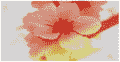 将结果限制在最大值 1.0 范围内。混合这些图像将得到此处所示的图像。左上角的白色来自该处的 `ALPHA` 在混合前未被应用！因此，即使那里 `ALPHA` 为 0，隐藏的 RGB 值（此处为白色）也会被计入！ |
| `bitm_blend_average` | `BLEND_AVERAGE` | 对于每个 RGBA 值，取平均值 `(B1+B2) / 2`。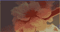 |
| `bitm_blend_color_burn` | `BLEND_COLOR_BURN` | 对于每个 RGBA 值，将 B1 的反色除以 B2，再对结果取反，并限制在 [0.0;1.0] 范围内。将 B2 的颜色烧入 B1。示例图片的结果如下所示；B1 越暗，其颜色使用得越多。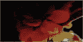 |
| `bitm_blend_color_dodge` | `BLEND_COLOR_DODGE` | 对于每个 RGBA 值，用 B1 除以 B2 的反色。B2 越亮，对结果颜色的影响越大。结果中 B1 的任何部分都不会变暗。 |
| `bitm_blend_darken` | `BLEND_DARKEN` | 对于每个 RGBA 值，取 B1 和 B2 中较小的值。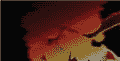 |
| `bitm_blend_difference` | `BLEND_DIFFERENCE` | 对于每个 RGBA 值，取绝对值差 `\| B1 – B2 \|`。在我们的示例中，我们只会在 B1 的 `ALPHA ≠ 1.0` 的区域（即其周围）得到 `ALPHA` 值。如果 B2 的 `ALPHA` 并非处处为 1.0，你将得到更有趣的结果。 |
| `bitm_blend_exclusion` | `BLEND_EXCLUSION` | 每个 RGBA 值的公式为：`B1 + B2 - 2 * B1 * B2` |
| `bitm_blend_glow` | `BLEND_GLOW` | 对于每个 RGBA 值，取 B2 的平方，然后除以 B1 的反色。平方运算会强调 B2 中较亮的部分，但对于较暗的部分，B1 中亮的部分会获得影响力。 |
| `bitm_blend_hard_light` | `BLEND_HARD_LIGHT` | 与 `BLEND_OVERLAY` 相同，但交换了 B1 和 B2 的角色。 |
| `bitm_blend_hard_mix` | `BLEND_HARD_MIX` | 对于每个 RGBA 值，如果 B1 比 B2 亮的部分暗，则设为 0。否则设为 1。 |
| `bitm_blend_lighten` | `BLEND_LIGHTEN` | 对于每个 RGBA 通道，取 B1 和 B2 中较大的值。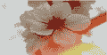 |
| `bitm_blend_linear_burn` | `BLEND_LINEAR_BURN` | 与 `BLEND_SUBTRACT` 相同。 |
| `bitm_blend_linear_dodge` | `BLEND_LINEAR_DODGE` | 与 `BLEND_ADD` 相同。 |
| `bitm_blend_linear_light` | `BLEND_LINEAR_LIGHT` | 对于每个 RGBA 值，如果 B1 < 0.5，则使用 `2 * B1` 和 B2 执行线性加深；否则，使用 `2 * (1.0 – B1)` 和 B2 执行线性减淡。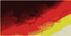 |
| `bitm_blend_multiply` | `BLEND_MULTIPLY` | 对于每个 RGBA 值，取 `B1 * B2`。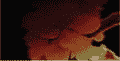 由于乘法运算，在 B1 和 B2 都是暗色的部分，结果将更加暗。 |
| `bitm_blend_negation` | `BLEND_NEGATION` | 对于每个 RGBA 值，取以下绝对值的反色：`(1.0 – B1) – B2` |
| `bitm_blend_normal` | `BLEND_NORMAL` | 对于每个 RGBA 值，根据 `bitm2_opacity` 锚点值将 B2 混合到 B1 中。以下为 0.0、0.5 和 1.0 的效果：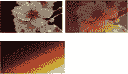 |
| `bitm_blend_overlay` | `BLEND_OVERLAY` | 对于每个 RGBA 值，如果 B2 < 0.5，则取两倍的乘积值 `2 * B1 * B2`。否则，取两倍反向乘积值的反色 `1.0 – 2 * (1.0 – B1) * (1.0 - B2)`。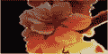 |
| `bitm_blend_phoenix` | `BLEND_PHOENIX` | 对于每个 RGBA 值，取 B1 和 B2 中较小值，然后加上 B1 和 B2 中较大值的反色。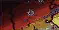 |
| `bitm_blend_pin_light` | `BLEND_PIN_LIGHT` | 对于每个 RGBA 值，如果 a < 0.5，则使用 `2*B1` 和 B2 执行变暗混合；否则，使用 `2 * (1.0 – B1)` 和 B2 执行变亮混合。 |
| `bitm_blend_reflect` | `BLEND_REFLECT` | 与 `BLEND_GLOW` 相同，但交换了 B1 和 B2 的角色。由于除法运算，示例中出现了一些伪影。 |
| `bitm_blend_screen` | `BLEND_SCREEN` | 与正片叠底混合相同，但取 B1 和 B2 的反色，然后对结果再次取反。普通正片叠底会加深两个位图中的暗部区域，而此模式会加亮两个位图中的亮部区域。 |
| `bitm_blend_soft_light` | `BLEND_SOFT_LIGHT` | `BLEND_HARD_LIGHT` 的柔化版本。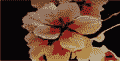 |
| `bitm_blend_subtract` | `BLEND_SUBTRACT` | 类似于加法，但将 0.5 作为 RGBA 值的零点。因此，如果值低于 0.5，可以实现减法效果。将结果限制在最小值 0.0 以内。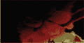 |
| `bitm_blend_vivid_light` | `BLEND_VIVID_LIGHT` | 对于每个 RGBA 值，如果 B1 < 0.5，则使用 `2 * B1` 和 B2 执行颜色加深；否则使用 `2 * (1.0 – B1)` 和 B2 执行颜色减淡。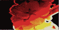 |

以下是根据您的要求翻译的中文版本，严格遵循了格式保留、代码与链接不翻译、粗斜体保留等规则。

两幅图像均为 PNG 格式，并指定 `WHITE`（白色）为背景色。请注意，所有混合滤镜均独立处理颜色分量 `RED`（红色）、`GREEN`（绿色）、`BLUE`（蓝色）和 `ALPHA`（透明度），且它们仅逐像素作用，不进行像素间的混合。

生成的位图将作为纹理发送给图形硬件，作用于一个顶点颜色均为白色的四边形上。

请注意，您可以将同一个位图同时用于 `B1` 和 `B2`，以实现图像与自身的混合。

#### 生成器

位图生成器作为无需加载外部图像文件即可生成位图的来源。路径为：位图 → 生成器，然后参见表 8-4 至 8-9。

**表 8-9。`subplasma`（子等离子）模块**

| `subplasma` | 生成随机等离子效果。与 `plasma` 模块相比，显得更不人工化 |
| --- | --- |
| In | `rand_seed:float` | 改变整数部分，可生成另一种形状的子等离子 |
| `size:enum` | 位图大小，可选值：8x8、16x16、32x32、64x64、128x128、256x256、512x512 或 1024x1024 |
| `amplitude:enum` | 定义子等离子颗粒的粗细。值越大，颗粒越细。可用值为 2、4、8、16、32、64、128、256 和 512 |
| `color:float4` | 子等离子的颜色 |
| Out | `bitmap:bitmap` | 结果位图 |

**表 8-8。`solid`（单色）模块**

| `solid` | 生成每个像素颜色相同的单色位图。可用于为位图着色的滤镜 |
| --- | --- |
| In | `color:float4` | 颜色 |
| `size:enum` | 位图大小，可选值：8x8、16x16、32x32、64x64、128x128、256x256、512x512、1024x1024 或 2048x2048 |
| Out | `bitmap:bitmap` | 结果位图 |

**表 8-7。`plasma`（等离子）模块**

| `plasma` | 生成确定性的、非随机的规则等离子。颜色值通过以下线性函数计算：`sin( x 的线性函数 ) * sin( y 的线性函数 )` |
| --- | --- |
| In | settings |  |
|  | `col_amp:float4` | 外部线性函数的颜色分量倍乘因子 |
| `col_ofs:float4` | 外部线性函数的颜色分量加法因子 |
| `period:complex` | 包含 `sin()` 项内部线性函数倍乘因子的颜色分量 `float3` 锚点（每个 `float3` 的第三个分量未使用，因为我们只需要 x 和 y 坐标） |
| `ofs:complex` | 包含 `sin()` 项内部线性函数加法因子的颜色分量 `float3` 锚点（每个 `float3` 的第三个分量未使用，因为我们只需要 x 和 y 坐标） |
| `size:enum` | 位图大小，可选值：8x8、16x16、32x32、64x64、128x128、256x256、512x512 或 1024x1024 |
| Out | `bitmap:bitmap` | 结果位图 |

**表 8-6。`perlin_noise`（柏林噪声）模块**

| `perlin_noise` | 柏林噪声位图 |
| --- | --- |
| In | `perlin_options` |  |
|  | `rand_seed:float` | 改变整数部分，可生成另一种形状的噪声 |
| `perlin_strength:float` | 噪声的强度 |
| `size:enum` | 可选值：8x8、16x16、32x32、64x64、128x128、256x256、512x512、1024x1024 或 2048x2048。定义位图的像素大小 |
| `octave:enum` | 噪声的模糊度。值越大，越不模糊。取值范围为 1 到 16 |
| `frequency:enum` | 定义颗粒粗细。取值范围为 1 到 8 |
| `bitmap_type:enum` | 可选 `integer`（整数）或 `float`（浮点数）。未使用 |
| `blob_settings` |  |
| `enable_blob:enum` | 设置为 `yes`（是）或 `no`（否），决定是否混合成斑块形状 |
| `arms:float` | 如果要制作星形或花朵形状，请设置一个大于 0 的值 |
| `attenuation:float` | 控制形状的锐利度。值越小，越模糊 |
| `star_flower:float` | 控制中心部分的密度。如果大于 0，则使中心附近的臂更细（如花朵形状） |
| `angle:float` | 用于旋转形状（仅在形状有臂时有效） |
| `color:float4` | 噪声的颜色 |
| `alpha:enum` | 设置为 `yes`（是）或 `no`（否）。如果为 `yes`，则使用 `ALPHA`（透明度）通道进行密度过渡；否则直接在此处应用 `ALPHA`。在后一种情况下，位图的 `ALPHA` 将在各处均为 1.0 |
| Out | `bitmap:bitmap` | 结果位图 |

**表 8-5。`concentric_circles`（同心圆）模块**

| `concentric_circles` | 创建同心圆 |
| --- | --- |
| In | settings |  |
|  | `frequency:float` | 控制要生成的圆的密度 |
| `attenuation:float` | 控制形状的锐利度。值越小，越模糊 |
| `color:float4` | 定义颜色 |
| `alpha:enum` | 设置为 `yes`（是）或 `no`（否）。如果为 `yes`，则使用 `ALPHA`（透明度）通道进行密度过渡；否则直接在此处应用 `ALPHA`。在后一种情况下，位图的 `ALPHA` 将在各处均为 1.0 |

**表 8-4。`blob`（斑块）模块**

| `blob` | 生成一个斑块 |
| --- | --- |
| In | settings |  |
| `arms:float` | 如果要制作星形或花朵形状，请设置一个大于 0 的值。值为 0 表示：无臂 |
| `attenuation:float` | 控制形状的锐利度。值越小，越模糊 |
| `star_flower:float` | 控制中心部分的密度。如果大于 0，则使中心附近的臂更细（如花朵形状） |
| `angle:float` | 用于旋转形状（仅在形状有臂时有效） |
| `color:float4` | 定义斑块的颜色 |
| `alpha:enum` | 设置为 `yes`（是）或 `no`（否）。如果为 `yes`，则使用 `ALPHA`（透明度）通道进行密度过渡；否则直接在此处应用 `ALPHA`。在后一种情况下，位图的 `ALPHA` 将在各处均为 1.0 |
| `size:enum` | 可选值：8x8、16x16、32x32、64x64、128x128、256x256、512x512、1024x1024 或 2048x2048。定义位图的像素大小 |
| Out | `bitmap:bitmap` | 结果位图 |

### 加载器

从文件加载位图。路径为：位图 → 加载器。然后参见表 8-10 至 8-12。

**表 8-12。`png_bitm_load`（PNG 位图加载）模块**

| `png_bitm_load` | 加载 PNG 文件作为位图。文件必须位于 `/home/[USER]/thmad/[VERSION]/data/resources` 文件夹内 |
| --- | --- |
| In | `Filename:resource` | 指向 resources 文件夹内的文件 |
|  | `reload:enum` | 动作枚举。点击 `yes`（是）可通知 ThMAD 重新加载该文件 |
| Out | `bitmap:bitmap` | 输出位图 |
| `texture:texture` | 加载后作为纹理发送给图形硬件 |

**表 8-11。`jpeg_bitm_load_alpha`（JPEG 位图加载透明度）模块**

| `jpeg_bitm_load_alpha` | 加载两个 JPG 文件。第二个文件定义 `ALPHA`（透明度）通道。两个文件必须位于 `/home/[USER]/thmad/[VERSION]/data/resources` 文件夹内 |
| --- | --- |
| In | `filename_rgb:resource` | RGB 数据 |
| `filename_alpha:resource` | `ALPHA` 数据；使用灰度值位图指定 `ALPHA` 值 |
| Out | `bitmap:bitmap` | 输出位图 |
| `texture:texture` | 加载后直接作为纹理发送给图形硬件 |

**表 8-10。`jpeg_bitm_load`（JPEG 位图加载）模块**

| `jpeg_bitm_load` | 加载 JPG 文件作为位图。文件必须位于 `/home/[USER]/thmad/[VERSION]/data/resources` 文件夹内 |
| --- | --- |
| In | `filename:resource` | 指向 resources 文件夹内的文件 |
| Out | `bitmap:bitmap` | 输出位图 |
| `texture:texture` | 加载后直接将纹理发送给图形硬件 |

### 修改器

位图的修改。路径为：位图 → 修改器 → 添加噪声。参见表 8-13。

**表 8-13。`add_noise`（添加噪声）模块**

| `add_noise` | 为位图添加噪声。请注意，这是一项开销较大的操作，因为位图需要频繁重新计算 |
| --- | --- |
| In | `bitmap_in:bitmap` | 输入位图 |
| `time_rate:float` | 应用噪声的时间间隔，单位为毫秒 |
| `noise_amount:float` | 添加的噪声量：1.0 为最大量，0.0 为无 |
| Out | `bitmap:bitmap` | 输出位图 |

