# 虚设模块

虚设模块要么不执行任何操作，要么在不改变数值的情况下将其传递。它们因技术原因或用于多路复用控制器。例如，模块 A 和 B 需要一个浮点数输入，并且你希望相应的锚点仅受手动更改（即使用图形用户界面）影响，此外还要保持同步。它们应始终接收相同的控制器值。如果没有虚设模块，你将不得不逐个更改它们。为了避免这种单调的工作，你可以使用一个虚设模块并将其连接到 A 和 B；请参见图 8-1。

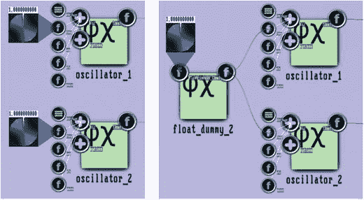

图 8-1. 使用虚设模块简化手动控制。在图的左侧，如果你想同步输入，需要调整两个控制器。使用右侧所示的虚设模块，你可以一步完成。

虚设模块位于模块层级结构的不同位置——`Dummies` 模块部分为来自其他不同模块部分的虚设模块提供了别名；请参见表 8-14。

表 8-14. 虚设模块别名

| 名称 | 描述 | 是以下模块的别名 |
| --- | --- | --- |
| `float_dummy` | 多路复用浮点数值 | 数学 → 虚设模块 → `float_dummy` |
| `float3_dummy` | 多路复用 float3 向量 | 数学 → 虚设模块 → `float3_dummy` |
| `float4_dummy` | 多路复用 float4 向量，主要为颜色值 | 数学 → 虚设模块 → `float4_dummy` |
| `quaternion_dummy` | 多路复用四元数 | 数学 → 虚设模块 → `quaternion_dummy` |
| `mesh_dummy` | 多路复用网格输入 | 网格 → 虚设模块 → `mesh_dummy` |
| `texture_dummy` | 多路复用纹理输入 | 纹理 → 虚设模块 → `texture_dummy` |

## 数学模块

数学模块对于控制其他模块很重要。它们不产生任何图形输出。

### 累加器

累加器累积输入值，即它们持有一个内部值，该值每帧通过提供的输入值进行更新。每个累加器的初始值是该运算的**单位元**，对于加法是 `0.0` 或包含值为 `0.0` 的元素的数组，对于四元数乘法是 `(0.0; 0.0; 0.0; 1.0)`。

如果使用了 `reset:enum` 输入锚点，这意味着将其值设置为 `ok` 会将累加器重置为其初始状态一次。该锚点将在下一帧自动停用，因此如果你想重复该动作，需要再次将其设置为 `ok`。

路径为：数学 → 算术 → 累加器，然后请参见表 8-15。

表 8-15. 累加器模块

| 名称 | 类型 | 参数名称 | 描述 |
| --- | --- | --- | --- |
| `float_accumulator` | float → float | `float_in` → `result_float` | 每帧将输入值加到累加器中。 |
| `float_accumulator_limits` | float → float | `float_in`, `limit_lower`, `limit_upper` → `result_float` | 每帧将输入值加到累加器中。如果累加器值超出任一限制，则将其钳制到相应限制。 |
| `float3_accumulator` | float3 → float3 | `float3_in` → `result_float3` | 每帧将输入 float3 值按分量加到累加器中。 |
| `float4_accumulator` | float4 → float4 | `float4_in` → `result_float4` | 每帧将输入 float4 值按分量加到累加器中。 |
| `quat_rotation_accum_2d` | float × float → quaternion | `param_x`, `param_y` → `result_quat` | 在 ThMAD 中，四元数表示为 `(x, y, z; w)`，意味着其特殊的实部位于数组末尾。`param_x` 和 `param_y` 构建乘数四元数 `(0, x, 0; 1)` 和 `(0, 0, y; 1)`，用于每帧应用的第一和第二次乘法或旋转：`accum = accum \cdot (0, x, 0; 1)`，`accum = accum \cdot (0, 0, y; 1)`。由于四元数的特殊性质，这种形式的乘法可以描述任何旋转。 |

### 算术运算

此类别涉及基本的算术运算。

#### 一元运算符

一种输入→输出的运算，所有类型相同。

对于布尔运算符，输入和输出是映射的浮点数。在 `[-0.5; 0.5]` 范围内的输入表示 `FALSE`，小于 `-0.5` 或大于 `+0.5` 的输入表示 `TRUE`，输出为 `1.0` 表示 `TRUE`，输出为 `0.0` 表示 `FALSE`。路径为：数学 → 算术 → 一元。表 8-16 提供了一个概览。

表 8-16. 一元运算符

| 名称 | 类型 | 参数名称 | 描述 |
| --- | --- | --- | --- |
| `cos` | `float` | `float_in` → `result_float` | 余弦函数 `out = cos(in)` |
| `sin` | `float` | `float_in` → `result_float` | 正弦函数 `out = sin(in)` |
| `tan` | `float` | `float_in` → `result_float` | 正切函数 `out = tan(in)` |
| `acos` | `float` | `float_in` → `result_float` | 反余弦函数 `out = arccos(in)` |
| `atan` | `float` | `float_in` → `result_float` | 反正切函数 `out = arctan(in)` |
| `abs` | `float` | `float_in` → `result_float` | 绝对值，去除符号 `out = abs(in)` |
| `not` | `float` | `a` → `result_float` | 布尔非运算 `out = not(in)` |
| `derivative` | `float` | `float_in` → `result_float` | 导数函数 `out = in - last_in`。由于该模块每 `1/60` 秒被调用一次，这意味着这是时间的近似导数，`1/60 \cdot d / dt`。 |
| `ifinside` | `float` | `float_in` → `result_float`；参数：`low`、`high`、`val_inside`、`val_outside` | 检查输入是否在范围 `[low; high]` 内，如果是，则输出 `val_inside`。否则输出 `val_outside`。 |
| `vector_normalize` | `float3` | `param1` → `result_float3` | 归一化一个 float3 向量，即将其长度更改为 `1.0`，同时保持方向：`v \rightarrow v / \lVert v \rVert`。 |

#### 二元运算符

一个操作`in1 ○ in2 → out`，所有类型相同。路径为 `Maths → Arithmetic → Binary → * → *`。

表 8-17 给出了一个列表；请注意，对于布尔值，输入和输出被映射为浮点数：在 `[-0.5;0.5]` 范围内的输入表示 `FALSE`，小于 `-0.5` 或大于 `+0.5` 的输入表示 `TRUE`，输出 `1.0` 表示 `TRUE`，输出 `0.0` 表示 `FALSE`。

表 8-17. 二元运算符

| 名称 | 类型 | 参数名称 | 描述 |
| --- | --- | --- | --- |
| `mod` | `float` | param1 param2 → mod | 除法取模 `out = in1 - int(in1 / in2) ∙ in2`，其中 `int()` 移除小数部分 |
| `add` | `float` | param1 param2 → sum | 加法 `out = in1 + in2` |
| `sub` | `float` | param1 param2 → diff | 减法 `out = in1 - in2` |
| `mult` | `float` | param1 param2 → mult | 乘法 `out = in1 ∙ in2` |
| `div` | `float` | param1 param2 → div | 除法 `out = in1 / in2` |
| `max` | `float` | param1 param2 → max | 最大值 `out = in1 > in2 ? in1 :else: in2` |
| `min` | `float` | param1 param2 → min | 最小值 `out = in1 < in2 ? in1 :else: in2` |
| `pow` | `float` | param1 param2 → pow | 幂运算 `out = in1 ^ in2` |
| `round` | `float` | param1 param2 → round | 四舍五入 `out = round0( in1 / in2 ) ∙ in2`，其中 `round0()` 返回最接近的整数（正数向上取半，负数向下取半） 示例：`in1 = 25.6382, in2 = 100 → 25.64` 示例：`in1 = 25.635, in2 = 100 → 25.64` 示例：`in1 = -25.635, in2 = 100 → -25.64` |
| `floor` | `float` | param1 param2 → floor | 返回缩放后的向下取整 `out = floor0( in1 / in2 ) ∙ in2`，其中 `floor0()` 返回下一个更小的整数 示例：`in1 = 25.6382, in2 = 100 → 25.63` |
| `ceil` | `float` | param1 param2 → ceil | 返回缩放后的向上取整 `out = ceil0( in1 / in2 ) ∙ in2`，其中 `ceil0()` 返回下一个更大的整数 示例：`in1 = 25.6312, in2 = 100 → 25.64` |
| `and` | `float` `(boolean)` | param1 param2 → and | 布尔与 `out = in1 && in2` 0,0 → 0, 1,0 → 0, 0,1 → 0, 1,1 → 1 |
| `or` | `float` `(boolean)` | param1 param2 → or | 布尔或 `out = in1 \|\| in2` 0,0 → 0, 1,0 → 1, 0,1 → 1, 1,1 → 1 |
| `nand` | `float` `(boolean)` | param1 param2 → nand | 布尔与非 `out = not(in1 && in2)` 0,0 → 1, 1,0 → 1, 0,1 → 1, 1,1 → 0 |
| `xor` | `float` `(boolean)` | param1 param2 → xor | 布尔异或 `out = (in1 \|\| in2) && not(in1 && in2)` 0,0 → 0, 1,0 → 1, 0,1 → 1, 1,1 → 1 |
| `nor` | `float (boolean)` | param1 param2 → nor | 布尔或非 `out = not(in1 \|\| in2)` 0,0 → 1, 1,0 → 0, 0,1 → 0, 1,1 → 0 |
| `float4_add` | `float4` | param1 param2 → result | 两个 `float4` 值的分量相加 `out[i] = in1[i] + in2[i]` |
| `quat_mul` | `quaternion` | param1 param2 → result | 四元数乘法 `out = in1 * in2` 如果将其视为空间中的旋转，该乘法表示两次连续的旋转。 |
| `vector_add` | `float3` | param1 param2 → result_float3 | 向量加法 `out[i] = in1[i] + in2 [i]` |
| `vector_cross_product` | `float3` | param1 param2 → result_float3 | 向量叉积 `out = in1 x in2` |
| `vector_from_points` | `float3` | param1 param2 → result_float3 | 从点 A 到点 B 的向量，本质上是它们位置向量的减法 `out[i] = in2[i] - in1[i]` |

#### 三元运算符

一个操作`in1 ○ in2 ○ in3 → out`，所有类型相同。路径为 `Maths → Arithmetic → Ternary → Float → mult_add`。只有一个，如表 8-18 所示。

表 8-18. 三元运算符

| 名称 | 类型 | 参数名称 | 描述 |
| --- | --- | --- | --- |
| `mult_add` | `float` | float_in first_mult then_add → result_float | 先乘后加 `out = (float_in ∙ first_mult) + then_add` |

## 函数

函数有一个或多个输入值，类型可以相同或不同，以及一个或多个输出值，类型也可能不同。路径为 `Maths → Arithmetic → Functions`。参见表 8-19 至 8-26。

### 表 8-19. `compare`

| | | |
| --- | --- | --- |
| 比较两个值，检查是否相等时可带模糊度 | | |
| 输入 | `float_a:float` | 第一个浮点数。 |
| | `float_b:float` | 第二个浮点数。 |
| | `operator:enum` | 枚举值，可以是 `equals`、`larger_than` 或 `smaller_than`。 |
| 输出 | `result:float` | 对于 `equals`：若 `abs(a-b) < 0.00001` 则返回 `1.0`，否则返回 `0.0`。对于 `larger_than`：若 `a > b` 则返回 `1.0`，否则返回 `0.0`。对于 `smaller_than`：若 `a < b` 则返回 `1.0`，否则返回 `0.0`。 |

### 表 8-20. `float4_mul_float`

| | | |
| --- | --- | --- |
| 将一个 `float4` 的所有分量乘以给定的另一个浮点数 | | |
| 输入 | `param1:float4` | `float4` 值 |
| | `param2:float` | `float` 乘数 |
| 输出 | `result_float4: float4` | 新的 `float4` 值：(`param1[i] * param2`) |

### 表 8-21. `quaternion_to_axis_angle`

| | | |
| --- | --- | --- |
| 将表示旋转的四元数转换为描述相同旋转的轴和角度值 | | |
| 输入 | `source_quaternion: quaternion` | 输入的四元数 |
| 输出 | `result_axis: float3` | 输出的轴 |
| | `result_angle: float` | 绕输出轴的旋转角度 |

### 表 8-22. `axis_angle_to_quaternion`

| | | |
| --- | --- | --- |
| 将绕轴旋转一定角度转换为四元数表示形式 | | |
| 输入 | `axis:float3` | 轴 |
| | `angle:float` | 绕轴的旋转角度 |
| 输出 | `Result: quaternion` | 表示相同操作的四元数 |

### 表 8-23. `vector_add_float`

| | | |
| --- | --- | --- |
| 向每个向量分量加上一个浮点数 | | |
| 输入 | `param1:float3` | 向量 |
| | `param2:float` | 要加到每个分量上的单个标量 |
| 输出 | `result_float3:float3` | 结果向量 |

```
out[i] = in1[i] + in2
```

### 表 8-24. `vector_dot_product`

| | | |
| --- | --- | --- |
| 向量点积 | | |
| 输入 | `param1:float3` | 第一个向量 |
| | `param2:float3` | 第二个向量 |
| 输出 | `result_float: float` | 点积 |

```
out = Σ[i] in1[i] ∙ in2[i]
```

### 表 8-25. `vector_mul_float`

| | | |
| --- | --- | --- |
| 将向量乘以一个标量 | | |
| 输入 | `param1:float3` | 要缩放的向量 |
| | `param2:float` | 标量乘数 |
| 输出 | `result_float3: float3` | 乘法结果 |

```
out[i] = in1[i] ∙ in2
```

### 表 8-26. `float3_rotate_by_quat`

| | | |
| --- | --- | --- |
| 让一个点向量围绕一个中心点旋转，旋转由四元数定义 | | |
| 输入 | `point:float3` | 我们要旋转的（位置）向量 |
| | `center:float3` | 围绕此中心点旋转 |
| 输出 | `result_float3: float3` | 旋转结果 |

## 数组

与数组相关的函数。路径为 `Maths` → `Array`。参见表 8-27 至 8-29。

### 表 8-29. `float_array_average`

| 输入 | `float_in: float_array` | 数组 |
| --- | --- | --- |
| | `start:float` | 数组内的起始索引 |
| | `end:float` | 数组内的结束索引 |
| 输出 | `result_float: float` | 平均值。如果 `start` 和/或 `end` 索引为小数，则在边界处考虑相邻元素的加权值 |

### 表 8-28. `float_array_pick`

| 输入 | `float_in: float_array` | 从中取值的数组 |
| --- | --- | --- |
| | `which:float` | 索引。如果索引超出范围，将再次返回最后返回的值。 |
| 输出 | `result_float: float` | 选取的值。 |

### 表 8-27. `float_array_memory_buffer`

| 输入 | `float_in:float` | 下一帧要添加的下一个值。 |
| --- | --- | --- |
| | `size:enum` | 缓冲区的大小。可选值：`2`、`4`、`8`、`16`、`32`、`64`、`128`、`256`、`512`、`1024`、`2048` 或 `4096`。 |
| | `mode:enum` | 如果为 `rewind`，则从数组左边界开始添加，然后每一步位置递增一。超过最大值时，再次从左边界开始。如果为 `shift`，则从左开始添加，超过最大值时，将整个数组左移，此后仅从右边界添加。如果为 `insert_right`，则始终左移，并始终在数组右边界添加。 |
| | `ema:float` | 可用于输入值的平滑处理。`0.0` 表示无平滑，`0.9` 表示正常，`0.99` 表示慢速平滑。不应让该值 ≥ `1.0`。 |
| 输出 | `result_array: float_array` | 当前缓冲区。 |
| | `cur_index:float` | 下一个将被添加的浮点数的索引。 |

## 颜色

颜色是一个四维值，即 `float4`，包含以下分量：

*   `RED`
*   `GREEN`
*   `BLUE`
*   `ALPHA`（不透明度或透明度倒数）

所有值都在 `[0.0; 1.0]` 范围内。

路径为 `Maths` → `Color`。尤其适用于颜色的函数见表 8-30 和 8-31。

### 表 8-31. `converters → f4_hsl_to_f4_rgb`

| 输入 | `hsl:float4` | 色相、饱和度、明度、Alpha |
| --- | --- | --- |
| 输出 | `result_float4: float4` | RGBA 颜色 |

将 HSL 色彩空间中的 HSL+A 颜色转换为 RGBA 格式的 `float4`。

### 表 8-30. `converters → 4f_hsv_to_f4_rgb`

| 输入 | `h:float` | 色相 |
| --- | --- | --- |
| | `s:float` | 饱和度 |
| | `v:float` | 明度 |
| | `a:float` | Alpha |
| 输出 | `result_float4: float4` | RGBA 颜色 |

将 HSV 空间中的 HSV+A 颜色转换为 RGBA 格式的 `float4`。

## 转换器

各种数据类型之间的转换器。颜色类型的转换器不在此处；请在本章后文查找。路径为 `Maths` → `Converters`。参见表 8-32 至 8-39。

### 表 8-39. `matrix_to_quaternion`

| 输入 | `source_matrix: matrix` | 4x4 矩阵 |
| --- | --- | --- |
| 输出 | `result_quat: quaternion` | 输出四元数 |

将合适的矩阵转换为对应的四元数。

### 表 8-38. `4float_to_quaternion`

| 输入 | `param1:float` | i 值 = ThMAD 中的 x |
| --- | --- | --- |
| | `param2:float` | j 值 = ThMAD 中的 y |
| | `param3:float` | k 值 = ThMAD 中的 z |
| | `param4:float` | 实部 = ThMAD 中的 w |
| 输出 | `result_quat: quaternion` | 输出四元数 |

根据其组成分量构造一个四元数。

### 表 8-37. `quaternion_to_4float`

| 输入 | `in_quat: quaternion` | 输入四元数 |
| --- | --- | --- |
| 输出 | `param1:float` | i 值 = ThMAD 中的 x |
| | `param2:float` | j 值 = ThMAD 中的 y |
| | `param3:float` | k 值 = ThMAD 中的 z |
| | `param4:float` | 实部 = ThMAD 中的 w |

展开一个四元数。

### 表 8-36. `float4_to_4float`

| 输入 | `in_float4:float4` | 输入 `float4` |
| --- | --- | --- |
| 输出 | `param1:float` | 第一个浮点数 |
| | `param2:float` | 第二个浮点数 |
| | `param3:float` | 第三个浮点数 |
| | `param4:float` | 第四个浮点数 |

展开一个 `float4` 值。

### 表 8-35. `float3_to_float`

| 输入 | `float3_in:float3` | 输入 `float3` |
| --- | --- | --- |
| 输出 | `a:float` | 第一个浮点数 |
| | `b:float` | 第二个浮点数 |
| | `c:float` | 第三个浮点数 |

展开一个 `float3` 值。

### 表 8-34. `4float_to_float4`

| 输入 | `floata:float` | 第一个浮点数 |
| --- | --- | --- |
| | `floatb:float` | 第二个浮点数 |
| | `floatc:float` | 第三个浮点数 |
| | `floatd:float` | 第四个浮点数 |
| 输出 | `result_float4: float4` | 输出的 `float4` |

根据其组成分量构造一个 `float4`。

### 表 8-33. `3float_to_float3`

| 输入 | `floata:float` | 第一个浮点数 |
| --- | --- | --- |
| | `floatb:float` | 第二个浮点数 |
| | `floatc:float` | 第三个浮点数 |
| 输出 | `result_float3: float3` | 输出的 `float3` |

根据其组成分量构造一个 `float3`。

### 表 8-32. `float_to_float3`

| 输入 | `param1:float` | 输入值 |
| --- | --- | --- |
| 输出 | `result_float3: float3` | 一个 `float3` |

将单个输入浮点数复用到 `float3` 的所有分量。

## 虚拟模块

由于模块能够通过单个锚点提供多个输出数据流，因此以某种方式对值进行复用可能会有所帮助，即一个控制器同时控制多个组件，并向所有组件提供相同的值。这就是虚拟模块的作用。路径为 `Maths` → `Dummies`。参见表 8-40 至 8-43。

### 表 8-43. `quaternion_dummy`

| 输入 | `quat_in: quaternion` | 输入值 |
| --- | --- | --- |
| 输出 | `out_quat: quaternion` | 将输入复制到输出。此处可连接其他多个模块。 |

复用单个输入四元数。

### 表 8-42. `float4_dummy`

| 输入 | `float4_in:float4` | 输入值 |
| --- | --- | --- |
| 输出 | `out_float4: float4` | 将输入复制到输出。此处可连接其他多个模块。 |

复用单个输入 `float4`。

### 表 8-41. `float3_dummy`

| 输入 | `float3_in:float3` | 输入值 |
| --- | --- | --- |
| 输出 | `out_float3: float3` | 将输入复制到输出。可连接其他多个模块。 |

复用单个输入 `float3`。

### 表 8-40. `float_dummy`

| 输入 | `float_in:float` | 输入值 |
| --- | --- | --- |
| 输出 | `result_float: float` | 将输入复制到输出。可连接其他多个模块。 |

复用单个输入浮点数。

### 插值

不同类型值之间的插值。路径为 `Maths → Interpolation`。请参阅表 8-44 至 8-49。

表 8-49.

| `quat_slerp_3p` | 根据 `pos` 参数是小于还是大于 0.5，在三个四元数之间进行线性插值，插值方向要么从第一个到第二个，要么从第二个到第三个。 |
| --- | --- |
| 输入 | `quat_a: quaternion` | 第一个值 |
| | `quat_b: quaternion` | 第二个值 |
| | `quat_c: quaternion` | 第三个值 |
| | `pos:float` | 位置，取值范围为 [0.0;1.0] |
| 输出 | `result_quat: quaternion` | 插值结果：`pos < 0.5: quat_a + 2 ∙ pos ∙ (quat_b - quat_a)`，`pos ≥ 0.5: quat_b + 2 ∙ (pos-0.5) ∙ (quat_c - quat_b)` |

表 8-48.

| `quat_slerp_2p` | 在两个四元数之间进行线性插值。用于实现平滑旋转 |
| --- | --- |
| 输入 | `quat_a: quaternion` | 第一个值 |
| | `quat_b: quaternion` | 第二个值 |
| | `pos:float` | 位置，取值范围为 [0.0;1.0] |
| 输出 | `result_quat: quaternion` | 插值结果：`quat_a + pos ∙ (quat_b - quat_a)` |

表 8-47.

| `float_smoother` | 将内部存储的值随时间逐渐变化到给定的最终值。假设内部值为 5.0，最终值为 1.0，那么会以递减的步长将内部值从 5.0 平滑地变化到 1.0 |
| --- | --- |
| 输入 | `value_in:float` | 要变化到的最终值 |
| | `speed:float` | 变化速度 |
| 输出 | `result_float: float` | 当前正在变化的内部值 |

表 8-46.

| `float4_interpolate` | 在两个锚点值之间进行线性插值 |
| --- | --- |
| 输入 | `float4_in_a: float4` | 第一个值 |
| | `float4_in_b: float4` | 第二个值 |
| | `pos:float` | 位置，取值范围为 [0.0;1.0] |
| 输出 | `result_float4: float4` | 插值结果：`float3_in_a + pos ∙ (float3_in_b - float3_in_a)` |

表 8-45.

| `float3_interpolate` | 在两个锚点值之间进行线性插值 |
| --- | --- |
| 输入 | `float3_in_a: float3` | 第一个值 |
| | `float3_in_b: float3` | 第二个值 |
| | `pos:float` | 位置，取值范围为 [0.0;1.0] |
| 输出 | `result_float3: float3` | 插值结果：`float3_in_a + pos ∙ (float3_in_b - float3_in_a)` |

表 8-44.

| `float_interpolate` | 在两个锚点值之间进行线性插值 |
| --- | --- |
| 输入 | `float_in_a:float` | 第一个值 |
| | `float_in_b:float` | 第二个值 |
| | `pos:float` | 位置，取值范围为 [0.0;1.0] |
| 输出 | `result_float: float` | 插值结果：`float_in_a + pos ∙ (float_in_b - float_in_a)` |

### 限制器

用于浮点数值的限制器。路径为 `Maths → Limiters`。请参阅表 8-50 和 8-51。

表 8-51.

| `float_clamp` | 将值限制在一个范围内 |
| --- | --- |
| 输入 | `value:float` | 输入的浮点数 |
| | `low:float` | 下限值 |
| | `high:float` | 上限值 |
| 输出 | `result_float: float` | 钳制后的值：`low ≤ value ≤ high → value`，`value < low → low`，`value > high → high` |

表 8-50.

| `float_limiter` | 限制为最大值或最小值 |
| --- | --- |
| 输入 | `value_in:float` | 输入的浮点数 |
| | `limit_value: float` | 限制值设置点 |
| | `type:enum` | 可为：`max`、`min`。用于设置上限或下限。 |
| 输出 | `result_float: float` | 限制后的值：`type = max → result = min(value, limit)`，`type = min → result = max(value, limit)` |

### 振荡器

振荡器根据给定的频率 `f`，生成周期性重复的浮点数值。更正式地说，`function(t + n ∙ 1/f) = function(t)`，`n = 0, +/- 1, +/- 2, …`

#### float_sequencer

`float_sequencer` 允许从给定的序列中重复生成浮点数。路径为 `Maths → Oscillators → float_sequencer`。

该序列在 Artiste GUI 内部使用图形化的 `float_sequence` 控制器定义。根据所选类型，数值会无条件重复或触发重复；参见表 8-52。

表 8-52.

序列器类型

| `类型` | 描述 |
| --- | --- |
| `oscillating` | 无条件且无限重复。 |
| `trigger` | 仅当触发器从 `trigger < 0 → trigger > 0` 变化时启动并运行一次。序列结束时，停止并发出最后一个值。当相同的触发器 `trigger < 0 → trigger > 0` 再次被触发时，才会再次启动。 |
| `trigger_pingpong` | 与 `trigger` 相同，但在触发器一次又一次被触发时，会交替地按正向和反向顺序运行序列。 |
| `trigger_sync` | 与 `trigger_pingpong` 相同，但正向序列在触发 `trigger < 0 → trigger > 0` 时运行，反向序列在 `trigger > 0 → trigger < 0` 时运行 |

锚点参数如表 8-53 所示。

表 8-53.

| `float_sequencer` | 一个浮点数序列器 |
| --- | --- |
| 输入 | `float_sequence: sequence` | 浮点数序列。 |
| | `length:float` | 运行一次序列所需的秒数。 |
| | `options:complex` |  |
| | `behavior: enum` | 振荡器行为，可选 `oscillating`、`trigger`、`trigger_pingpong`、`trigger_sync`。 |
| | `time_source: enum` | 时间（隐藏输入参数）源。可选：`operating_system`：使用操作系统的计时器；`sequence`：使用序列计时器，即可能忽略序列间隙。 |
| | `trigger:float` | 触发值。当 `behavior = oscillating` 时未使用。 |
| | `drive_type: enum` | 时间（隐藏输入参数）模式。可选：`time_internal_relative`：传递自引擎启动以来用于渲染工作所经过的时间；`external`：使用 `drive` 参数。 |
| | `drive:float` | 若 `drive_type` 使用了 `external`，则为时间参数。这样你可以使用自定义的时间概念。 |
| 输出 | `float:float` | 振荡器输出值，为序列中的一个值。 |

#### `inside_range`

路径为 `Maths → Oscillators → inside_range`。参见表 8-54。

表 8-54.

| `inside_range` | 判断一个数字是否位于特定范围内 |
| --- | --- |
| 输入 | `sound_in:float` | 输入浮点数 |
| | `range_low:float` | 下限 |
| | `range_high:float` | 上限 |
| | `randomness: float` | 指定 `random_beat` 锚点的随机性。0 表示从不触发，100 表示始终触发。 |
| 输出 | `every_beat:float` | 一旦进入范围，则触发一个值为 1.0 的单帧脉冲 |
| | `random_beat: float` | 与 `every_beat` 相同，但仅以特定概率触发 |
| | `in_range:float` | 当在范围内时为 1.0，否则为 0.0。 |

严格来说，这并不是一个振荡器，而是一个输入数据的聚合器。当输入数据（如音乐）具有周期性成分时，对于连接到其输出的组件来说，它看起来就像一个振荡器，因此它被归入振荡器部分。

这个伪振荡器对于声音节拍检测很有用。它能在一定程度上抹平不重要的副节拍。更详细地说，它的工作方式如下：给定输入数字序列 `a[1]`， `a[2]`， `a[3]`， `a[4]`，... 以及一个范围 `[r[1]，r[2]]`，模块的 `in_range` 输出锚点对于所有在该范围内的数字（即 `a[i] ∈ [r[1]，r[2]]`）输出 1.0，对于其他所有数字输出 0.0。示例如图 8-2 所示。

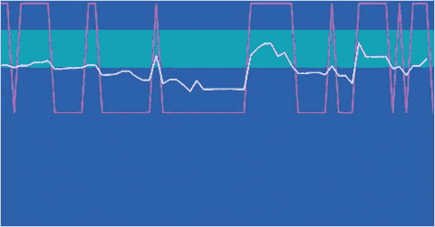

图 8-2. 范围内伪振荡器，范围内输出。白线表示输入信号，绿色表示范围，紫线表示 `in_range` 输出。

此外，输出锚点 `every_beat` 会在每次 `in_range` 输出从 0.0 变为 1.0 时触发一个单脉冲。作为后者的一个变体，输出锚点 `random_beat` 会在 `in_range` 输出从 0.0 变为 1.0 时，以随机方式触发单脉冲。“`randomness`”输入参数描述了触发率：只有当某个介于 0 和 100 之间的随机数落在 [0;`randomness`] 范围内时，该脉冲才会被触发。因此，这种随机脉冲的概率为“`randomness`”百分比。`every_beat` 输出的示例如图 8-3 所示。

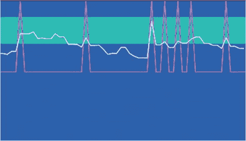

图 8-3. 范围内伪振荡器，节拍输出。白线表示输入信号，绿色表示范围，紫线表示 `every_beat` 输出。

#### `oscillator`

这取决于类型：可以是噪声、正弦、锯齿、方波、三角波或二次波振荡器。路径为 `Maths → Oscillators → Oscillator`。

详细来说，如果 `freq` 是频率 `f`，`amp` 是振幅，`ofs` 是偏移量；参见表 8-55。

表 8-55. 振荡器模块的类型

| 名称 | 类型 | 描述 |
| --- | --- | --- |
| `noise` | 噪声 | 将每频率秒从 [-1;+1] ∙ `amp` + `ofs` 范围内创建一个随机值 |
| `sin` | 正弦 | 对于 f = 1: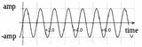`ofs` 将加到值上。注意：这不是数学上的 `sin(t)`，而是 `sin(t ∙ 2π)`，因此每 `t → t + 1` 有一个完整周期 |
| `saw` | 锯齿 | 对于 f = 1: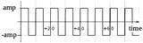`ofs` 将加到值上 |
| `square` | 方波 | 对于 f = 1: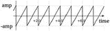`ofs` 将加到值上 |
| `triangle` | 三角波 | 对于 f = 1: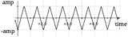`ofs` 将加到值上 |
| `quadratic` | 重复的半条抛物线曲线 | 对于 f = 1: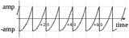`ofs` 将加到值上 |

此外，参数 `phase` 将加到时间上，这意味着水平移动曲线。这并不常用，如果不需要，可以保留其默认值 0 而无需关心。所有参数参见表 8-56。

表 8-56.

| `oscillator` | 一个振荡器 |
| --- | --- |
| 输入 | `osc:complex` | |
| | `osc_type: enum` | 振荡器类型；可以是 `noise`， `sin`， `saw`， `square`， `triangle` 或 `quadratic`。 |
| | `freq:float` | 频率（1/s） |
| | `amp:float` | 振幅；振荡器值将位于 [-amp; +amp] + `ofs` 范围内 |
| | `ofs:float` | 偏移量；振荡器值将位于 [-amp; +amp] + `ofs` 范围内 |
| | `phase:float` | 为时间参数增加一个值 |
| | `options:complex` | | |
| | `time_source: enum` | 时间源（隐藏输入参数）。可选值： − `operating_system`：将使用操作系统计时器 − `sequence`：将使用序列计时器，即可能会减去序列间隙 |
| | `drive_type: enum` | 时间模式（隐藏输入参数）。可选值： − `time_internal_absolute`：传递引擎启动以来经过的绝对时间 − `time_internal_relative`：传递引擎启动以来用于渲染工作经过的时间。 − `external`：使用 `drive` 参数。 |
| | `drive:float` | 当 `drive_type` 为 `external` 时使用的时间参数。这样你可以有自己的时间概念。 |
| 输出 | `float:float` | 振荡器值，始终位于 [-amp; +amp] + `ofs` 范围内 |

#### `pulse_oscillator`

重复提供可调整形状和长度的脉冲。请注意，它仅在触发器被激活时才开始产生输出。路径为 `Maths → Oscillators → pulse_oscillator`。可能的形状如表 8-57 所示。

表 8-57. 脉冲类型

| 三角波 | 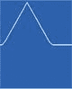 |
| --- | --- |
| 方波 |  |
| 余弦波 | 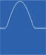 |
| 高斯波 | 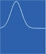 |

参数见表 8-58。

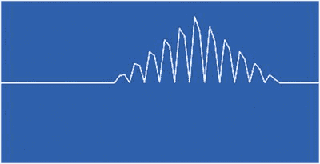

图 8-4. 类型为“三角波”的脉冲振荡器，带有包络输入信号。

表 8-58.

| `pulse_oscillator` | |
| --- | --- |
| 输入 | `in_signal:float` | 默认为 1.0。你可以用它让脉冲包络一个输入信号，见图 8-4。 |
| | `trigger:float` | 默认为 0.0。仅当 `trigger > 0` 时，脉冲振荡器才会运行。 |
| | `osc:complex` | |
| | `freq:float` | 脉冲的频率（1/秒）。 |
| | `pulse_type: enum` | 脉冲类型。可选值：`triangle`， `square`， `cosine` 或 `gauss`。 |
| | `pulse_width: float` | 脉冲的宽度（以秒为单位）。对于三角波、方波和余弦形状，宽度是明确的。对于高斯类型，宽度是从 -3σ 到 3σ（请在你最喜欢的搜索引擎中搜索“正态分布”）。 |
| | `time_source: enum` | 时间源（隐藏输入参数）。可选值： − `operating_system`：将使用操作系统计时器 − `sequence`：将使用序列计时器，即可能会减去序列间隙 |
| 输出 | `result1:float` | 振荡器值，始终位于 [0;`in_signal`] 范围内 |

## Mesh

网格是定义 3D 对象表面或面的点的集合。

### 哑元

哑元仅将其网格输入转发到输出。如果你需要将一个网格传递到宏的内部，并且有多个消费者，这非常有用。路径为 `Mesh → Dummies → mesh_dummy`。参见表 8-59。

表 8-59.

| `mesh_dummy` | 仅将其网格输入传递到输出 |
| --- | --- |
| 输入 | `mesh_in:mesh` | 输入网格 |
| 输出 | `mesh_out:mesh` | 输出网格 |

#### 生成器

生成器用于产生像素数据。路径为 `Mesh → Generators`。请参见表 8-60 至 8-63。

**表 8-63.**

| `xtra → kaleido_mesh` | 类似双曲碗的网格 |
| --- | --- |
| 输入 | `Hemispheric: float` | 碗的形状。`0.0` 为平面，`1.0` 类似半球，大于 `1.0` 则会进一步挤压 |
| 输出 | `mesh_out: mesh` | 输出网格 |

**表 8-62.**

| `ribbon` | 一条扭曲的 3D 带状物，随时间变化 |
| --- | --- |
| 输入 | `spatial` |  |
|  | `start_point: float3` | 带状物的起始位置 |
|  | `end_point: float3` | 带状物的结束位置 |
|  | `up_vector: float3` | 用于倾斜的上向量 |
|  | `shape` |  |
|  | `width:float` | 带状物宽度 |
|  | `skew_amp: float` | 倾斜幅度 |
|  | `time_amp: float` | 形状变化幅度 |
|  | `time_source: enum` | 可选 `sequence` 或 `real`。若为 `sequence`，则使用序列化时间（需手动启动）。若为 `real`，则使用 ThMAD 启动以来的实际时间。 |
|  | `segm_count: float` | 绘制带状物的分段数 |
| 输出 | `mesh:mesh` | 输出网格 |

**表 8-61.**

| `ocean_tunnel` | 分类：特殊效果。使用 `ocean` 模块的海洋模拟，但将计算出的坐标映射到一个管状物上 |
| --- | --- |
| 输入 | `time_spec:float` | 运动的时间缩放因子 |
| 输出 | `mesh:mesh` | 输出网格 |

**表 8-60.**

| `ocean` | x-z 平面（`y=0`）上的海洋 |
| --- | --- |
| 输入 | `time_speed: float` | 表面运动的时间缩放 |
|  | `lambda:float` | 控制波浪速度 |
|  | `wind_speed_x: float` | 模拟风速的 x 坐标 |
|  | `wind_speed_y: float` | 模拟风速的 y 坐标 |
|  | `normals_only: enum` | 设为 `yes` 或 `no`。若为 `yes`，则使用一个略有不同的算法，忽略 x-z 方向上的扭曲。 |
| 输出 | `mesh:mesh` | 输出网格 |

### 导入器

导入 Cal3D 或 Blender 文件。路径为 `Mesh → Importers`。请参见表 8-64 和 8-65。

**表 8-65.**

| `obj_importer` | 导入 Blender 的 `*.obj` 文件（Blender 是一款工业级 3D 创作软件） |
| --- | --- |
| 输入 | `filename:resource` | 要导入的 `*.obj` 文件。`examples/meshes` 资源文件夹中包含一些示例 |
|  | `preserve_uv_ coords:enum` | 设置为 `NO` 或 `YES`，决定是否同时从文件中读取纹理 UV 坐标 |
|  | `center_` `object` `: enum` | 设置为 `NO` 或 `YES`，决定是否将对象居中于原点（使用质心算法） |
| 输出 | `mesh:mesh` | 输出网格 |

**表 8-64.**

| `cal3d_importer` | 导入一个 `cal3d` 项目。示例位于 `examples` 文件夹中的 `examples/dolphin` 状态 |
| --- | --- |
| 输入 | `filename:resource` | 指向 Cal3D 的 `*.cfg` 文件 |
|  | `use_thread:enum` | 设置为 `yes` 或 `no`。决定是否在后台进行网格生成 |
|  | `transforms: complex` |  |
|  | `pre_rotation: quaternion` | 描述加载过程中的预旋转。 |
|  | `pre_rotation_ center:float` | 预旋转的中心 |
|  | `rotation:` | 导入后的旋转 |
|  | `quaternion` |  |
|  | `rotation_center: float3` | 旋转的中心 |
|  | `post_rot_ translate:float3` | 导入后的平移 |
|  | `bones:complex` | 允许调整 Cal3D 模型的各种参数 |
| 输出 | `mesh:mesh` | 输出网格 |
|  | `bones_bounding_ box:mesh` | 骨骼的边界框 |
|  | `absolutes:complex` | 与 `bones` 输入锚点对应的输出 |

### 修改器：颜色

与网格顶点颜色相关的模块。路径为 `Mesh → Modifiers → Color`。请参见表 8-66。

**表 8-66.**

| `mesh_colorfield` | 根据颜色场设置顶点颜色。给定一个向量 A→B，所有顶点投影到该向量上，其在向量上的位置决定了在插值 RGBA 颜色梯度中的位置。若超出范围，将应用模运算（重复） |
| --- | --- |
| 输入 | `mesh_in: mesh` | 输入网格 |
|  | `start_pos:float3` | 颜色场的起始位置 |
|  | `color_from:float4` | 起始位置的颜色 |
|  | `end_pos:float3` | 颜色场的结束位置 |
|  | `color_to:float4` | 结束位置的颜色 |
| 输出 | `mesh_out:mesh` | 输出网格 |

### 修改器：转换器

转换网格数据。路径为 `Mesh → Modifiers → Converters → mesh_to_float3_arrays`。请参见表 8-67。

**表 8-67.**

| `mesh_to_float3_arrays` | 将网格转换为对应的 `float3` 数组。由于没有模块拥有 `float3_array` 输入，该模块目前用途不大 |
| --- | --- |
| 输入 | `mesh_in: mesh` | 输入网格 |
| 输出 | `vertices: float3_array` | 网格的顶点 |
|  | `vertex_normals: float3_array` | 顶点法线 |
|  | `face_normals: float3_array` | 面法线 |
|  | `face_centers: float3_arrays` | 面的中心点 |

### 修改器：变形器

用于修改网格坐标的模块。路径为 `Mesh → Modifiers → Deformers`。请参阅表 8-68 至 8-74。

表 8-74.

| `mesh_vortex` | 此模块正在构建中，尚未开放使用 |

表 8-73.

| `mesh_vertex_move` | 此模块正在构建中，尚未开放使用 |

表 8-72.

| `mesh_rain_down` | 模拟粒子的下落或坠落效果 |
| --- | --- |
| 输入 | `mesh_in:mesh` | 输入网格。 |
| | `start:float` | 控制效果的触发时间（`start > 0`）和效果强度（爆炸与下落速度）。 |
| | `floor_level:float` | 下落停止的 Y 轴位置。 |
| | `explosion_factor:float` | 粒子（输入网格的分解部分）在 X-Z 平面上的爆炸程度。默认值为 `1.0`（无爆炸），数值越高，爆炸强度越大。 |
| | `landing_` | 着陆，即运动的最终阶段 |
| | `fluffiness:` | 沿 Y 轴方向，可按此参数调整 |
| | `float` | 输入参数。默认值为 `0.0`，表示关闭；数值越高，会根据每个粒子的大小按权重降低 `floor_level` 参数。 |
| 输出 | `mesh_out: mesh` | 输出网格 |

表 8-71.

| `mesh_normal_randistort` | 随机扭曲顶点坐标和/或顶点法线。若仅扭曲法线，可添加有趣的光照效果，因为法线控制光的反射 |
| --- | --- |
| 输入 | `mesh_in_mesh` | 输入网格 |
| | `distortion_factor:float3` | X、Y、Z 三个维度上的随机扭曲因子 |
| | `distort_normals:enum` | 设置为 `no` 或 `yes`，决定是否扭曲法线（会显著影响光反射率） |
| | `distort_vertices:enum` | 设置为 `no` 或 `yes`，决定是否扭曲顶点坐标 |
| | `vertex_distortion_factor:float` | 若同时扭曲法线和顶点，则使用此参数控制顶点扭曲的相对程度 |
| 输出 | `mesh_out: mesh` | 输出网格 |

表 8-70.

| `mesh_noise` | 向顶点坐标添加噪点。法线、纹理坐标和面分配保持不变 |
| --- | --- |
| 输入 | `mesh_in:mesh` | 输入网格 |
| | `noise:amount: float3` | 每个方向上的噪点量 |
| 输出 | `mesh_out: mesh` | 输出网格 |

表 8-69.

| `mesh_inflate` | 此模块正在构建中，尚未开放使用 |

表 8-68.

| `mesh_explode` | 将网格炸开。破坏网格的边界组成结构，使其四分五裂 |
| --- | --- |
| 输入 | `mesh_in:mesh` | 输入网格 |
| | `start:float` | 爆炸触发器。一旦设置为 `> 0` 的值，爆炸即开始。该参数值控制爆炸粒子的速度。数值越高，速度越快。若设置为 `< 0`，则返回未爆炸的网格重新开始 |
| | `explosion_factor:float` | 乘以爆炸速度的因子（可将 `start` 设为 `1.0`，仅用此参数控制速度） |
| | `velocity_deceleration:float` | 控制爆炸后粒子减速的程度 |
| | `use_weights: enum` | 设置为 `no` 或 `yes`。若为 `yes`，则爆炸后每个粒子的权重由其空间范围计算得出，该权重将影响粒子飞散的速度 |
| | `weight_power:float` | 若启用权重，则控制其影响程度。若大于 `1`，则小型粒子的权重差异影响不大 |
| 输出 | `mesh_out:mesh` | 输出网格 |

关于 `mesh_rain_down` 模块：给定一个输入网格，此变形器会将其所有部分分解，并使其沿 Y 轴向下爆炸和移动，直至到达某个地面高度。因此，它可以模拟从云中落下的雨滴效果。

如果你需要不同方向的运动，可以在输入前使用位于 `Mesh → Modifiers → Transforms → mesh_rotate_quat` 的旋转模块，并在输出后使用另一个 `mesh_rotate_quat` 将其旋转回来。模块 `mesh_rotate_quat` 使用四元数来指定旋转角度。如果你更倾向于轴角旋转表示法，可以使用转换器模块 `Maths → Arithmetic → Quaternion → axis_angle_to_quaternion`。示例请参见图 8-5。

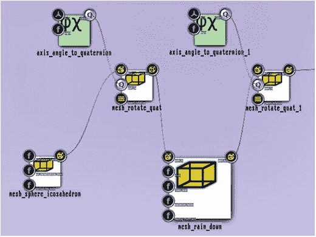

图 8-5. 应用了旋转变换的 `mesh_rain_down` 模块