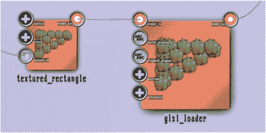

# 修改器：辅助器

用于网格的辅助模块。路径为`Mesh → Modifiers → Helpers`。请参阅表 8-75 和 8-76。

表 8-76.

| `mesh_compute_tangents_vertex_color_array` | 计算顶点的切线并存储到颜色数组中，可在着色器中使用 |
| --- | --- |
| 输入 | `mesh_in:mesh` | 输入网格 |
| 输出 | `mesh_out:mesh` | 输出网格 |

表 8-75.

| `mesh_compute_tangents` | 此模块正在构建中，尚未开放使用 |

## 修改器：拾取器

用于从网格中提取数值。路径为`Mesh → Modifiers → Pickers`。请参阅表 8-77 和 8-78。

表 8-78.

| `mesh_vertex_picker` | 获取特定网格顶点的完整数据 |
| --- | --- |
| 输入 | `mesh_in:mesh` | 输入网格 |
| | `id:float` | 整数部分表示网格顶点 ID（0, 1, 2, …） |
| 输出 | `vertex:float3` | 顶点坐标 |
| | `normal:float3` | 该顶点处的法线向量 |
| | `color:float4` | 该顶点处的颜色 |
| | `texcoords:float3` | 该顶点处的纹理坐标 |
| | `passthru:mesh` | 输出网格。注意，必须将此端口连接至一个能产生结果的渲染子流程，模块才能正常工作。只需将其放置于网格生成器和预期的网格消费者（如渲染器）之间即可 |
| | `sizes:complex` | 网格数组大小 |
| | | `vertices_size: float` | 顶点数量 |
| | | `normals_size: float` | 顶点法线数量 |
| | | `colors_size: float` | 顶点颜色数量 |
| | | `faces_size: float` | 面数量 |

表 8-77.

| `mesh_attach_picker` | 给定两个顶点 ID，返回 ID1 的坐标和一个旋转四元数，该四元数描述为沿 ID1 法线方向观察，并使 ID2-ID1 方向保持水平所需的旋转 |
| --- | --- |
| 输入 | `mesh_in:mesh` | 输入网格 |
| | `id_a:float` | 整数部分指向顶点 A（0, 1, 2, …） |
| | `id_b:float` | 整数部分指向顶点 B（0, 1, 2, …） |
| 输出 | `position:float3` | 顶点 A 的坐标 |
| | `rotation: quaternion` | 由 A 点法线及从 A 到 B 的向量定义的旋转向量 |

`mesh_attach_picker` 和 `mesh_vertex_picker` 模块都可以用于让可视化操作扫描网格的顶点，并根据获取的坐标执行操作。请注意，如果不需要使用旋转四元数，则在使用 `mesh_attach_picker` 时不必指定第二个顶点 ID。

## 修改器：变换

用于修改顶点数据。路径为`Mesh` → `Modifiers` → `Transforms`。请参见表格 8-79 至 8-85。

表 8-85.

| `mesh_translate_ edge_wraparound` | 执行顶点平移，但在达到某些限制坐标值时进行回绕 |
| --- | --- |
| 输入 | `mesh_in:mesh` | 输入网格 |
| | `translation: float3` | 平移量 |
| | `edge_min: float3` | 定义了当边缘坐标小于该值时，发生坐标回绕的 x、y、z 值 |
| | `edge_max: float3` | 定义了当边缘坐标大于该值时，发生坐标回绕的 x、y、z 值 |
| 输出 | `mesh_out: mesh` | 输出网格 |

表 8-84.

| `mesh_translate` | 平移网格 |
| --- | --- |
| 输入 | `mesh_in:mesh` | 输入网格 |
| | `translation: float3` | 平移向量 |
| 输出 | `out_mesh: mesh` | 输出网格 |

表 8-83.

| `mesh_scale` | 执行缩放 |
| --- | --- |
| 输入 | `mesh_in:mesh` | 输入网格 |
| | `scale:float3` | 每个维度的缩放因子 |
| 输出 | `mesh_out: mesh` | 输出网格 |

表 8-82.

| `mesh_rotate_quat_ around_vertex` | 围绕网格的一个顶点旋转该网格。随后可再进行平移 |
| --- | --- |
| 输入 | `mesh_in:mesh` | 输入网格 |
| | `quat_in: quaternion` | 描述旋转的四元数 |
| | `vertex_rot_id: float` | 整数部分指示围绕哪个顶点进行旋转。值为 0, 1, 2, … |
| | `offset_pos: float3` | 旋转后的附加平移 |
| 输出 | `out_mesh: mesh` | 输出网格 |

表 8-81.

| `mesh_rotate_quat` | 通过旋转四元数旋转网格 |
| --- | --- |
| 输入 | `mesh_in:mesh` | 输入网格 |
| | `quat_in: quaternion` | 旋转四元数（如需通过轴角旋转控制，请使用`Maths` → `Arithmetic` → `Functions` → `axis_angle_to_quaternion`模块） |
| | `invert_rotation: enum` | 设置为`no`或`yes`，是否反转旋转 |
| 输出 | `mesh_out:out` | 输出网格 |

表 8-80.

| `mesh_norm_scale` | 缩放并移动网格，使其所有顶点位于 [0;1] 内。保持尺寸比例（最大跨度将为 [0;1]） |
| --- | --- |
| 输入 | `mesh_in:mesh` | 输入网格 |
| 输出 | `mesh_out: mesh` | 输出网格 |

表 8-79.

| `mesh_mirror` | 镜像网格 |
| --- | --- |
| 输入 | `mesh_in:mesh` | 输入网格 |
| | `axis:enum` | 镜像轴，可选`x`、`y`或`z`之一。 |
| 输出 | `mesh_out: mesh` | 输出网格 |

## 粒子

与二维粒子系统相关的简单网格。路径为`Mesh` → `Particles`。请参见表格 8-86 至 8-88。

表 8-88.

| `mesh_star` | 此模块正在建设中，尚不可用 |

表 8-87.

| `mesh_rays` | 从 (0,0,0) 开始、达到某个大小限制的随机扇形三角形 |
| --- | --- |
| 输入 | `num_rays:float` | 射线数量 |
| | `center_color: float4` | 指定的中心颜色 |
| | `options / limit_ray_size` | 若 < 0，则最大射线大小为 1.0。否则使用此处给定的限制值。 |
| 输出 | `mesh:mesh` | 输出网格 |

表 8-86.

| `mesh_disc` | 圆盘或圆环。如果与基本网格渲染器一起使用，请注意纹理将分布在整个周长上。如果不需要，可以尝试使用`use_tex_center`参数 |
| --- | --- |
| 输入 | `num_segments: float` | 沿周长生成的段数 |
| | `diameter:float` | 孔的直径。如果希望得到一个圆盘而非圆环，请将其设为零 |
| | `border_width: float` | 圆环的宽度。如果直径为零，则为圆盘的半径。 |
| | `use_tex_center: enum` | 设置为`no`或`yes`。如果为`yes`，则不将纹理分布到整个周长，而是仅使用中心部分，从而使该纹理实际上被一维使用。 |
| 输出 | `mesh:mesh` | 输出网格 |

## Segmesh

`mesh` → `segmesh` 下的 Segmesh 模块正在建设中，尚不可用。

## 实体

使用网格生成三维实体。路径为`Mesh` → `Solid`。请参见表格 8-89 至 8-102。

表 8-102.

| `plane_uv_distort` | 一个位于 z=0、尺寸为 [-1;-1] 到 [1;1] 的 xy 平面，通过序列控制器实现纹理坐标扭曲 |
| --- | --- |
| 输入 | `x_res:float` | 该数值的整数部分为 x 方向的分辨率 |
| | `y_res:float` | 该数值的整数部分为 y 方向的分辨率 |
| | `distortion: complex` |     |
| | `x_shape: sequence` | 描述沿 x 轴的扭曲。如果序列内所有值都设为 0.5，则不会发生扭曲。小于 0.5 表示负扭曲，大于 0.5 表示正扭曲 |
| | `x_shape_ multiplier:float` | 应用于 x 方向扭曲值的乘数 |
| | `z_shape: sequence` | 描述沿 y 轴的扭曲（不要被名称误导；名称有误但为向后兼容而保留） |
| | `z_shape_ multiplier:float` | 应用于 y 方向扭曲值的乘数 |
| 输出 | `mesh:mesh` | 输出网格 |

表 8-101.

| `metaballs` | 显示元球。这是一个等势面的物理模拟。功能可用但当前存在错误，会显示一些伪影 |
| --- | --- |
| 输入 | `grid_size:float` | 分辨率 |
| 输出 | `mesh:mesh` | 输出网格 |

表 8-100.

| `mesh_torus_knot` | 环面纽结。这是一个位于环面表面、可能具有多次环绕的纽结 |
| --- | --- |
| 输入 | `num_sectors:float` | 沿周长的扇区数 |
| | `num_stacks:float` | 沿其长度的段数 |
| | `p:float` | P 参数化 |
| | `q:float` | Q 参数化 |
| | `phi_offset:float` | 角度偏移 |
| | `size` |     |
| | `size_shape_x: sequence` | 第一个径向分量沿长度的尺寸 |
| | `size_shape_x_ multiplier:float` | 应用于`size_shape_x`序列的因子 |
| | `size_shape_y: sequence` | 第二个径向分量沿长度的尺寸 |
| | `size_shape_y_ multiplier:float` | 应用于`size_shape_y`序列的因子 |
| 输出 | `mesh:mesh` | 输出网格 |

表 8-99.

| `mesh_super_banana` | 一个可塑的、可能呈香蕉形状的网格。请注意，必须先设置形状才能看到任何内容 |
| --- | --- |
| 输入 | `num_sectors:float` | 沿周长的扇区数 |
| | `num_stacks:float` | 沿其长度方向的层数 |
| | `shape:complex` |     |
| | `x_shape:` `sequence` | 沿一个径向维度的序列 |
| | `x_shape_ multiplier:float` | x 形状的乘数 |
| | `y_shape: sequence` | 沿另一个径向维度的序列 |
| | `y_shape_ multiplier:float` | y 形状的乘数 |
| | `z_shape: sequence` | 沿长度维度的序列 |
| | `z_shape_ multiplier:float` | z 形状的乘数 |
| | `size:complex` |     |
| | `size_shape_x: sequence` | 一个半径沿长度维度的尺寸形状 |
| | `size_shape_x_ multiplier:float` | 一个半径沿长度维度的尺寸形状的乘数 |
| | `size_shape_y: sequence` | 另一个半径沿长度维度的尺寸形状 |
| | `size_shape_y_ multiplier:float` | 另一个半径沿长度维度的尺寸形状的乘数 |
| 输出 | `mesh:mesh` | 输出网格 |

表 8-98.

| `mesh_sphere_octahedron` | 一个具有更规则细分方式的球体。从八面体（8 个三角形面）开始，迭代地细分其每个部分（将一个三角形细分为四个），并将每个新点投影到球面上（只需将其拉伸到目标立方体的半径即可）。 |
| --- | --- |
| 输入 | `subdivision_level: float` | 细分的迭代次数。注意不要设置过大，否则 ThMAD 会崩溃。大于 9 的值将被忽略并自动限制为 9。 |
| 输出 | `max_normalization_level: float` | 法线重算可以配置为在特定级别停止，这会使表面在光线照射时产生更多凹凸感。 |
| 输出 | `mesh:mesh` | 输出网格 |

表 8-97.

| `mesh_sphere_icosahedron` | 一个具有更规则细分方式的球体。从二十面体（20 个三角形面）开始，迭代地细分其每个部分（将一个三角形细分为四个），并将每个新点投影到球面上（只需将其拉伸到目标立方体的半径即可）。 |
| --- | --- |
| 输入 | `subdivision_level: float` | 细分的迭代次数。注意不要设置过大，否则 ThMAD 会崩溃。默认值为 6，这在大多数情况下已足够。大于 7 的值将被忽略并自动限制为 7。 |
| 输出 | `max_normalization_level: float` | 法线重算可以配置为在特定级别停止，这会使表面在光线照射时产生更多凹凸感。 |
| 输出 | `initial_ico_scale: float` | 在开始细分之前缩放原始二十面体。这些点不会投影到球面上。当前存在一些小问题，会显示伪影。 |
| 输出 | `mesh:mesh` | 输出网格 |

表 8-96.

| `mesh_sphere` | 一个球体。使用用于地球仪的非常基础的直接细分算法 |
| --- | --- |
| 输入 | `num_sectors:float` | 经度方向的分段数 |
| 输出 | `num_stacks:float` | 纬度方向的分段数 |
| 输出 | `mesh:mesh` | 输出网格 |

表 8-95.

| `mesh_solid_supershape` | 通过组合幂函数和正弦函数形成的复杂形状 |
| --- | --- |
| 输入 | `x: complex` | 算法中使用的 X 和 Y 维度，目前均由此处处理 |
| 输出 | `x_num_segments:float` | 要生成的分段数。生成的顶点总数为该值的平方 |
| 输出 | `x_start:float` | 算法的一个角度参数 |
| 输出 | `x_stop:float` | 算法的一个角度参数 |
| 输出 | `y_start:float` | 算法的一个角度参数 |
| 输出 | `y_stop:float` | 算法的一个角度参数 |
| 输出 | `x_a:float` | 缩放因子 |
| 输出 | `x_b:float` | 缩放因子 |
| 输出 | `x_n1:float` | 幂参数 |
| 输出 | `x_n2:float` | 幂参数 |
| 输出 | `x_n3:float` | 幂参数 |
| 输出 | `x_m:float` | 算法中角度的因子 |
| 输出 | `mesh:mesh` | 输出网格 |

表 8-94.

| `mesh_planes` | 一组平行平面 |
| --- | --- |
| 输入 | `num_planes:float` | 平面数量 |
| 输出 | `space_between: float` | 相邻平面之间的距离 |
| 输出 | `diameter:float` | 一个平面的尺寸为 2 x 直径 乘以 2 x 直径 |
| 输出 | `normals:float3` | 指定每个平面在空间中的朝向。“法线”垂直于平面 |
| 输出 | `colors:complex` | |
| 输出 | `color_a:float4` | 每个平面在顶点 1 处的颜色 |
| 输出 | `color_b:float4` | 每个平面在顶点 2 处的颜色 |
| 输出 | `color_c:float4` | 每个平面在顶点 3 处的颜色 |
| 输出 | `color_d:float4` | 每个平面在顶点 4 处的颜色 |
| 输出 | `mesh:mesh` | 输出网格 |

表 8-93.

## 网格

| `mesh_grid` | 一个由小四边形组成的四边形网格。中心位于 (0;0;0)，网格大小为 1x1 |
| --- | --- |
| 输入 | `power_of_two_size:float` | 此值的二次幂即为每条边上的四边形数量。因此，如果此值为 4，则每边有 2⁴ = 16 个四边形，总共 16x16 = 256 个。 |
| 输出 | `plane:enum` | 可选值为 `xy`、`xz` 和 `yz`。网格的朝向。 |
| 输出 | `mesh:mesh` | 输出网格 |

表 8-92

| `mesh_cylinder` | 一个圆柱体 |
| --- | --- |
| 输入 | `start:float3` | 底面的中心 |
| 输出 | `end:float3` | 顶面的中心 |
| 输出 | `radius:float` | 半径 |
| 输出 | `segments:float` | 分段数 |
| 输出 | `mesh:mesh` | 输出网格 |

表 8-91

| `mesh_cone` | 一个圆锥体 |
| --- | --- |
| 输入 | `base:float3` | 圆锥底面的中心 |
| 输出 | `peak:float3` | 圆锥的顶点 |
| 输出 | `radius:float` | 底面的半径 |
| 输出 | `segments:float` | 分段数 |
| 输出 | `mesh:mesh` | 输出网格 |

表 8-90

| `mesh_box` | 一个由六个四边形面组成的立方体。线性尺寸始终为 [-0.5;0.5] |
| --- | --- |
| 输出 | `mesh:mesh` | 输出网格 |

表 8-89

| `mesh_arrow` | 一个箭头 |
| --- | --- |
| 输入 | `start:float3` | 起始位置 |
| 输出 | `end:float3` | 结束位置 |
| 输出 | `radius:float` | 箭杆的半径 |
| 输出 | `segments:float` | 分段数 |
| 输出 | `head_size:float` | 箭头头部占整个长度的比例 |
| 输出 | `mesh:mesh` | 输出网格 |

## 纹理

这些模块用于网格的纹理坐标操作。路径为“网格 → 纹理”。请参见表 8-103 和 8-104。

| `mesh_tex_sequ_distort` | 使用序列描述纹理坐标扭曲 |
| --- | --- |
| 输入 | `mesh_in:mesh` | 输入网格 |
| 输出 | `spatial:complex` | |
| 输出 | `scale_u:float` | 额外的纹理 u 坐标缩放因子 |
| 输出 | `scale_v:float` | 额外的纹理 v 坐标缩放因子 |
| 输出 | `translate_u: float` | 额外的纹理 u 坐标平移量 |
| 输出 | `translate_v: float` | 额外的纹理 v 坐标平移量 |
| 输出 | `distortion: complex` | |
| 输出 | `u_shape: sequence` | 描述纹理 u 坐标的扭曲 |
| 输出 | `v_shape: sequence` | 描述纹理 v 坐标的扭曲 |
| 输出 | `mesh_out: mesh` | 输出网格 |

表 8-104

| `mesh_tex_bitmap_distort` | 使用位图描述纹理坐标扭曲 |
| --- | --- |
| 输入 | `mesh_in:mesh` | 输入网格 |
| 输出 | `bitmap:bitmap` | 位图。仅使用红色和绿色通道。红色描述纹理的 U 方向扭曲，绿色描述 V 方向扭曲。值为 0.5 表示无扭曲。 |
| 输出 | `intensity:float` | 控制效果的总体强度 |
| 输出 | `spatial:complex` | 额外的扭曲参数 |
| 输出 | `u_off:float` | 纹理 u 坐标偏移量 |
| 输出 | `v_off:float` | 纹理 v 坐标偏移量 |
| 输出 | `u_scale:float` | 纹理 u 坐标缩放因子 |
| 输出 | `v_scale:float` | 纹理 v 坐标缩放因子 |
| 输出 | `mesh_out: mesh` | 输出网格 |

表 8-103

### Vertices

通过算法定义网格。路径为 Mesh → Vertices。参见表 8-105 至 8-109。

#### Xtra

一些特殊的网格生成器和修改器。路径为 Mesh → Xtra。参见表 8-110 至 8-112。

**表 8-112**

| `thorn` | 生成一个彩色的刺 |
| --- | --- |
| 输出 | `mesh_result:mesh` | 输出网格 |

**表 8-111**

| `planeworld` | 与 mesh → vertices → `random_vertices` 配合使用作为输入，创建一个具有完整网格属性的复杂结：顶点、颜色、纹理坐标、面。 |
| --- | --- |
| 输入 | `bspline_vertices_mesh:mesh` | 输入网格。你不必在这里使用 `bspline_vertices` 模块的输出！B 样条是在内部计算的。 |
| 输出 | `mesh_result:mesh` | 输出网格 |

**表 8-110**

| `cloud_plane` | 一个彩色的云平面 |
| --- | --- |
| 输出 | `mesh_out:mesh` | 输出网格 |

**表 8-109**

| `ribbon_vertices` | 一条扭曲的带状物。随时间变化。类似于 mesh → generators → `ribbon`，但不会创建面，因此 `mesh_basic_render` 模块无法处理它。 |
| --- | --- |
| 输入 | `start_point:float3` | 起始点 |
| | `end_point:float3` | 终止点 |
| | `up_vector:float3` | 上向量，定义其运动方向 |
| | `num_segments:float` | 段数 |
| | `particle_scale:float` | 影响着色。着色从黑色到白色，如果将此值设置为小于 1.0，则为灰色。 |
| | `width:float` | 控制带状物的宽度 |
| | `skew_amp:float` | 倾斜幅度 |
| | `time_amp:float` | 扭曲的时间尺度 |
| 输出 | `mesh:mesh` | 输出网格 |

**表 8-108**

| `random_vertices` | 生成随机顶点 |
| --- | --- |
| 输入 | `rand_seed:float` | 随机种子。如果需要不同的分布，请更改此值。 |
| | `num_points:float` | 点数 |
| | `scaling:float3` | 缩放 |
| | `distrib:enum` | 分布：`box`：在盒子内均匀分布。`sphere`：在球体表面均匀分布。`bowl`：在球体内均匀分布。`gauss`：3D 高斯分布。`gauss2d`：2D 高斯分布，z = 0。 |
| 输出 | `mesh:mesh` | 输出网格 |

**表 8-107**

| modifiers → `mesh_vertex_distance_sort` | 从输入网格中获取顶点，并根据它们到给定点的距离进行排序（最远的优先）。输出不包含颜色或面；也没有纹理坐标！因此 `mesh_basic_render` 模块无法处理它。 |
| --- | --- |
| 输入 | `mesh_in:mesh` | 输入网格。不会被修改。 |
| | `distance_to:float3` | 用于测量距离的点。 |
| 输出 | `mesh_out:mesh` | 输出网格。无颜色、法线或面；仅包含顶点。 |
| | `original_ids:float_array` | 排序后输入网格的 ID。 |

**表 8-106**

| `lightning_vertices` | 等离子球效果 |
| --- | --- |
| 输入 | `rand_seed:float` | 一些随机种子。更改此值以获得不同的形状。通常你需要将其发送到 `mesh_dot_render` 模块进行渲染，因为此模块不生成法线或面。 |
| | `lifetime:float` | 增加此值以使模拟更平缓。 |
| | `length:float` | 闪电的长度。 |
| | `mesh_a:mesh` | 输入网格。来自此处的顶点用作闪电的起始点。此处的法线用于闪电的主要方向。 |
| | `num_points:float` | 闪电顶点数。 |
| | `scaling:float3` | 使用此参数控制效果的范围。 |
| | `sub_divide:float` | 为闪电的每个部分生成这么多点。如果使用点渲染器，增加此值是合理的。 |
| 输出 | `mesh:mesh` | 输出网格 |

**表 8-105**

| `bspline_vertices` | 获取输入网格的顶点，并使用它们来驱动 B 样条管线。请注意，输出网格不包含任何法线或面，因此 `mesh_basic_render` 模块无法处理它。 |
| --- | --- |
| 输入 | `source:mesh` | 输入网格 |
| | `density:float` | 密度：为每对顶点生成的点数。 |
| 输出 | `mesh:mesh` | 输出网格 |

## Particlesystems

粒子系统处理大量小尺寸对象。它们以某种方式弥补了状态内部缺少循环构造的问题。

### Fractals

分形是几何对象或具有某些与分形相关的特殊数学属性的对象集合。这里的一个模块使用迭代函数系统算法生成分形。路径为 Particlesystems → Fractals。参见表 8-113。

**表 8-113**

| `ifs_modifier` | 根据迭代函数系统（IFS）持续改变粒子的坐标。即 x → f(x) → f(f(x)) → f(f(f(x))) 等等。这里的函数 f 是两个仿射映射的随机混合。 |
| --- | --- |
| 输入 | `in_particlesystem:particlesystem` | 输入粒子系统 |
| | `change_probab:float` | 如果只想每帧（1/60 秒）更改一部分粒子，请将此值设置为小于 1.0。 |
| | `change_random:enum` | 这是一个触发器。选择 `go` 将生成并使用一个随机的 IFS 参数集。请注意，只有一小部分随机生成的参数集会产出可用结果。 |
| | `save_params:enum` | 一个触发器，将当前参数集保存到 `/home/[USER]/thmad/[VERSION]/data/resources/ifs` 文件，以便在未来的状态中使用。 |
| | `load_params:resource` | 加载以前保存的参数集。此锚点的值不会被持久化，因此是一次性设置操作。当然，此处获取的参数将会被持久化。 |
| | `ifs:complex` | 当前参数集：两个仿射变换。算法以相等的概率在它们之间随机切换。 |
| | `sys1:complex` | 第一个系统。 |
| | `sys2:complex` | 第二个系统。 |
| 输出 | `particlesystem:particlesystem` | 输出粒子系统 |

#### 生成器

生成器用于产生粒子。路径为 `Particlesystems` → `Generators`。请参考表 8-114 至 8-116。

## 表 8-116

| `particles_mesh_spray` | 类似于 `basic_spray_emitter`，但使用网格作为粒子的运动原点 |
| --- | --- |
| 输入 | `num_particles:float` | 粒子总数 |
|   | `particles_per_second:float` | 若未设置为 -1，此数字指定当粒子死亡后，每秒可被复活的粒子最大数量。 |
|   | `mesh_properties:complex` | 网格属性仅在粒子生成或复活时生效 |
|   |   | `pick_type:enum` | 取值为 `sequential` 或 `random`。决定如何从网格中选择顶点作为粒子运动原点。 |
|   |   | `center:float3` | 所有粒子的公共平移向量 |
|   |   | `spread:float3` | 在将坐标添加到粒子最终位置时，应用于输入顶点位置坐标的乘数 |
|   |   | `random_deviation:float3` | 指定计算粒子位置时的随机程度 |
|   | `spatial:complex` |   |
|   |   | `speed_type:enum` | 如何计算速度：取以下之一： − `random_balanced`：对于每个坐标，速度将来自 `rnd[-0.5;0.5]` ∙ `speed_*` ∙ `speed_mult` − `directional`：取 `speed_mult` ∙ `speed_*` − `mesh_beam`：取 `speed_mult` `origin_to_vertex + add_vector` 其中 `rnd[a;b]` 指定 a 和 b 之间的随机数，`origin_to_vertex` 为从原点指向顶点的归一化向量。 |
|   |   | `speed_multiplier:float` | 速度乘数 (`speed_mult`) |
|   |   | `speed_random_value:float` | 一个随机值 [-0.5;0.5] 的乘数，该值会加到 `speed_mult` 上 |
|   |   | `speed:complex` | 指定粒子发射时开始运动的速度。其解释方式由 `speed_type`、`speed_multiplier` 和 `speed_random_value` 指定 |
|   |   |   | `speed_x:float` |
|   |   |   | `speed_y:float` |
|   |   |   | `speed_z:float` |
|   |   | `add_vector:float3` | `add_vector` 仅适用于 `speed_type` = `mesh_beam` |
|   |   | `size:complex` | 每个粒子的大小计算：`size = size_base + rnd[-0.5;0.5]` ∙ `random_weight` |
|   |   |   | `particle_size_base:float` |
|   |   |   | `particle_size_random_weight:float` | 其中 `rnd[a;b]` 指定 a 和 b 之间的随机数。 |
|   | `appearance:complex` |   |
|   |   | `color:float4` | 粒子颜色 |
|   |   | `time:complex` | 每个粒子的生命周期：`lifetime = lifetime_base + rnd[-0.5;0.5]` ∙ `random_weight` 其中 `rnd[a;b]` 指定 a 和 b 之间的随机数。 |
|   |   |   | `particle_lifetime_base:float` |
|   |   |   | `particle_lifetime_random_weight:float` |
|   |   | `time_source:enum` | 从何处获取时间。取值为 `real` 或 `sequencer`。对于简单状态，使用 `real` |
| 输出 | `particlesystem:particlesystem` | 输出粒子系统 |

## 表 8-115

| `bitmap_to_particlesystem` | 一个使用位图像素作为运动原点和颜色的粒子系统 |
| --- | --- |
| 输入 | `bitmap_in:bitmap` | 输入位图 |
| | `particles_per_second:float` | 若未设置为 -1，此数字指定当粒子死亡后，每秒可被复活的粒子最大数量。 |
| | `spatial:complex` | |
| | | `bitmap_size:float` | 从坐标原点视角来看的位图大小 |
| | | `bitmap_normal:float3` | 法线，指定位图在空间中的朝向 |
| | | `bitmap_upvector:float3` | 位图绕法线向量的旋转 |
| | | `bitmap_position:float3` | 位图中心的位置 |
| | | `speed:complex` | 指定粒子发射时开始运动的速度 |
| | | | `speed_x:float` |
| | | | `speed_y:float` |
| | | | `speed_z:float` |
| | | `speed_type:enum` | 速度参数的应用方式。若为 `random_balanced`，例如 `speed-x` 将从 `[- speed_x/2;speed_x/2]` 中随机选择。若为 `directional`，则按指定值直接采用速度 |
| | | `size:complex` | 每个粒子的大小计算：`size = size_base + rnd[-0.5;0.5]` ∙ `random_weight` |
| | | | `particle_size_base:float` |
| | | | `particle_size_random_weight:float` | 其中 `rnd[a;b]` 指定 a 和 b 之间的随机数。 |
| | | `time_source:enum` | 从何处获取时间。取值为 `real` 或 `sequencer`。对于简单状态，使用 `real`。 |
| | | `particle_rotation_dir:quaternion` | 若启用粒子旋转，使用此项指定旋转方向。 |
| | | `enable_rotation` | 是否启用旋转：取值为 `true` 或 `false` |
| | `appearance:complex` | |
| | | `color:float4` | 颜色 |
| | | `time:complex` | 每个粒子的生命周期：`lifetime = lifetime_base + rnd[-0.5;0.5]` ∙ `random_weight` 其中 `rnd[a;b]` 指定 a 和 b 之间的随机数。 |
| | | | `particle_lifetime_base:float` |
| | | | `particle_lifetime_random_weight:float` |
| 输出 | `particlesystem:particlesystem` | 输出粒子系统 |

## 表 8-114

| `basic_spray_emitter` | 在空间中的指定点创建粒子。粒子的数量后续不会改变——被视为死亡的粒子仍会保留在内存中，并可能在之后于此点重新激活 |
| --- | --- |
| 输入 | `num_particles:float` | 粒子总数 |
| | `particles_per_second:float` | 若未设置为 -1，此数字指定当粒子死亡后，每秒可被复活的粒子最大数量。 |
| | `spatial:complex` | |
| | | `emitter_position:float3` | 粒子开始存在的空间位置。 |
| | | `speed:complex` | 指定粒子发射时开始运动的速度 |
| | | | `speed_x:float` |
| | | | `speed_y:float` |
| | | | `speed_z:float` |
| | | `speed_type:enum` | 速度参数的应用方式。若为 `random_balanced`，例如 `speed-x` 将从 `[- speed_x/2;speed_x/2]` 中随机选择。若为 `directional`，则按指定值直接采用速度 |
| | | `size:complex` | 每个粒子的大小计算：`size = size_base + rnd[-0.5;0.5]` ∙ `random_weight` 其中 `rnd[a;b]` 指定 a 和 b 之间的随机数。 |
| | | | `particle_size_base:float` |
| | | | `particle_size_random_weight:float` |
| | | `time_source:enum` | 从何处获取时间。取值为 `real` 或 `sequencer` |
| | | `particle_rotation_dir:quaternion` | 若启用粒子旋转，使用此项指定旋转方向。 |
| | | `enable_rotation:enum` | 是否启用旋转：取值为 `true` 或 `false` |
| | `appearance:complex` | |
| | | `color:float4` | 颜色 |
| | | `time:complex` | 每个粒子的生命周期：`lifetime = lifetime_base + rnd[-0.5;0.5]` ∙ `random_weight` 其中 `rnd[a;b]` 指定一个随机数 |
| | | | `particle_lifetime_base:float` |
| | | | `particle_lifetime_random_weight:float` | 在 a 和 b 之间。 |
| 输出 | `particlesystem:particlesystem` | 输出粒子系统 |

### 修改器

修改器决定了粒子在发射后（即粒子在发射点被赋予速度之外）的行为表现。其路径为 `Particlesystems` → `Modifiers`。请参见表 8-117 至 8-122。

## 表 8-122

| `size_noise` | 随机改变粒子的大小，可添加或乘以一个数值 |
| --- | --- |
| 输入 | `in_particlesystem:particlesystem` | 输入粒子系统 |
| | `strength:float` | 变化量 |
| | `size_type:enum` | `multiply`（乘以）或 `add`（添加）之一 |
| 输出 | `particlesystem:particlesystem` | 输出粒子系统 |

## 表 8-121

| `size_mult` | 改变粒子的大小，可添加或乘以一个数值 |
| --- | --- |
| 输入 | `in_particlesystem:particlesystem` | 输入粒子系统 |
| | `strength:float` | 变化量 |
| | `size_type:enum` | `multiply`（乘以）或 `add`（添加）之一 |
| 输出 | `particlesystem:particlesystem` | 输出粒子系统 |

## 表 8-120

| `particle_fluid_deformer` | 此模块目前正在构建中，功能尚未实现 |
| --- | --- |

## 表 8-119

| `floor` | 模拟一个地面，粒子将在此停止运动或反弹 |
| --- | --- |
| 输入 | `in_particlesystem:particlesystem` | 输入粒子系统 |
| | `axis:complex` | |
| | `x:complex` | |
| | | `x_floor:enum` | `no`（否）或 `yes`（是）之一。是否在 `x = floor-x` 处启用地面 |
| | | `x_bounce:enum` | `no`（否）或 `yes`（是）之一。是否在撞击地面后启用反弹。 |
| | | `x_loss:float` | 仅在启用反弹时生效，反弹过程中损失的速度 |
| | `y:complex` | |
| | | `y_floor:enum` | `no`（否）或 `yes`（是）之一。是否在 `y = floor-y` 处启用地面 |
| | | `y_bounce:enum` | `no`（否）或 `yes`（是）之一。是否在撞击地面后启用反弹。 |
| | | `y_loss:float` | 仅在启用反弹时生效，反弹过程中损失的速度 |
| | `z:complex` | |
| | | `z_floor:enum` | `no`（否）或 `yes`（是）之一。是否在 `z = floor-z` 处启用地面 |
| | | `z_bounce:enum` | `no`（否）或 `yes`（是）之一。是否在撞击地面后启用反弹。 |
| | | `z_loss:float` | 仅在启用反弹时生效，反弹过程中损失的速度 |
| | `refraction:enum` | `no`（否）或 `yes`（是）之一。如果选择 `yes`，且反弹也已启用，则启用折射，意味着粒子将以或多或少的随机方向反弹 |
| | `refraction_amount:float3` | 如果启用了折射，折射在每个维度上发生的量 |
| | `floor:float3` | 地面-x、地面-y 和地面-z 的值 |
| 输出 | `particlesystem:particlesystem` | 输出粒子系统 |

## 表 8-118

| `basic_wind_deformer` | 应用风力 |
| --- | --- |
| 输入 | `in_particlesystem:particlesystem` | 输入粒子系统 |
| | `wind:float3` | 风速 |
| 输出 | `particlesystem:particlesystem` | 输出粒子系统 |

## 表 8-117

| `basic_gravity` | 添加重力和摩擦力 |
| --- | --- |
| 输入 | `in_particlesystem:particlesystem` | 输入粒子系统 |
| | `basic_parameters:complex` | |
| | `center:float3` | 重心 |
| | `amount:float3` | 重力每个坐标的乘数。将一个或两个坐标设为零，可以模拟诸如径向或平面重心之类的情况 |
| | `friction:float3` | 摩擦力，将限制最终速度，如同粒子在空气中运动一样 |
| | `time_source:enum` | 时间的来源，`sequencer`（序列器）或 `real`（真实）之一 |
| | `mass_calculations:complex` | |
| | `mass_type:enum` | 以下之一：individual：将每个粒子的大小作为其质量 uniform：改用 `uniform_mass` 参数 |
| | `uniform_mass:float` | 如果 `mass_type` = `uniform`，则为每个粒子的质量 |
| 输出 | `particlesystem:particlesystem` | 输出粒子系统 |

### 渲染器

当数据流在流程中到达渲染器时，我们就进入了对象的 OpenGL 世界。这意味着在渲染步骤之后，我们将得到点、线、多边形、四边形以及其他图形基元，这些基元最终会在屏幕上产生输出。本节描述了渲染数据的修改步骤，例如方向、渲染模式等。也就是说，具有渲染器输入和渲染器输出锚点的模块也在此处进行说明。渲染器根据其渲染的内容或对渲染对象执行的操作被划分为不同的部分。

#### 基础

基础渲染器。路径为 `Renderers` → `Basic`。请参阅表格 8-123 至 8-127。

## 表 8-127

| `textured_triangle` | 纹理三角形 |
| --- | --- |
| 输入 | `spatial:complex` | |
| | | `position_a:float3` | 顶点 A 位置 |
| | | `position_b:float3` | 顶点 B 位置 |
| | | `position_c:float3` | 顶点 C 位置 |
| | | `tex_coord_a:float3` | 顶点 A 纹理坐标 |
| | | `tex_coord_b:float3` | 顶点 B 纹理坐标 |
| | | `tex_coord_c:float3` | 顶点 C 纹理坐标 |
| | `color:complex` | |
| | | `global_alpha:float` | 全局透明度乘数。仅应用于颜色乘数的 `ALPHA` 分量，因此仅为方便而存在。 |
| | | `color_multiplier:float4` | 应用于所有颜色的乘数。如前所述，其 `ALPHA` 分量首先与 `global_alpha` 相乘 |
| | | `color_a:float4` | 顶点 A 颜色 |
| | | `color_b:float4` | 顶点 B 颜色 |
| | | `color_c:float4` | 顶点 C 颜色 |
| | `texture_in:texture` | 输入纹理 |
| 输出 | `render_out:render` | 渲染器输出 |

## 表 8-126

| `textured_rectangle` | 重要渲染器；在屏幕上绘制带纹理的矩形 |
| --- | --- |
| 输入 | `spatial:complex` | |
| | | `position:float3` | 矩形中心的位置。 |
| | | `size:float` | 尺寸乘数。若为 1.0，则尺寸为 2x2，因为坐标位于 `[-1; -1] x [1;1]` 范围内 |
| | | `angle:float` | 绕 z 轴的旋转角度 |
| | | `x_aspect_ratio:float` | 如需应用宽高比，请在此处设置非 1.0 的值 |
| | | `tex_coord_a:float3` | 左下角的纹理坐标。此处第三个坐标未使用 |
| | | `tex_coord_b:float3` | 右上角的纹理坐标。此处第三个坐标未使用 |
| | | `facing_camera:enum` | 可选值为 `no` 或 `yes`。若为 `yes`，则使用 OpenGL 的特殊功能，忽略旋转，使矩形正对相机。 |
| | `color:complex` | |
| | | `global_alpha:float` | 全局透明度乘数。仅应用于颜色乘数的 `ALPHA` 分量，因此仅为方便而存在。 |
| | | `color_multiplier:float4` | 应用于所有颜色的乘数。如前所述，其 `ALPHA` 分量首先与 `global_alpha` 相乘 |
| | | `color_center:float4` | 中心颜色 |
| | | `color_a:float4` | 左下角颜色 |
| | | `color_b:float4` | 左上角颜色 |
| | | `color_c:float4` | 右上角颜色 |
| | | `color_d:float4` | 右下角颜色 |
| | `texture_in:texture` | 输入纹理 |
| 输出 | `render_out:render` | 渲染器输出 |

## 表 8-125

| `render_line` | 在屏幕上绘制一条线 |
| --- | --- |
| 输入 | `spatial:complex` | |
| | `point_a:float3` | 起点 |
| | `point_b:float3` | 终点 |
| | `color_a:float4` | 起始颜色 |
| | `color_b:float4` | 结束颜色。中间颜色在 RGBA 色彩空间中线性插值。 |
| | `width:float` | 宽度。请注意，根据硬件不同，可能存在上限 |
| 输出 | `render_out:render` | 渲染器输出 |

## 表 8-124

| `points` | 一个非常简单的渲染器，用于在屏幕上绘制矩形的四个角点。可将其视为一种“Hello World”程序 |
| --- | --- |
| 输入 | `spatial:complex` | |
| | `position:float3` | 矩形的中心 |
| | `angle:float` | 旋转角度 |
| | `rotation_axis:float3` | 旋转轴 |
| | `size:float` | 尺寸乘数。若为 1.0，则尺寸为 2x2 |
| 输出 | `render_out:render` | 渲染器输出 |

#### 表 8-123.

| `colored_rectangle` | 绘制彩色矩形 |
| --- | --- |
| 输入 | `spatial:complex` | |
| | `position:float3` | 矩形的中心 |
| | `angle:float` | 旋转角度 |
| | `rotation_axis: float3` | 旋转轴 |
| | `size:float` | 尺寸乘数。若为 `1.0`，则尺寸为 `2x2` |
| | `border:complex` | |
| | | `border_enabled: enum` | 可选值为 `no` 或 `yes`。 |
| | | `border_width: float` | 边框宽度（若启用） |
| | | `border_color: float4` | 边框颜色（若启用） |
| | `color:float4` | 区域颜色 |
| 输出 | `render_out:render` | 渲染器输出 |

对于纹理矩形和纹理三角形，我们有两种竞争的颜色概念：第一种是由顶点颜色给出的颜色，第二种是由纹理给出的颜色。最终哪个颜色胜出，或者它们如何混合，取决于渲染管线的其余部分和 OpenGL 的内部状态。ThMAD 中的标准混合模式是 `MODULATE`，这意味着颜色值会被简单地相乘。不幸的是，我们无法轻易地在模块基础上更改此设置，因为 OpenGL 遵循纹理单元的概念，并且每个纹理单元的纹理组合方式只能通过标准 API 函数进行设置。但还有另一种在模块基础上控制这一点的方法，而且它更加强大。

实际上，使用着色器代替内置函数，可以赋予您极大的能力来定义混合方式。您可以通过在渲染器后面添加 `Renderers` → `Shaders` → `glsl_loader` 模块来指定着色程序；请参见图 8-6。



图 8-6. 使用着色器控制颜色混合

例如，以下代码允许您对颜色值进行加法操作，而非乘法：

顶点着色器：

```
varying vec4 vColor;
void main(void) {
  vColor = gl_Color;
  gl_TexCoord[0] = gl_MultiTexCoord0;
  gl_Position = gl_ModelViewProjectionMatrix * gl_Vertex;
}
```

片段着色器：

```
varying vec4 vColor;
uniform sampler2D sampler;
void main(void) {
  vec4 tex = texture2D ( sampler,
      gl_TexCoord[0].st );
  gl_FragColor = vec4(vColor.r + tex.r,
    vColor.g + tex.g,
    vColor.b + tex.b,
    vColor.a + tex.a);
}
```

混合算法如片段着色器代码的第 `6-9` 行所示。

## 网格

网格相关的渲染器。路径为 `Renderers` → `Mesh`。请参见表 `8-128` 至 `8-134`。

### 表 8-134.

| `render_mesh_ribbon` | 此模块正在开发中，目前属于实验性功能（存在性能问题） |
|---|---|

### 表 8-133.

| `mesh_vertex_id_render` | 渲染顶点 ID（诊断工具） |
| --- | --- |
| 输入 | `mesh_in:mesh` | 输入的网格 |
| `base_color:float4` | 绘制 ID 的颜色 |
| `font_size:float` | 字体的缩放比例 |
| `min_box:float3` | 顶点坐标的下限。如果 `x`、`y`、`z` 中任一坐标低于该参数的对应值，该顶点将被忽略 |
| `max_box:float3` | 顶点坐标的上限。如果 `x`、`y`、`z` 中任一坐标高于该参数的对应值，该顶点将被忽略 |
| `max_id:float` | 要渲染的最大顶点 ID。对应于显示的最大顶点数。如果设置为小于 `0.0` 的值，则无限制 |
| 输出 | `render_out: render` | 渲染器输出 |

### 表 8-132.

| `mesh_transparency_render` | 按照与眼睛/摄像机的距离顺序渲染网格。由于在混合透明纹理时顺序很重要，因此首先对顺序进行排序可以获得更真实的效果 |
| --- | --- |
| 输入 | `tex_a:texture` | 要映射到网格表面的纹理 |
| `mesh_in:mesh` | 输入的网格 |
| `vertex_colors: enum` | 取值为 `no` 或 `yes`。是否使用与顶点关联的颜色。如果为 `yes`，将使用 `MODULATE` 类型的混合方式与纹理颜色混合（颜色值相乘）。 |
| 输出 | `render_out: render` | 渲染器输出。 |

### 表 8-131.

| `mesh_line_render` | 在顶点之间绘制线条。这通常不会产生美观的效果，但能显示顶点的顺序。如果需要真正的线框，请改用 `Renderers` → `opengl_modifiers` → `rendering_mode` |
| --- | --- |
| 输入 | `mesh_in:mesh` | 输入的网格 |
| `base_options: complex` |  |
|  | `line_width:float` | 线条宽度。通常，你的图形硬件会对此设定上限。 |
|  | `override_base_color: enum` | 取值为 `no` 或 `yes`。如果为 `yes`，将使用 `base_color`。否则使用顶点的颜色。 |
|  | `base_color: float4` | 用于线条的颜色。仅在 `override_base_color` 设置为 `true` 时生效。 |
|  | `base_color_add:float4` | 直接添加到 `base_color` 上 |
| `center_options: complex` |  |
|  | `each_to_center:enum` | 取值为 `no` 或 `yes`。如果为 `yes`，则改为从每个顶点向原点 `(0,0,0)` 绘制一条线 |
|  | `center_color: float4` | 在中心点使用的颜色 |
|  | `center_color_add:float4` | 直接添加到 `center_color` 上 |
| 输出 | `render_out: render` | 渲染器输出 |

### 表 8-130.

| `mesh_dot_render` | 这是模块 `mesh_dot_billboards` 的简化版。在每个顶点处绘制点，但不使用着色器代码 |
| --- | --- |
| 输入 | `mesh_in:mesh` | 输入的网格 |
| `base_color:float4` | 除非 `use_vertex_color` 设置为 `true`，否则这是点的颜色。 |
| `dot_size:float` | 点的大小 |
| `use_vertex_color:enum` | 取值为 `no` 或 `yes`。是否使用在顶点上设置的颜色。 |
| 输出 | `render_out: render` | 渲染器输出。 |

### 表 8-129.

| `mesh_dot_billboards` | 在网格位置渲染点。之所以称为“广告牌”，是因为无论距离眼睛/摄像机位置多远，这些点在屏幕上的大小都相同。 |
| --- | --- |
| 输入 | `mesh_in:mesh` | 输入的网格 |
|  | `base_color:float4` | 点的颜色的一种可能是使用此值。着色由着色器代码完成，因此可能使用也可能不使用该值。 |
|  | `dot_size:float` | 点的大小。可能会使用也可能不会使用，具体取决于着色器代码。 |
| `use_display_list: enum` | 取值为 `no` 或 `yes`。是否使用显示列表。如果为 `yes`，则能提升性能。 |
| `shader_params: complex` |  |
|  | `vertex_program:string` | 顶点程序。它将接收 `dot_size` 作为一个 `uniform` 浮点变量。通常可以保持默认。如果想使用着色器设置点的大小，可以写入类似 `gl_PointSize = 7.0;` 的内容 |
|  | `fragment_program:string` | 片段程序。在此处可以指定是使用顶点颜色（`"gl_FragColor = vColor;"`）还是 `base_color`（`"gl_FragColor = base_color;"`）。 |
|  | `uniforms: complex` | 自动 `uniform` 变量。它们是 `base_color` 和 `dot_size` 的镜像。使用它们或原始变量来控制模块。 |
|  | `attributes: complex` | 自动属性变量。未使用。 |
| 输出 | `render_out: render` | 渲染器输出。 |

### 表 8-128.

| `mesh_basic_render` | 网格的基本渲染器 |
| --- | --- |
| 输入 | `tex_a:texture` | 用于网格描述的表面的纹理。此锚点是强制性的，如果未连接，则在定义了顶点颜色且将锚点 `options / vertex_colors` 和 `options / use_vertex_colors` 设置为 `yes` 时，将使用顶点颜色 |
| `mesh_in:mesh` | 主要的网格输入。定义顶点、法线、切线、面和纹理坐标。 |
| `particles: particlesystem` | 如果要复制网格，请在此锚点连接一个粒子系统。强制性的。 |
| `particle_cloud: mesh` | 如果要复制网格，请在此处连接另一个网格 `B`。与 `particles` 锚点相比，这更适用于静态系统。强制性的。 |
| `options:complex` |  |
| `vertex_colors: enum` | 取值为 `no` 或 `yes`。是否调用 `glEnable(GL_COLOR_MATERIAL)`。如果为 `yes`，则顶点的颜色将被考虑在内 |
| `use_display_list:enum` | 取值为 `no` 或 `yes`。如果为 `yes`，则使用静态绘制模式，该模式性能更好，但灵活性较差。 |
| `use_vertex_colors:enum` | 取值为 `no` 或 `yes`。是否将顶点颜色作为数组发送到图形硬件。如果希望基于顶点颜色进行着色，请将此选项设置为 `yes` |
| `particles_size_center:enum` | 取值为 `no` 或 `yes`。如果为 `yes`，并且仅在 `particles` 输入锚点已连接的情况下，使粒子在距离其出生位置较远时变大。 |
| `particles_size_from_color: enum` | 取值为 `no` 或 `yes`。如果为 `yes`，并且仅在 `particles` 输入锚点已连接的情况下，借用顶点颜色的 `R`、`G`、`B` 值来定义粒子在 `x`、`y` 和 `z` 方向上的缩放。 |
| `ignore_uvs_in_vbo_updates: enum` | 取值为 `no` 或 `yes`。如果为 `yes`，并且仅在动态模式下（`use_display_list = false`），仅在开始时将顶点纹理坐标上传到图形硬件。这是一种性能优化。 |
| 输出 | `render_out: render` | 渲染器输出 |

## OpenGL 修饰器

本小节中的模块与 OpenGL 设置和功能密切相关。因此，与其他 ThMAD 模块相比，它们可以被视为更底层的模块。尽管如此，其中一些模块对你的状态至关重要。路径为 `Renderers` → `opengl_modifiers`。参见表 `8-135` 至 `8-158`。

### 表 8-158.

| `rendering_mode` | 渲染模式指定了对顶点之间的线条和区域的处理方式 |
| --- | --- |
| 输入 | `render_in:render` | 渲染器输入 |
| `back_facing:enum` | 可选值：`points`：仅渲染顶点处的点。`lines`：渲染相邻顶点之间的线条，但不绘制面。`solid`：填充相邻顶点之间的区域。 |
| `front_facing:enum` | 与 `back_facing` 取值相同。 |
| `smooth_edges:enum` | 可选值为 `no` 或 `yes`。是否绘制平滑边缘。 |
| 输出 | `render_out:render` | 渲染器输出 |

### 表 8-157.

| `material_param` | 材质颜色相关参数 |
| --- | --- |
| 输入 | `render_in:render` | 渲染器输入 |
| `faces_affected:enum` | 可选值为 `front_facing`、`back_facing` 或 `front_and_back`。 |
| `properties:complex` | |
| | `ambient_reflectance:float4` | 环境反射使用的颜色。自然情况下，此处应使用较暗的颜色。 |
| | `diffuse_reflectance:float4` | 漫反射使用的颜色。通常此处应放置自然表面的颜色。 |
| | `specular_reflectance:float4` | 镜面反射使用的颜色。通常此处应放置明亮或非常明亮的颜色。 |
| | `emission_intensity: float4` | 无论何种光线照射到表面都会发出的某种颜色。 |
| | `specular_exponent: float` | 定义镜面反射的模糊程度。值越大，镜面反射的斑点效果越明显。 |
| 输出 | `render_out:render` | 渲染器输出 |

### 表 8-156.

| `light_model` | 要使用的光照模型 |
| --- | --- |
| 输入 | `render_in:render` | 渲染器输入 |
| | `properties:complex` | |
| | `ambient_color: float4` | 独立于任何光线的环境色。无论表面如何放置，环境色都会照射其上。 |
| | `color_control: enum` | 可选值：`SINGLE_COLOR`：所有类型光线的标准颜色计算。`SEPARATE_SPECULAR_COLOR`：为镜面颜色使用一个特殊变量。 |
| | | `local_viewer:enum` | 可选值：`Z-AXIS`：使用 `z` 轴上的一个点来计算最终颜色值。`EYE_COORDS`：使用相机位置来计算最终颜色值。 |
| | `num_sides:enum` | 可选值为 `ONE` 或 `TWO`。如果为 `TWO`，则让光线也照射到表面的背面（但 ThMAD 无法处理此情况）。 |
| 输出 | `render_out:render` | 渲染器输出 |

### 表 8-155.

| `light_directional` | 一个方向光。“方向”意味着光照的计算方式如同所有光线都是平行射入的。 |
| --- | --- |
| 输入 | `render_in:render` | 渲染器输入 |
| `properties:complex` | |
| | `light_id:enum` | 灯光 ID。如果您有多个灯光，所有灯光必须有不同的 ID。 |
| | `enabled:enum` | 可选值为 `no` 或 `yes`。打开或关闭灯光。 |
| | `position:float3` | 光线来自何处。定义了光线的方向。 |
| | `ambient_color: float4` | 环境颜色。将照射在所有表面上，与灯光位置无关。 |
| | `diffuse_color: float4` | 漫反射颜色。当光线照射到表面时会发生折射到各个方向。 |
| | `specular_color: float4` | 镜面颜色。当光线照射到表面时，会以（或多或少）精确的角度反射。 |
| 输出 | `render_out:render` | 渲染器输出 |

### 表 8-154.

| `gl_translate` | 平移所有对象 |
| --- | --- |
| 输入 | `render_in:render` | 渲染器输入 |
| `translation:float3` | 平移向量 |
| 输出 | `render_out:render` | 渲染器输出 |

### 表 8-153.

| `gl_scale_one` | 进行缩放，每个维度的缩放因子相同。 |
| --- | --- |
| 输入 | `render_in:render` | 渲染器输入 |
| `scale:float` | 所有维度的缩放因子。 |
| `matrix:enum` | 可选值为 `MODELVIEW`、`PROJECTION` 或 `TEXTURE`。缩放应在哪个矩阵堆栈中发生。 |
| 输出 | `render_out:render` | 渲染器输出 |

# 渲染模块

## 矩阵操作

### `gl_scale`
进行缩放。

| 输入 | 名称 | 描述 |
| --- | --- | --- |
| 输入 | `render_in:render` | 渲染器输入 |
| | `scale:float3` | 每个维度的缩放因子。 |
| | `matrix:enum` | 可选值为 `MODELVIEW`、`PROJECTION` 或 `TEXTURE`。缩放应在哪个矩阵堆栈中发生。 |
| 输出 | `render_out:render` | 渲染器输出 |

### `gl_rotate_quat`
按照四元数描述的进行旋转。

| 输入 | 名称 | 描述 |
| --- | --- | --- |
| 输入 | `render_in:render` | 渲染器输入 |
| | `rotation:quaternion` | 旋转四元数。 |
| | `matrix_target:enum` | 可选值为 `MODELVIEW`、`PROJECTION` 或 `TEXTURE`。旋转应在哪个矩阵堆栈中发生。 |
| | `invert_rotation:enum` | 可选值为 `no` 或 `yes`。如果为 `yes`，则反转旋转。 |
| 输出 | `render_out:render` | 渲染器输出 |

### `gl_matrix_multiply`
将 `MODELVIEW`、`PROJECTION` 或 `TEXTURE` 矩阵之一与给定的矩阵相乘。

| 输入 | 名称 | 描述 |
| --- | --- | --- |
| 输入 | `render_in:render` | 渲染器输入 |
| | `matrix_in:matrix` | 用于乘法的 4x4 矩阵。 |
| | `matrix_target:enum` | 可选值为 `MODELVIEW`、`PROJECTION`、`TEXTURE`。 |
| 输出 | `render_out:render` | 渲染器输出 |

### `gl_rotate`
绕轴旋转。

| 输入 | 名称 | 描述 |
| --- | --- | --- |
| 输入 | `render_in:render` | 渲染器输入 |
| | `axis:float3` | 旋转轴。 |
| | `angle:float` | 旋转角度。 |
| 输出 | `render_out:render` | 渲染器输出 |

### `gl_matrix_get`
获取 `MODELVIEW`、`PROJECTION` 或 `TEXTURE` 矩阵。

| 输入 | 名称 | 描述 |
| --- | --- | --- |
| 输入 | `render_in:render` | 渲染器输入 |
| | `matrix_target:enum` | 可选值为 `MODELVIEW`、`PROJECTION` 或 `TEXTURE`。 |
| 输出 | `render_out:render` | 渲染器输出 |
| | `matrix_out:matrix` | 所选定的 4x4 矩阵。 |

## 相机模块

### `camera` → `target_camera`
从一个点看向另一个点的摄像机。适用于需要跟随对象或点的情况。

| 输入 | 名称 | 描述 |
| --- | --- | --- |
| 输入 | `render_in:render` | 渲染器输入 |
| `camera:complex` | | |
| | `position:float3` | 空间中的位置 |
| | `destination:float3` | 我们正在观察的点 |
| | `upvector:float3` | 上向量 |
| | `fov:float` | 摄像机视场角 |
| | `near_clipping:float` | 距离近于该值的物体将被丢弃 |
| | `far_clipping:float` | 距离远于该值的物体将被丢弃 |
| | `perspective_correct:enum` | 取值为 `no` 或 `yes`。若为 `yes`，则考虑显示器的宽高比 |
| `ortho:complex` | | |
| | `enable_ortho:enum` | 取值为 `no` 或 `yes`。若为 `yes`，则使用正交投影（无透视效果）代替透视投影。此时 `fov`、`near_clipping` 和 `far_clipping` 锚点将不起作用 |
| | `ortho_left:float` | 若启用正交，左边缘 |
| | `ortho_right:float` | 若启用正交，右边缘 |
| | `ortho_bottom:float` | 若启用正交，底边缘 |
| | `ortho_top:float` | 若启用正交，顶边缘 |
| | `ortho_near:float` | 若启用正交，近裁剪面 |
| | `ortho_far:float` | 若启用正交，远裁剪面 |
| 输出 | `render_out:render` | 渲染器输出 |

### `camera` → `orbit_camera`
一种注视某点的摄像机，可通过定义轨道上的位置从任意角度观察该点。

| 输入 | 名称 | 描述 |
| --- | --- | --- |
| 输入 | `render_in:render` | 渲染器输出 |
| `camera:complex` | | |
| | `rotation:float3` | 旋转量，即我们在轨道上的位置 |
| | `distance:float` | 轨道到被观察点的距离 |
| | `destination:float3` | 我们正在观察的点 |
| | `upvector:float3` | 上向量 |
| | `fov:float` | 摄像机视场角 |
| | `near_clipping:float` | 距离近于该值的物体将被丢弃 |
| | `far_clipping:float` | 距离远于该值的物体将被丢弃 |
| | `perspective_correct:enum` | 取值为 `no` 或 `yes`。若为 `yes`，则考虑显示器的宽高比 |
| `ortho:complex` | | |
| | `enable_ortho:enum` | 取值为 `no` 或 `yes`。若为 `yes`，则使用正交投影（无透视效果）代替透视投影。此时 `fov`、`near_clipping` 和 `far_clipping` 锚点将不起作用 |
| | `ortho_left:float` | 若启用正交，左边缘 |
| | `ortho_right:float` | 若启用正交，右边缘 |
| | `ortho_bottom:float` | 若启用正交，底边缘 |
| | `ortho_top:float` | 若启用正交，顶边缘 |
| | `ortho_near:float` | 若启用正交，近裁剪面 |
| | `ortho_far:float` | 若启用正交，远裁剪面 |
| 输出 | `render_out:render` | 渲染器输出 |

### `camera` → `freelook_camera`
位于特定位置、以特定方式旋转并具有特定上向量的摄像机。

| 输入 | 名称 | 描述 |
| --- | --- | --- |
| 输入 | `render_in:render` | 渲染器输出 |
| `camera:complex` | | |
| | `position:float3` | 空间中的位置 |
| | `rotation:float3` | 旋转量 |
| | `upvector:float3` | 上向量 |
| | `fov:float` | 摄像机视场角 |
| | `near_clipping:float` | 距离近于该值的物体将被丢弃 |
| | `far_clipping:float` | 距离远于该值的物体将被丢弃 |
| | `perspective_correct:enum` | 取值为 `no` 或 `yes`。若为 `yes`，则考虑显示器的宽高比 |
| `ortho:complex` | | |
| | `enable_ortho:enum` | 取值为 `no` 或 `yes`。若为 `yes`，则使用正交投影（无透视效果）代替透视投影。此时 `fov`、`near_clipping` 和 `far_clipping` 锚点将不起作用 |
| | `ortho_left:float` | 若启用正交，左边缘 |
| | `ortho_right:float` | 若启用正交，右边缘 |
| | `ortho_bottom:float` | 若启用正交，底边缘 |
| | `ortho_top:float` | 若启用正交，顶边缘 |
| | `ortho_near:float` | 若启用正交，近裁剪面 |
| | `ortho_far:float` | 若启用正交，远裁剪面 |
| 输出 | `render_out:render` | 渲染器输出 |

## 深度与混合

### `depth_buffer`
除非需要透明表面，否则位于其他像素后面的像素无需绘制。OpenGL 可以保存这些像素的深度并允许检查此深度关系。

| 输入 | 名称 | 描述 |
| --- | --- | --- |
| 输入 | `render_in:render` | 渲染器输入 |
| | `depth_test:enum` | 取值为 `ENABLED` 或 `DISABLED`。启用它可执行深度检查 |
| | `depth_mask:enum` | 取值为 `ENABLED` 或 `DISABLED`。启用它可存储包含深度信息的缓冲区 |
| 输出 | `render_out:render` | 渲染器输出 |

### `depth_buffer_clear`
在管线中的此位置清除深度缓冲区。

| 输入 | 名称 | 描述 |
| --- | --- | --- |
| 输入 | `render_in:render` | 渲染器输入 |
| 输出 | `render_out:render` | 渲染器输出 |

### `depth_function`
如果启用深度测试，请参阅指定测试函数的模块 `depth_buffer`。

| 输入 | 名称 | 描述 |
| --- | --- | --- |
| 输入 | `render_in:render` | 渲染器输入 |
| | `depth_func:enum` | 以下之一： |
```
`NEVER`：测试始终失败（每个位置最后绘制的像素始终获胜）
`LESS`：默认值 – 更近或相同深度的像素（z 轴方向为视角方向）获胜
`EQUAL`：相同深度不会被绘制
`LESS_OR_EQUAL`：更近的像素获胜
`GREATER`：相同深度或更远的像素获胜
`NOT_EQUAL`：仅在相同深度时新像素才会显示
`GREATER_OR_EQUAL`：更远的像素获胜
`ALWAYS`：测试始终通过（每个位置最先绘制的像素始终获胜）
```
| 输出 | `render_out:render` | 渲染器输出 |

### `blend_mode`
决定了在已有内容上绘制新内容时发生的情况。

| 输入 | 名称 | 描述 |
| --- | --- | --- |
| 输入 | `render_in:render` | 渲染器输入 |
| | `source_blend:enum` | 对新到达的像素的处理方式。详情请参考 OpenGL 规范（或在您喜欢的搜索引擎中搜索 `gl_blend`）。默认设置为 `SRC_ALPHA`，它将以像素自身的 `ALPHA` 值定义的不透明度绘制新到达的像素，同时允许现有像素以 `1 – ALPHA` 的不透明度透出。 |
| | `dest_blend:enum` | 对已有像素的处理方式。默认设置为 `ONE_MINUS_SRC_ALPHA`，这意味着它们将以新来像素的 `1 – ALPHA` 定义的不透明度淡出。 |
| | `blend_color:enum` | 外部混合颜色，根据前几项所选规则可能需要使用。 |
| 输出 | `render_out:render` | 渲染器输出 |

## 实用工具

### `gl_line_width`
如果模块使用线条且未自行设置宽度，则设置线条宽度。如果模块已设置，则不会覆盖。

| 输入 | 名称 | 描述 |
| --- | --- | --- |
| 输入 | `render_in:render` | 渲染器输入 |
| | `width:float` | 宽度。 |
| 输出 | `render_out:render` | 渲染器输出 |

### `gl_get_camera_orientation`
获取相机朝向，即 `MODELVIEW` 矩阵乘以 `(0,0,1)`。听起来有些奇怪，但不要将此模块放在子管道中的相机模块之后。

| 输入 | 名称 | 描述 |
| --- | --- | --- |
| 输入 | `render_in:render` | 渲染器输入 |
| 输出 | `render_out:render` | 渲染器输出 |
| | `direction_out:float3` | 朝向。 |

### `gl_frustum`
对当前 `PROJECTION` 矩阵应用透视投影。

| 输入 | 名称 | 描述 |
| --- | --- | --- |
| 输入 | `render_in:render` | 渲染器输入 |
| | `left:float` | 裁剪平面的左边缘。 |
| | `right:float` | 裁剪平面的右边缘。 |
| | `bottom:float` | 裁剪平面的底部。 |
| | `top:float` | 裁剪平面的顶部。 |
| | `near:float` | 近平面距离。 |
| | `far:float` | 远平面距离。 |
| 输出 | `render_out:render` | 渲染器输出 |

### `gl_fog`
OpenGL 内置雾效会逐像素改变颜色。此模块允许为线性模式设置一些雾参数：计算因子 `f = (end-c) / (end-start)`，其中 `c` 是从相机到原点的距离。混合函数为 `C' = f * color + (1-f) * fog_color`。雾效不影响 `ALPHA` 通道！

| 输入 | 名称 | 描述 |
| --- | --- | --- |
| 输入 | `render_in:render` | 渲染器输入 |
| | `status:enum` | 可选值为 `ENABLED` 或 `DISABLED`。 |
| | `fog_color:float4` | 雾的颜色。 |
| | `fog_start:float` | 起始参数。 |
| | `fog_end:float` | 结束参数。 |
| 输出 | `render_out:render` | 渲染器输出 |

### `gl_color`
为不自行设置颜色的模块设定顶点颜色。此设置不会覆盖模块颜色。

| 输入 | 名称 | 描述 |
| --- | --- | --- |
| 输入 | `render_in:render` | 渲染器输入 |
| | `color:float4` | 颜色值 |
| 输出 | `render_out:render` | 渲染器输出 |

### `buffer_clear`
在管线的此阶段清除输出。

| 输入 | 名称 | 描述 |
| --- | --- | --- |
| 输入 | `render_in:render` | 渲染器输入 |
| | `color_buffer:enum` | 取值为 `no` 或 `yes`。是否要清除颜色缓冲区 |
| | `clear_color:float4` | 如果由此模块清除颜色缓冲区，则使用此颜色进行清除 |
| | `depth_buffer:enum` | 取值为 `no` 或 `yes`。是否清除深度缓冲区 |
| 输出 | `render_out:render` | 渲染器输出 |

### `auto_normalize`
在对任何可能发生缩放的场景应用光照前使用此选项。允许自动重新计算法线向量，这对于正确的光照计算是必需的。当着色器工作时，此模块无效。

| 输入 | 名称 | 描述 |
| --- | --- | --- |
| 输入 | `render_in:render` | 渲染器输入 |
| 输出 | `render_out:render` | 渲染器输出 |

### `backface_culling`
如果定义了面（区域，由三个顶点定义的最小尺度），则使用顶点排序（左或右）定义的旋转来确定我们是从正面还是背面观察它。如果启用，视图背面的部分将被直接丢弃。

| 输入 | 名称 | 描述 |
| --- | --- | --- |
| 输入 | `render_in:render` | 渲染器输入 |
| | `status:enum` | 值可为 `ENABLED` 或 `DISABLED`。是否启用背面剔除。 |
| 输出 | `render_out:render` | 渲染器输出 |

## 示波器

示波器用于诊断目的，以查看控制器模块随时间的变化情况。路径为：渲染器 → 示波器。参见表格 8-159 和 8-160。

### `simple_oscilloscope`
一种示波器，用于绘制由传入浮点数数组中的浮点数指定的伸长量。

| 输入 | 名称 | 描述 |
| --- | --- | --- |
| 输入 | `data_in:float_array` | 传入数据 |
| `spatial:complex` | | |
| | `position:float3` | 周围（不可见）裁剪框在空间中的位置。 |
| | `angle:float` | 绕旋转轴的角度。 |
| | `rotation_axis:float3` | 旋转轴。 |
| | `size:float` | 周围框的大小。 |
| | `color:float4` | 绘制颜色。 |
| | `line_width:float` | 线条宽度。请注意，您的图形硬件可能对此设置上限。 |
| | `axes:complex` | |
| | | `paint_y_zero:enum` | 值为 `no` 或 `yes`。是否绘制一条 `val=0` 的线。 |
| | | `axes_color:float4` | 用于坐标轴的颜色。 |
| 输出 | `render_out:render` | 渲染器输出 |

## 表格 8-159（重复）

| 模块名 | 描述 |
| :--- | :--- |
| `simple_colorline` | 绘制一条线段，其颜色根据输入数组中的值进行着色。 |
| **输入** | |
| | `spatial:complex` |
| | `position:float3` 周围（不可见）框在空间中的位置。 |
| | `angle:float` 绕旋转轴的角度。 |
| | `rotation_axis: float3` 旋转轴。 |
| | `size:float` 周围框的大小。 |
| | `color_a:float4` 数组值为零时的颜色。 |
| | `color_b:float4` 数组值为 1.0 时的颜色——介于两者之间的颜色将线性插值。 |
| | `line_width:float` 线条宽度。请注意，您的图形硬件可能对此设置上限。 |
| **输出** | |
| | `render_out:render` 渲染器输出 |

虽然示波器更像是一种诊断工具，但您可能需要通过在它之前添加一个数学→数组→`float_array_memory_buffer` 模块来收集浮点数，以确保其可用性；而 `simple_colorline` 可用于生成可视化效果。尽管单独的线条有点单调，但使用模糊效果可能会大大增加使用场景的数量。

### 粒子系统

与粒子系统相关的渲染器。路径为：渲染器 → 粒子系统。参见表格 8-161 至 8-166。

#### 表格 8-166

| 模块名 | 描述 |
| :--- | :--- |
| `sparks` | 在彼此过于接近的粒子之间绘制火花。 |
| **输入** | |
| | `particlesystem: particlesystem` 要渲染的粒子系统。不应太大，因为邻近计算开销很大。 |
| | `float_array_in: float_array` 一个数组，用于调制产生火花时的邻近距离。例如，使用从声音输入中获取的某个数组。 |
| | `proximity_level: float` 产生火花时的邻近水平。 |
| | `color:float4` 火花的颜色。 |
| **输出** | |
| | `render_out:render` 渲染器输出 |

#### 表格 8-165

| 模块名 | 描述 |
| :--- | :--- |
| `simple` | 基本的粒子系统渲染器。类似于 `render_particle_shader` 模块，但允许在纹理渲染（不使用着色器代码）和点精灵渲染（使用着色器代码）之间进行选择。 |
| **输入** | |
| | `particlesystem: particlesystem` 要渲染的粒子系统。 |
| | `texture:texture` 用于渲染粒子的纹理。 |
| | `options:complex` |
| | | `render_type:enum` 值为 `quads` 或 `point_sprites`。 |
| | | `size_lifespan_type: enum` 生命周期内大小如何计算：`normal`：在生命周期内线性增加 `sequence`：按序列指定。 |
| | | `size_lifespan_sequence:sequence` 如果 `size_lifespan_type` 设置为 `sequence` 时的大小序列。 |
| | | `alpha_lifespan_sequence:sequence` 粒子在其生命周期内的 `ALPHA` 值如何变化。 |
| | | `color_lifespan_type: enum` 生命周期内颜色如何计算：`normal`：直接采用指定的粒子颜色 `sequence`：按序列指定。 |
| | | `r_lifespan_sequence:sequence` 如果 `color_lifespan_type` 设置为 `sequence` 时的红色序列。 |
| | | `g_lifespan_sequence:sequence` 如果 `color_lifespan_type` 设置为 `sequence` 时的绿色序列。 |
| | | `b_lifespan_sequence:sequence` 如果 `color_lifespan_type` 设置为 `sequence` 时的蓝色序列。 |
| | | `Ignore_particles_att_center:enum` 值为 `no` 或 `yes`。是否绘制位于或非常接近中心的粒子。 |
| | `shader_params: complex` |
| | | `vertex_program: string` 顶点程序。用于调整位置。 |
| | | `fragment_program: string` 片段程序。用于调整着色。 |
| **输出** | |
| | `render_out:render` 渲染器输出 |

#### 表格 8-164

| 模块名 | 描述 |
| :--- | :--- |
| `render_particlesystem_ext` | 模块 `render_particle_shader` 的“小兄弟”。始终对生命周期参数（大小、透明度、颜色通道）使用序列。 |
| **输入** | |
| | `particlesystem: particlesystem` 要渲染的粒子系统。 |
| | `texture:texture` 用于渲染粒子的纹理。 |
| | `options:complex` |
| | | `size_lifespan_sequence: sequence` 如果 `size_lifespan_type` 设置为 `sequence` 时的大小序列。 |
| | | `alpha_lifespan_sequence: sequence` 粒子在其生命周期内的 `ALPHA` 值如何变化。 |
| | | `r_lifespan_sequence: sequence` 如果 `color_lifespan_type` 设置为 `sequence` 时的红色序列。 |
| | | `g_lifespan_sequence: sequence` 如果 `color_lifespan_type` 设置为 `sequence` 时的绿色序列。 |
| | | `b_lifespan_sequence: sequence` 如果 `color_lifespan_type` 设置为 `sequence` 时的蓝色序列。 |
| | | `Ignore_particles_att_center:enum` 值为 `no` 或 `yes`。是否绘制位于或非常接近中心的粒子。 |
| | | `vertex_program: string` 顶点程序。用于调整位置。 |
| | | `fragment_program: string` 片段程序。用于调整着色。 |
| **输出** | |
| | `render_out:render` 渲染器输出 |

#### 表格 8-163

| 模块名 | 描述 |
| :--- | :--- |
| `render_particle_shader` | 一种更高级的粒子系统渲染器，允许你定义粒子的生命周期行为，并可使用着色器代码以实现最大渲染灵活性。 |
| **输入** | |
| | `particlesystem: particlesystem` 要渲染的粒子系统。 |
| | `texture:texture` 用于渲染粒子的纹理。 |
| | `options:complex` |
| | | `size_lifespan_type:enum` 生命周期内粒子尺寸的计算方式： −`normal`：在生命周期内线性增大 −`sequence`：按序列指定的方式计算。 |
| | | `size_lifespan_sequence: sequence` 当 `size_lifespan_type` 设置为 `sequence` 时的尺寸序列。 |
| | `alpha_lifespan_sequence: sequence` 粒子在其生命周期内 `ALPHA` 值的变化方式。 |
| | `color_lifespan_type:enum` 生命周期内颜色的计算方式： −`normal`：直接使用指定的粒子颜色 −`sequence`：按序列指定的方式计算。 |
| | `r_lifespan_sequence: sequence` 当 `color_lifespan_type` 设置为 `sequence` 时的红色序列。 |
| | `g_lifespan_sequence: sequence` 当 `color_lifespan_type` 设置为 `sequence` 时的绿色序列。 |
| | `b_lifespan_sequence: sequence` 当 `color_lifespan_type` 设置为 `sequence` 时的蓝色序列。 |
| | `ignore_particles_att_center:enum` 可选值为 `no` 或 `yes`。是否绘制位于中心或非常靠近中心的粒子。 |
| | `shader_params: complex` |
| | | `vertex_program: string` 顶点程序。用于调整位置。 |
| | | `fragment_program: string` 片段程序。用于调整着色。 |
| **输出** | |
| | `render_out:render` 渲染器输出 |

#### 表格 8-162

| 模块名 | 描述 |
| :--- | :--- |
| `render_particle_ribbon` | 沿三维动态引力带渲染粒子。 |
| **输入** | |
| | `particlesystem: particlesystem` 要渲染的粒子系统。 |
| | `params:complex` |
| | | `ribbon_width: float` 带状轨迹的宽度。 |
| | | `length:float` 带状轨迹的长度。 |
| | | `friction:float` 摩擦参数（粒子沿带状轨迹移动时速度可能改变）。 |
| | | `step_length: float` 粒子沿带状轨迹移动速度的因子。 |
| | | `color0:float4` 粒子的颜色，每个粒子在其生命周期内 `ALPHA` 值将逐渐减小。 |
| | | `color1:float` 另一个静态颜色参数。 |
| **输出** | |
| | `render_out:render` 渲染器输出 |

#### 表格 8-161

| 模块名 | 描述 |
| :--- | :--- |
| `render_particle_center` | 一种特效粒子系统渲染器，通过将某些坐标固定到中心点来违反物理定律。 |
| **输入** | |
| | `particlesystem: particlesystem` 要渲染的粒子系统。 |
| | `texture:texture` 用于绘制每个粒子的纹理。 |
| | `position:float3` 用于渲染粒子系统的基准位置。 |
| | `alpha:float` 一个额外的人工 `ALPHA` 值；粒子中的所有颜色仅将其 RGB 值（不包括 `ALPHA`！）与该数值相乘。 |
| | `size:float` 应用于每个粒子的尺寸。 |
| **输出** | |
| | `render_out:render` 渲染器输出 |

### 着色器

本小节中的着色器是特殊模块；它们都使用相同的代码基础，但内部运行着任意编写的着色器代码。后者在初始化时会加载一些代码，但一旦模块在画布上实例化，就可以自由调整。

与其他所有模块的一个显著区别是，参数的默认值不再生效。因此，在大多数情况下，你需要仔细设置所有可调参数，着色器才能按预期工作。

基础代码会产生以下参数；参见表 8-167。

#### 表格 8-167：着色器参数

| 参数名 | 描述 |
| :--- | :--- |
| `<由着色器代码指定的名称>` | 着色器基础代码 |
| **输入** | |
| | `render_in:render` 渲染器输入。 |
| | `vertex_program:string` 顶点着色器代码。 |
| | `fragment_program: string` 片段着色器代码。 |
| | `uniforms:complex` 自动生成的锚点。ThMAD 解析着色器代码并暴露其找到的所有 `uniform` 变量。 |
| | `attributes:complex` 为属性自动生成的锚点。属性是按顶点分配的，这使得它们在 ThMAD 中处理起来有些困难。 |
| **输出** | |
| | `render_out:render` 渲染器输出。 |

存在以下着色器；参见表 8-168。

#### 表格 8-168：内置着色器

| 名称 | 描述 |
| :--- | :--- |
| `glsl_loader` | 基础着色器。描述了一个用于从头开发自定义着色器的基本着色器代码。如需查看默认着色器代码，请打开新实例化模块的锚点。 |
| `blend_modes / shader_blend_color_dodge` | 一种减淡混合着色器。如需查看默认着色器代码，请打开新实例化模块的锚点。 |
| `blend_modes / shader_blend_overlay` | 一种叠加混合着色器。如需查看默认着色器代码，请打开新实例化模块的锚点。 |
| `blend_modes / shader_blend_satadd` | 一种饱和加法混合着色器。如需查看默认着色器代码，请打开新实例化模块的锚点。 |
| `blend_modes / shader_blend_screen` | 一种屏幕混合着色器。如需查看默认着色器代码，请打开新实例化模块的锚点。 |
| `lighting_models / normal_map` | 一种法线贴图光照。如需查看默认着色器代码，请打开新实例化模块的锚点。 |
| `lighting_models / normal_map2` | 另一种法线贴图光照。如需查看默认着色器代码，请打开新实例化模块的锚点。 |
| `lighting_models / shader_2l_diffmap_specmap` | 一种漫反射贴图/高光贴图光照。如需查看默认着色器代码，请打开新实例化模块的锚点。 |
| `lighting_models / shader_smooth_lighting_tex` | 一种纹理光照。如需查看默认着色器代码，请打开新实例化模块的锚点。 |
| `materials / chromatic_dispersion` | 一种色散折射着色器。如需查看默认着色器代码，请打开新实例化模块的锚点。 |
| `texture_filters / blur_shader` | 一种模糊着色器。接收一个纹理并应用高斯模糊。你需要将 `texOffset` 设置为非 `(0,0)` 的值才能看到效果（尝试小数值，如 `0.02`）。如需查看默认着色器代码，请打开新实例化模块的锚点。 |

着色器是一个强大的概念。尽管本书无法提供全面的介绍，但你可以通过示例开始深入探索这一领域。

### 文本

文本相关渲染器。路径为 `Renderers` → `Text`。参见表格 8-169。

#### 表格 8-169

| 模块名 | 描述 |
| :--- | :--- |
| `text_s` | 在平面上写入字符串。 |
| **输入** | |
| | `text_in:string` 文本。 |
| | `font_in:resource` 使用的 TTF 字体（附录 `*.ttf`）。 |
| | `render_type:enum` 若为 `BITMAP`，则将文本渲染为位图；若为 `POLYGON`，则创建多边形来渲染文本。通常使用位图效果更好。 |
| | `align:enum` 如何水平对齐多行文本。可选 `LEFT`、`CENTER` 或 `RIGHT`。 |
| | `limits / limit_align:float` 如果大于 `0.0`，整数部分将从多行文本中选择一行（`0` 表示第一行）。 |
| | `appearance:complex` |
| | | `glyph_size:float` 字形大小。将在字体数据中查找最匹配的字形集。 |
| | | `size:float` 外边框的大小。更改此项时，文本将自动缩放。 |
| | | `leading:float` 文本行之间的距离。 |
| | | `position:float3` 外边框的位置。 |
| | | `angle:float` 外边框的旋转角度。 |
| | | `rotation_axis:float3` 外边框的旋转轴。 |
| | | `text_alpha:float` 文本的 `透明度`。 |
| | | `outline_alpha:float` 若处于 `多边形` 模式，则为轮廓线的 `透明度` 通道乘数。 |
| | | `outline_color:float4` 若处于 `多边形` 模式，则为轮廓线的颜色。 |
| | | `outline_thickness:float` 若处于 `多边形` 模式，则为轮廓线的线条粗细。 |
| | | `color:complex` 文本的颜色。 |
| | | | `red:float` 红。 |
| | | | `green:float` 绿。 |
| | | | `blue:float` 蓝。 |
| **输出** | |
| | `render_out:render` 渲染器输出。 |

# 附加

一些额外的渲染器。路径为 `Renderers` → `Xtra`。参见表格 8-170 至 8-172。

### 表格 8-172

| | | |
|---|---|---|
| `skybox` | 专为天空盒定制的特殊模块。将从单个输入位图生成六个位图，用于映射到立方体上。您可能需要将其连接到一个 `Texture` → `opengl` → `bitmcubemap` 模块，然后应用着色器代码，并将纹理连接到一个 `samplerCube` 类型的着色器变量。请参见 `Examples` → `skybox_chromatic` 中的状态。 |
| 输入 | `bitmap:bitmap` | 输入位图 |
| 输出 | `render_out:render` | 渲染器输出。不必须使用此项。 |
| | `bitmaps:complex` | 用于映射到立方体上的六个位图 |
| | | `positive_x:bitmap` |
| | | `negative_x:bitmap` |
| | | `positive_y:bitmap` |
| | | `negative_y:bitmap` |
| | | `positive_z:bitmap` |
| | | `negative_z:bitmap` |

### 表格 8-171

| | | |
|---|---|---|
| `gravity_ribbon` | 让丝带围绕一个中心点旋转。应用非牛顿引力定律：`F = -q ∙ (pos - center)`。请注意，算法会向引力中心坍缩，因此后者（`pos` 锚点）应在可视化过程中不断变化。通常，`Mesh` → `Generators` → `Ribbon` 比此模块能获得更好的效果。 |
| 输入 | `pos:float3` | 引力中心 |
| | `params:complex` | |
| | | `length:float` | 丝带的长度 |
| | | `ribbon_width:float` | 丝带的宽度 |
| | | `friction:float` | 应用于运动的摩擦力 |
| | | `step_length:float` | 每帧的平流距离。增加此参数后，丝带将移动得更快。 |
| | | `color0:float4` | 起始颜色 |
| | | `color1:float4` | 结束颜色 |
| 输出 | `render_out:render` | 渲染器输出 |

### 表格 8-170

| | | |
|---|---|---|
| `gravity_lines` | 让 40 个质点围绕一个中心点旋转。应用非牛顿引力定律：`F = -q ∙ (pos - center)`。请注意，算法会向引力中心坍缩，因此后者（`pos` 锚点）应在可视化过程中不断变化。将质点的轨迹渲染为线条。 |
| 输入 | `pos:float3` | 引力中心 |
| | `params:complex` | |
| | | `friction:float` | 应用于运动的摩擦力 |
| | | `step_length:float` | 每帧的平流距离。增加此参数后，质点将移动得更快。 |
| | | `color0:float4` | 起始颜色 |
| | | `color1:float4` | 结束颜色 |
| 输出 | `render_out:render` | 渲染器输出 |

# 选择器

选择器允许根据索引从一系列值中程序化地选择数值。路径为 `Selectors`，然后参见表 8-173 到 8-178。

### 表 8-178

| `texture_selector` | 根据 `texture_x` 内部锚点提供的纹理进行选择 |
| --- | --- |
| 输入 | `index:float` | 选择哪个纹理。 |
| `inputs:enum` | 将提供的纹理数量。可选值：0、1、2、…、16 |
| | `texture_x:complex` | 在此复合锚点内部，必须指定输入的纹理 |
| | `texture_0:texture` | 第一个纹理 |
| | `texture_1:texture` | 第二个纹理 |
| | … | 更多纹理 |
| `options:complex` | | |
| | `wrap:enum` | 索引越界时的处理方式：<br>- `Wrap`：索引循环。例如，如果 `inputs` = 3 且无插值，则选择的纹理为：-1 → val3, 0 → val1, 1 → val2, 2 → val3, 3 → val0, …<br>- `None_zero`：不循环，将越界索引设置为空<br>- `None_freeze`：不循环，设置为最近的有效值 |
| | `blend_type:enum` | 可选值之一：<br>- `Snap`：索引变化时，在纹理间突然切换<br>- `Linear`：索引变化时，在相邻纹理间线性混合<br>- `Sequence`：根据 `sequence` 锚点进行混合 |
| | `blend_options:complex` | | |
| | | `blend_size:enum` | 混合时会创建自己的纹理。这是其尺寸。可选值：8x8、16x16、32x32、64x64、128x128、256x256、512x512、1024x1024 或 2048x2048 |
| | | `A_crossfade:complex` | 定义纹理 A（索引的整数部分）的交叉淡入淡出选项 |
| | | | `A_sequence:sequence` | 混合时纹理 A 的序列，用于调制 `sequence` 参数。 |
| | | | `A_reverse:enum` | `Off` 或 `on`，是否反转该序列 |
| | | | `A_reset_seq_to_default:enum` | 触发器。如果设为 `ok`，将该 A 交叉淡入淡出序列重置为线性模式。 |
| | | `B_crossfade:complex` | | |
| | | | `B_sequence:sequence` | 混合时纹理 B 的序列，用于调制 `sequence` 参数。 |
| | | | `B_reverse:enum` | `Off` 或 `on`，是否反转该序列。 |
| | | | `B_reset_seq_to_default:enum` | 触发器。如果设为 `ok`，将该 B 交叉淡入淡出序列重置为线性模式。 |
| | `sequence:sequence` | 仅当 `blend_type` 设为 `sequence` 时，在索引从一个序列变化到下一个序列时进行混合。可由 `blend_options` 中的序列进一步调制。 |
| | `reverse:enum` | `Off` 或 `on`。如果设为 `On`，并且仅当 `blend_type` 设为 `sequence` 时，反转该序列。 |
| | `reset_seq_to_default:enum` | 一个触发器，如果设为 `ok`，将 `sequence` 重置为其默认值（线性）。 |
| `shaders:complex` | 用于进一步微调纹理间的混合 |
| | `vertex_program:string` | 顶点着色器 |
| | `fragment_program:string` | 片段着色器 |
| | `shad_param1:float` | 着色器参数（uniform 变量） |
| | `shad_param2:float` | |
| | `shad_param3:float` | |
| | `shad_param4:float` | |
| | `shad_param5:float` | |
| | `shad_param6:float` | |
| | `shad_param7:float` | |
| | `shad_param8:float` | |
| 输出 | `result:texture` | 被选中的、可能经过插值的纹理 |

### 表 8-177

| `string_selector` | 根据 `string_x` 内部锚点提供的字符串值进行选择 |
| --- | --- |
| 输入 | `index:float` | 选择哪个字符串值。 |
| `inputs:enum` | 将提供的字符串值数量。可选值：0、1、2、…、16 |
| `string_x:complex` | 在此复合锚点内部，必须指定输入的字符串值 |
| | `string_0:string` | 第一个值 |
| | `string_1:string` | 第二个值 |
| | `...` | 更多值 |
| | `wrap:enum` | 索引越界时的处理方式：<br>- `Wrap`：索引循环。例如，如果 `inputs` = 3 且无插值，则选择的值为：-1 → val3，0 → val1，1 → val2，2 → val3，3 → val0，…<br>- `None_zero`：不循环，将越界索引设置为 `0.0`<br>- `None_freeze`：不循环，设置为最近的有效值 |
| 输出 | `result:string` | 被选中的值 |

### 表 8-176

| `quaternion_selector` | 根据 `quaternion_x` 内部锚点提供的四元数值进行选择 |
| --- | --- |
| 输入 | `index:float` | 选择哪个四元数值 |
| | `inputs:enum` | 将提供的四元数值数量。可选值：0、1、2、…、16 |
| `quaternion_x:complex` | 在此复合锚点内部，必须指定输入的四元数值 |
| | `quaternion_0:quaternion` | 第一个值 |
| | `quaternion_1:quaternion` | 第二个值 |
| | `...` | 更多值 |
| `options:complex` | | |
| | `wrap:enum` | 索引越界时的处理方式：<br>- `Wrap`：索引循环。例如，如果 `inputs` = 3 且无插值，则选择的值为：-1 → val3，0 → val1，1 → val2，2 → val3，3 → val0，…<br>- `None_zero`：不循环，将越界索引设置为 `0.0`<br>- `None_freeze`：不循环，设置为最近的有效值 |
| | `interpolation:enum` | 可选值之一：<br>- `None`：无插值。从输入 `index` 到选中索引的映射为：Round(inp)<br>- `Linear`：从输入 `index` 到选中索引的映射为：Floor(inp)。小数部分线性插值<br>- `Sequence`：与线性相同，但使用给定的序列进行插值 |
| | `sequence:sequence` | 仅当 `interpolation` 设为 `sequence` 时，使用此序列对输入索引的小数部分进行插值。 |
| | `reverse:enum` | 仅当 `interpolation` 设为 `sequence` 时：<br>- `Off`：不反转<br>- `On`：改为从右向左解读序列。<br>- `Auto_Normal`：当值递减时自动反转序列<br>- `Auto_Inverted`：类似 `Auto_Normal`，但再反转一次。 |
| | | `reset_seq_to_default:enum` | 一个触发器。如果选择 `ok`，将 `sequence` 重置为其默认的余弦形状。 |
| 输出 | `result:quaternion` | 被选中的、可能经过插值的值 |

### 表 8-175

| `float_selector` | 根据锚点 `float_*` 提供的浮点值进行选择 |
| --- | --- |
| 输入 | `index:float` | 选择哪个浮点值。 |
| | `inputs:enum` | 将提供的浮点值数量。可选值：0、1、2、…、16 |
| `float_x:complex` | 在此复合锚点内部，必须指定输入的浮点值 |
| | `float_0:float` | 第一个值 |
| | `float_1:float` | 第二个值 |
| | `...` | 更多值 |
| `options:complex` | | |
| | `wrap:enum` | 索引越界时的处理方式：<br>- `Wrap`：索引循环。例如，如果 `inputs` = 3 且无插值，则选择的值为：-1 → val3，0 → val1，1 → val2，2 → val3，3 → val0，…<br>- `None_zero`：不循环，将越界索引设置为 `0.0`<br>- `None_freeze`：不循环，设置为最近的有效值 |
| | `interpolation:enum` | 可选值之一：<br>- `None`：无插值。从输入 `index` 到选中索引的映射为：Round(inp)<br>- `Linear`：从输入 `index` 到选中索引的映射为：Floor(inp)。小数部分线性插值<br>- `Sequence`：与线性相同，但使用给定的序列进行插值 |
| | `sequence:sequence` | 仅当 `interpolation` 设为 `sequence` 时，使用此序列对输入索引的小数部分进行插值。 |
| | `reverse:enum` | 仅当 `interpolation` 设为 `sequence` 时：<br>- `Off`：不反转<br>- `On`：改为从右向左解读序列。<br>- `Auto_Normal`：当值递减时自动反转序列<br>- `Auto_Inverted`：类似 `Auto_Normal`，但再反转一次。 |
| | `reset_seq_to_default:enum` | 一个触发器。如果选择 `ok`，将 `sequence` 重置为其默认的余弦形状。 |
| 输出 | `result:float` | 被选中的、可能经过插值的值 |

### 表 8-174

| `float4_selector` | 根据 `float4_x` 内部锚点提供的 `float4` 向量进行选择 |
| --- | --- |
| 输入 | `index:float` | 选择哪个 `float4` 值。 |
| | `inputs:enum` | 将提供的 `float4` 值数量。可选值：0、1、2、…、16 |
| `float4_x:complex` | 在此复合锚点内部，必须指定输入的 `float4` 值 |
| | `float4_0:float4` | 第一个值 |
| | `float4_1:float4` | 第二个值 |
| | `...` | 更多值 |
| `options:complex` | | |
| | `wrap:enum` | 索引越界时的处理方式：<br>- `Wrap`：索引循环。例如，如果 `inputs` = 3 且无插值，则选择的值为：-1 → val3，0 → val1，1 → val2，2 → val3，3 → val0，…<br>- `None_zero`：不循环，将越界索引设置为 `0.0`<br>- `None_freeze`：不循环，设置为最近的有效值 |
| | | `interpolation:enum` | 可选值之一：<br>- `None`：无插值。从输入 `index` 到选中索引的映射为：Round(inp)<br>- `Linear`：从输入 `index` 到选中索引的映射为 Floor(inp)。小数部分线性插值<br>- `Sequence`：与线性相同，但使用给定的序列进行插值 |
| | `sequence:sequence` | 仅当 `interpolation` 设为 `sequence` 时，使用此序列对输入索引的小数部分进行插值。 |
| | `reverse:enum` | 仅当 `interpolation` 设为 `sequence` 时：<br>- `Off`：不反转<br>- `On`：改为从右向左解读序列。<br>- `Auto_Normal`：当值递减时自动反转序列<br>- `Auto_Inverted`：类似 `Auto_Normal`，但再反转一次。 |
| | | `reset_seq_to_default:enum` | 一个触发器。如果选择 `ok`，将 `sequence` 重置为其默认的余弦形状。 |
| 输出 | `result:float4` | 被选中的、可能经过插值的值 |

## 表 8-173

| 参数 | 说明 |
| --- | --- |
| `float3_selector` | 根据锚点 `float3_*` 提供的 `float3` 向量进行选择 |
| **输入** | |
| `index:float` | 选择哪个 `float3` 值 |
| `inputs:enum` | 将提供的 `float3` 值数量。可选值：0、1、2、…、16 |
| `float3_x:complex` | 在此复合锚点内部，必须指定输入的 `float3` 值 |
| `float3_0:float3` | 第一个值 |
| `float3_1:float3` | 第二个值 |
| `...` | 更多值 |
| `options:complex` | |
| `wrap:enum` | 索引越界时的处理方式：<br>- `Wrap`：索引循环。例如，如果 `inputs` = 3 且无插值，则选择的值为：-1 → val3，0 → val1，1 → val2，2 → val3，3 → val0，… <br>- `None_zero`：不循环，将越界索引设置为 0.0 <br>- `None_freeze`：不循环，设置为最近的有效值 |
| `interpolation:enum` | 可选值之一：<br>- `None`：无插值。从输入 `index` 到选中索引的映射为：Round(inp) <br>- `Linear`：从输入 `index` 到选中索引的映射为：Floor(inp)。小数部分线性插值 <br>- `Sequence`：与线性相同，但使用给定的序列进行插值 |
| `sequence:sequence` | 仅当 `interpolation` 设为 `Sequence` 时，使用此序列对输入索引的小数部分进行插值。 |
| `reverse:enum` | 仅当 `interpolation` 设为 `Sequence` 时：<br>- `Off`：不反转 <br>- `On`：改为从右向左解读序列。 <br>- `Auto_Normal`：当值递减时自动反转序列 <br>- `Auto_Inverted`：类似 `Auto_Normal`，但再反转一次。 |
| `reset_seq_to_default:enum` | 一个触发器。如果选择 `ok`，将 `sequence` 重置为其默认的余弦形状。 |
| **输出** | |
| `result:float3` | 被选中的、可能经过插值的值 |

## 声音

声音模块构建了与传入声音的接口。

### `input_visualization_listener`

监听传入声音，并为其他模块提供数值输出。如果你想对音频输入做出反应，这是主要的输入模块。在使用图形界面时，通常会将此模块图形化地放置在最左侧。路径为`Sound → input_visualization_listener`。

从技术上讲，它将使用快速傅里叶变换（FFT）算法，将系统声音设备提供的基于时间的输入转换到频域，因此你能够获知频谱的分布以及频谱每个部分的音量。见表 8-179。

表 8-179.

| `input_visualization_listener` | 监听传入声音 |
| --- | --- |
| **输入** | |
| `multiplier:float` | 将系统音频设备的输入乘以某个数字。默认值为 1.0 |
| **输出** | |
| `vu:complex` | 通过对 FFT 结果的系数求和得到的当前总体振幅。一个由左右立体声声道两个数字组成的复数。 |
| `vu_l:float` | 左立体声声道。一个介于 0.0 和 1.0 之间的浮点数 |
| `vu_r:float` | 右立体声声道。一个介于 0.0 和 1.0 之间的浮点数。注意，`vu_l` 和 `vu_r` 当前是相同的，因为 FFT 仅在左声道上运行，左声道的值直接被复制到右声道。 |
| `octaves:complex` | 基于粗略八度频谱的振幅。 |
| `left:complex` | 左立体声声道。 |
| `octaves_l_0` | 最低八度，大约从 F 到 f（midi 音调 41 至 53） |
| `octaves_l_1` | 中央 C（c' midi 音调 60）在此范围内。大约从 f 到 f'（midi 音调 53 至 65） |
| `octaves_l_2` | 大约从 f' 到 f''（midi 音调 65 至 77） |
| `octaves_l_3` | 大约从 f'' 到 f'''（midi 音调 77 至 89） |
| `octaves_l_4` | 大约从 f''' 到 f''''（midi 音调 89 至 101） |
| `octaves_l_5` | 大约从 f'''' 到 f'''''（midi 音调 101 至 113） |
| `octaves_l_6` | 大约从 f^((5)) 到 f^((6))（midi 音调 113 至 125） |
| `octaves_l_7` | 从 f^((6)) 到 f^((7)) 的最高八度 |
| `right:complex` | 右立体声声道。注意，右声道和左声道显示相同的数字，因为 FFT 仅在左声道上运行，其值仅被复制到右声道数组。 |
| `octaves_r_0` | 最低八度，见 `octaves_l_0` 的描述 |
| `octaves_r_1` | 见 `octaves_l_1` 的描述 |
| `octaves_r_2` | 见 `octaves_l_2` 的描述 |
| `octaves_r_3` | 见 `octaves_l_3` 的描述 |
| `octaves_r_4` | 见 `octaves_l_4` 的描述 |
| `octaves_r_5` | 见 `octaves_l_5` 的描述 |
| `octaves_r_6` | 见 `octaves_l_6` 的描述 |
| `octaves_r_7` | 最高八度，见 `octaves_l_7` 的描述 |
| `wave:float_array` | 音频样本本身。一个大小为 512 的数组，包含左声道的样本数据。右声道被忽略。 |
| `spectrum:float_array` | 频谱。一个大小为 512 的数组，包含频率空间中的振幅。最初，来自 FFT 结果的每个值的索引（i=0..511）对应频率 i / 256 * 44100 / 2，但我们希望拥有相等的音调范围，因此相应地进行重新索引。因此，最低值对应 86 Hz（= F，midi 41），最高值对应 f^((7))（超出 MIDI 范围）。这是八个八度或 96 个半音，因此该数组中的每个值对应 96 / 512 = 0.1875 个半音或 18.75 个音分。注意，由于 FFT 算法的特性，较低频率是相当粗略的。 |

你可能会问为什么我们没有更低的八度。这源于算法本身：对于更低的八度，我们需要更大的音频计算缓冲区，需要更多时间处理样本，这会降低响应速度，并需要更多的 CPU 性能。

### `midi → aka_apc40_controller`

这是一种特定类型的硬件控制器，用于在实时演出中专业地使用 ThMAD。路径为`Sound → aka_apc40_controller`。见表 8-180。

表 8-180.

| `midi → aka_apc40_controller` | 连接至一个 Akai APC40 midi 控制器 |
| --- | --- |
| 请查阅控制器手册了解参数。锚点已相应命名。 |

### `ogg_sample_*`

Ogg Vorbis 声音文件格式播放器。路径为`Sound → ogg_sample_*`。见表 8-181 和 8-182。

表 8-182.

| `ogg_sample_trigger` | 播放 Ogg Vorbis 格式的音频文件。包含一个触发器，可以应用增益和音调修改器 |
| --- | --- |
| **输入** | |
| `filename: resource` | 要播放的 OGG Vorbis 文件 |
| `trigger:float` | 值为 1.0 或以上时开始播放。值为 0.0 或以下时停止播放。播放期间，定义播放速度（>1 更快，<1 更慢） |
| `pitch:float` | 改变播放速度（和音调）的另一种方式。设置为 0 保持原样（但如果 `trigger` ≠ 1 仍会改变速度和音调） |
| `gain:float` | 音量增益控制 |

表 8-181.

| `ogg_sample_play` | 播放 Ogg Vorbis 格式的音频文件。你应该能够听到声音，数据也会传输到 `input_visualization_listener`。配置完成后或 ThMAD 启动时立即开始播放。如果需要触发式播放，请使用模块 `ogg_sample_trigger` |
| --- | --- |
| **输入** | |
| `filename: resource` | 要播放的 OGG Vorbis 文件 |
| `format:enum` | 单声道或立体声 |

### `raw_sample_*`

Raw 指的是无头部的音频文件，即所有字节都是未压缩的 PCM 音频数据。所需的格式是带符号的 16 位小端整数。

你可以使用 `ffmpeg` 等软件创建 RAW 文件。例如，如果你有一个 WAV 文件，可以通过在终端中输入以下命令将其转换为合适的 RAW 文件：

```
ffmpeg -i a.wav -f s16le -acodec pcm_s16le a.raw
```

路径为`Sound → raw_sample_*`。见表 8-183 和 8-184。

表 8-184.

| `raw_sample_trigger` | 播放原始格式的音频文件。包含一个触发器，可以应用增益和音调修改器 |
| --- | --- |
| **输入** | |
| `filename:resource` | 要播放的 RAW 文件。 |
| `trigger:float` | 值为 1.0 或以上时开始播放。值为 0.0 或以下时停止播放。播放期间，定义播放速度（>1 更快，<1 更慢） |
| `pitch:float` | 改变播放速度（和音调）的另一种方式。设置为 0 保持原样（但如果 `trigger` ≠ 1 仍会改变速度和音调） |
| `gain:float` | 音量增益控制 |

表 8-183.

| `raw_sample_play` | 播放原始格式的音频文件。你应该能够听到声音，数据也会传输到 `input_visualization_listener`。配置完成后或 ThMAD 启动时立即开始播放。如果需要触发式播放，请使用模块 `raw_sample_trigger`。 |
| --- | --- |
| **输入** | |
| `filename:resource` | 要播放的 RAW 文件 |
| `format:enum` | 单声道或立体声 |

## 字符串

与字符串相关的模块。路径为`String`，然后见表 8-185 和 8-186。

表 8-186.

| `res_to_str` | 使用此模块从资源中获取路径。将输出类似 `resources/my.png` 的内容 |
| --- | --- |
| **输入** | |
| `resource_in:resource` | 资源 |
| **输出** | |
| `string_out:string` | 资源路径 |

表 8-185.

| `float_to_string` | 将浮点数转换为字符串 |
| --- | --- |
| **输入** | |
| `float_in:float` | 浮点数输入 |
| `precision:float` | 小数点后要显示的位数 |
| **输出** | |
| `string_out:string` | 字符串表示 |

## 系统

系统级模块。路径为`System`，然后参见表 8-187 至 8-198。

### 表 8-198

| 模块名 | `visual_fader` | 一个专用于在播放器内进行视觉效果过渡的推子模块。使用“新建 → ThMAD 播放器过渡”来查看其用法。 |
| --- | --- | --- |
| **输入** | `texture_a_in: texture` | 请勿使用 |
| | `texture_b_in: texture` | 请勿使用 |
| | `fade_pos_in: float` | 请勿使用 |
| | `options:complex` | |
| | | `transition_length:float` | 过渡将持续的秒数 |
| **输出** | `texture_a_out: texture` | 已淡出的纹理，即淡出的视觉效果 |
| | `texture_b_out: texture` | 已淡入的纹理，即淡入的视觉效果 |
| | `fade_pos_out: float` | 位于 `[0.0; 1.0]` 区间内，表示当前处于过渡阶段的哪个位置 |

### 表 8-197

| 模块名 | `viewport_size` | 用于确定以像素为单位的实际图形输出尺寸。通常不需要使用此模块，因为大多数坐标都是相对的。 |
| --- | --- | --- |
| **输出** | `vx:float` | 宽度（像素） |
| | `vy:float` | 高度（像素） |

### 表 8-196

| 模块名 | `to_console` | 定期将值写入控制台。仅当 Artiste 或 Player 从控制台启动时适用。 |
| --- | --- | --- |
| **输入** | `out_id:string` | 如果设置，则将此字符串附加到控制台输出之前 |
| | `enabled:enum` | 枚举值之一：`no` 或 `yes` |
| | `show_each:float` | 输出频率（秒）。如果设置为 1.0，则每帧输出，这会拖慢 ThMAD。或许设置为 60 或类似的值。 |
| | `params:complex` | |
| | | `show_float: enum` | 枚举值之一：`no` 或 `yes`。是否打印该值。 |
| | | `in_float:float` | 输入浮点数 |
| | | `show_float3: enum` | 枚举值之一：`no` 或 `yes`。是否打印该值。 |
| | | `in_float3:float3` | 输入 `float3` |
| | | `show_float4: enum` | 枚举值之一：`no` 或 `yes`。是否打印该值。 |
| | | `in_float4:float4` | 输入 `float4` |
| | | `show_quaternion: enum` | 枚举值之一：`no` 或 `yes`。是否打印该值。 |
| | | `in_quaternion: quaternion` | 输入四元数 |

### 表 8-195

| 模块名 | `time` | 报告操作系统时间和序列时间。 |
| --- | --- | --- |
| **输出** | `normal:complex` | 序列定时器。 |
| | | `time:float` | 序列时间 |
| | | `dtime:float` | 当前帧与前一帧之间的时间差，基于序列定时器。 |
| | `real:complex` | 操作系统定时器 |
| | | `r_time:float` | 操作系统时间 |
| | | `r_dtime:float` | 当前帧与前一帧之间的时间差，基于操作系统定时器。 |

### 表 8-194

| 模块名 | `system_sequencer_control` | 控制序列时间，这是系统时钟之外的另一种计时概念。在 GUI 中，可将其放置在任何位置以使用。该模块没有输出，但控制引擎的内部状态。 |
| --- | --- | --- |
| **输入** | `trig_play:float` | 如果尚未播放，将其值从 0.0 或以下更改为正值会触发 `PLAY` 事件。如果已经在播放，则不执行任何操作。如果事件触发，则启动序列定时器（即，现实世界中的一秒将显示为序列定时器中的一秒）。如果事件触发，且 `trig_set_time` 为 0 或更小，则序列定时器将从其最后的值开始。否则，它将从 `trig_set_time` 给定的值开始。 |
| | `trig_stop:float` | 如果尚未停止，将其值从 0.0 或以下更改为正值会触发 `STOP` 事件。序列时间将停止在最新的值上，不再前进。之后可通过使用 `trig_play` 触发器重新启动。 |
| | `trig_rewind:float` | 如果当前正在运行，将其值从 0.0 或以下更改为正值会触发 `REWIND` 事件。如果 `trig_set_time` 为 0 或更小，则将序列定时器更改为 0.0。如果 `trig_set_time` 大于零，则将序列定时器更改为 `trig_set_time`。在这两种情况下，都会停止引擎（不再有序列时间前进）。 |
| | `trig_set_time: float` | 控制在倒回或重新启动引擎时的值。 |

### 表 8-193

| 模块名 | `state_loader` | 将 `*.vsx` 文件加载到当前状态中。 |
| --- | --- | --- |
| **输入** | `filename: resource` | `*.vsx` 文件。如果使用 `state_loader`，ThMAD 会将该文件视为资源，因此它必须位于 `/home/[USER]/thmad/[VERSION]/data/resources` 文件夹内。 |
| **输出** | `render_out: render` | 来自此已加载状态的输出。 |

### 表 8-192

| 模块名 | `shutdown` | 如果输入值超过 1.0，则以编程方式关闭 ThMAD。请注意，如果在 Artiste 中使用，它不会处理状态中未保存的更改。 |
| --- | --- | --- |
| **输入** | `shutdown:float` | 当此值达到或超过 1.0 时，执行 ThMAD（Artiste 或 Player）的无条件关闭。 |

### 表 8-191

| 模块名 | `joystick` | 访问来自系统设备 `/dev/js*` 的摇杆输入。 |
| --- | --- | --- |
| **输出** | `joystick_0: complex` | 第一个摇杆（仅在连接时存在，否则该锚点不存在）。 |
| | | `j_0_name: string` | 如果系统能确定，则为摇杆的名称。 |
| | `axes:complex` | |
| | | | `j_0_axis0: float` | 第一个轴 |
| | | | `j_0_axis1: float` | 第二个轴（如果存在） |
| | | | `…` | 可能还有更多轴 |
| | `buttons: complex` | |
| | | `j_0_button0: float` | 第一个按钮状态 |
| | | `j_0_button1: float` | 第二个按钮状态（如果存在） |
| | | `…` | 可能还有更多按钮 |
| | `joystick_1: complex` | 第二个摇杆（仅在连接时存在，否则该锚点不存在）。子锚点与 `joystick_0` 的类似。 |
| | `…` | 更多的摇杆（动态检测）。 |

### 表 8-190

| 模块名 | `filesystem → file_chooser` | 允许根据路径动态选择资源。 |
| --- | --- | --- |
| **输入** | `directory_path: string` | 在 `/home/[USER]/thmad/[VERSION]/data` 内选择哪个目录。会考虑找到的所有文件，包括子文件夹内的文件！ |
| | `file_id:float` | 从所有找到的文件中选择哪个文件。 |
| **输出** | `filename_result: resource` | 选定的资源。 |
| | `filename_count: float` | 实际找到的文件数量。 |

### 表 8-189

| 模块名 | `clock` | 允许访问系统时钟。 |
| --- | --- | --- |
| **输出** | `clock:complex` | |
| | | `year:float` | 年份减去 1900 |
| | | `month:float` | 月份，0 代表一月 |
| | | `dayofweek: float` | 星期几，0 到 6，0 代表星期日 |
| | | `day:float` | 月份中的日期，1, …, 31 |
| | | `hour:float` | 一天中的小时，整数部分 = 0, …, 23。包含小时的小数部分！ |
| | | `hour12:float` | 一天中的小时（12 小时制），整数部分 = 0, …, 11。包含小时的小数部分！ |
| | | `minute:float` | 小时中的分钟。包含分钟的小数部分！ |
| | | `second:float` | 分钟中的秒数。包含秒的小数部分！ |
| | | `millisecond: float` | 秒中的毫秒数。包含毫秒的小数部分！ |

### 表 8-188

| 模块名 | `blocker_loading` | 仅在 ThMAD 正在加载时渲染子管线。 |
| --- | --- | --- |
| **输入** | `render_in: render` | 渲染器输入 |
| | `fadeout_time: float` | 在 ThMAD 开始加载后的这么多秒内不进行阻塞。之后开始阻塞。 |
| **输出** | `render_out: render` | 渲染器输出 |
| | `fadeout_out: float` | 将从 1.0 线性递减到 0.0。当达到 0.0 时，开始阻塞。 |

### 表 8-187

| 模块名 | `blocker` | 使用此模块有条件地阻止渲染子管线运行。 |
| --- | --- | --- |
| **输入** | `render_in: render` | 渲染器输入 |
| | `block:float` | 如果此值小于 0.5，则阻止子管线。如果大于或等于 0.5，则让其运行。 |
| **输出** | `render_out: render` | 渲染器输出 |

## 纹理

纹理是存在于图形硬件中的图像。它们对于实时图形处理非常重要。

## 缓冲区

纹理缓冲区支持将渲染后的像素数据发送到图形硬件上的缓冲区，以实现快速渲染。其路径为：纹理 → 缓冲区。请参见表 8-199 至 8-202。

表 8-202.

| `render_surface_single` | 包含颜色和深度数据的缓冲区。支持回馈，即子流水线后续的渲染结果可反馈回该模块的输入。该纹理不使用 mipmap，在放大和缩小时均采用 `linear` 过滤（纹理像素大于或小于颜色缓冲区像素），并将两个坐标轴均钳制至边缘进行环绕 |
| --- | --- |
| 输入 | `render_in:render` | 我们希望保存到图形硬件上作为纹理的图形数据 |
| | `options:complex` | |
| | `texture_size: enum` | 尺寸。可选值：`4x4`、`8x8`、`16x16`、`32x32`、`64x64`、`128x128`、`256x256`、`512x512`、`1024x1024` 或 `2048x2048`；`VIEWPORT_SIZE`：视口大小；`VIEWPORT_SIZE_DIV_2`：视口大小的一半；`VIEWPORT_SIZE_DIV_4`：视口大小的四分之一；`VIEWPORT_SIZE_x2`：视口大小的两倍；`VIEWPORT_SIZE_x4`：视口大小的四倍；`CUSTOM_SIZE`：由 `size_x` 和 `size_y` 锚点指定的大小 |
| | | `size_x:float` | 仅当 `texture_size` 设置为 `CUSTOM_SIZE` 时使用此尺寸 |
| | `size_y:float` | |
| | `support_feedback: enum` | `no` 或 `yes` 之一。仅当启用时，才可能进行回馈。 |
| | `float_texture: enum` | `no` 或 `yes` 之一。如果为 `yes`，则改用浮点纹理。这对着色器代码尤其重要。 |
| | `alpha_channel: enum` | `no` 或 `yes` 之一。如果为 `yes`，则启用纹理内的 `ALPHA` 通道。 |
| | `clear_color:float4` | 使用的清除颜色 |
| 输出 | `texture_out:texture` | 输出纹理，即图形硬件上数据缓冲区的指针 |

表 8-201.

| `render_surface_color_depth_buffer` | 可使用独立共享深度缓冲区，并可分别输出深度缓冲区的缓冲区 |
| --- | --- |
| 输入 | `render_in:render` | 我们希望保存到图形硬件上作为纹理的图形数据 |
| | `depth_buffer: texture` | 如果连接，则为要使用的深度缓冲区。其尺寸必须与本模块中 size 参数指定的尺寸相同 |
| `options:complex` | |
| | `texture_size: enum` | 尺寸。可选值：`4x4`、`8x8`、`16x16`、`32x32`、`64x64`、`128x128`、`256x256`、`512x512`、`1024x1024` 或 `2048x2048`；`VIEWPORT_SIZE`：视口大小；`VIEWPORT_SIZE_DIV_2`：视口大小的一半；`VIEWPORT_SIZE_DIV_4`：视口大小的四分之一；`VIEWPORT_SIZE_x2`：视口大小的两倍；`VIEWPORT_SIZE_x4`：视口大小的四倍；`CUSTOM_SIZE`：由 `size_x` 和 `size_y` 锚点指定的大小 |
| | `size_x:float` | 仅当 `texture_size` 设置为 `CUSTOM_SIZE` 时使用此尺寸 |
| | `size_y:float` | |
| | `float_texture: enum` | `no` 或 `yes` 之一。如果为 `yes`，则改用浮点纹理。这对着色器代码尤其重要。 |
| | `alpha_channel: enum` | `no` 或 `yes` 之一。如果为 `yes`，则启用纹理内的 `ALPHA` 通道。 |
| 输出 | `color_buffer: texture` | 输出纹理，仅颜色缓冲区 |
| | `depth_buffer: texture` | 输出深度缓冲区。可与其他 `render_surface_color_depth_buffer` 模块共享。 |

表 8-200.

| `render_surface_color_buffer` | 颜色缓冲区，类似于模块 `render_buffer`，但不含深度缓冲区 |
| --- | --- |
| 输入 | `render_in:render` | 我们希望保存到图形硬件上作为纹理的图形数据 |
| | `options:complex` | |
| | `texture_size: enum` | 尺寸。可选值：`4x4`、`8x8`、`16x16`、`32x32`、`64x64`、`128x128`、`256x256`、`512x512`、`1024x1024` 或 `2048x2048`；`VIEWPORT_SIZE`：视口大小；`VIEWPORT_SIZE_DIV_2`：视口大小的一半；`VIEWPORT_SIZE_DIV_4`：视口大小的四分之一；`VIEWPORT_SIZE_x2`：视口大小的两倍；`VIEWPORT_SIZE_x4`：视口大小的四倍；`CUSTOM_SIZE`：由 `size_x` 和 `size_y` 锚点指定的大小 |
| | `size_x:float` | 仅当 `texture_size` 设置为 `CUSTOM_SIZE` 时使用此尺寸 |
| | `size_y:float` | |
| | `float_texture: enum` | `no` 或 `yes` 之一。如果为 `yes`，则改用浮点纹理。这对着色器代码尤其重要。 |
| | `alpha_channel: enum` | `no` 或 `yes` 之一。如果为 `yes`，则启用纹理内的 `ALPHA` 通道。 |
| 输出 | `color_buffer: texture` | 输出纹理，即图形硬件上数据缓冲区的指针 |

表 8-199.

| `render_buffer` | 表示一个纹理。渲染其输入的子流水线并将结果存储在纹理中。即使渲染输入被停用或移除，数据也会保留在那里。该纹理不使用 mipmap，在放大和缩小时均采用 `nearest` 过滤（纹理像素大于或小于颜色缓冲区像素），并将两个坐标轴均钳制至边缘进行环绕 |
| --- | --- |
| 输入 | `render_in:render` | 我们希望保存到图形硬件上作为纹理的图形数据 |
| | `options:complex` | |
| | `texture_size: enum` | 尺寸。可选值：`4x4`、`8x8`、`16x16`、`32x32`、`64x64`、`128x128`、`256x256`、`512x512`、`1024x1024` 或 `2048x2048`；`VIEWPORT_SIZE`：视口大小；`VIEWPORT_SIZE_DIV_2`：视口大小的一半；`VIEWPORT_SIZE_DIV_4`：视口大小的四分之一；`VIEWPORT_SIZE_x2`：视口大小的两倍；`VIEWPORT_SIZE_x4`：视口大小的四倍；`CUSTOM_SIZE`：由下方的 `size_x` 和 `size_y` 锚点指定的大小 |
| | | `size_x:float` | 仅当 `texture_size` 设置为 `CUSTOM_SIZE` 时使用此尺寸 |
| | `size_y:float` | |
| | `float_texture: enum` | `no` 或 `yes` 之一。如果为 `yes`，则改用浮点纹理。这对着色器代码尤其重要。 |
| | `alpha_channel: enum` | `no` 或 `yes` 之一。如果为 `yes`，则启用纹理内的 `ALPHA` 通道。 |
| | `multisample: enum` | `no` 或 `yes` 之一。如果为 `yes`，则启用多重采样，以改善边缘和角落处像素颜色过渡的平滑度。 |
| 输出 | `texture_out:texture` | 输出纹理，即图形硬件上数据缓冲区的指针 |

## 虚拟模块

虚拟模块。其路径为：纹理 → 虚拟模块。请参见表 8-203。

表 8-203.

| `texture_dummy` | 一个虚拟模块；仅透传纹理。例如在宏内部很有用 |
| --- | --- |
| 输入 | `texture_in: texture` | 输入纹理 |
| 输出 | `texture_out: texture` | 输出纹理 |

## 特效

纹理特效。路径为 `Texture → Effects`。请参见表 8-204 和 8-205。

**表 8-205.**

| `highblur` | 一种精细的模糊效果。使用着色代码，并且仅在回馈子管线内部使用时才有效 |
| --- | --- |
| `In` | `texture_in: texture` | 待模糊的输入纹理 |
|   | `translation:float` | 效果的平移部分 |
|   | `blowup_center: float3` | 效果缩放部分的中心点 |
|   | `blowup_rate: float` | 效果缩放部分的强度。数值越高，效果越弱。 |
|   | `texture_size: enum` | 尺寸。可选值：`4x4`、`8x8`、`16x16`、`32x32`、`64x64`、`128x128`、`256x256`、`512x512`、`1024x1024` 或 `2048x2048`<br>`VIEWPORT_SIZE`：视口尺寸<br>`VIEWPORT_SIZE_DIV_2`：视口尺寸的一半<br>`VIEWPORT_SIZE_DIV_4`：视口尺寸的四分之一<br>`VIEWPORT_SIZE_x2`：视口尺寸的两倍 |
| `Out` | `texture_out: texture` | 输出纹理 |

**表 8-204.**

| `blur` | 一种模糊效果。使用内部着色器对输入纹理进行模糊处理。若想实现发光效果，可考虑混合同一图像的未模糊版本与模糊版本 |
| --- | --- |
| `In` | `glow_source: texture` | 输入纹理。 |
|   | `start_value:float` | 效果的强度。数值越高，模糊程度越强。 |
|   | `attenuation:float` | 在输出前应用的衰减因子。 |
|   | `texture_size: enum` | 尺寸。可选值：`4x4`、`8x8`、`16x16`、`32x32`、`64x64`、`128x128`、`256x256`、`512x512`、`1024x1024` 或 `2048x2048`<br>`VIEWPORT_SIZE`：视口尺寸<br>`VIEWPORT_SIZE_DIV_2`：视口尺寸的一半<br>`VIEWPORT_SIZE_DIV_4`：视口尺寸的四分之一<br>`VIEWPORT_SIZE_x2`：视口尺寸的两倍 |
|   | `passes:enum` | 可选 `ONE` 或 `TWO`。应用两次处理可显著增强效果。 |
| `Out` | `texture_out: texture` | 输出纹理 |

## 加载器

接收和发送纹理数据。路径为 `Texture → Loaders`。请参见表 8-206 至 8-211。

**表 8-211.**

| `texture2bitmap` | 从图形硬件加载纹理，并提供以位图形式访问数据的能力 |
| --- | --- |
| `In` | `texture_in: texture` | 输入纹理 |
| `Out` | `bitmap:bitmap` | 位图 |

**表 8-210.**

| `png_tex_load` | 加载一个 PNG 文件，并将其作为纹理发送到图形硬件 |
| --- | --- |
| `In` | `filename:resource` | PNG 文件。必须位于 `/home/[USER]/thmad/[VERSION]/data/resources` 文件夹内 |
|   | `reload:enum` | 一个触发器。如果选择了 `yes`，则从文件重新加载数据 |
| `Out` | `texture:texture` | 指向纹理的指针 |
|   | `bitmap:bitmap` | 如果同时也需要位图，可在此获取 |

**表 8-209.**

| `png_cubemap_load` | 正在开发中，目前不可用。 |
| --- | --- |

**表 8-208.**

| `jpeg_tex_load_alpha` | JPEG 格式没有 `ALPHA` 通道。但你可以使用此模块，提供一个相同尺寸的第二张 JPEG 图像，将其灰度值映射到输出图像的 `ALPHA` 通道 |
| --- | --- |
| `In` | `filename_rgb: resource` | RGB 数据 |
|   | `filename_alpha: resource` | `ALPHA` 数据 |
| `Out` | `texture:texture` | 指向纹理的指针 |
|   | `bitmap:bitmap` | 如果需要，该模块也提供图像的位图形式 |

**表 8-207.**

| `jpeg_tex_load` | 加载一个 JPEG 文件，并将其像素数据作为纹理发送到图形硬件 |
| --- | --- |
| `In` | `filename: resource` | 要加载的 JPEG 文件。请注意，JPEG 格式没有 `ALPHA` 通道 |
| `Out` | `texture:texture` | 指向纹理的指针 |
|   | `bitmap:bitmap` | 如果需要，该模块也提供图像的位图形式 |

**表 8-206.**

| `bitmap2texture` | 将位图转换为纹理。意味着该位图会作为纹理上传到图形硬件 |
| --- | --- |
| `In` | `bitmap:bitmap` | 输入位图。 |
|   | `mipmaps:enum` | 可选 `no` 或 `yes`。是否使用 `mipmap`，即硬件是否保留纹理数据的缩小版本，以便在无需高分辨率时提高渲染速度。 |
| `Out` | `texture:texture` | 输出纹理 |

### 修改器

这些操作直接在图形硬件上进行，因此速度很快。路径为`Texture → modifiers`。请参见表 8-212 至 8-216。

表 8-216.

| `translate` | 平移纹理 |
| --- | --- |
| `In` | `texture_in:texture` | 输入纹理 |
| | `translation_vector: float3` | 平移向量。第三个坐标分量将被忽略。 |
| `Out` | `texture_translate_ out:texture` | 输出纹理 |

表 8-215.

| `tex_parameters` | 纹理参数 |
| --- | --- |
| `In` | `texture_in:texture` | 输入纹理 |
| | `parameters: complex` | |
| | `wrap_s:enum` | 当第一个纹理坐标超出边界时的环绕模式：`repeat`：重复纹理`clamp`：使用纹理的最后一个像素；可能因插值产生伪影`clamp_to_edge`：将纹理坐标限制在 `[0+t/2;1-t/2]` 范围内，其中 `t` 为纹素宽度/高度（纹理像素）`clamp_to_border`：将纹理坐标限制在 `[0-t/2;1+t/2]` 范围内，其中 `t` 为纹素宽度/高度（纹理像素）`mirrored_repeat`：重复，即只取纹理坐标的小数部分，但交替地将 `[0;1]` 翻转为 `[1;0]` |
| | `wrap_t:enum` | 当第二个纹理坐标超出边界时的环绕模式，取值与 `wrap_s` 相同 |
| | `border_color: float4` | 指定边框颜色 |
| | `anisotropic_ filtering:enum` | 可选 `no` 或 `yes`。是否使用各向异性过滤。如果为 `yes`，可提高插值质量，但会牺牲性能 |
| | `min_filter:enum` | 当纹素（纹理像素）小于其映射区域时的处理方式。可选值：`nearest`：使用距离被纹理化的像素中心最近的纹理元素的值`linear`：在相邻纹理像素之间进行线性插值`nearest_mipmap_nearest`：首先选择与像素大小最匹配的 mipmap，然后按照“nearest”方式处理`linear_mipmap_nearest`：在两个最匹配的 mipmap 之间进行线性插值，然后按照“nearest”方式处理。`nearest_mipmap_linear`：首先选择与像素大小最匹配的 mipmap，然后按照“linear”方式处理`linear_mipmap_linear`：在两个最匹配的 mipmap 之间进行线性插值，然后按照“linear”方式处理。 |
| | `mag_filter: enum` | 当纹素（纹理像素）大于其映射区域时的处理方式。可选值：`nearest`：使用距离被纹理化像素中心最近的纹理元素的值（曼哈顿距离）。`linear`：在相邻的四个纹理像素之间进行线性插值。 |
| `Out` | `texture_out: texture` | 输出纹理 |

表 8-214.

| `scale_one` | 与 `scale` 相同，但对两个纹理坐标使用同一个缩放因子 |
| --- | --- |
| `In` | `texture_in:texture` | 输入纹理 |
| | `scale_vector:float3` | 坐标的缩放值。第三个坐标分量将被忽略。 |
| `center:complex` | |
| | `use_scale_center:` `enum` | `yes` 或 `no`，是否指定缩放中心（否则缩放会相对于纹理坐标的 `(0;0)` 点进行，这可能不是你想要的）。 |
| | `scale_center: float3` | 缩放中心。例如，点 `(0.5;0.5)` 位于中心。第三个坐标分量将被忽略。 |
| `Out` | `texture_scale_out: texture` | 缩放后的纹理 |

表 8-213.

| `scale` | 缩放纹理 |
| --- | --- |
| 输入 | `texture_in: texture` | 输入纹理 |
| `scale_vector: float3` | 所有坐标的缩放比例。第三个坐标将被忽略。 |
| `center:complex` | |
| | `use_scale_center:enum` | `yes` 或 `no`，指定是否设置缩放中心（若否，则缩放操作将相对于纹理坐标 (0;0) 进行，这通常不是您期望的效果）。 |
| | `scale_center: float3` | 缩放中心。例如，点 (0.5;0.5) 位于中心。第三个坐标将被忽略。 |
| 输出 | `texture_scale_out:texture` | 缩放后的纹理 |

表 8-212.

| `rotate` | 旋转纹理。 |
| --- | --- |
| 输入 | `texture_in: texture` | 输入纹理 |
| | `rotation_angle: float` | 旋转角度 |
| `rotation_axis: float3` | 旋转轴 |
| `center:complex` | |
| | `use_rotate_center:enum` | `yes` 或 `no`，指定是否设置旋转中心（若否，则旋转操作将围绕纹理坐标 (0;0) 进行，这通常不是您期望的效果）。 |
| | `rotate_center: float3` | 旋转中心。例如，点 (0.5;0.5) 位于中心。第三个坐标将被忽略。 |
| 输出 | `texture_rotate_out:texture` | 旋转后的纹理 |

### OpenGL

操作接近 OpenGL 标准功能。路径为`纹理 → OpenGL`。参见表 8-217 至 8-219。

表 8-219.

| `texture_coord_gen` | 让 OpenGL 为物体提供纹理坐标（用于纹理映射）。 |
| --- | --- |
| 输入 | `render_in:render` | 渲染器输入 |
| `gen_s:enum` | 生成第一个纹理坐标的方式 |
| `gen_t:enum` | 生成第二个纹理坐标的方式 |
| `gen_r:enum` | 生成第三个纹理坐标的方式。可能未使用，因为 ThMAD 不支持 3D 纹理。 |
| `parameter_s: float3` | 第一个坐标映射的参数（如果适用） |
| `parameter_t: float3` | 第二个坐标映射的参数（如果适用） |
| `parameter_r: float3` | 第三个坐标映射的参数（如果适用） |
| 输出 | `render_out: render` | 渲染器输出 |

表 8-218.

| `texture_bind` | 为不提供自身纹理的物体提供纹理。请注意，纹理坐标是否设置正确取决于管线中更早的模块。因此，若将此模块用于那些提供自身纹理的模块来绑定纹理，可能会导致未定义行为。 |
| --- | --- |
| 输入 | `render_in: render` | 渲染器输入 |
| | `tex_in:texture` | 要绑定的纹理 |
| 输出 | `render_out: render` | 渲染器输出 |

表 8-217.

| `6bitm2cubemap` | 立方体贴图会将六个面映射到立方体表面。例如，您可以将 `渲染器 → xtra → 天空盒` 模块的输出连接到此模块，然后在后续管线中使用着色器进行渲染。 |
| --- | --- |
| 输入 | `bitmaps:complex` | 位图 |
| | `positive_x:bitmap` |
| | `negative_x:bitmap` |
| | `positive_y:bitmap` |
| | `negative_y:bitmap` |
| | `positive_z:bitmap` |
| | `negative_z:bitmap` |
| 输出 | `texture_out:texture` | 输出纹理 |

根据输入参数，应用以下机制：

*   `枚举 gen_* = OFF: 不进行生成`
*   `枚举 gen_* = OBJECT_LINEAR:`

应用此函数：

*   `g = p[1] ∙ x[0] + p[2] ∙ y[0] + p[3] ∙ z[0] + p[4] ∙ w[0]`

其中 `(x[0], y[0], z[0], w[0])` 是物体坐标，`p[i]` 是在对应 `parameter_*` 锚点中提供的参数。`g` 即为纹理坐标值。这在数学上描述为投影到参数锚点提供的向量上，并测量到原点的距离。

*   `枚举 gen_* = EYE_LINEAR:`

类似于 `OBJECT_LINEAR`，但 `p` 首先乘以 MODELVIEW 矩阵的逆矩阵。这意味着计算将跟随摄像机的位置。

*   `枚举 gen_* = SPHERE_MAP`: 以这样一种方式生成纹理坐标，使物体看起来像是在反射纹理像素数据。
*   `枚举 gen_* = NORMAL_MAP 或 REFLECTION_MAP`: 指立方体贴图，其中纹理代表立方体的六个面。法线的计算方式取决于纹理数据的解释，`NORMAL_MAP` 和 `REFLECTION_MAP` 的解释是不同的。具体细节相当复杂，因此建议读者查阅可在此方面从网络上找到的 OpenGL 教程或文档了解详情。

### 粒子

一系列可用于粒子系统（也可用于其他目的）的人工纹理。路径为`纹理 → 粒子`。参见表 8-220 和 8-221。

表 8-221.

| `concentric_circles` | 生成具有同心圆的纹理 |
| --- | --- |
| `输入` | `settings:complex` | |
| | `frequency:float` | 控制圆之间的间距 |
| | `attenuation:float` | 控制圆的锐利度 |
| | `color:float4` | 要使用的颜色 |
| | `alpha:enum` | 值为 `no` 或 `yes`。若为 `yes`，则使用 `ALPHA` 在形状中创建透明度。否则，用 `color` 中给出的 `ALPHA` 预乘颜色值，并令输出的 `ALPHA` 处处为 1.0。 |
| `size:enum` | 值可为：8x8, 16x16, 32x32, 64x64, 128x128, 256x256, 512x512, 1024x1024, 或 2048x2048。 |
| 输出 | `texture:texture` | 指向图形硬件上该纹理的指针 |

表 8-220.

| `blob` | 根据设置生成一个斑点、星星或叶子形状 |
| --- | --- |
| 输入 | `settings:complex` | |
| | `arms:float` | 如果想生成星星或叶子形状，此参数为臂的数量 |
| | `attenuation: float` | 增加此数值以减少模糊度 |
| | `star_flower: float` | 增加此数值可使中心部分更细，类似花瓣 |
| | `angle:float` | 在此指定旋转角度 |
| | `color:float4` | 要使用的颜色 |
| | `alpha:enum` | 值为 `no` 或 `yes`。若为 `yes`，则使用 `ALPHA` 在形状中创建透明度。否则，用 `color` 中给出的 `ALPHA` 预乘颜色值，并令输出的 `ALPHA` 处处为 1.0。 |
| `size:enum` | 值可为：8x8, 16x16, 32x32, 64x64, 128x128, 256x256, 512x512, 1024x1024, 或 2048x2048。 |
| 输出 | `texture:texture` | 指向图形硬件上该纹理的指针 |

## 宏

宏是通过 Artiste GUI 生成的。它们是子管线的容器，其行为类似于带有输入和输出锚点的模块。

一旦保存宏，它们将在下次启动 Artiste 时出现在模块列表菜单中。在操作系统文件结构中，宏将存储在这里：

```
/home/[USER]/thmad/[VERSION]/data/macros/
```

当前版本的 ThMAD 无法动态构建菜单，这就是为什么在修改模块结构后必须重启它的原因。

## 总结

本章列出了 ThMAD 中所有可用的模块，并描述了它们的所有参数。