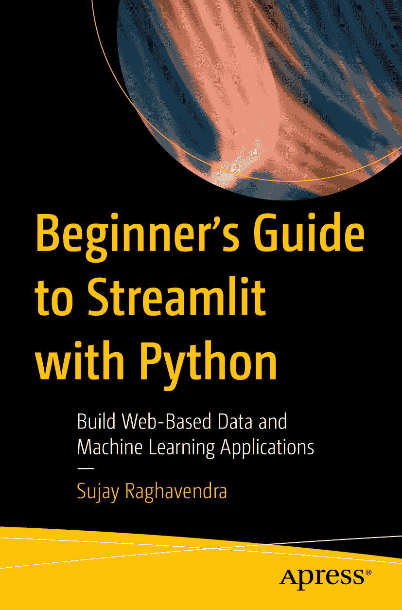

ISBN 978-1-4842-8982-2 e-ISBN 978-1-4842-8983-9 [`doi.org/10.1007/978-1-4842-8983-9`](https://doi.org/10.1007/978-1-4842-8983-9) © Sujay Raghavendra 2023 Apress Standard 本出版物中使用的通用描述性名称、注册商标名称、商标、服务标记等，即使未作特别声明，也不意味着这些名称不受相关保护性法律和法规的约束，因此可自由使用。出版商、作者和编辑可以假定，本书中的建议和信息在出版之日是真实和准确的。出版商和作者或编辑均不对本文所含材料或可能存在的任何错误或遗漏提供明示或暗示的担保。出版商对已出版地图和机构归属中的管辖权主张保持中立。

本 Apress 印记由注册公司 APress Media, LLC（Springer Nature 的一部分）出版。

注册公司地址为：1 New York Plaza, New York, NY 10004, U.S.A.

*献给*

*Prema Amma*

## 引言

Streamlit 是一个基于 Python 的 Web 开发应用框架。Streamlit 旨在减少为数据和机器学习模型开发基于 Web 的应用原型所需的时间。该框架有助于开发数据增强分析、构建动态用户体验，并展示数据科学/机器学习模型的数据。本书将提供见解，帮助您使用 Python 创建高质量的应用程序。本书采用实践方法，帮助您快速创建此类原型。

本书首先介绍 Streamlit 的基础知识，展示如何构建一个基本应用程序，然后逐步深入，涵盖可视化技术及其相应功能。本书还介绍了可以集成到 Streamlit 应用程序中的各种 Web 应用功能。您还将学习如何处理应用程序的流程控制和状态元素。本书还涉及应用程序中数据模块所需的性能优化技术。最后，您将学习如何在基于云的平台上部署 Streamlit 应用程序。您还将了解一些自然语言处理和计算机视觉领域的原型应用，这些应用可以使用 Streamlit 从头开始实现。

通过阅读本书，您将全面理解 Streamlit 应用程序的所有概念、功能和性能。这将使您有足够的信心开发自己的动态 Streamlit Web 应用程序。

### 本书内容

以下是各章节的简要总结，以帮助您更好地理解本书的结构。

第 1 章将向您介绍 Streamlit 库。它将引导您完成安装和运行第一个应用程序的过程。

第 2 章讨论应用程序中以各种形式呈现的文本和数据框。

第 3 章涵盖可视化。可视化是数据科学和机器学习的重要方面之一。可视化技术有助于您更恰当地理解数据。在本章中，我们将实现 Streamlit 以及其他 Python 库中为数据科学和机器学习开发者提供的不同可视化技术。

第 4 章将讨论可以在应用程序中实现的不同媒体元素，如图像、视频、音频等。

第 5 章将介绍 Streamlit 中的按钮功能，以及如何使用这些按钮选择所需数据以处理或可视化正在开发的应用程序中的数据。

第 6 章主要关注用户提供的数据以及如何在应用程序中处理这些数据。我们将以表单的形式讨论用户数据。

第 7 章讨论应用程序中的列布局、容器和导航。它还将重点介绍如何使用导航在应用程序的多个页面之间切换。

第 8 章介绍使用控制流对应用程序进行自定义处理。您还将了解 Streamlit 提供的状态元素。此外，本章还讨论了如何处理海量数据以及优化 Streamlit 应用程序的性能。

第 9 章将介绍在基于云的平台 Heroku 上开发和部署 NLP 应用程序。

第 10 章涵盖从零开始开发一个基于计算机视觉模型的完整 Streamlit 应用程序。前面章节中介绍的功能将在此应用程序中使用。

### 本书读者对象

本书面向数据科学和机器学习领域的专业人士，他们希望在没有 Web 开发先验知识的情况下，在 Web 应用程序中展示和部署自己的工作。本书将帮助您学习基本的 Streamlit 组件，以便部署您的研究工作或原型。本书还指导您开发动态数据应用程序。

### 源代码

源代码可在 GitHub 上获取，地址为：[`https://github.com/apress/beginners-guide-streamlit-python`](https://github.com/apress/beginners-guide-streamlit-python)。

## 关于作者 关于技术审校者