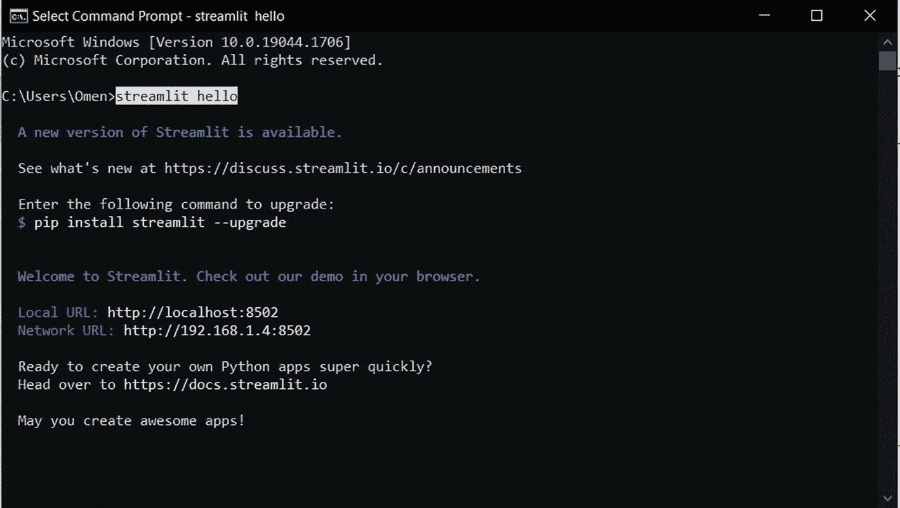
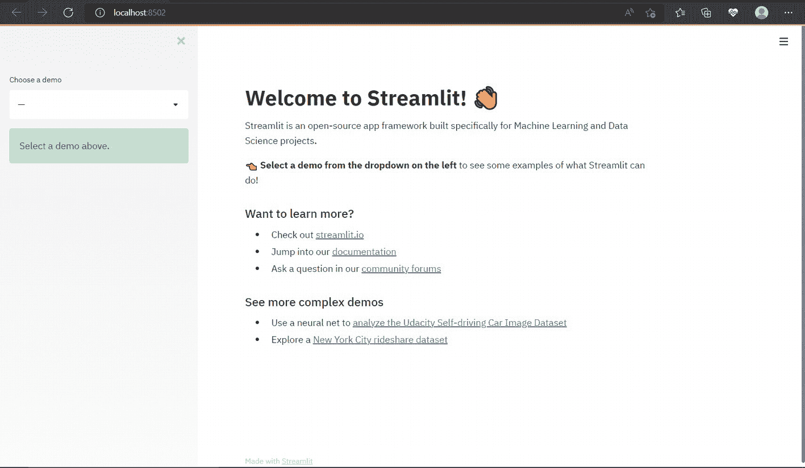
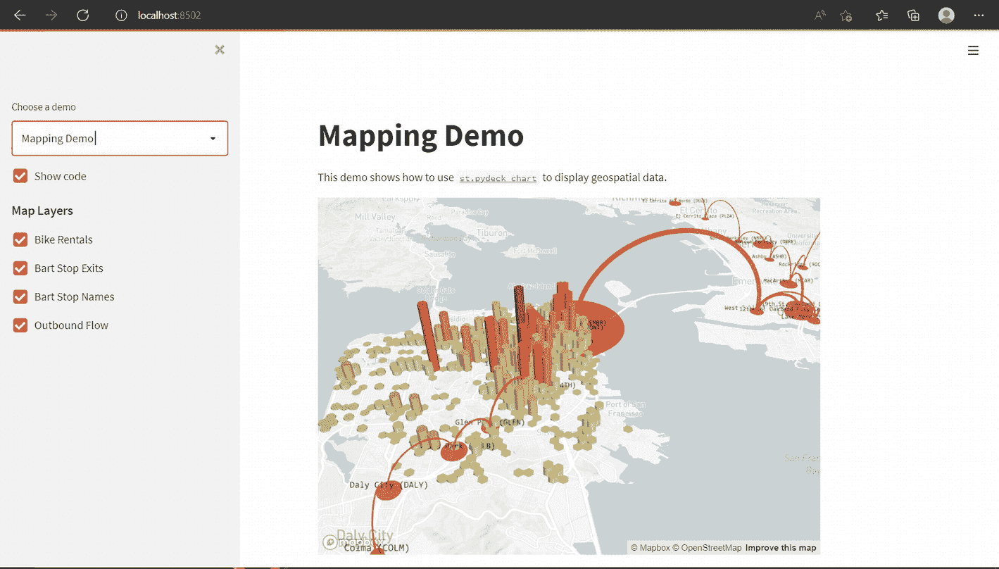

# 1. Streamlit 简介

在第一章中，我们将了解 Streamlit 及其核心功能。我们还将讨论为什么需要 Streamlit，并将其与替代方案进行比较。接下来，我们将讨论在各种操作系统上运行 Streamlit 应用程序的安装步骤。最后，我们将开发并运行我们的第一个 Streamlit 应用程序。

## 什么是 Streamlit？

Streamlit 是一个于 2019 年 10 月发布的开源 Python 框架。它在应用程序中充当数据与用户交互之间的媒介。开发 Streamlit 库的目标是使数据科学家和机器学习工程师能够使用 Python，在无需具备 `Flask`、`Django`、`Node` 等 Web 开发工具先验知识的情况下，在用户界面中解释和部署数据。Streamlit 也是一家软件公司的名称，由 Adrien Treuille、Amanda Kelly 和 Thiago Teixeira 于 2018 年在加利福尼亚州旧金山创立。

Streamlit 框架使用 Python 语言和 API 在应用程序中部署内置对象。全球数以千计的公司、初创企业、专业人士和自由职业者使用 Streamlit 来部署模型或向客户展示数据洞察。现在，我们将探讨使用 Streamlit 的原因。

## 为什么选择 Streamlit？

Streamlit 库的开发重点是面向数据驱动和机器学习模型的原型应用程序。原型应用程序易于使用，无需 Web 开发先验知识。您只需要具备 Python 和 Streamlit 的基础知识即可开发此类应用。与基于 Streamlit 的开发相比，传统的应用程序开发耗时更长，而且 Streamlit 应用程序具有交互性。使用 Streamlit 开发的应用程序将通过减少流程时间和成本，为许多公司提供助力。


## 为什么数据科学与机器学习工程师要使用 Streamlit？

我们知道，数据科学和机器学习利用技术媒介来提取数据，并将其连同相关见解呈现给客户或利益相关者。大多数时候，数据科学家和机器学习工程师会开发 Python 脚本或程序作为定制工具。当他们想向客户或利益相关者展示这些见解时，分享已开发的脚本或程序变得极其困难。同时，向非技术客户或用户呈现数据也很困难。

假设你是一家公司的数据科学或机器学习员工。根据客户需求，你被要求开发一个定制的交互式工具，以便用户可以探索数据并查看相关可视化效果。当客户想要检查正在开发的应用程序时，你可以使用 Streamlit 库来开发一个定制的交互式应用程序，并将其托管在服务器上与客户或利益相关者共享。

现在你已经了解了数据科学家和机器学习工程师开发 Streamlit 应用程序的视角。接下来，我们将在下一节中介绍 Streamlit 的主要特性。

### Streamlit 的特性

我们将讨论几个重要特性，这些特性使 Streamlit 与其他工具和应用程序相比独具特色。

#### 开源

Streamlit 是开源的，因此可以免费使用。庞大的数据科学家和机器学习工程师社区都在使用它来开发应用程序。

#### 跨平台

Streamlit 可以在任何平台上运行，这意味着一旦应用程序开发完成，它们可以在任何其他系统上进行修改或变更。

#### 易于开发

由于所需代码较少，你可以在极短时间内开发出带有用户交互功能的仪表盘以及数据驱动或机器学习驱动的应用程序。

#### 交互式应用程序

用户通过修改或上传数据来与应用程序交互，以实现数据可视化或应用已实现的模型数据。在接下来的章节中，你将看到使用 Streamlit 的应用程序中可能实现的多种用户交互方式。

#### 缩短开发时间

与领域内的各种竞争对手相比，Streamlit 应用程序的开发时间更短。自动重新加载功能可以预览对应用程序所做的更改，从而减少了所需时间。

#### 无需核心 Web 开发知识

Streamlit 库将应用程序的前端和后端绑定在一起。开发人员无需任何 Web 开发知识即可开发数据驱动的应用程序，因为 Streamlit 会处理这些。

#### 易于学习

你需要一些 Python 编程语言的基础知识，以及本书中将讨论的 Streamlit 语法，才能构建数据驱动的应用程序。

#### 模型实现

你可以在应用程序中实现预训练模型，并分析模型结果。这类应用程序可能是针对特定客户或特定测试的。Face-GAN 探索器就是模型实现的一个例子。

#### 兼容性

Streamlit 支持多种用于可视化、计算机视觉、机器学习和数据科学的 Python 驱动库。表 1-1 列出了其中一些。

**表 1-1** Streamlit 支持的 Python 库

| 框架 | Python 库 |
| --- | --- |
| 可视化 | Matplotlib, Plotly, Seaborn, Bokeh, Altair |
| 机器学习 | PyTorch, TensorFlow, Keras, Sci-kit Learn |
| 数据科学 | Numpy, Pandas |
| 计算机视觉 | OpenCV, imgaug, SimpleCV, BoofCV |

#### 文学化编程文档

在 Streamlit 应用程序中，你可以在 `.py` 文件中解析任何语言（如 Markdown、LaTeX 等），并将其渲染为 HTML，这使得 `.py` 文件充当了文学化编程文档的角色，其后端由基于 Python 的服务器托管。你可以通过在 `.py` 文件中定义名称来运行任何编程语言；这将在本书的后续章节中讨论。

#### Streamlit Cloud

开发完成的应用程序可以使用 Streamlit Cloud（[`https://streamlit.io/cloud`](https://streamlit.io/cloud)）进行部署和共享，远程授予客户或团队成员访问权限。（对于开发的应用程序，使用 Streamlit Cloud 并非强制要求。）

#### 优化变更

在 Python 脚本文件中所做的更改会直接显示在应用程序中，使开发更加容易。在本章稍后创建第一个应用程序时，你将了解更多相关信息。

#### 错误通知

如果代码中出现了任何错误，它们会显示在应用程序中，而不是命令提示符中，这使得错误检测更加容易。这些错误可能来自 Streamlit 的内置函数，也可能来自用于开发应用程序的任何库。

### Streamlit 与替代框架的比较

现在你已经了解了 Streamlit 的特性，我们将把 Streamlit 的特性与其竞争对手进行比较；参见表 1-2。

**表 1-2** Streamlit 与其竞争对手的比较

| | Streamlit | Panel | Dash | Voila |
| --- | --- | --- | --- | --- |
| **所属方** | Streamlit | Anaconda | Plotly | Quantstack |
| **发布年份** | 2019 | 2018 | 2017 | 2019 |
| **许可证类型** | Apache | BSD | MIT | BSD |
| **前端** | React | HTML 模板、Bokeh 及任意 JavaScript 库 | React | HTML 模板或 Jupyter |
| **后端** | Tornado | Tornado | Tornado | Flask |
| **公共部署** | 任意云环境（同时提供 Streamlit Cloud 以便轻松连接和部署） | 任意云环境 | 任意云环境 | 任意云环境 |
| **复杂应用** | 支持多页面 | 通过配置响应式组件支持 | 支持，但需要手动处理事件 | 难以处理复杂应用 |
| **托管服务支持** | Streamlit Cloud | Jupyterhub/Binder | 需购买企业版 | Jupyterhub/Binder |
| **产品支持** | 开源社区 | 开源社区 | 开源社区/商业支持 | 开源社区 |

现在你已经对 Streamlit 有了全面的了解，明白了它为何被开发以及它的相关特性。接下来，我们将通过在系统上安装 Python，向创建第一个 Streamlit 应用程序迈进一步。


## 安装 Python

开始使用 Python 的第一步是安装它。请按照以下步骤在 Windows 中安装 Python：

1. 打开任意浏览器，导航至 [`https://python.org/downloads/windows/link`](https://python.org/downloads/windows/link)。
2. 在“Python Release for Windows”下，选择 3.7 以上的 Python 版本进行下载，因为 Streamlit 支持 Python 3.7、3.8、3.9 和 3.10（最新版本为 3.10.4）。
3. 选择你的 Windows 版本（有适用于 32 位或 64 位的 Windows 可执行安装程序）。
4. 最后，运行下载的安装程序并按照安装步骤操作；同时记得更新 `ADD PATH` 变量。

**注意：** Mac 和 Linux 操作系统已内置 Python。使用命令 `python3 -–version` 检查版本，如果 Python 版本低于 3.7，请进行升级。

现在，我们将了解如何为各种操作系统安装 Streamlit 库。

### 在 Windows 上安装 Streamlit

一旦我们在系统中安装了 Python，就可以利用 `pip` 命令来下载 Streamlit 包。使用以下 `pip` 命令安装 Streamlit：

```
pip install streamlit
```

### 在 Linux 上安装 Streamlit

假设我们已经在系统上安装了高于 3.7 的 Python 版本，我们需要安装 `pip` 来直接安装 Streamlit 库。为此，我们将使用以下命令：

```
sudo apt – get install python3 – pip
```

现在我们将安装 Streamlit 库：

```
pip install streamlit
```

### 在 macOS 上安装 Streamlit

要在 Mac 系统上安装 Streamlit，首先我们需要安装 `pip`，这与我们在 Linux 上的操作类似。安装 `pip` 的命令如下：

```
sudo easy_install pip
```

现在，我们将使用以下命令在 macOS 上下载 Streamlit 库：

```
pip install streamlit
```

**注意：** 目前，Streamlit 库仅支持 Python 3.7 到 3.10 版本。本书中我们使用的是 Python 3.8.12 版本。

### 测试 Streamlit 安装

现在，我们将通过使用 Streamlit 命令来检查 Streamlit 库是否已安装。打开命令提示符并输入以下命令，如图 1-1 所示：



**图 1-1** 显示 Streamlit 应用程序在本地服务器上运行的命令提示符屏幕

```
streamlit hello
```

运行该命令后，我们将使用 Streamlit 在默认 Web 浏览器的 localhost 地址上运行一个内置的欢迎应用程序，如图 1-2 所示。在我们的例子中，localhost 地址是 `http://localhost:8052`。



**图 1-2** 显示默认的 Streamlit 页面

欢迎屏幕的下拉菜单中有一些演示应用程序，可以展示动画、绘图、地图和数据框。当我们从下拉菜单中选择“地图演示”时，应用程序和代码会生成，如图 1-3 所示。



**图 1-3** 显示一个演示应用程序

现在，我们将讨论如何创建我们的第一个 Streamlit 应用程序。

## 创建我们的第一个应用程序

假设你已经按照说明安装了 Streamlit Python 库，你将看到如何创建第一个 Streamlit 应用程序的分步说明。

首先，你需要在任何指定的目录中创建一个新的 Python 文件（`.py`）。

接下来，我们将编写代码来导入 Streamlit 库。选择你喜欢的任何代码编辑器。我使用了 Visual Studio 来编写以下脚本：

```
import streamlit as st
```

我们将使用 `write` 函数在应用程序中显示“Hello”文本；这类似于 Python 编程语言中的 `print` 函数。

```
st.write("Hello")
```

最后，我们将保存文件，并在保存文件的目录中，于命令提示符下运行以下命令：

```
streamlit run filename.py
```

现在，我们将在应用程序中看到只有“Hello”文本，如图 1-4 所示。


**图 1-4** 在创建的应用程序中显示“Hello”文本

这里，filename 是我们 Python 脚本的名称，当我们打开默认浏览器时，它将显示我们的“Hello”文本。现在，我们再编写一个 `write` 语句，文本内容为“World”。

```
st.write('World!!!!')
```

当我们对创建的 Python 文件进行任何更改时，浏览器中运行的应用程序将在其右上角显示图 1-5 中的命令。


**图 1-5** 当 Python 脚本被编辑/修改时，应用程序中显示的按钮

“源文件已更改”是当我们保存对 Python 脚本所做的任何更改且未刷新页面时显示的消息。“重新运行”按钮将从头开始运行所有代码块，并随后显示更改。

当我们在应用程序中选择“始终重新运行”按钮时，应用程序会自动根据所做的更改进行优化并显示更改。

清单 1-1 显示了创建第一个应用程序的完整程序。

```
#导入 Streamlit 库
import streamlit as st
#显示纯文本
st.write("Hello")
st.write('World!!!!')
```

**清单 1-1** `1 _hello_world.py`

图 1-6 显示了刷新或重新运行上述脚本后的屏幕。


**图 1-6** 在应用程序中显示“Hello World!!!”

我们已经开发了一个基本的 Streamlit 应用程序，其中显示了“Hello World!!!”文本。这是为了让您了解如何使用 Streamlit 创建 Python 脚本。

## 总结

在本章中，我们通过讨论 Streamlit 应用程序对数据科学家和机器学习工程师的用途，对其有了全面的了解。我们讨论了其核心功能，并将其与其他可用工具进行了比较。然后，我们讨论了安装 Streamlit 兼容的 Python 版本，并详细介绍了在不同平台上安装 Python 和 Streamlit 的说明。最后，我们使用 Python 脚本中的 `streamlit` 命令创建了第一个基本的 Streamlit 应用程序。

在下一章中，我们将讨论在应用程序中表示文本数据的各种方式。我们还将进一步介绍开发以数据为中心的应用程序所必需的数据元素。


