# 2. 文本与表格元素

在第一章中，你已经全面了解了 Streamlit 的核心功能，以及它与数据科学和机器学习领域其他竞争者的不同之处。我们还讨论了在不同平台上必要的安装步骤，并创建了属于我们自己的第一个 Streamlit 应用程序。

在本章中，我们不仅将讨论如何以不同方式格式化文本，例如使用 Markdown、标题、代码块和 LaTeX，还将讨论如何在已创建的应用程序中添加标题、一级标题和二级标题。接下来，我们将研究表格数据元素，以及如何在应用程序中显示它们。

让我们从查看 Streamlit 库中可用的各种文本元素开始。

## 文本元素

我们将文本元素定义为带有描述的对象，这些描述在 Streamlit 应用程序中用作标题、一级标题、二级标题、说明文字和纯文本。我们将从标题开始，将其作为我们的第一个文本元素。

### 标题

我们将开始在 Streamlit 应用程序中编写一个标题。标题是区分大小写的，并且会显示在每个文档上，但这并非强制要求。换句话说，标题类似于一个章节的标题。清单 2-1 中的代码将生成图 2-1 中的输出。


一个深色矩形框，其中包含文本“this is our title”。

图 2-1

显示标题

```
#### 导入 Streamlit 库
import streamlit as st
#### 编写标题
st.title("This is our Title")
清单 2-1
01_title.py
```

我们可以看到图 2-1 中显示的文本，即我们在 `st.title()` 函数中指定的文本。我们还可以在标题中添加锚点，以便导航到另一个链接或页面。（我们将在第 7 章中了解更多相关信息。）由于我们没有在标题示例中添加锚点，因此将使用我们为标题编写的相同文本来生成锚点，即 *This is our Title.* 我们现在来看看如何为标题添加锚点；请参见清单 2-2。

```
#### 导入 Streamlit 库
import streamlit as st
#### 编写带锚点的标题
st.title("This is our Title", anchor="Apress")
清单 2-2
02_title_anchor.py
```

在清单 2-2 中，我们使用了 `Apress` 作为锚点。这用于将页面或页面中的某些部分链接到另一个页面或同一页面内的其他部分。锚点功能是可选的，如果不使用，也可以设置为 `None`。

在接下来的部分中，我们将分别学习如何使用 Streamlit 库定义一级标题和二级标题。

#### 一级标题

我们都知道，一级标题用于表示应用程序中的一组内容。我们现在将定义 Streamlit 库中可用的内置一级标题函数。请参见清单 2-3。

```
#### 导入 Streamlit 库
import streamlit as st
#### 一级标题
st.header("""This is our Header""")
清单 2-3
03_header.py
```

图 2-2 显示了在我们的应用程序中显示的一级标题文本。现在，让我们在下一节中查看二级标题。


一个深色矩形框，其中包含文本“this is our header”。

图 2-2

显示一级标题

#### 二级标题

顾名思义，二级标题是一级标题的子类型。它写在一级标题之后，字体大小比一级标题小。清单 2-4 显示了我们的示例，相关的输出在图 2-3 中。


一个深色矩形框，其中包含文本“this is our Sub-header”。

图 2-3

显示二级标题

```
#### 导入 Streamlit 库
import streamlit as st
#### 二级标题
st.subheader("""This is our Sub-header""")
清单 2-4
04_sub_header.py
```

我们也可以像对 `st.title()` 函数那样应用锚点参数。

注意

我们可以在 `st.title()`、`st.header()` 和 `st.subheader()` 中使用锚点参数，但它是可选的。

#### 说明文字

说明文字通常与应用程序中的描述相关联。说明文字的大小很小；请参见清单 2-5 和图 2-4。


一个深色矩形框，其中包含文本“this is our caption”。

图 2-4

显示说明文字

```
#### 导入 Streamlit 库
import streamlit as st
#### 说明文字
st.caption("""This is our Caption""")
清单 2-5
05_caption.py
```

我们知道，说明文字文本是一种解释，用于描述注释、脚注、表格、图像和视频。

现在，让我们一次性比较所有三种类型的文本（标题、一级标题和说明文字），以了解它们的区别，并查看它们在 Streamlit 应用程序中的呈现方式。请参见清单 2-6 和图 2-5 中的输出。

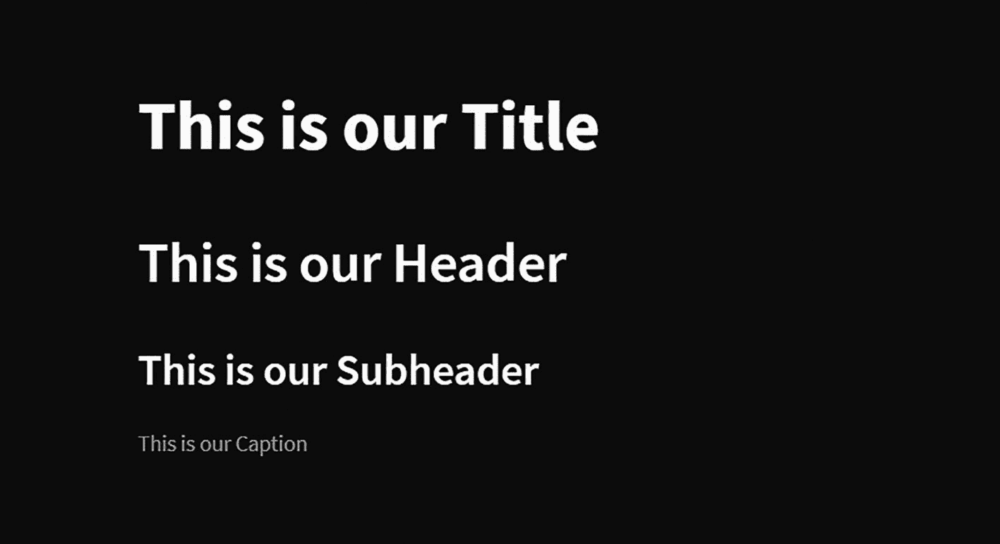

一个深色矩形框，其中包含不同大小的文本：“this is our title”、“this is our header”、“this is our Sub-header”和“this is our caption”。

图 2-5

通过在同一页面中显示标题、一级标题、二级标题和说明文字元素来比较它们

```
#### 导入 Streamlit 库
import streamlit as st
### 标题
st.title("""This is our Title""")
#### 一级标题
st.header("""This is our Header""")
#### 二级标题
st.subheader("""This is our Subheader""")
#### 说明文字
st.caption("""This is our Caption""")
清单 2-6
06_comparison.py
```

既然我们已经了解了这三者之间的区别，我们将继续以纯文本格式编写文本。

### 纯文本

让我们在应用程序中显示一些纯文本。其语法如下：

```
st.text(“your text”)
```

这个 `st.text()` 函数将显示引号内编写的任何文本。该语法遵循 Python 中使用的相同字符串规则。文本可以用单引号、双引号或三引号编写，如清单 2-7 所示。图 2-6 显示了输出。

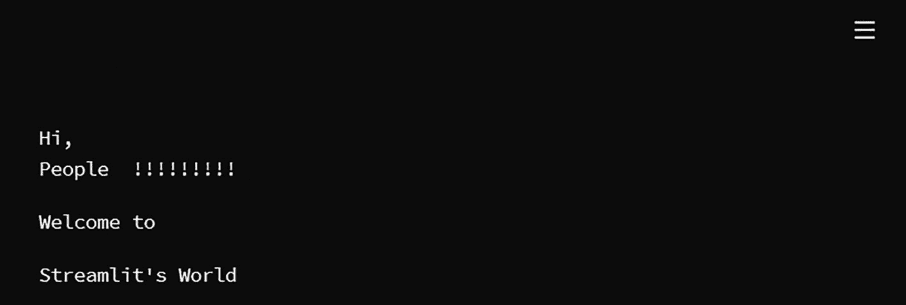

一张屏幕截图，显示一个矩形深色窗口，其中包含文本“Hi, People exclamations, welcome to, Streamlit's world”。

图 2-6

显示纯文本

```
#### 导入 Streamlit 库
import streamlit as st
#### 显示纯文本
st.text("Hi,\nPeople\t!!!!!!!!!")
st.text('Welcome to')
st.text(""" Streamlit's World""")
清单 2-7
07_plain_text.py
```

这就是纯文本在我们创建的应用程序中的显示方式。屏幕处于深色模式，因此我们看到应用程序的背景是黑色的。

注意

每次我们编写 `st.text()` 函数时，它都会在应用程序中显示在新的一行上。

在下一节中，我们将讨论如何从纯文本创建 Markdown 文本。

### Markdown

`Markdown` 是一种用于创建格式化文本的标记语言。现在我们来看看如何在应用程序中使用标记语言显示纯文本。请参见清单 2-8 及图 2-7 中的输出。


截图显示了一个深色矩形窗口，其中包含文本“Hi, People exclamations, welcome to, Streamlit's world.”。这是 markdown 格式的文本。

图 2-7

显示 Markdown 格式的文本

```
#Import Streamlit library
import streamlit as st
#Displaying Markdown
st.markdown("# Hi,\n# ***People*** \t!!!!!!!!!")
st.markdown('## Welcome to')
st.markdown("""### Streamlit's World""")
Listing 2-8
08_markdown.py
```

```
st.markdown()
```

`st.markdown()` 函数中编写的文本必须使用标记语言，才能获得如图 2-7 所示的格式化文本。

### LaTeX

`LaTeX` 是一种主要用于技术文档的格式化文本。`Streamlit` 支持以 `LaTeX` 格式编写的文本。请参见清单 2-9 及图 2-8 中的输出。

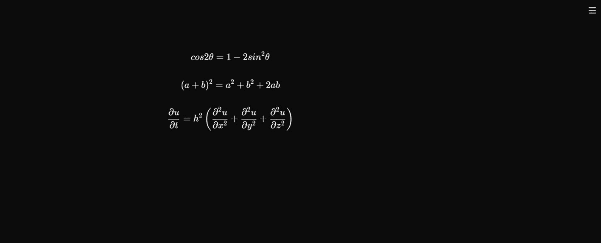

一个深色矩形屏幕，显示方程式 `cos 2 thetas`、`a + b` 的平方以及 `u` 对 `t` 的偏导数。

图 2-8

使用 `LaTeX` 格式显示数学方程式

```
#Import Streamlit library
import streamlit as st
#Displaying Latex
st.latex(r'''cos2\theta = 1 - 2sin²\theta''')
st.latex("""(a+b)² = a² + b² + 2ab""")
st.latex(r'''\frac{\partial u}{\partial t}
= h² \left( \frac{\partial² u}{\partial x²}
+ \frac{\partial² u}{\partial y²}
+ \frac{\partial² u}{\partial z²} \right)''')
Listing 2-9
09_latex.py
```

### Code

`Streamlit` 库提供了一定的灵活性来显示各种编程语言的代码。文本会像在代码编辑器中一样高亮显示。请参见清单 2-10 及图 2-9 中的输出。

```
#### Import Streamlit library
import streamlit as st
#### Displaying Python Code
st.subheader("""Python Code""")
code = '''def hello():
print("Hello, Streamlit!")'''
st.code(code, language='python')
#### Displaying Java Code
st.subheader("""Java Code""")
st.code("""public class GFG {
public static void main(String args[])
{
System.out.println("Hello World");
}
}""", language='javascript')
st.subheader("""JavaScript Code""")
st.code(""" 

try {
adddlert("Welcome guest!");
}
catch(err) {
document.getElementById("demo").innerHTML = err.message;
}
 """)
Listing 2-10
10_code.py
```

如果我们不为指定的代码添加编程语言，那么代码将以无样式格式显示，就像我们使用 `HTML` 语言编写的代码一样。除非使用了多种语言，否则 `language` 选项不是必需的。我们还可以通过代码框右上角的快捷方式复制应用程序中编写的代码。


一个深色屏幕，显示 Python 代码、Java 代码和 Javascript 代码，并带有相应的代码和高亮显示的文本“hello, streamlit”、“hello world”和“welcome guest”。

图 2-9

显示代码块

现在，我们将继续学习其他元素，即*数据元素*。这是 `Streamlit` 应用程序中帮助定义数据以供探索的最佳功能之一。

## 数据元素

我们已经了解了如何在 `Streamlit` 应用程序中以各种格式表示文本数据。现在，我们将继续学习可在应用程序中显示的各种数据形式。让我们逐一了解这些数据元素。

### 数据框

众所周知，数据框是数据科学和机器学习项目中使用的最重要的数据格式之一。它由二维数据组成，包含行和列，作为带标签的数据。`Streamlit` 库以交互式表格格式显示数据框，这意味着表格是可滚动的，并且可以动态更改表格大小。请参见清单 2-11 及图 2-10 中的输出。

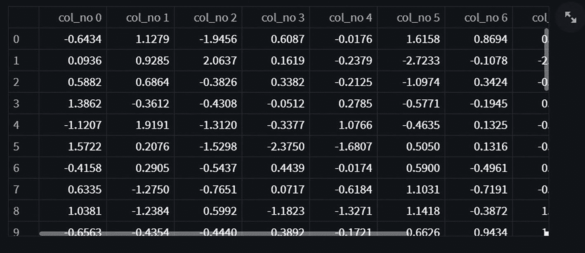

一个深色屏幕，显示一个包含 9 列的表格，列标题为数字 0、1、2、3、4、5、6 和 7，以及它们在 9 行中对应的值。

图 2-10

显示带有滚动和筛选选项的数据框

```
#### Import Necessary libraries
import streamlit as st
import pandas as pd
import numpy as np
#### defining random values in a dataframe using pandas and numpy
df = pd.DataFrame(
np.random.randn(30, 10),
columns=('col_no %d' % i for i in range(10)))
st.dataframe(df)
Listing 2-11
11_dataframe.py
```

我们可以固定应用程序中显示的数据框的高度和宽度。`Streamlit` 确定的默认大小是静态的，即使我们在应用程序内部更改表格大小，也不会受到影响。

注意： 这也被称为*动态表格*，因为我们可以直接从应用程序更改表格中列的宽度和高度，而无需更改代码。

我们可以使用 `highlight` 函数，通过最小值、最大值和空值来高亮显示数据框对象。请参见清单 2-12。

```
import streamlit as st
import pandas as pd
import numpy as np
#### defining random values in a dataframe using pandas and numpy
df = pd.DataFrame(
np.random.randn(30, 10),
columns=('col_no %d' % i for i in range(10)))
#### Highlighting minimum value objects
st.dataframe(df.style.highlight_min(axis=0))
Listing 2-12
12_dataframe_highlight.py
```

在清单 2-12 中，我们高亮显示了数据框中具有最小值的对象。图 2-11 显示了应用程序中高亮显示数据框最小值的效果。

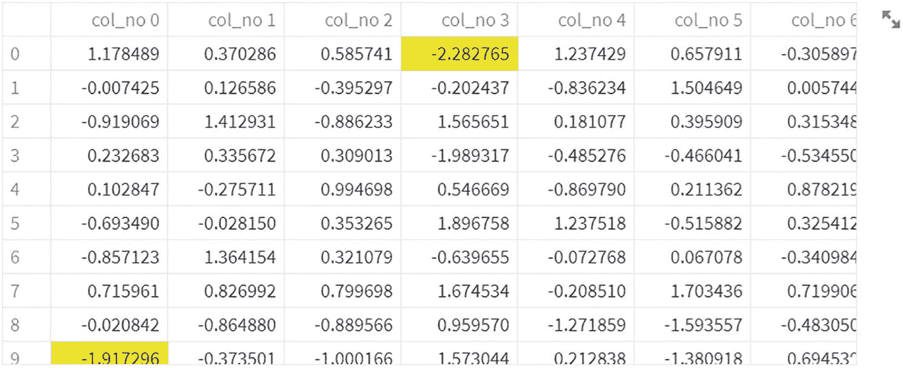

一个包含 9 列的表格，列标题为数字 0、1、2、3、4、5、6 和 7，以及它们在 9 行中对应的值。它在第 0 行和第 9 行高亮显示了值 -2.282765 和 -1.917296。

图 2-11

显示数据框中高亮显示的对象

注意： `Streamlit` Cloud 尚不支持将数据复制到剪贴板。

我们将在下一节学习如何显示表格。

### 表格

众所周知，表格和数据框在本质上相似，都有行和列。但是，在 `Streamlit` 中显示的表格本质上是静态的，并直接显示在应用程序页面上。请参见清单 2-13 及图 2-12 中的输出。

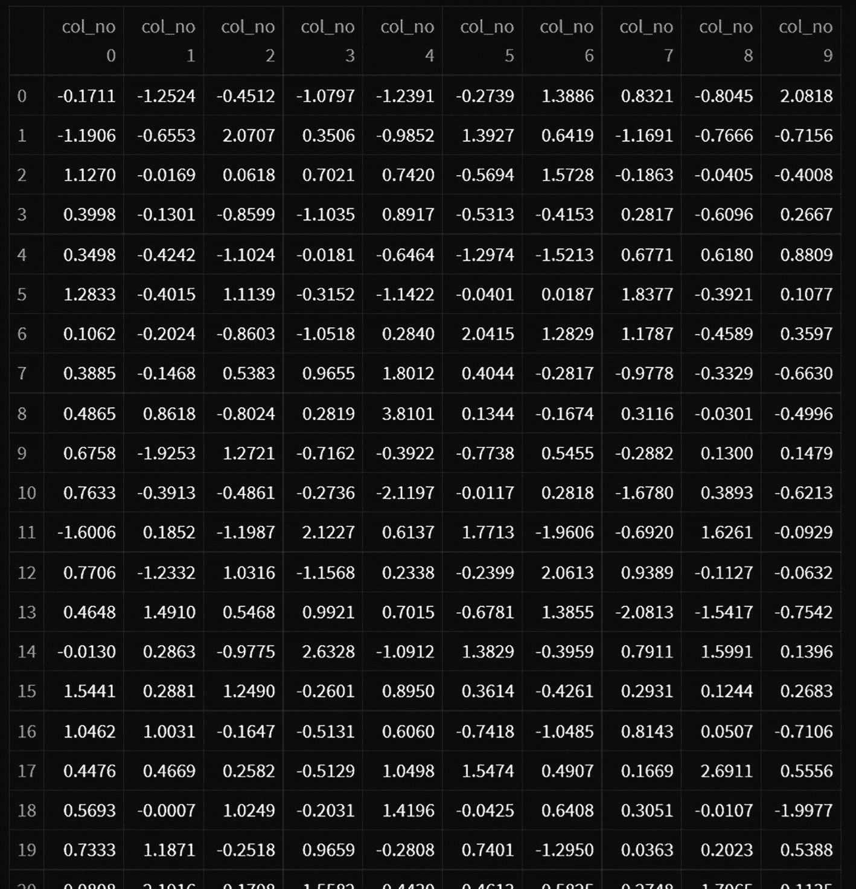

一个深色屏幕，显示一个包含 10 列的表格，列标题为数字 0、1、2、3、4、5、6、7、8 和 9，以及它们在 20 行中对应的值。

图 2-12

以表格格式显示数据

```
import streamlit as st
import pandas as pd
import numpy as np
#### defining random values in a dataframe using pandas and numpy
df = pd.DataFrame(
np.random.randn(30, 10),
columns=('col_no %d' % i for i in range(10)))
#### defining data in table
st.table(df)
Listing 2-13
13_table.py
```

如图 2-12 所示，应用程序中显示的是完整的表格，而不是使用数据框显示的默认数据。这是表格和数据框之间的主要区别之一。

注意： `Streamlit` 应用程序中定义的表格本质上是静态的，并且没有像我们在数据框中看到的那样，可以在用户界面内滚动和更改表格尺寸的选项。

接下来，我们将了解另一个数据元素，它允许我们以独特的方式显示数据。

### 指标

在 Streamlit 应用中，我们可以使用`metric()`函数通过指标来显示数据。该指标帮助用户轻松查看数据中的任何变化。我们可以定义数据的变化是正向、负向还是中性。

现在，我们将使用`metric()`函数在应用中显示温度数据。参见清单 2-14 和图 2-13 的输出。

```python
import streamlit as st
#### Defining Metrics
st.metric(label="Temperature", value="31 °C", delta="1.2 °C")
```

清单 2-14 `14_metric.py`

标签是`Temperature`，值是`31`，差值是`1.2`摄氏度。差值显示与标签关联的变化是正向、负向还是空值。参见图 2-13。

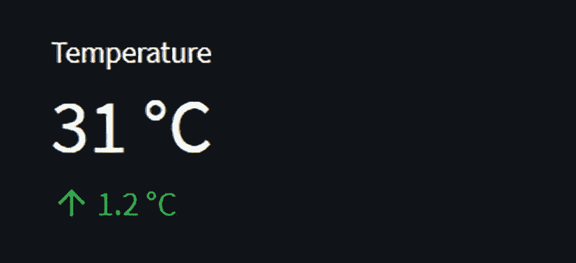

一个深色矩形屏幕，显示文本温度、31 摄氏度，以及一个向上的箭头和 1.2 摄氏度。

图 2-13

显示温度指标

类似地，我们可以通过为标签分配值和差值来显示任何指标，例如速度、降雨量、能量、卡路里等。参见清单 2-15。

```python
import streamlit as st
#Defining Columns
c1, c2, c3 = st.columns(3)
#### Defining Metrics
c1.metric("Rainfall", "100 cm", "10 cm")
c2.metric(label="Population", value="123 Billions", delta="1 Billions", delta_color="inverse")
c3.metric(label="Customers", value=100, delta=10, delta_color="off")
st.metric(label="Speed", value=None, delta=0)
st.metric("Trees", "91456", "-1132649")
```

清单 2-15 `15_metric_all.py`

在清单 2-15 中，我们可以看到 Streamlit 支持的不同指标格式。`delta`是帮助用户了解值是否发生变化的数值。`delta_color`是为正值和负值定义的颜色；这里我们分别使用绿色和蓝色。参见图 2-14。

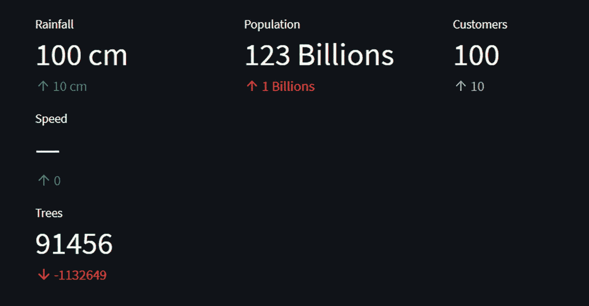

一个深色矩形屏幕，显示文本降雨量、人口、客户、速度和树木，以及它们对应的差值。

图 2-14

以多种形式显示指标

我们还可以通过关闭指标来更改差值指示器为反向或中性。这在以下 JSON 示例中完成。

### JSON

我们知道数据科学中的表格数据有时是 JSON 格式。JSON 格式是一种数据交换方式。它易于用户读写。当一个对象是字符串时，我们假设它将包含序列化的 JSON。清单 2-16 展示了如何在 Streamlit 中将字符串或对象显示为 JSON 字符串。

```python
import streamlit as st
#Defining Nested JSON
st.json(
    {
        "Books": [
            {
                "BookName": "Python Testing with Selenium",
                "BookID": "1",
                "Publisher": "Apress",
                "Year": "2021",
                "Edition": "First",
                "Language": "Python",
            },
            {
                "BookName": "Beginners Guide to Streamlit with Python",
                "BookID": "2",
                "Publisher": "Apress",
                "Year": "2022",
                "Edition": "First",
                "Language": "Python",
            },
        ]
    }
)
```

清单 2-16 `16_json.py`

这里我们在代码中使用了嵌套 JSON。图 2-15 展示了它在应用中的显示效果。

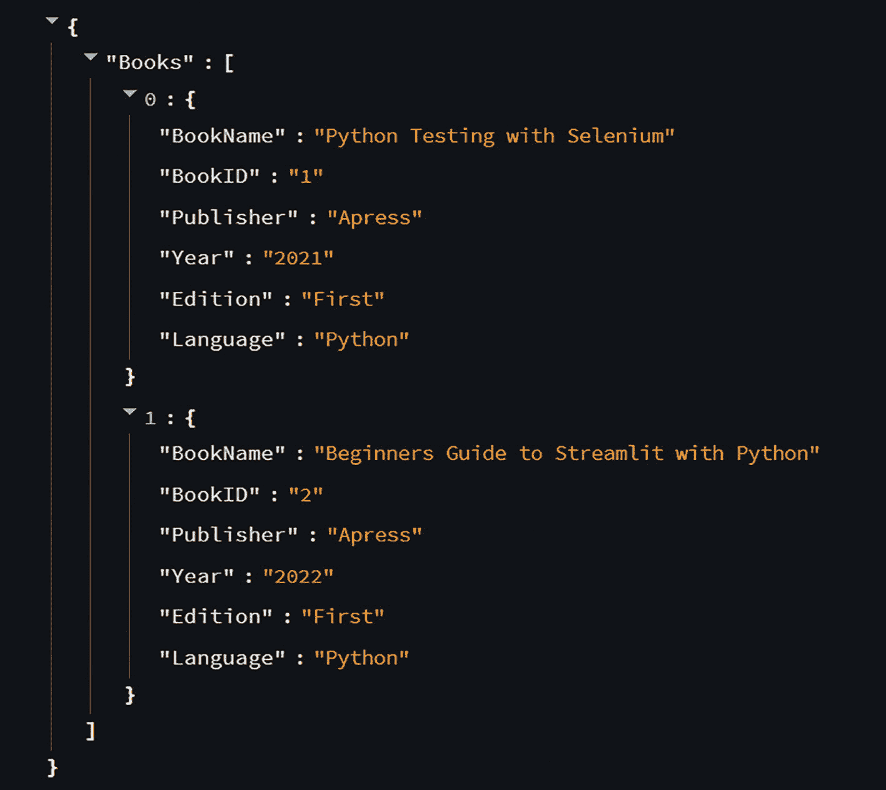

一个深色屏幕显示了一个 20 行的程序代码，其中包含书籍信息，包括书名、书籍 ID、出版商、年份、版本和语言。

图 2-15

显示 JSON 数据

到目前为止，我们已经了解了如何在 Streamlit 应用中显示所有类型的数据格式。现在我们将检查另一种也可以在应用中显示数据的方法。

### `write()` 函数作为超级函数

`write()` 函数类似于 Python 中的`print()`函数或 C 和 Java 中的`printf()`语句。`write()`函数是一个输出函数，用于在屏幕上显示内容。基本语法如下：

```
st.write(input)
```

`write()` 函数有一个特别之处，它不仅仅显示文本。我们将看到`write()`函数如何以不同方式使用。首先，我们将使用`write()`函数实现一个数据框。参见清单 2-17。

```python
import streamlit as st
import pandas as pd
#### Dataframe in write function
st.write(pd.DataFrame({
    'column one': [5.436, 6.372, 3.645, 4.554, 7.263],
    'column two': [99, 55, 75, 41, 37],
}))
```

清单 2-17 `17_write_df.py`

在图 2-16 中，我们在`write()`函数中嵌入了一个数据框。类似地，我们可以在`write()`函数中引入多个参数。

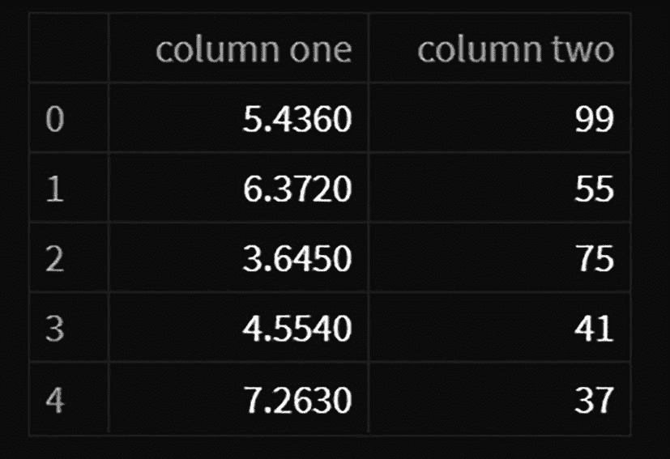

一个屏幕截图显示了一个包含 3 列（标题为 column one 和 column two）以及它们对应 5 行值的表格。

图 2-16

使用`write()`函数显示数据框

现在我们将看到另一个在`write()`函数中嵌入多个参数的示例。参见清单 2-18。

```python
import streamlit as st
import pandas as pd
import numpy as np

df = pd.DataFrame(
    np.random.randn(30, 10),
    columns=('col_no %d' % i for i in range(10)))

#### defining multiple arguments in write function
st.write('Here is our Data', df, 'Data is in dataframe format.\n', "\nWrite is Super function")
```

清单 2-18 `18_write_mul_args.py`

我们没有在`write()`函数中使用默认的数据框定义。这里`write()`函数会自动检查与数据类型对应的值，并在我们的应用中显示它，如图 2-17 所示。

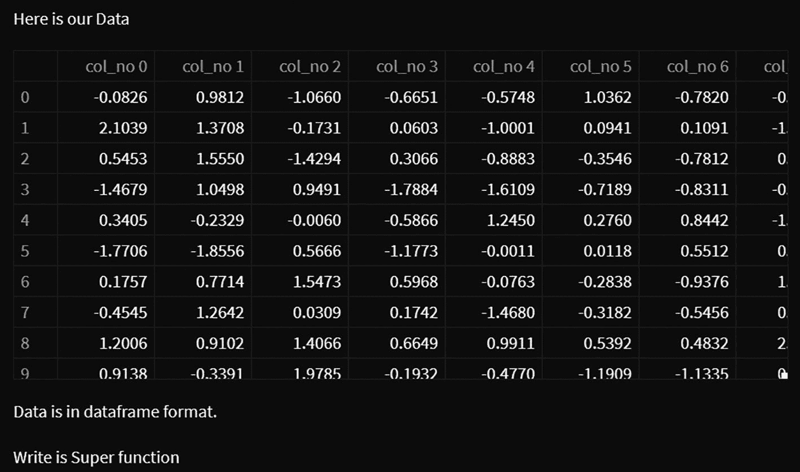

一个深色屏幕显示了一个包含 9 列（标题为列号 0、1、2、3、4、5、6 和 7）以及它们相关 10 行值的表格，以及文本“Data is in dataframe format”。

图 2-17

显示在`write()`函数中定义的多个对象

在这个示例中，我们在单个`write()`函数中使用了两种数据类型：一种是文本，另一种是数据框，如图 2-17 所示。

最后，我们将看到如何使用`write()`函数在应用中显示一个简单的图表。参见清单 2-19 和图 2-18 的输出。

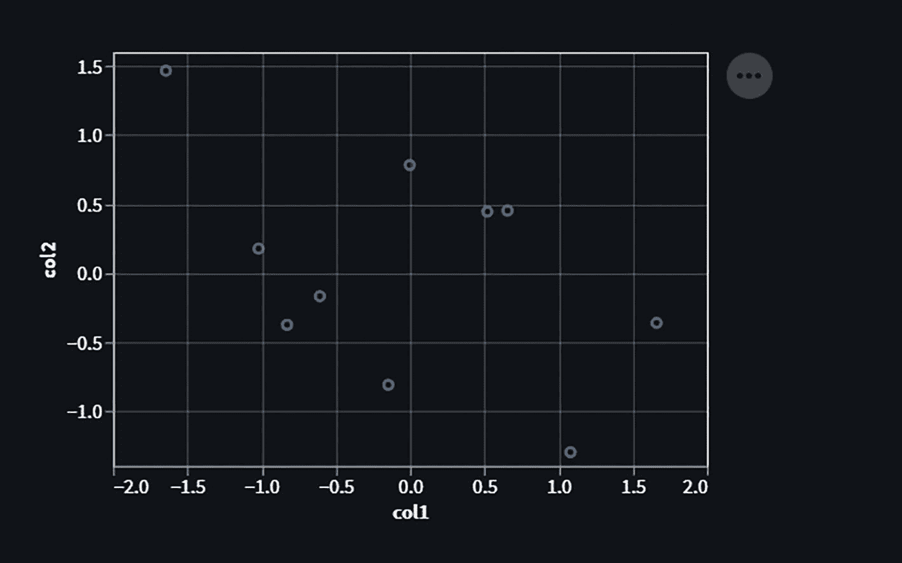

一个深色屏幕显示了一个 col 2 与 col 1 的散点图。它绘制了呈下降趋势的数据。

图 2-18

使用`write()`函数显示图表

```python
#### importing Necessary Libraries
import pandas as pd
import numpy as np
import altair as alt
import streamlit as st

#### Defining random Values for Chart
df = pd.DataFrame(
    np.random.randn(10, 2),
    columns=['a', 'b'])

#### Defining Chart
chart = alt.Chart(df).mark_bar().encode(
    x='a', y='b', tooltip=['a', 'b'])

#### Defining Chart in write() function
st.write(chart)
```

清单 2-19 `19_write_chart.py`

最后，我们将了解 Streamlit 中的魔法功能。

### 魔法

`Magic`是一项功能，它使我们能够在应用程序中定义数据元素，而无需显式声明任何命令。我们将在代码清单 2-20 中看到魔法是如何工作的，其输出结果如图 2-19 所示。

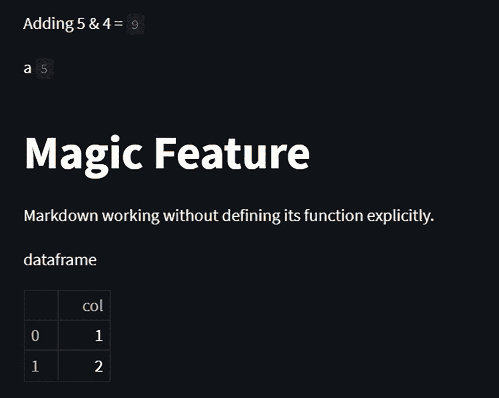

一个深色屏幕，显示文本“magic feature”，Markdown 无需显式定义其函数即可工作，同时还有数据框和添加的值。

图 2-19 使用魔法函数显示数据框

```python
#### Math calculations with no functions defined
"Adding 5 & 4 =", 5+4

#### Displaying Variable 'a' and its value
a = 5
'a', a

#### Markdown with Magic
"""
#### Magic Feature
Markdown working without defining its function explicitly.
"""

#### Dataframe using magic
import pandas as pd
df = pd.DataFrame({'col': [1,2]})
'dataframe', df
```

清单 2-20 `20_magic_feature.py`

我们甚至可以使用魔法功能在应用程序中显示图表，如图 2-20 所示，该图使用了代码清单 2-21。

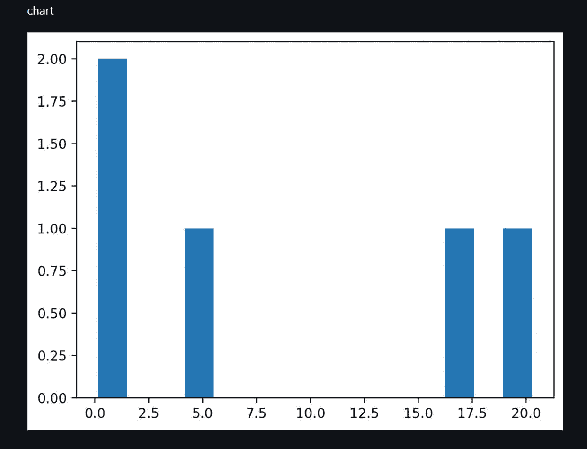

一个深色屏幕，显示一个条形图。在 1.0 处的箱子具有较高的逻辑值 2，而在 5、17.5 和 20 处的箱子具有较低的逻辑值 1。数值为近似值。

图 2-20 使用魔法函数显示图表

```python
#### Magic working on Charts
import matplotlib.pyplot as plt
import numpy as np

s = np.random.logistic(10, 5, size=5)
chart, ax = plt.subplots()
ax.hist(s, bins=15)

#### Magic chart
"chart", chart
```

清单 2-21 `21_magic_chart.py`

> **注意：** 魔法功能在主 Python 源应用程序文件中有效，因为在文件导入期间目前不支持此功能。

## 总结

在本章中，我们学习了如何以各种格式编写文本元素，例如标题、页眉、副标题和说明文字。我们还比较了在 Streamlit 应用程序中显示的不同文本。然后，我们了解了可以以纯文本、Markdown、LaTeX 和不同语言的代码等格式编写的文本。

我们了解了如何在应用程序中将数据元素显示为表格、指标和数据框对象。最后，我们讨论了如何使用 `write()` 函数来显示数据元素。

在下一章中，我们将进一步讨论如何使用 Streamlit 支持的不同库将数据可视化为图表和图形。