# 3. 可视化

在上一章中，你了解了如何在 Streamlit 中使用文本和表格形式的数据。在本章中，我们将学习什么是数据可视化，并探索 Streamlit 用于可视化数据的函数。之后，你将看到 Streamlit 与各种 Python 库在数据可视化方面的灵活性。

## 可视化的重要性

数据可视化对于帮助企业分析近期数据趋势非常重要。当数据以图表或图形的形式呈现时，更容易解读和解释。在数据科学和机器学习中，原始数据被可视化以建模趋势并得出关于数据的结论。

此外，可视化数据更有利于各方之间的沟通以及关联数据的相关因素。可视化数据能让企业主、决策者和利益相关者更好地理解他们的数据，并帮助他们发展业务。

## Streamlit 中的可视化

使用 Streamlit，我们可以开发用于可视化数据的自定义仪表板。我们还可以在 Streamlit 中创建任何类型的可视化工具，因为它支持所有 Python 库。在本章中，我们将介绍几个主要的库，例如 `Plotly`、`Altair`、`Seaborn` 和 `Matplotlib`。我们还将讨论可以在 Streamlit 应用程序中可视化的各种图形。现在，我们将讨论可视化的目的。

## 可视化的目的

对于数据科学家和业务分析师来说，可视化有助于识别所提供数据中的模式和错误。例如，在最近的疫情期间，科学家们将数据可视化，以向公众通报当前情况。从数据中识别出模式，以确定 `COVID` 热点区域。这是通过各种类型的图表和图形完成的，例如条形图、折线图、热力图、饼图、散点图等。

可视化数据有助于解决业务中的许多问题，并据此开发算法。这反过来又加快了在解决已识别的不准确性时的决策速度。在 Streamlit 中，我们可以用更少的代码创建可视化仪表板或工具。

## Streamlit 函数

我们现在将讨论 Streamlit 中可用的内置可视化函数。

### 条形图

要使用垂直条形图表示数据点，我们可以使用条形图。内置的 `st.bar_chart()` 函数可以在 Streamlit 应用程序中绘制数据点。它类似于 `st.altair_chart()`，后者将在本章后面定义。请参见代码清单 3-1。

```python
import streamlit as st
import pandas as pd
import numpy as np
st.title('Area')
#### Defining dataframe with its values
df = pd.DataFrame(
np.random.randn(40, 4),
columns=["C1", "C2", "C3", "C4"])
#### Bar Chart
st.bar_chart(df)
```

代码清单 3-1 `01_bar_chart.py`

`st.bar_chart()` 函数通过识别列及其关联值直接绘制图形，使其成为最容易使用的函数。在代码清单 3-1 中，我们没有定义任何与 x 轴和 y 轴相关的值。

此函数的可定制性较低，我们不需要指定数据框的值。如图 3-1 所示，每列的值以不同颜色的垂直条形图绘制。

接下来，我们将讨论折线图。

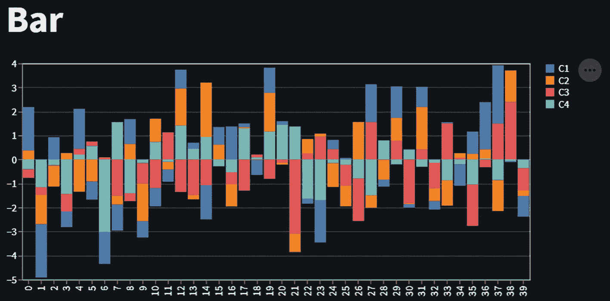

一个堆叠条形图的快照。`C1`、`C2`、`C3` 和 `C4` 的值绘制在垂直轴和水平轴上。垂直轴范围从 -5 到 5。水平轴范围从 0 到 39。该图呈现波动趋势。

`图 3-1` 在 Streamlit 中显示条形图

### 折线图

与 `st.bar_chart()` 函数类似，`st.line_chart()` 函数会自动检测索引及其值。请参见代码清单 3-2。

```python
import streamlit as st
import pandas as pd
import numpy as np
st.title('Area')
#### Defining dataframe with its values
df = pd.DataFrame(
np.random.randn(40, 4),
columns=["C1", "C2", "C3", "C4"])
#### Bar Chart
st.line_chart(df)
```

代码清单 3-2 `02_line_chart.py`

我们在代码清单 3-2 中创建了包含四列的随机值。通过将数据框传递给它来创建折线图。

如图 3-2 所示，四列的值在图表中使用四种不同的颜色表示。x 轴定义每列的行号，y 轴定义该行中的值。

我们将在下一节讨论如何实现面积图。

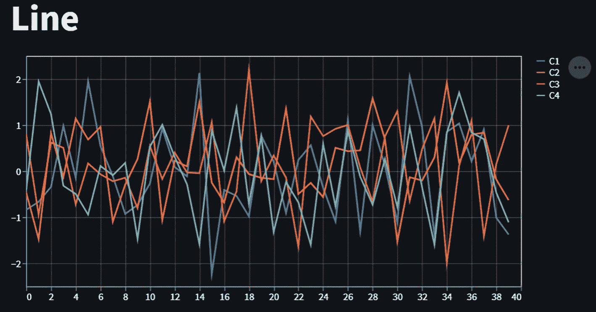

一个折线图，垂直轴上的值从 -2 到 2，水平轴上的值从 0 到 40。代表 `C1`、`C2`、`C3` 和 `C4` 的四条曲线呈现波动趋势。

`图 3-2` 在 Streamlit 中显示折线图

### 面积图

面积图或面积图表基于上一节介绍的折线图。面积图用于比较一个或多个列的不同定量值。参见代码清单 3-3。

```python
import streamlit as st
import pandas as pd
import numpy as np
st.title('Area')
#### Defining dataframe with its values
df = pd.DataFrame(
np.random.randn(40, 4),
columns=["C1", "C2", "C3", "C4"])
#### Bar Chart
st.area_chart(df)
```

代码清单 3-3 `03_area_chart.py`

数据框直接传递给 `st.area_chart()` 函数，生成的图表如图 3-3 所示。

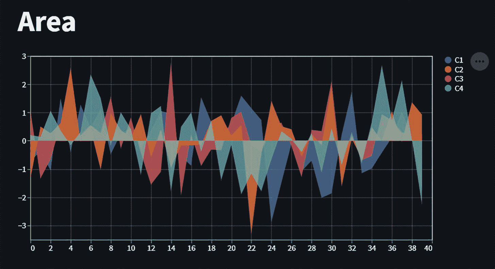

`C1`、`C2`、`C3` 和 `C4` 的面积图快照。垂直轴范围从 -3 到 3。水平轴范围从 0 到 40，增量为 2。该图呈现波动趋势。

`图 3-3` 在 Streamlit 中显示面积图

接下来，我们将讨论如何在地图上的指定地理位置显示数据点。

> **注意：** 在某些情况下，当 Streamlit 内置的条形图、折线图和面积图函数无法正确识别数据中的值时，我们可以使用其他可自定义的图表（如下面各节所示）。

### 地图

要在地图上显示数据点，我们将使用 Streamlit 的 `st.map()` 函数。散点图会叠加在由 `mapbox` 提供的地图上。纬度和经度指定了地图的位置以及散点图的绘制位置。参见代码清单 3-4。

```python
import streamlit as st
import pandas as pd
import numpy as np
st.title('Map')
#### Defining Latitude and Longitude
locate_map = pd.DataFrame(
np.random.randn(50, 2)/[10,10] + [15.4589, 75.0078],
columns = ['latitude', 'longitude'])
#### Map Function
st.map(locate_map)
```

代码清单 3-4 `04_map.py`

我们生成了一些随机点，由于我们定义了纬度和经度，这些点将显示在印度达尔瓦德市的地图上（图 3-4）。

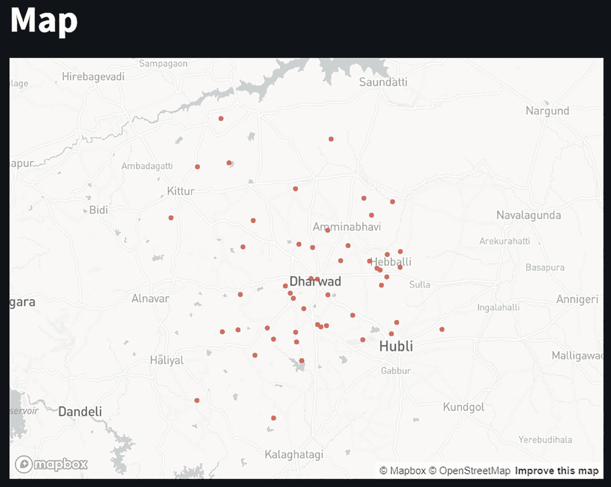

快照显示了一张地图，上面标有 `Bidi`、`Dandeli`、`Dhararand`、`Hubli`、`Kittur` 等地名，并带有一些随机点。

`图 3-4` 在 Streamlit 中显示地图

地图居中显示。自动缩放功能允许我们放大和缩小地图。

在下一节中，我们将了解如何用 `DOT` 语言表示数据。

## Graphviz

`Graphviz` 是一个开源的 Python 库，我们可以用它创建包含节点和边的图形对象。节点和边的语言被称为 `DOT` 语言。

在代码清单 3-5 中，我们实现了一个用于训练模型的机器学习工作流。

```python
import streamlit as st
import graphviz as graphviz
st.title('Graphviz')
#### Creating graph object
st.graphviz_chart('''
digraph {
"Training Data" -> "ML Algorithm"
"ML Algorithm" -> "Model"
"Model" -> "Result Forecasting"
"New Data" -> "Model"
}
''')
```

代码清单 3-5 `05_graphviz_dot.py`

节点和边使用易于理解的 `DOT` 语言添加。我们定义了四个节点及其连接边，如图 3-5 所示。

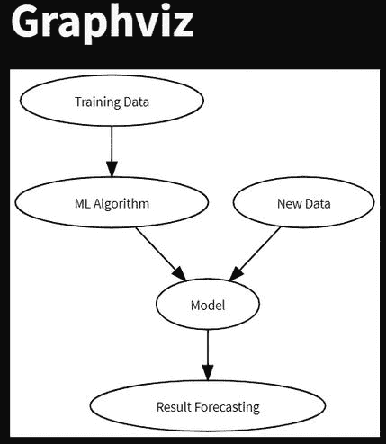

一个 Graphviz 模型。训练数据被传递给机器学习算法。机器学习算法和新数据值被传递给模型，并得出预测结果。

`图 3-5` 使用 Graphviz 显示一个简单的机器学习模型

我们可以像代码清单 3-6 所示那样定义相同的边和节点。

```python
import streamlit as st
import graphviz as graphviz
st.title('Graphviz')
#### Create a graphlib graph object
graph = graphviz.Digraph()
graph.edge('Training Data', 'ML Algorithm')
graph.edge('ML Algorithm', 'Model')
graph.edge('Model', 'Result Forecasting')
graph.edge('New Data', 'Model')
st.graphviz_chart(graph)
```

代码清单 3-6 `06_graphviz.py`

我们可以使用这个 Graphviz 代码来可视化各种机器学习算法或神经网络，以帮助我们理解它们在处理数据时遇到的架构或流程。

在下一节中，我们将讨论 `Seaborn` Python 库以及如何使用它实现不同的图表。

## Seaborn

`Seaborn` 是一个 Python 可视化库，用于以各种调色板获得样式精美的图表，使图表更具吸引力。要开始使用 Seaborn，我们需要使用以下命令安装它：

```bash
pip install seaborn
```

### 计数图

计数图用于表示分类变量的出现次数或计数。代码清单 3-7 展示了一个简单计数图的代码。

```python
#### Import python libraries
import streamlit as st
import seaborn as sns
import pandas as pd
import matplotlib.pyplot as plt
#### Data Set
df = pd.read_csv("./files/avocado.csv")
#### Defining Count Graph/Plot
fig = plt.figure(figsize=(10, 5))
sns.countplot(x = "year", data = df)
st.pyplot(fig)
```

代码清单 3-7 `07_seaborn_count.py`

使用的分类数据是年份，通过计算出现次数来绘制图 3-6 所示的图表。使用 `Seaborn` 库中的 `count_plot()` 函数来显示计数图。

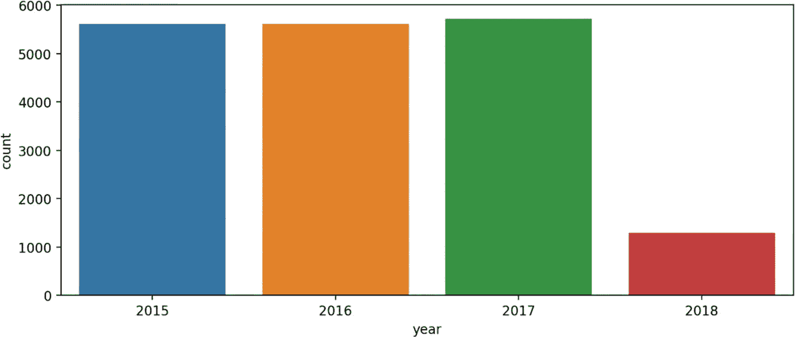

2015 年至 2018 年 Seaborn 计数与年份的条形图。图表数据如下：2015 年，5500；2016 年，5500；2017 年，5500；2018 年，1200。

`图 3-6` 在 Streamlit 中显示 Seaborn 计数图

我们使用了针对鳄梨数据集中年份的计数图。每年以不同的颜色表示，并显示计数数量。

### 小提琴图

为了表示多个组的数值数据，我们可以使用基于密度曲线的小提琴图或图表。参见代码清单 3-8。

```python
#### Import python libraries
import streamlit as st
import seaborn as sns
import pandas as pd
import matplotlib.pyplot as plt
#### Data Set
df = pd.read_csv("./files/avocado.csv")
#### Defining Violin Graph
fig = plt.figure(figsize=(10, 5))
sns.violinplot(x = "year", y="AveragePrice", data = df)
st.pyplot(fig)
```

代码清单 3-8 `08_seaborn_violin.py`

我们使用了 `violinplot()` 方法，并定义了 x 和 y 参数来显示小提琴图。频率越高，小提琴区域曲线的宽度就越大，如图 3-7 所示。

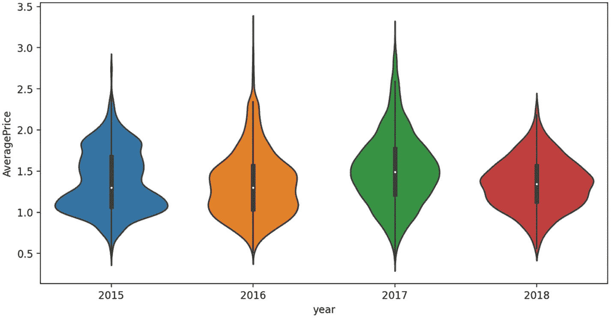

年份与平均价格的 Seaborn 小提琴图。垂直轴标记为“平均价格”，范围从 0.5 到 3.5。每年用不同颜色显示小提琴条。

`图 3-7` 在 Streamlit 中显示 Seaborn 小提琴图

接下来，我们将了解带状图。

### 带状图

带状图表示汇总的单变量数据集。为了显示所有观测值，我们可以使用带状图。参见代码清单 3-9。

```python
#### Import python libraries
import streamlit as st
import seaborn as sns
import pandas as pd
import matplotlib.pyplot as plt
#### Data Set
df = pd.read_csv("./files/avocado.csv")
#### Defining Strip Plot
fig = plt.figure(figsize=(10, 5))
sns.stripplot(x = "year", y="AveragePrice", data = df)
st.pyplot(fig)
```

代码清单 3-9 `09_seaborn_strip.py`

如图 3-8 所示，我们可以使用带状图作为直方图或密度图的替代方案。

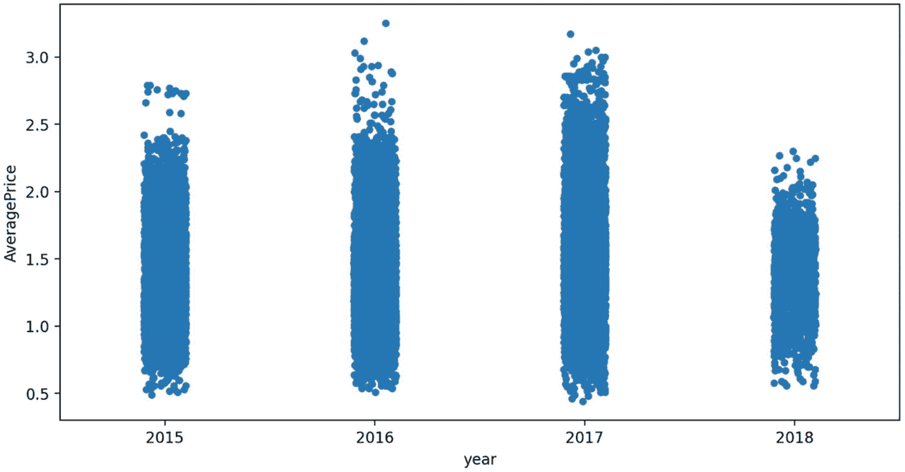

平均价格与年份的 Seaborn 带状图。四个垂直的带状条代表年份，每个条由一系列点组成。

`图 3-8` 在 Streamlit 中显示 Seaborn 带状图

## Altair

Altair 是基于 Vega 的最常用的统计可视化 Python 库之一。一旦我们为 `x` 和 `y` 定义了值，可视化过程就由 Altair 库处理。我们还可以限制在应用程序中显示的图表的大小并设置其颜色。首先，我们需要安装 Altair 库。要安装它，我们将使用以下命令：

```
pip install altair
```

Altair 支持所有类型的图表，但我们只讨论 Altair 中的几种图表类型。

### 箱线图

我们可以使用箱线图通过显示数据四分位数和平均值来表示数据的偏度。请参见代码清单 3-10。

```python
import altair as alt
import streamlit as st
import pandas as pd
#读取 albany 数据集
df = pd.read_csv("./files/albany.csv")
### 箱线图
box_plot = alt.Chart(df).mark_boxplot().encode(
x = "Date",
y = "Large Bags"
)
st.altair_chart(box_plot)
代码清单 3-10
10_altair_boxplot.py
```

在上面的代码中，我们使用了 `mark_boxplot()` 方法来显示箱线图。随后，我们使用 `st.altair_chart()` 函数在应用程序中显示该图表。箱线图分为五个不同的部分，如图 3-9 所示。

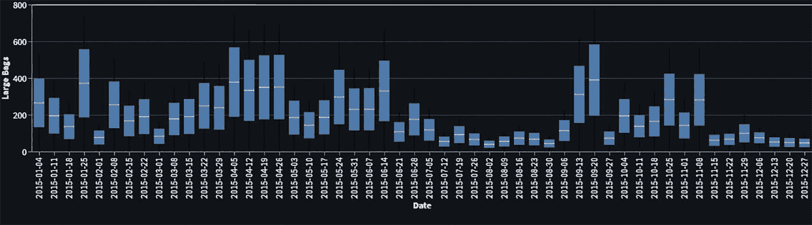

一张日期与大包装袋的 Altair 箱线图快照。2015 年 9 月 20 日达到最高值 590。中间的白色带代表中位数。

接下来，我们将了解如何在应用程序中创建和显示面积图。

### 面积图

如我们所知，面积图用于基于折线图表示定量数据。请参见代码清单 3-11。

```python
import altair as alt
import streamlit as st
import pandas as pd
#读取 albany 数据集
df = pd.read_csv("./files/albany.csv")
### 面积图
area = alt.Chart(df).mark_area(color="orange").encode(
x = "Date",
y = "Large Bags"
)
st.altair_chart(area)
代码清单 3-11
11_altair_area.py
```

我们使用了 `mark_area()` 方法来创建面积图。可以看到，它类似于我们之前讨论过的内置函数。请参见图 3-10。

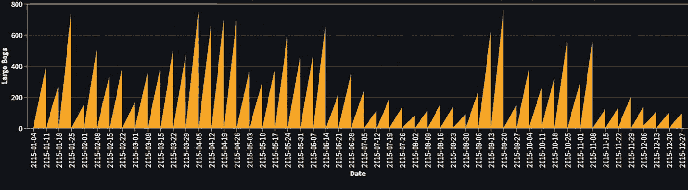

一张日期与大包装袋的 Altair 面积图快照。面积图最高点位于 2015 年 9 月 13 日至 20 日之间，值为 790。折线图上的额外阴影区域是面积图区别于折线图的地方。

最后，我们将讨论如何将数据可视化为热力图。

### 热力图

热力图是用颜色表示数值的图形表示。数值决定了对应于两个维度的颜色强度。请参见代码清单 3-12。

```python
import altair as alt
import streamlit as st
import pandas as pd
#读取 albany 数据集
df = pd.read_csv("./files/albany.csv")
heat_map  = alt.Chart(df).mark_rect().encode(
alt.Y('AveragePrice:Q'),
alt.X('Large Bags:Q'),
alt.Color('AveragePrice:Q'),
tooltip = ['AveragePrice', 'type', 'Large Bags', 'Date']
).interactive()
st.altair_chart(heat_map)
代码清单 3-12
12_altair_heatmap.py
```

Altair 库中的 `mark_rect()` 函数用于创建热力图。我们定义了 `Large Bags` 和 `AveragePrice` 作为生成热力图的 x 轴和 y 轴参数。您可以在图 3-11 的右侧看到颜色强度范围。

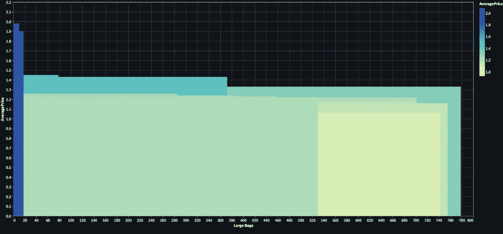

一张平均价格与大包装袋的 Altair 热力图快照。平均价格的颜色指示器范围从 2.0 到 1.0。我们可以得出结论，数值的增加会增加图表中的颜色强度。

> **注意**
> `mark()` 方法用于表示将要创建的图表类型（如折线图、面积图、热力图等）。

在下一节中，我们将讨论最广泛使用的交互式 Python 库之一，名为 Plotly。我们将使用 Plotly 在我们的 Streamlit 应用程序中显示图表。

## Plotly

Plotly 是一个可以制作高质量交互式图表的 Python 库。它支持不同类型的图表，如条形图、折线图、箱线图、饼图、散点图、直方图等。我们将看到如何在我们 Streamlit 应用程序中使用这个 Python 库。

首先，我们需要使用 `pip` 命令安装 Plotly 库。

```
pip install plotly
```

现在，我们将看到可以使用 Plotly 在 Streamlit 中实现的各种图表。我们将使用鳄梨数据集来可视化图表。

### 饼图

对于鳄梨数据集，我们将可视化有机鳄梨和传统鳄梨的百分比。

在代码清单 3-13 中，第一个函数 `figure()` 是一个空白页面，用于在其中绘制我们的饼图。`Pie()` 方法创建一个饼图，将标签和值作为输入参数。

```python
import streamlit as st
import plotly.graph_objects as go
import pandas as pd
#读取鳄梨数据集
data = pd.read_csv("./files/avocado.csv")
st.header("饼图")
#### 实现饼图
pie_chart = go.Figure(
go.Pie(
labels = data.type,
values = data.AveragePrice,
hoverinfo = "label+percent",
textinfo = "value+percent"
))
st.plotly_chart(pie_chart)
代码清单 3-13
13_plotly_pie.py
```

还有两个可选参数，名为 `hoverinfo` 和 `textinfo`，当鼠标悬停在饼图上时会显示信息。函数 `plotly_chart` 允许我们在应用程序中添加定义的饼图，如图 3-12 所示。

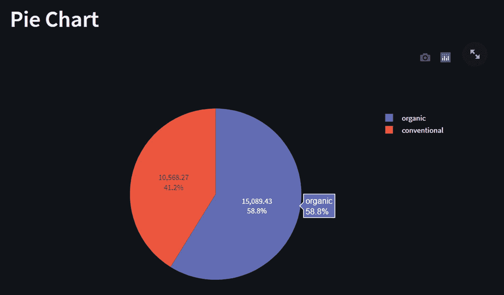

一张显示有机和传统数值的饼图快照。有机数值为 15,089.43，占比 58.8%。传统数值为 10,568.27，占比 41.2%。

我们的饼图分为两部分：有机和传统。当鼠标悬停在一个部分上时，我们可以看到饼图该特定部分的名称和百分比。对应于有机和传统的鳄梨百分比和总数以不同颜色显示。接下来，我们将转向环形图，它与饼图类似。

#### 环形图

Plotly 创建了一个不同的子模块来绘制环形图。该模块的名称是 `express()`。我们需要在我们的代码中导入 `express()` 模块。请参见代码清单 3-14。

```python
import streamlit as st
import pandas as pd
import plotly.express as px
#读取鳄梨数据集
data = pd.read_csv("./files/avocado.csv")
st.header("环形图")
#### 环形图
donut_chart = px.pie(
names = data.type,
values = data.AveragePrice,
hole=0.25,
)
st.plotly_chart(donut_chart)
代码清单 3-14
14_plotly_donut.py
```

我们提供了与之前示例中用于饼图相同的数据集值。Express 模块中的 `pie()` 方法接受三个参数：`names`、`values` 和 `hole`。`hole` 指定环形图中孔的半径。请参见图 3-13。

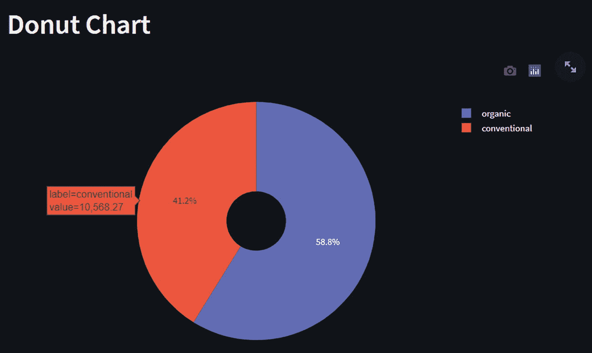

一张显示有机和传统数值的环形图快照。有机占比 58.8%。传统被标记，标签 = 传统，值 = 10,568.27，占比 41.2%。

> **注意**
> 如果不指定 `hole` 参数，我们可以将环形图转换为饼图。

在下一节中，我们将讨论如何在我们的应用程序中实现散点图。

### 散点图

现在，我们将通过使用 Plotly 库中的 `scatter()` 方法，在我们的应用程序中实现一个散点图。参见代码清单 3-15。

```python
import streamlit as st
import pandas as pd
import plotly.express as px
#数据集
data = pd.read_csv("./files/avocado.csv")
st.header("散点图")
#散点图
scat = px.scatter(
x = data.Date,
y = data.AveragePrice
)
st.plotly_chart(scat)
代码清单 3-15
15_plotly_scatter.py
```

`scatter()` 函数中的 x 轴和 y 轴是以列表形式呈现的参数。参见图 3-14。

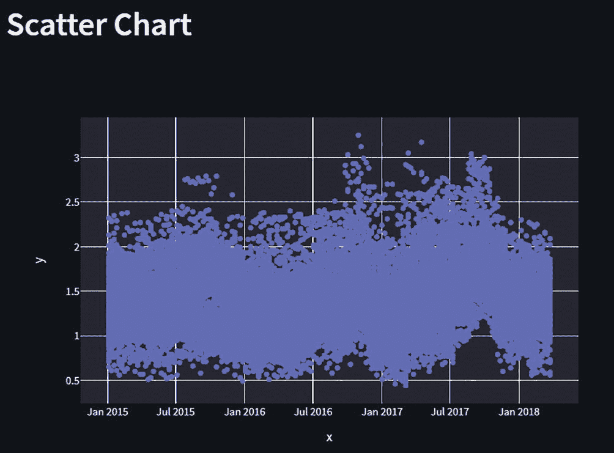

散点图快照。纵轴范围从 0.5 到 3。横轴范围从 2015 年 1 月到 2018 年 1 月。2017 年 1 月的最高值绘制在 3.5 处。散点图以点的形式表示数值。每个点都与 x 和 y 值相关联。

### 折线图

我们可以使用 Plotly 中 Express 模块的 `line()` 方法创建折线图。x 轴和 y 轴是 `line()` 函数中使用的参数。参见代码清单 3-16。

```python
import streamlit as st
import pandas as pd
import plotly.express as px
#### 数据集
data = pd.read_csv("./files/avocado.csv")
#### 精简数据集
albany_df = data[data['region']=="Albany"]
al_df = albany_df[albany_df["year"]==2015]
#折线图
line_chart = px.line(
x = al_df["Date"],
y = al_df["Large Bags"]
)
st.header("折线图")
st.plotly_chart(line_chart)
代码清单 3-16
16_plotly_line.py
```

我们已针对奥尔巴尼地区精简了数据。`title` 参数是 `line()` 函数中的一个可选参数，用于为我们选择的折线图提供标题。参见图 3-15。

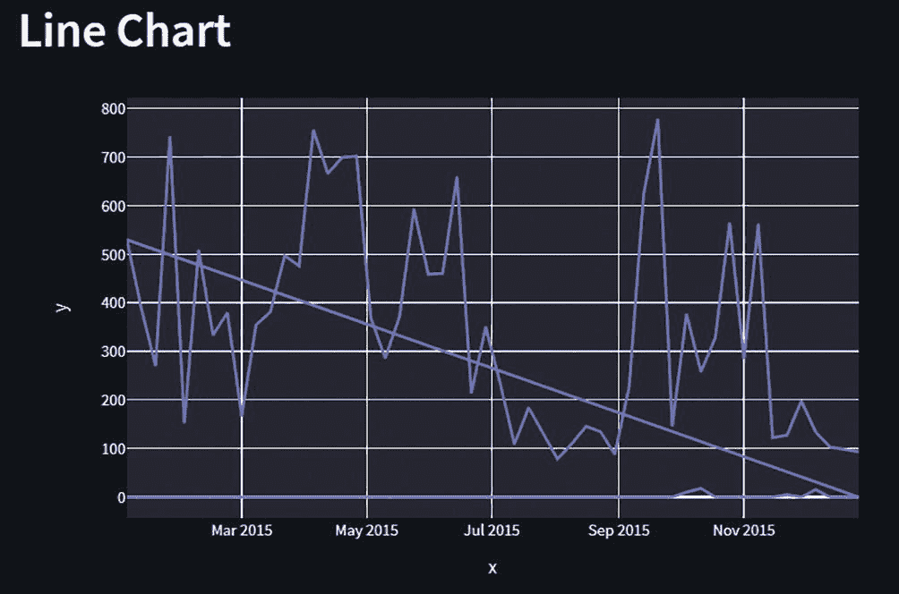

折线图快照。纵轴范围从 0 到 800。横轴范围从 2015 年 3 月到 2015 年 11 月。两条曲线分别代表波动和下降趋势。我们还可以通过在代码中定义 `update_traces()` 函数来更改属性，例如颜色。

```python
line_chart.update_traces(line_color = "orange")
```

在下一节中，我们将介绍柱状图及其在应用程序中的相关子图实现。

#### 柱状图

我们可以使用 `express.bar()` 函数来表示柱状图。与折线图类似，柱状图也有 x 和 y 参数以及一个可选的 title 参数。参见代码清单 3-17。

```python
import streamlit as st
import pandas as pd
import plotly.express as px
#### 数据集
data = pd.read_csv("./files/avocado.csv")
#### 精简数据集
albany_df = data[data['region']=="Albany"]
al_df = albany_df[albany_df["year"]==2015]
#### 柱状图
bar_graph = px.bar(
al_df,
title = "柱状图",
x = "Date",
y = "Large Bags"
)
st.plotly_chart(bar_graph)
代码清单 3-17
17_plotly_bar.py
```

在 `bar()` 函数中，我们定义了数据集名称，并直接将列名作为值赋给了 x 和 y 参数，如图 3-16 所示。

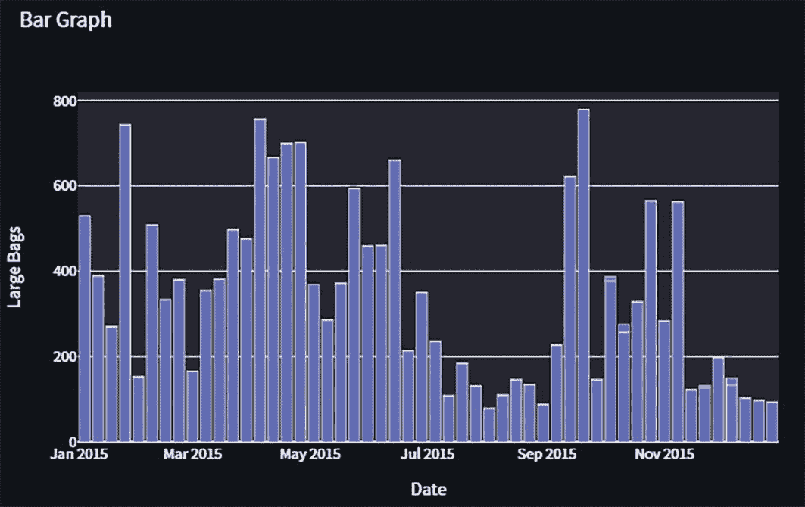

一张快照描绘了大型袋装量的柱状图，数值范围从 0 到 800，对应日期从 2015 年 1 月到 2015 年 11 月。2015 年 9 月的大型袋装量最高，为 790。

我们还可以通过在 `bar()` 函数中引入 `color` 参数来更改颜色，如代码清单 3-18 所示；结果如图 3-17 所示。

```python
#柱状图颜色
bar_graph = px.bar(
x = al_df["Date"],
y = al_df["Large Bags"],
title = "柱状图",
color=al_df["Large Bags"]
)
代码清单 3-18
18_plotly_bar_color.py
```

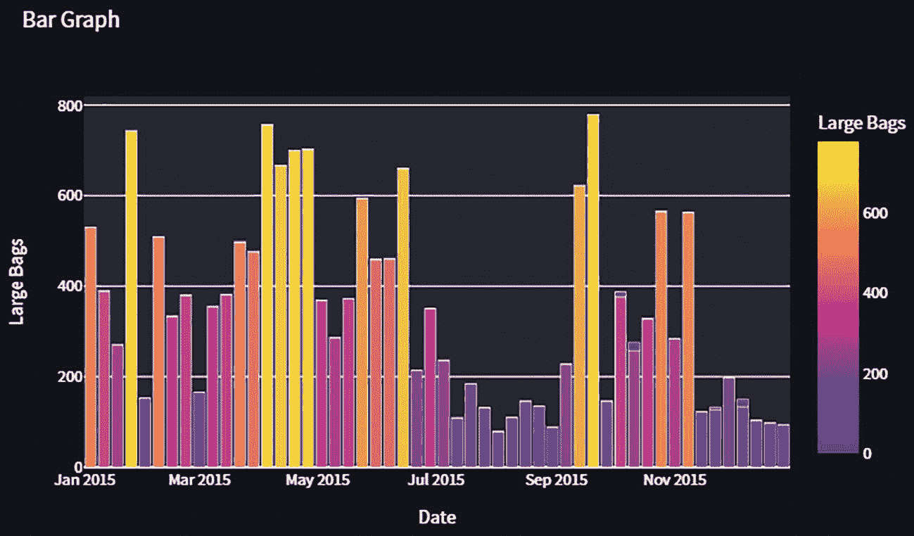

一张垂直柱状图的快照，显示大型袋装量与日期的关系。最高值出现在 2015 年 9 月，为 790 个大型袋。颜色强度与其中定义的值相关联。柱状图中的颜色强度有助于理解所描绘的数值范围。

#### 水平柱状图

我们可以翻转柱状图中的柱子使其变为水平。要将柱状图翻转为水平，我们需要在 `bar()` 函数中指定 `orientation` 参数。参见代码清单 3-19 及图 3-18 中的输出。

```python
import streamlit as st
import pandas as pd
import plotly.express as px
#### 数据集
data = pd.read_csv("./files/avocado.csv")
#### 精简数据集
albany_df = data[data['region']=="Albany"]
al_df = albany_df[albany_df["year"]==2015]
#### 水平柱状图
bar_graph = px.bar(
al_df,
x = "Large Bags",
y = "Date",
title = "柱状图",
color="Large Bags",
orientation='h'
)
代码清单 3-19
19_plotly_bar_horizontal.py
```

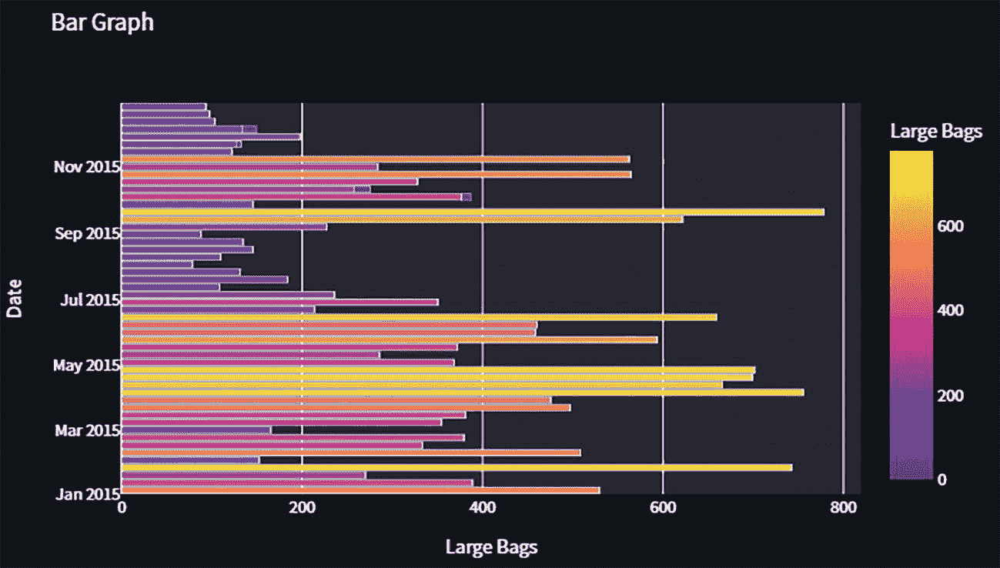

一张水平柱状图的快照，显示日期与大型袋装量的关系。最高值出现在 2015 年 9 月，为 790 个大型袋。

最后，我们将了解如何在 Streamlit 应用程序中使用 Plotly 实现子图。

### 子图

子图用于将不同的图表并排加载。在 Plotly 中，我们可以使用 `make_subplots()` 方法创建多个图表，这些图表可以并排放置，也可以一个叠一个地堆叠。要定义子图，我们需要导入 `plotly.subplots` 模块。参见代码清单 3-20。

```python
import streamlit as st
import pandas as pd
import plotly.graph_objects as go
from plotly.subplots import make_subplots

# 数据集
data = pd.read_csv("./files/avocado.csv")

# 精简数据集
albany_df = data[data['region']=="Albany"]
al_df = albany_df[albany_df["year"]==2015]
fig = make_subplots(rows=3, cols=1)

# 第一个子图
fig.add_trace(go.Scatter(
    x=al_df["Date"],
    y=al_df["Total Bags"],
), row=1, col=1)

# 第二个子图
fig.add_trace(go.Scatter(
    x=al_df["Date"],
    y=al_df["Small Bags"],
), row=2, col=1)

# 第三个子图
fig.add_trace(go.Scatter(
    x=al_df["Date"],
    y=al_df["Large Bags"],
), row=3, col=1)

st.plotly_chart(fig)
```

代码清单 3-20: `20_plotly_subplots.py`

在代码清单 3-20 中，我们通过定义三行一列来创建上下堆叠的图表。要将图表并排放置，我们可以增加列数。参见图 3-19。

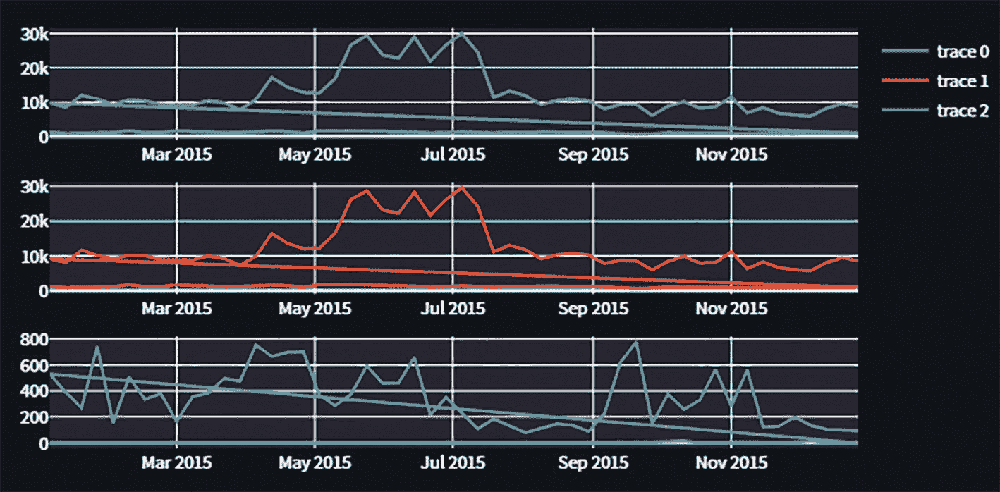

一组三个折线图，时间范围为 2015 年 3 月到 2015 年 11 月。三条曲线分别代表轨迹 0、1 和 2，均呈下降趋势。

图 3-19：显示 Plotly 子图

子图可以包含任何类型的图表。在我们的示例中，我们在所有三行中都使用了折线图。

### 注意

通过在 Streamlit 中定义列，图表可以上下堆叠或并排放置。这些列充当放置图表的容器。

## 总结

可视化是数据科学和机器学习中的一个重要方面。可视化技术有助于数据科学家更好地理解数据。在本章中，我们从理解可视化基础开始，然后讨论了如何使用 Streamlit 的内置函数在我们的应用程序中显示数据点。

最后，我们讨论并实现了 Python 中可供数据科学和机器学习开发人员使用的不同可视化技术。

在下一章中，我们将讨论如何在应用程序中实现媒体元素。