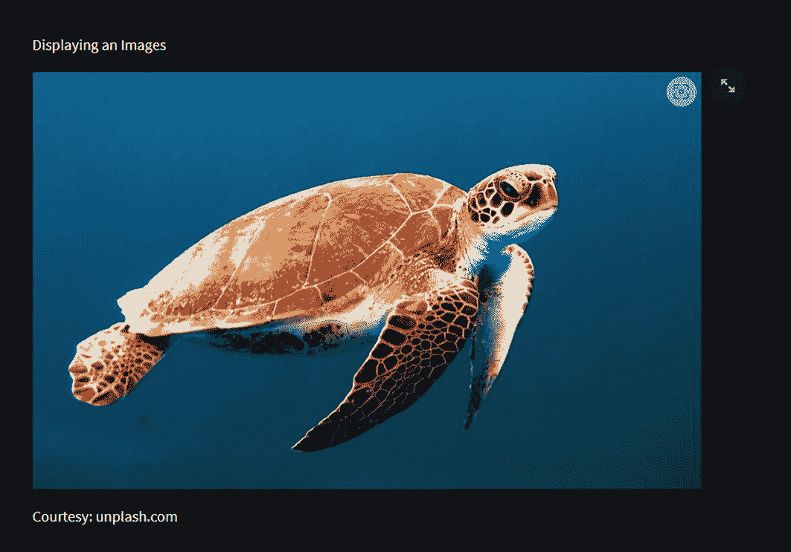
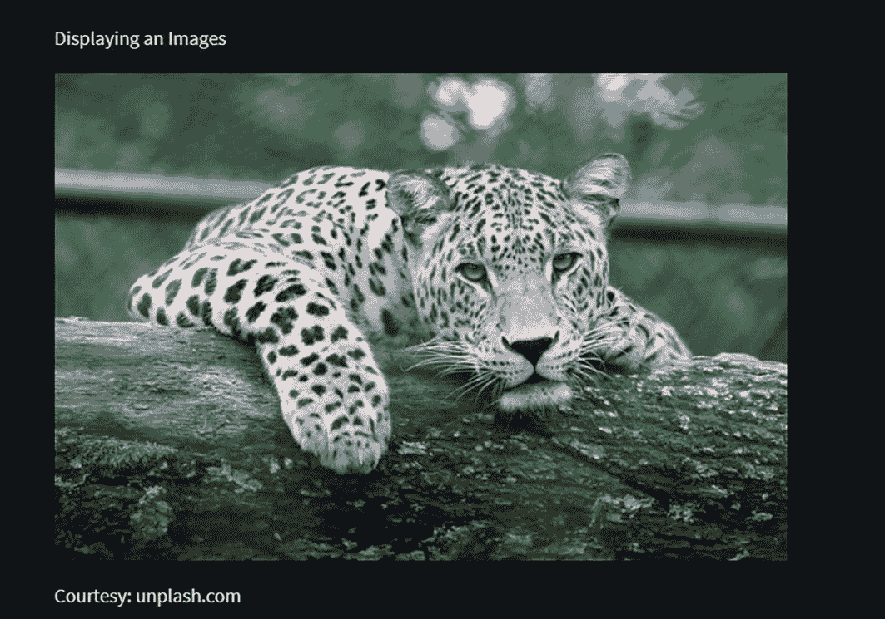
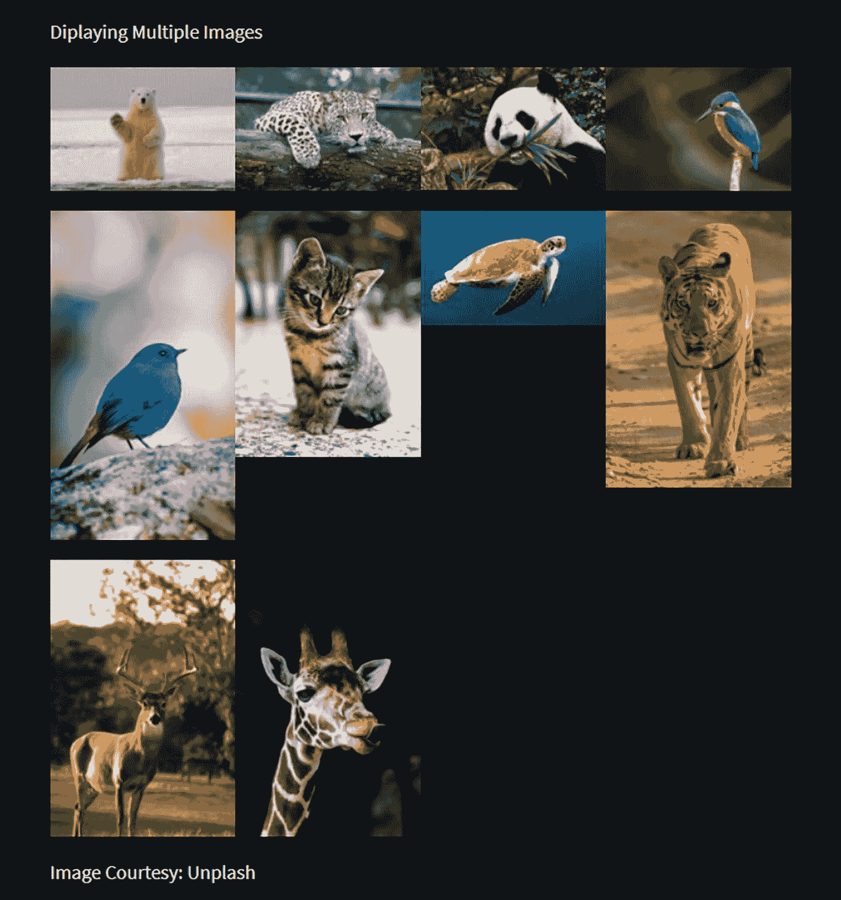
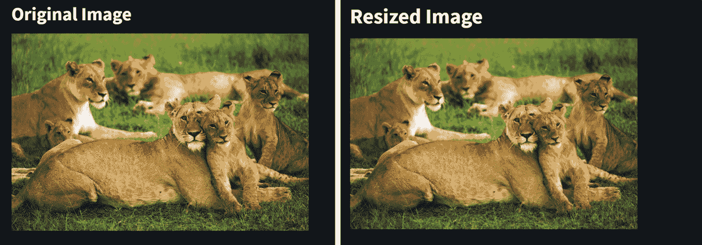
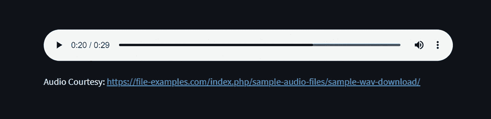
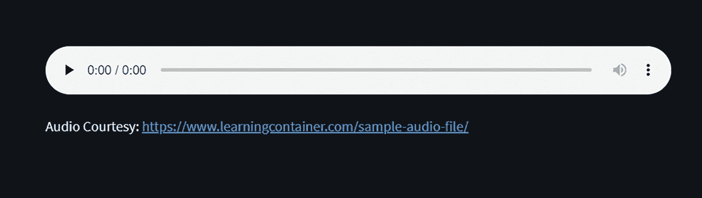
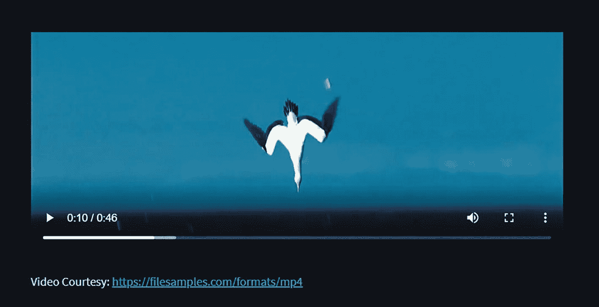
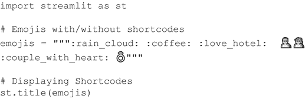
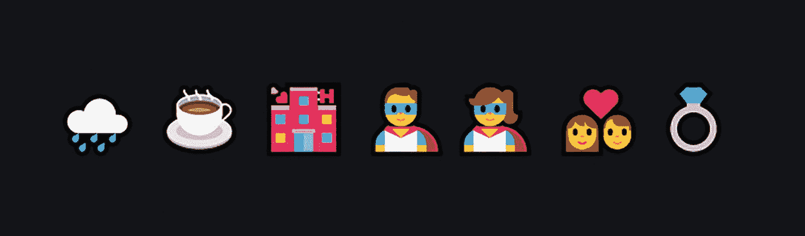

# 4. 数据与媒体元素

在本章中，我们将重点介绍我们能看到和听到的数据。这类数据以图像、音频、视频或动画的形式存在，被称为*多媒体数据*。一个应用程序可能包含其中一种或多种类型的数据组合。

由于机器学习模型可以基于图像、音频或视频来构建，我们将学习如何在应用程序中展示这些多媒体数据，以便在最后的项目构建章节中使用这些技术。现在，让我们从图像开始，大多数机器学习模型都是围绕目标检测、目标识别和图像分割来开发的。

## 图像

在机器学习/数据科学应用中，所需的主要多媒体文件之一就是图像。图像通常用于可视化与机器学习模型相关的结果。在本节中，我们将探索图像，以便将来能够构建高效的图像应用程序。

在我们的示例中，我们将图像存储在一个名为 `files` 的目录中，并将其导入到应用程序中。这有助于将图像与代码分离。请参见`代码清单 4-1`。

```
import streamlit as st
st.write("显示图像")
#### 通过指定路径显示图像
st.image("files/animal7.jpg")
# 图片致谢：unplash
st.write("图片致谢：unplash.com")
代码清单 4-1
01_image_local.py
```

图 4-1 显示了这段代码的结果。



一张深色屏幕的截图，展示了一只乌龟在水体中游泳的图片。标题显示为“显示图像”。

`图 4-1`

在应用程序中显示 JPG 图像

我们也可以使用任何支持打开图像的 Python 库，例如 OpenCV、PIL 等。并非强制使用某个特定的库。之后，我们需要将存储在变量中的同一图像文件传递给 Streamlit 的 `image()` 函数。

`代码清单 4-2` 和图 4-2 展示了如何使用 URL 显示图像。



一张深色屏幕的截图，展示了一只豹子凝视着并攀爬原木的图片。标题显示为“显示图像”。

`图 4-2`

使用 URL 显示图像

```
import streamlit as st
st.write("显示图像")
#### 显示图像 URL
st.image("https://tinyurl.com/322vu3ab")
#### 图片致谢
st.write("致谢：unplash.com")
代码清单 4-2
02_image_url.py
```

带有其他参数的 `image()` 函数的语法如下：

```
st.image(image, caption, width, use_column_width, clamp, channels, output_format)
```

在应用程序中显示图像时，会涉及各种参数，如表 4-1 所述。

`表 4-1`

`image()` 函数的参数

| 参数 | 描述 |
| --- | --- |
| `image (numpy.ndarray, [numpy.ndarray], str, [str], 或 BytesIO)` | 指定将在应用程序中显示的图像。图像可以是单色的，形状为 `(w,h)` 或 `(w,h,1)`；也可以是彩色图像，形状为 `(w,h,3)`；或者是 RGBA 图像，形状为 `(w,h,4)`。图像可以是 URL、本地存储路径、SVG XML 字符串或多张图像的列表。（这里 `(w,h)` 表示图像的高度和宽度。） |
| `caption (str 或字符串列表)` | 提供关于所显示图像的信息。 |
| `width (int 或 None)` | 用于固定将要显示的图像的宽度。当使用 SVG 图像时，由于 SVG 图像尺寸较大，通常会设置此参数。当使用列宽显示多张图像时，也可以调整宽度。 |
| `use_column_width ('auto' 或 'always' 或 'never')` | 当设置为 `auto` 时，图像会以其实际尺寸显示，但不会超过列宽。当设置为 `"always"` 或 `True` 时，图像宽度会被设置为列宽；当设置为 `"never"` 或 `False` 时，图像宽度会设置为其正常尺寸。此参数设置后会覆盖 `width` 参数。 |
| `clamp (bool)` | 图像的钳位值范围，每个通道为 0 到 255。当图像为字节数组格式时可以使用此值；当图像通过 URL 定义时则跳过。如果未设置钳位值且图像的值超出范围，则会引发错误。 |
| `channels ('RGB' 或 'BGR')` | 通道表示图像的颜色信息，指明当图像为 `nd.array` 时使用的格式。通道默认设置为 `RGB` 格式。每个通道对应的值如下：`[:,:,0]` -> 红色通道`[:,:,1]` -> 绿色通道`[:,:,2]` -> 蓝色通道当我们从 OpenCV 等 Python 库读取图像时，需要将通道设置为 `BGR` 而不是 `RGB`。 |
| `Output_format ('JPEG', 'PNG', 或 'auto')` | 此参数定义传输图像数据时使用的格式。照片可以使用有损压缩的 `JPEG` 格式，而图表可以使用无损压缩的 `PNG` 格式。当设置为 `"auto"` 时，压缩类型会根据图像参数的类型和格式自动设置。 |

另一个重要的特性是，可以使用 Streamlit 支持的各种 Python 库，应用计算机视觉技术进行图像处理。

接下来，我们将看到如何在应用程序中显示多张图像。

**注意**

当从 URL 或本地存储显示图像时，应用程序中显示的图像将保持其原始尺寸（即高度和宽度）。我们可以在调用 `st.image` 函数之前，使用任何 Python 库调整图像大小。

## 多张图像

我们可以通过在 `image()` 函数中列出图像，在应用程序中显示多张图像。本节将展示如何显示多张图像。

在`代码清单 4-3`中，我们定义了将分配给应用程序中每张图像的宽度，并以列和网格结构显示。我们可以根据需要调整宽度，并将在第 7 章中学习更多关于 Streamlit 应用程序的列和网格结构。

```
import streamlit as st
#### 图片致谢
st.write("显示多张图像")
#### 列出动物图像
animal_images = [
'files/animal1.jpg',
'files/animal2.jpg',
'files/animal3.jpg',
'files/animal4.jpg',
'files/animal5.jpg',    'files/animal6.jpg',
'files/animal7.jpg',
'files/animal8.jpg',
'files/animal9.jpg',
'files/animal10.jpg'
]
#### 显示多张图像，宽度为 150
st.image(animal_images, width=150)
#### 图片致谢
st.write("图片致谢：Unplash")
代码清单 4-3
03_multiple_local.py
```

图 4-3 显示了结果。



一张深色屏幕的截图，展示了北极熊、豹子、熊猫、鸟、猫、乌龟、老虎、鹿和长颈鹿的图片。标题显示为“显示多张图像”。

`图 4-3`

显示多张图像

**注意**

图像可以通过 URL 或本地目录调用。

我们已经了解了如何在应用程序中定义多张图像，并且可以将其用于书籍、电影等推荐系统中。

在下一节中，我们将展示如何将图像设置为背景。

### 背景图像

我们可以通过 Markdown 语言将图像嵌入为应用的背景图像。下面来看图像是如何显示的；参见`清单 4-4`。

```
import streamlit as st
import base64
#### 将图像设置为背景的函数
def add_local_backgound_image_(image):
with open(image, "rb") as image:
encoded_string = base64.b64encode(image.read())
st.write("图片来源：Unplash")
st.markdown(
f"""

.stApp {{
background-image: url(data:files/{"jpg"};base64,{encoded_string.decode()});
background-size: cover
}}

""",
unsafe_allow_html=True
)
st.write("背景图像")
#### 在函数中调用图像
add_local_backgound_image_('files/animal7.jpg')
清单 4-4
04_background_image.py
```

首先，我们打开一张图像并将其转换为 base64 编码格式。然后，我们定义一个函数，在该函数中使用 Markdown 将图像作为背景调用。我们可以为背景图像定义任何图像格式。图 4-4 展示了结果。


截图展示了一只乌龟在水中游泳的画面。图中显示“背景图像”字样，并注明图片来源为 Unplash。

`图 4-4`

图像作为背景

在下一节中，我们将了解如何调整图像大小以在应用中显示。

### 调整图像大小

在机器学习中，图像会以统一尺寸进行训练，以便从中提取特征并获得图像模型。当模型部署后，我们想用新图像测试模型时，需要将图像调整到与训练模型相同的尺寸。因此，我们将了解如何调整图像大小。在图像上传时也会应用同样的方法。参见`清单 4-5`和图 4-5。



两张截图展示了一群母狮和幼狮坐着的画面。其中包含原始图像和调整大小后的图像。

`图 4-5`

显示 a) 原始图像和 b) 调整大小后的图像

```
import streamlit as st
from PIL import Image
original_image = Image.open("files/animal9.jpg")
#### 显示原始图像
st.title("原始图像")
st.image(original_image)
#### 将图像调整为 600*400
resized_image = original_image.resize((600, 400))
#### 显示调整大小后的图像
st.title("调整大小后的图像")
st.image(resized_image)
清单 4-5
05_image_resize.py
```

**注意**

调整图像大小是为了与训练好的模型图像尺寸匹配。

为了调整图像大小，我们使用了 PIL Python 库。我们可以在应用中使用任何支持图像大小调整的 Python 库。

在下一节中，我们将探讨音频数据。

## 音频

音频是一种多媒体文件类型，我们只能从文件中听到声音。我们可以通过 `st.audio()` 函数在应用中使用音频文件，如`清单 4-6`所示。

我们需要在第一条语句中使用 `rb` 参数以二进制模式打开音频文件，并传入音频文件名。之后，我们使用 Streamlit 的 `audio()` 函数，将保存音频的变量作为输入，从而在应用中显示音频文件。参见图 4-6。



深色屏幕上显示一个滑块条。左侧有一个播放按钮，接着是 0:20 / 0:29，然后是一个带有扬声器图标的长条，底部显示一个已下载文件的 URL。

`图 4-6`

在应用中显示音频文件

```
import streamlit as st
#### 使用文件路径和文件名打开音频
sample_audio = open("files/audio.wav", "rb")
#### 读取音频文件
audio_bytes = sample_audio.read()
#### 使用 st.audio() 函数显示音频，并将开始时间设置为 20
st.audio(sample_audio, start_time = 20)
#### 打印音频来源
st.write("音频来源：https://file-examples.com/index.php/sample-audio-files/sample-wav-download/")
清单 4-6
06_audio.py
```

控制按钮会与音频文件一起显示在应用中。支持的音频文件类型是 MIME 类型。我们可以设置音频文件的开始播放时间。开始时间始终是一个整数值。

我们也可以使用 URL 来代替存储在本地磁盘上的音频文件。这是最佳特性之一，因为我们可以直接访问存储在云端或在线服务器上的音频文件。

`清单 4-7` 展示了一个通过 URL 访问音频文件的示例。参见图 4-7。



深色屏幕上显示一个滑块条。左侧有一个播放按钮，接着是 0:00 / 0:00，然后是一个带有扬声器图标的长条，底部显示一个学习容器 URL。

`图 4-7`

使用 URL 显示音频文件

```
import streamlit as st
#### 使用文件路径和文件名打开音频并读取音频文件
sample_url = st.audio("https://www.learningcontainer.com/wp-content/uploads/2020/02/Kalimba.mp3")
st.write("音频来源：https://www.learningcontainer.com/sample-audio-file/")
清单 4-7
07_audio_url.py
```

Streamlit 支持大多数音频格式，如 MP3、WAV、OGG 等。当未指定音频格式时，Streamlit 会自动采用 `audio/wav` 格式。在下一节中，我们将探讨如何在 Streamlit 应用中显示视频文件。

## 视频

我们可以使用 `st.video()` 函数将任意视频上传到应用程序中。与音频文件类似，我们可以指定上传视频的起始时间，而不是默认从 0 秒开始。这里的整数值以秒为单位指定时间。让我们使用该函数在应用程序中查看视频。请参见`代码清单 4-8`。

```
import streamlit as st
#### 使用包含文件名的文件路径打开视频并读取视频文件
sample_video = open("files/ocean.mp4", "rb").read()
#### 使用 st.video() 函数显示视频
st.video(sample_video, start_time = 10)
st.write("视频来源: https://filesamples.com/formats/mp4")
代码清单 4-8
08_video_local.py
```

在我们的应用程序中，我们将起始时间设置为 10，这意味着视频将从第 10 秒开始播放。除非我们点击播放按钮，否则视频不会开始播放。请参见图 4-8。



一个深色屏幕显示了一个视频文件。这是一个 46 秒的视频，并在第 10 秒处暂停。下方是一个 mp4 格式文件的 URL。

`图 4-8` 在应用程序中显示视频文件

播放、暂停、全屏和音量等控件会显示出来。`st.video` 还提供了播放速度、下载功能和画中画等功能，可以通过点击带有三个垂直点的按钮来探索。

在某些情况下，标准浏览器不支持以 MP4V 格式编码的视频，但可以通过在 Python 中导入 OpenCV 库将其用作导出选项。我们也可以通过将 MP4V 编码的视频转换为 Streamlit 支持的 H.264 格式来显示它。

我们还可以使用 URL 在应用程序中上传视频。在`代码清单 4-9`中，我们将在应用程序中使用一个 YouTube 视频链接。请参见图 4-9。


一个深色屏幕描绘了一个视频文件。它有一张狮子图片，上面覆盖着“国家地理野生”的文字。左上角显示一个标志和“狮子 101”，左下角显示“在 YouTube 上观看”。

`图 4-9` 使用 YouTube URL 显示视频

```
import streamlit as st
#### 使用 YouTube URL 显示视频
st.video("https://www.youtube.com/watch?v=OMkEVX23BdM")
#### 由 YouTube 频道提供
st.write("视频来源: 国家地理频道")
代码清单 4-9
09_video_youtube.py
```

我们还可以为 YouTube 视频提供起始时间以及 URL。视频的大小是 Streamlit 设置的默认值，无法更改。要更改视频的高度和宽度，我们需要将视频嵌入到 HTML 代码中，然后在 Streamlit 应用程序中运行。

**注意**
当我们在应用程序中使用 URL 显示视频时，无需像本地上传那样读取视频文件。

## 气球

`代码清单 4-10` 在我们的应用程序中创建了一个气球飞行的动画。请参见图 4-10。


一个深色屏幕展示了一组向上飞行的彩色动画气球。左上角有一个停止按钮，并显示“庆祝气球”。

`图 4-10` 显示向上移动的动画气球

```
import streamlit as st
### 动画雪花
st.balloons()
代码清单 4-10
10_balloons.py
```

动画气球从我们应用程序的底部开始，向顶部移动。动画本质上非常快，我们可以添加 `time.sleep()` 函数来延迟动画的开始。我们将在下一节中介绍另一个内置的动画函数。

## 雪花

当`Snowflake`公司收购`Streamlit`时，引入了动画雪花。因此，此动画在`Streamlit` 1.17 及以上版本中可用。动画雪花的函数是`snow()`。代码清单 4-11 显示了代码，图 4-11 显示了输出。


**图 4-11** 显示动画雪花

```python
import streamlit as st

### 动画雪花
st.snow()
```
代码清单 4-11
`11_snowflake.py`

> **注意**
> 内置的雪花函数仅在`Streamlit` 1.17 及以上版本中有效。

动画雪花的行为就像从天空飘落一样；也就是说，它们在应用程序中从上到下开始动画。

## 表情符号

表情符号是微型图标或图像，通常用于在数字通信中描述表情、感受或信息，现在也用于 Web 应用程序。这在互联网开始蓬勃发展且`Unicode`变得可接受时成为可能。`Streamlit`支持这些表情符号，因此可以在我们的应用程序中使用。

添加表情符号有两种方法：一种是使用 ASCII 值添加表情符号，另一种是添加相应表情符号的短代码。您可以根据以下示例决定更喜欢哪一种。请参见代码清单 4-12 和图 4-12。

**代码清单 4-12.** `12_emojis.py`





**图 4-12** 显示表情符号

图 4-12 显示了我们使用和不使用短代码显示的表情符号。这里显示了诸如`:rain_cloud:`、`:coffee:`、`:love_hotel:`和`:couple_with_heart:`之类的短代码。我们也可以像为男性和女性超级英雄编写的那样，以文本格式编写表情符号。建议使用短代码编写表情符号，因为这样我们知道图片在应用程序中描绘的是什么。

您可以在[`https://streamlit-emoji-shortcodes-streamlit-app-gwckff.streamlitapp.com/`](https://streamlit-emoji-shortcodes-streamlit-app-gwckff.streamlitapp.com/)查看`Streamlit`应用程序可用的所有表情符号短代码。您也可以使用其他表情符号网站显示任何其他不可用的表情符号。

我们可以使用表情符号替换第 2 章中涵盖的任何文本。

## 总结

在本章中，我们了解了如何在应用程序中显示各种格式的多媒体数据，例如图像、音频和视频。我们了解了如何从本地存储或 URL 显示图像。我们还了解了如何调整图像大小、定义多个图像以及将图像显示为背景。

我们还研究了`Streamlit`中作为内置函数可用的气球和雪花动画。

最后，我们学习了如何在数据中显示表情符号。

在下一章中，我们将研究按钮和滑块及其相关功能。