# 5. 按钮和滑块

在本章中，我们将讨论如何创建不同类型的按钮。这些按钮是用户与应用程序交互的媒介。让我们开始逐一创建这些按钮。

## 按钮

按钮通过以下语法创建：

```python
st.button('button_name')
```

让我们使用此语法创建一个按钮；参见清单 5-1。

```python
import streamlit as st
st.title('创建按钮')
#### 定义一个按钮
button = st.button('点击这里')
if button:
    st.write('您已点击了按钮')
else:
    st.write('您尚未点击按钮')
```
清单 5-1 `01_button.py`

在清单 5-1 中，我们使用了一个 `if` 条件来判断按钮是否被点击。如果按钮被点击，则执行语句“您已点击了按钮”。如果按钮未被点击，则语句“您尚未点击按钮”生效。图 5-1 显示了结果。

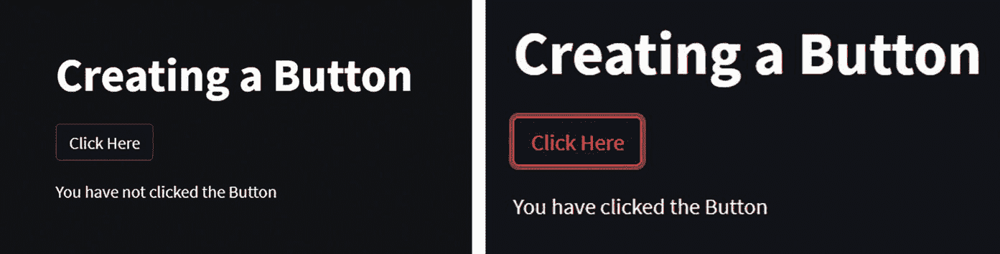

**图 5-1** 按钮输出 a) 点击前 b) 点击后

## 单选按钮

要创建单选按钮，我们可以使用以下语法：

```python
st.radio('button_labels', radio_button_names, index=index_value)
```

清单 5-2 创建了三个包含不同性别的单选按钮，图 5-2 显示了输出结果。

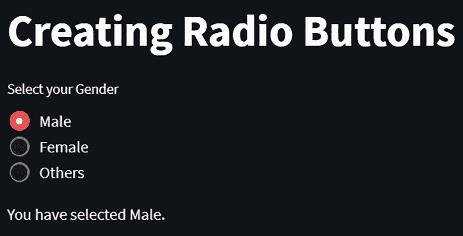

**图 5-2** 单选按钮

```python
import streamlit as st
st.title('创建单选按钮')
#### 定义单选按钮
gender = st.radio(
    "选择您的性别",
    ('男性', '女性', '其他'))
if gender == '男性':
    st.write('您已选择男性。')
elif gender == '女性':
    st.write("您已选择女性。")
else:
    st.write("您已选择其他。")
```
清单 5-2 `02_radio_buttons.py`

默认情况下，第一个单选按钮被选中，但您可以通过索引进行更改。我们可以使用清单 5-3 中的代码来更改索引。图 5-3 显示了输出结果。

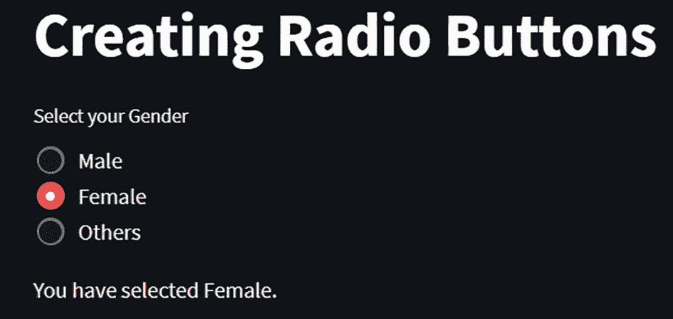

**图 5-3** 带定义索引选择的单选按钮

```python
import streamlit as st
st.title('创建单选按钮')
gender = ('男性', '女性', '其他')
#### 定义带索引值的单选按钮
gender = st.radio(
    "选择您的性别",
    gender,
    index = 1)
if gender == '男性':
    st.write('您已选择男性。')
elif gender == '女性':
    st.write("您已选择女性。")
else:
    st.write("您已选择其他。")
```
清单 5-3 `03_radio_buttons_index.py`

这里，索引值被改为 1，因此“女性”单选按钮被选中。执行后，输出显示在屏幕上。

## 复选框

要创建复选框，我们将使用以下语法：

```python
st.checkbox('button_label', checkbox_names, index=index_value)
```

清单 5-4 创建了三个复选框，对应爱好：书籍、电影和运动。

```python
import streamlit as st
st.title('创建复选框')
st.write('选择您的爱好：')
#### 定义复选框
check_1 = st.checkbox('书籍')
check_2 = st.checkbox('电影')
check_3 = st.checkbox('运动')
```
清单 5-4 `04_checkbox.py`

可以创建一个或多个复选框，因为对数量没有限制。图 5-4 显示了选择前后的复选框。我们甚至可以选中所有可用的复选框。

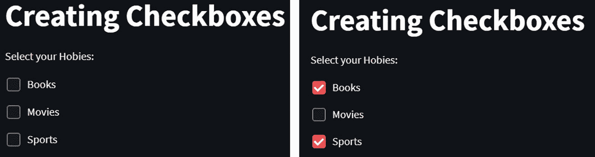

**图 5-4** 复选框输出 a) 点击前 b) 点击后

创建的复选框可以通过清单 5-5 中的代码进行预选。图 5-5 显示了输出结果。

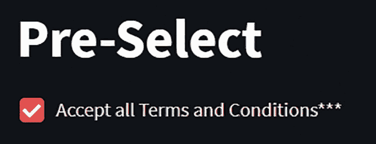

**图 5-5** 预选复选框输出

```python
import streamlit as st
st.title('预选')
check = st.checkbox('接受所有条款和条件***', value=True)
```
清单 5-5 `05_checkbox_pre_select.py`

要预选一个复选框，我们需要为 `value` 属性添加布尔值 `True`。

## 下拉菜单

下拉菜单包含列出的选项，当用户点击时会展开显示。在 Streamlit 中使用以下语法创建下拉菜单很容易：

```python
st.selectbox(label, options, index)
```

我们将创建一个包含多个选项的简单下拉菜单；参见清单 5-6。

```python
import streamlit as st
st.title('创建下拉菜单')
#### 创建下拉菜单
hobby = st.selectbox('选择您的爱好：',
                    ('书籍', '电影', '运动'))
```
清单 5-6 `06_dropdown.py`

图 5-6 显示了将在我们的应用程序中显示的下拉菜单。

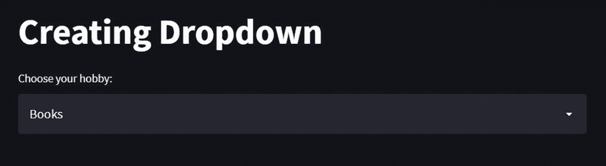

**图 5-6** 显示下拉菜单

在图 5-6 中，用户未与下拉菜单交互，因此我们看不到在代码中分配的选项列表，并且默认情况下第一个选项被选中，类似于单选按钮。图 5-7 显示了点击时提供的所有选项。

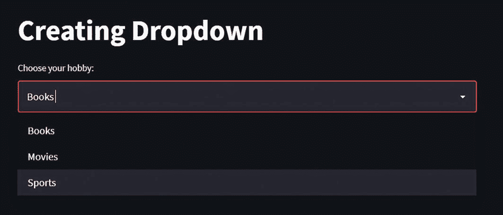

**图 5-7** 显示下拉菜单中的选项

我们可以通过提供索引值来更改默认选中的选项。参见清单 5-7 和图 5-8。

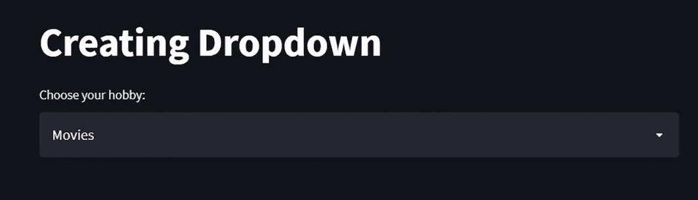

**图 5-8** 设置索引值后显示下拉菜单

```python
hobby = st.selectbox('选择您的爱好：',
                    ('书籍', '电影', '运动'),
                    index=1)
```
清单 5-7 `07_dropdown_index.py`

接下来，我们将研究如何从下拉菜单中选择多个选项。

## 多选功能

现在我们将学习如何实现多选选项。参见代码清单 5-8。

```python
import streamlit as st
st.title('多选')
#### 定义带预选值的多选组件
hobbies = st.multiselect(
    '你的爱好是什么',
    ['阅读', '烹饪', '看电影/电视剧', '玩游戏', '绘画', '徒步'],
    ['阅读', '玩游戏'])
```
代码清单 5-8 `08_mutlti_select.py`

在这段多选代码中，我们预选了两个爱好；输出结果如图 5-9 所示。

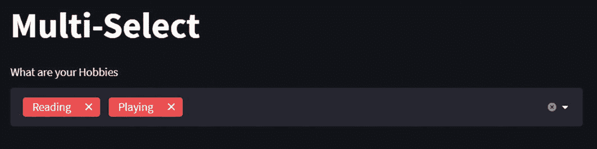

图 5-9 多选输出结果

可以通过从代码中移除已选项来跳过预选，如代码清单 5-9 所示。结果见图 5-10 和图 5-11。

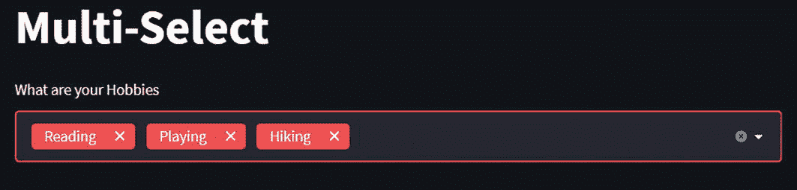

图 5-11 选择后的多选输出结果

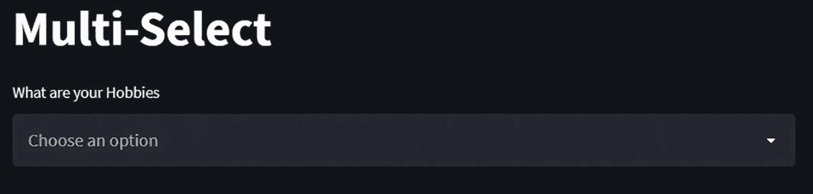

图 5-10 无预选值的多选输出结果

```python
hobbies = st.multiselect(
    '你的爱好是什么',
    ['阅读', '烹饪', '看电影/电视剧',
     '玩游戏', '绘画', '徒步'])
```
代码清单 5-9 `09_mutlti_select_no_pre_select.py`

接下来我们将学习如何使用下载按钮下载文件。

**注意：** 如果多选选项超过 100 个属性，用户可能会遇到较长的加载时间。因此，建议使用较少的属性。

## 下载按钮

当我们允许用户直接从应用程序下载结果或文件时，Streamlit 提供了一个供用户点击的下载按钮。文件格式可以是 JPG/PNG、TXT、CSV 等。参见代码清单 5-10。

```python
import streamlit as st
st.title("下载按钮")
#### 创建下载按钮
down_btn = st.download_button(
    label="下载图片",
    data=open("./files/fam.jpg", "rb"),
    file_name="lions.jpg",
    mime="image/jpg"
)
```
代码清单 5-10 `10_download_button.py`

在上述代码中，我们为下载按钮分配了一张图片。当用户点击“下载图片”按钮时，一个 JPG 文件将被下载到本地系统。见图 5-12。


图 5-12 显示下载图片按钮 a) 点击前 和 b) 点击后

类似地，我们可以使用下载按钮来下载 CSV 文件。在某些情况下，我们可以通过下载按钮将分析结果的数据框转换为 CSV 格式。参见代码清单 5-11。

```python
st.download_button(
    label="下载 CSV",
    data=open("./files/avocado.csv", "rb"),
    file_name='data.csv',
    mime='csv',
)
```
代码清单 5-11 `11_download_dataframe.py`

在我们的示例中，我们使用了本地磁盘上的一个 CSV 文件，并将其提供给下载按钮。在下一节中，我们将了解如何在用户等待时提供进度条。

## 进度条

我们在从网络下载东西时都见过进度条。我们可以用同样的方式让用户知道某些内容仍在下载中。参见代码清单 5-12。

```python
import streamlit as st
import time
st.title('进度条')
#### 定义进度条
download = st.progress(0)
for percentage in range(100):
    time.sleep(0.1)
    download.progress(percentage+1)
st.write('下载完成')
```
代码清单 5-12 `12_progress_bar.py`

在图 5-13 中，我们看到一个尚未开始的进度条，而在图 5-14 中，我们看到一个已达到 100% 的进度条。

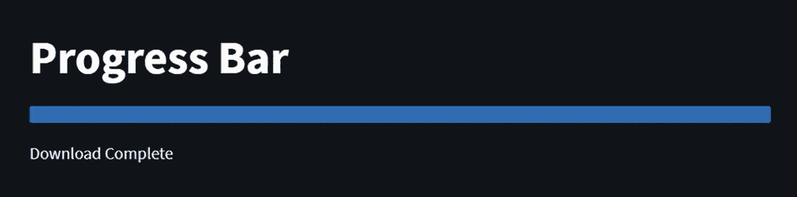

图 5-14 显示已完成的进度条


图 5-13 显示进度条

在下一节中，我们将讨论旋转加载器以及何时可以在应用程序中使用它们。

## 旋转加载器

旋转加载器用于在用户等待应用程序执行某些任务时显示一条消息。具体来说，我们可以在上传数据并由应用程序处理时使用旋转加载器。该消息是临时性的。参见代码清单 5-13。

```python
import streamlit as st
import time
st.title('旋转加载器')
#### 定义旋转加载器
with st.spinner('加载中...'):
    time.sleep(5)
    st.write('你好，数据科学家们')
```
代码清单 5-13 `13_spinner.py`

我们为旋转加载器设置了 5 秒的等待时间，如图 5-15 (a) 所示。等待时间结束后，我们将显示“你好，数据科学家们”文本，如图 5-15 (b) 所示。

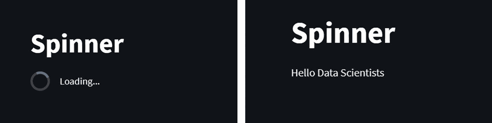

图 5-15 显示旋转加载器 a) 缓冲中 和 b) 等待时间结束后

旋转加载器通常用于应用程序正在处理结果时。

## 总结

在本章中，我们讨论了可以在应用程序中使用的各种按钮。我们从默认按钮开始，然后介绍了可以包含多个选项的单选按钮。我们还讨论了复选框，其中可以有多个选项并进行选择。

我们还看到了下拉菜单，用户只能从给定选项中选择一个。我们还介绍了多选菜单，我们可以从可用选项中选择多个或全部选项。然后，我们讨论了使用下载按钮下载文件。

最后，我们学习了进度条和旋转加载器，它们可以在处理任务和下载文件时使用。

在下一章中，我们将进一步讨论如何通过表单获取不同类型的数据。