# 6. 表单

在本章中，我们将讨论用于获取用户输入并据此提供结果的各种表单属性。在机器学习应用中，当我们想要测试模型或向用户提供结果时，首先需要收集用户的输入。例如，如果我们想在将图像交给模型预测之前对其应用亮度或对比度值，就需要用户输入来设置这些值并分析相关结果。上传文件也需要用户输入，并且用户/客户端会期望得到结果。

在创建数据科学或机器学习应用时，我们需要通过使应用程序具有动态性来关注用户交互。用户交互是指从用户处接收输入，然后显示结果。用户输入可以是文本、数字、日期/时间选择以及颜色选择器的形式。本章将让我们深入了解获取用户输入的各种方式。

为了从我们的应用程序获取用户输入，我们将使用文本框、文本区域、日期输入、数字输入、时间输入和颜色选择器。让我们从输入框开始，这是本章介绍的第一种方法。

## 文本框

文本输入框允许用户输入数据。它是表单中最重要的元素之一。在本节中，让我们看看如何创建一个文本框。

代码清单 6-1 创建了一个文本框，用于接受用户输入的姓名文本数据。

```
import streamlit as st
st.title("文本框")
#### 创建文本框
name = st.text_input("请输入您的姓名")
st.write("您的姓名是", name)
代码清单 6-1
01_text_box.py
```

在图 6-1 (a) 中，我们可以看到定义了一个带有姓名字段的输入框，而图 6-1 (b) 显示了用户指定的输入数据，并作为结果显示。要提交输入的文本，用户需要按下键盘上的回车键。

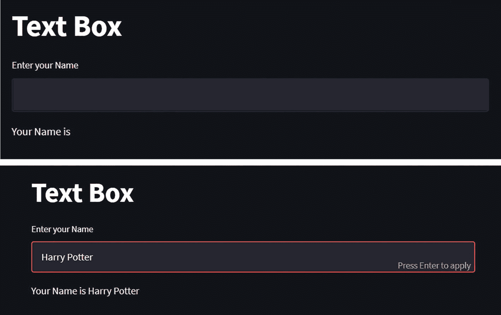

一个深色背景的文本框，显示“请输入您的姓名”和“您的姓名是”，以及一个输入数据后显示“您的姓名是 哈利·波特”的文本框。

图 6-1

a) 输入数据前的文本框，b) 输入数据后的文本框

我们可以使用 `max_chars` 参数限制在文本框中输入的字符数。在代码清单 6-2 中，我们将字符数限制为最多 10 个，如图 6-2 文本框角落所示。

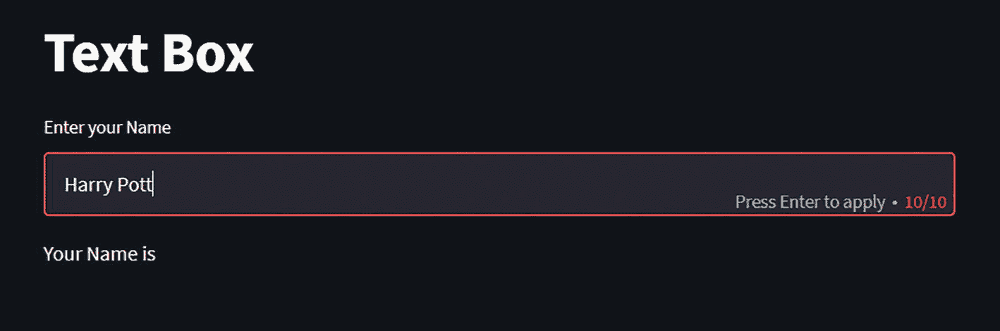

一个深色背景的文本框，包含对话框“请输入您的姓名 哈利·波特”和文本“您的姓名是”。

图 6-2

显示带有字符限制的文本框

```
import streamlit as st
st.title("文本框")
#### 创建字符限制为 10 的文本框
name = st.text_input("请输入您的姓名", max_chars=10)
st.write("您的姓名是", name)
代码清单 6-2
02_text_box_max_chars.py
```

我们可以将同一个文本框用作密码框，因为它会隐藏文本数据。要实现密码输入框，我们将使用代码清单 6-3 中的代码。图 6-3 显示了结果。

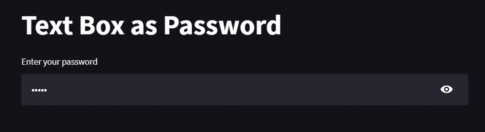

一个深色背景的文本框作为密码框，显示“请输入您的密码”字段，其中包含 5 个字符的数据。

图 6-3

显示作为密码字段的文本框

```
import streamlit as st
st.title("作为密码的文本框")
password = st.text_input("请输入您的密码", type='password')
代码清单 6-3
03_input_text_password.py
```

我们还可以对密码输入框实现字符限制。我们可以通过点击文本框末尾的眼睛图标来查看密码，如图 6-4 所示。

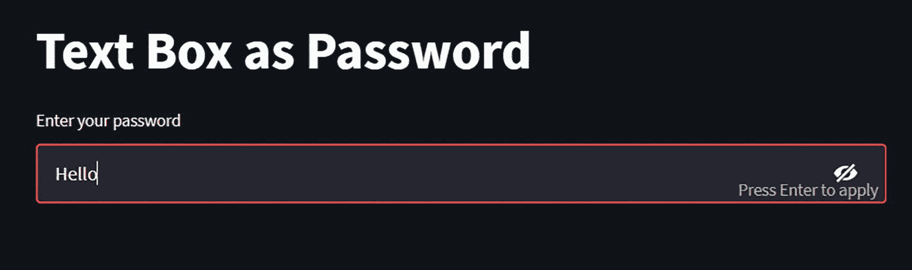

一个深色背景的文本框作为密码框，包含“请输入您的密码”字段，其中显示文本“Hello”。

图 6-4

显示带有可见字符的密码字段文本框

现在，让我们看看可以获取多行输入的文本区域。

## 文本区域

当我们想要从用户那里获取多行文本时，会使用文本区域。这种格式通常用于分析情感，例如评论、评价、反馈或社交媒体或网站上给出的任何意见。我们可以在代码清单 6-4 中看到如何定义文本区域。

```
import streamlit as st
#### 创建文本区域
input_text = st.text_area("请输入您的评价")
#### 打印输入的文本
st.write("""您输入了:  \n""",input_text)
代码清单 6-4
04_text_area.py
```

如图 6-5 所示，文本区域可以在同一个框内包含多行。还可以从应用程序中调整文本区域的大小。

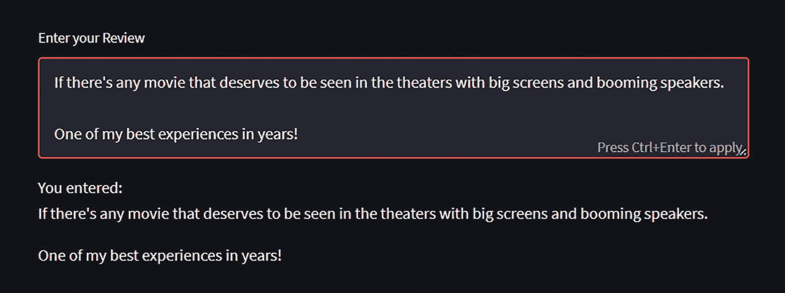

一个深色背景的屏幕，带有“请输入您的评价”字段，其中包含文本“如果有哪部电影值得在拥有大屏幕和震撼音响的电影院观看，那就是这部。这是我多年来最好的体验之一。”

图 6-5

显示文本区域

在下一节中，我们将学习如何在应用程序中获取数字输入。

## 数字输入

在这种输入类型中，用户只能在输入框中输入数字。要将数字定义为输入，我们将使用 Streamlit 的 `number_input()` 函数。请参见代码清单 6-5 和图 6-6。

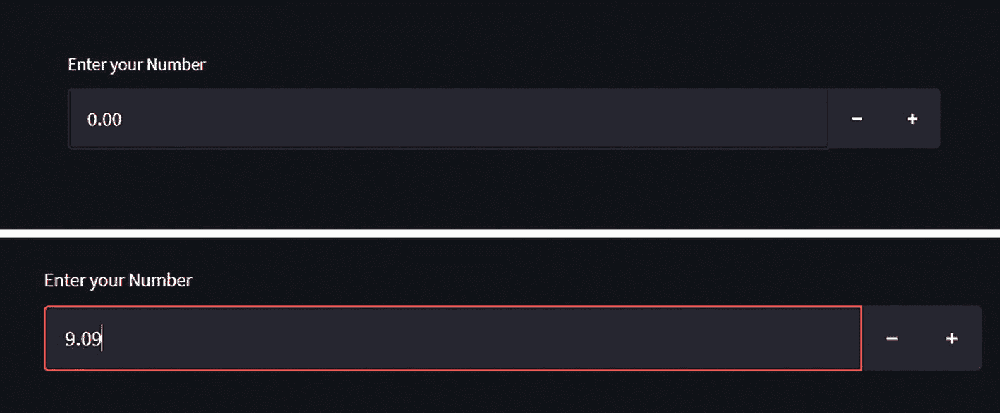

一个深色背景的屏幕，带有“请输入您的数字”字段和一个空白框，下方显示“请输入您的数字”并输入了 9.09。

图 6-6

显示数字输入 a) 输入数据前，b) 输入数据后

```
import streamlit as st
#### 创建数字输入
st.number_input("请输入您的数字")
代码清单 6-5
05_number.py
```

我们可以通过数字框旁边的 - 和 + 来减少或增加数字。数字可以是小数或整数。

我们还可以通过指定起始和结束数字来限制数字范围。如果用户未指定任何值，我们还可以设置默认值。`number_input()` 函数中还有一个参数叫做 `step_size`。当设置了 `step_size` 时，在从输入框更改数字时，它将会加到提供的默认值上（即 `number` + `step_size`）。请参见代码清单 6-6 和图 6-7。

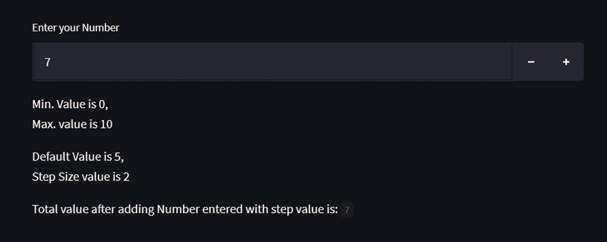

一个深色背景的屏幕，带有“请输入您的数字”字段和输入值 7。下方显示最小值、最大值和默认值，以及步长值和总值。

图 6-7

显示带有所有参数的数字输入

```
import streamlit as st
#### 创建数字输入
num = st.number_input("请输入您的数字", 0, 10, 5, 2)
st.write("最小值是 0,  \n  最大值是 10")
st.write("默认值是 5,  \n  步长值是 2")
st.write("输入数字与步长值相加后的总值为:", num)
代码清单 6-6
06_number_range.py
```

在我们之前的示例中，我们将默认数字设置为 5，`step_value` 设置为 2。数字的范围分别从 0 开始，到 10 结束。当我们想要增加或减少默认值 5 时，数字将根据 `step_value` 的值进行变化。

注意

`step_value` 用于通过数字输入框提供的 `-` 和 `+`（减号和加号）按钮来改变数字。

在下一节中，我们将了解用户如何指定时间和日期。

## 时间

我们可以定义时间来表示特定时段，以显示用户在我们的应用程序中使用机器学习模型的时间。它采用 24 小时制。参见代码清单 6-7 和图 6-8。

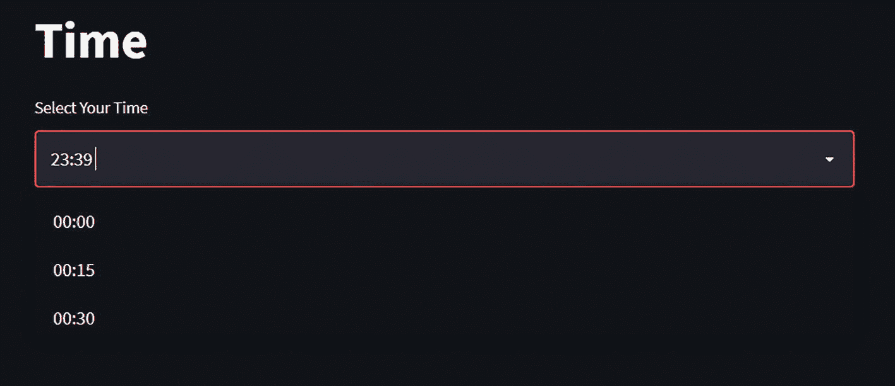

深色屏幕上显示时间，以及“选择您的时间”字段下的选项列表，其中数据 23:39 被高亮显示。

**图 6-8** 显示当前时间为默认值，并带有下拉时间选项

```
import streamlit as st
st.title("时间")
#### 定义时间函数
st.time_input("选择您的时间")
代码清单 6-7
07_time.py
```

我们不能设置当前时间之前的时间。此函数提供的时间是当前时间之后一小时，时间间隔为 15 分钟。

> **注意：** `time_input()` 函数将当前系统时间视为默认时间。

接下来，我们将介绍 Streamlit 提供的 `date` 函数。

## 日期

日期帮助我们分别定义年、月、日。我们使用以下语法来定义日期：

```
st.date_input()
```

我们在应用程序中定义了 `date` 函数，如代码清单 6-8 所示。

```
import streamlit as st
st.title("日期")
#### 定义日期函数
st.date_input("选择日期")
代码清单 6-8
08_date.py
```

我们还可以更改年、月、日的默认格式。可以通过日历选择日期，如图 6-9 所示。

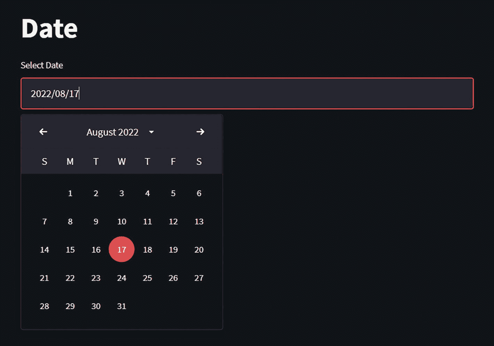

深色屏幕上显示日期，列出了“选择日期”字段下的选项，并带有 2022 年 8 月的日历。

**图 6-9** 使用日历显示当前日期

我们还可以通过在 `date_input()` 函数中指定 `min_value` 和 `max_value` 值来设置日历的开始和结束日期。参见代码清单 6-9 和图 6-10。

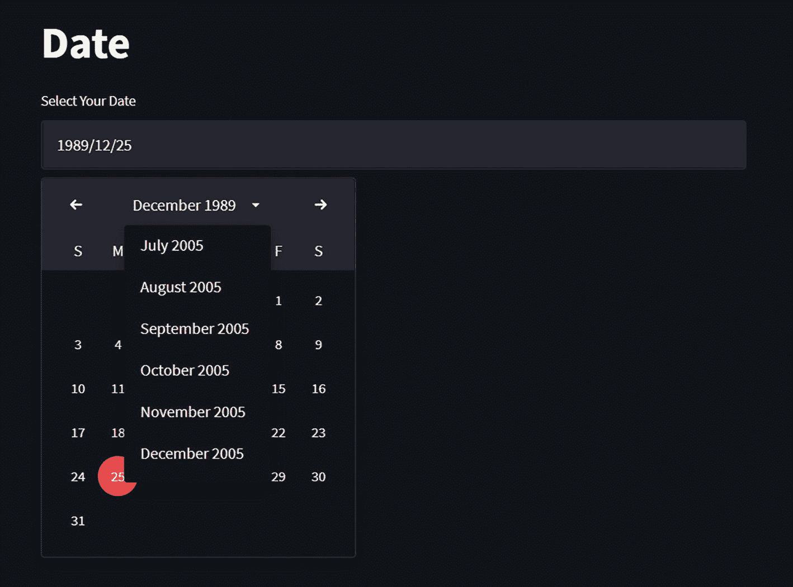

深色屏幕上的日期页面，列出了“选择日期”字段下的选项，并带有 1989 年 12 月的日历。

**图 6-10** 设置开始和结束日期

```
import streamlit as st
import datetime
st.title("日期")
#### 定义时间函数
st.date_input("选择您的日期", value=datetime.date(1989, 12, 25),
min_value=datetime.date(1987, 1, 1),
max_value=datetime.date(2005, 12, 1))
代码清单 6-9
09_date limit.py
```

现在我们知道如何在应用程序中使用日历了。接下来要介绍的元素是颜色选择框。

> **注意：** 默认日期设置为当前日期。

## 颜色

Streamlit 提供了一个独特的颜色选择框作为输入功能。通过使用颜色小部件，我们可以选择任何我们想要的颜色。颜色代码是用于定义颜色的十六进制数字。参见代码清单 6-10 和图 6-11。

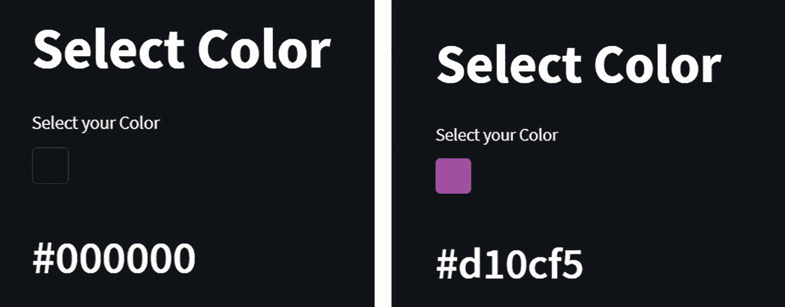

两个深色屏幕，左侧显示“选择颜色”文本及其字段（颜色选择前），右侧显示已选择深色及其代码（颜色选择后）。

**图 6-11** 显示颜色选择小部件 a) 颜色选择前 和 b) 颜色选择后

```
import streamlit as st
st.title("选择颜色")
#### 定义颜色选择器
color_code = st.color_picker("选择您的颜色")
st.header(color_code)
代码清单 6-10
10_color.py
```

默认选择的颜色是黑色，其十六进制值为 `#000000`。颜色小部件有一个滑块，并且还有一个更改 RGB 值的选项，如图 6-12 所示。

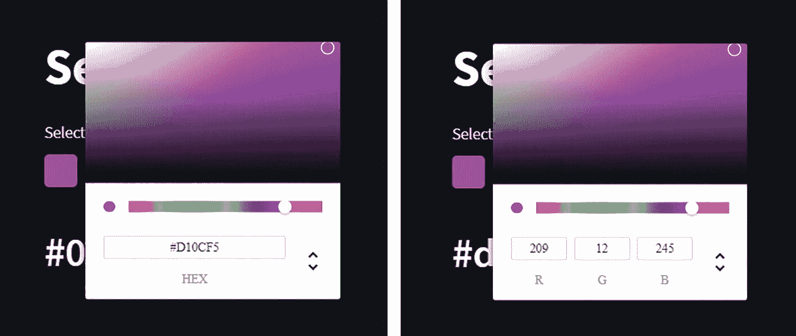

两个深色屏幕显示颜色选择小部件。左侧是带有值的十六进制颜色模式，右侧是带有 R、G、B 值的颜色模式。

**图 6-12** 显示颜色选择小部件 a) 带有十六进制值 和 b) 带有 RGB 值

在下一节中，我们将讨论如何在我们的 Streamlit 应用程序中让用户以各种格式的文件作为输入。

## 文件上传

有时用户需要在 ML/DS 应用程序中从本地存储上传文件进行分析。文件可能用于图像中的目标检测/识别、基于 CSV 数据的预测、文本文件中的文本检测/摘要（NLP 技术）等。

上传文件是向应用程序输入数据的一种方式。数据可以是文本文件、CSV 文件或图像的形式。我们将看到如何将如此多样化的数据上传到我们的应用程序中，并将其存储在特定目录中。我们将从文本文档开始。

### 文本/Docx 文档

仅包含文本数据的文件被视为文本文档。文本文件可以使用记事本等文本编辑器创建。我们将了解如何将文本文档（特别是 `.docx` 文件）上传到我们的应用程序中。为了查看 `.docx` 文件的内容，我们将使用 `docx2txt` Python 库。还有其他类似的库可供使用。请参见代码清单 6-11 和图 6-13。

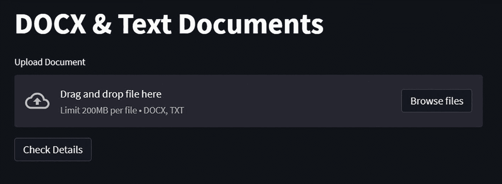

一个深色屏幕，显示文本“Docx”和文本文档，包含上传文档字段，并在左下方有“检查详情”按钮。

图 6-13

显示上传前的文档上传区域

```
#导入必要的库
import streamlit as st
import docx2txt
st.title("DOCX & Text Documents")
#### 将文件上传器函数定义在一个变量中
text_file = st.file_uploader("Upload Document", type=["docx","txt"])
#### 检查文档详情的按钮
details = st.button("Check Details")
#### 获取文档详情的条件
if details:
if text_file is not None:
#### 获取文档详情，如名称、类型和大小
doc_details = {"file_name":text_file.name, "file_type":text_file.type,
"file_size":text_file.size}
st.write(doc_details)
#### 检查是否为 text/plain 文档类型
if text_file.type == "text/plain":
#### 以 utf-8 格式将文档读取为字符串
raw_text = str(text_file.read(),"utf-8")
st.write(raw_text)
else:
#### 读取 docx 文档类型
docx_text = docx2txt.process(text_file)
st.write(docx_text)
代码清单 6-11
11_new_doc.py
```

如图 6-14 所示，有一个“浏览”按钮，允许用户从本地存储上传文件，或者直接将文件拖放到上传区域。

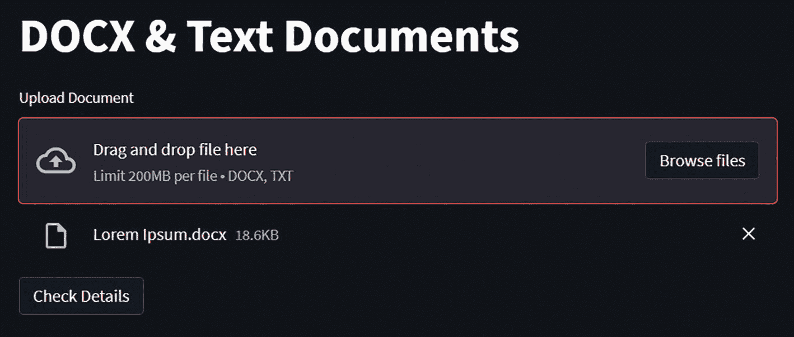

一个深色屏幕，显示文本“Docx”和文本文档，包含上传文档字段，并高亮显示了“将文件拖放到此处”的选项。

图 6-14

显示上传后的文档上传区域

Streamlit 指定的大小限制为 200 MB，超过此限制则无法上传。应用程序中也可以看到要上传的文档类型。

我们将显示文件详情，例如上传文件的名称、格式类型和大小。这些详情会在用户点击`检查详情`按钮后显示。我们将看到其中的所有文本数据，如图 6-15 所示。

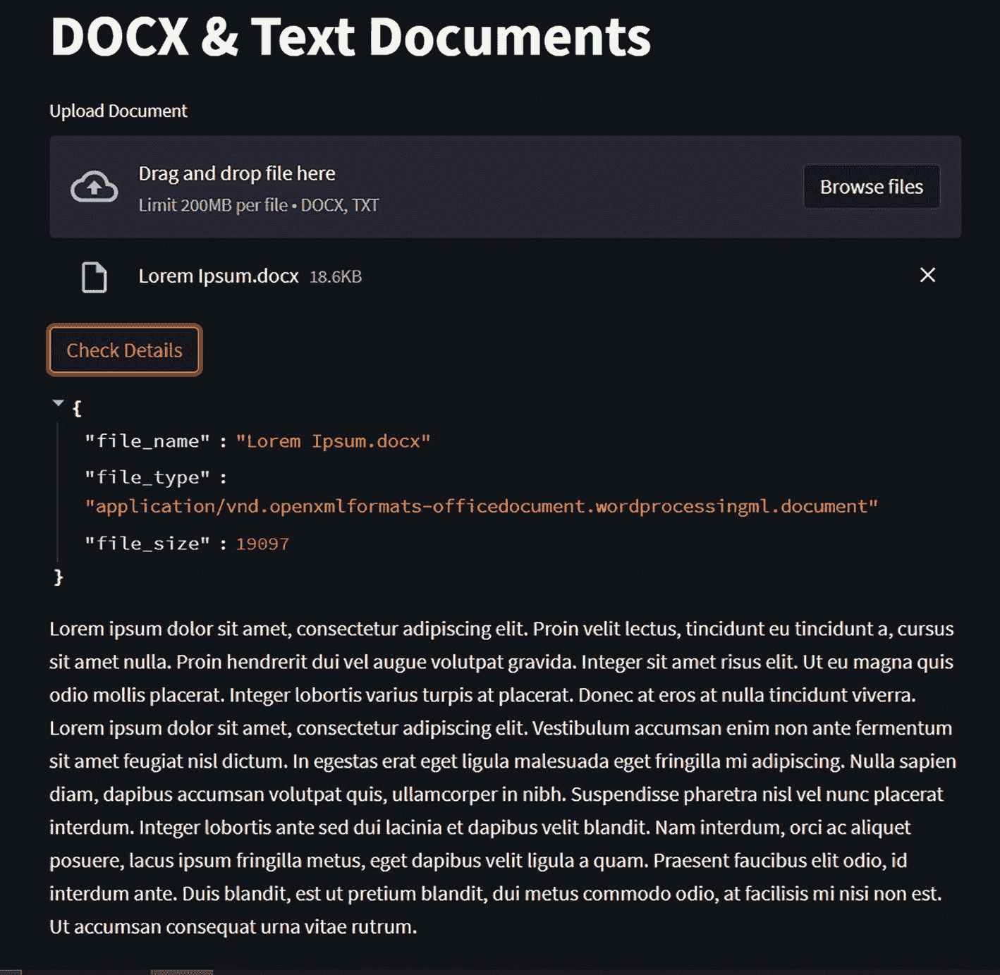

一个深色屏幕，显示文本“Docx”和文本文档，包含上传文档字段，并高亮显示了“将文件拖放到此处”的选项，以及相关的代码。

图 6-15

显示已上传的 `.docx` 文件的内容

与 `.docx` 文件类似，点击`检查详情`按钮将在我们的应用程序中显示文本文档的内容，如图 6-16 所示。

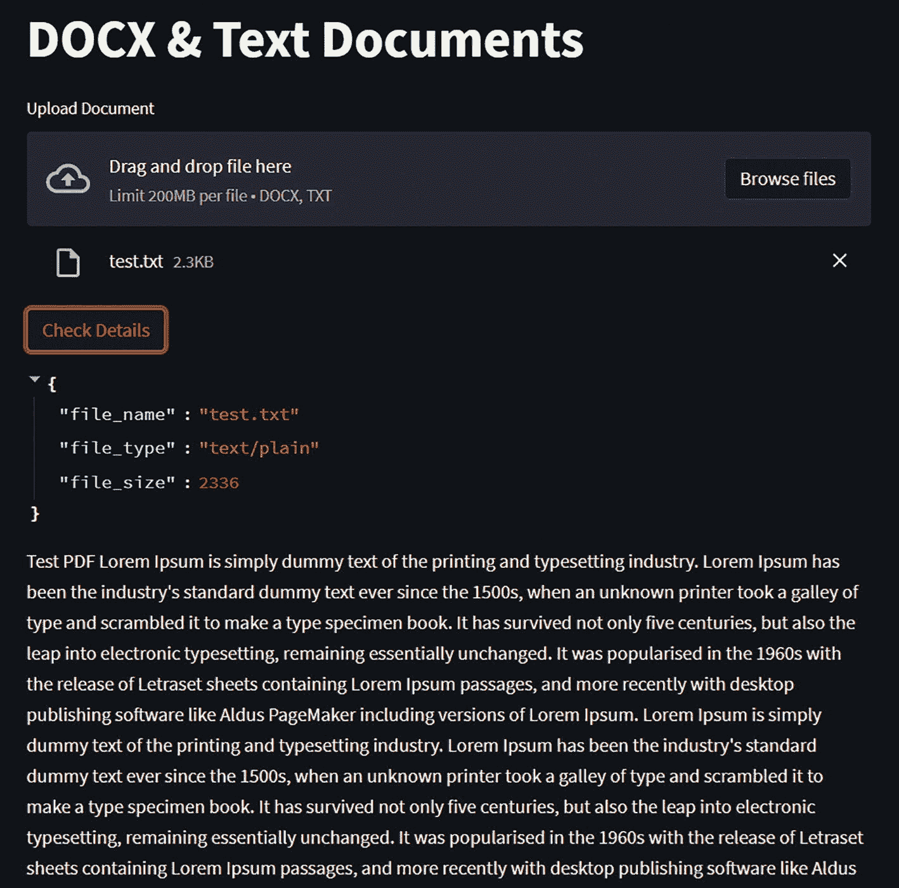

一个深色屏幕，显示文本“Docx”和文本文档，包含上传文档字段，并高亮显示了“将文件拖放到此处”的选项，以及所选文本文件的内容。

图 6-16

显示已上传的文本文件的内容

注意

`.docx` 文件中的数据是 *lorem ipsum* 文本，用作虚拟数据。

### PDF 上传

PDF 是最常用的数据类型之一。它包含文本和图像数据，这使其与前面展示的纯 `.docx` 文件有所不同。我们将上传文件并显示其中的内容。请参见代码清单 6-12。

```
import streamlit as st
import pdfplumber
st.title("PDF File")
pdf_file = st.file_uploader("Upload PDF", type=["pdf"])
details = st.button("Check Details")
if details :
if pdf_file is not None:
pdf_details = {"filename":pdf_file.name, "filetype":pdf_file.type,
"filesize":pdf_file.size}
st.write(pdf_details)
pdf = pdfplumber.open(pdf_file)
pages = pdf.pages[0]
st.write(pages.extract_text())
else:
st.write("No PDF File is Uploaded")
代码清单 6-12
12_pdf.py
```

我们已使用 `pip` 命令（`pip install pdfplumber`）在为 Streamlit 定义的环境中安装了 `pdfplumber` Python 库。

如图 6-17 所示，我们通过点击`点击详情`按钮来显示 PDF 文件的内容和元数据。元数据包括上传的 PDF 的 `file_name`、`file_type` 和 `file_size` 值。

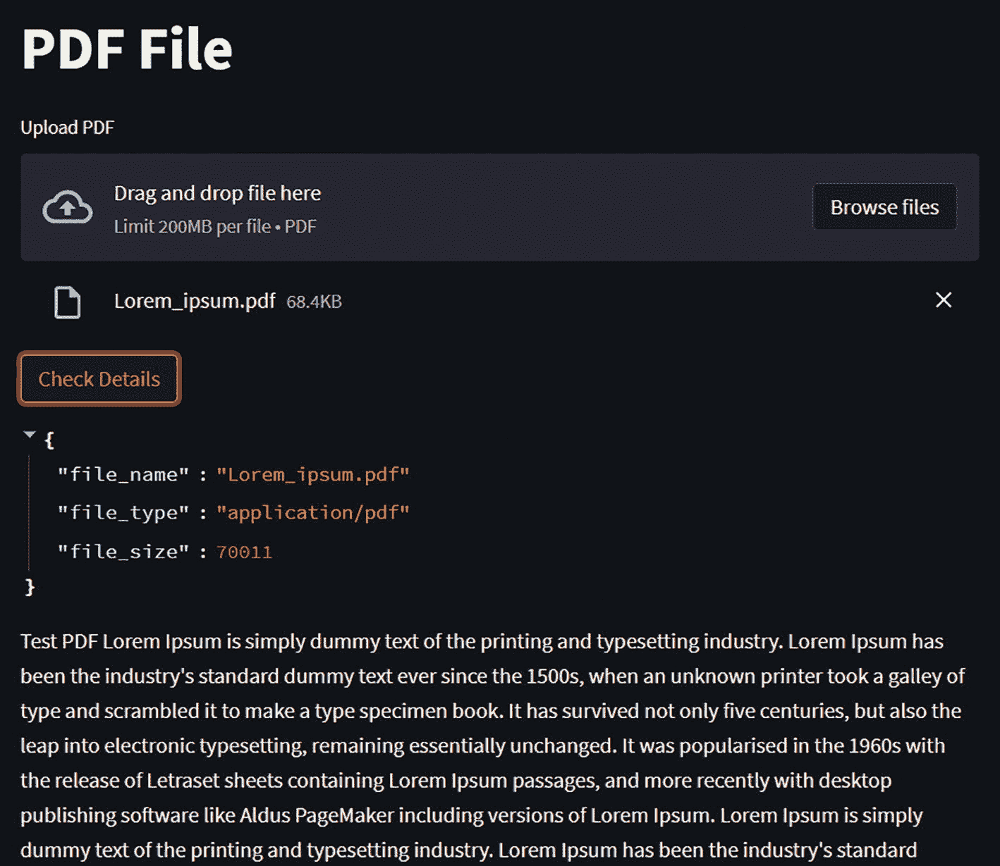

一个深色屏幕，显示文本“P D F 文件”，包含上传 P D F 字段，并高亮显示了“将文件拖放到此处”的选项，以及所选 P D F 文件的内容。

图 6-17

显示已上传的 PDF 文件的内容

在下一节中，我们将讨论可以在我们的应用程序中上传的表格数据格式。

# 使用 Streamlit 处理表单数据

## 数据集上传

到目前为止，我们已经了解了在我们的应用程序中上传的仅包含文本数据的文件。现在我们将讨论以表格格式提供的数据，即 CSV 类型。CSV 文档包含由逗号分隔的文本数据，形成类似表格或列的结构。我们将了解如何上传此类文件并在表格中可视化数据。请参见代码清单 6-13。

```python
import streamlit as st
import pandas as pd
st.title("CSV Data")
data_file = st.file_uploader("Upload CSV",type=["csv"])
details = st.button("Check Details")
if details:
    if data_file is not None:
        file_details = {"file_name":data_file.name, "file_type":data_file.type,
        "file_size":data_file.size}
        st.write(file_details)
        df = pd.read_csv(data_file)
        st.dataframe(df)
    else:
        st.write("No CSV File is Uploaded")
```

代码清单 6-13 `13_csv.py`

我们使用了 `Pandas` 库来以表格格式显示上传的 CSV 文件的结果。你可以从 Kaggle（[https://www.kaggle.com/datasets/neuromusic/avocado-prices](https://www.kaggle.com/datasets/neuromusic/avocado-prices)）下载此数据。我们只定义了要上传的 CSV 类型。请参见图 6-18。

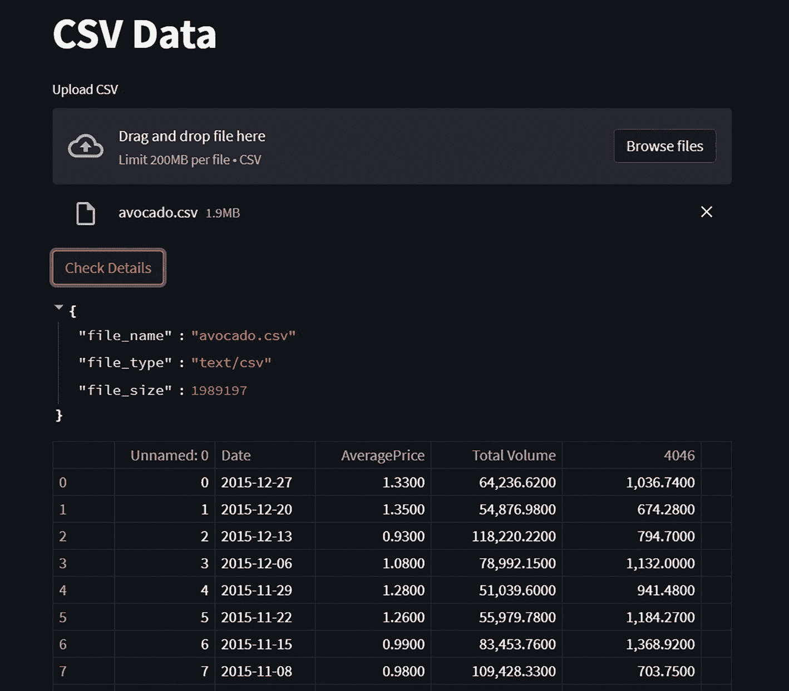

一个深色屏幕，显示文本“C S V 数据”，包含上传 C S V 字段，并高亮显示了“将文件拖放到此处”的选项，以及所选 C S V 的内容。

通过点击`检查详情`按钮，我们可以看到上传的 CSV 文件的内容和完整详情。

到目前为止，我们已经讨论了如何在应用程序中上传各种文件类型。接下来，我们将了解如何上传图像。

## 图像上传

在本节中，我们将讨论如何在应用程序中上传图像。与其他文档文件不同，图像可以有多种文件格式，如 JPG、PNG 等，这些格式在上传后会被读取。我们需要指定应用程序中可接受为输入数据的文件格式。清单 6-14 展示了如何实现图像上传。

```python
import streamlit as st
from PIL import Image
import io
st.title("Upload Image")
image_file = st.file_uploader("Upload Images", type=["png","jpg","jpeg"])
check_details = st.button("Check Details")
if check_details:
    if image_file is not None:
        # To See details
        image_details = {"file_name":image_file.name, "file_type":image_file.type,
        "file_size":image_file.size}
        st.write(image_details)
        # To View Uploaded Image
        image_data = image_file.read()
        image = Image.open(io.BytesIO(image_data))
        st.image(image, width=250)
    else:
        st.write("No Image File is Uploaded")
```

Listing 6-14 `14_image_upload.py`

在示例中，我们在 `st.file_uploader()` 函数的 `type` 参数中指定了可以上传的图像文件格式。`check_details` 按钮将提供文件的元数据，并显示上传的图像，如图 6-19 所示。

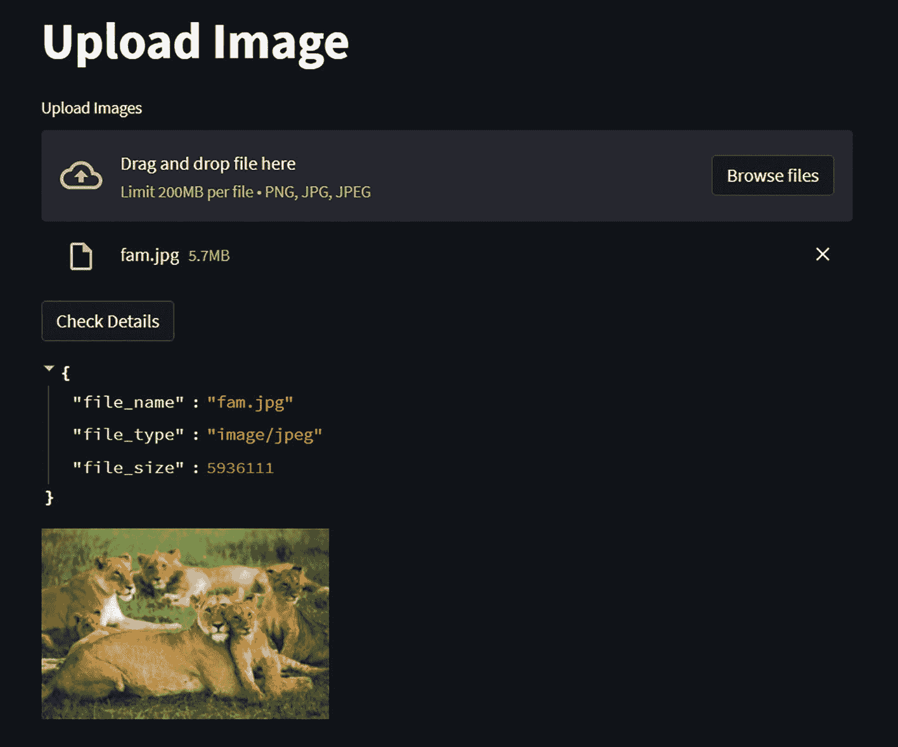

一个深色屏幕，显示文本“上传图像”，其中包含“上传图像”字段，并高亮显示了“将文件拖放到此处”选项，以及图像文件。

## 上传多张图像

之前我们了解了如何将图像作为单个文件上传，这在机器学习应用中常用于从已开发的模型获取结果。我们也可以同时上传多张图像来获取结果或训练模型。首先，我们将学习如何获取多个图像文件，而不是默认的单个文件。请参见清单 6-15。

```python
import streamlit as st
import io
from PIL import Image
uploaded_files = st.file_uploader("Multiple Image Uploader", type=['jpg','jpeg','png'],
help="Upload Images in jpg, jpeg, png format", accept_multiple_files=True,)
details = st.button("Check Details")
for uploaded_file in uploaded_files:
    if details:
        if uploaded_file is not None:
            bytes_data = uploaded_file.read()
            image = Image.open(io.BytesIO(bytes_data))
            st.write("file_name:", uploaded_file.name)
            st.image(image, width=100)
    else:
        st.write("No Image File is Uploaded")
        break
```

Listing 6-15 `15_image_multiple.py`

`st.upload()` 中的 `accept_multiple_files` 参数是一个布尔值，当设置为 `True` 时，允许我们的应用程序接受上传多个文件。当未定义此参数时，该函数将只接受单个文件，这是默认功能。请参见图 6-20。

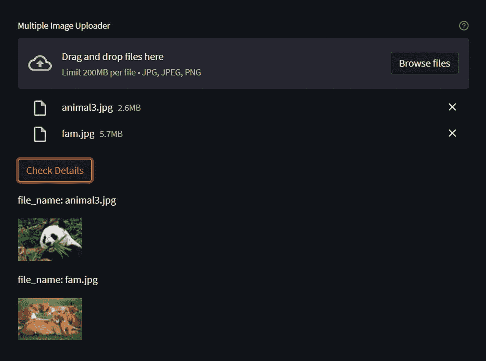

一个深色屏幕，显示文本“多图像上传器”，其中包含“上传图像”字段，并高亮显示了“将文件拖放到此处”选项，以及多个图像文件。

要上传多个文件，可以使用我们在之前示例中看到的相同参数来处理各种文件格式。

## 保存上传的文档

在某些情况下，我们需要使用上传的图像来训练模型或提供与之关联的结果。为此，我们需要将图像保存到一个目录中，以便应用程序以后可以重复使用。我们将首先使用 `file_uploader()` 函数获取图像，然后提供一个目录/文件夹路径用于保存。请参见清单 6-16。

```python
# Import following libraries
import streamlit as st
from PIL import Image
import os
import io
# Defining File Upload Method of Streamlit
st.title("Saving File to Directory")
image_file = st.file_uploader("Upload Images",
type=["png","jpg","jpeg"])
# Defining path where file to be saved
file_save_path = "F:/Books/Apress Streamlit/Chapters/02 Codes/chapter 6 forms/files"
save_file = st.button("Check Details & Save")
if save_file:
    if image_file is not None:
        # To See details
        image_details = {"file_name":image_file.name, "file_type":image_file.type,
        "file_size":image_file.size}
        st.write(image_details)
        # To View Uploaded Image
        image_data = image_file.read()
        image = Image.open(io.BytesIO(image_data))
        st.image(image, width=250)
        with open(os.path.join(file_save_path,image_file.name),"wb") as f:
            f.write((image_file).getbuffer())
        st.success("Image Saved Successfully")
    else:
        st.write("No Image File is Uploaded")
```

Listing 6-16 `16_image_save.py`

我们需要指定用户上传图像将要存储的文件路径。我们需要使用相对路径，以便通过我们的应用程序保存上传的图像。变量 `file_save_path` 已在我们的代码中定义。之后，当我们点击应用程序中的“检查详情并保存”按钮时，要上传的文件将被保存，如图 6-21 所示。

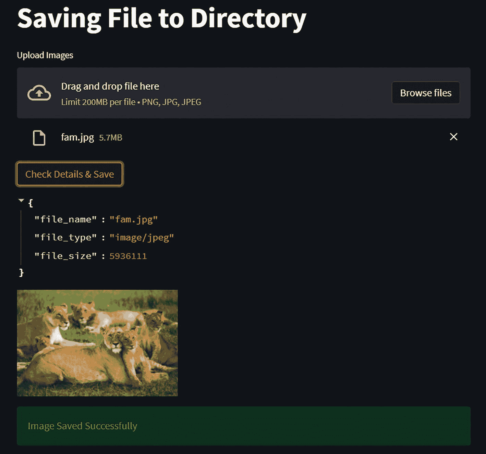

一个深色屏幕，显示文本“将文件保存到目录”，其中包含“上传图像”字段，并高亮显示了“将文件拖放到此处”选项，以及图像文件。

一旦图像保存到我们指定的目录中，我们将收到一条“图像已成功保存”的通知，如图 6-21 所示。

在图 6-22 中，目录显示了上传图像已存储的位置。我们可以使用相同的方法将各种文件文档存储到该目录中。

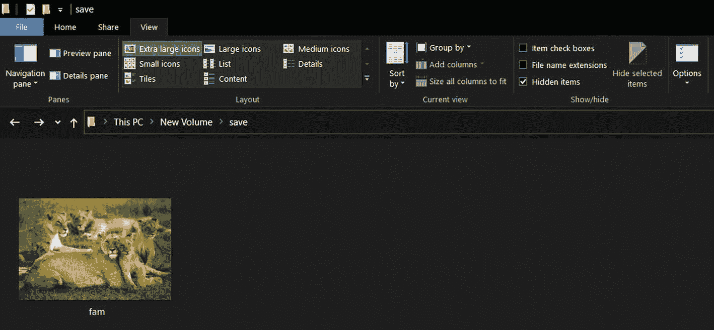

一个窗口的屏幕截图，列出了文件下的选项，其中包含上传的狮子在草地上的图像。

**注意：** 如果指定目录或文件夹中存在同名文件，则会覆盖现有文件。

最后，我们将讨论如何提交所有前面提到的表单数据类型。

## 提交按钮

当用户更改输入表单数据时，应用程序需要重新运行，这会导致糟糕的用户体验。为了解决每次用户更改数据时应用程序都重新运行的问题，我们可以使用 `form_submit_button()` 函数，如清单 6-17 所示。

```python
import streamlit as st
my_form = st.form(key='form')
my_form.text_input(label='Enter any text')
# Defining submit button
submit_button = my_form.form_submit_button(label='Submit')
```

Listing 6-17 `17_form_submit.py`

在文本框中输入文本后，我们将点击“提交”按钮，如图 6-23 所示。

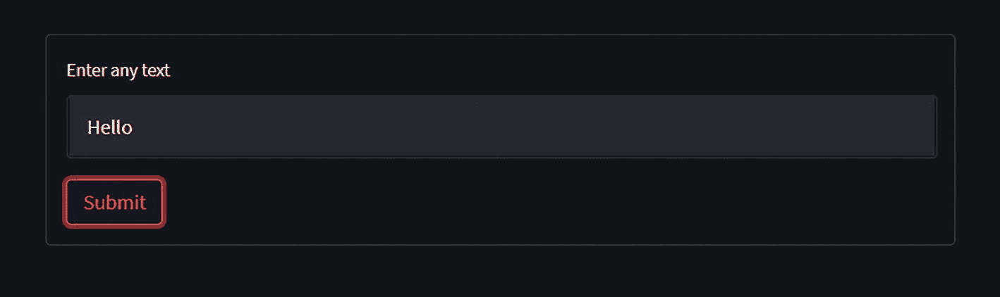

一个深色屏幕，包含“输入任意文本”字段，其中数据为“hello”，以及左下角选中的“提交”按钮。

当我们点击“提交”按钮时，应用程序会重新运行。它类似于 `st.button()` 函数，但功能有所不同。“提交”按钮将小部件的状态以批处理形式发布到表单中。`st.form_submit_button` 必须与表单关联，否则 Streamlit 将进入错误状态。

## 总结

本章从表单中的文本框开始讲起。我们还了解了如何使用文本框来输入密码。接着，我们讨论了使用文本区域进行多行文本输入。之后，我们探讨了如何接收数字作为输入。

当用户想要提交表单时，我们讨论了时间和日期输入。我们还介绍了一种颜色选择方法，用户可以通过该方法向表单输入颜色代码。

然后，我们讨论了可以接受作为输入数据的不同文件格式，例如 `.txt`、`.docx`、`.csv` 和图片。我们了解了如何上传这些文件并将其保存到目录中。最后，我们学习了如何使用提交按钮来提交表单数据。

在下一章中，我们将探讨布局和导航。