# 7. 列与导航

在本章中，我们将讨论如何设置列、布局和导航，以便在其中插入元素。这些将有助于将我们的应用程序划分为网格。当我们的应用程序需要多个页面时，就会使用这种导航方式。我们还将探索如何使用侧边栏。让我们从列开始。

## 列

我们将在应用程序中插入并排的列。我们将使用 Streamlit 内置的 `st.columns()` 函数来定义列。

要创建的列数由 `st.columns()` 函数中作为参数给出的整数值指定。参见代码清单 7-1。

```python
import streamlit as st
#### 定义列
col1, col2 = st.columns(2)
#### 在列 1 中插入元素
col1.write("第一列")
col1.image("files/fam.jpg")
#### 在列 2 中插入元素
col2.write("第二列")
col2.image("files/fam.jpg")
```

在我们的示例中，我们创建了两列，每列都包含一个图片元素。如图 7-1 所示，这些列被均等划分。


一张截图显示了两张大小相同的图片。图片中有一群母狮和它们的幼崽坐在草坪上，每张图片分别标注为“第一列”和“第二列”。

图 7-1：两列以相同大小显示其中的元素

我们在每列中放置了两个元素：一个是文本，另一个是图片。使用相同的图片是为了展示列之间可能存在的差异。创建的列具有响应式特性，这意味着当应用程序在不同设备上查看时，列的大小会相应改变。

## 间距列

我们可以通过指定列的宽度来设置其大小。具有最大宽度的列被称为间距列。参见代码清单 7-2。

```python
import streamlit as st
from PIL import Image
img = Image.open("files/fam.jpg")
st.title("间距列")
#### 定义两行
for _ in range(2):
    #### 定义列的数量及大小
    cols = st.columns((3, 1, 2, 1))
    cols[0].image(img)
    cols[1].image(img)
    cols[2].image(img)
    cols[3].image(img)
```

在此代码清单中，我们定义了两行四列，每列都包含图片（图 7-2）。第一列最宽，其次是第三列，另外两列大小相同。第一列和第三列被称为间距列，因为它们比第二列和第四列更宽。

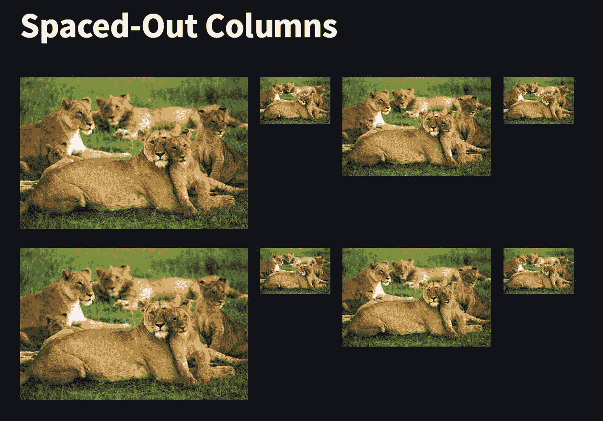

一个深色屏幕，显示文本“间距列”。它有 4 列，每列都有一张母狮群的照片。第一列最宽，其次是第三列，第二列和第四列大小相同。

图 7-2：间距列

我们可以指定任意数量的间距列。

> **注意：** 也可以在 `st.columns()` 函数中使用元组来指定每列的宽度。

## 带填充的列

添加填充是为了在两列之间创建额外的空间。这有助于区分两列中的元素。代码清单 7-3 演示了如何实现这一点。

```python
import streamlit as st
from PIL import Image
img = Image.open("files/fam.jpg")
st.title("填充")
#### 定义带填充的列
col1, padding, col2 = st.columns((10,2,10))
with col1:
    col1.image(img)
with col2:
    col2.image(img)
```

我们定义了一个空列作为填充，如图 7-3 所示。


一个深色屏幕，标题为“填充”。它有两列，中间有很宽的空间。每列都有一张母狮群坐在草坪上的照片。

图 7-3：带填充的列

> **注意：** 填充是放置在两列之间的一个空列，用于在那里创建空间。

## 网格

可以使用前面所示的 `st.columns()` 函数创建网格。在循环中创建多个列将得到网格。参见代码清单 7-4。

```python
import streamlit as st
from PIL import Image
img = Image.open("files/fam.jpg")
st.title("网格")
#### 定义行数
for _ in range(4):
    #### 定义列的数量及大小
    cols = st.columns((1, 1, 1, 1))
    cols[0].image(img)
    cols[1].image(img)
    cols[2].image(img)
    cols[3].image(img)
```

网格用于通过大小和位置来对齐其中的元素。在我们的示例中，我们定义了大小相同的 (4 * 4) 行和列，如图 7-4 所示。

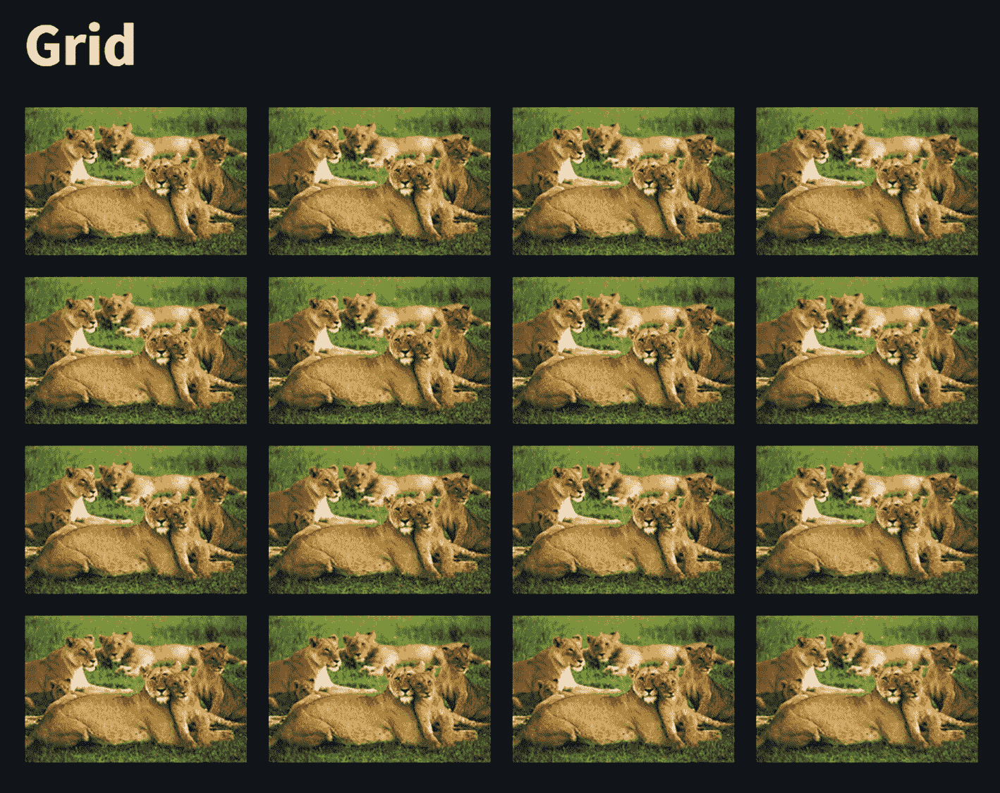

一个深色屏幕，标题为“网格”。它有 4 列和 4 行，彼此间距相等。每个单元格都有一张母狮群坐在草坪上的照片。

图 7-4：显示网格

网格可用于图片库或书籍、音乐、电影等的推荐系统，在这些场景中，我们需要在单个页面上以网格格式指定大量数据。

## 扩展器/手风琴

当我们想对用户隐藏额外信息，或者不希望信息始终显示在应用程序中时，我们可以使用手风琴。这些也称为扩展器，因为当用户将扩展器切换到打开状态时，它会展开并显示额外信息。参见代码清单 7-5。

```python
import streamlit as st
st.title('扩展器')
#### 定义扩展器
with st.expander("Streamlit with Python"):
    st.write("在几分钟内开发机器学习应用！！！！")
```

我们创建了包含一些文本信息的扩展器。只有当用户点击扩展器时，文本信息才会显示。图 7-5 显示了一个关闭状态的扩展器。

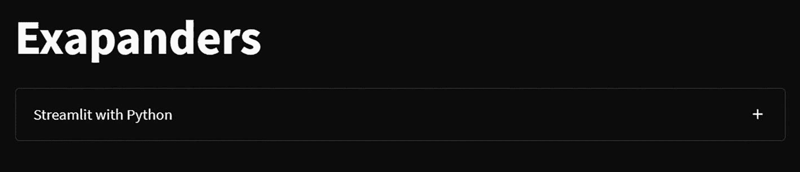

一个深色屏幕显示文本“扩展器”。下方有一个选项，显示“Streamlit with Python”，并带有一个加号按钮。

图 7-5：显示关闭状态的扩展器

当你点击一个扩展器时，你将看到其中包含的信息，如图 7-6 所示。


一个深色屏幕显示文本“扩展器”。下方有一个选项，显示“Streamlit with Python”，以及“在几分钟内开发机器学习应用”。

图 7-6：打开时显示文本信息

信息可以是文本、图片、图表等。

> **注意：** 我们可以使用 `write()` 函数在手风琴或扩展器中添加信息。

## 容器

要在 Streamlit 中插入多个元素，可以使用容器。容器本质上是不可见的，可以通过 `st.container()` 来定义。参见代码清单 7-6。

```python
import streamlit as st
import numpy as np
st.title("容器")
with st.container():
    st.write("容器内的元素")
    #### 定义图表元素
    st.line_chart(np.random.randn(40, 4))
st.write("容器外的元素")
```

我们在 `st.container()` 中使用了 `with` 语句来在容器中插入多个元素。参见图 7-7。

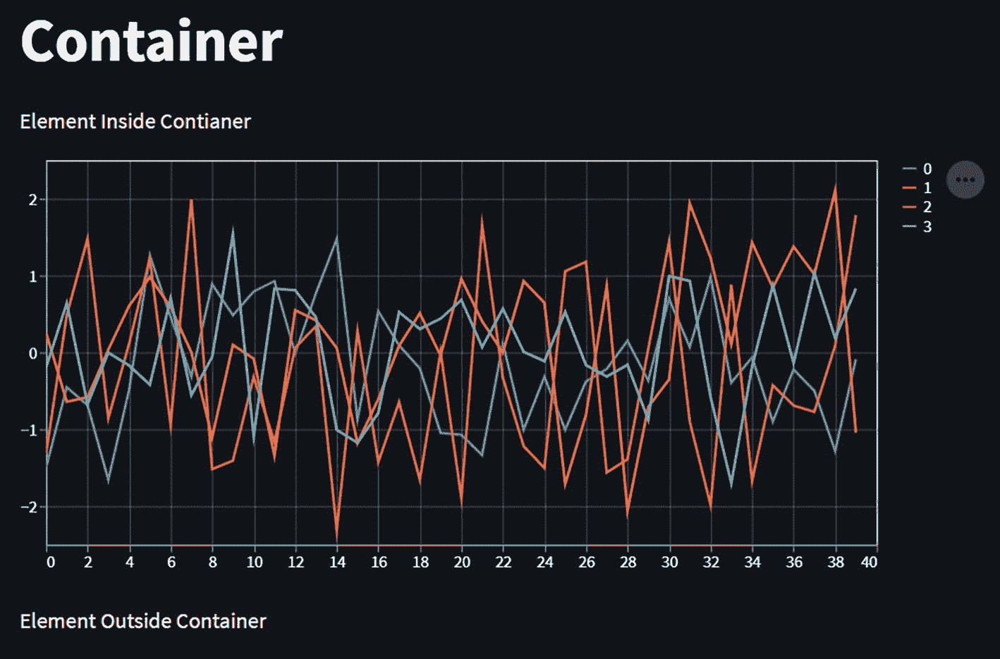

一个标题为“容器”的深色屏幕。它展示了一个模拟图表，显示了容器内外的元素。图表绘制了 0、1、2 和 3 四条混沌波形。

图 7-7

包含图表对象的容器

我们可以不按顺序向容器中插入元素，这可以通过使用 `container.write()` 函数来实现。参见代码清单 7-7。

```python
import streamlit as st
import numpy as np
st.title("无序容器")
#### 定义容器
container_one = st.container()
container_one.write("容器内的元素一")
st.write("容器外的元素")
#### 现在向 container_one 中再插入几个元素
container_one.write("容器内的元素二")
container_one.line_chart(np.random.randn(40, 4))
```

我们在容器中插入了三个元素。其中两个是文本函数，一个是折线图，如图 7-8 所示。

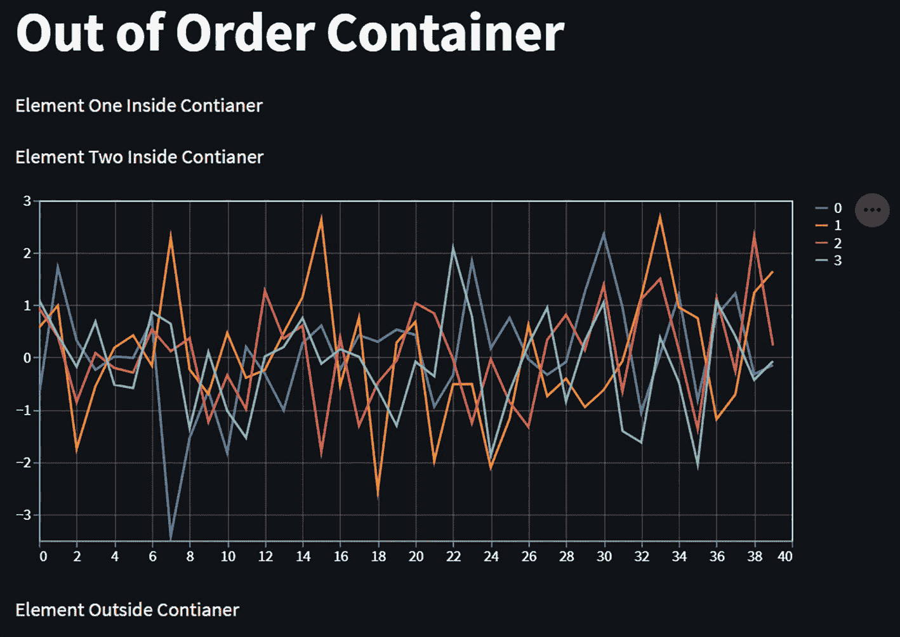

一个标题为“无序容器”的深色屏幕。它展示了一个模拟图表，显示了容器内的元素一和元素二，以及容器外的元素。图表绘制了 0、1、2 和 3 四条混沌波形。

图 7-8

无序容器

插入元素的顺序会变化，因此被称为无序。这有助于创建更灵活的应用程序。

### 空容器

顾名思义，空容器是空的，我们只能向其中插入一个元素。要定义一个空容器，可以使用 `st.empty()` 语法。参见代码清单 7-8。

```python
import streamlit as st
import time
#### 空容器
with st.empty():
    for seconds in range(5):
        st.write(f"⏳ {seconds} 秒已过去")
        time.sleep(1)
    st.write("✔ 时间到！")
```

这将创建如图 7-9 所示的空容器。


两个深色屏幕，一个显示沙漏图标和“0 秒已过去”，另一个显示对勾符号和“时间到！”。

图 7-9

显示空屏幕 a) 时间过去之前 和 b) 时间过去之后

### 侧边栏

侧边栏是显示在应用程序侧面的窗格。它允许用户专注于主要内容。我们将使用 `st.sidebar()` 函数在我们的应用程序中定义侧边栏。参见代码清单 7-9。

```python
import streamlit as st
#### 侧边栏
st.sidebar.title("侧边栏")
st.sidebar.radio("你是新用户吗", ["是", "否"])
st.sidebar.slider("选择一个数字", 0,10)
```

在代码清单 7-9 中，我们将在侧边栏中显示一个滑块和单选按钮，如图 7-10 所示。

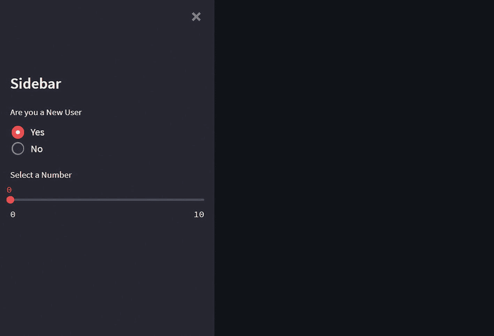

一个深色屏幕在侧边栏下列出了问题。它显示“你是新用户吗”，并选中了“是”选项，还有一个用于选择数字的滑块条。

图 7-10

侧边栏

我们可以使用侧边栏来显示导航链接，用户可以通过它从一个页面切换到另一个页面。

## 多页面导航

我们可以通过导航创建多页面应用。在 Streamlit 中，导航侧边栏会显示已创建的页面。由于前端从不重新加载，因此可以快速轻松地导航页面。多页面应用分为两部分：主页面和子页面。

### 主页面

首先，我们将在目录中创建一个作为主页面的 Python 文件。这类似于我们之前创建的单一页面应用。我们可以使用以下命令运行此文件：

`streamlit run file_name.py`

我们将 Python 文件命名为 `home.py`。`main_page.py` 的代码在代码清单 7-10 中给出。图 7-11 显示了结果。

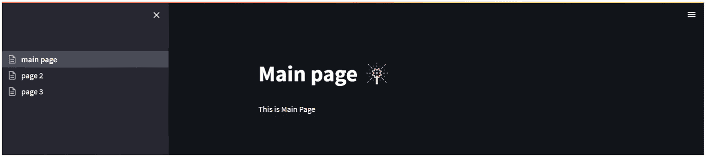

一个深色屏幕有 2 个面板。面板 1 列出了选项：主页面、页面 2 和页面 3，其中主页面被选中。面板 2 显示主页面，下方文字为“这是主页面”。

图 7-11

显示主页面

**代码清单 7-10.** `home.py`

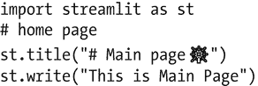一组程序代码的截图。它将 sreatmlit 导入为主页面，并将主页面的标题设置为“这是主页面”。

图 7-11 显示了主页面。现在我们将看到如何向这个 `home.py` 页面添加其他页面。

### 子页面

我们将在包含 `main_page.py` 文件的文件夹中，创建一个名为 `pages` 的子文件夹，并在其中添加多个 Python 页面。我们将在 `pages` 文件夹中创建两个文件，分别命名为 `page2.py` 和 `page3.py`。

文件夹结构如下：

```
home.py # 使用 "streamlit run" 运行的主文件
└─── pages/ # 文件夹
    └─── page2.py # 第二个页面
    └─── page3.py # 第三个页面
```

页面的代码如代码清单 7-11 和代码清单 7-12 所示。

**代码清单 7-11.** `page2.py`

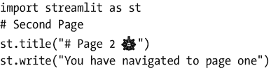一组程序代码的截图。它将 sreatmlit 导入为第二个页面，将标题设置为“页面 2”，并写入“您已导航到页面一”。

**代码清单 7-12.** `page3.py`

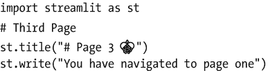一组程序代码的截图。它将 sreatmlit 导入为第三个页面，将标题设置为“页面 3”，并写入“您已导航到页面一”。

Streamlit 会获取 `pages` 文件夹中所有文件的文件名，并将它们放置在应用程序的侧边栏中，如图 7-12 和图 7-13 所示。

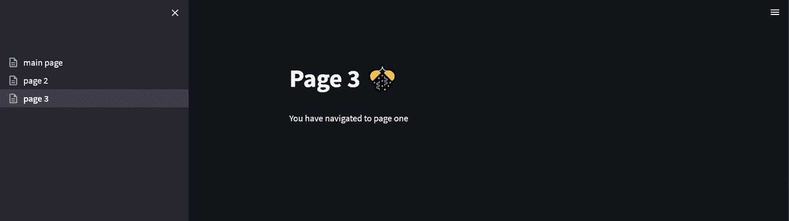

一个深色屏幕有 2 个面板。面板 1 列出了选项：主页面、页面 2 和页面 3，其中页面 3 被选中。面板 2 显示页面 3，并显示“您已导航到页面一”。

图 7-13

显示第三个页面

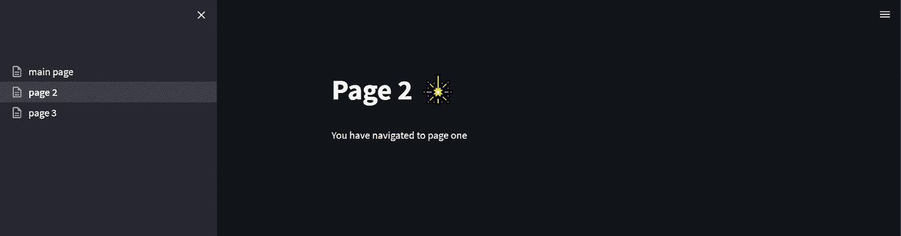

一个深色屏幕有 2 个面板。面板 1 列出了选项：主页面、页面 2 和页面 3，其中页面 2 被选中。面板 2 显示页面 2，并显示“您已导航到页面一”。

图 7-12

显示第二个页面

> **注意：** 多页面导航仅在 Streamlit 1.10 及以上版本中有效。

## 总结

在本章中，我们学习了如何将对象放置到列和网格中，并进一步了解了如何定义包含对象的容器。我们还讨论了如何使用展开器显示额外信息。

我们学习了如何将对象放置在侧边栏中，使其与页面导航分离。最后，我们通过演示文件夹结构，讨论了如何在 Streamlit 应用程序中创建多个页面。

在下一章中，我们将了解 Streamlit 应用程序的控制流和高级特性。