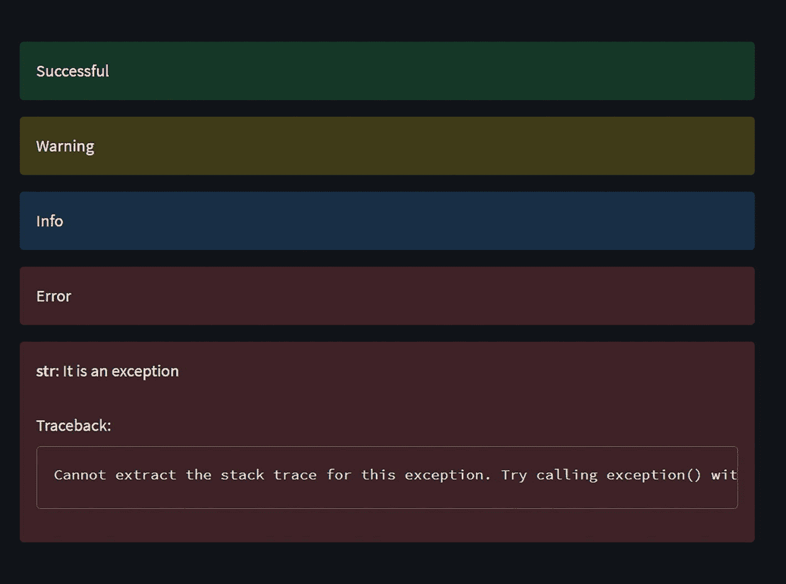
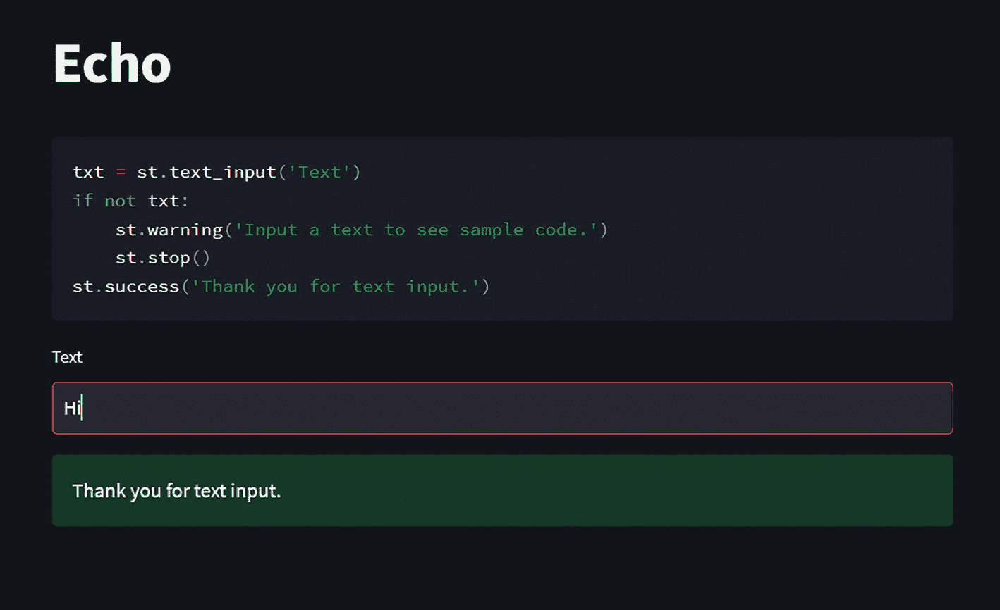
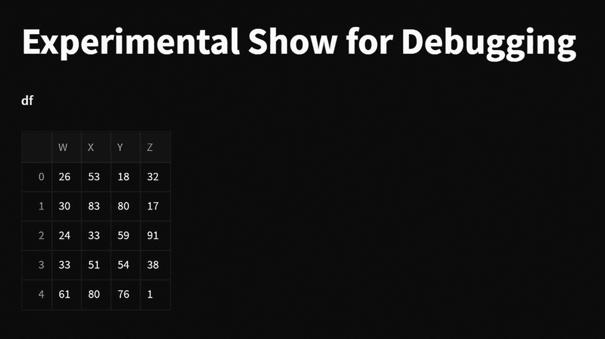
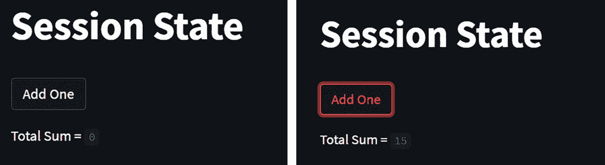

# 8. 控制流与高级特性

在本章中，我们将讨论 Streamlit 中可用的不同提示框。然后，我们将学习 Streamlit 中的控制流相关内容。我们还将探讨如何通过提供的方法来改变 Streamlit 应用的默认执行流程。最后，我们将学习高级特性，包括更改 Streamlit 的默认配置以及使用缓存技术提升性能。

## 提示框

在本节中，我们将回顾 Streamlit 中可用的一些提示框。这些提示框用于向用户提供特定信息，以便他们与应用程序进行交互。

### `st.info()`

此函数用于向用户提供额外信息，以便他们能与应用程序交互。

### `st.warning()`

此函数会向用户弹出一条警告消息。

### `st.success()`

`st.success()` 函数用于显示一条成功消息。例如，当表单数据正确提交时，我们可以使用它。

### `st.error()`

此函数用于在应用程序上显示一条错误消息。当文件上传不支持某些文件类型时，可以使用它。

### `st.exception()`

当我们想要处理应用程序中的任何异常时，可以使用 `st.exception()` 函数，并在异常发生时显示一条通知，如代码清单 8-1 和图 8-1 所示。



五个提示框的快照。1. 成功。2. 警告。3. 信息。4. 错误。5. 字符串：这是一个异常。下面定义了回溯信息。

图 8-1

显示所有提示框

```
import streamlit as st
st.success("Successful")
st.warning("Warning")
st.info("Info")
st.error("Error")
st.exception("It is an exception")
pass
代码清单 8-1
1_alert.py
```

我们可以在应用程序中使用一个或多个提示框，它们可以以不同的颜色显示。

## 控制流

我们知道 Streamlit 会执行应用的完整脚本，但这可以通过允许执行特定函数来控制，从而改变应用的默认流程。这可以通过使用以下方法来实现。

### 停止执行

我们可以立即停止脚本的执行。用于停止执行的命令如下：

```
st.stop()
```

当 `st.stop()` 发生时，不会运行任何其他脚本。参见代码清单 8-2。

```
import streamlit as st
name = st.text_input('Text')
if not name:
st.info('Enter any Text.')
#### Stop function
st.stop()
st.success('Text Entered Successfully.')
代码清单 8-2
2_stop.py
```

在这种情况下，当在文本框中输入任何文本时，脚本会退出 `if` 条件，因为我们定义了 `st.stop()` 方法，然后执行下一个条件。这改变了应用的默认流程。

### 重新运行脚本

我们可以在任何时间点重新运行脚本。要重新运行脚本，我们使用以下命令：

```
st.experimental_rerun()
```

参见代码清单 8-3。

```
import streamlit as st
import time
st.title('Hello World')
st.info('Script Runs Everytime rerun hits.')
time.sleep(2)
#### rerun statement
st.experimental_rerun()
st.success('Scipt Never Runs.')
代码清单 8-3
3_rerun.py
```

当我们在脚本中遇到 `rerun()` 语句时，脚本会从头开始重新运行，因此后续脚本将不会被执行。

### `st.form_submit_button`

此按钮用于批量提交表单中输入的所有数据。当用户点击提交按钮时，脚本会重新运行。这是一种特殊类型的按钮，必须与表单关联。参见代码清单 8-4。

```
import streamlit as st
sub_form = st.form(key='submit_form')
user_name = sub_form.text_input('Enter your username')
#### Submit button associated with form
submit_button = sub_form.form_submit_button('Submit')
st.write('Press submit see username displayed below')
if submit_button:
st.write(f'Hello!!!! {user_name}')
代码清单 8-4
4_submit.py
```

在代码清单 8-4 中，`sub_form` 与提交按钮关联；因此，当点击按钮时，它会批量发送数据并显示在应用程序上。此按钮可以与我们在第 5 章中讨论的任何表单小部件关联。

## 高级特性

在本节中，我们将讨论 Streamlit 中可用的高级特性。每个特性及其应用的更详细描述将随代码片段一起出现。

### 配置页面

我们可以通过配置页面来更改 Streamlit 使用的默认页面标题和图标。此页面配置通过使用 `st.set_page_config()` 方法完成。参见代码清单 8-5。

```
import streamlit as st
st.set_page_config(page_title='ML App', page_icon=':robot_face:')
st.title("Page Configured")
代码清单 8-5
5_page_configuration.py
```

上述代码将分别更改应用程序的页面标题和图标。

### `st.echo`

当我们希望在前端显示创建图形的代码时，可以使用 `echo`。我们还可以调整代码的显示时机，即在代码执行之前或之后显示。参见代码清单 8-6。

```
import streamlit as st
with st.echo():
txt = st.text_input('Text')
if not txt:
st.warning('Input a text to see sample code.')
st.stop()
st.success('Thank you for text input.')
代码清单 8-6
6_echo.py
```

在此示例中，我们通过获取用户的文本输入，在代码执行后显示了代码。图 8-2 显示了结果。



echo 函数的结果窗口快照。显示了用于获取文本输入和验证输入的程序代码，并在下方显示了代码执行后的结果。

图 8-2

使用 echo 函数显示代码

### `st.experimental_show`

为了调试我们的应用程序，我们可以使用 `experimental_show()` 方法。我们可以传递多个参数来调试应用程序。当调用此方法时，它会返回一个 `None` 值，因此该方法只能用于调试。参见代码清单 8-7。

```
import streamlit as st
import pandas as pd
import numpy as np
st.title("Experimental Show for Debugging")
#### Dataframe
df = pd.DataFrame(np.random.randint(0,100,size=(5, 4)), columns=list('WXYZ'))
#### Defining Experimental show
st.experimental_show(df)
代码清单 8-7
7_experimental_show.py
```

在代码清单 8-7 中，我们使用了 `show` 方法来调试创建的 DataFrame。

图 8-3 显示了 `experimental_show()` 方法展示待调试的 DataFrame。



用于调试的实验性显示的快照。显示了文本 df，并且数据框以 5 行 4 列的矩阵表格格式显示，行值从 0 到 4，列值为 w、x、y 和 z。

图 8-3

显示由 `experimental_show()` 方法给出的 DataFrame


好的，作为一名高级文档工程师和翻译员，我将严格遵循您提供的注意事项和示例，将给定的英文文本翻译成中文。


### 会话状态

会话状态是 Streamlit 库的一个独特功能，我们可以在其中存储值，并在应用程序重新运行时共享这些值。它持有一个类似于 Python 字典的键值对。我们可以使用以下命令来访问会话状态：

```
st.session_state
```

我们可以通过使用以下命令，使用键来访问会话状态：

```
st.session_stat['key']
```

**注意：** 会话状态仅保存当前会话的值，刷新后，将创建一个新的会话状态。

一旦我们刷新页面，就会创建一个新的会话，并且存储在会话状态中的值将被擦除。然后，应用程序会存储新会话的值。请参见代码清单 8-8。

```
import streamlit as st
st.title('Session State')
#### Session state initialization
if 'sum' not in st.session_state:
st.session_state.sum = 0
#### Button to add value
add = st.button('Add One')
if add:
st.session_state.sum += 1
st.write('Total Sum = ', st.session_state.sum)
Listing 8-8
8_session_state.py
```

我们有一个按钮，点击它时，会向总和加一。每次我们点击按钮，应用程序都会重新运行，并将递增后的值存储在会话状态中。如果会话状态未初始化，则会话状态值将设置为零。



两个窗口的快照描述了会话状态。1. 显示“加一”文本，初始化会话前总和值为 0。2. 初始化会话后，“加一”文本高亮显示，总和值为 15。

**图 8-4** 显示会话状态总和 a) 初始化前 和 b) 初始化后

在代码清单 8-8 中，我们看到值在会话状态的重新运行之间被存储。

### 性能

在本节中，我们将探讨一些通过提高应用程序中计算的健壮性来提升性能的技术。我们将讨论如何通过使用默认设置以及高级选项来提高应用程序的性能。

### 缓存

当我们想要加载大型数据集、操作数据或执行繁重的计算工作时，我们需要应用程序保持稳定并按预期运行。Streamlit 提供了缓存机制来处理此类情况。

当我们在应用程序中使用缓存作为装饰器时，Streamlit 将检查以下内容：

-   被调用函数的输入参数
-   函数中使用的外部变量值
-   函数体
-   缓存函数内部使用的任何函数体

当 Streamlit 首次以相同顺序看到这些组件时，它将在脚本执行时存储这些值。

Streamlit 通过使用哈希技术来监控组件是否有任何更改。这类似于内存存储中的键值对，其中键是哈希值，值是通过引用传递的对象。

这是一个缓存的基本示例：

```
import streamlit as st
import time
#### Defining cache
@st.cache
def add(x, y):
#### Function takes 5 secs to run
time.sleep(5)
return x + y
x = 10
y = 60
res = add(x, y)
st.write("Result:", res)
```

当脚本首次运行时，我们将有 5 秒的等待时间。首次运行后，当再次执行脚本时，结果会直接返回，无需等待时间。这是由于我们定义的缓存获取了先前存储的数据并提供了结果。因此，我们可以将缓存用于大型数据集。

### `st.experimental_memo`

在计算量大的情况下，我们使用 `experimental_memo` 来存储数据。它以键值格式保存缓存数据。初始化 `experimental_memo` 的命令如下：

```
@st.experimental_memo
```

我们可以使用 `@st.experimental_memo` 代替 `@cache` 来存储繁重计算的结果。它源自与缓存相同的 API。

### `st.experimental_memo.clear()`

要清除 `st.experimental_memo` 中的缓存存储，我们将使用以下命令：

```
st.experimental_memo.clear()
```

Memo 可用于分别存储下载的数据，或用于数据帧计算或 *n* 位数字之间的计算。

### `st.experimental_singleton`

连接到应用程序的所有用户共享每个单例对象。由于它们可能同时被多个线程访问，因此单例对象必须是线程安全的。要定义一个单例，我们将使用以下语句：

```
@st.experimental_singleton
```

一个 Streamlit 应用程序与其所有会话共享此键值存储。它非常适合跨会话存储大型单例对象，例如数据库连接或 TensorFlow、Torch 或 Keras 的会话。

### `st.experimental_singleton.clear()`

当单例持有数据并需要清除时，我们使用以下函数：

```
st.experimental_singleton.clear()
```

## 总结

在本章中，我们讨论了可用于通知用户特定信息的各种警报框。我们还讨论了如何更改应用程序的默认控制流。

最后，我们详细讨论了 Streamlit 应用程序中可用的高级功能，这些功能用于增强性能、可靠性和稳定性。

在下一章中，我们将从头开始开发一个自然语言处理应用程序并部署它。

