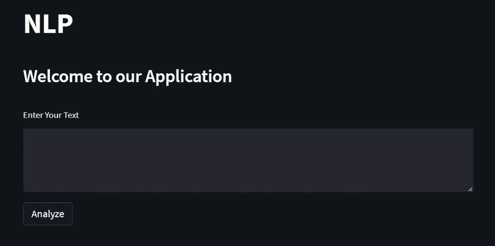
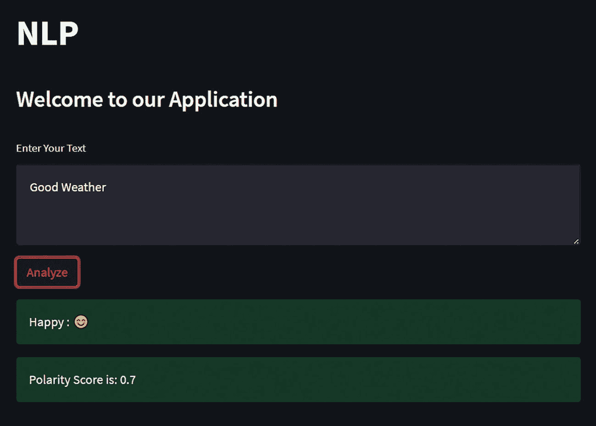
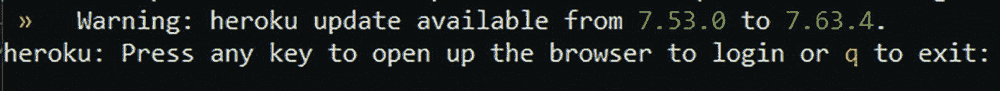

# 9. 自然语言处理

在本章中，我们将从头开始开发一个自然语言处理（NLP）应用程序。该应用程序将演示其工作原理，并为您提供使用 Streamlit 开发应用程序，然后部署到 Heroku 平台的完整说明。

## NLP 应用创建

在本节中，我们将创建一个 NLP 应用程序，用于预测情感是正面、负面还是中性。在此应用程序中，我们将获取用户输入并检查句子的情感极性。

首先，我们需要导入必要的 Python 包，包括 Streamlit（代码清单 9-1）。

```
import streamlit as st
# NLP Pkgs
from textblob import TextBlob
from nltk.stem.wordnet import WordNetLemmatizer
import re
Listing 9-1
Import Packages
```

要安装该包，您可以使用 `pip` 命令。

### 用户输入

我们定义了应用程序的标题和副标题。我们还定义了一个文本区域来获取用户输入。用户输入是文本数据，将被进一步分析。请参见代码清单 9-2。

```
st.title("NLP")
st.subheader("Welcome to our Application")
text = st.text_area("Enter Your Text")
Listing 9-2
User Input
```

### 清理文本

清理文本有多种方式。在我们的案例中，我们将从用户输入的文本中移除所有空白字符、网页链接、标点符号和数字。我们还将对文本应用词形还原，这将为屈折形式提供一个单词。请参见代码清单 9-3。

```
#Keeping only Text and digits
text = re.sub(r"[^A-Za-z0-9]", " ", text)
#Removes Whitespaces
text = re.sub(r"\'s", " ", text)
#### Removing Links if any
text = re.sub(r"http\S+", " link ", text)
#### Removes Punctuations and Numbers
text = re.sub(r"\b\d+(?:\.\d+)?\s+", "", text)
#### Splitting Text
text = text.split()
#### Lemmatizer
lemmatizer = WordNetLemmatizer()
lemmatized_words =[lemmatizer.lemmatize(word) for word in text]
text = " ".join(lemmatized_words)
Listing 9-3
Clean User Text
```


## 预测

当点击`Analyze`按钮时，系统会对清洗后的文本进行处理。`TextBlob()`函数会为给定句子中的每个单词赋予一个值，用于预测情感倾向。系统会综合考虑每个单词的值，以判断文本是正面、负面还是中性。当文本值大于零时，表示正面情感；若小于零，则预测为负面情感；若等于零，则对应中性情感。参见代码清单 9-4。

```
if st.button("Analyze"):
blob = TextBlob(text)
result = blob.sentiment.polarity
if result > 0.0:
custom_emoji = ':blush:'
st.success('Happy : {}'.format(custom_emoji))
elif result < 0.0:
custom_emoji = ':disappointed:'
st.warning('Sad : {}'.format(custom_emoji))
else:
custom_emoji = ':confused:'
st.info('Confused : {}'.format(custom_emoji))
st.success("Polarity Score is: {}".format(result))
代码清单 9-4
预测
```

代码清单 9-5 展示了如何仅用几行`Streamlit`代码创建一个 NLP 应用。

```
import streamlit as st
# NLP Pkgs
from textblob import TextBlob
from nltk.stem.wordnet import WordNetLemmatizer
import re
def main():
st.title("NLP")
st.subheader("Welcome to our Application")
text = st.text_area("Enter Your Text")
#Text Cleaning
#Keeping only Text and digits
text = re.sub(r"[^A-Za-z0-9]", " ", text)
#Removes Whitespaces
text = re.sub(r"\'s", " ", text)
#### Removing Links if any
text = re.sub(r"http\S+", " link ", text)
#### Removes Punctuations and Numbers
text = re.sub(r"\b\d+(?:\.\d+)?\s+", "", text)
#### Splitting Text
text = text.split()
#### Lemmatizer
lemmatizer = WordNetLemmatizer()
lemmatized_words =[lemmatizer.lemmatize(word) for word in text]
text = " ".join(lemmatized_words)
if st.button("Analyze"):
blob = TextBlob(text)
result = blob.sentiment.polarity
if result > 0.0:
custom_emoji = ':blush:'
st.success('Happy : {}'.format(custom_emoji))
elif result < 0.0:
custom_emoji = ':disappointed:'
st.warning('Sad : {}'.format(custom_emoji))
else:
custom_emoji = ':confused:'
st.info('Confused : {}'.format(custom_emoji))
st.success("Polarity Score is: {}".format(result))
if __name__ == '__main__':
main()
代码清单 9-5
nlp.py
```

图 9-1 展示了该应用的外观。



NLP 应用的截图。文本显示：欢迎使用我们的应用。界面上显示了一个输入文本框和一个标有“分析”的按钮。

图 9-1

展示 NLP 应用

我们将首先通过输入不同的文本来测试应用，并预测这些文本的情感倾向。结果将弹出显示，如图 9-2 所示。



NLP 应用的截图。输出窗口展示了针对输入文本“好天气”的两个结果：1. 开心：一个笑脸表情。2. 极性得分为 0.7。

图 9-2

展示正面情感

在下一节中，我们将了解如何设置文件，这些文件随后会上传到 GitHub 仓库，供我们的应用使用。

## 设置文件

我们将创建一些 Heroku 运行应用所需的文件。以下各节将讨论所创建的文件。

### 依赖项文本文件

我们需要创建一个`requirement.txt`文件（区分大小写）。该文件将包含我们应用中所使用的所有 Python 库及其不同版本。

创建依赖项文件有两种方法：一种是手动列出所有使用的库。第二种方法是安装`pipreqs`模块，该模块会自动创建`requirement.txt`文件。

我们可以通过`pip`安装`pipreqs`，如下所示：

```
pip install pipreqs
```

安装完成后，我们需要进入应用目录，并在命令提示符下输入以下命令：

```
pipreqs ./
```

代码清单 9-6 展示了`requirement.txt`文件的内容。

```
nltk==3.7
streamlit==1.12.2
textblob==0.17.1
代码清单 9-6
requirement.txt
```

注意

Heroku 将从`requirement.txt`安装所有 Python 依赖项。

### setup.sh

我们需要在应用目录中创建一个名为`setup.sh`的 Shell 文件（区分大小写），并在其中添加命令；参见代码清单 9-7。

```
mkdir -p ~/.streamlit/echo "\
[server]\n\
headless = true\n\
port = $PORT\n\
enableCORS = false\n\
\n\
" > ~/.streamlit/config.toml
代码清单 9-7
setup.sh
```

添加上述命令并以 Shell 扩展名保存；否则，Heroku 在部署过程中会报错。

注意

请按照命令中指定的名称保存文件。

### Procfile

最后，我们将创建一个名为`Procfile`的文件。我们需要在`Procfile`中添加代码清单 9-8 所示的命令。

```
web: sh setup.sh && Streamlit run app.py
代码清单 9-8
Procfile
```

在此命令中，`web:`指定这是一个 Web 应用。该命令用于运行 Heroku 应用。最后，`app.py`是 Streamlit 应用的名称。在将其保存到 Shell 文件之前，请检查名称，因为您的实际情况可能有所不同。

现在，请检查文件及其名称，以确保部署过程中不会出现错误。检查`requirement.txt`文件，确认是否有库被添加或从应用中移除。

## 创建 GitHub 仓库

创建 Git 仓库有多种方法。在我们的案例中，我们将使用一种最简单的方法将应用部署到 Heroku。

注意

根据文档说明，Heroku 需要 Git 才能运行。

我们将使用以下命令，从项目根目录的命令提示符中初始化 Git 仓库：

```
Git init
```

Git 初始化完成后，我们将从 Heroku 登录，下一节将对此进行讨论。

## Heroku

现在我们已经创建了所有必需的文件，接下来将为我们的应用设置 Heroku。使用以下命令从命令提示符登录 Heroku 账户：

```
Heroku login
```

命令提示符将返回如图 9-3 所示的消息。



截图显示了一个命令提示符窗口，其中包含一条警告消息。警告内容为：Heroku 有可用更新，从 7.53.0 到 7.63.4。按任意键打开浏览器登录，或按 q 退出。

图 9-3

显示 Heroku 登录消息

一旦我们按下任意键，Heroku 登录界面将在默认浏览器中打开，如图 9-4 所示。


浏览器中登录界面的截图。显示带有徽标的文本 HEROKU，并显示一个标有“登录到 Heroku CLI”的登录按钮。页脚显示：Heroku 是 Salesforce 旗下公司。

图 9-4

在浏览器中显示 Heroku 登录界面

我们将点击“登录”按钮并输入我们的凭据。完成此操作后，我们将看到“已登录”消息，如图 9-5 所示。


Heroku 登录成功窗口的截图。顶部显示带有徽标的文本 HEROKU，下方显示一个弹出消息“已登录”。消息内容为：您可以关闭此页面并返回 CLI。现在应该已登录。

图 9-5

在浏览器中显示 Heroku 登录成功消息


