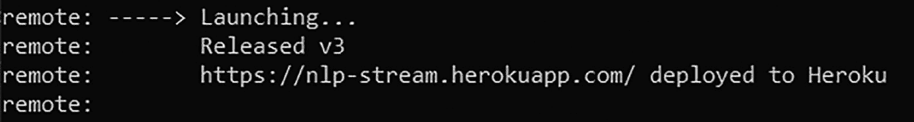
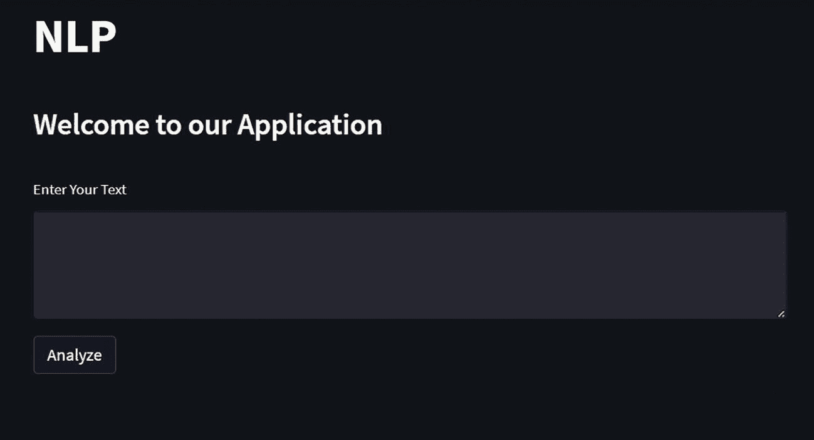

# 部署

在本节中，我们将学习如何部署我们的应用程序。首先，我们将使用以下命令为我们的应用程序创建一个实例：

```
heroku create nlp-stream
```

`nlp-stream` 是我们应用程序的名称，它将由 Heroku 部署。

**注意：** 不允许重复名称。

我们需要使用几个命令将代码推送到已创建的实例。

```
git add .
git commit -m "some message"
git push heroku master
```

一旦我们使用 `git push` 命令，我们会注意到它会自动下载 `requirements.txt` 中提到的所有 Python 库以及 Python 应用程序。安装完成后，我们将看到一个 URL，如图 9-6 所示，这意味着我们的应用程序已成功部署。



**图 9-6** 显示 Heroku 部署

复制该 URL 并将其粘贴到浏览器中，即可看到我们的应用程序在 Heroku 上运行，如图 9-7 所示。



**图 9-7** 显示 Heroku 部署

如果文件有任何更改，我们可以使用与 Heroku 登录方法后相同的命令。部署后，我们将获得相同的 URL。

**注意：** 我们从 Heroku 获得的 URL 将包含我们已创建实例的应用程序名称。

## 总结

在本章中，我们仅用几行代码就开发了一个 Streamlit NLP 应用程序。该应用程序包含了我们在前几章中学到的组件和功能。在本章中，我们还学习了如何将 Streamlit 应用程序部署到 Heroku。类似地，我们可以创建任何我们选择的应用程序并将其部署到云端。在本书的最后一章中，我们将创建一个包含计算机视觉方面的 Streamlit 应用程序。

