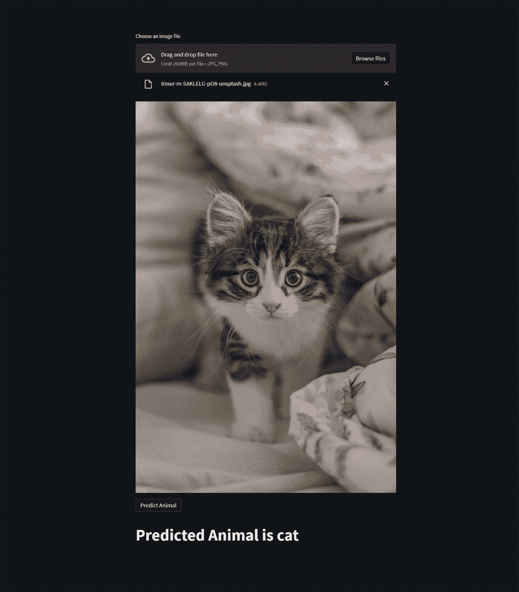

# 10. Streamlit 中的计算机视觉

在本书的最后一章中，我们将看到一个计算机视觉应用程序的小例子，它可以预测图像中的动物。此应用程序将部署我们训练好的模型来对动物图像进行分类。

## 安装库

在本节中，我们将安装开始使用 ML 应用程序所需的库。

使用 `pip` 命令安装以下库：

```
streamlit
cv2
numpy
tensorflow
```

现在，我们将使用清单 10-1 中所示的代码将这些库导入到我们的应用程序中。

```
import streamlit as st
import cv2
import numpy as np
import tensorflow as tf
from tensorflow.keras.preprocessing import image
from tensorflow.keras.applications.mobilenet_v2 import MobileNetV2, preprocess_input as mobilenet_v2_preprocess_input
```

**清单 10-1** 导入库

## 模型部署

我们需要在我们的应用程序中部署训练好的模型。这是通过使用清单 10-2 中所示的 `TensorFlow` 函数完成的。

```
#### 部署模型
with st.spinner('正在加载模型...'):
model = tf.keras.models.load_model("model/mdl_wts.hdf5")
```

**清单 10-2** 部署模型

该模型是 `hdf5` 格式，名为 `animals`，存储在 `model` 文件夹中。模型部署后，我们就可以上传图像了。在模型加载期间，我们将向用户显示一个旋转加载器。我们可以部署任何训练好的 ML 模型。

## 上传图像

现在，我们将通过上传图像来获取用户的输入。此图像可以是 `JPG` 或 `PNG` 格式。参见清单 10-3。

```
#### 上传文件
uploaded_file = st.file_uploader("选择一个图像文件", type=["jpg","png"])
```

**清单 10-3** 上传图像

### 映射图像类别

我们在字典中映射了五种不同的动物类别。随后，将根据为模型定义的这五个类别来预测动物。参见清单 10-4。

```
#### 映射图像类别
animal_dict = {0: '狗',
1: '马',
2: '大象',
3: '蝴蝶',
4: '鸡',
5: '猫',
6: '牛'}
```

**清单 10-4** 映射图像

接下来，我们将对上传的图像应用成像技术。

## 应用成像技术

首先，我们将图像转换为字节数组对象。然后读取同一图像并将其转换为 `RGB` 格式。之后，将图像大小调整为 `224 * 244`，以便可以将其输入模型。参见清单 10-5。

```
if uploaded_file is not None:
#### 对上传的图像应用成像技术
img_bytes = np.asarray(bytearray(uploaded_file.read()), dtype=np.uint8)
img = cv2.imdecode(img_bytes, 1)
img = cv2.cvtColor(img, cv2.COLOR_BGR2RGB)
img_resize = cv2.resize(img,(224,224))
```

**清单 10-5** 成像技术

我们还如下所示在应用程序中显示了上传的图像：

```
#### 显示图像
st.image(img, channels="RGB")
```

## 模型预处理

调整大小后的图像作为输入提供给 `mobilenet`。`mobilenet` 使用其内置脚本对图像进行预处理。参见清单 10-6。

```
img_resize = mobilenet_v2_preprocess_input(img_resize)
```

**清单 10-6** 处理模型

我们还为图像预测添加了一个轴，因为模型训练时没有添加维度。

```
img_reshape = img_resize[np.newaxis,...]
```

## 预测

我们添加了一个名为“预测动物”的按钮，通过映射到字典中定义的类别来从模型预测动物。参见清单 10-7。

```
#### 预测按钮
predict = st.button("预测动物")
if predict:
prediction = model.predict(img_reshape).argmax()
st.title("图像中预测的动物是 {}".format(animal_dict [prediction]))
```

**清单 10-7** 预测

## 完整代码

清单 10-8 给出了图像分类的完整代码。

**清单 10-8. `cv.py`**

```
import streamlit as st
import cv2
import numpy as np
import tensorflow as tf
from tensorflow.keras.preprocessing import image
from tensorflow.keras.applications.mobilenet_v2 import MobileNetV2,preprocess_input as mobilenet_v2_preprocess_input
#### 部署模型
with st.spinner('正在加载模型...'):
model = tf.keras.models.load_model("model/mdl_wts.hdf5")
#### 上传文件
uploaded_file = st.file_uploader("选择一个图像文件", type=["jpg","png"])
#### 映射图像类别
animal_dict = {0: '狗',
1: '马',
2: '大象',
3: '蝴蝶',
4: '鸡',
5: '猫',
6: '牛'}
```

```
if uploaded_file is not None:
#### 对上传的图像应用成像技术
img_bytes = np.asarray(bytearray(uploaded_file.read()), dtype=np.uint8)
img = cv2.imdecode(img_bytes, 1)
img = cv2.cvtColor(img, cv2.COLOR_BGR2RGB)
img_resize = cv2.resize(img,(224,224))
#### 显示图像
st.image(img, channels="RGB")
img_resize = mobilenet_v2_preprocess_input(img_resize)
img_reshape = img_resize[np.newaxis,...]
#### 预测按钮
predict_img = st.button("预测动物")
if predict_img:
prediction = model.predict(img_reshape).argmax()
st.title("图像中预测的动物是 {}".format(animal_dict [prediction]))
```

图 10-1 展示了我们的应用程序通过接收用户输入来对动物进行分类。



**图 10-1** 显示计算机视觉应用程序