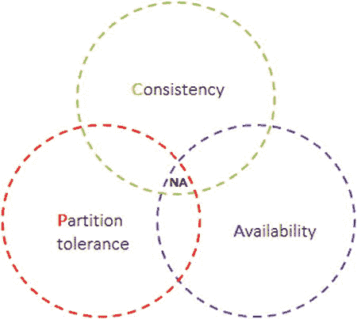
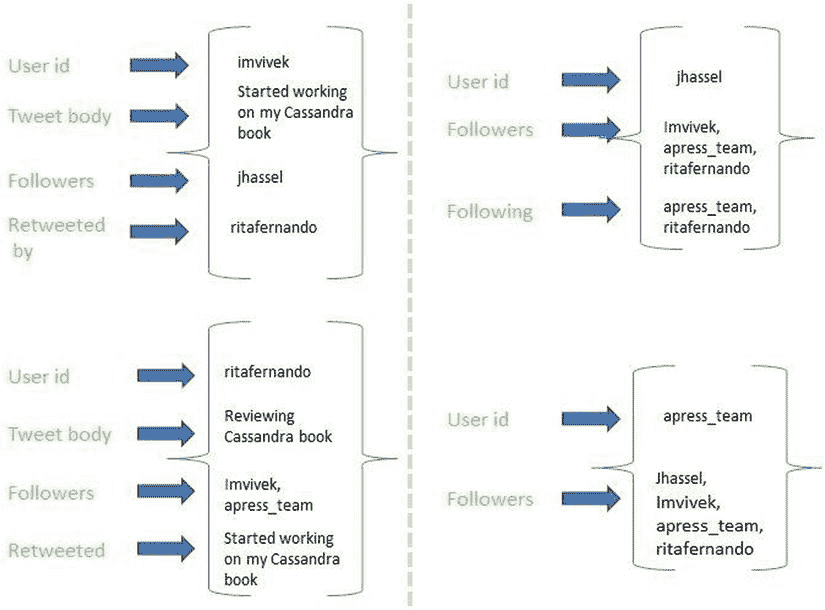
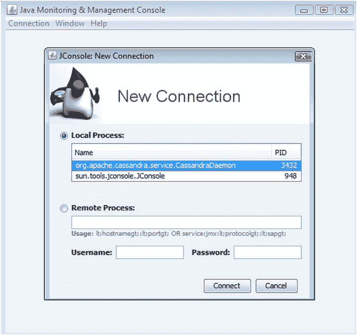
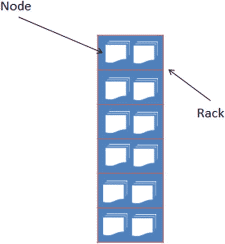
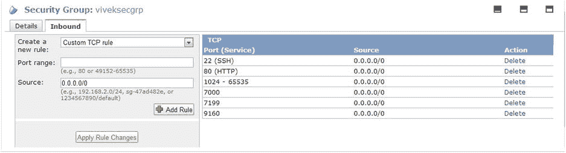
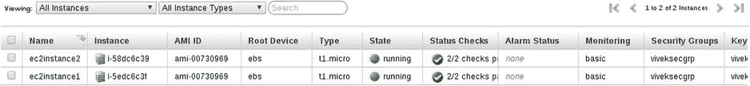

# 1. NoSQL：Cassandra 基础

本章旨在探讨 NoSQL，让用户深入了解 NoSQL 元素，然后介绍大数据问题、分布式数据库概念，最后介绍 Cassandra 的概念。本章涵盖的主题包括：
- NoSQL 简介
- `CAP` 定理
- 数据分布概念
- 大数据问题
- Cassandra 配置
- Cassandra 存储架构
- 设置与安装
- 使用 Cassandra 进行日志记录

这个详尽的介绍性章节旨在通过讨论问题和解决方案（例如有助于解决可伸缩性、可用性和其他数据相关问题的分布式编程概念）来深入探讨 NoSQL 生态系统。

本章将向读者介绍 Cassandra，并讨论 Cassandra 的存储架构、各种其他配置，以及在本地和 AWS 机器上搭建 Cassandra 集群。

## NoSQL 简介
大数据的存在可以追溯到 20 世纪 90 年代中期。然而，真正的转变始于 21 世纪初。互联网和移动技术的演进为更多人参与和在全球范围内共享数据打开了大门。这导致了以各种格式产生的海量数据在全球范围内流动。更广泛的分布式网络导致数据呈增量增长。由于这种大规模的数据产生，应用开发发生了重大转变，并且出现了许多新的领域业务可能性，例如：
- 社交趋势分析
- OLAP 和数据挖掘
- 情感分析
- 行为定向
- 实时数据分析

随着数据增长到拍字节或皆字节级别，传统关系型数据库在处理可伸缩性和管理数据结构等挑战时会变得非常困难。在这种情况下，大数据和 NoSQL 技术被视为构建解决方案的替代方案。在当今的背景下，现有的业务领域也在探索新的功能方面的可能性，并同时应对海量数据的增长。

### NoSQL 生态系统
NoSQL，通常被称为“不仅仅是 SQL”，意味着以分布式方式超越传统 SQL 的思维。目前有超过 150 种 NoSQL 数据库可用。以下是一些流行的数据库：
- 列族数据库，例如 Cassandra 和 HBase
- 基于文档的存储，例如 MongoDB 和 Couchbase
- 基于图的访问，例如 Neo4J 和 Titan Graph DB
- 简单的键值存储，例如 Redis 和 Couch DB

面对如此多的选择和类别，最重要的问题是选择什么、如何选择以及为什么选择！每个 NoSQL 数据库类别都旨在解决特定的一组问题。针对特定需求采用特定技术的范式正在引领当前的技术时代。可以肯定的是，单一数据库满足所有业务需求显然不是解决方案，而这正是 NoSQL 数据库需求产生的原因。采用数据库的最佳方式是首先理解需求。如果应用本质上是多语言的，那么您可能需要从可用选项中选择不止一个数据库。在下一节中，我们将讨论几点内容，说明为什么 Cassandra 可能是您大数据问题的答案。

### CAP 定理
`CAP` 定理由 Eric Brewer 在 21 世纪初提出，该定理指出没有数据库能同时提供一致性、可用性和分区容错性（见图 1-1），但根据用例的不同，可能允许选择其中任意两个。

图 1-1. `CAP` 定理排除了同时具备所有三种特性的数据库的可能性（“NA”区域）
传统的关系型数据库管理系统（RDBMS）提供原子性、一致性、隔离性和持久性（ACID）语义，并倡导强一致性。这正是大多数 NoSQL 数据库的不同之处，它们强烈倡导分区容错性和最终一致性下的高可用性。
- 高可用性意味着数据必须以最小的延迟可用。对于分布在多个节点上的分布式数据库，实现高可用性的一种方法是在多个节点间复制数据。像大多数 NoSQL 数据库一样，Cassandra 也提供了高可用性。
- 分区容错性意味着如果一个或几个节点宕机，系统仍然能够处理读/写请求。在构建用于处理海量数据（以拍字节计）的可伸缩系统中，这种情况很可能经常发生。因此，此类系统必须具有分区容错性。Cassandra 的存储架构也实现了这一点。
- 一致性意味着在分布式节点间保持一致。强一致性指的是集群中每个节点上数据的最新或一致状态。在每个读/写请求上，通过引入延迟（NoSQL 的缺点），可以读取或写入最稳定的行，确保所有副本上的数据同步。Cassandra 提供了最终一致性，并为每个读/写请求提供了可配置的一致性级别。我们将在后续章节详细讨论各种一致性级别选项。

### 动态模式
结构化或固定模式在实现之前定义了列数和数据类型。对模式进行的任何改动，例如添加列，都需要跨模式进行迁移计划。对于半结构化或非结构化数据格式，其中列数和数据类型可能跨多行变化，静态模式并不十分适用。这正是动态模式最适合半结构化或非结构化数据的地方。
图 1-2 展示了四条记录，其中包含特定用户 ID 的类似推文的数据。在这里，用户 ID `imvivek` 包含三列：“推文正文”、“关注者”和“被转发者”。但对于用户 `apress_team` 的行，只有“关注者”这一列。对于非结构化模式（如服务器日志），字段数可能因行而异。这就需要“动态”添加列，这是 NoSQL 数据库的一个强烈需求。传统 RDBMS 可以以静态方式处理此类数据集，但不像 Cassandra，RDBMS 无法在每个分区中扩展到每行拥有多达百万列。在 RDBMS 世界中，使用预定义模型来处理频繁的模式变更显然不是一个可行的选择。想象一下，如果我们尝试支持动态列，最终可能会产生许多空列！每行有多个列具有默认的空值肯定是不理想的。使用 Cassandra，我们可以拥有任意多的列（最多 20 亿！）。另一个可能的选项是为列名（比较器）定义数据类型，这在 RDBMS 中是不可能的（无法拥有整型列名）。

图 1-2. 动态列，也称为动态模式，是放松 RDBMS 世界静态模式约束的一种方式

### 可伸缩性
传统 RDBMS 提供垂直可伸缩性，即通过向单个单元添加更多处理器或内存来进行扩展。而 NoSQL 数据库提供水平可伸缩性，即添加更多节点。大多数 NoSQL 数据库都是无模式的，并且可以在廉价服务器上表现良好。向现有 RDBMS 集群添加节点是一个繁琐且相对昂贵的过程，而使用 NoSQL 数据库（如 Cassandra）添加数据节点则相对容易。我们将在后续章节讨论如何向 Cassandra 添加节点。

## 无单点故障
在采用集中式数据库或主从架构时，数据库资源或主节点仅存在于单台机器上，一旦主节点宕机，数据库服务将完全瘫痪。在以数据高可用为首要目标的场景中，不鼓励使用此类数据库架构。NoSQL 分布式数据库通常倾向于采用多主从配置或点对点架构，以避免单点故障。Cassandra 采用点对点架构，其中每个 Cassandra 节点都具有相同的配置。我们将在后续章节详细讨论这一点。
图 1-3a 展示了一个单主系统，该主节点作为从节点检索数据的单一接触点。如果主节点宕机，整个系统将陷入停滞，直到主节点恢复。但采用多主配置（如图 1-3b 所示）时，单点故障不会中断服务。

图 1-3. 集中式与分布式架构对比

## 高可用性
高可用性集群意味着数据库能够提供 24x7 全天候支持，且停机时间最小化（或为零）。在这类集群中，数据会复制到多个节点；当某个节点宕机时，仍有其他节点可以处理读写请求，直到该节点恢复正常运行。Cassandra 的点对点架构通过数据协同部署确保了高可用性。

## 识别大数据问题
近年来，我们发现开发者倾向于选择 NoSQL 数据库作为 RDBMS 的替代方案。然而，我建议在决定采用 NoSQL 技术之前，先进行深入分析。传统 RDBMS 确实提供了许多 NoSQL 数据库所不具备的功能。在转向基于 NoSQL 的方法之前，必须分析并回答以下几个问题：
- 这真的是大数据问题吗？
- RDBMS 为何/在哪些方面无法胜任？
识别“大数据问题”是一项有趣的任务。可扩展性、数据类型（结构化、非结构化或半结构化）以及数据量的维护成本都是几个重要因素。在大多数情况下，在 RDBMS 中管理安全且结构化的数据可能仍是首选方案；然而，如果数据具有半结构化、低敏感性等特征，并且可扩展性优先于传统 RDBMS 功能（例如连接、物化视图等），那么它便符合大数据应用场景。此处数据安全指的是身份验证和授权机制。尽管 Cassandra 对身份验证和授权提供了不错的支持，但 RDBMS 在这方面仍优于大多数 NoSQL 数据库。
图 1-4 展示了一个场景：有线/卫星运营商系统每天为每个连接收集约 3 GB 的音频/视频传输日志。可以利用大数据技术栈开发一个“观众传输分析系统”，对实时流日志进行“近实时”和“大规模数据”分析。此外，数据日志的性质不确定，且可能因用户而异。生成月度/年度分析报告需要处理 PB 级数据，此时 NoSQL 的可扩展性无疑优于 RDBMS。

图 1-4. 家庭观看卫星传输节目
考虑一个例子：观众传输分析系统正在为每个传输的节目以及正在观看或观看过的用户捕获随机日志。我们首先需要问：这真的是大数据问题吗？是的，我们讨论的是日志；想象在印度这样的国家，用户基数庞大，日志也是 24x7 全天候捕获的！此外，传输日志的性质可能是随机的，这意味着其结构不固定！它可以是半结构化的，也可以是完全非结构化的。这正是 RDBMS 由于模式僵化和可扩展性问题而无法胜任的地方（参见上一节）。
总结一下，在以下情况下，可以构建基于 NoSQL 的解决方案：
- 数据格式为半结构化/非结构化
- RDBMS 达到存储限制，无法进一步扩展
- 可以牺牲 RDBMS 特有的功能（如关系、索引），以换取反范式化但分布式的数据
- 数据冗余不是问题，并且可以采用先读后写的方法
在下一节中，我们将讨论 Cassandra 如何成为应对此类技术和功能挑战的最佳选择。

## 介绍 Cassandra
Cassandra 是一个开源的列族型数据库。它最初由 Facebook 开发，自 2009 年起成为 Apache 顶级项目。Cassandra 具备许多重要特性；以下列举部分：
- 分布式数据库
- 点对点架构
- 可配置的一致性
- CQL（Cassandra 查询语言）

### 分布式数据库
Cassandra 是一个全球性的分布式数据库。它支持复制和分区等特性。复制是指系统在不同数据站点维护 n* 个副本的过程。这些数据站点在 Cassandra 中称为节点。数据分区是一种方案，数据可以分布在多个节点上。分区通常用于管理数据的高可用性和性能。
注意：节点是数据所在的物理位置。

### 点对点设计
Cassandra 的存储架构是点对点的。集群中的每个节点都被赋予相同的角色，使其成为一个去中心化的数据库。每个节点相互独立但又互连。网络中的节点能够处理数据库的读写请求，因此在任何给定时刻，即使某个节点宕机，后续的读写请求也会由网络中的其他节点处理，因此不存在单点故障。
图 1-5 是点对点架构的图形表示。

图 1-5. 点对点去中心化的 Cassandra 节点。每个节点都是相同的，并且可以与其他节点通信

### 可配置的数据一致性
数据一致性是指在多个副本节点之间同步数据。最终一致性数据模型会返回最后更新的记录。许多分布式数据库都广泛支持这种数据模型。Cassandra 也提供了可配置的最终一致性。

#### 写入一致性
如果在确认写入请求之前，数据已成功写入并同步到副本节点，则该数据被视为写入一致的。然而，在提交写入请求时，可能存在多种一致性级别值。可用的写入一致性级别包括：
- `ANY`：写入必须至少写入任意一个节点。在这种情况下，如果所有副本节点都宕机，并且 `hinted_handoff_enabled: true`（默认值为 `true`），则对应的写入数据和提示信息将由协调节点存储，待所有副本节点恢复后，再将数据协调至至少一个节点。该写入数据在所有副本节点宕机期间将无法用于读取。虽然 `ANY` 是最低的一致性级别，但具有最高的可用性，因为它要求在发送写入确认之前，数据至少被复制到任何一个节点上。
- `ONE`：使用一致性级别 `ONE` 时，写入请求在确认前必须至少成功写入一个副本节点。
- `QUORUM`：使用一致性级别 `QUORUM` 时，写入请求必须成功写入到一组选定的副本节点。
- `LOCAL_QUORUM`：使用一致性级别 `LOCAL_QUORUM` 时，写入请求必须成功写入到一组选定的、且与协调节点位于同一数据中心的本地副本节点（称为法定人数）。
- `EACH_QUORUM`：使用一致性级别 `EACH_QUORUM` 时，写入请求必须成功写入到每组选定的副本节点（法定人数）。
- `ALL`：使用一致性级别 `ALL` 时，写入请求必须写入集群中所有副本节点的提交日志和内存表，以确保最高的一致性级别。
- `SERIAL`：线性一致性作为轻量级事务支持在 Cassandra 2.0 中引入。使用一致性级别 `SERIAL` 时，写入请求必须有条件地写入到法定副本节点的提交日志和内存表。这里的“有条件”意味着要么保证写入所有节点，要么不写入任何节点。
- `TWO`：与 `ONE` 类似，但使用一致性级别 `TWO` 时，写入请求必须写入至少两个副本节点的提交日志和内存表。
- `THREE`：与 `TWO` 类似，但使用一致性级别 `THREE` 时，写入请求必须写入至少三个副本节点的提交日志和内存表。

#### 读取一致性
如果数据不一致，其价值将大打折扣。无论数据应用的大小，都不希望出现脏读或不一致的数据。脏读是指一个事务可能读取到另一个线程未提交的数据。尽管脏读更常见于 RDBMS，但在 Cassandra 中，如果负责的节点宕机，且最新数据未被复制到每个副本节点，也可能出现数据不一致的情况。在这种情况下，应用程序可能希望在读取级别上具有强一致性。借助 Cassandra 的可调一致性，可以为每个读取请求配置一致性。可用的选项包括：
- `ONE`：使用读取一致性级别 `ONE` 时，数据从距离协调节点最近的副本节点返回。Cassandra 依靠 snitch 配置来确定最近的副本节点。由于要求从最近的副本节点返回响应，因此 `ONE` 是最低的一致性级别。
- `QUORUM`：使用读取一致性级别 `QUORUM` 时，将从法定副本节点收到的数据响应中，返回最新的（基于时间戳）数据。
- `LOCAL_QUORUM`：使用读取一致性级别 `LOCAL_QUORUM` 时，将从本地法定副本节点收到的数据响应中，返回最新的（基于时间戳）数据。
- `EACH_QUORUM`：使用读取一致性级别 `EACH_QUORUM` 时，将从每个法定副本组收到的数据响应中，返回最新的（基于时间戳）数据。
- `ALL`：使用读取一致性级别 `ALL` 时，将从所有副本节点收到的数据响应中，返回最新的（基于时间戳）数据。由于在所有副本节点中返回具有最新时间戳的响应，因此 `ALL` 是最高的一致性级别。
- `SERIAL`：使用读取一致性级别 `SERIAL` 时，将返回最新一组已提交或正在进行中的列。在读取过程中发现的未提交事务将导致正在运行的事务被隐式提交，并返回最新的列值。
- `TWO`：使用读取一致性级别 `TWO` 时，将从最近的两个副本节点返回最新的列值。
- `THREE`：使用读取一致性级别 `THREE` 时，将从最近的三个副本节点返回最新的列值。
基于上述一致性级别配置，用户可以始终为每个读/写请求配置所需的一致性级别。例如，为了确保最低的写入一致性但最高的读取一致性，我们可以选择 `ANY` 作为写入一致性级别，选择 `ALL` 作为读取一致性级别。

### Cassandra 查询语言 (CQL)
从最终用户的角度来看，Cassandra 的一个关键特性是易用性而非熟悉性。Cassandra 查询语言（`CQL`）是在 Cassandra 0.8 版本中引入的，旨在提供一种类似 RDBMS 的结构化查询语言（SQL）。自诞生以来，`CQL` 经历了多次变更。后续版本中引入了许多新特性，并进行了大量与性能相关的增强工作。`CQL` 融合了众人熟知的数据定义语言（DDL）和数据操作语言（DML）语句。
在本书中，我们将介绍 `CQL` 的大部分特性。

## 安装 Cassandra
安装 Cassandra 相当简单。在本节中，我们将介绍如何在 Windows 和 Linux 系统上通过 Cassandra tarball（`.tar`文件）进行安装。
- 对于 Linux，使用以下命令：`tar -xvf apache-cassandra-2.0.6-bin.tar.gz`
- 对于 Windows，您可以使用 WinZip 或 7zip 等工具来提取 tarball。
根据您的平台使用适当的方法解压下载的 tar 文件：
- Linux：`wget http://archive.apache.org/dist/cassandra/2.0.6/apache-cassandra-2.0.6-bin.tar.gz`
- Windows：`http://archive.apache.org/dist/cassandra/2.0.6/apache-cassandra-2.0.6-bin.tar.gz`
下载 Cassandra 的 tarball：
- 运行 `mkdir /home/apress/Cassandra`（这里 `apress` 是 `user.name` 环境变量）
- 运行 `cd /home/apress/cassandra`
创建一个文件夹来下载 Cassandra 的 tarball，例如：
> **注意**：如果遇到“内存不足”或段错误，请检查 `cassandra-env.sh` 文件中的 `JAVA_HOME` 和 `JVM_OPTS` 参数。

## Cassandra 中的日志记录

在开发模式或生产模式下运行应用程序时，我们可能需要在某些情况下查看服务器日志，例如：
- 性能问题
- 运维支持
- 调试应用程序漏洞

默认的服务器日志记录设置定义在 `log4j-server.properties` 文件中，如下所示。

```
# output messages into a rolling log file as well as stdout
log4j.rootLogger=INFO,stdout,R

# stdout
log4j.appender.stdout=org.apache.log4j.ConsoleAppender
log4j.appender.stdout.layout=org.apache.log4j.PatternLayout
log4j.appender.stdout.layout.ConversionPattern=%5p %d{HH:mm:ss,SSS} %m%n

# rolling log file
log4j.appender.R=org.apache.log4j.RollingFileAppender
log4j.appender.R.maxFileSize=20MB
log4j.appender.R.maxBackupIndex=50
log4j.appender.R.layout=org.apache.log4j.PatternLayout
log4j.appender.R.layout.ConversionPattern=%5p [%t] %d{ISO8601} %F (line %L) %m%n

# Edit the next line to point to your logs directory
log4j.appender.R.File=/var/log/cassandra/system.log

# Application logging options
#log4j.logger.org.apache.cassandra=DEBUG
#log4j.logger.org.apache.cassandra.db=DEBUG
#log4j.logger.org.apache.cassandra.service.StorageProxy=DEBUG

# Adding this to avoid thrift logging disconnect errors.
log4j.logger.org.apache.thrift.server.TNonblockingServer=ERROR
```

让我们按顺序讨论这些属性：
- 前缀为 `log4j.appender.stdout` 的属性用于控制台日志记录。
- 服务器日志会在由属性 `log4j.appender.R.File` 的值所定义的位置生成并追加。默认值为 `/var/log/cassandra/system`。用户可以覆盖默认位置的属性文件。
- `log4j.appender.R.maxFileSize` 定义了最大日志文件大小。
- `log4j.appender.R.maxBackupIndex` 属性定义了最大滚动日志文件数量（默认为 50）。
- `log4j.appender.R.layout.ConversionPattern` 属性定义了日志文件的日志记录模式。
- `log4j-server.properties` 文件中的最后一行是在与 Cassandra 进行 thrift 连接时用于应用程序日志记录的。默认情况下它被注释掉了，以避免在频繁的套接字断开时产生不必要的日志记录。

### 应用程序日志记录选项

默认情况下，Cassandra API 级别的日志记录是禁用的。但我们可以启用并更改日志级别，以记录更多应用程序级别的信息。很多时候，应用程序可能需要启用 Cassandra 特定的服务器端日志记录来排查问题。以下代码展示了可用于特定应用程序日志记录的部分。

```
# Application logging options
#log4j.logger.org.apache.cassandra=DEBUG
#log4j.logger.org.apache.cassandra.db=DEBUG
#log4j.logger.org.apache.cassandra.service.StorageProxy=DEBUG
```

### 更改日志属性

有两种可能的方法来配置日志属性。第一种，我们可以修改 `log4j-server.properties`；第二种，通过 JMX（Java 管理扩展），使用 `jconsole`。两者之间的区别在于，使用后者可以在运行时动态更改日志级别，而前者是静态的。

### 通过 JConsole 管理日志

JConsole 是一个 GUI 监控工具，用于使用 JMX 监控正在运行的 Java 应用程序的资源使用情况和性能。

`jconsole` 可执行文件位于 `JDK_HOME/bin` 目录中，其中 `JDK_HOME` 是安装 Java 开发工具包（JDK）的目录。如果此目录在您的系统路径中，您只需在命令（shell）提示符下输入 `jconsole` 即可启动 JConsole。否则，您必须使用可执行文件的完整路径。

运行 `jconsole` 时，您需要连接 Cassandra 守护进程线程，如图 1-6 所示。


图 1-6. JConsole 连接界面

成功连接到 CassandraDaemon 进程后，单击 MBeans 选项卡以查看已注册的消息 beans。图 1-7 描述了将 `org.apache.cassandra.db` 包中类的日志级别更改为 `INFO` 级别。


图 1-7. 通过 jconsole Mbeans 设置更改日志级别

注意：请参考 [`logging.apache.org/log4j/1.2/apidocs/org/apache/log4j/PatternLayout.html`](http://logging.apache.org/log4j/1.2/apidocs/org/apache/log4j/PatternLayout.html) 获取更多关于日志模式的信息。

## 理解 Cassandra 配置

主要的 Cassandra 配置文件是`Cassandra.yaml`，它位于`$CASSSANDRA_HOME/conf`文件夹中。粗略统计，大约有 100 个属性。表 1-1 包含了这些属性的一个子集，这些属性对 Cassandra 初学者很有帮助，值得一提。

表 1-1. 重要的 Cassandra 服务器属性

| 属性 | 默认值 | 描述 |
| --- | --- | --- |
| `cluster_name` | “Test cluster” | 用于限制节点仅加入一个逻辑集群。 |
| `num_tokens` | 禁用，未指定 | 如果未指定，默认值为 1。例如，如果希望在引导节点时启用虚拟节点支持，则需要设置`num_tokens`参数。推荐值为 256。 |
| `initial_token` | 不适用 | 为节点分配一个数据范围。在引导节点时，建议为其赋值。如果未指定，Cassandra 将分配一个随机令牌。对于随机分区模式，计算`initial_token`的方式是：`i * (2**127 / N)`，其中`i = 0 .. N-1`，`N`是节点数。 |
| `hinted_handoff_enabled` | True | 在一致性级别为 ANY 的情况下，如果副本节点宕机，则相应的写入请求将以提示（hint）的形式存储在协调节点的`system.hints`列族中。一旦副本节点开始接受写入请求，这些提示将用于重放变更对象。 |
| `max_hint_window_in_ms` | 3 小时 | 对于宕机节点，新提示被写入协调节点前的最大等待时间。超过提示窗口后，将不再存储新的提示。如果未指定，默认值为 1 小时。此属性在协调节点上写入提示时使用。如果 gossip 协议中某个特定副本节点的端点宕机时间超过了指定的最大等待时间，则`StorageProxy`服务将无法在协调节点上写入新提示。 |
| `hinted_handoff_throttle_in_kb` | 1024 | 每线程的提示数据流量限制（千字节/秒）。 |
| `max_hints_delivery_threads` | 2 | 允许用于发送数据提示的最大线程数。在跨多个数据中心写入提示时非常有用。 |
| `populate_io_cache_on_flush` | False | 如果节点上的完整数据可以放入内存，则设置为 true。自 Cassandra 1.2.2 起，我们还可以为每个列族设置此参数。参见[`issues.apache.org/jira/browse/CASSANDRA-4694`](https://issues.apache.org/jira/browse/CASSANDRA-4694)。 |
| `authenticator` | `AllowAllAuthenticator` | `IAuthenticator`接口的实现。默认情况下，Cassandra 提供`AllowAllAuthenticator`和`PasswordAuthenticator`作为内部认证实现。`PasswordAuthenticator`根据存储在`system_auth`键空间中`credentials`和`users`列族的数据验证用户名和密码。（关于 Cassandra 的安全性将在第 10 章详细讨论。） |
| `Authorizer` | `AllowAllAuthorizer` | `IAuthorizer`接口的实现。该实现管理用户对键空间、列族、索引等的权限。在服务器启动时启用`CassandraAuthorizer`将在`system_auth`键空间中创建一个权限表来存储用户权限。（关于 Cassandra 的安全性将在第 10 章详细讨论。） |
| `permissions_validity_in_ms` | 默认为 2000。如果授权器属性为`AllowAllAuthorizer`则禁用 | 默认的权限缓存有效期。 |
| `Partitioner` | `Murmur3Partitioner` | 集群中各节点间的行分布取决于所选的分区器。可用的值有`RandomPartitioner`、`ByteOrderedPartitioner`、`Murmur3Partitioner`和已弃用的`OrderPreservingPartitioner`。 |
| `data_file_directories` | `/var/lib/cassandra/data` | 节点的物理数据存储位置。 |
| `commitlog_directory` | `/var/lib/cassandra/commitlog` | 节点提交日志文件的物理位置。 |
| `disk_failure_policy` | Stop | 可用的值有 stop、best_effort 和 ignore。Stop 将关闭与节点的所有通信（JMX 除外）。`best_effort`仍然会响应来自可用 sstable 的读取请求。 |
| `key_cache_size_in_mb` | 空，意为 100MB 或可用堆大小的 5%，取两者中较小值 | 若要禁用，设为 0。 |
| `saved_caches_directory` | `/var/lib/cassandra/saved_caches` | 节点上已保存缓存的物理存储位置。 |
| `key_cache_save_period` | 14400 | 键缓存保存的持续时间（秒），保存在`saved_caches_directory`下。 |
| `key_cache_keys_to_save` | 禁用 | 默认禁用。所有行键都将被缓存。 |
| `row_cache_size_in_mb` | 0（禁用） | 内存行缓存大小。 |
| `row_cache_save_period` | 0（禁用） | 行缓存保存的持续时间（秒），保存在`saved_caches_directory`下。 |
| `row_cache_keys_to_save` | 禁用 | 默认禁用。所有行键都将被缓存。 |
| `row_cache_provider` | `SerializingCacheProvider` | 可用的值有`SerializingCacheProvider`和`ConcurrentLinkedHashCacheProvider`。如果工作负载不是密集更新型，推荐使用`SerializingCacheProvider`，因为它使用本地内存（而非 JVM）进行缓存。 |
| `commitlog_sync` | Periodic | 可用的值有 periodic 和 batch。使用 batch 同步时，数据写入磁盘之前不会确认写入操作。参见`commitlog_sync_batch_window_in_ms`属性。 |
| `commitlog_sync_batch_window_in_ms` | 50 | 如果`commitlog_sync`为 batch 模式，Cassandra 仅在提交日志同步窗口过期且数据被 fsync 到磁盘后，才会确认写入操作。 |
| `commitlog_sync_period_in_ms` | 10000 | 如果`commitlog_sync`为 periodic 模式。提交日志将在该时间过后被 fsync 到磁盘。 |
| `commitlog_segment_size_in_mb` | 32 | 提交日志段大小。达到此限制后，Cassandra 会将内存中的 memtable 以 sstable 形式刷新到磁盘。在 32 位 JVM 上，应保持较小值，以避免地址空间耗尽并减少提交日志刷新频率。 |
| `seed_provider` | `SimpleSeedProvider` | `SeedProvider`接口的实现。`SimpleSeedProvider`是默认实现，接受逗号分隔的地址列表。“-seeds”参数的默认值为 127.0.0.1。在多节点部署的情况下，请将其更改为多个节点地址。 |
| `concurrent_reads` | 32 | 如果工作负载数据无法放入内存，则需要从磁盘获取数据。设置此参数以指定并发读取的数量。 |
| `concurrent_writes` | 32 | 通常写入比读取快。因此，与`concurrent_reads`相比，此参数可以设置得更高一些。 |
| `memtable_total_space_in_mb` | JVM 堆的三分之一（禁用） | 分配给 memtable 的总空间。一旦超过指定大小，Cassandra 将首先将最大的 memtable 刷新到磁盘。 |
| `commitlog_total_space_in_mb` | 32（32 位 JVM），1024（64 位 JVM） | 分配给提交日志段的总空间。达到指定限制后，Cassandra 会通过删除最旧的提交日志来刷新 memtable 以回收空间。 |
| `storage_port` | 7000 | 节点间内部通信使用的 TCP 端口。 |
| `ssl_storage_port` | 7001 | 在启用了`client_encryption_options`时使用。 |
| `listen_address` | `Localhost` | 用于绑定并连接其他 Cassandra 节点的地址。 |
| `broadcast_address` | 禁用（与`listen_address`相同） | 供其他 Cassandra 节点使用的广播地址。 |
| `internode_authenticator` | `AllowAllInternodeAuthenticator` | 用于节点间通信的`IinternodeAuthenticator`接口实现。 |
| `start_native_transport` | False | 用于客户端的 CQL 原生传输。 |
| `native_transport_port` | 9042 | 用于连接客户端的 CQL 原生传输端口。 |
| `rpc_address` | Localhost | Thrift RPC 地址，供客户端连接。 |
| `rpc_port` | 9160 | 供客户端通信的 Thrift RPC 端口。 |
| `rpc_min_threads` | 16 | Thrift RPC 的最小线程数。 |
| `rpc_max_threads` | 2147483647（最大 32 位有符号整数值） | Thrift RPC 的最大线程数。 |
| `rpc_recv_buff_size_in_bytes` | 禁用 | 如果希望为 Thrift RPC 设置接收套接字缓冲区大小限制，请启用。 |
| `rpc_send_buff_size_in_bytes` | 禁用 | 如果希望为 Thrift RPC 设置发送套接字缓冲区大小限制，请启用。 |
| `incremental_backups` | False | 如果启用，Cassandra 会将已刷新的 sstable 硬链接到`data_file_directories/keyspace/backup`目录下的备份目录。 |
| `snapshot_before_compaction` | False | 如果启用，将在每次压缩前，在`data_file_directories/keyspace/snapshots`目录下创建快照。 |
| `auto_snapshot` | True | 如果禁用，则在针对键空间执行 DML 操作（truncate, drop）时将不会创建快照。 |
| `concurrent_compactors` | 等于处理器数量 | 等于`cassandra.available_processors`（如果已定义），否则等于可用的处理器数量。 |
| `multithreaded_compaction` | False | 如果启用，将为每个处理器使用单个线程进行压缩。 |
| `compaction_throughput_mb_per_sec` | 16 | 数据压缩流量，单位为兆字节/秒。更高的压缩吞吐量将确保更少的 sstable 和更多的磁盘空间。 |
| `endpoint_snitch` | `SimpleSnitch` | 一个非常重要的配置。Snitch 也可以称为信息提供者。用于将请求路由到集群中的副本节点。可用的值有`SimpleSnitch`、`PropertyFileSnitch`、`RackInferringSnitch`、`Ec2Snitch`和`Ec2MultiRegionSnitch`。（我将在后续章节中介绍 snitch 配置。） |
| `request_scheduler` | `NoScheduler` | 客户端请求调度器。默认不进行任何调度，但我们可以将其配置为`RoundRobinScheduler`或自定义实现。它将对客户端 DML 请求进行排队，并在成功处理请求后最终释放。 |
| `server_encryption_options` | None | 启用节点间通信加密。可用的值有 all、none、dc 和 rack。 |
| `client_encryption_options` | false（未启用） | 启用客户端/服务器通信。如果启用，必须指定`ssl_storage_port`，因为它将用于客户端/服务器通信。 |
| `internode_compression` | All | 压缩节点间通信的流量。可用的值有：all、dc 和 none。 |
| `inter_dc_tcp_nodelay` | True | 将其设置为 false 将减少 TCP 协议的拥塞，但会增加延迟。 |

### 提交日志归档

要启用 Cassandra 的自动提交日志归档和恢复功能（自 1.1.1 版本起支持），需使用`commitlog_archiving.properties`文件。该文件用于配置`archive_command`和`restore_command`属性。提交日志归档也被称为预写式日志（WAL）归档，用于实现时间点恢复。

Cassandra 的实现方式与 PostgreSQL 类似。PostgreSQL 是一种面向对象的关系数据库管理系统（OORDBMS），它提供`wal_level`设置，级别从最低的 minimal 开始，依次是 archive 和`hot_standby`级别，后者允许在恢复期间执行查询。更多关于 PostgreSQL 的详细信息，请参考[`www.postgresql.org/`](http://www.postgresql.org/)。

#### archive_command

通过如下命令启用`archive_command`以实现隐式提交日志归档：

```
archive_command= /bin/ln %path /home/backup/%name
```

其中，`%path`是上一个活动提交日志段的完整路径，`%name`是提交日志的名称。上述 shell 命令将为提交日志段（`%path`）创建一个硬链接。如果行突变大小超过`commitlog_segment_size_in_mb`，Cassandra 将使用`archive`命令将此段归档至`/home/backup/`目录下。此处`%path`是最新旧段的名称，`%name`是提交日志文件名。

#### restore_command

在 Cassandra 引导过程中，将`commitlog_archiving.properties`中的`restore_directories`留空，Cassandra 将使用`restore_command`重放这些日志文件：

```
restore_command=cp -f %from %to
```

其中，`%from`是`restore_directories`指定的值，`%to`是`commitlog_directory`下的下一个提交日志段文件。

这种持续提交日志的一个优势是数据的高可用性，也称为热备。

## 配置复制和数据中心

近年来，大数据异构系统的需求已经演变。此类系统中的组件本质上是多样化的，可以由不同的数据集组成。考虑到数据量的性质、本地性和数量，此类系统极有可能需要与位于不同物理位置的数据中心进行互联。

数据中心是一个硬件系统（例如，商品服务器），由多个机架组成。一个机架可能包含一个或多个节点（参见图 1-8）。



图 1-8. 描绘 Cassandra 数据中心的图像

维护多个数据中心的原因可能是高可用性、备用节点和数据恢复。

在高可用性方面，任何传入请求都必须以最低延迟得到响应。数据复制是一种在多个节点上保留相同数据冗余副本的机制。

如上所述，数据中心由多个机架组成，每个机架包含多个节点。为了实现高可用性和节点故障恢复，数据复制策略至关重要。考虑如下场景：
- 本地读取（高可用性）
- 故障转移（节点故障）

考虑到这些因素，我们应将数据复制到同一数据中心但位于不同机架的多个节点上。这样可以避免同一机架内节点（因网络连接问题、电源故障等导致的）的读写失败。

复制意味着在多个数据节点上保留数据的冗余副本，以实现高可用性和一致性。使用 `Cassandra`，我们可以在创建键空间时配置复制因子和复制策略类。

在创建模式（而非键空间）时，我们可以按如下方式配置复制：

```
CREATE KEYSPACE apress WITH replication = {'class': 'SimpleStrategy', 'replication_factor' : 3};
```

```
// cql3 脚本
create keyspace apress with placement_strategy='org.apache.cassandra.locator.SimpleStrategy' and strategy_options ={replication_factor:1};
```

```
// 使用 cassandra-cli thrift
```

`注意：` 通过 `CQL3` 和 `Cassandra-cli` 进行模式创建和管理将在第 2 章中讨论。

此处，`SimpleStrategy` 是复制策略，`replication_factor` 为 3。像这样使用 `SimpleStrategy`，每个数据行将按顺时针方向在 3 个副本节点上同步或异步复制（取决于写一致性级别）。

`Cassandra` 支持的不同策略类选项有：
- `SimpleStrategy`
- `LocalStrategy`
- `NetworkTopologyStrategy`

### LocalStrategy

`LocalStrategy` 用于内部目的，主要用于 `system` 和 `system_auth` 键空间。`System` 和 `system_auth` 是内部键空间，由 `Cassandra` 的存储架构隐式管理，用于处理授权和认证。这些键空间还保存关于用户定义的键空间和列族的元数据。我们将在下一章详细讨论它们。尝试使用 `LocalStrategy` 作为策略类来创建键空间在 `Cassandra` 中是不允许的，并会给出类似“LocalStrategy 仅用于 Cassandra 内部目的”的错误。

### NetworkTopologyStrategy

如果需要在不同的数据中心放置多个副本节点，则首选 `NetworkTopologyStrategy`。我们可以按如下方式使用此策略创建键空间：

```
CREATE KEYSPACE apress WITH replication = {'class': 'NetworkTopologyStrategy', 'dc1' : 2, 'dc2' : 3};
```

这里 `dc1` 和 `dc2` 是数据中心名称，其复制因子分别为 2 和 3。数据中心名称源自配置的 `snitch` 属性。

### SimpleStrategy

`SimpleStrategy` 推荐用于单个数据中心内跨越多个机架的多个节点。

```
CREATE KEYSPACE apress WITH replication = {'class': 'SimpleStrategy', 'replication_factor' : 3};
```

此处，复制因子 3 意味着将数据复制到 3 个节点上，而策略类 `SimpleStrategy` 意味着这些 `Cassandra` 节点位于同一数据中心内。

## Cassandra 多节点配置

在本节中，我们将讨论在单台机器上和 Amazon EC2 实例上的多个 Cassandra 节点配置。选择 AWS EC2 实例的原因包括：在云上搭建 Cassandra 集群，以及在本地机器上配置 Cassandra 集群以用于物理机器。基于 AWS 的配置将教育用户了解 AWS 和 Cassandra。

### 在单台机器上配置多节点集群

在单台机器上配置多节点集群更像是一种实验，因为在生产应用中，你通常会希望在多个 Cassandra 节点上配置集群。无论是单台机器还是多台机器上搭建多节点集群，其过程都是相似的。这正是我们将在本次示例练习中介绍的内容。在本例中，我们将在单台机器上配置 3 个节点（`127.0.0.2`-`4`）。

我们需要将主机名映射到 IP 地址。在 Windows 和 Linux 操作系统中，这些配置信息位于 `etc/hosts`（Windows）或 `/etc/hosts`（Linux）文件中。修改配置文件，添加上面提到的 3 个节点配置，如下所示：

```
127.0.0.1   127.0.0.2
127.0.0.1   127.0.0.3
127.0.0.1   127.0.0.4
```

对于 Mac OS，我们需要创建这些别名，如下所示：

```
sudo ifconfig lo0 alias 127.0.0.2 up
sudo ifconfig lo0 alias 127.0.0.3 up
sudo ifconfig lo0 alias 127.0.0.4 up
```

将下载的 Cassandra 压缩包解压到 3 个不同的文件夹中（每个节点一个）。为每个节点分配一个相同的 `cluster_name`，如下所示：

```
# 集群名称。主要用于防止一个逻辑集群中的机器
# 加入到另一个集群。
cluster_name: 'Test Cluster'
```

我们应该为集群中的每个节点保留相同的种子节点。这些种子节点仅用于在集群内的节点间启动 `gossip` 协议。在 `cassandra.yaml` 中配置种子节点，如下所示：

```
seed_provider:
# 被视为联系点的主机地址。
# Cassandra 节点使用此主机列表来相互发现并了解
# 环的拓扑结构。如果运行多个节点，则必须修改此项！
- class_name: org.apache.cassandra.locator.SimpleSeedProvider
  parameters:
    # seeds 实际上是一个逗号分隔的地址列表。
    # 例如: "<ip1>,<ip2>,<ip3>"
    - seeds: "127.0.0.2"
```

在每个 `cassandra.yaml` 文件中，针对 `127.0.0.2`、`127.0.0.3` 和 `127.0.0.4` 的 IP 地址，修改 `listen_address` 和 `rpc_address` 配置。由于所有 3 个节点都运行在同一台机器上，请将每个节点的 `rpc_address` 分别改为 `9160`、`9161` 和 `9162`。这里，我们可以选择每个节点使用一个令牌还是多个令牌。`Cassandra 1.2` 引入了“虚拟节点”功能，允许为一个节点分配一个令牌范围。我们将在后续章节讨论虚拟节点。将 `initial_token` 改为 `empty`，并保持 `num_tokens` 为 2（建议值为 256）。接下来是为每个节点分配不同的 `JMX_PORT`（例如 `8081`、`8082` 和 `8083`）。

对于 Linux，修改 `$CASSANDRA_HOME/conf/cassandra.env.sh`，如下所示：

```
# 指定 Cassandra 将通过 JMX 连接可用的默认端口。
JMX_PORT="7199"
```

对于 Windows，修改 `$CASSANDRA_HOME/bin/cassandra.bat`，如下所示：

```
REM ***** JAVA options *****
set JAVA_OPTS=-ea^
-javaagent:"%CASSANDRA_HOME%\lib\jamm-0.2.5.jar"^
-Xms1G^
-Xmx1G^
-XX:+HeapDumpOnOutOfMemoryError^
-XX:+UseParNewGC^
-XX:+UseConcMarkSweepGC^
-XX:+CMSParallelRemarkEnabled^
-XX:SurvivorRatio=8^
-XX:MaxTenuringThreshold=1^
-XX:CMSInitiatingOccupancyFraction=75^
-XX:+UseCMSInitiatingOccupancyOnly^
-Dcom.sun.management.jmxremote.port=7199^
-Dcom.sun.management.jmxremote.ssl=false^
-Dcom.sun.management.jmxremote.authenticate=false^
-Dlog4j.configuration=log4j-server.properties^
-Dlog4j.defaultInitOverride=true
```

让我们逐个启动每个节点，并通过命令 `$CASSANDRA_HOME/apache-cassandra-1.2.4/bin/nodetool -h 127.0.0.02 -p 8081 ring` 检查环状态。

图 1-9 显示了使用 `jmx` 连接到一个 Cassandra 节点时的环状态。由于 Cassandra 的架构是对等的，在任何节点上检查环状态都会得到相同的结果。


图 1-9. 环状态

### 在 Amazon EC2 上配置多节点集群

Amazon 弹性计算云 (Amazon EC2) 是 Amazon Web Service (AWS) 云计算平台的重要组成部分之一。AWS 允许你选择操作系统平台，并在云端提供所需的硬件支持，这使你能够在云计算平台上快速搭建和部署应用程序。要了解有关 Amazon ec2 设置的更多信息，请参阅 [`http://aws.amazon.com/ec2/`](http://aws.amazon.com/ec2/)。

在本节中，我们将学习如何在 Amazon EC2 上配置多个 Cassandra 节点。为此，请遵循以下步骤。

连接到每个实例并下载 Cassandra 压缩包，如下所示：



图 1-11. 配置安全组设置

修改安全组以启用 `9160`、`7000` 和 `7199` 端口，如图 1-11 所示。



图 1-10. 显示 2 个实例处于运行状态的 EC2 控制台

首先，启动 2 个 AMI（`ami-00730969`）实例，如图 1-10 所示。

```
wget http://archive.apache.org/dist/cassandra/1.2.4/apache-cassandra-1.2.4-bin.tar.gz
```

使用 `rpm` 安装程序在每个 EC2 实例上下载并设置 Java，如下所示：

```
sudo rpm -i jdk-7-linux-x64.rpm
sudo rm -rf /usr/bin/java
sudo ln -s /usr/java/jdk1.7.0/bin/java /usr/bin/java
sudo rm -rf /usr/bin/javac
sudo ln -s /usr/java/jdk1.7.0/bin/javac /usr/bin/javac
```


图 1-15. 节点 10.145.213.3 已启动并加入集群

图 1-15 显示了实例 `10.145.213.3` 已启动并加入集群环。


图 1-14. 两个 EC2 实例及其环状态

让我们逐个启动每个节点并检查环状态。验证两个 EC2 实例是否都应该已启动、正在运行并通过环拓扑连接。图 1-14 显示了两个正在运行的 EC2 实例的环状态。


图 1-13. 如何获取节点的 inet 地址

将这两个实例中的任意一个创建为种子节点，并将存储端口、`jmx_port` 和 `rpc_port` 分别保持为 `7000`、`7199` 和 `9160`。

让我们将 `listen_address` 和 `rpc_address` 保留为空值（默认值为节点的 inet 地址（下划线标出），如图 1-13 所示）。


图 1-12. 两个节点的 initial_token 配置

多个 Cassandra 节点的配置与我们之前讨论的相同。在本节中，我们将演示每个节点使用单个令牌（`initial_token`）。让我们分配初始令牌值 0 和 1。我们可以通过修改每个节点上的 `Cassandra.yaml` 文件来分配 `initial_token` 值。

## 总结

本章是介绍性的，涵盖了所有通用概念和 Cassandra 特定的配置。对于应用程序开发人员来说，理解副本、数据分布的本质以及最重要的是在 Cassandra 中进行设置是非常关键的。现在我们已经准备好迎接下一个挑战：用 Cassandra 处理大数据！在下一章中，我们将讨论 Cassandra 的存储机制和数据建模。通过数据建模和理解 Cassandra 的存储架构，将有助于我们对数据集进行建模、分析并探索 Cassandra 可用的最佳方法。

