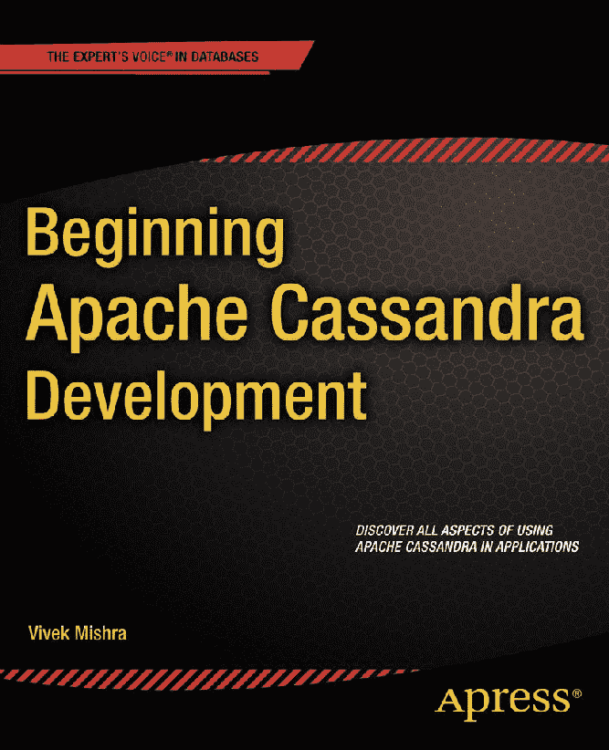

 维韦克·米什拉（Vivek Mishra）《Apache Cassandra 开发入门》

ISBN 978-1-4842-0143-5
电子版 ISBN 978-1-4842-0142-8
DOI 10.1007/978-1-4842-0142-8
© Apress 2014

《Apache Cassandra 开发入门》
版权所有 © 2014 维韦克·米什拉

本作品受版权保护。出版者保留所有权利，无论是涉及材料的全部或部分内容，特别是翻译、重印、重用插图、朗诵、广播、以缩微胶片或任何其他物理方式复制，以及传输或信息存储与检索、电子改编、计算机软件，或现在已知或未来开发的任何类似或不同方法的权利。本法律保留的例外情况包括：与评论或学术分析相关的简短摘录，或专门为在计算机系统上输入和执行而提供的材料，仅供作品购买者独家使用。仅在出版者所在地现行版权法的规定下，才允许复制本出版物或其部分内容，且使用许可必须始终从 Springer 获取。使用许可可通过 Copyright Clearance Center 的 RightsLink 获得。违反者将根据相应的版权法被起诉。

ISBN-13（平装本）：978-1-4842-0143-5
ISBN-13（电子版）：978-1-4842-0142-8

本书中可能出现商标名称、标识和图像。我们并非在每次出现商标名称、标识或图像时都使用商标符号，而是仅以编辑方式使用这些名称、标识和图像，以维护商标所有者的利益，并且无意侵犯商标权。本出版物中使用的商号、商标、服务标志及类似术语，即便未明确标识，也不应被视为对其是否受专有权利保护的看法。

尽管本书中的建议和信息在出版时被认为是真实准确的，但作者、编辑和出版者对可能出现的任何错误或遗漏均不承担任何法律责任。出版者对本文所含内容不作任何明示或暗示的担保。

常务董事：韦尔莫德·斯帕尔
首席编辑：杰夫·奥尔森
技术审校：布莱恩·奥尼尔
编辑委员会：史蒂夫·安格林、马克·贝克纳、加里·康奈尔、路易丝·科里根、吉姆·德沃尔夫、乔纳森·根尼克、罗伯特·哈钦森、米歇尔·洛曼、詹姆斯·马克姆、马修·穆迪、杰夫·奥尔森、杰弗里·佩珀、道格拉斯·潘迪克、本·雷诺-克拉克、格温南·斯皮林、马特·韦德、史蒂夫·韦斯
统筹编辑：梅丽莎·马尔多纳多
文字编辑：洛里·卡瓦诺
排版：SPi Global
索引编制：SPi Global
插图制作：SPi Global
封面设计：安娜·伊申科

由 Springer Science+Business Media New York 向全球图书贸易发行，地址：233 Spring Street, 6th Floor, New York, NY 10013。电话：1-800-SPRINGER，传真：(201) 348-4505，电子邮件：`orders-ny@springer-sbm.com`，或访问 `www.springeronline.com`。Apress Media, LLC 是加利福尼亚州的有限责任公司，其唯一成员（所有者）是 Springer Science + Business Media Finance Inc (SSBM Finance Inc)。SSBM Finance Inc 是特拉华州的一家公司。

如需翻译信息，请发送电子邮件至 `rights@apress.com`，或访问 `www.apress.com`。

Apress 和 friends of ED 图书可批量购买用于学术、企业或促销用途。大多数图书也提供电子书版本和许可证。如需更多信息，请参考我们的特别批量销售–电子书许可网页：`www.apress.com/bulk-sales`。

作者在本书中引用的任何源代码或其他补充材料均可供读者在 `www.apress.com` 获取。有关如何找到您图书源代码的详细信息，请访问 `www.apress.com/source-code/`。

献给我的妻子拉什米（Rashmi）和我的天使尤迪蒂（Uditi）。没有你们，这一切都不可能实现。

## 关于作者

 维韦克·米什拉是一位技术爱好者、作者、演讲者和大数据架构师。他是开源项目 Kundera 的主要贡献者，并为 Apache Cassandra 做出了贡献。

目前，他在 Impetus Infotech Pvt Ltd 担任首席软件工程师。他专注于使用机器学习算法进行实时数据质量管理和虚拟化，及其在解决业务问题中的应用。

## 关于技术审校

 布莱恩·奥尼尔是一位技术领导者，也是大数据领域的公认权威。他领导并贡献于涉及分布式存储、实时计算和分析的开源项目。他于 2013 年荣获 InfoWorld 技术领导力奖，并被评为 2012-2014 年度 Datastax Cassandra MVP。他撰写了关于 Cassandra 的 Dzone 参考卡片，并最近出版了一本关于分布式处理的书籍，书名为《Storm 蓝图：分布式实时计算模式》。他拥有人工智能和数据管理方面的专利，毕业于布朗大学。

目前，布莱恩担任 Health Market Science (HMS) 的首席技术官，负责开发一个专注于医疗保健领域分析和数据管理的大数据平台。该平台由 Storm 和 Cassandra 驱动，可对数千个不同的数据源（包括医疗索赔和社交媒体）进行实时数据管理和分析。

## 引言

大数据近年来一直是热门话题。随着解决非结构化和半结构化数据问题的可能性出现，越来越多的组织正逐渐转向大数据驱动的解决方案。这本质上为组织提供了一种“超越关系型数据库”的思考方式。本书将在学习过程中引导您了解许多此类用例。

在过去 4-5 年中，已经开发了许多 NoSQL 数据库。近期研究表明，目前已有超过 150 种不同的 NoSQL 数据库。这引发了一个问题：为什么选择采用某个特定的数据库？例如，它是否可扩展、是否处于活跃开发中、最重要的是，是否得到社区和组织的认可？正是基于这些问题，Apache Cassandra 脱颖而出，说明它为何是目前最流行的 NoSQL 数据库之一。

Apache Cassandra 是一种列式分布式数据库，它在我们从传统关系型数据库在性能和可扩展性方面遇到限制的点上，将数据库应用程序开发向前推进。限制传统关系型数据库的一些因素包括：需要预定义模式、扩展至数百个数据节点的能力，以及数据管理和监控所涉及的工作量。我们将讨论这些限制以及如何利用 Apache Cassandra 来解决它们。

《Apache Cassandra 开发入门》将向您介绍 Apache Cassandra，包括上述问题的答案，并对其功能集提供详细的概述和解释。

从 Cassandra 基础开始，本书将引导您学习以下主题及更多内容：

- 数据建模
- 集群部署、日志记录和监控
- 性能调优
- 通过 MapReduce 进行批处理
- Hive 和 Pig 集成
- 处理基于图的解决方案
- Cassandra 及相关实用工具的开源工具

本书面向数据库管理员、大数据开发人员、学生、大数据解决方案架构师以及计划使用或已在使用 Apache Cassandra 的技术决策者。

本书涉及的许多特性与概念均通过实操式指南进行讲解，清晰演示具体实现方法。除了这些分步指导外，示例源代码也可从本书的 Apress 产品页面（`www.apress.com/9781484201435`）下载获取。

## 致谢

首先感谢我的妻子拉什米和女儿乌迪蒂，感谢她们在我整个职业生涯中的支持以及鼓励我撰写本书。特别感谢我的父母，他们鼓励我选择了正确的职业道路，并教会我对工作的专注。我还要感谢所有同事、前辈和导师们给予的支持与富有洞见的探讨。

衷心感谢克里斯·尼尔森、布莱恩·奥尼尔、梅丽莎·马尔多纳多以及 Apress 团队，他们进行了严谨的技术审校，并为我带来了绝佳的创作体验。没有这个团队，这一切将无法实现。

