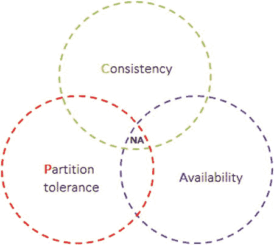
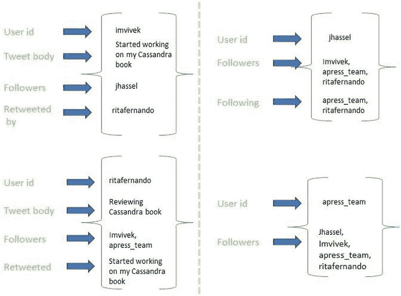
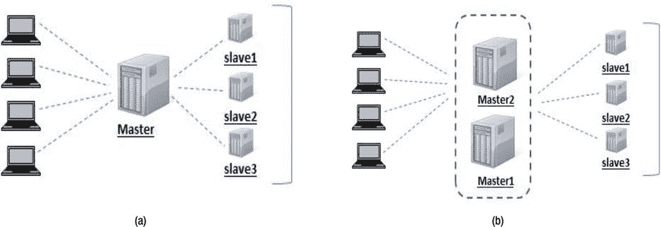
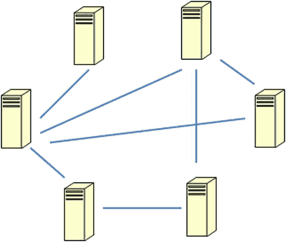

# NoSQL：Cassandra 基础

本章旨在讨论 NoSQL，让用户深入理解 NoSQL 的各个要素，进而介绍大数据问题、分布式数据库概念，最后介绍 Cassandra 的概念。本章涵盖的主题包括：

- NoSQL 简介
- `CAP` 定理
- 数据分布概念
- 大数据问题
- Cassandra 配置
- Cassandra 存储架构
- 安装与设置
- 使用 Cassandra 进行日志记录

本详细引言章节的目的是通过讨论分布式编程概念等问题及解决方案，深入探讨 NoSQL 生态系统，这些概念有助于解决可扩展性、可用性及其他数据相关问题。

本章将向读者介绍 Cassandra，并讨论 Cassandra 的存储架构、各种其他配置，以及在本地和 AWS 环境下的 Cassandra 集群搭建。

### NoSQL 简介

大数据的存在可以追溯到 20 世纪 90 年代中期。然而，真正的转变始于 21 世纪初。互联网和移动技术的发展为更多人参与并在全球范围内共享数据打开了大门。这导致了以各种格式在全球流动的海量数据产生。更广泛的分布式网络导致了数据的增量式增长。由于这种海量数据的产生，应用开发领域发生了重大转变，并且涌现了许多新的领域业务可能性，例如：

- 社交趋势分析
- OLAP 与数据挖掘
- 情感分析
- 行为定向
- 实时数据分析

随着数据量高速增长至 PB 甚至 ZB 级别，使用传统关系型数据库来应对可扩展性和数据结构管理等挑战将变得非常困难。在这种情况下，大数据和 NoSQL 技术被视为构建解决方案的替代方案。在当今的背景下，现有业务领域也在探索新的功能维度以及同时处理海量数据增长的可能性。

#### NoSQL 生态系统

NoSQL，通常被称为“不仅仅是 SQL”，意味着以分布式方式超越传统 SQL 的思维。目前有超过 150 种 NoSQL 数据库可用。以下是一些流行的数据库：

- 列族数据库，例如 Cassandra 和 HBase
- 基于文档的存储，如 MongoDB 和 Couchbase
- 基于图形的访问，如 Neo4J 和 Titan Graph DB
- 简单的键值存储，如 Redis 和 Couch DB

面对如此多的选择和类别，最重要的问题是：选择什么、如何选择以及为什么选择！每种 NoSQL 数据库类别都旨在解决特定的一组问题。针对特定需求采用特定技术的范式正引领着当前的技术时代。可以肯定的是，单一的数据库无法满足所有业务需求，这正是 NoSQL 数据库需求产生的地方。采用数据库的最佳方式是首先理解需求。如果应用程序本质上是多语言的，那么您可能需要从可用选项中选择多个数据库。在下一节中，我们将讨论一些要点，说明为什么 Cassandra 可能是您解决大数据问题的答案。

#### CAP 定理

`CAP` 定理由 Eric Brewer 在 21 世纪初提出，该定理指出没有数据库能够同时提供一致性、可用性和分区容忍性（见图 1-1），但根据用例的不同，可能允许同时满足其中任意两个。

图 1-1. `CAP` 定理排除了同时具备所有三种特性的数据库的可能性（“NA”区域）

传统的关系型数据库管理系统提供原子性、一致性、隔离性和持久性语义，并倡导强一致性。这正是大多数 NoSQL 数据库的不同之处，它们强烈主张分区容忍性和高可用性，并通常采用最终一致性。

- 高可用性意味着数据必须以最小延迟可用。对于数据分布在多个节点上的分布式数据库，实现高可用性的一种方法是在多个节点上进行数据复制。像大多数 NoSQL 数据库一样，Cassandra 也提供了高可用性。
- 分区容忍性意味着如果一个或几个节点宕机，系统仍然能够处理读写请求。在构建用于处理海量数据的可扩展系统中，这种情况很可能经常发生。因此，此类系统必须具有分区容忍性。Cassandra 的存储架构也支持这一点。
- 一致性意味着跨分布式节点的一致性。强一致性指的是集群中每个节点上都拥有最新或一致的数据。通过在每次读写请求中引入延迟，确保所有副本上的数据同步，从而读取或写入最稳定的行。Cassandra 提供了最终一致性，并且为每个读写请求提供了一致性级别配置。我们将在后续章节中详细讨论各种一致性级别选项。

#### 动态模式

结构化或固定模式要求在实现之前定义列的数量和数据类型。对模式的任何更改（例如添加列）都需要跨模式进行迁移规划。对于半结构化或非结构化数据格式，其列的数量和数据类型可能在不同行之间变化，静态模式并不适用。这时，动态模式最适合处理半结构化或非结构化数据。

图 1-2 展示了包含特定用户 ID 的类似 Twitter 数据的四条记录。这里，用户 ID `imvivek` 包含三列：“推文正文”、“粉丝数”和“被转发者”。但对于用户“apress_team”的行，只有“粉丝数”这一列。对于非结构化模式（例如服务器日志），字段的数量可能因行而异。这要求能够“动态”添加列，这是 NoSQL 数据库的一个强需求。传统的关系型数据库可以以静态方式处理此类数据集，但不像 Cassandra，传统关系型数据库无法在每个分区中扩展至每行拥有数百万列。在关系型数据库世界中，使用预定义模型来处理频繁的模式更改肯定不是一个可行的选择。想象一下，如果我们尝试支持动态列，最终可能会得到许多空列！每行有多个列具有默认空值当然不可取。使用 Cassandra，我们可以拥有任意数量的列（最多可达 20 亿列）！另一个可能的选项是为列名定义数据类型，这在关系型数据库中是不可能的。

图 1-2. 动态列，也称为动态模式，是放松关系型数据库世界静态模式约束的一种方式

#### 可扩展性

传统关系型数据库提供垂直扩展，即通过向单个单元添加更多处理器或内存来扩展。而 NoSQL 数据库提供水平扩展，即添加更多节点。大多数 NoSQL 数据库是无模式的，并且可以在普通服务器上良好运行。向现有关系型数据库集群添加节点是一个繁琐且相对昂贵的过程，而向 NoSQL 数据库（如 Cassandra）添加数据节点则相对容易。我们将在后续章节中讨论向 Cassandra 添加节点。

#### 无单点故障

在集中式数据库或主从架构中，数据库资源或主节点都位于单台机器上，一旦主节点宕机，数据库服务就会完全停止。当数据的高可用性成为优先考虑时，应避免采用此类数据库架构。NoSQL 分布式数据库通常更倾向于使用多主/从配置或对等架构，以避免单点故障。`Cassandra` 采用对等架构，其中每个 `Cassandra` 节点都具有相同的配置。我们将在后续章节中详细讨论这一点。

图 1-3a 描绘了一个系统，其中单个主节点作为从从节点检索数据的唯一接触点。如果主节点宕机，整个系统将停止运行，直至主节点恢复。但在多主配置（如图 1-3b 所示）中，单点故障不会中断服务。

图 1-3. 集中式与分布式架构对比

#### 高可用性

高可用性集群意味着数据库能够提供 7x24 小时的支持，且停机时间极短（或为零）。在此类集群中，数据会跨多个节点进行复制，这样，即使某个节点宕机，其他节点仍可继续处理读写请求，直至该节点恢复运行。`Cassandra` 的对等架构通过数据同地部署确保了数据的高可用性。

### 识别大数据问题

近年来，人们观察到开发者倾向于选择 NoSQL 数据库作为 RDBMS 的替代方案。然而，我建议在决定采用 NoSQL 技术之前进行深入分析。传统的 RDBMS 确实提供了许多 NoSQL 数据库所不具备的功能。在转向基于 NoSQL 的方法之前，必须分析并回答以下几个问题：

-   这真的是一个大数据问题吗？
-   RDBMS 为何或在哪些方面无法胜任？

识别“大数据问题”是一项有趣的任务。可扩展性、数据的性质（结构化、非结构化或半结构化）以及维护数据量的成本是几个重要因素。在大多数情况下，在 RDBMS 内管理安全且结构化的数据可能仍然是首选方法；然而，如果数据本质上是半结构化、安全性要求较低，并且可扩展性优先于传统的 RDBMS 功能（例如连接、物化视图等），那么它就符合大数据用例的条件。这里的数据安全性指的是身份验证和授权机制。尽管 `Cassandra` 对身份验证和授权提供了不错的支持，但与大多数 NoSQL 数据库相比，RDBMS 在这方面表现更佳。

图 1-4 展示了一个场景：有线/卫星运营商系统每天为每个连接收集约 3 GB 的音视频传输日志。可以利用大数据技术栈开发一个“观众传输分析系统”，对流式日志进行“近实时”和“大规模数据”分析。此外，数据日志的性质不确定，可能因用户而异。生成月度/年度分析报告需要处理 PB 级别的数据，相比于 RDBMS，NoSQL 的可扩展性显然是更优选择。

图 1-4. 观看卫星传输节目的家庭

考虑一个例子：观众传输分析系统正在为每个已传输的节目以及观看或正在观看的用户捕获随机日志。我们需要问的第一个问题是：这真的是一个大数据问题吗？是的，我们这里讨论的是日志；想象一下，在像印度这样的国家，用户群非常庞大，捕获的日志是 7x24 小时的！而且，传输日志的性质可能是随机的，这意味着其结构不固定！它可能是半结构化的，也可能是完全非结构化的。这正是 RDBMS 因僵化的模式和可扩展性问题（参见上一节）而无法胜任的地方。

总而言之，在以下情况下，构建基于 NoSQL 的解决方案：

-   数据格式为半结构化/非结构化
-   RDBMS 达到存储上限且无法进一步扩展
-   可以牺牲关系、索引等 RDBMS 特定功能，以换取反范式化但分布式的数据
-   数据冗余不是问题，并且可以采用先读后写的方法

在下一节中，我们将讨论 `Cassandra` 如何能够最恰当地应对这些技术和功能挑战。

### 介绍 Cassandra

`Cassandra` 是一个开源的、面向列的、家族式的数据库。它最初由 Facebook 开发，自 2009 年起成为 Apache 顶级项目（TLP）。`Cassandra` 拥有许多重要特性；以下列出部分特性：

-   分布式数据库
-   对等架构
-   可配置的一致性
-   CQL（Cassandra 查询语言）

#### 分布式数据库

`Cassandra` 是一个全球性的分布式数据库。`Cassandra` 支持复制和分区等功能。复制是一个过程，系统会在不同的数据站点维护 n\* 个副本。在 `Cassandra` 中，这些数据站点被称为节点。数据分区是一种方案，数据可以分布到多个节点上。分区通常用于管理数据的高可用性/性能。

> **注：** 节点是数据所在的物理位置。

#### 对等设计

`Cassandra` 的存储架构是对等的。集群中的每个节点都被分配相同的角色，使其成为一个去中心化的数据库。每个节点彼此独立但又相互连接。网络中的节点能够处理读写数据库请求，因此，在任意时刻，即使某个节点宕机，后续的读写请求也会由网络中的其他节点处理，因此不存在单点故障（SPOF）。

图 1-5 是对等（P2P）架构的图形表示。

图 1-5. 对等去中心化的 Cassandra 节点。每个节点都是相同的，并且可以与其他节点通信

#### 可配置的数据一致性

数据一致性是指跨多个副本节点同步数据。最终一致性数据模型返回最后更新的记录。许多分布式数据库都广泛支持这种数据模型。`Cassandra` 也提供了可配置的最终一致性。

#### 写入一致性

如果在确认写入请求之前，数据已成功写入并在副本节点上同步，则数据被视为写入一致。然而，在提交写入请求时，可以设置不同的一致性级别值。可用的一致性级别包括：

- `ANY`：写入必须至少写入任何一个节点。在这种情况下，如果所有副本节点都宕机，并且`hinted_handoff_enabled: true`（默认值为 true），则相应的写入数据和提示将由协调节点存储，待所有副本节点恢复后，它们将被协调到至少一个节点上。在所有副本节点宕机前，该写入数据将无法用于读取。虽然`ANY`是最低的一致性级别，但可用性最高，因为它要求在发送写入确认之前，数据至少在一个节点上复制。
- `ONE`：使用一致性级别`ONE`，写入请求必须在至少一个副本节点上成功写入后才能确认。
- `QUORUM`：使用一致性级别`QUORUM`，写入请求必须在一组选定的副本节点上成功写入。
- `LOCAL_QUORUM`：使用一致性级别`LOCAL_QUORUM`，写入请求必须在一组选定的副本节点（称为法定人数）上成功写入，这些节点与协调节点位于同一数据中心本地可用。
- `EACH_QUORUM`：使用一致性级别`EACH_QUORUM`，写入请求必须在多组选定的副本节点（法定人数）上成功写入。
- `ALL`：使用一致性级别`ALL`，写入请求必须写入集群中所有副本节点上该行键的提交日志和内存表，以确保最高的一致性级别。
- `SERIAL`：线性一致性作为轻量级事务支持在 Cassandra 2.0 中引入。使用一致性级别`SERIAL`，写入请求必须有条件地写入法定副本节点的提交日志和内存表。这里的“有条件”意味着要么保证所有节点都写入，要么都不写入。
- `TWO`：与`ONE`类似，但使用一致性级别`TWO`，写入请求必须至少写入两个副本节点的提交日志和内存表。
- `THREE`：与`TWO`类似，但使用一致性级别`THREE`，写入请求必须至少写入三个副本节点的提交日志和内存表。

#### 读取一致性

如果数据不一致，再多的数据也用处不大。无论数据应用是大是小，都不希望出现脏读或不一致的数据。脏读是指一个事务可能读取到另一个线程未提交的数据。虽然脏读更常见于关系型数据库管理系统，但在 Cassandra 中，如果负责的节点宕机且最新数据未在每个副本节点上复制，则可能出现数据不一致。在这种情况下，应用程序可能希望在读取级别具有强一致性。借助 Cassandra 的可调一致性，可以为每个读取请求配置一致性。可能的选项包括：

- `ONE`：使用读取一致性级别`ONE`，数据从距离协调节点最近的副本节点返回。Cassandra 依靠 snitch 配置来确定最近的副本节点。由于要求从最近的副本节点返回响应，`ONE`是最低的一致性级别。
- `QUORUM`：使用读取一致性级别`QUORUM`，从法定副本节点收到的数据响应中，返回最新更新的数据（基于时间戳）。
- `LOCAL_QUORUM`：使用读取一致性级别`LOCAL_QUORUM`，从本地法定副本节点收到的数据响应中，返回最新更新的数据（基于时间戳）。
- `EACH_QUORUM`：使用读取一致性级别`EACH_QUORUM`，从每个法定副本节点组收到的数据响应中，返回最新更新的数据（基于时间戳）。
- `ALL`：使用读取一致性级别`ALL`，从所有副本节点收到的数据响应中，返回最新更新的数据（基于时间戳）。由于从所有副本节点中返回具有最新时间戳的响应，`ALL`是最高的一致性级别。
- `SERIAL`：使用读取一致性级别`SERIAL`，它将返回已提交或正在进行的最新列集合。在读取过程中发现的未提交事务将导致正在运行的事务隐式提交，并返回最新的列值。
- `TWO`：使用读取一致性级别`TWO`，将从两个最近的副本节点返回最新的列值。
- `THREE`：使用读取一致性级别`THREE`，将从三个最近的副本节点返回最新的列值。

基于上述一致性级别配置，用户始终可以为每个读取/写入请求配置所需的一致性级别。例如，为了确保最低的写入一致性但最高的读取一致性，我们可以选择`ANY`作为写入一致性级别，选择`ALL`作为读取一致性级别。

#### Cassandra 查询语言（CQL）

从最终用户的角度来看，Cassandra 的一个关键特性是易用性而非熟悉度。Cassandra 查询语言（CQL）随 Cassandra 0.8 版本引入，旨在提供一种类似关系型数据库的结构化查询语言（SQL）。自问世以来，CQL 经历了多次变化。后续版本中引入许多新功能，以及大量与性能相关的增强工作。CQL 增添了熟悉的数据定义语言（DDL）和数据操作语言（DML）语句风格。

在本书中，我们将介绍 CQL 的大部分功能。

### 安装 Cassandra

安装 Cassandra 相当简单。在本节中，我们将介绍如何在 Windows 和 Linux 系统上通过 tarball（`.tar`文件）安装 Cassandra。

- 对于 Linux，使用以下命令：`tar -xvf apache-cassandra-2.0.6-bin.tar.gz`
- 对于 Windows，你可以使用 WinZip 或 7zip 等工具提取 tarball。

下载 Cassandra tarball：

- Linux：`wget http://archive.apache.org/dist/cassandra/2.0.6/apache-cassandra-2.0.6-bin.tar.gz`
- Windows：`http://archive.apache.org/dist/cassandra/2.0.6/apache-cassandra-2.0.6-bin.tar.gz`

创建一个文件夹来下载 Cassandra tarball，例如：

- 运行`mkdir /home/apress/Cassandra`（这里`apress`是 user.name 环境变量）
- 运行`cd /home/apress/cassandra`

根据你的平台，使用适当的方法解压下载的 tar 文件。

注意：如果遇到"内存不足"或段错误，请检查`cassandra-env.sh`文件中的`JAVA_HOME`和`JVM_OPTS`参数。

