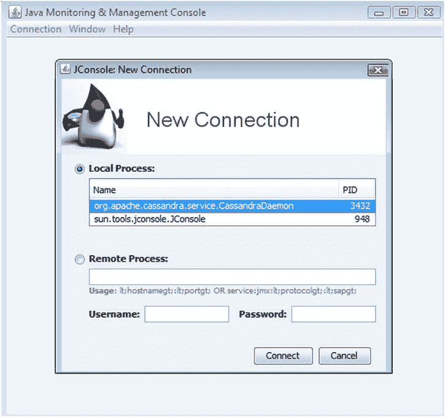
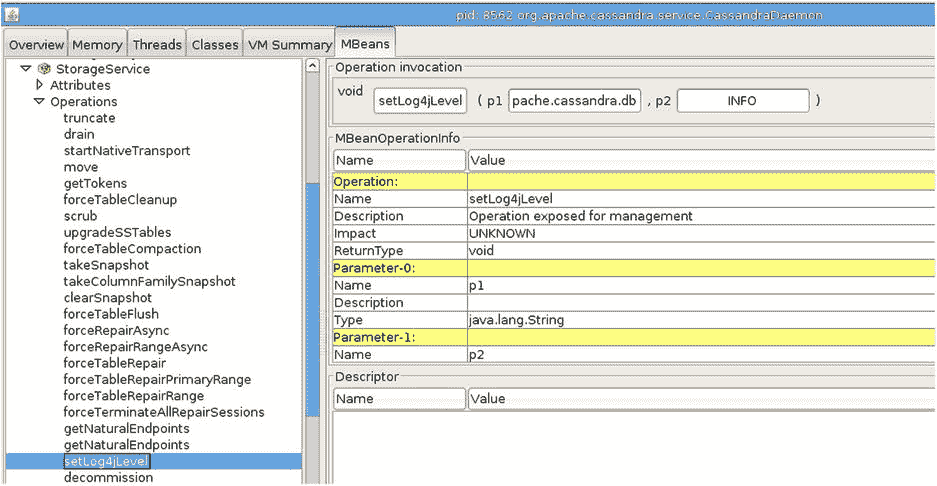
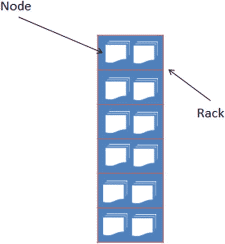
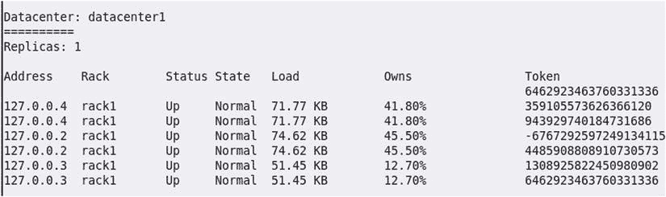
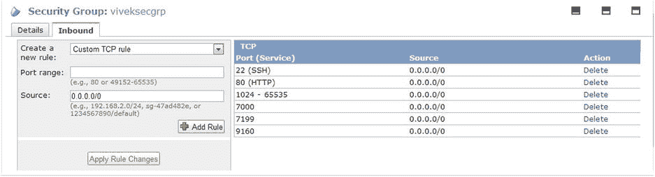
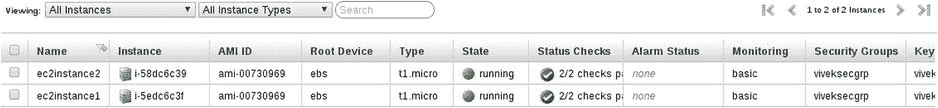
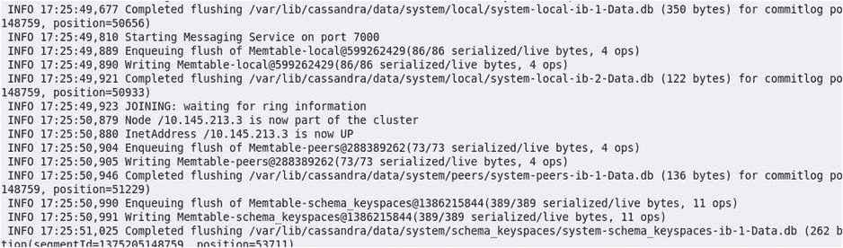
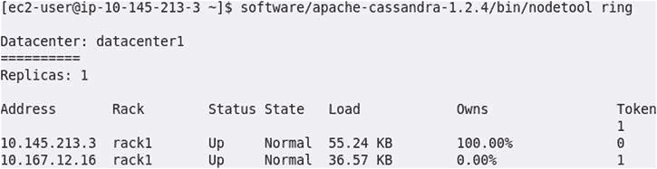
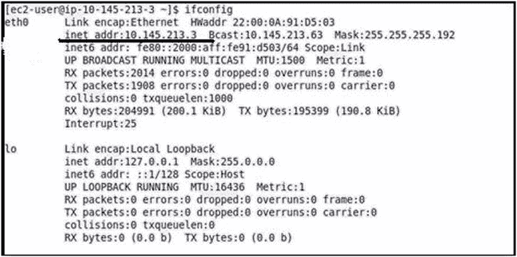
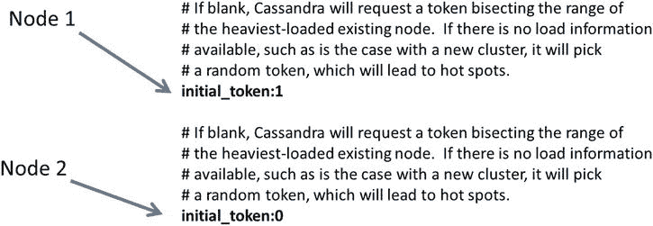

# Cassandra 中的日志记录

在开发或生产模式下运行应用程序时，我们可能需要在特定情况下查看服务器日志，例如：

- 性能问题
- 运维支持
- 调试应用程序漏洞

默认的服务器日志设置定义在 `log4j-server.properties` 文件中，如下所示。

```
# 将日志消息输出到滚动日志文件以及标准输出
log4j.rootLogger=INFO,stdout,R

# 标准输出
log4j.appender.stdout=org.apache.log4j.ConsoleAppender
log4j.appender.stdout.layout=org.apache.log4j.PatternLayout
log4j.appender.stdout.layout.ConversionPattern=%5p %d{HH:mm:ss,SSS} %m%n

# 滚动日志文件
log4j.appender.R=org.apache.log4j.RollingFileAppender
log4j.appender.R.maxFileSize=20MB
log4j.appender.R.maxBackupIndex=50
log4j.appender.R.layout=org.apache.log4j.PatternLayout
log4j.appender.R.layout.ConversionPattern=%5p [%t] %d{ISO8601} %F (line %L) %m%n

# 编辑下一行以指向您的日志目录
log4j.appender.R.File=/var/log/cassandra/system.log

# 应用程序日志选项
#log4j.logger.org.apache.cassandra=DEBUG
#log4j.logger.org.apache.cassandra.db=DEBUG
#log4j.logger.org.apache.cassandra.service.StorageProxy=DEBUG

# 添加此项以避免 thrift 记录断开连接错误。
log4j.logger.org.apache.thrift.server.TNonblockingServer=ERROR
```

让我们依次讨论这些属性：

- 前缀为 `log4j.appender.stdout` 的属性用于控制台日志记录。
- 服务器日志在由属性 `log4j.appender.R.File` 值定义的位置生成并追加。默认值为 `/var/log/cassandra/system.log`。用户可以覆盖属性文件以更改默认位置。
- `log4j.appender.R.maxFileSize` 定义了最大日志文件大小。
- `log4j.appender.R.maxBackupIndex` 属性定义了最大滚动日志文件数（默认为 50）。
- `log4j.appender.R.layout.ConversionPattern` 属性定义了日志文件的日志记录模式。
- `log4j-server.properties` 文件中的最后一行用于在与 Cassandra 进行 thrift 连接时的应用程序日志记录。默认情况下它被注释掉，以避免在频繁的套接字断开连接时产生不必要的日志。

## 应用程序日志选项

默认情况下，Cassandra API 级别的日志记录是禁用的。但我们可以启用并更改日志级别，以记录更多应用程序级别的信息。很多时候，应用程序可能需要启用 Cassandra 特定的服务器端日志记录来排查问题。以下代码展示了可用于特定应用程序日志记录的部分。

```
# 应用程序日志选项
#log4j.logger.org.apache.cassandra=DEBUG
#log4j.logger.org.apache.cassandra.db=DEBUG
#log4j.logger.org.apache.cassandra.service.StorageProxy=DEBUG
```

## 更改日志属性

配置日志属性有两种可能的方法。第一种，我们可以修改 `log4j-server.properties`；第二种，通过 JMX（Java 管理扩展），使用 `jconsole`。两者的区别在于，使用后者可以在运行时动态更改日志级别，而前者是静态的。

## 通过 JConsole 管理日志

`JConsole` 是一个 GUI 监控工具，用于使用 JMX 对正在运行的 Java 应用程序进行资源使用和性能监控。

`jconsole` 可执行文件可以在 `JDK_HOME/bin` 目录中找到，其中 `JDK_HOME` 是 Java 开发工具包（JDK）的安装目录。如果此目录在您的系统路径中，您只需在命令（shell）提示符下键入 `jconsole` 即可启动 `JConsole`。否则，您必须使用可执行文件的完整路径。

运行 `jconsole` 后，您需要连接到 Cassandra 守护进程线程，如图 1-6 所示。



图 1-6. JConsole 连接布局

成功连接到 CassandraDaemon 进程后，单击 **MBeans** 选项卡以查看已注册的消息 bean。图 1-7 描述了将 `org.apache.cassandra.db` 包内类的日志级别更改为 `INFO` 级别。



图 1-7. 通过 jconsole Mbeans 设置更改日志级别

注意：有关日志模式的更多信息，请参考 [`logging.apache.org/log4j/1.2/apidocs/org/apache/log4j/PatternLayout.html`](http://logging.apache.org/log4j/1.2/apidocs/org/apache/log4j/PatternLayout.html) 。

### 理解 Cassandra 配置

主要的 Cassandra 配置文件是 `Cassandra.yaml`，它位于 `$CASSSANDRA_HOME/conf` 文件夹中。大约有 100 个属性。表 1-1 包含了其中的一部分属性，这些属性对 Cassandra 初学者很有帮助，值得一提。

表 1-1. 重要的 Cassandra 服务器属性


| 属性 | 默认值 | 描述 |
| --- | --- | --- |
| `cluster_name` | `"Test cluster"` | 用于限制节点仅加入一个逻辑集群。 |
| `num_tokens` | 禁用，未指定 | 如果未指定，默认值为 1。例如，若要在引导节点时启用虚拟节点支持，需设置 `num_tokens` 参数。推荐值为 256。 |
| `initial_token` | 无 | 为节点分配数据范围。在引导节点时，建议分配一个值。如果未指定，将由 Cassandra 随机分配一个令牌。对于随机分区方案，计算 `initial_token` 的方式为：`i * (2**127 / N)` ，其中 `i = 0 .. N-1`。`N` 代表节点数量。 |
| `hinted_handoff_enabled` | True | 当一致性级别为 ANY 时，如果副本节点宕机，对应的写入请求将以提示（hint）的形式存储在协调节点的 `system.hints` 列族中。一旦副本节点开始接受写入请求，将用于重放变更对象。 |
| `max_hint_window_in_ms` | 3 小时 | 死节点等待新提示写入协调节点的最长等待时间。提示窗口过期后，将不再存储新的提示。如果未指定，默认值为 1 小时。此属性用于在协调节点上写入提示。如果某个特定副本节点的 gossip 协议端点宕机时间超过指定的最长等待时间，`StorageProxy` 服务将无法在协调节点上写入新提示。 |
| `hinted_handoff_throttle_in_kb` | 1024 | 提示数据流的速率（kb/秒/线程）。 |
| `max_hints_delivery_threads` | 2 | 允许发送数据提示的最大线程数。在跨数据中心写入提示时很有用。 |
| `populate_io_cache_on_flush` | False | 如果节点上的完整数据可以放入内存，则设置为 true。自 Cassandra 1.2.2 起，也可以在每个列族上设置此参数。[`issues.apache.org/jira/browse/CASSANDRA-4694`](https://issues.apache.org/jira/browse/CASSANDRA-4694)。 |
| `authenticator` | `AllowAllAuthenticator` | `IAuthenticator` 接口的实现。默认情况下，Cassandra 提供 `AllowAllAuthenticator` 和 `PasswordAuthenticator` 作为内部身份验证实现。`PasswordAuthenticator` 会根据存储在 `system_auth` 键空间中 `credentials` 和 `users` 列族中的数据验证用户名和密码。（Cassandra 的安全性将在第 10 章中详细讨论。） |
| `Authorizer` | `AllowAllAuthorizer` | `IAuthorizer` 接口的实现。该实现管理用户对键空间、列族、索引等的权限。在服务器启动时启用 `CassandraAuthorizer` 将在 `system_auth` 键空间中创建一个 `permissions` 表，用于存储用户权限。（Cassandra 的安全性将在第 10 章中详细讨论。） |
| `permissions_validity_in_ms` | 默认值为 2000。如果 authorizer 属性为 `AllowAllAuthorizer` 则禁用 | 默认权限缓存的有效期。 |
| `Partitioner` | `Murmur3Partitioner` | 集群中节点间的行分布基于所选的分区器决定。可用值为 `RandomPartitioner`、`ByteOrderedPartitioner`、`Murmur3Partitioner` 和 `OrderPreservingPartitioner`（已弃用）。 |
| `data_file_directories` | `/var/lib/cassandra/data` | 节点的物理数据位置。 |
| `commitlog_directory` | `/var/lib/cassandra/commitlog` | 节点提交日志文件的物理位置。 |
| `disk_failure_policy` | Stop | 可用值为 `stop`、`best_effort` 和 `ignore`。Stop 将关闭与节点的所有通信（JMX 除外）。`best_effort` 仍会响应来自可用 sstable 的读取请求。 |
| `key_cache_size_in_mb` | 空，表示 100MB 或可用堆大小的 5%，取较小值 | 设置为零可禁用。 |
| `saved_caches_directory` | `/var/lib/cassandra/saved_caches` | 节点上已保存缓存的物理位置。 |
| `key_cache_save_period` | 14400 | 键缓存保存持续时间（以秒为单位），保存在 `saved_caches_directory` 下。 |
| `key_cache_keys_to_save` | 已禁用。 | 默认情况下禁用。所有行键都将被缓存。 |
| `row_cache_size_in_mb` | 0（已禁用） | 内存中的行缓存大小。 |
| `row_cache_save_period` | 0（已禁用） | 行缓存保存持续时间（以秒为单位），保存在 `saved_caches_directory` 下。 |
| `row_cache_keys_to_save` | 已禁用。 | 默认情况下禁用。所有行键都将被缓存。 |
| `row_cache_provider` | `SerializingCacheProvider` | 可用值为 `SerializingCacheProvider` 和 `ConcurrentLinkedHashCacheProvider`。如果工作负载不是密集更新，建议使用 `SerializingCacheProvider`，因为它使用本地内存（而非 JVM）进行缓存。 |
| `commitlog_sync` | Periodic | 可用值为 `periodic` 和 `batch`。在 batch 同步模式下，直到写入与磁盘同步后才会确认写入操作。请参考 `commitlog_sync_batch_window_in_ms` 属性。 |
| `commitlog_sync_batch_window_in_ms` | 50 | 如果 `commitlog_sync` 为 batch 模式，Cassandra 仅在提交日志同步窗口过期且数据已通过 fsync 写入磁盘后才会确认写入操作。 |
| `commitlog_sync_period_in_ms` | 10000 | 如果 `commitlog_sync` 为 periodic 模式。提交日志将在此时间间隔后通过 fsync 写入磁盘。 |
| `commitlog_segment_size_in_mb` | 32 | 提交日志段大小。达到此限制后，Cassandra 会将内存表（memtable）以 sstable 的形式刷新到磁盘。对于 32 位 JVM，应保持最小值，以避免耗尽地址空间并减少提交日志刷新。 |
| `seed_provider` | `SimpleSeedProvider` | `SeedProvider` 接口的实现。`SimpleSeedProvider` 是默认实现，接受逗号分隔的地址列表。`-seeds` 参数的默认值为 `127.0.0.1`。如果多节点部署，请将其更改为多个节点地址。 |
| `concurrent_reads` | 32 | 如果工作负载数据无法放入内存，则需要从磁盘获取数据。设置此参数以执行并发读取的数量。 |
| `concurrent_writes` | 32 | 通常写入速度比读取快。因此，与 `concurrent_reads` 相比，可以将此参数设置得更高。 |
| `memtable_total_space_in_mb` | JVM 堆的三分之一（已禁用） | 为内存表分配的总空间。一旦超过指定大小，Cassandra 将首先将最大的内存表刷新到磁盘。 |
| `commitlog_total_space_in_mb` | 32（32 位 JVM），1024（64 位 JVM） | 为提交日志段分配的总空间。达到指定限制后，Cassandra 会通过首先移除最旧的提交日志来刷新内存表以回收空间。 |
| `storage_port` | 7000 | 节点间内部通信的 TCP 端口。 |
| `ssl_storage_port` | 7001 | 在启用 `client_encryption_options` 时使用。 |
| `listen_address` | `Localhost` | 用于绑定并与其它 Cassandra 节点通信的地址。 |
| `broadcast_address` | 已禁用（与 `listen_address` 相同） | 供其它 Cassandra 节点使用的广播地址。 |
| `internode_authenticator` | `AllowAllInternodeAuthenticator` | 用于节点间通信的 `IinternodeAuthenticator` 接口实现。 |
| `start_native_transport` | False | 客户端的 CQL 原生传输。 |
| `native_transport_port` | 9042 | 用于连接客户端的 CQL 原生传输端口。 |
| `rpc_address` | Localhost | Thrift RPC 地址，供客户端连接。 |
| `rpc_port` | 9160 | 供客户端通信的 Thrift RPC 端口。 |
| `rpc_min_threads` | 16 | Thrift RPC 的最小线程数。 |
| `rpc_max_threads` | 2147483647（最大 32 位有符号整数） | Thrift RPC 的最大线程数。 |
| `rpc_recv_buff_size_in_bytes` | 已禁用 | 如果要设置 Thrift RPC 接收套接字缓冲区大小限制，请启用。 |
| `rpc_send_buff_size_in_bytes` | 已禁用 | 如果要设置 Thrift RPC 发送套接字缓冲区大小限制，请启用。 |
| `incremental_backups` | False | 如果启用，Cassandra 会将刷新后的 sstable 硬链接到 `data_file_directories/keyspace/backup` 目录下的备份目录。 |
| `snapshot_before_compaction` | False | 如果启用，将在每次压缩前在 `data_file_directories/keyspace/snapshots` 目录下创建快照。 |
| `auto_snapshot` | True | 如果禁用，在对键空间执行 DML 操作（`truncate`、`drop`）时将不会创建快照。 |
| `concurrent_compactors` | 等于处理器数量 | 等于 `cassandra.available_processors`（如果已定义），否则等于可用处理器数量。 |
| `multithreaded_compaction` | False | 如果启用，将为每个处理器使用单线程进行压缩。 |
| `compaction_throughput_mb_per_sec` | 16 | 数据压缩流量（兆字节/秒）。更高的压缩吞吐量可确保更少的 sstable 和更多的磁盘空间。 |
| `endpoint_snitch` | `SimpleSnitch` | 一个非常重要的配置。Snitch 也可以称为信息提供者。用于将请求路由到集群中的副本节点。可用值为 `SimpleSnitch`、`PropertyFileSnitch`、`RackInferringSnitch`、`Ec2Snitch` 和 `Ec2MultiRegionSnitch`。（我将在后续章节中介绍 snitch 配置。） |
| `request_scheduler` | `NoScheduler` | 客户端请求调度器。默认情况下不进行调度，但我们可以将其配置为 `RoundRobinScheduler` 或自定义实现。它将客户端 DML 请求排队，并在成功处理请求后最终释放。 |
| `server_encryption_options` | None | 用于启用节点间通信的加密。可用值为 `all`、`none`、`dc` 和 `rack`。 |
| `client_encryption_options` | `false`（未启用） | 用于启用客户端/服务器通信。如果启用，必须指定 `ssl_storage_port`。因为它将用于客户端/服务器通信。 |
| `internode_compression` | All | 用于压缩节点间通信的流量。可用值为：`all`、`dc` 和 `none`。 |
| `inter_dc_tcp_nodelay` | True | 设置为 `false` 将减少 TCP 协议上的拥塞，但会增加延迟。 |


```markdown

#### 提交日志归档

要启用 Cassandra 的自动提交日志归档和恢复功能（自 1.1.1 版本起支持），需使用`commitlog_archiving.properties`文件。该文件配置了`archive_command`和`restore_command`属性。提交日志归档也称为预写日志（WAL）归档，用于时间点恢复。

Cassandra 的实现类似于 PostgreSQL。PostgreSQL 是一种面向对象的关系数据库管理系统（OORDBMS），它提供`wal_level`设置，其中`minimum`为最低级别，其次是`archive`和`hot_standby`级别，以允许在恢复期间执行查询。有关 PostgreSQL 的更多详细信息，请参阅[`http://www.postgresql.org/`](http://www.postgresql.org/)。

##### archive_command

启用`archive_command`以使用如下命令进行隐式提交日志归档：

`archive_command= /bin/ln %path /home/backup/%name`

这里，`%path`是最后一个活动提交日志段的完全限定路径，`%name`是提交日志的名称。上述 shell 命令将为提交日志段（`%path`）创建一个硬链接。如果行突变大小超过`commitlog_segment_size_in_mb`，Cassandra 会使用此`archive`命令将该段归档到`/home/backup/`目录下。其中`%path`是最新旧段的名称，`%name`是提交日志文件名。

##### restore_command

在启动 Cassandra 时，如果将`commitlog_archiving.properties`中的`restore_directories`留空，Cassandra 将使用`restore_command`重放这些日志文件：

`restore_command=cp -f %from %to`

这里，`%from`是`restore_directories`指定的值，`%to`是`commitlog_directory`下的下一个提交日志段文件。

这种连续提交日志的一个优点是数据的高可用性，也称为热备份。

### 配置复制和数据中心

近年来，对大数据异构系统的需求已经演变。此类系统中的组件本质上是多样化的，可以由不同的数据集组成。考虑到数据量的大小、位置和数量，这些系统很可能需要与位于不同物理位置的数据中心互连。

数据中心是一个硬件系统（例如商品服务器），由多个机架组成。一个机架可能包含一个或多个节点（参见图 1-8）。



图 1-8. 描绘 Cassandra 数据中心的图像

维护多个数据中心的原因可以是高可用性、备用节点和数据恢复。

在高可用性场景下，任何传入请求都必须以最低延迟得到服务。数据复制是一种在多个节点上保留相同数据冗余副本的机制。

如上所述，数据中心由多个机架组成，每个机架包含多个节点。为了实现高可用性和节点故障转移，数据复制策略至关重要。例如：

*   本地读取（高可用性）
*   故障转移（节点故障）

考虑到这些因素，我们应将数据复制到同一数据中心但不同机架的多个节点上。这将避免同一机架中节点的读写失败（例如在网络连接问题、电源故障等情况下）。

复制意味着在多个数据节点上保留数据的冗余副本，以实现高可用性和一致性。在使用 Cassandra 创建键空间时，我们可以配置复制因子和复制策略类。

在创建模式（而非键空间）时，我们可以像这样配置复制：

```
CREATE KEYSPACE apress WITH replication = {'class': 'SimpleStrategy', 'replication_factor' : 3};
```

```
// cql3 script
create keyspace apress with placement_strategy='org.apache.cassandra.locator.SimpleStrategy' and strategy_options ={replication_factor:1};
```

```
// using cassandra-cli thrift
```

> **注意：** 通过 CQL3 和 `cassandra-cli` 进行模式创建和管理将在第 2 章中讨论。

这里，`SimpleStrategy`是复制策略，其中`replication_factor`为 3。像这样使用`SimpleStrategy`，每条数据行将在顺时针方向上的 3 个副本节点上同步或异步复制（取决于写入一致性级别）。

Cassandra 支持的不同策略类有：

*   `SimpleStrategy`
*   `LocalStrategy`
*   `NetworkTopologyStrategy`

#### LocalStrategy

`LocalStrategy`用于内部目的，并用于`system`和`system_auth`键空间。`System`和`system_auth`是内部键空间，由 Cassandra 的存储架构隐式处理，用于管理授权和身份验证。这些键空间还保存有关用户定义的键空间和列族的元数据。在下一章中，我们将详细讨论它们。在 Cassandra 中，尝试使用`LocalStrategy`作为策略类创建键空间是不允许的，并且会给出类似“`LocalStrategy`仅用于 Cassandra 内部目的”的错误。

#### NetworkTopologyStrategy

如果多个副本节点需要放置在不同的数据中心，则首选`NetworkTopologyStrategy`。我们可以使用此策略创建键空间，如下所示：

```
CREATE KEYSPACE apress WITH replication = {'class': 'NetworkTopologyStrategy', 'dc1' : 2, 'dc2' : 3};
```

这里，`dc1`和`dc2`是数据中心名称，复制因子分别为 2 和 3。数据中心名称源自配置的`snitch`属性。

#### SimpleStrategy

建议在单个数据中心内的多个机架上使用多个节点时采用此策略。

```
CREATE KEYSPACE apress WITH replication = {'class': 'SimpleStrategy', 'replication_factor' : 3};
```

这里，复制因子为 3 意味着将数据复制到 3 个节点上，而策略类`SimpleStrategy`意味着这些 Cassandra 节点位于同一个数据中心内。

### Cassandra 多节点配置

在本节中，我们将讨论在单台机器上以及通过 Amazon EC2 实例进行的多节点 Cassandra 配置。选择 AWS EC2 实例的原因包括在云上设置 Cassandra 集群，以及在本地机器上配置 Cassandra 集群以模拟物理机柜。基于 AWS 的配置将帮助用户了解 AWS 和 Cassandra。

```


#### 在单机上配置多个节点

在单机上配置多个节点更像是一种实验，因为在生产应用中，你通常会在多个 Cassandra 节点上配置集群。在单机或多机上搭建多节点集群的过程是相似的，这正是我们将在本示例练习中介绍的内容。在此示例中，我们将在一台机器上配置 3 个节点（`127.0.0.2-4`）。

我们需要将主机名映射到 IP 地址。在 Windows 和 Linux 操作系统中，这些配置位于 `etc/hosts`（Windows）或 `/etc/hosts`（Linux）文件中。修改配置文件，添加上面提到的 3 个节点配置，如下所示：

```
127.0.0.1   127.0.0.2
127.0.0.1   127.0.0.3
127.0.0.1   127.0.0.4
```

对于 Mac OS，我们需要创建如下别名：

```
sudo ifconfig lo0 alias 127.0.0.2 up
sudo ifconfig lo0 alias 127.0.0.3 up
sudo ifconfig lo0 alias 127.0.0.4 up
```

将下载的 Cassandra tarball 安装包解压到 3 个不同的文件夹中（每个节点一个）。为每个节点分配相同的 `cluster_name`，如下所示：

```
# 集群的名称。这主要用于防止一个逻辑集群中的机器加入另一个集群。
cluster_name: 'Test Cluster'
```

我们应让集群中每个节点持有相同的种子节点（seeds）。这些种子节点仅用于在集群节点间启动 gossip 协议。在 `cassandra.yaml` 中配置种子节点，如下所示：

```
seed_provider:
    # 被视为联系点的主机地址。
    # Cassandra 节点使用此主机列表来相互查找并学习环的拓扑。
    # 如果你正在运行多个节点，则必须更改此项！
    - class_name: org.apache.cassandra.locator.SimpleSeedProvider
      parameters:
          # seeds 实际上是一个以逗号分隔的地址列表。
          # 例如: "<ip1>,<ip2>,<ip3>"
          - seeds: "127.0.0.2"
```

在每个 `cassandra.yaml` 文件中，将 `listen_address` 和 `rpc_address` 配置更改为 `127.0.0.2`、`127.0.0.3` 和 `127.0.0.4` IP 地址。由于所有 3 个节点都运行在同一台机器上，请分别将 `rpc_address` 更改为 `9160`、`9161` 和 `9162`。

这里我们可以选择每个节点使用一个 token 或每个节点使用多个 token。Cassandra 1.2 引入了 **虚拟节点** 功能，允许为节点分配一个 token 范围。我们将在下一章讨论虚拟节点。将 `initial_token` 改为 `empty`，并将 `num_tokens` 保留为 2（建议为 256）。

下一步是为每个节点分配不同的 `JMX_PORT`（例如 `8081`、`8082` 和 `8083`）。

在 Linux 系统中，修改 `$CASSANDRA_HOME/conf/cassandra.env.sh` 文件，如下所示：

```
# 指定 Cassandra 用于
# JMX 连接的默认端口。
JMX_PORT="7199"
```

在 Windows 系统中，修改 `$CASSANDRA_HOME/bin/cassandra.bat` 文件，如下所示：

```
REM ***** JAVA options *****
set JAVA_OPTS=-ea^
    -javaagent:"%CASSANDRA_HOME%\lib\jamm-0.2.5.jar"^
    -Xms1G^
    -Xmx1G^
    -XX:+HeapDumpOnOutOfMemoryError^
    -XX:+UseParNewGC^
    -XX:+UseConcMarkSweepGC^
    -XX:+CMSParallelRemarkEnabled^
    -XX:SurvivorRatio=8^
    -XX:MaxTenuringThreshold=1^
    -XX:CMSInitiatingOccupancyFraction=75^
    -XX:+UseCMSInitiatingOccupancyOnly^
    -Dcom.sun.management.jmxremote.port=7199^
    -Dcom.sun.management.jmxremote.ssl=false^
    -Dcom.sun.management.jmxremote.authenticate=false^
    -Dlog4j.configuration=log4j-server.properties^
    -Dlog4j.defaultInitOverride=true
```

让我们逐个启动每个节点，并检查环状态：`$CASSANDRA_HOME/apache-cassandra-1.2.4/bin/nodetool -h 127.0.0.2 -p 8081 ring`。

图 1-9 显示了使用 jmx 连接到一个 Cassandra 节点时的环状态。由于 Cassandra 的架构是对等的（peer-to-peer），在任何节点上检查环状态都会得到相同的结果。



图 1-9.

环状态

#### 在 Amazon EC2 上配置多个节点

Amazon Elastic Compute Cloud (Amazon EC2) 是亚马逊 Web 服务（AWS）云计算平台的重要组成部分之一。AWS 允许你选择操作系统平台，并在云端提供所需的硬件支持，使你能够快速在云计算平台上设置和部署应用程序。要了解更多关于 Amazon EC2 设置的信息，请参阅 [`http://aws.amazon.com/ec2/`](http://aws.amazon.com/ec2/)。

在本节中，我们将学习如何在 Amazon EC2 上配置多个 Cassandra 节点。为此，请按照以下步骤操作。

连接到每个实例并下载 Cassandra tarball，如下所示：

```
wget http://archive.apache.org/dist/cassandra/1.2.4/apache-cassandra-1.2.4-bin.tar.gz
```



图 1-11.

配置安全组设置 修改安全组以启用 `9160`、`7000` 和 `7199` 端口，如图 1-11 所示。



图 1-10.

显示 2 个实例处于运行状态的 EC2 控制台显示 首先启动 2 个 AMI（`ami-00730969`）实例，如图 1-10 所示。

使用 `rpm` 安装程序在每个 EC2 实例上下载并安装 Java，如下所示：

```
sudo rpm -i jdk-7-linux-x64.rpm
sudo rm -rf /usr/bin/java
sudo ln -s /usr/java/jdk1.7.0/bin/java /usr/bin/java
sudo rm -rf /usr/bin/javac
sudo ln -s /usr/java/jdk1.7.0/bin/javac /usr/bin/javac
```



图 1-15.

节点 `10.145.213.3` 已启动并加入集群 图 1-15 显示了实例 `10.145.213.3` 已启动并加入集群环。



图 1-14.

两个 EC2 实例及其环状态 让我们逐个启动每个节点并检查环状态。验证两个 EC2 实例都应已启动、运行并通过环拓扑连接。图 1-14 显示了两个正在运行的 EC2 实例的环状态。



图 1-13.

如何获取节点的 inet 地址 将其中任意一个创建为种子节点，并保持存储端口、`jmx_port` 和 `rpc_port` 分别为 `7000`、`7199` 和 `9160`。

让我们将 `listen_address` 和 `rpc_address` 保留为空值（默认值为节点的 inet 地址（带下划线），如图 1-13 所示）。



图 1-12.

两个节点的 `initial_token` 配置 多个 Cassandra 节点的配置与我们上一节讨论的相同。在本节中，我们将演示使用每个节点一个 token（`initial_token`）。让我们分配初始 token 值 0 和 1。我们可以通过修改每个节点上的 `cassandra.yaml` 文件来分配 `initial_token` 值。

### 总结

本章是一个入门章节，涵盖了所有通用概念和 Cassandra 特定的配置。对于应用程序开发人员来说，理解复制、数据分布的本质，以及最重要的是在 Cassandra 中如何进行设置，至关重要。现在我们已经准备好迎接下一个挑战：使用 Cassandra 处理大数据！在下一章中，我们将讨论 Cassandra 的存储机制和数据建模。通过数据建模和理解 Cassandra 的存储架构，将有助于我们对数据集进行建模，分析并探索 Cassandra 可用的最佳方法。


