# 4. Cassandra 数据安全

数据库安全意味着保护敏感数据和数据库应用程序免受未经授权的访问。数据的可扩展性和高可用性固然重要，但数据安全也同样关键！例如，金融及其他公共行业需要可扩展、高可用且安全的数据库。也就是说，许多类型的组织，尤其是金融和政府机构，都将安全性置于优先地位。

从 Cassandra 1.2.2 版本开始，我们可以通过两种方式保护 Cassandra 中的数据：访问控制和加密。Cassandra 支持授权和身份验证功能。

本章将涵盖以下主题：

- Cassandra 的 `system` 和 `system_auth` 键空间
- 管理用户权限
- 节点间与客户端-服务器 SSL 加密

## 身份验证与授权

身份验证是指对试图访问数据存储的用户进行控制。在确保与数据库连接安全的同时，必须验证用户身份。身份验证有三种基本类型：

- 使用内部身份验证时，通常数据存储会通过凭据（如用户 ID 和密码）管理用户登录。
- 外部身份验证，例如 Kerberos，是一种使用票据系统验证客户端身份的网络协议。
- 客户端-服务器加密。客户端到服务器或节点到节点的加密是数据在集群中传输的另一种方式。使用加密时，必须将客户端或节点的公共信任证书安装到另一个节点上。

身份验证过程仅限于用户验证和识别。

处理用户访问控制被称为授权。数据库授权意味着管理用户对模式、表和列的角色与权限。

Cassandra 的内部身份验证是一种 SSL 加密机制，我们将通过实践示例来了解它。

### `system` 和 `system_auth` 键空间

`system` 键空间包含有关可用列族、列和集群的信息。`system_auth` 键空间主要包含身份验证信息、用户凭据和权限。我们将在后续的示例中讨论它们。`system` 键空间下的表/列族包括：

- `schema_keyspace`
- `schema_columns`
- `schema_columnfamilies`
- `local`
- `peers`

图 4-1 显示了 `system` 键空间的层次结构，其中根节点是 `system` 键空间，下级节点是列族，每个表代表使用这些列族定义的列。

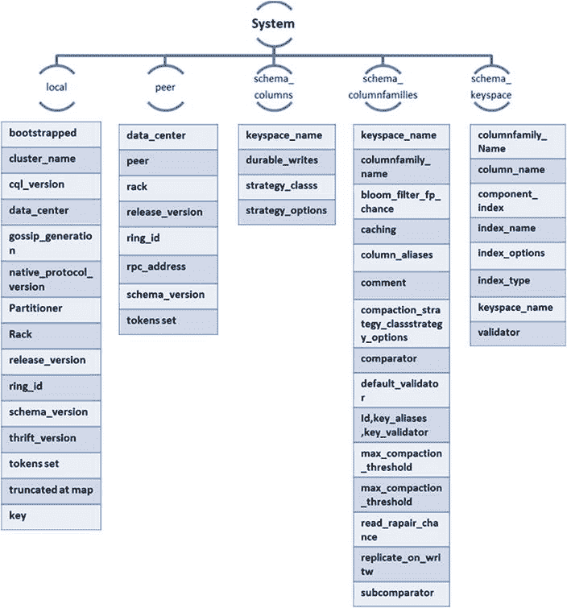

图 4-1. 系统键空间及其底层列族和对应列

在我们开始使用 `system` 和 `system_auth` 键空间管理身份验证和授权之前，让我们先探索一下 `system` 键空间是否可修改！

#### `system` 键空间不可修改

在我们深入讨论授权和身份验证之前，让我们先操作一下 `system` 键空间，以验证外部用户是否可以修改它。由于它是由 Cassandra 存储架构内部管理的键空间，外部用户不可能更新/修改 `system` 键空间。下一个简单的练习旨在尝试这些否定场景以进行验证。在设计模式时，通常无需对 Cassandra 进行此类调整，但既然我们在讨论安全性，那就来看看 `system` 键空间的安全程度如何！

默认情况下，提供对 `system` 键空间的读取访问权限。让我们通过一些练习尝试访问它。

`system` 键空间配置了 `LocalStrategy` 作为复制选项。

- 首先，尝试创建一个复制策略为 `LocalStrategy` 的键空间：

```cql
create keyspace system_test with replication = { 'class':'localstrategy','replication_factor':3};
```

```cql
create keyspace system_test with replication = { 'class':'LocalStrategy'};
```

图 4-2 显示我们无法使用 `LocalStrategy` 创建另一个键空间。

- 现在，尝试修改/删除 `system` 键空间：

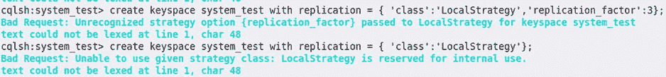

图 4-2. `LocalStrategy` 不供公共使用

```cql
alter keyspace system with replication = { 'class' : 'LocalStrategy'};
alter keyspace system with replication = { 'class' : 'SimpleStrategy', 'replication_factor':3};
```

图 4-3 显示无法更改 `system` 键空间的策略。

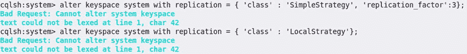

图 4-3. 无法更改 `system` 键空间的策略类

这意味着我们也无法修改 `system` 键空间。

- 接下来，尝试删除 `system` 键空间：

```cql
drop keyspace system;
```

图 4-4 显示我们同样无法删除 `system` 键空间！


图 4-4. 删除 `system` 键空间是不允许的

通过这些示例，我们可以得出结论：修改 `system` 键空间是不允许的；但是，我们可以修改 `system` 键空间下列族中存在的数据。

## 启用身份验证后访问 `system_auth` 密钥空间

Cassandra 的二进制发行版附带两种身份验证器：`PasswordAuthenticator` 和 `AllowAllAuthenticator`。启用 `PasswordAuthenticator` 后，Cassandra 会通过用户名和哈希密码来验证用户。这些用户凭据存储在 `system_auth.credentials` 表中。

在本教程中，我们将讨论如何使用 `PasswordAuthenticator` 管理用户凭据并访问 `system_auth` 密钥空间。启用身份验证后，在连接到 Cassandra 服务器时需要提供用户名和密码。Cassandra 会将用户名和哈希密码存储在该密钥空间的 `credentials` 表中。

开始之前，我们需要在 `cassandra.yaml` 中启用身份验证，操作如下：

```yaml
authenticator: org.apache.cassandra.auth.PasswordAuthenticator
```

现在身份验证已启用，您可以完成以下步骤：

首先，让我们尝试不提供用户名/密码，直接连接服务器并创建一个密钥空间：

```cql
create keyspace system_temp with replication = { 'class' : 'SimpleStrategy', 'replication_factor' : 3 };
```

执行上述命令将会产生如图 4-5 所示的错误。

现在，使用用户名和密码进行连接并创建密钥空间：

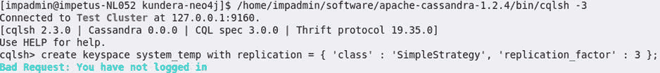

图 4-5. 连接失败，因为在尝试创建密钥空间之前我们没有进行身份验证

```shell
// 使用用户名和密码连接。
$CASSANDRA_HOME/bin/cqlsh -3 -u cassandra -p cassandra

// 创建密钥空间。
create keyspace system_temp with replication = { 'class' : 'SimpleStrategy', 'replication_factor' : 3 };
```

图 4-6 显示连接成功。

接下来，我们创建一个超级用户和一个非超级用户：

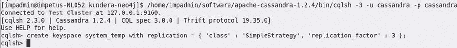

图 4-6. 使用用户凭据成功连接后

```cql
create user normaluser with password 'normal';
create user 'superuser' with password 'superuser' superuser;
```

这将把用户信息存储在 `users` 表中，如图 4-7 所示。


图 4-7. 已注册用户列表

此外，您可以查看 `credentials` 表中的密码及其他信息。

至此，我们得出结论：我们可以使用身份验证创建和管理用户凭据。

在上述教程中，我们成功创建了一个超级用户和一个非超级用户。下一个教程将讨论为这两类用户管理并访问不同列族上的用户凭据。

## 管理用户权限

Cassandra 提供了管理已验证用户权限和凭据的机制。在本教程中，我们将进一步探讨如何管理/访问用户权限。`cassandra.yaml` 中配置的默认授权器是 `AllowAllAuthorizer`。

首先，我们尝试使用 `normaluser` 进行身份验证并管理其权限：

```shell
// 使用 cqlsh 连接。
$CASSANDRA_HOME/bin/cqlsh -3 -u normaluser -p normal

// 列出用户权限。
list all permissions of normaluser;
list all permissions of cassandra;

// 向 normaluser 授予权限。
grant select on all keyspaces to normaluser;
```

这将会产生如图 4-8 所示的授权错误。因此，我们需要在 `cassandra.yaml` 中启用授权器。

现在，让我们尝试使用 `normaluser` 创建一个密钥空间：


图 4-9. 在 `cassandra.yaml` 中启用 `CassandraAuthorizer`

让我们在 `cassandra.yaml` 中启用授权器配置并重启服务器。图 4-9 展示了如何在 `cassandra.yaml` 中启用。


图 4-8. 不允许使用 `AllowAllAuthorizer` 管理权限

```cql
create keyspace testkeyspace with replication = { 'class' : 'SimpleStrategy', 'replication_factor' : 3};
```

我们再次遇到错误（见图 4-10），因为 `normaluser` 没有被授予创建权限。


图 4-10. 错误：`normaluser` 没有创建密钥空间的权限

此外，`normaluser` 不能将权限授予自身。只有 `superuser` 才能做到！

因此，让我们使用 `superuser` 登录：

```shell
$CASSANDRA_HOME/bin/cqlsh -3 -u superuser -p superuser
```

现在，创建一个密钥空间并向 `normaluser` 授予权限：

```cql
// 创建密钥空间。
create keyspace testkeyspace with replication = { 'class' : 'SimpleStrategy' , 'replication_factor' : 3};

// 将 'testkeyspace' 的所有权限授予 normaluser。
grant all on keyspace testkeyspace to normaluser;
```

向 `normaluser` 授予权限后，服务器会将其权限存储在 `system_auth` 密钥空间下的 `permissions` 表中。

让我们查看 `normaluser` 的所有已授予权限（见图 4-11）：

```cql
// 列出所有权限。
list all permissions of normaluser;
```

让我们创建 `anotherkeyspace` 并在其下创建一个名为 `privileges` 的表：

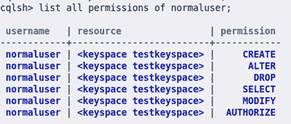

图 4-11. 当前 `normaluser` 的权限

```cql
// 创建密钥空间。
create keyspace anotherkeyspace with replication = { 'class' : 'SimpleStrategy' , 'replication_factor' : 3};

// 创建表。
create table privileges (user_id text PRIMARY KEY, read_write boolean);
```

让我们将 `privileges` 表的所有权限授予 `normaluser`：

```cql
grant all on table anotherkeyspace.privileges to normaluser;
```

现在，我们再次列出 `normaluser` 的所有权限（见图 4-12）：

```cql
// 列出所有权限。
list all permissions of normaluser;
```

接下来，让我们将所有密钥空间的所有权限授予 `superuser`：


图 4-12. `normaluser` 的新权限列表

```cql
grant select on all keyspaces to 'superuser';
```

现在，将 `privileges` 表的 `select` 权限授予 `superuser`：

```cql
grant select on anotherkeyspace.privileges to 'superuser';
```

让我们查看 `privileges` 表上授予的所有权限（见图 4-13）：

```cql
list all permissions on privileges;
```

我们还可以使用指定符显示特定资源的权限（见图 4-14）。

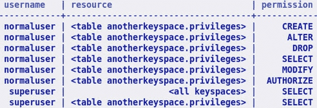

图 4-13.

### 权限及父级资源的权限

```cql
list all permissions on privileges NORECURSIVE;
```

让我们使用 `normaluser` 登录，并尝试查看 `privileges` 表上赋予的所有权限。

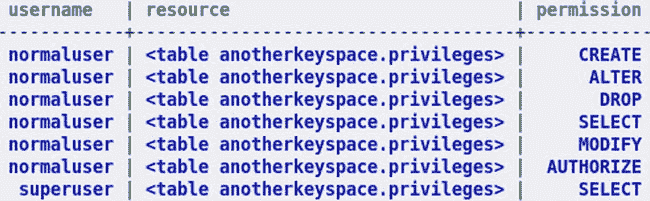

图 4-14. 在 `privileges` 表上赋予所有用户的权限列表

```cql
list all permissions on anotherkeyspace.privileges;
```

我们再次收到“未授权”错误（见图 4-15）。`normaluser` 已被授予 `privileges` 表上的所有权限，但它无法查看所有用户的权限。不过，`normaluser` 可以执行前面提到的其他允许的操作。

我们再尝试让 `normaluser` 删除自身和 `superuser`（见图 4-16）。


图 4-15. 未授予 `normaluser` 对 `anotherkeyspace` 的权限

```cql
drop user normaluser;
drop user 'superuser';
```

结果如图 4-16 所示，表明 `normaluser` 无法删除、撤销或查看其他用户的权限。但 `superuser` 可以！

因此，我们使用 `superuser` 登录，并尝试撤销赋予特定用户（此处为 `normaluser`）的权限，操作如下：

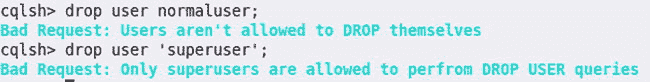

图 4-16. 非超级用户不允许删除用户

```cql
revoke all permissions on privileges from normaluser;
list all permissions on privileges;
```

图 4-17 显示操作成功。


图 4-17. 超级用户在 `privileges` 表上的权限

通过这一系列步骤，我们得出结论：

- 非超级用户无法管理、访问或查看其他用户的权限。
- 权限可以在键空间及特定表/列族上授予。
- 超级用户可以管理或访问其他用户的权限。

## 使用 `AllowAllAuthorizer` 访问 `system_auth`

默认情况下，Cassandra 的认证功能是禁用的，并在 `cassandra.yaml` 配置文件中配置了 `AllowAllAuthenticator` 作为认证器。在前面章节中，我们探讨了使用 `PasswordAuthenticator` 的各种授权技术。本节我们将探讨使用 `AllowAllAuthorizer` 管理用户权限是否可行。本方案旨在让你了解 `AllowAllAuthorizer` 的局限性，纯属实验性质。

如上所述，`system_auth` 键空间包含用户凭据和权限详情。在本方案中，我们将尝试在无认证情况下访问 `system_auth` 键空间并管理用户凭据。

首先，我们描述一下 `system_auth` 键空间（见图 4-18）。

```
// 描述键空间。
describe keyspace system_auth;
```

让我们探索 `users` 表，如图 4-19 所示。

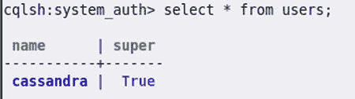

图 4-19. `users` 表中的默认用户

首先，尝试删除 `users` 表中的所有数据（见图 4-20）：

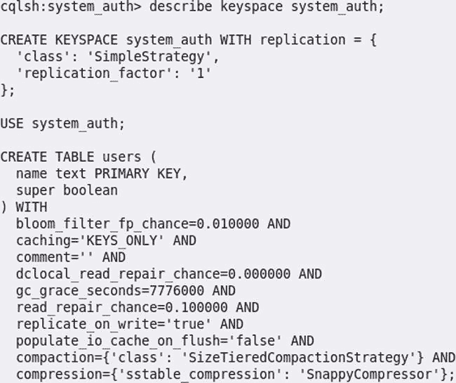

图 4-18. 描述的 `system_auth` 键空间

```
truncate users;
```

我们成功截断了 `users` 表，但接下来看看能否删除它。


图 4-20. 截断后的 `users` 表

```
drop table users;
```

图 4-21 显示我们无法执行此操作，因为这是一个系统表，Cassandra 对外部用户进行了限制。

接下来，重启 Cassandra 服务器以验证 `users` 表是否为空（见图 4-22）：


图 4-21. 不允许删除 `users` 表

```
select * from users;
```


图 4-22. 默认用户 `cassandra` 已预填充

启用 `AllowAllAuthorizer` 后对 `system_auth` 键空间所做的更改将被 Cassandra 忽略。因此，第 3 步中的更改将不会生效，Cassandra 将填充如图第 2 步所示的默认设置。

让我们尝试创建一个用户：

```
create user normaluser with password 'normal';
create user normaluser;
```

如图 4-23 所示，Cassandra 不允许在启用 `AllowAllAuthenticator` 的情况下创建用户。然而，正如我们之前所见，使用 `PasswordAuthenticator` 则可以。

我们可以按如下方式更改 `system_auth` 键空间的复制策略：


图 4-23. 未登录时尝试使用 `AllowAllAuthenticator` 创建用户

```
alter keyspace system_auth with replication = {'class':'SimpleStrategy','replication_factor':3};
```

通过本方案，我们得出结论：我们可以更改 `system_auth` 键空间，但无法在启用 `AllowAllAuthenticator`（认证禁用）的情况下创建用户。当使用默认用户凭据认证 Cassandra 服务器时，必须将一致性级别配置为 `QUORUM`。

接下来我们将讨论 SSL 加密以及在启用加密的情况下连接 `cqlsh` 和 Thrift 客户端。

## 准备服务器证书

近年来，社交媒体和基于互联网的应用使全球范围内的数据访问和共享成为可能。SSL 协议用于通过互联网以安全通信的方式发送加密数据。

对于通过 SSL 进行的客户端-服务器或节点间通信，我们需要准备服务器证书。一个文件包含服务器密钥，而另一个文件包含所有客户端或节点的可信 SSL 证书。

在开始新的教程之前，我们预先讨论一些可能的错误及解决方案。在配置并启动 Cassandra 服务器后，如果收到类似以下的错误，我们需要使用 Java 加密扩展（JCE）来配置已安装的 Java 版本。

```
Cannot support TLS_RSA_WITH_AES_256_CBC_SHA with currently installed providers
```

从以下地址下载 JCE 包：

[`http://www.oracle.com/technetwork/java/javase/downloads/jce-6-download-429243.html`](http://www.oracle.com/technetwork/java/javase/downloads/jce-6-download-429243.html) (Java 6)

[`http://www.oracle.com/technetwork/java/javase/downloads/jce-7-download-432124.html`](http://www.oracle.com/technetwork/java/javase/downloads/jce-7-download-432124.html) (Java 7)

然后将 `local_policy.jar` 和 `US_export_policy.jar` 复制到 `$JAVA_HOME/jre/lib/security` 文件夹下。

必要的配置已完成，现在让我们通过一个简单的练习来探索如何准备服务器证书。

首先，使用 `keytool` 为服务器生成一个密钥库：

```
keytool -genkey -alias servernode -keystore /home/impadmin/keys/server/server.jks -storepass server -keypass server
```

这里，`/home/impadmin/keys/server` 是包含密钥库文件的文件夹路径。你可以根据实际情况修改。图 4-24 显示了生成密钥库时需要输入的基本信息。

从密钥库文件中导出公钥部分：


图 4-24. 生成密钥库时提供的输入信息

```
keytool -export -alias servernode -file /home/impadmin/keys/publickey.cer -keystore /home/impadmin/keys/server.jks -storepass server
```

图 4-25 显示了 `publickey.cer` 存储在 `/home/impadmin/keys` 文件夹中。

将 `publickey.cer` 作为受信任的证书导入到服务器的文件中：


图 4-25. 存储的带有完整路径的公钥证书

```
keytool -import -v -trustcacerts -alias client -file /home/impadmin/keys/publickey.cer -keystore /home/impadmin/keys/.truststore -storepass client
```

图 4-26 显示证书已成功添加。

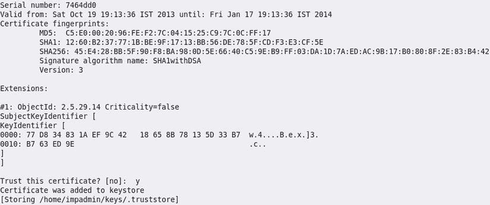

图 4-26. 客户端证书成功添加到服务器的信任库中

至此，我们已经准备好了服务器证书。在接下来的几个教程中，我们将使用信任库通过受信任的证书访问服务器。对于节点间通信，我们需要在每个节点上重复上述步骤，并将每个节点的公钥证书复制到每个节点的信任库中。

图 4-27 以图形方式展示了客户端证书准备以及导入信任库的过程。

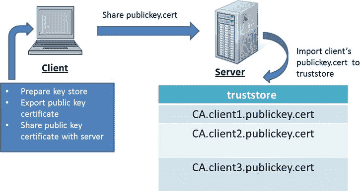

图 4-27. 准备并与服务器共享客户端公钥证书的流程

在 Cassandra 节点间准备和共享证书的过程相同，每个节点都需要将其公钥证书导出并共享给 Cassandra 集群中的所有其他节点。

证书准备过程完成后，你需要启用并连接启用 SSL 加密的命令行客户端。下一节将讨论此过程。

## 通过 SSL 加密进行连接

上一节讨论了在启用 SSL 的情况下通过 `cqlsh` 进行连接。现在让我们探索如何通过启用 SSL 加密的 `cassandra-cli` 命令行客户端进行连接。

### 通过 Cassandra-cli 连接

让我们启用 Cassandra 以实现加密的客户端到节点加密，并通过 Thrift 方式（使用 `cassandra-cli`）连接到服务器。

首先，我们需要为客户端到节点加密配置服务器。

```
// 启用服务器
enabled: true
// 密钥库路径
keystore: /home/impadmin/keys/server.jks
// 密钥库密码
keystore_password: server
```

以下显示了 `cassandra.yaml` 中需要进行的配置更改，以配置密钥库和信任库路径：

```
# 启用或禁用客户端/服务器加密。
client_encryption_options:
  enabled: false
  keystore: /home/impadmin/keys/server.jks
  keystore_password: server
# require_client_auth: false
# 如果 require_client_auth 为 true，则设置信任库和信任库密码
  truststore: /home/impadmin/keys/.truststore
  truststore_password: client
# 更多高级默认设置如下：
  protocol: TLS
  algorithm: SunX509
  store_type: JKS
  cipher_suites: [TLS ECDHE RSA WITH AES 256 CBC SHA, TLS DHE RSA WITH AES 128 CBC SHA, TLS ECDH ECDSA WITH AES 128 CBC SHA, TLS DHE RSA WITH AES 256 CBC SHA,
SSL DHE RSA WITH 3DES EDE CBC SHA, TLS ECDH RSA WITH AES 256 CBC SHA, SSL RSA WITH RC4 128 SHA, TLS ECDH ECDSA WITH 3DES EDE CBC SHA, TLS ECDHE RSA WITH RC4 128 SHA,
TLS ECDH ECDSA WITH RC4 128 SHA, TLS ECDHE ECDSA WITH RC4 128 SHA, TLS ECDHE RSA WITH AES 128 CBC SHA, TLS ECDHE ECDSA WITH 3DES EDE CBC SHA,
TLS ECDH RSA WITH RC4 128 SHA, TLS EMPTY RENEGOTIATION INFO SCSV, TLS ECDH RSA WITH 3DES EDE CBC SHA, TLS ECDH RSA WITH AES 128 CBC SHA,
TLS ECDHE ECDSA WITH AES 256 CBC SHA, TLS ECDHE ECDSA WITH AES 128 CBC SHA, TLS DHE DSS WITH AES 256 CBC SHA, TLS RSA WITH AES 128 CBC SHA,
TLS ECDH ECDSA WITH AES 256 CBC SHA, TLS RSA WITH AES 256 CBC SHA, TLS ECDHE RSA WITH 3DES EDE CBC SHA, SSL RSA WITH RC4 128 MD5, TLS DHE DSS WITH AES 128 CBC SHA,
SSI DHF DSS WTTH 3DFS FDF CRC SHA. SSI RSA WTTH 3DFS FDF CRC SHA1]
```

这里，`cipher_suites` 配置包含所有有效的协议，建议在使用此应用程序进行配置时保持原样。

你可以将 `require_client_auth` 设置为 `true` 以启用客户端证书认证。

启动 Cassandra 服务器并连接 `cassandra-cli`：

```
$CASSANDRA_HOME/bin/cassandra-cli -h 127.0.0.1 -p 9160 -ts /home/impadmin/keys/.truststore -tf org.apache.cassandra.cli.transport.SSLTransportFactory -tspw client
```

这里，`-ts`、`-tf` 和 `-tspw` 分别代表信任库、传输工厂和信任库密码。

通过使用传输工厂和信任库配置，以及 SSL 加密，我们可以连接到 Thrift 客户端。接下来，我们将使用启用 SSL 加密的 `cqlsh` 进行连接。

### 通过 cqlsh 连接

要连接启用加密的 `cqlsh`，我们需要在 `home` 目录下创建 `.cqlshrc` 文件。此外，我们也可以在 `require_client_auth=false` 的情况下连接 `cqlsh`。在本教程中，我们连接并配置 `cqlsh`。

让我们在 `home` 目录下创建针对 SSL 配置的 `.cqlshrc` 文件。

```
factory = cqlshlib.ssl.ssl_transport_factory
// 信任库文件路径
certfile = /home/impadmin/source/keys/.truststore
```

图 4-28 显示了 `.cqlshrc` 文件中的配置更改。

就这样！让我们运行 `cqlsh` 来连接 Cassandra 服务器：


图 4-28. `.cqlshrc` 配置更改

```
SSL_CERTFILE=/home/impadmin/source/keys/publickey.cer SSL_VALIDATE=$CASSANDRA_HOME/bin/cqlsh -3 -t cqlshlib.ssl.ssl_transport_factory
```

### 通过 Cassandra Thrift 客户端连接

以下代码片段展示了如何通过基于 Java 的 Cassandra Thrift 客户端，连接到启用了安全机制的服务器：

```
TSSLTransportFactory.TSSLTransportParameters params =
new TSSLTransportFactory.TSSLTransportParameters();
params.setTrustStore("信任库路径", "信任库密码");
transport = TSSLTransportFactory.getClientSocket("localhost", 7001, 10000, params);
TProtocol protocol = new TBinaryProtocol(transport);
Cassandra.Client client = new Cassandra.Client(protocol);
```

这里的 `7011` 是 SSL 端口。其余部分与 Cassandra-cli 连接方式类似。使用基于 SSL 配置的传输参数（例如，配置信任库路径、密码和 SSL 传输工厂）打开客户端套接字。

以上就是我们如何通过命令行客户端和基于 Java 的 Thrift 客户端连接到 Cassandra 服务器的方法。

## 总结

总而言之，本章讨论的主题如下：

- 通过超级用户和非超级用户管理用户角色和权限
- 为客户端-服务器通信和节点间通信准备 SSL 加密证书
- 通过各种客户端连接到安全的 Cassandra 服务器。

至此，我们结束了关于 Cassandra 数据安全与用户管理的讨论。

下一章将更深入地探讨大数据分析，我们将讨论如何使用 Hadoop 的 MapReduce 算法进行批处理，以及如何将 Cassandra 文件系统同时用作输入和输出来在 Cassandra 上运行 MapReduce 程序！

