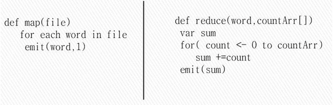
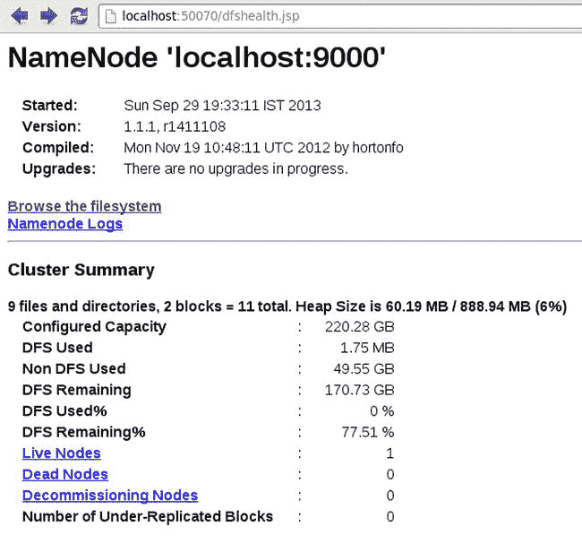

# 5. 基于 Cassandra 的 MapReduce

那么，在讨论了数据建模、安全性和用户角色权限管理之后，下一步是什么？借助 `Cassandra` 查询语言（`CQL`），我们确实可以通过主键和二级索引来管理基本的基于查询的分析，并尽可能地保持数据模型的非规范化。但是，我们仍然可以对非常大的数据块执行分析（类似于连接操作），或者在统计特定字段（例如，统计特定用户账户在给定日期范围内的推文数量）后将数据持久化到 `Cassandra` 中。显然，这属于大数据分析，更具体地说是批处理分析。

在本章中，我们将：
- 介绍 `MapReduce`
- 探索 `Hadoop`
- 讨论 `HDFS` 和 `MapReduce`
- 描述 `Cassandra` 与 `MapReduce` 的集成

## 批处理与 MapReduce

任何形式的数据，无论是结构化的还是非结构化的，如果不经过处理都将毫无意义。到目前为止，我们已经讨论了管理和建模 `Cassandra` 中数据量的各种方法。

那么，对这些归档的大型数据集进行分析又如何呢？大数据分析可以分为两大类：
- 批处理
- 流处理

通俗地说，批处理就是执行一个或多个作业。这些作业被预先编程，以尽量减少人工干预。所需的输入/输出参数和资源是预先配置好的。批处理机制的历史可以追溯到穿孔卡片和大型机计算时代。

我们以一个卫星频道应用为例，它多年来一直在归档日志。每年年底（或每半年），提供商都想知道，在黄金时段，特定年龄范围内的多少用户观看了特定节目。由于数据量巨大且完全是非结构化的，我们无法将其流式传输并放入内存来执行此类计算。这些数据在很大程度上可能互不相关，要对其进行批量处理，就需要预定义的步骤来进行并行处理。

对于大数据而言，批处理作业可以分为三个简单的步骤：
- 提取，
- 转换，
- 和加载

这个过程通常被称为 `ETL`。有各种 `ETL` 工具可用于数据仓库和分析，例如 `Ab initio`、`CloverETL`、`Pentaho` 和 `Informatica`。

`ETL` 系统的另一个方面是分析。想象一下，一个系统需要执行大数据分析，其中数据输入点来自不同的应用程序，并且系统需要生成一份整合的汇总报告。这就是数据从各种输入渠道提取出来，经过计算和转换，然后加载到数据库中的过程。图 5-1 展示了一个示例，其中基于 `ETL` 的分析需要从社交媒体渠道、金融应用程序和服务器日志中提取数据。转换/计算在引擎端完成，最终输出被加载到数据库上。


图 5-1. 基于 `ETL` 的分析

2008 年，`Google` 研究项目发表了一篇论文《MapReduce: Simplified Data Processing on Large Clusters》，介绍了 `MapReduce` 范式，尽管它自 2003 年起就已被使用。（你可以从 [`http://static.googleusercontent.com/media/research.google.com/en//archive/mapreduce-osdi04.pdf`](http://static.googleusercontent.com/media/research.google.com/en//archive/mapreduce-osdi04.pdf) 下载这份白皮书。）`MapReduce` 算法是一种分布式并行编程模型，由映射和归约函数组成，是解决需要对异构形式的海量数据进行分析的业务问题的一种方案。自 `Google` 论文发表以来，已经构建了多种 `MapReduce` 实现。其中一种流行且开源的实现是 `Apache Hadoop`。

## Apache Hadoop

`Apache Hadoop` 是一个流行的开源库，用于大规模数据集的分布式计算。它是一个大规模的批处理基础设施，主要用于对分布在数百个节点上的数据进行批处理分析。

通过 `MapReduce` 作业，数据集被分成多个块，这样每个块都可以作为映射任务以协同方式进行独立处理，然后框架对输出进行排序并提供给归约任务。`Hadoop` 框架自动管理任务调度和数据分发。

显然，如此大量的数据无法在单个节点上管理，必须分布在多个节点上。这里明显有两个问题：
- 数据分发
- 协同数据处理

### HDFS

`Hadoop` 的数据分发由 `Hadoop` 分布式文件系统（`HDFS`）管理。`HDFS` 是 `Apache Hadoop` 项目的子模块之一。它专门设计用于在廉价的硬件上构建可扩展的系统。`HDFS` 基于主/从架构，其中称为 `NameNode` 的单个进程在主节点上运行，并管理关于数据文件和跨节点集群复制的所有信息。

有关 `HDFS` 架构的更多信息，请参考 [`http://hadoop.apache.org/docs/r1.2.1/hdfs_design.html`](http://hadoop.apache.org/docs/r1.2.1/hdfs_design.html)。

### MapReduce

`MapReduce` 的实现也解决了另一个问题：它是一个跨多个节点对大量数据进行并行处理的框架。

`MapReduce` 过程中执行的三个主要任务是：
- `Split` 与 `map`
- `Shuffle` 与 `sort`
- `Reduce` 与 `output`

提交作业后，输入数据被分割成块，并作为并行的 `map` 任务分配给每个 `mapper`。每个 `mapper` 生成一个独特的键值对作为输出，这些键值对会按键进行混洗和排序，然后作为输入提供给每个 `reducer`。在数据节点上运行的每个 `mapper` 和 `reducer` 只操作本地数据（数据本地性）。另一个附加优势是，该框架完全解耦，并且可以对 `mapper`、`reducer`、文件格式和记录读取进行自定义实现。

让我们借助一个著名的单词计数问题来简化理解。在这里，程序需要输出输入文件中每个单词出现的次数（见图 5-2）。


图 5-2. `MapReduce` 在单词计数中的工作原理

图 5-2 是对 Word 文件中给出的三行内容进行单词计数的 `MapReduce` 程序的图形表示。

Welcome to the Cassandra world Apress book Cassandra made easy Cassandra 2.0.8 out now

在这里，每个 `map` 任务在数据所在的节点上本地运行。然后，数据由 `Hadoop` `MapReduce` 框架隐式地进行混洗和排序，最后交给 `reduce` 任务，经过归约过程后将结果输出到一个文件中。

为了在更底层理解它，您也可以参考图 5-3 中的伪代码表示。


图 5-3. 单词计数 `MapReduce` 算法

### 将推文读取并存储到 HDFS 中

由于我们在本书中一直沿用基于 Twitter 的示例，那么让我们再次使用实时推文来演示 `HDFS`/`MapReduce` 的示例。从 `HDFS` 开始的原因是先熟悉在默认 `HDFS` 上运行 `MapReduce`，之后再解释如何在外部文件系统（例如 `Cassandra` 文件系统）上执行它。在本节中，我们将讨论如何设置并抓取关于“apress”的推文。在我们的示例中，我们将流式读取一些关于“Apress 出版物”的推文，并将它们存储在 `HDFS` 上。此操作指南的目的是设置和配置 `Hadoop` 进程，并为“`Cassandra` `MapReduce` 集成”部分的下一个操作指南奠定基础。

#### 读取推文

首先，让我们构建一个基于 `Maven` 的示例 `Java` 项目，以演示从 Twitter 读取推文。（关于使用 `Maven` 的更多细节，您也可以参考 [`http://maven.apache.org/plugins/maven-site-plugin/usage.html`](http://maven.apache.org/plugins/maven-site-plugin/usage.html)。）

首先，生成一个 `Maven` 项目：

```
mvn archetype:create –DgroupId=com.apress –DartifactId=twitterExample –Dversion=1.0 –Dpackaging=jar
```

让我们在 `pom.xml` 中添加 `twitter4j` 依赖（见图 5-4）：

```xml
<!-- Twitter 4j 依赖 -->
<dependency>
  <groupId>org.twitter4j</groupId>
  <artifactId>twitter4j-core</artifactId>
  <version>[3.0,)</version>
</dependency>
```

配置 `twitter4j.properties`（位于 `src/main/resources` 目录下），设置消费者和访问凭据：

```properties
#twitter4j.properties
# 以下给出的密钥已被掩码。在运行 DefaultTwitterService 之前，请根据您的设置进行更改。
oauth.consumerSecret=8xxxxxxcxxxxxxxxxxxxxxxxxxxxxxxxxxxxx
oauth.accessToken=3ccxxxxxxxxxxxxxxxxxxxxxxxxxxxxxxxxxxxxxxxxxxxxxxxx
oauth.accessTokenSecret=hxxxxxxxxxxxxxxxxxxxxxxxxxxxxxxxxxxxxxxxxxx
oauth.consumerKey=oxxxxxxxxxxxxxxxxxxxxx
```

让我们使用 `Twitter` `API` 创建一个连接，如下所示：

```java
twitter = new TwitterFactory().getInstance();
```

注意：请参考 `com.apress.chapter5.mapreduce.twittercount.hdfs.ConnectionHandler` 的实现。

接下来，将 `apress` 配置为搜索关键词并获取推文：

```java
Query query = new Query("apress");
QueryResult result = connection.search(query);
```

将这些推文存储到一个本地文件夹中：

```java
final String filePath = "tweets"; // 您可以根据配置修改此路径
File file = new File(filePath);
FileOutputStream fos = null;
try
{
  fos = new FileOutputStream(file);
}
catch (FileNotFoundException e)
{
  // 记录错误
}
// 读取并写入推文到本地文件系统
do
{
  List<Status> statuses = result.getTweets();
  for (Status status : statuses)
  {
    StringBuilder sb = new StringBuilder();
    sb.append(status.getUser().getCreatedAt());
    sb.append("\001");
    if (status.getUser() != null)
    {
      sb.append(status.getUser().getName());
      sb.append("\001");
    }
    sb.append(status.getText());
    sb.append("\n");
    try
    {
      fos.write(sb.toString().getBytes());
    }
    catch (IOException e)
    {
      // 记录错误
    }
    count++;
  }
  while ((query = result.nextQuery()) != null);
}
```

运行这段代码将在当前目录下存储一个推文文件。

本章中所有示例的源代码均可通过本书的下载资源获取。上述代码片段的完整源代码位于 `com.apress.chapter5.mapreduce.twittercount.hdfs.DefaultTwitterService`。

#### 将推文存储到 HDFS

接下来，将推文存储到 `HDFS`。你还需要安装并配置好 `Hadoop`。本示例将使用 `Hadoop` 单节点设置，这也是我们首先要做的。

设置的基本步骤如下：
- 下载 `Hadoop` `tarball` 发行版：[`https://archive.apache.org/dist/hadoop/core/hadoop-1.1.1/hadoop-1.1.1-bin.tar.gz`](https://archive.apache.org/dist/hadoop/core/hadoop-1.1.1/hadoop-1.1.1-bin.tar.gz)
- 将 `tarball` 解压到本地文件夹，并运行以下命令：`$HADOOP_HOME/bin/hadoop namenode –format`，其中，`$HADOOP_HOME` 是包含已解压 `Hadoop` 二进制文件的目录。
- 修改 `$HADOOP_HOME/conf/core-site.xml` 以设置默认文件系统：
```xml
<configuration>
<property>
  <name>fs.defaultFS</name>
  <value>hdfs://localhost:9000</value>
</property>
</configuration>
```
- 修改 `$HADOOP_HOME/conf/hdfs-site.xml` 以设置副本数：
```xml
<configuration>
<property>
  <name>dfs.replication</name>
  <value>1</value>
</property>
</configuration>
```
- 通过运行以下命令启动 `Hadoop` 进程：`$HADOOP_HOME/bin/start-all.sh`

现在完成以下步骤来复制推文文件：

在将本地文件复制到 `HDFS` 之前，我们先确认五个进程是否都已运行。图 5-4 中以下划线的形式显示了这些进程。将推文文件复制到 `HDFS`：


图 5-4. 在本地机器上运行的五个 `Hadoop` 进程（已加下划线）

```bash
# 在 HDFS 上创建 /apress/tweetdata 目录
$HADOOP_HOME/bin/hadoop fs -mkdir /apress/tweetdata
$HADOOP_HOME/bin/hadoop fs -put $DIR/tweets /apress/tweetdata
```

此时，推文存储在 `HDFS` 目录：`/apress/tweetdata` 下。

数据复制完成后，可以通过 Web 管理界面（`localhost:50070`），点击“浏览文件系统”进行验证，如图 5-5 所示。你可以在 `Hadoop` Web 界面控制台中看到数据已可用。


图 5-5. `Hadoop` Web 管理控制台

或者，你也可以运行以下命令来验证已存储的推文文件：`$HADOOP_HOME/bin/hadoop fs –lsr /apress/tweetdata`

本示例练习中，我们先将实时 `Twitter` 数据流存储到本地文件系统。对于实时推文流，你可能希望使用 `Flume` 或 `Scribe` 将实时 `Twitter` 数据流存储到 `HDFS`。请参考 [`https://cwiki.apache.org/FLUME/`](https://cwiki.apache.org/FLUME/) 或 [`https://github.com/facebook/scribe`](https://github.com/facebook/scribe)。

关于安装和设置的更多信息，请参考 [`http://hadoop.apache.org/docs/stable/single_node_setup.html`](http://hadoop.apache.org/docs/stable/single_node_setup.html)。

本示例中，我们讨论了如何将实时推文存储在 `HDFS` 中。下一节，我们将探讨如何编写一个 `MapReduce` 程序，将特定用户和日期的推文计数存储到 `Cassandra` 列族中。

## Cassandra MapReduce 集成

在本节中，我们将从 `HDFS` 读取推文（见上一节），并讨论一个 `MapReduce` 程序来执行推文计算。最后，缩减后的输出将存储在 `Cassandra` 的 `tweetcount` 列族中。我们将通过两个方案讨论 `Cassandra` 上的 `MapReduce`，分别是：
- 从 `HDFS` 读取推文，并将推文计数存储到 `Cassandra`。
- 从 `Cassandra` 读取推文，并将推文计数存储到 `Cassandra`。

在本示例中，我们将使用 `Thrift` 协议来创建 `Cassandra` 模式。作为 `Cassandra` 的开源 `API`，`MapReduce` 集成可通过 `Thrift` 协议实现。示例练习将以 `CQL3` 方式演示 `MapReduce` 与 `Cassandra` 的集成。

### 从 HDFS 读取推文并将计数结果存储到 Cassandra

在本节中，我们将从之前存储在 HDFS 目录 `/apress/tweetdata`（见上一节）的推文文件中读取数据，并将每个用户和每个日期的推文计数存储到 Cassandra。Cassandra 对 Thrift 和 CQL3 都提供了 MapReduce 支持。我们将从 Thrift 协议开始，探讨这两种协议。

好的，作为高级文档工程师和翻译员，我将根据您提供的注意事项和示例，将给定的英文文本翻译成中文。

### Thrift 方式

我们沿用相同的 Twitter 示例，其中用户及其推文应存储在本地，并按 `tweet_date` 排序。

首先，我们需要准备数据定义。让我们使用 `cassandra-cli` 创建一个列族 `tweetcount`：

```
// 创建键空间。
Create keyspace tweet_keyspace;
use tweet_keyspace;

// 创建列族 tweetcount。
create column family tweetcount with comparator='UTF8Type' and key_validation_class = 'UTF8Type' and column_metadata=[{column_name:'count', validation_class:'Int32Type'}];
```

让我们创建一个 MapReduce 作业。我们需要创建一个 Hadoop 配置实例，并配置 NameNode 的主机和端口：

```
Configuration conf = new Configuration();
conf.set("fs.default.name","hdfs://localhost:9000");   // 根据你的 Hadoop 配置修改此项。
conf.set("mapred.child.java.opts", "-Xms1024m -Xmx2g -XX:+UseSerialGC");
conf.set("mapred.job.map.memory.mb", "4096");
conf.set("mapred.job.reduce.memory.mb", "2048");
conf.set("mapreduce.map.ulimit","1048576");
conf.set("mapred.job.reduce.physical.mb", "2048");
conf.set("mapred.job.map.physical.mb", "2048");
```

> **注意**
> 如果你在远程机器上运行，可能需要更改 `fs.default.name`。

现在，让我们为映射器和归约器配置 MapReduce 作业：

```
//映射器配置
job.setMapperClass(TweetTokenizer.class);
job.setMapOutputKeyClass(Text.class);
job.setMapOutputValueClass(IntWritable.class);

// 归约器配置
job.setReducerClass(TweetAggregator.class);
job.setOutputKeyClass(ByteBuffer.class);
job.setOutputValueClass(List.class);
job.setOutputFormatClass(ColumnFamilyOutputFormat.class);
```

接下来，我们需要提供用于输出映射的 Cassandra 特定配置：

```
ConfigHelper.setOutputRpcPort(job.getConfiguration(), "9160");
ConfigHelper.setOutputInitialAddress(job.getConfiguration(), "localhost");
ConfigHelper.setOutputPartitioner(job.getConfiguration(), "Murmur3Partitioner");
ConfigHelper.setOutputColumnFamily(job.getConfiguration(), KEYSPACE_NAME, COLUMN_FAMILY);
```

> **注意**
> 如果你不是在本地主机上运行，也可以更改 `rpc` 端口和初始地址。

最后，我们需要提供输入和输出路径：

```
FileInputFormat.addInputPath(job, new Path(otherArgs[0]));
job.setOutputFormatClass(ColumnFamilyOutputFormat.class);
```

这里的 `otherArgs[0]` 是 HDFS 推文文件的输入路径（例如，`/apress/tweetdata`）。

让我们看一下映射器：

```
public class TweetMapper
{
  public static class TweetTokenizer extends Mapper<LongWritable, Text, Text, IntWritable>
  {
    private final static IntWritable one = new IntWritable(1);
    /* (non-Javadoc)
     * @see org.apache.hadoop.mapreduce.Mapper#map(KEYIN, VALUEIN, org.apache.hadoop.mapreduce.       Mapper.Context)
     */
    public void map(LongWritable key, Text value, Context context)
      throws IOException, InterruptedException
    {
      // 分割成令牌，并将日期和计数作为键传递。
      String[] values = StringUtils.split(value.toString(), "\001");
      if(values.length >=2 && values.length <=3)
      {
        context.write(new Text(values[0]), one);  // 按日期计数。
        context.write(new Text(values[1]), one);  // 按用户计数。
      }
    }
  }
}
```

现在，让我们看一下归约器：

```
public static class TweetAggregator extends  org.apache.hadoop.mapreduce.Reducer<Text, IntWritable, ByteBuffer, List<Mutation>>
{
  public void reduce(Text word, Iterable<IntWritable> values, Context context) throws IOException,
    InterruptedException
  {
    int sum = 0;
    for (IntWritable val : values)
      sum += val.get();
    context.write(ByteBufferUtil.bytes(word.toString()), Collections.singletonList(getMutation(word, sum)));
  }

private static Mutation getMutation(Text word, int sum)
  {
    Column c = new Column();
    c.setName(ByteBufferUtil.bytes("count"));
    c.setValue(ByteBufferUtil.bytes(sum));
    c.setTimestamp(System.currentTimeMillis());
    Mutation m = new Mutation();
    m.setColumn_or_supercolumn(new ColumnOrSuperColumn());
    m.column_or_supercolumn.setColumn(c);
    return m;
  }
}
```

此 MapReduce 作业的完整源代码可以在本书的下载资源中找到。可执行类是 `TwitterHDFSJob`（位于 `com.apress.chapter5.mapreduce.twittercount.hdfs` 包中）。你还可以参考 `README.txt` 文件（位于 `src/main/resources` 下），以获取有关设置数据库和运行此 MapReduce 作业的进一步说明。

成功执行作业后，列族中的输出将如下所示：

```
[default@tweet_keyspace] list tweetcount;
Using default limit of 100
Using default cell limit of 100

RowKey: Mon May 11 06:16:04 IST 2009
=> (name=count, value=334, timestamp=1407569960904)

RowKey: Hazem Saleh
=> (name=count, value=334, timestamp=1407569960798)

RowKey: cessprin
=> (name=count, value=334, timestamp=1407569960990)

RowKey: Thu Feb 23 00:24:16 IST 2012
=> (name=count, value=334, timestamp=1407569960966)

RowKey: Hunter Scott
=> (name=count, value=334, timestamp=1407569960803)
22 Rows Returned.
```

存储的 `tweetcount` 的示例输出总共包含 22 行。行键可以是推文日期或用户名，并包含一个名为 `count` 及其值的列。

### CQL3 方式

在前几章中，我们讨论了 CQL3 与 Thrift 之间的差异及互操作性问题。Cassandra 为 MapReduce 提供了支持 CQL 兼容的输入输出格式类。请注意，这些实现仍基于 Thrift，而非原生 CQL3 驱动程序。在本示例中，我们将使用它在 CQL3 列族中写入输出数据。我们知道通过 CQL3 创建的列族在 Thrift 中不可见，因此接下来我们将探讨如何在 CQL3 表/列族上运行 MapReduce。使用 CQL3 运行前面的 MapReduce 程序只需很少的改动。我们需要以 CQL3 格式定义表，并修改 Hadoop 作业配置，使其指向基于 CQL3 的输出格式。下面我们来逐一说明这些改动：

首先，你需要创建 `tweetcount_cql` 表：

```
create table tweetcount_cql (key text primary key, count int);
```

在 Hadoop 作业层级所需的修改如下：

```
// 设置更新 CQL 和行键
job.getConfiguration().set("row_key", "key");
String query = "UPDATE " + KEYSPACE_NAME + "." + COLUMN_FAMILY + " SET count = ? ";
CqlConfigHelper.setOutputCql(job.getConfiguration(), query);
// 设置 CQL 输出格式类
job.setOutputFormatClass(CqlOutputFormat.class);
```

基于 CQL3 的聚合器如下：

```
public static class TweetCQLAggregator extends org.apache.hadoop.mapreduce.Reducer<Text, IntWritable, Map<String,ByteBuffer>, List<ByteBuffer>>
{
  private static Map<String,ByteBuffer> keys = new HashMap<>();
  /* (非 Javadoc)
  * @see org.apache.hadoop.mapreduce.Reducer#reduce(KEYIN, java.lang.Iterable,org.apache.hadoop.mapreduce.Reducer.Context)
  */
  public void reduce(Text word, Iterable<IntWritable> values, Context context) throws IOException, InterruptedException
  {
    int sum = 0;
    for (IntWritable val : values)
      sum += val.get();
    System.out.println("writing");
    keys.put("key", ByteBufferUtil.bytes(word.toString()));
    context.write(keys, getBindVariables(word, sum));
  }
  private List<ByteBuffer> getBindVariables(Text word, int sum)
  {
    List<ByteBuffer> variables = new ArrayList<ByteBuffer>();
    variables.add(Int32Type.instance.decompose(sum));
    return variables;
  }
}
```

最后，运行 HDFS 作业（参见 `TwitterHDFSCQLJob`，源代码后附输出）后，我们可以使用 `cqlsh` 客户端查看输出：

```
select * from tweetcount_cql;
 key                         | count
-----------------------------+-------
 Mon May 11 06:16:04 IST 2009 |   334
 Hazem Saleh                 |   334
 cessprin                    |   334
 Thu Feb 23 00:24:16 IST 2012|   334
 Hunter Scott                |   334
 Tue Sep 29 22:01:16 IST 2009|   334
 Elena Vielva Gómez          |   334
 Sun Dec 18 20:13:39 IST 2011|   334
 Alejandro || Serras        |   334
 Tue Jul 06 18:01:47 IST 2010|   334
 Wed Mar 07 05:11:11 IST 2012|   334
 Wed Nov 07 14:04:18 IST 2012|   334
 Oseias Moraes               |   334
 Adeesh Fulay                |   334
 Sat Nov 05 21:29:20 IST 2011|   334
 Sun Jul 24 21:44:17 IST 2011|   334
 Manthita.                   |   334
 ebooksdealofdaybot          |   334
 Wed Apr 23 19:19:49 IST 2014|   334
 The News Selector           |  6680
 Louise Corrigan             |   334
 Mon Mar 03 01:19:17 IST 2014|  6680
22 行返回。
```

完整源代码可通过本书的下载资源获取，其中涉及的类包括：

- `com.apress.chapter5.mapreduce.twittercount.hdfs.TwitterHDFSCQLJob`
- `com.apress.chapter5.mapreduce.twittercount.hdfs.TweetAggregator`

下一节我们将讨论如何将 Cassandra 用作 MapReduce 的输入和输出格式。

### Cassandra 输入与输出

现在我们来讨论如何运行一个 MapReduce 作业，其中输入从 Cassandra 获取，输出也存储到 Cassandra 中。

到目前为止，我们已经看到 MapReduce 作业可以在默认的 HDFS 以及像 Cassandra 这样的外部文件系统上执行。你可能会疑惑应该采用哪种文件系统以及为什么？这完全取决于具体用例。例如，如果一个应用程序已经基于各种 Cassandra 特性构建，那么最好将其 MapReduce 批处理分析也实现在 Cassandra 中。也可能存在这样的情况：HDFS 已被用于存储原始数据，用户可能不希望迁移，但仍希望运行一些 MapReduce 作业并将输出存储到 Cassandra 中。同样，用户可能希望从 HDFS 及其生态系统（Hive、Pig 等）迁移到单一的数据库解决方案（即 Cassandra）。我们必须记住的一个重大区别是，HDFS 是一个分布式文件系统，而 Cassandra 是一个分布式数据库。Cassandra 具备容错性且没有单点故障，而 HDFS 则不然。另一个关键区别是，Hadoop 采用主从架构，而 Cassandra 采用对等架构。由于基于 Cassandra 构建的解决方案具有可扩展性，并利用了 Cassandra 的特定功能（如二级索引、复合列等），我们可能仍然需要使用 MapReduce 在 Cassandra 上执行批处理分析。在本教程中，我们将讨论同一个推文计数示例，但将 Cassandra 同时用作输入和输出格式。

该程序将用户名作为输入参数（默认用户值为），并计算该用户的推文数量。

首先我们需要准备数据定义。让我们创建一个键空间 `tweet_` 以及列族和。其中 `tweetstore` 将存储原始推文，而特定用户的计数将通过 `cqlsh` 存储在 `tweetcount` 列族中。

```
// 创建键空间。
create keyspace tweet_keyspace with replication={'class': 'SimpleStrategy', 'replication_factor:3};
use tweet_keyspace;
// 创建输入列族。
create table tweetstore(tweet_id timeuuid PRIMARY KEY, user text, tweeted_at timestamp, body text);
// 通过 Cassandra-cli（Thrift 方式）更新列族以启用 user 上的索引。
create column family tweetstore with column_metadata=[{column_name:'user', validation_class:'UTF8Type', index_type: KEYS},{column_name:'body', validation_class: 'UTF8Type'}, {column_name:'tweeted_at',validation_class: 'DateType'}]
// 通过 Cassandra-cli 创建输出列族。
create column family tweetcount with comparator='UTF8Type' and key_validation_class = 'UTF8Type' and column_metadata=[{column_name:'count', validation_class:'Int32Type'}];
```

接下来，我们使用客户端在 `tweetstore` 中填充一些行：

```
use tweet_keyspace;
// 复制命令
copy tweetstore from STDIN;
```

以下是从 STDIN 复制的控制台输出：

```
cqlsh:tweet_keyspace> copy tweetstore from STDIN;
[使用 \. 单独一行结束输入]
[copy]  now(),bama meeting with European allies on Ukraine http://t.co/1Ik3qBOPxC from #APress #tns, 2013-10-20,mevivs
[copy] now(),nergdahl uproar halts plan for return celebration http://t.co/bywaBAoWTP from #APress #tns,2012-09-22,Chrisk
[copy] now(),booksdealofdaybot^A[Apress]?Android Apps Security?http://t.co/5XLSObkk9f,2014-03-24,mevivs
[copy] \.
6 分 35.900 秒内导入了 3 行。
```

让我们使用以下映射器和规约器配置创建一个 MapReduce 作业：

```
Configuration conf = new Configuration();
String[] otherArgs = new GenericOptionsParser(conf, args).getRemainingArgs();
Job job = new Job(conf, "tweet count");
job.setJarByClass(TwitterCassandraJob.class);
// 映射器配置。
job.setMapperClass(TweetMapper.class);
job.setMapOutputKeyClass(Text.class);
job.setMapOutputValueClass(IntWritable.class);
job.setInputFormatClass(ColumnFamilyInputFormat.class);
// 规约器配置
job.setReducerClass(TweetAggregator.class);
job.setOutputKeyClass(ByteBuffer.class);
job.setOutputValueClass(List.class);
job.setOutputFormatClass(ColumnFamilyOutputFormat.class);
```

接下来，我们需要为输入列族和格式配置 MapReduce 作业：

```
// Cassandra input column family configuration
ConfigHelper.setInputRpcPort(job.getConfiguration(), "9160");
ConfigHelper.setInputInitialAddress(job.getConfiguration(), "localhost");
ConfigHelper.setInputPartitioner(job.getConfiguration(), "Murmur3Partitioner");
ConfigHelper.setInputColumnFamily(job.getConfiguration(), KEYSPACE_NAME, INPUT_COLUMN_FAMILY);
job.setInputFormatClass(ColumnFamilyInputFormat.class);
```

由于我们需要获取特定索引列（`user`）的记录，我们将使用 Thrift Slice API 配合 `mapper` 类配置 MapReduce 作业，以进行过滤流式处理。

```
// Create a slice predicate
SlicePredicate slicePredicate = new SlicePredicate();
slicePredicate.setSlice_range(new SliceRange(ByteBufferUtil.EMPTY_BYTE_BUFFER, ByteBufferUtil.EMPTY_BYTE_BUFFER, false, Integer.MAX_VALUE));

// Prepare index expression.
IndexExpression ixpr = new IndexExpression();
ixpr.setColumn_name(ByteBufferUtil.bytes(COLUMN_NAME));
ixpr.setOp(IndexOperator.EQ);
ixpr.setValue(ByteBufferUtil.bytes(otherArgs.length > 0 && !StringUtils.isBlank(otherArgs[0])? otherArgs[0]: "mevivs"));

List<IndexExpression> ixpressions = new ArrayList<IndexExpression>();
ixpressions.add(ixpr);
ConfigHelper.setInputRange(job.getConfiguration(), ixpressions);
ConfigHelper.setInputSlicePredicate(job.getConfiguration(), slicePredicate);
```

接下来，我们需要为输出列族和格式配置 MapReduce 作业：

```
// Cassandra output family configuration.
ConfigHelper.setOutputRpcPort(job.getConfiguration(), "9160");
ConfigHelper.setOutputInitialAddress(job.getConfiguration(), "localhost");
ConfigHelper.setOutputPartitioner(job.getConfiguration(), "Murmur3Partitioner");
ConfigHelper.setOutputColumnFamily(job.getConfiguration(), KEYSPACE_NAME, OUTPUT_COLUMN_FAMILY);
job.setOutputFormatClass(ColumnFamilyOutputFormat.class);
```

让我们看看 `mapper()`：

```
public class TweetMapper extends Mapper<ByteBuffer, SortedMap<ByteBuffer, Column>, Text, IntWritable>
{
    static final String COLUMN_NAME = TwitterCassandraJob.COLUMN_NAME;
    private final static IntWritable one = new IntWritable(1);

/* (non-Javadoc)
     * @see org.apache.hadoop.mapreduce.Mapper#map(KEYIN, VALUEIN, org.apache.hadoop.mapreduce.Mapper.Context)
     */
    public void map(ByteBuffer key, SortedMap<ByteBuffer, Column> columns, Context context) throws IOException, InterruptedException
    {
        Column column = columns.get(ByteBufferUtil.bytes(COLUMN_NAME));
        String value = ByteBufferUtil.string(column.value());
        context.write(new Text(value), one);
    }
}
```

它简单地读取特定列（例如，来自流式列的 `user`），并为每个列值写入计数。我们将使用相同的 `reducer()` 执行归约操作。

该 MapReduce 作业的完整源代码可在本书的下载资源中找到。可执行类是 `TwitterCassandraJob`（位于 `com.apress.chapter5.mapreduce.twittercount.cassandra` 包中）。你也可以参考 `README.txt` 和 `db.txt` 文件（位于 `src/main/resources` 下）以获取进一步说明。

成功执行作业后，列族中的输出如图 [5-6] 所示。


图 5-6. 特定于用户 `mevivs` 的计数存储在 `tweetcount` 中

本配方的完整源代码可在本书下载资源的 `com.apress.chapter5.mapreduce.twittercount.cassandra` 文件夹中找到。

## Stream 或实时分析

批处理框架非常适合一次性写入、随处读取的范式。但对于数据集的持续更新，任何正在进行的 Hadoop 作业都不会获取这些数据更新，需要重新运行。

实时分析需要处理和分析进入系统的大量数据。诸如股票市场交易和动态预测分析等应用需要在数据进入系统时实时提供分析结果。

在过去一年左右，构建此类实时分析应用引起了极大兴趣。因此，出现了许多新框架，例如 Storm、Samza 和 Kafka。我们将在后续章节讨论它们的集成。

## 总结

如前所述，本章中分享的所有代码片段均以完整源代码形式随本书下载资源提供。下载资源中还包含 `db.txt` 和 `README.txt`，用于指导如何配置和运行这些 Java 程序以及这些示例中使用的 Cassandra 数据定义。

在本章中，我们讨论了 HDFS 和 MapReduce 及其与 Cassandra 的集成。运行 MapReduce 是大型数据分析的一种解决方案。然而，为了满足更复杂的分析需求，可能需要使用内置 API 来自动构建和执行此类 MapReduce 程序。其中两个最流行的工具是 Hive 和 Pig。下一章将讨论 Hive 和 Pig 的使用及其与 Cassandra 的集成。

