# 2. Cassandra 数据建模

上一章我们讨论了 Cassandra 的配置、安装和集群搭建。本章将带你了解：

- 数据建模概念
- Cassandra 集合支持
- CQL 与基于 Thrift 的模式的对比
- 管理数据类型
- 计数器列

准备好，我们将采用理论与实践并重的方式来学习。

### 数据建模介绍

数据建模是一种定义读/写需求并构建逻辑结构和对象模型的机制。Cassandra 是一个 NoSQL 数据库，它推崇的是“先读后写”模式，而非关系模型。先读后写（或称读前准备）设计用于首先分析你的数据读取需求，然后以相同的方式存储数据。试想管理 PB 或 ZB 级别的数据量，由于数据量巨大，我们无法承受在内存中进行计算（例如连接操作）。因此，最好让数据集准备好以供检索或进行大规模数据分析。用户无需预先了解列结构，但应避免存储扁平化的列，而倾向于在读取时进行计算（例如聚合、连接等）。

Cassandra 是一个面向列族的数据库。顾名思义，列族就是“列的家族”。Cassandra 中的每一行可能包含一个或多个列。列是数据的最小单元，包含名称、值和时间戳（见图 2-1）。

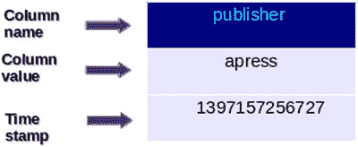

图 2-1. Cassandra 列定义

默认情况下，Cassandra 发行版附带 `cqlsh` 和 `Cassandra-cli` 命令行客户端以进行操作。`Cassandra-cli` 和 `cqlsh`（`.sh` 和 `.bat` 文件）位于 `bin` 文件夹下。在 Linux、Windows 或 Mac 上运行这些命令行客户端相当容易。在 Linux 和 Mac 机器上运行 shell 文件只需执行 `cql.sh`。但在 Windows 上运行 `cqlsh` 则需要安装 Python。

要在 Windows 上安装 `cqlsh`，请执行以下步骤：

首先，从 [`www.python.org/ftp/python/2.7.6/python-2.7.6.msi`](https://www.python.org/ftp/python/2.7.6/python-2.7.6.msi) 下载 Python。将 `python.exe` 添加到环境变量的 `PATH` 中。运行位于 `$CASSANDRA_HOME/pylib` 目录下的 `setup.py`：

```
python setup.py install
```

运行位于 `bin` 目录下的 `cqlsh`（见图 2-2）：

```
python cqlsh
```

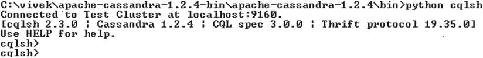

图 2-2. 成功连接到 cql shell

#### 数据类型

在 CQL 演变之前，Cassandra 中的数据类型是通过比较器和验证器来定义的。列或行键值被称为验证器，而列名则被称为比较器。可用的数据类型如图 2-3 所示。

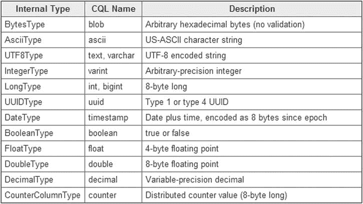

图 2-3. Cassandra 支持的数据类型

### 动态列

自诞生以来，Cassandra 就被定位为一种无模式、面向列族的分布式数据库。在一个列族中，每一行的列数可以不同。列定义可以在运行时动态添加。

`Cassandra-cli`（Thrift）和 `cqlsh`（CQL3）是本章各种练习中将使用的两个命令行客户端。

#### 通过 Thrift 使用动态列

让我们讨论一个简单的 Twitter 用例。在这个例子中，我们将探索通过 Thrift 建模和存储动态列的方法。

首先，创建一个键空间 `twitter` 和列族 `users`：

```
create keyspace twitter with strategy_options={replication_factor:1} and placement_strategy='org.apache.cassandra.locator.SimpleStrategy';
```

```
use twitter;
```

```
create column family users with key_validation_class='UTF8Type' and comparator='UTF8Type' and default_validation_class='UTF8Type';
```

这里，在定义列族时，我们没有定义任何列。列将在运行时针对每个行键值动态添加。

在 `users` 列族中，为行键值 `'imvivek'` 存储几个列：

```
set users['imvivek']['apress']='apress author';
```

```
set users['imvivek']['team_marketing']='apress marketing';
```

```
set users['imvivek']['guest']='guest user';
```

```
set users['imvivek']['ritaf']='rita fernando';
```

这里我们为用户 `imvivek` 添加了关注者作为动态列。

现在，为 `'ritaf'` 添加 `'imvivek'` 和 `'team_marketing'` 作为关注者：

```
set users['ritaf']['imvivek']='vivek mishra';
```

```
set users['team_marketing']['imvivek']='vivek mishra';
```

要查看 `users` 列族中的行列表（见图 2-4），请使用以下命令：

```
list users;
```

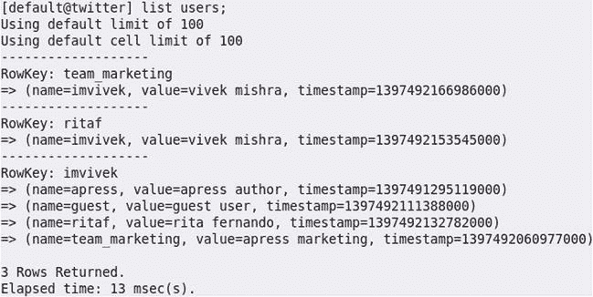

图 2-4. 查询 users 的输出

在图 2-4 中，我们可以看到针对第 3 步中存储的每个行键的列名及其值。

我们也可以删除单个键的列。例如，要删除行键 `'imvivek'` 的列 `'apress'`：

```
del users['imvivek']['apress'];
```

图 2-5 显示了执行第 5 步后 `imvivek` 的列数。

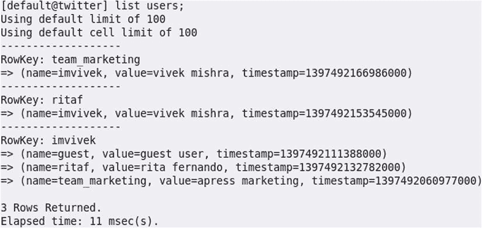

图 2-5. 删除后 imvivek 的列数

这里，列名是关注者的 `twitter_id`，而他们的全名是列值。这就是如何使用 Thrift 方式管理模式并操作动态列。我们将在第 3 章讨论 CQL3 对动态列的支持。


#### 通过 cqlsh 利用 Map 支持实现动态列

在本节中，我们将讨论如何利用 map 支持实现相同的 Twitter 用例。Cassandra 中的集合支持仅适用于 CQL3 二进制协议。

首先，创建一个键空间 `twitter` 和列族 `users`：

```
create keyspace twitter with replication = {'class':'SimpleStrategy','replication_factor':3};
```
```
use twitter;
```
```
create table users(twitter_id text primary key,followers map<text,text>);
```

为行键值 `'imvivek'` 在 `users` 列族中存储一些列：

```
insert into users(twitter_id,followers) values('imvivek',{'guestuser':'guest','ritaf':'rita fernando','team_marketing':'apress marketing'});
```

这里，我们为 `imvivek` 用户添加了关注者，将其作为动态列（即 map 属性）。

下面将 `'imvivek'` 和 `'team_marketing'` 添加为 `'ritaf'` 的关注者：

```
insert into users(twitter_id,followers) values('ritaf',{'imvivek':'vivek mishra'});
```
```
insert into users(twitter_id,followers) values('team_marketing',{'imvivek':'vivek mishra'});
```

要查看 `users` 列族中的行列表（见图 2-6），请使用以下命令：

```
select * from users;
```

要将 `'team_marketing'` 添加为 `'ritaf'` 的关注者，反之亦然（见图 2-7），我们只需将其作为元素添加到 `users` 列族中：

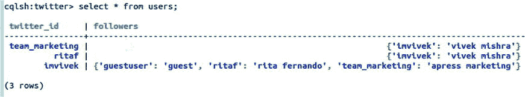

图 2-6. 包含用户关注者的 map

```
update users set followers = followers + {'team_marketing':'apress marketing'} where twitter_id='ritaf';
```
```
update users set followers = followers + {'ritaf':'rita fernando'} where twitter_id='apress_marketing';
```

如果行键在数据库中不存在，使用 `update` 会起到插入的作用。例如：

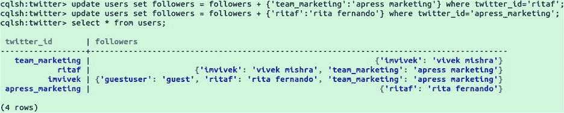

图 2-7. 更新后每个用户的关注者 map

```
update users set followers = followers + {'ritaf':'rita fernando'} where twitter_id='jhassell'; // update 语句起插入作用
```

图 2-8 显示 ritaf 已被添加为 jhassell 的关注者。

要从 map 中删除一个元素，需要执行以下命令：

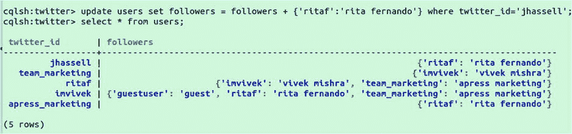

图 2-8. 对于不存在的行键（例如 twitter_id），update 语句对关注者 map 起到插入作用

```
delete followers['guestuser'] from users where twitter_id='imvivek';
```

可以看到，删除后，`imvivek` 的关注者列表减少到了四个（见图 2-9）。

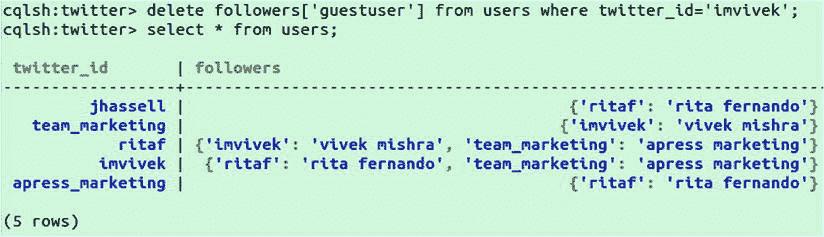

图 2-9. 删除 guestuser 作为 imvivek 的关注者之后的结果

至此，我们可以利用集合支持，将动态列添加为键值对。

#### 通过 cqlsh 利用 Set 支持实现动态列

考虑一个场景，用户希望只存储关注者 ID 的集合（而不是全名）。Cassandra 提供了集合支持，用于存储此类元素的列表或集合。下面我们讨论如何利用这种支持来实现。

首先，创建一个键空间 `twitter` 和列族 `users`：

```
create keyspace twitter with replication = {'class':'SimpleStrategy','replication_factor':3};
```
```
use twitter;
```
```
create table users(twitter_id text primary key,followers set<text>);
```

为行键值 `'imvivek'` 在 `users` 列族中存储一些列：

```
insert into users(twitter_id,followers) values('imvivek', {'guestuser','ritaf','team_marketing'});
```

这里，我们为 `imvivek` 用户添加了关注者，将其作为动态列（即 set 属性）。

下面我们来添加以下内容：

- 将 `'imvivek'` 和 `'team_marketing'` 添加为 `'ritaf'` 的关注者
- 将 `'ritaf'` 添加为 `'jhassell'` 的关注者

```
insert into users(twitter_id,followers) values('ritaf', {'imvivek','jhassell','team_marketing'});
```
```
insert into users(twitter_id,followers) values('jhassell', {'ritaf'});
```

要查看 `users` 列族中的行列表（见图 2-10），请使用以下命令：

```
select * from users;
```

我们可以通过以下方式更新集合来删除一个元素。图 2-10 显示了结果：

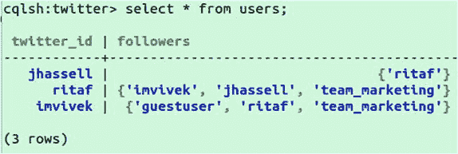

图 2-10. 已将 ritaf、jhassell 和 imvivek 的关注者添加完毕

```
update users set followers = followers - {'guestuser'} where twitter_id = 'imvivek';
```

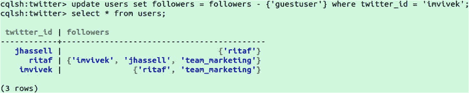

图 2-11. 为 imvivek 移除 guestuser 后更新后的关注者 set

集合支持可以作为在 Cassandra 上实现动态列添加的良好替代方案。复合键是多个表字段的组合，其中第一部分称为分区键，复合键的其余部分称为集群键。第 3 章将讨论使用复合列实现动态列。


#### 二级索引

在分布式集群中，列族的数据会根据复制因子和分区模式分布到多个节点上。但给定行键值的数据始终会位于同一个节点。利用主索引（例如行键），我们总能检索到一行数据。但如果要使用非行键值来检索呢？

Cassandra 提供了对列值添加索引的支持，称为二级索引。第 3 章将更详细地介绍索引，现在我们先看一个简单的二级索引示例。

我们来讨论同一个 Twitter 示例，看看如何利用和启用二级索引支持。

首先，创建`twitter`键空间和列族`users`。

```
create keyspace twitter with replication = {'class' : 'SimpleStrategy' , 'replication_factor' : 3};
```

```
use twitter;
```

```
create table users(user_id text PRIMARY KEY,fullname text,email text,password text, followers map<text, text>);
```

插入一个带有电子邮件和密码的用户：

```
insert into users(user_id,email,password,fullname,followers) values ('imvivek','imvivek@xxx.com','password','vivekm',{'mkundera':'milan kundera','guest': 'guestuser'});
```

在继续这个练习之前，有必要讨论一下哪些列应该被索引。

任何使用二级索引的读取请求实际上都会被广播到集群中的所有节点。Cassandra 在节点本地维护一个隐藏的列族用于二级索引，通过扫描该列族来使用二级索引检索行。

在执行数据建模时，我们应当对那些能从非常大的数据集中返回大量数据的列值创建二级索引。对小型数据集的唯一值创建索引只会成为负担，这不是良好的数据建模实践。对`fullname`创建索引是一个可行的选择。

让我们在`fullname`上创建二级索引：

```
create index fullname_idx on users(fullname);
```

索引创建成功后，我们可以使用`fullname`来获取记录。图 2-12 展示了结果。

让我们添加一个`age`列并创建索引：

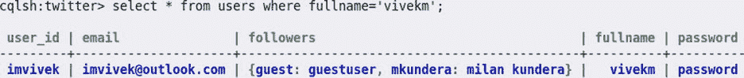

图 2-12.  搜索`fullname`值为`vivekm`的用户记录

```
alter table users add age text;
```

```
create index age_idx on users(age);
```

```
update users set age='32' where user_id='imvivek';
```

```
insert into users(user_id,email,password,fullname,followers,age) values ('mkundera','mkundera@outlook.com','password','milan kundera',{'imvivek':'vivekm','guest': 'guestuser'},'51');
```

图 2-13 显示了结果。

让我们将`age`的数据类型改为`int`：

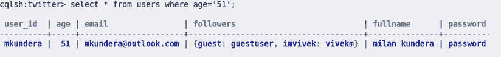

图 2-13.  选择所有年龄为 51 的用户

```
alter table users alter age type int;
```

这将导致以下错误：

```
TSocket read 0 bytes (via cqlsh)
```

要更改已索引列的数据类型，我们需要重建它们：

```
drop index age_idx;
```

```
alter table users alter age type int;
```

但请注意，在这种情况下，可能会导致数据集处于不兼容状态（见图 2-14）。

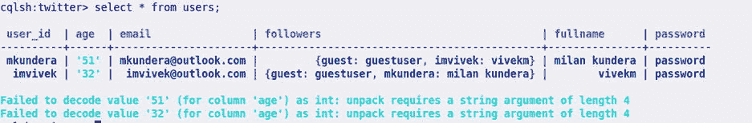

图 2-14.  将数据类型从字符串改为`int`时出错

以下是错误信息：

```
Failed to decode value '51' (for column 'age') as int: unpack requires a string argument of length 4
Failed to decode value '32' (for column 'age') as int: unpack requires a string argument of length 4
```

因此，建议在索引列上没有数据时，才更改其数据类型。

在 Cassandra 2.0 中不支持对集合创建索引。图 2-15 显示了如果我们尝试创建索引`follower`会发生什么。然而，在本书付印之前，2.1 版本已经发布并添加了此功能。请参见第 11 章的“集合属性上的索引”。

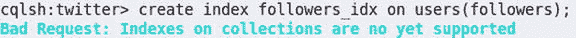

图 2-15.  Cassandra 2.0 不支持对集合创建索引

注意：不允许更新集群键和索引的数据类型。

### CQL3 与 Thrift 的互操作性

在 CQL 出现之前，Thrift 是在 Cassandra 上开发应用程序的唯一方式。CQL3 与 Thrift 的互操作性问题在 Cassandra 社区中经常被讨论。

让我们通过一个简单的例子来讨论一些问题：

首先，使用 CQL3 创建一个键空间和列族。

```
create keyspace cql3usage with replication = {'class' : 'SimpleStrategy' , 'replication_factor' : 3};
```

```
use cql3usage;
```

```
create table user(user_id text PRIMARY KEY, first_name text, last_name text, emailid text);
```

让我们插入一条记录：

```
insert into user(user_id,first_name,last_name,emailid) values('@mevivs','vivek','mishra','vivek.mishra@xxx.com');
```

现在，连接到 Cassandra-cli（Thrift 方式）并更新`user`列族，以在`last_name`和`first_name`上创建索引：

```
update column family user with key_validation_class='UTF8Type' and column_metadata=[{column_name:last_name, validation_class:'UTF8Type', index_type:KEYS},{column_name:first_name, validation_class:'UTF8Type', index_type:KEYS}];
```

注意：第 3 章将详细介绍索引。

现在用 CQL3 探索`user`列族，查看图 2-16 的结果。

```
describe table user;
```

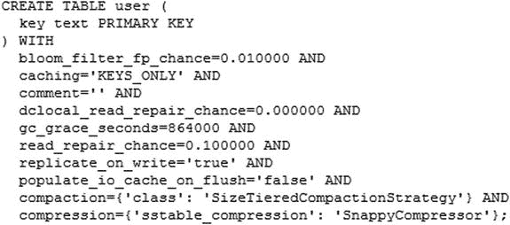

图 2-16.  描述表 user

元数据已经被更改，通过 Thrift 修改的列（`first_name` 和 `last_name`）在 CQL3 中不再可用！别担心！数据并没有丢失，因为 CQL3 和 Thrift 依赖于同一个存储引擎，我们可以通过重建它们来恢复这些元数据。

让我们重建`first_name`和`last_name`：

```
alter table user add first_name text;
```

```
alter table user add last_name text;
```

问题在于 CQL3 的稀疏表。CQL3 拥有不同的元数据（CQL3Metadata），而这些元数据并未被添加到 Thrift 的 CFMetaData 中。不要混合使用 CQL3 和 Thrift 来执行 DDL/DML 操作，这总会导致其中一种元数据处于不一致状态。

对于那些不能失去 Thrift 动态列支持的开发者，仍然倾向于通过 Thrift 执行插入操作，但通过 CQL3 读取它们。建议在新的 Cassandra 应用开发中使用 CQL3。然而，据观察，直到 Cassandra 1.x.x 版本，基于 Thrift 的突变（例如批量操作）仍然比 CQL3 更快。这个问题计划在 Cassandra 2.0.0 版本（`https://issues.apache.org/jira/browse/CASSANDRA-4693`）中解决。

### 更改数据类型

使用 Cassandra 更改数据类型有两种方式：Thrift 和 CQL3。


#### Thrift 方式

让我们更深入地讨论使用旧版 Thrift API 的数据类型：

让我们创建一个最小定义的列族，例如：

```
create keyspace twitter with strategy_options={replication_factor:1} and placement_strategy='org.apache.cassandra.locator.SimpleStrategy';
```

```
use twitter;
```

```
create column family default;
```

`comparator` 和 `validator` 的默认数据类型是 `BytesType`。

让我们描述一下 keyspace 并查看一下默认的列族（参见图 2-17）：

```
describe twitter;
```

让我们尝试在列族中存储一些数据：

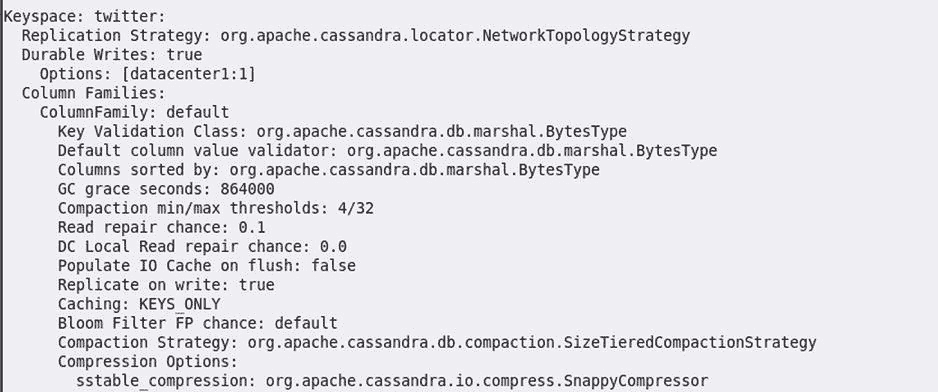

**图 2-17.** twitter keyspace 的结构

`set default[1]['type']='bytes';` 会报错

图 2-18 显示这将产生一个错误。

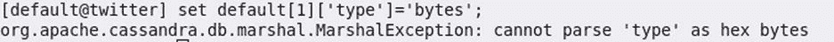

**图 2-18.** 存储字符串值时出错，但列值类型为 bytes

由于 `comparator` 和 `validator` 被设置为默认数据类型（即 `BytesType`），`Cassandra-cli` 无法解析和存储此类请求。

为了让第三步能够工作，我们需要使用 `assume` 函数来提供一些提示：

```
assume default keys as UTF8Type;
```

```
assume default comparator as UTF8Type;
```

```
assume default validator as UTF8Type;
```

现在让我们尝试将 comparator 从 `BytesType` 改为 `UTF8Type`：

```
update column family default with comparator='UTF8Type';
```

这会报错

这会产生一个错误，因为不允许更改 comparator 类型（参见图 2-19）。

虽然不允许更改 comparator 类型，但我们始终可以更改列和键验证类的数据类型，如下所示：

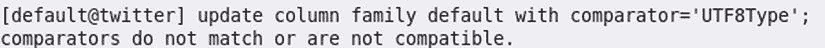

**图 2-19.** 不允许更改 comparator 类型

```
update column family default with key_validation_class=UTF8Type and default_validation_class = UTF8Type;
```

行中的列按列名排序，这就是 comparator 发挥关键作用的地方。根据 comparator 类型（即 `UTF8Type`、`Int32Type` 等），列可以按排序方式存储。

#### CQL3 方式

Cassandra CQL3 是当前的驱动因素。大多数高级 API 都在支持并围绕它进行进一步的扩展开发。

让我们讨论一些使用 CQL3 方式处理数据类型时的技巧。我们将使用以 Thrift 方式创建的默认列族进行探索（参见上一节）。

让我们尝试从默认列族中获取行（参见图 2-20）：

```
Select * from default;
```

让我们发出 `assume` 命令，并尝试以可读格式从默认列族中获取行：

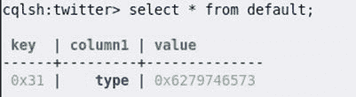

**图 2-20.** 使用 cql shell 检索值

```
assume default(column1) values are text;
```

```
assume default(value) values are text;
```

```
assume default(key) values are text;
```

```
select * from default;
```

图 2-21 显示了结果。

`typeAsBlob` 或 `blobAsType` 函数也可用于在运行 CQL3 查询时编组数据：

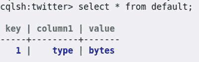

**图 2-21.** 应用 assume 函数后的检索结果

```
select blobAsText(key),blobAsText(type),blobAsText(value) from default;
```

我们可以如下更改验证器的数据类型：

```
alter table default alter value type text;
```

```
alter table default alter key type text;
```

> **注意：** `assume` 命令在 Cassandra 1.2.X 版本后将不可用。作为替代，我们可以使用 `typeAsBlob`（例如 `textAsBlob`）CQL3 函数。

### 计数器列

分布式计数器是跨多个节点分区的列的增量值。计数器列可用于为基于 Cassandra 的应用程序提供计数和聚合分析（例如，页面点击次数、活跃用户数等）。

在 Cassandra 中，计数器是一个 64 位有符号整数。对计数器的写入需要从副本节点读取（这取决于一致性级别，默认为 `ONE`）。在读取计数器列值时，读取必须是一致的。

#### 带和不带 replicate_on_write 的计数器列

`replicate_on_write` 的默认值是 `true`。如果设置为 `false`，它将只在一个副本节点上复制（无论复制因子如何）。这可能有助于避免在处理写入请求时进行读前写操作。但是，任何后续的读取可能不一致，并且还可能导致数据丢失（单个副本节点宕机！）。

#### 使用计数器列

在第 1 章中，我们讨论了在单台机器上设置多个集群。首先，让我们在单台机器上启动一个包含三个节点的集群。（请参考第 1 章中的“在单台机器上配置多个节点”部分。）在本节中，我们将讨论使用计数器列的注意事项。

让我们创建一个 keyspace `counterkeyspace`：

```
create keyspace counterkeyspace with replication = {'class' : 'SimpleStrategy', 'replication_factor' : 2 };
```

创建一个 `replicate_on_write` 为 `false` 的列族 `counternoreptable`：

```
create table counternoreptable(id text PRIMARY KEY, pagecount counter) with replicate_on_write='false';
```

将 `pagecount` 增加 2，如下所示：

```
update counternoreptable set pagecount=pagecount+2 where id = '1';
```

从列族中选择数据，如下所示：

```
select * from counternoreptable;
```

如图 2-22 所示，结果为零行。是否得到零行取决于它被写入到哪个节点。

让我们再为 `pagecount` 更新一些值并验证结果：

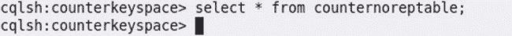

**图 2-22.** 从计数器表获取结果不一致

```
update counternoreptable set pagecount=pagecount+12 where id = '1';
```

```
select * from counternoreptable;
```

图 2-23 显示了此命令的结果。

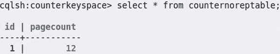

**图 2-23.** 递增计数器列值后从计数器表检索

```
update counternoreptable set pagecount=pagecount-2 where id = '1';
```

```
select * from counternoreptable;
```

此命令的结果不同（参见图 2-24）。

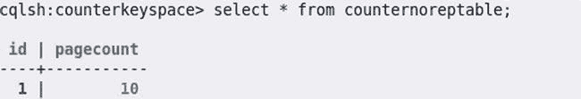

**图 2-24.** 无复制的计数器列结果不一致

你可以看到当 `replicate_on_write` 为 `false` 时读取结果不一致。由此可以得出结论，通过禁用此类参数，我们可以避免每个写入请求的读前写操作，但后续的读取请求可能会导致数据不一致。此外，如果没有复制，如果包含更新计数器值的单个副本节点宕机或损坏，我们可能会遭受数据丢失。尝试将上述方案中的 `replicate_on_write` 设置为 `true`，并监控结果是否一致且准确！

> **注意：** 你可以参考 [`issues.apache.org/jira/browse/CASSANDRA-1072`](https://issues.apache.org/jira/browse/CASSANDRA-1072) 以获取有关计数器列的更多信息。


### 数据建模技巧

Cassandra 是一种面向列的数据库，与传统的 RDBMS 截然不同。我们无需预先定义模式，但在开始数据建模之前，最好先充分理解需求和数据库，包括以下几点：

- Cassandra 的写入速度相对较快，但读取速度不快。在数据建模前，预先分析如何执行读取操作始终非常重要。
- 数据应尽可能地进行反范式化。
- 选择正确的分区策略，以避免因更新分区策略而需要重建或重新填充数据。
- 在建模表/列族时，优先使用代理键和复合键（而非超级列）。

### 总结

总结一下本章至今讨论的几个要点：

- 对于 DDL 和 DML 操作，不要混用 Thrift 和 CQL3，尽管读取操作通常没有问题。
- 避免更改数据类型。
- 利用 Cassandra 的集合支持来动态添加列。

在第 3 章中，我们将继续讨论索引、复合列以及 Cassandra 2.0 中引入的最新特性，例如比较并设置（Compare and Set）。

