# 3. 索引与复合列

在前几章中，我们讨论了大数据问题、Cassandra 数据建模概念以及各种模式管理技术。虽然应避免过度规范化数据形式，但在数据库应用程序中，你仍然需要围绕列（而非主键）来建模读取需求。

本章将涵盖以下主题：

- 索引概念
- 数据分区
- Cassandra 读写机制
- 二级索引
- 复合列
- Cassandra 2.0 的新特性

## 索引

数据库中的索引是一种用于更快检索表中数据集的数据结构。索引可以建立在单个或多个列上。

索引是创建和管理一种称为“索引”的数据结构的过程，用于快速数据检索。每个索引由索引字段值和指向物理记录的引用组成。在某些情况下，引用本身可能就是实际的行。我们将在“聚簇索引”部分讨论这些情况。

物理上，数据以数据结构形式（如 Cassandra 中的 `sstable`）存储在块上。这些数据块是无序的，并分布在多个节点上。如果没有主键或索引，访问数据记录将需要在多个节点间进行线性搜索。接下来，我们讨论索引数据结构的格式。

索引以排序顺序存储在 B-树（平衡树）结构中，其中索引是分支节点下的叶节点。图 3-1 展示了数据存储方式：多级叶节点（0,1）按排序顺序建立索引，而数据则无序存放。这里每个叶节点是一个包含多个键的 B-树节点。基于插入/更新/删除操作，每个 B-树节点的键数量会不断变化，但始终保持排序顺序。

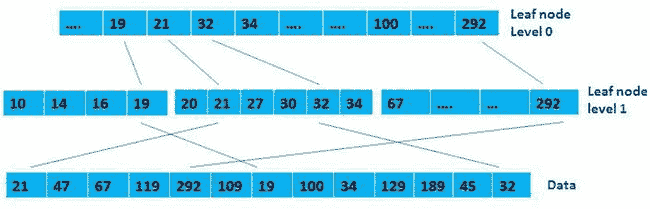

图 3-1. B-树索引与含多级叶节点的数据结构

让我们进一步简化。在图 3-2 中，包含年龄和行键的表是叶节点，另一个是物理表。

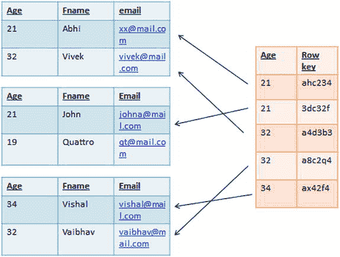

图 3-2. 物理表与作为叶节点的索引表

这使得通过二分查找可以更快地检索记录。由于 B-树为了更快的搜索而保持数据有序，这会在插入、更新和删除操作上引入一些开销，并需要重新排列索引。B-树是处理大量读写操作的首选数据结构，这也是它被广泛应用于分布式数据库的原因。

#### 聚簇索引 vs. 非聚簇索引

独立于物理行维护且不管理行排序的索引称为非聚簇索引（参见图 3-1）。相反，聚簇索引会按索引字段的排序顺序存储实际的行。由于聚簇索引会存储和管理物理行的顺序，因此每个表只能有一个聚簇索引。

关键问题是在哪些场景下应该使用聚簇索引和非聚簇索引。例如，一个部门可以有多个员工（多对一关系），并且通常需要按部门读取员工详细信息。这里，部门是聚簇索引的理想候选。所有包含员工详细信息的行将按部门进行存储和排序，以实现更快的检索。这里，员工姓名是非聚簇索引的完美候选，因此一个表中可以拥有多个非聚簇索引，但每个表始终只有一个聚簇索引。

#### 索引分布

在分布式数据库中，数据会被分布和复制到多个节点上。检索一个数据集需要从多个节点获取行。对非行键列建立索引也需要将这些索引分布到多个节点上，例如分片。长时间运行的查询可以从这种基于分片的索引中受益，以实现数据集的快速检索。

由于点对点架构，Cassandra 集群中的每个节点都持有相同的配置。数据复制、最终一致性和分区模式是数据分布的两个重要方面。

关于复制因子、策略类和读写一致性的更多详细信息，请参阅第 1 章。

#### Cassandra 中的索引

在 Cassandra 节点上，数据按行在本地存储。行分布在多个节点上，但特定行键的所有列都存储在同一个节点上。Cassandra 默认提供基于行键的主索引，以便通过行键进行快速检索。


#### 二级索引

基于列值的索引被称为**二级索引**。这些索引存储在物理数据所在的节点上，使 Cassandra 能通过索引更快速地检索数据。二级索引存储在一个隐藏的列族中，由节点自身进行内部管理。

让我们通过一个简单的练习进一步了解二级索引。

首先，创建一个键空间 `twitter` 和列族 `users`。

```
create keyspace twitter with replication = { 'class':'SimpleStrategy' , 'replication_factor':3};use twitter;
```

```
create column family users with key_validation_class='UTF8Type' and comparator='UTF8Type' and default_validation_class='UTF8Type';
```

```
create table users (user_id uuid primary key, first_name text, twitter_handle text);
```

使用 `create index` 语法在 `first_name` 上创建索引（见图 3-3）。

```
create index fname_idx on users(first_name);
```

描述表 `users`：

```
describe table users;
```

图 3-3 显示了在 `first_name` 上创建索引后的 `users` 模式。

在 `users` 列族中插入几行数据。

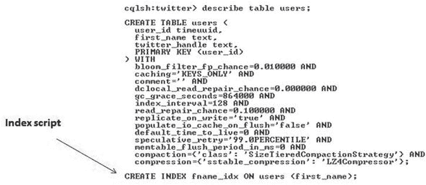

图 3-3.
在 first_name 上创建索引的 Users 表

```
insert into users(user_id,first_name,twitter_handle) values(now(),'apress','#apress_team');
```

```
insert into users(user_id,first_name,twitter_handle) values(now(),'jonathan','#jhassell');
```

```
insert into users(user_id,first_name,twitter_handle) values(now(),'vivek','#mevivs');
```

```
insert into users(user_id,first_name,twitter_handle) values(now(),'vivek','#vivekab');
```

尝试使用索引列 `first_name` 查找记录（见图 3-4）。

```
select * from users where first_name='vivek';
```

图 3-4 显示了查询名字为 `vivek` 的用户的结果。

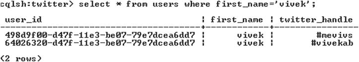

图 3-4.
通过 first_name 查询用户

在索引列 `first_name` 上查询值为 `'vivek'`（图 3-4）会返回两行数据。这两行数据可能位于同一个节点，也可能位于不同节点。

这里值得提及的一点是：索引也会和数据行一同存储在本地，从而确保数据本地性。

另一方面，如果我们尝试使用非索引列 `twitter_handle` 来获取数据行：

```
select * from users where twitter_handle='#imvivek';
```

会导致以下错误：

```
Bad Request: No indexed columns present in by-columns clause with Equal operator
```

让我们尝试另一种类型的示例：

添加另一个列 `age`：

```
alter table users  add age int  ;
```

为 `age` 更新几行数据：

```
update users set age = 21 where user_id = 498d9f00-d47f-11e3-be07-79e7dcea6dd7;
```

```
update users set age = 51 where user_id = 498b06f0-d47f-11e3-be07-79e7dcea6dd7;
```

在 `age` 列上创建索引：

```
create index age_idx on users(age);
```

现在，尝试获取年龄为 21 的用户的 `user_id`：

```
select user_id from users where age =21;
```

```
user_id
--------------------------------------
498d9f00-d47f-11e3-be07-79e7dcea6dd7
(1 rows)
```

接下来，尝试获取年龄大于 21 的用户：

```
select user_id from users where age >=21;
```

这会导致与前面示例相同的错误：

```
Bad Request: No indexed columns present in by-columns clause with Equal operator
```

二级索引只允许用户使用索引列进行“=”操作来检索记录。但实时应用通常需要对非行键列执行范围查询。

通常建议对基数低的列建索引，因为从集群中各个节点检索数据的概率非常高。而对于基数高的列，在高数据负载和大型 Cassandra 集群下可能会带来性能开销。如果数据量不大，对具有唯一值的列建索引应该没问题。此外，你可以开启跟踪来监控对二级索引的查询。通常，跟踪可用于调查 CQL3 查询。你可以按如下方式开启或关闭跟踪：

```
TRACING ON;
```

```
TRACING OFF;
```

从 1.2 版本开始，Cassandra 提供了复合列支持。利用复合列支持，可以对复合列进行范围扫描。

我们将在下一节进一步探讨复合列。


### 复合列

在集群中跨多个节点分布的细长行，辅以次级索引支持后，运行良好。但应用程序可能仍需要对获取的行应用排序顺序。在客户端对海量数据实现此类排序机制显然不可取。应用程序会依赖数据库来提供此类支持。

从 1.1 版本开始，Cassandra 通过复合列支持排序宽行。排序宽行意味着用更多列取代细长行，从而能以协同存储的方式容纳更多数据。

让我们用同样的 Twitter 示例来探索，其中用户及其推文应本地存储，并需要按特定顺序排序。

首先，创建一个键空间 `twitter` 和列族 `users`：

```
create keyspace twitter with replication = {'class':'SimpleStrategy','replication_factor':1};
```

```
use twitter;
```

```
create table users(user_id text,followers set<text>, tweet_date timestamp, tweet_body text, first_name text, PRIMARY KEY(user_id,tweet_date, first_name));
```

这里 `users` 表包含一个复合主键，由 `user_id`、`tweet_date` 和 `first_name` 组成。

让我们为 `user_id` 为 `'imvivek'` 的用户在 `users` 列族中存储一些列：

```
// 为 'imvivek' 插入记录
insert into users(user_id,tweet_date,tweet_body,first_name) values('imvivek','2013-12-31','good bye 2013','vivek');
insert into users(user_id,tweet_date,tweet_body,first_name) values('imvivek','2014-01-01','welcome 2014','vivek');
insert into users(user_id,tweet_date,tweet_body,first_name) values('imvivek','2014-01-04','Working on Cassandra book on weekend','vivek');
```

让我们为 `user_id` 为 `'jhassell'` 的用户在 `users` 列族中存储一些列：

```
// 为 'jhassel' 插入记录
insert into users(user_id,tweet_date,tweet_body,first_name) values('jhassell','2013-12-21','2013 bye bye','jonathan');
insert into users(user_id,tweet_date,tweet_body,first_name) values('jhassell','2014-01-01','2014! another exciting year','jonathan');
insert into users(user_id,tweet_date,tweet_body,first_name) values('jhassell','2014-03-25','Cassandra book, rolling out!','jonathan');
```

让我们尝试按 `tweet_date` 降序获取行（见图 3-5）。

```
select * from users where user_id='imvivek' order by tweet_date DESC;
```

图 3-5 的输出显示了按 `tweet_date` 排序的、`user_id` 为 `imvivek` 的行。

我们也可以查询 `users` 表来获取多个用户 ID 按推文日期排序的行，如下所示（见图 3-6）：

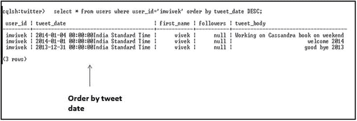

图 3-5. `user_id` 为 `imvivek` 的用户，按推文日期排序

```
select * from users where user_id in('imvivek','jhassell') order by tweet_date DESC;
```

图 3-6 显示了按 `tweet_date` 排序的用户 `imvivek` 和 `jhassel` 的行。

让我们更新几行 `followers` 数据，并探索内部数据结构会是什么样子：

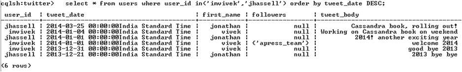

图 3-6. 这里我们使用 `in` 子句检索 `user_id` 为 `imvivek` 和 `jhassel` 的行

```
update users set followers = {'jhassell'} where user_id='imvivek' and tweet_date = '2013-12-31' and first_name = 'vivek';
update users set followers = {'jhassell'} where user_id='imvivek' and tweet_date = '2014-01-01' and first_name = 'vivek';
```

这里，`user_id` 将作为分区键，其余列 `tweet_date` 和 `first_name` 将作为聚簇键的一部分。让我们借助图 3-7 来查看存储的数据。

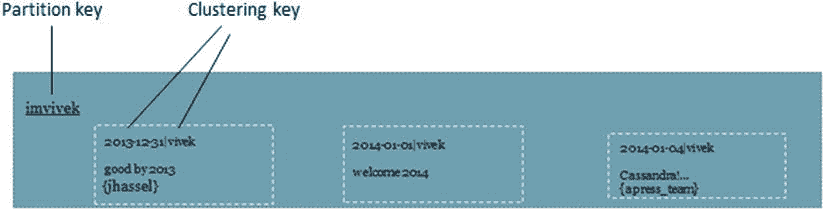

图 3-7. 复合列，其中 `imvivek` 为分区键，其余为聚簇键

在 Cassandra 上进行数据建模时，值得一提的一个重要点是：对聚簇键进行排序仅在分区键包含在 `EQ/IN` 子句中时才有效。因此，在定义表结构时，请确保需要排序的列是聚簇列的一部分。您也可以在创建表时指定聚簇顺序，如下所示：

```
create table users(user_id text,followers set<text>, tweet_date timestamp, tweet_body text, first_name text, PRIMARY KEY(user_id,tweet_date, first_name)) with clustering order by (tweet_date DESC);
```

这将确保聚簇数据按 `tweet_date` 降序排列。

### 允许过滤

正如“次级索引”一节所讨论的，次级索引的一个限制是只允许对索引列使用 `EQ` 运算符。如果非行键列被定义为聚簇列，我们可以对它们执行范围查询。下面的查询将正常工作，因为 `tweet_date` 是剩余聚簇键的一部分。

默认情况下，Cassandra 会限制此类查询的执行，并通过明确要求用户使用子句启用过滤功能，智能地告知用户此类查询的性能开销。

用户可以通过在 `select` 查询中显式添加 `ALLOW FILTERING` 子句来运行此类查询，如下所示：

```
select * from users where tweet_date>='2013-12-31' allow filtering;
```

图 3-8 显示了在启用允许过滤的情况下，按推文日期选择用户的输出。


图 3-8. 启用过滤选项后，获取推文日期大于或等于 2013 年 12 月 31 日的行

当大量数据分布在一个大型集群中时，如果分区键未出现在 `EQ/IN` 子句中，运行此类查询可能会降低应用程序性能。建议用户在运行此类查询之前先分析数据，而不是对特定的分区键执行一系列范围查询。


### 过期列

在 Cassandra 表中，我们也可以为每个列设置 TTL（存活时间）值。当超过设定的 TTL 后，该列会被逻辑删除并标记为过期，但内存只有在压缩时才会被释放。

例如，在银行系统中，每次请求会生成一个 OTP（一次性密码），并在一定时间后过期。对于此类场景，我们可以临时创建一个带有 TTL 值的列。

在 Cassandra 2.x 之前，只能通过插入和更新操作设置 TTL 值。现在，使用 2.x 版本，我们还可以为每个列族/表设置默认 TTL 值。为了存储 TTL 和过期时间，列族需要额外的八个字节。

让我们通过一个简单的练习来探索 TTL。

首先，创建一个键空间`demo`和列族`TTLSample`。

```
create keyspace demo with replication = {'class':'SimpleStrategy','replication_factor':1};
```

```
use demo;
```

```
create table "TTLsample"(user_id text PRIMARY KEY, OTP text, name text);
```

让我们在`TTLsample`表中插入一条记录，并将 TTL 值设置为 16 秒。

```
insert into "TTLsample"(user_id,OTP,name) values('imvivek','12121','vivek') using TTL 16;
```

运行上述查询后，`TTLsample`表中会存储一行数据，且每个列的 TTL 值都设置为 16 秒。

接下来，我们尝试在 16 秒前后分别获取该行数据。

```
select * from "TTLsample";
```

图 3-9 显示了 16 秒前后的输出结果。

你也可以通过`insert`或`update`操作为每个列设置 TTL 值。

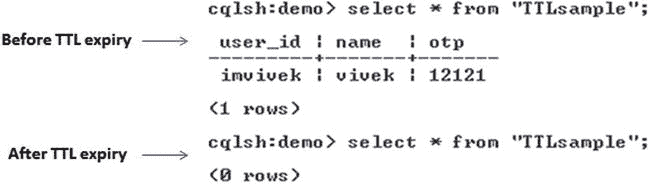
图 3-9. TTL 过期前后的输出结果

```
insert into "TTLsample"(user_id,name) values('imvivek','vivek');
```

```
insert into "TTLsample"(user_id,OTP) values('imvivek','12121') using TTL 16;
```

图 3-10 显示了`OTP`列在 TTL 过期前后的输出结果。

也可以在 TTL 过期之前重置 TTL 值。

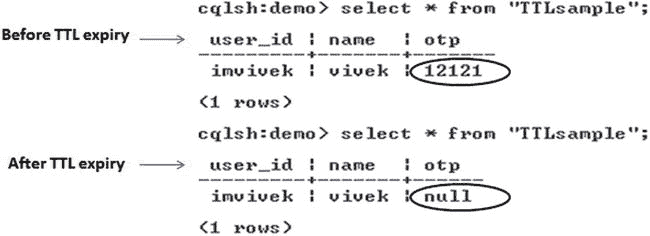
图 3-10. OTP 列在 TTL 过期前后的对比

```
insert into "TTLsample"(user_id,OTP) values('imvivek','12121') using TTL 160;
// OTP 在 160 秒后过期
```

```
insert into "TTLsample"(user_id,OTP) values('imvivek','12121') using TTL 16;
// 将过期时间重置为 16 秒
```

### 默认 TTL

使用 Cassandra 2.x，还可以为每个列族设置默认 TTL。

```
alter table "TTLsample" with default_time_to_live=10;
```

图 3-11 显示了默认 TTL 值设置为 10 秒。

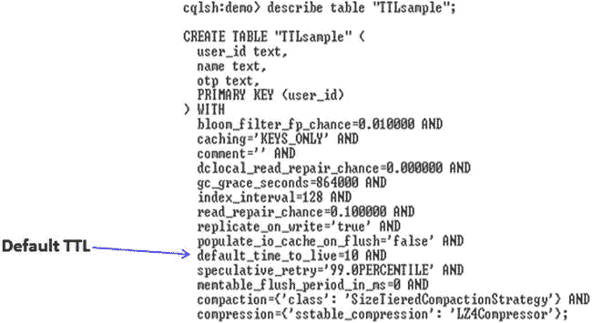
图 3-11. 输出结果显示默认 TTL 设置为 10 秒

### 数据分区

分区模式在节点间的数据分布中起着重要作用。Cassandra 提供了三种数据分区策略：

-   选择随机分区器将使用 MD5 哈希算法在节点间分布数据。随机分区器会在集群中均匀分布数据。数据分布依赖于分配的`initial_token`值或`num_tokens`将行分配到每个节点。MD5 哈希值为 16 字节，用于表示十六进制数字。每个节点被分配一个由令牌值表示的数据范围。当接收到读/写请求时，如果选择了随机分区器作为分区策略，会为每个行键生成哈希值，并将其分配给负责处理该读/写请求的节点。这就是随机分区下数据分布的方式。
-   默认分区器。与`RandomPartitioner`类似，但使用 Murmur 哈希函数计算令牌值。Murmur3 哈希表示 32 位或 128 位的值，在 Cassandra 中，它使用 128 位的值作为令牌。MD5 和 Murmur3 哈希的另一个区别在于，后者是非加密哈希，而 MD5 是加密哈希函数（例如，单向哈希）。
-   推荐用于顺序数据访问。使用此分区器时，数据会根据行键值在集群中的节点间分布。数据分布不均匀的频率较高，并且可能在特定范围内频繁写入时导致性能热点。

#### 更换分区器

在进行数据建模时，应提前决定分区策略。不允许在集群已经接收数据时更换分区器，否则 Cassandra 会抛出类似以下的错误：

```
ERROR 23:34:10,630 Cannot open \var\lib\cassandra\data\system\schema_keyspaces\system-schema_keyspaces-jb-1; partitioner org.apache.cassandra.dht.Murmur3Partitioner does not match system partitioner org.apache.cassandra.dht.RandomPartitioner.
```

请注意，从 Cassandra 1.2 开始，默认的分区器是`Murmur3Partitioner`，因此如果升级，你需要修改它以匹配旧的分区器。

#### 数据共置

每个行键的列会本地存储在该节点上。根据复制因子和策略，数据会在节点间进行复制。这确保了 Cassandra 的数据本地性和高可用性。

下面我们来讨论 Cassandra 中读写操作的工作原理。

##### Cassandra 写入

在点对点架构中，集群中的每个节点都有资格接收读/写请求。作为客户端和数据节点（负责处理写请求的节点）之间代理或委派者的节点称为协调节点。收到写请求后，列会首先写入提交日志，然后写入分配给该节点上的内存表。根据提供的一致性级别，会向客户端发送确认。

基于`memtable_total_space_in_mb`，数据会以 SSTable 的形式刷新到磁盘。当超过该限制时，最大的内存表会被刷新到磁盘。图 3-12 展示了 Cassandra 插入和更新的图示。

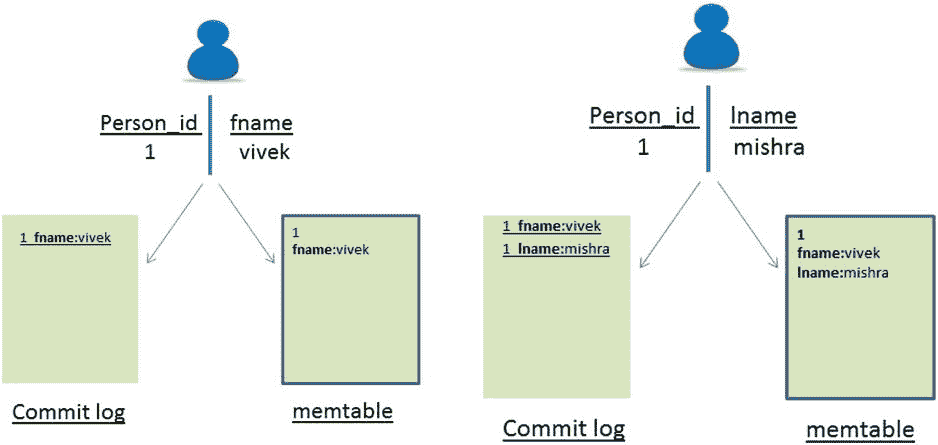
图 3-12. a) 左侧图片，为 id 1 插入`fname`；b) 右侧图片，为 person id 1 更新，添加列`lname`

在图 3-12a 和 3-12b 中，列`fname`和`lname`存储在连续的写入列请求中。每个内存表是一个列族的内存表示。而提交日志会按相同顺序保留数据。为 Person 列族插入一条记录会持续将其添加到对应的内存表中。例如，为行键 1 添加另一列`age`并更新`fname`，会修改数据结构，如图 3-13 所示。

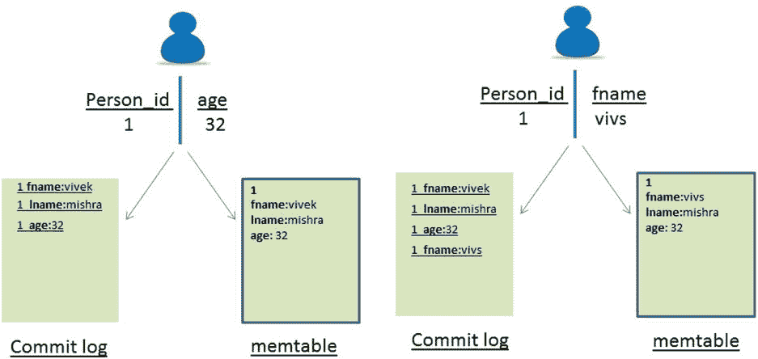
图 3-13. a) 左侧图片显示添加了值为 32 的`age`列；b) 右侧图片显示将 person id 1 的行中的`fname`列值更新为 vivs

图 3-13a 和 3-13b 分别展示了插入`age`列和修改`fname`列的情况。请注意，Cassandra 提供更快的写入吞吐量，因为没有更新操作，只有插入操作。但是，基于时间戳，具有最新时间戳的行将作为输出返回。这里的时间戳由 Cassandra 内部管理。压缩过程将通过删除过期或墓碑行来管理空间释放。在 2.x 版本中，Cassandra 提供了比较并设置（CAS）支持。我们将在后面的“比较并设置”部分讨论这一点。


### Cassandra 读取操作

协调节点的选择以及将读取请求分配给数据节点的过程与写入请求类似。Cassandra 会为特定行键返回具有最新时间戳的列。Cassandra 在内部执行以下步骤来返回列名和值：

-   首先搜索 `memtable` 缓存中的值
-   使用布隆过滤器的行键扫描 `sstables` 以查找列
-   根据最新时间戳对符合条件的 `sstables` 进行排序
-   合并并返回具有最新时间戳值的列

我们将在第 8 章中详细讨论布隆过滤器。

图 3-14 展示了读取操作如何与 Cassandra 存储架构协同工作。

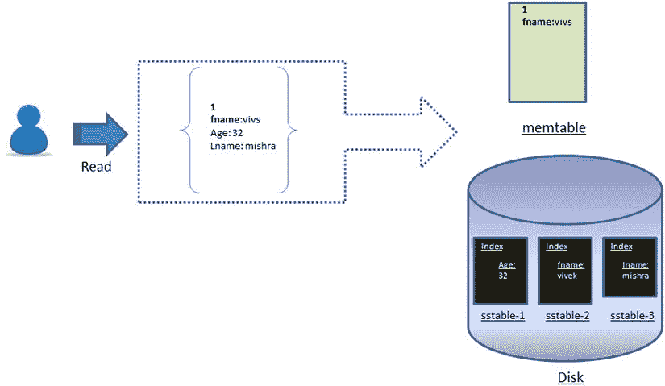

**图 3-14.** Cassandra 的读取机制

### Cassandra 2.0 的新特性

Cassandra 2.0 及后续版本带来了许多新功能，并在 CQL3 方面进行了大量性能增强。Cassandra 2.0 引入了对与索引和组合列相关的若干关键能力的支持，包括：

-   比较并设置 (CAS)
-   组合列上的二级索引
-   条件 DDL

> **注意：** 在本书付印前，Cassandra 2.1 已发布。有关 2.1 版中若干重要新功能的信息，请参阅第 1 章。

### 比较并设置

通过最终一致性和复制支持，事务数据可以保持一致性且高可用。但在某些情况下，应用程序可能需要在多个线程之间独立访问数据，例如，应用程序需要生成唯一的 OTP（一次性密码）并希望避免竞态条件。从 2.x 版本开始支持比较并设置 (CAS)。

> **注意：** Cassandra 中的 CAS 支持基于 Paxos 算法。更多详细信息，请参考 [`http://en.wikipedia.org/wiki/Paxos_(computer_science)`](http://en.wikipedia.org/wiki/Paxos_(computer_science))。

#### 算法

比较并设置操作需要从副本节点读取最新值，充当协调器的节点称为领导者。领导者将协调副本节点执行以下任务：

1.  准备令牌和承诺
2.  向副本发出读取请求并接收带有最新令牌的输出
3.  提议更新后的值并获得接受
4.  向每个副本发出提交请求并接收确认

#### 使用 CAS

每个 CAS 操作都需要多次数据库往返；因此，建议仅在有限需求下使用此类操作，以避免性能开销。

让我们用同样的 Twitter 示例来使用 CAS。

首先，创建一个键空间 `twitter` 和列族 `users`：

```
create keyspace twitter with replication={'class':'SimpleStrategy','replication_factor': 1 };
```

```
use twitter;
```

```
create table users(user_id text primary key,followers set<text>, tweet_date timestamp, tweet_body text, first_name text);
```

让我们使用 `if not exists` 命令为行键 `imvivek` 插入一条记录：

```
insert into users(user_id,tweet_date,tweet_body,first_name) values('imvivek','2013-12-31','good bye 2013','vivek')  if not exists;
```

让我们将 `first_name` 改为 `vivek_update` 后重新运行相同的命令：

```
insert into users(user_id,tweet_date,tweet_body,first_name) values('imvivek','2013-12-31','good bye 2013','vivek_update')  if not exists;
```

在图 3-15 中，由于在执行步骤 2 的命令之前表是空的且不存在任何记录，因此操作成功应用，但在步骤 3 中失败了。

让我们尝试使用 CAS 来更新用户，为 first_name 为 `vivek` 的用户添加关注者：

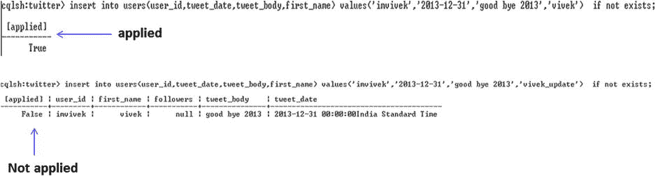

**图 3-15.** 如果不存在则插入 id 为 imvivek 的行的 CAS 操作

```
update users set followers = {'apress'} where user_id='imvivek' if first_name='vivek'
```

```
select * from users;
```

图 3-16 显示了使用 CAS 更新操作后检索记录的结果。

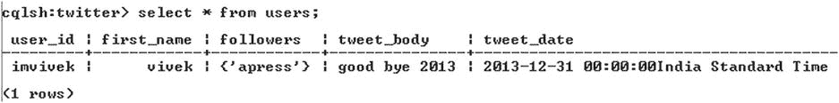

**图 3-16.** 使用 CAS 操作成功更新后的行

### 组合列上的二级索引

从 Cassandra 2.x 开始，Cassandra 允许在聚类键上创建二级索引，这使得用户可以使用 EQ 运算符运行查询。在 2.x 之前，只有当 `where` 子句中存在前一个聚类键部分时，才能在 `where` 子句中包含剩余的聚类键。

让我们使用在“组合列”部分讨论过的同一个 Twitter 示例。

首先，创建一个键空间 `twitter` 和列族 `users`：

```
create keyspace twitter with replication = {'class':'SimpleStrategy','replication_factor':1};
```

```
use twitter;
```

```
create table users(user_id text,followers set<text>, tweet_date timestamp, tweet_body text, first_name text, PRIMARY KEY(user_id,tweet_date, first_name));
```

让我们为 `user_id` 为 `imvivek` 的 `users` 列族存储几列数据：

```
// 为 'imvivek' 插入记录
insert into users(user_id,tweet_date,tweet_body,first_name) values('imvivek','2013-12-31','good bye 2013','vivek');
insert into users(user_id,tweet_date,tweet_body,first_name) values('imvivek','2014-01-01','welcome 2014','vivek');
insert into users(user_id,tweet_date,tweet_body,first_name) values('imvivek','2014-01-04','Working on Cassandra book on weekend','Vivs');
```

在 `first_name` 上添加索引并检索 first_name 为 `vivek` 的记录：

```
create index on user(first_name);
```

```
select * from users where first_name = 'vivek';
```

图 3-17 显示了在启用二级索引后，通过聚类列 `first_name` 获取数据的结果。

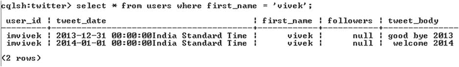

**图 3-17.** 在聚类列 first_name 上启用二级索引后获取记录

### 条件 DDL

从 Cassandra 2.x 开始，现在可以对键空间、表和索引执行条件 DDL 操作。条件 DDL 允许用户验证所查询的键空间、列族或索引是否存在。让我们看几个例子来说明其工作原理。

**键空间**

-   如果键空间 `twitter` 不存在则创建它：

```
create keyspace if not exists twitter with replication = {'class':'SimpleStrategy', 'replication_factor': 3};
```

-   如果键空间 `twitter` 存在则删除它：

```
drop keyspace if exists twitter;
```

**表**

-   如果表 `users` 不存在则创建它：

```
create table if not exists users(user_id text,followers set<text>, tweet_date timestamp, tweet_body text, first_name text, PRIMARY KEY(user_id,tweet_date, first_name));
```

-   如果表 `users` 存在则删除它：

```
drop table if exists users;
```

**索引**

-   如果在 `users` 表的 `first_name` 列上不存在索引则创建它：

```
create index if not exists users_first_name_idx on users(first_name);
```

-   如果索引 `users_first_name_idx` 存在则删除它：

```
drop index if exists users_first_name_idx;
```

### 总结

在本章中，我们讨论了数据建模和索引概念及其在 Cassandra 中的使用。总结一下，有几个要点值得重申：

-   索引存储在数据节点本地。
-   对列值的更新是原子操作，包括索引的更新。
-   避免在高基数列值上使用二级索引。
-   过多的索引会降低写入性能，应予以避免。应尝试对数据模型进行反规范化，或使用组合列。

有了数据模型之后，在使用 Cassandra 设计应用程序时自然而然会想到的下一个问题是数据安全。第 4 章将讨论数据加密/解密以及 Cassandra 可用的安全选项。


