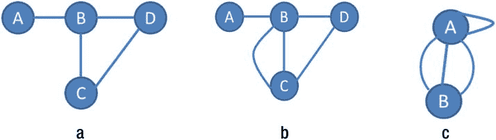
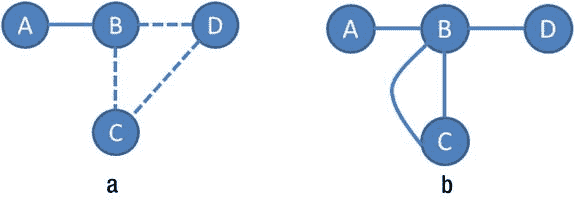
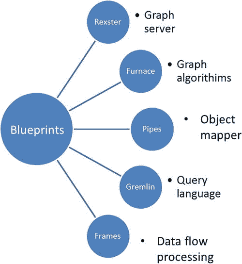
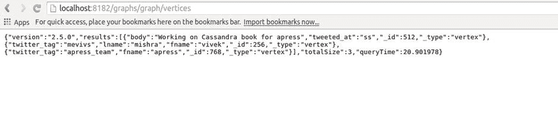
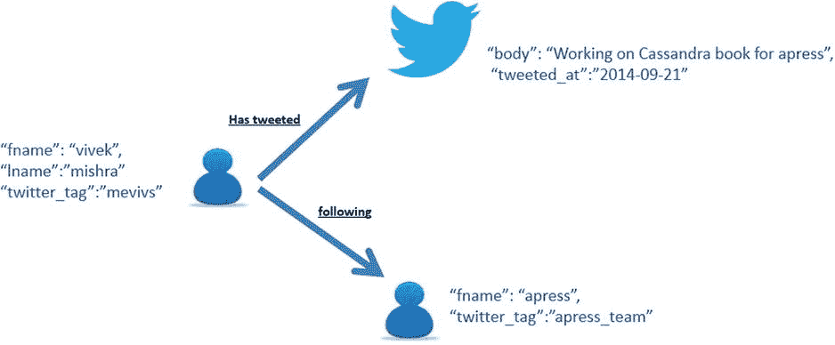

# 7. 结合 Cassandra 的 Titan 图数据库

到目前为止，我们已经讨论了 Cassandra 中的数据建模，以及使用 Hadoop 和相关技术构建大型数据分析平台。当业务需求要求各种对象之间存在互联性时，答案是在多个对象之间进行引用（连接）查询。一切看起来很美好，直到我们不得不处理许多此类关系，或者数据量变得非常庞大。

LinkedIn、Twitter 和 Facebook 都是典型的例子，其中注册用户之间的关系可以描述为一个社交图谱。另一个例子可能是构建信用历史，并对向一组客户发放贷款进行风险分析。当然，使用多个表和连接理论，我们可以实现一个解决方案，但它显然不具备可扩展性和高性能。这正是使用图数据库的想法大显身手的地方。

在本章中，我们将讨论：

-   图概念简介
-   图框架与数据库
-   Titan 图数据库的安装与设置
-   图用例

## 图简介

图论可以追溯到 1736 年。图是一种由顶点/节点和边组成的数据结构。一个图可以有零条或多条边。没有边的图也称为空图。

顶点是一个图节点，它通过边连接到其他图节点/顶点。每条边是一条弧或线段，用于连接多个顶点。

在计算机科学中，图可以按多种方式进行分类。其中一些流行的分类包括：

-   简单图与非简单图
-   有向图与无向图
-   有环图与无环图

### 简单图与非简单图

简单图，顾名思义，是一种基本的图，其任意两个顶点之间最多只有一条边。它是一个没有自环但有多节点的图（见图 7-1a）。另一方面，有自环和多条边的图是非简单图（见图 7-1b）。这里，自环是一条连接到顶点自身的边。在同两个节点之间有多条边的图也称为多重图或并行图。图 7-1c 所示的图既是一个多重图也是一个自环图。它在顶点 A 上包含一个自环，并且在顶点 A 和 B 之间有多条边。



**图 7-1.** a) 左侧为简单图；b) 中间为非简单图；c) 带自环的多重图

### 有向图与无向图

具有多个节点和有向边的图是有向图（见图 7-2a）。无向图是边没有方向的图（见图 7-2b）。


**图 7-2.** a) 左侧为有向图，带有有向边；b) 无向图

### 有环图与无环图

如果一个图沿着一条路径（至少包含一条边）遍历，并且起点和终点在同一个顶点上，则称该图包含一个环，而非环或无环图则不包含任何环。此类图可以是有向的或无向的。图 7-3 展示了有环图和无环图的图形表示。



**图 7-3.** a) 虚线显示了图中的一个环；b) 无环图

图 7-3a 表示一个有环图，其中的环由连接顶点 B、C 和 D 的虚线表示。

这些是几种基本的图类型。接下来可能会想到的问题是，是否有专门为处理图相关问题而构建的开源工具、框架或数据库？

## 用于图的开源软件

开源软件是免费的，易于提交错误报告并根据我们的需求请求功能修改，最重要的是成本效益高。近年来，在 IT 行业使用开源软件变得流行起来，越来越多的组织倾向于使用开源解决方案。在采用开源解决方案之前需要考虑的几个因素是：

-   应该成熟稳定
-   应该处于积极开发中，并且必须有社区支持
-   必须有生产环境中的系统来验证行业应用

我们之前问过是否有解决图相关问题的工具、框架或数据库。那么，让我们来探索一下吧！

### 图框架：TinkerPop

图框架用于图数据建模和可视化。在本节中，我们将讨论 TinkerPop（[`www.tinkerpop.com/`](http://www.tinkerpop.com/)）及其功能集。许多 NoSQL 数据库（包括 Titan）都将 TinkerPop Blueprints 用作规范。Blueprints 为图数据建模提供了一套接口和实现，稍后将在本节中进行讨论。

TinkerPop 是一个开源图计算框架，拥有多个组件、框架和命令行工具，用于处理图数据建模和可视化。在本节中，我们将逐一讨论它们。

# Pipes

`Pipes` 是一个数据流框架，能够实现从输入到输出的数据拆分、合并、过滤和转换。计算以节省内存的惰性方式进行评估。

将 `Pipes` 视为由边连接的顶点，通常具有用于数据提取、转换和计算的函数。

# Gremlin

Gremlin 是一种图遍历语言，用于图查询、分析和操作。Gremlin 发行版内置了对 Java 和 Groovy 的 API 支持。我们将在本章后面的“命令行工具和客户端”部分详细讨论与 Titan 相关的 Gremlin。

# Frames

`Frames` 将 `Blueprints` 图的元素暴露为 Java 对象。通过 `Frames`，软件不再以顶点和边的方式来编写，而是以领域对象及其相互关系的方式来编写。

# Rexster

`Rexster` 是一个多功能的图服务器，它通过多种机制（主要侧重于 REST）暴露任何 `Blueprints` 图。它通过 REST API 和 `RexPro` 协议暴露图服务器。`RexPro` 是 `Rexster` 的一种二进制协议，可用于将 `Gremlin` 脚本发送到远程的 `Rexster` 实例。脚本在服务器上处理，结果被序列化并返回给调用客户端。它还提供了基于浏览器的界面工具，称为 Dog House 和 `Rexster` 控制台（后者将在 Titan 生态系统中讨论）。

# Furnace

`Furnace` 是一个属性图算法包。它提供了标准图分析算法的实现，这些算法可以以有意义的方式应用于属性图。`Furnace` 提供了针对不同图计算场景（如单机图和分布式图）而优化的不同图算法实现。

> **注意：** 单机图涉及单个节点上的图数据，而分布式图则将数据分布在多个节点上。

# Blueprints

正如其名，`Blueprints` 是一个属性图模型接口，并提供了相应的实现。实现了 `Blueprints` 接口的数据库会自动支持启用 `Blueprints` 的应用。

可以将 `Blueprints` 视为图数据库的 JDBC（Java 数据库连接）或 JPA（Java 持久化 API） API。大多数图数据库都实现了 `Blueprints`。图 7-4 展示了如何将 `Blueprints` 与前面提到的 TinkerPop 组件结合起来的可视化表示。



**图 7-4.** TinkerPop Blueprints 实现

至此，我们已经涵盖了 TinkerPop 框架及其组件，以及其他与图相关的概念。下一个问题是，是否存在可以被视为图数据库的基于图的解决方案。在下一节中，我们将回答这些问题。

## 图即数据库

与传统的 RDBMS 相比，NoSQL 数据库更少关注模式，更多关注非规范化的数据形式。但图数据库提供了通过边定义节点之间关系的灵活性，这就是为什么可以很容易地根据 RDBMS 概念来理解它们。使用 RDBMS 构建类似图的查询当然是可能的，但如前所述，其用途非常有限。对于非图数据库，运行基于图的查询以进行遍历或构建图结构的能力不受支持，并且构建起来可能很繁琐。由于固有的图数据结构支持，图数据库将比传统的 RDBMS 更具优势。

RDBMS 和图数据库之间的一些区别如下：
*   图数据库无需索引查找，因为节点或顶点知道它们所连接的属性（例如边），而 RDBMS 则需要依赖索引机制。
*   通过边相互连接的两个顶点可能在属性上有所不同，并且可以动态演变，但 RDBMS 强加了一套固定的模式。
*   在图数据库中，两个顶点之间的关系存储在记录级别，而在 RDBMS 中，它是在表级别定义的。

我们需要记住一件事，当前的应用开发时代是为特定需求使用特定技术的时代，这非常适合构建多语言或混合解决方案。这意味着，当你的需求最适合通过运行类似图的查询来满足，并且你的要求倾向于更快的基于图的模型时，答案很简单：使用图数据库。图数据库使用节点和边及其属性来构建数据并将其存储在图结构中。图数据库中的每个元素都有一个对相邻节点的引用，这意味着不需要索引查找。图 7-4 展示了一个图数据库的示例，它将 Twitter 用户存储为节点，将其关注者存储为边。每个节点包含 `fname`、`id`、`lname` 和 `role` 作为属性，而每条边都有一个属性来表示用户成为其相邻节点（即用户）关注者的日期。


**图 7-5.** 存储 Twitter 用户、其属性和关注者的图数据库

图 7-5 展示了用户 `mevivs`、`chris_n`、`apress_team` 和 `melissa_m` 的 Twitter 连接和关注者图。这里，顶点 `apress_team` 被顶点 `mevivs` 和 `melissa_m` 关注。另一方面，在 `chris_n` 和 `apress_team` 之间存在一个传递关系/遍历，`chris_n` 关注了 `mevivs`，`mevivs` 关注了 `apress_team`，而 `apress_team` 又关注了 `chris_n`。在“Gremlin Shell”和“用例”部分，我们将引用相同的 Twitter 示例来探索示例练习中的命令行工具和 Java API。在考虑此类传递性图查询时，值得讨论的一点是图数据库处理此类查询的方式与 SQL 查询不同。使用 SQL 处理此类传递性查询并不直接，需要执行复杂的连接、并集或交集。但是，使用图数据库处理此类传递性查询要容易得多，只需要根据边的属性跟踪边以进行传入和传出的数据查询即可。“用例”部分将讨论这些图遍历。

让我们来谈谈可用的图数据库。一些流行的图数据库包括：
*   Neo4J
*   OrientDB
*   Objectivity 的 InfiniteGraph
*   Titan

由于本章的目的是详细讨论 Cassandra 和 Titan 图数据库，因此我们只讨论此处提到的其他数据库提供的重要功能。

### Neo4J

Neo4J ([www.neo4j.org/](http://www.neo4j.org/)) 是一个基于 GPU（通用公共许可证）许可的开源数据库。它由 Neo Technology Inc. 开发。它以节点的形式存储数据，节点通过有向边连接。它提供的一些重要功能包括：
*   可扩展且高可用的数据
*   完全的 ACID 事务支持
*   基于 REST 的访问
*   支持 `Cypher` 和 `Gremlin` 图查询语言

### OrientDB

OrientDB ([www.orientechnologies.com/orientdb/](http://www.orientechnologies.com/orientdb/)) 是一个基于 Apache 2 许可的 NoSQL 图数据库。它由 Orient Technologies 的 Luca Garulli 管理和开发。OrientDB 提供的一些重要功能包括：
*   基于 REST 的访问
*   完全的 ACID 事务支持
*   用于查询支持的类似 SQL 的接口

### InfiniteGraph

InfiniteGraph ([www.infinitegraph.com/](http://www.infinitegraph.com/)) 是由 Objectivity Inc. 构建的企业级分布式图数据库。InfiniteGraph 支持的一些重要功能包括：
*   支持并发性和一致性
*   完全的 ACID 事务支持
*   可视化工具

#### Titan

`Titan`（`thinkaurelius.github.io/titan/`）是一个基于 Apache 许可的可扩展图数据库，用于以节点和边的形式存储大量数据。它支持 `Cassandra` 作为后端存储。其一些重要特性包括：
- 通过 `Lucene`/`ES` 支持全文搜索和地理空间查询
- 支持 `ACID`
- 最终一致性和中间一致性
- 支持多种数据库，适用于多语言图应用
- 支持 `Gremlin` 和 `Cypher`

`Titan` 及其各个组件将在后续章节中讨论。

## Titan 图数据库

`Titan` 是一个事务性图数据库，允许数千名并发用户实时执行复杂的图遍历查询。它还通过 `Hadoop` 集成提供了图数据分析、报表和 `ETL` 支持。它内建了对 `Elasticsearch` 和 `Lucene` 的支持，用于地理空间查询和全文搜索。它还原生支持 `Blueprint` `TinkerPop` 图栈。

图 7-6 展示了 `Titan` 生态系统的图形化表示。


图 7-6. Titan 生态系统

### 基本概念

在本节中，我们将介绍一些对理解 `Titan` 图数据库至关重要的基本概念。

#### 以顶点为中心的索引

以顶点为中心的索引特定于某个顶点。大多数对引用或非引用顶点的遍历都是通过边及其属性进行的。对这些属性或边标签进行索引可以避免性能开销。这类索引也可称为局部索引。以顶点为中心的索引的目的是根据边的属性和标签对顶点的邻接边进行排序和索引。

`Titan` 还支持 `Elasticsearch`，它可以以独立模式或内嵌模式与 `Titan` 一起运行。使用 `Elasticsearch` 还可以执行全文搜索、地理空间查询和数值范围查询。`Elasticsearch` 也允许我们对未索引的属性进行查询。

#### 边压缩

通过边压缩，`Titan` 可以存储压缩后的元数据并保持较低的内存占用。它还可以将所有边的标签和属性存储在同一数据块中，以实现更快的检索。

#### 图分区

这是底层数据库最为关键的地方。在 `Cassandra` 中，我们知道某一行数据会存储在单个 `Cassandra` 节点上。`Titan` 理解，通过按顶点 ID 排序键，它可以有效地对图数据进行分区并分布到 `Cassandra` 节点上。顶点 ID 是一个 64 位的唯一值。

默认情况下，`Titan` 采用随机分区策略，将顶点随机分配给节点。随机分区效率高，且能使集群保持平衡，但如果采用多种后端存储来存储图，则会导致性能问题，并需要在实例之间进行跨数据库通信。使用 `Titan`，我们还可以配置显式分区。通过显式分区，我们可以控制并将遍历的子图存储在同一节点上。

我们可以按如下方式在 `Titan` 中启用显式分区：

```
cluster.partition = true
cluster.max-partitions = 16
ids.flush = false
```

这里 `cluster.max-partitions` 是每个集群的最大分区数。同时，我们还需要禁用刷新 ID。

当使用 `Cassandra` 作为存储后端选项时，必须使用 `ByteOrderedPartitioner` 进行配置。

`Titan` 将顶点及其邻接边和属性存储为一个集合。这种机制称为“数据并置”。通过这种机制，连接到某个顶点的边及其属性将被存储在一起。每一行将包含一个顶点 ID 作为键，邻接边和属性作为单元格。这种数据表示格式在所有支持的数据库中都是通用的。

图 7-7 和 7-8 展示了 `Titan` 的数据布局和边存储机制。（图片来源于 `https://github.com/thinkaurelius/titan/wiki/Titan-Data-Model` 上的 `Titan` 维基页面，并依据 Apache 许可证 2.0 版本重复使用，许可证地址为 `http://www.apache.org/licenses/LICENSE-2.0`。）


图 7-8. Titan 的边存储机制


图 7-7. Titan 的数据布局机制

底层数据存储会将每个顶点及其邻接边和属性存储为单行数据。此外，这些行将按顶点 ID 排序，单元格将按属性和边键排序。动态单元格可以在运行时添加。数据并置非常重要，这就是为什么将顶点和邻接边存储为单行有助于实现高可用性。

#### 后端存储

`Titan` 的存储架构是完全解耦的，支持多种 NoSQL 数据库，包括：
- `Cassandra`
- `HBase`
- `BerkeleyDB`
- `Persistit`

支持多种 NoSQL 数据存储允许根据应用需求选择合适的技术。换句话说，您可以根据特定需求选择特定的技术。基于 CAP 定理，我们可以选择任何一种支持的数据库。

使用 `Titan`，我们可以通过 `storage.backend` 选项动态配置后端存储。本章中的示例将介绍如何结合 `Cassandra` 使用此选项。

#### 事务处理

`Titan` 是一个事务性图数据库，因此每个读/写操作都将在事务边界内发生。

以下代码片段展示了 `Titan` 如何将顶点 `mevivs` 包裹在事务边界内并提交它：

```
TitanGraph g = TitanFactory.open("/home/vivek/Titan");
Vertex mevivs = g.addVertex(null); //隐式包裹在事务中
mevivs.setProperty("fname", "vivek");
g.commit(); //提交事务
```

在处理非常大量数据和多语言场景时，可能会发生永久性或临时性故障。这里的临时性故障包括网络故障、节点无响应等类似情况。在这种情况下，我们可以像这样配置 `Titan` 的重试延迟属性：

```
Configuration conf = new BaseConfiguration();
conf.setProperty("storage.attempt-wait", 250); // 时间单位为毫秒
```

此类临时性故障可以通过重试来处理，但永久性故障（例如硬件故障）则需要用户显式处理 `TitanException`：

```
try
{
    TitanGraph g = TitanFactory.open("/home/vivek/Titan");
    Vertex mevivs = g.addVertex(null); //隐式包裹在事务中
    mevivs.setProperty("fname", "vivek");
    g.commit(); //提交事务
} catch (TitanException e) {
    //配置显式重试或快速失败场景。
}
```

以上是 `Titan` 的基本概念及其架构。接下来，我们将介绍 `Titan` 图数据库的搭建和安装。

### 安装与搭建

我们可以从 `https://github.com/thinkaurelius/titan/wiki/Downloads` 下载最新的 `Titan` 发行版。写作时的最新版本是 0.5.0。下载发行版后，将其解压到本地文件夹。在本章中，我们将在多处引用 `TITAN_HOME` 变量。我们可以按如下方式设置它：

```
export TITAN_HOME=/home/vivek/software/titan
```

### 命令行工具与客户端

完成搭建和安装后，首先想到的问题是：是否有任何命令行客户端？就像 `Cassandra` 有 `CQL` `shell` 一样，`Titan` 是否也提供了用于服务端脚本编写和快速分析的选项？本节将探讨 `Gremlin` `shell` 和 `Rexster` 这两个命令行选项。

# Gremlin Shell

Titan 支持通过 Gremlin Shell 使用 Gremlin 查询语言进行图遍历和变更操作。这是一种函数式语言，每一步都会输出一个对象，通过`.`（点号）我们可以调用该对象的相关函数。例如：

```
gremlin> conf = new BaseConfiguration() // 第一步
==>org.apache.commons.configuration.BaseConfiguration@2d3c117a
gremlin> conf.setProperty("storage.backend", "cassandrathrift") // 第二步
```

这里 `conf` 是第一步中创建的 `Configuration` 对象，它的函数在第二步中被调用。

接下来，我们通过一个练习来讨论 Gremlin。在本教程中，我们将沿用之前的 Twitter 示例，其中用户的推文将作为图的顶点，用户与其推文及关注者之间的关系将作为边。在本例中，我们将使用 Cassandra 作为后端存储选项。你可以选择运行一个独立的 Cassandra 服务器；否则，默认情况下，它会启动并连接到一个内嵌的 Cassandra 实例。

接下来，我们需要初始化一个配置对象，并设置一些 Cassandra 特有的属性：


**图 7-9.** 连接到 Gremlin Shell

首先，我们需要像图 7-9 那样连接到 Gremlin。

```
gremlin> conf = new BaseConfiguration()
==>org.apache.commons.configuration.BaseConfiguration@2d3c117a
gremlin> conf.setProperty("storage.backend", "cassandrathrift")
==>null
gremlin> conf.setProperty("storage.hostname", "localhost")
==>null
gremlin> conf.setProperty("storage.port", "9160")
==>null
gremlin> conf.setProperty("storage.keyspace", "twitter")
==>null
```

接着，获取一个 Titan 图对象：

```
gremlin> graph = TitanFactory.open(conf)
==>titangraph[cassandrathrift:localhost]
```

让我们创建一些顶点键和边标签：

```
gremlin> graph.makeKey("fname").
dataType(String.class).indexed(Vertex.class).make()
==>fname
gremlin> graph.makeKey("lname").
dataType(String.class).indexed(Vertex.class).make()
==>lname
gremlin> graph.makeKey("twitter_tag").
dataType(String.class).indexed(Vertex.class).make()
==>twitter_tag
gremlin> graph.makeKey("tweeted_at").
dataType(String.class).indexed(Vertex.class).make()
==>tweeted_at
gremlin> graph.makeLabel("has_tweeted").make()
==>has_tweeted
gremlin> tweet.setProperty("body", "Working on Cassandra book for apress")
==>null
gremlin> tweet.setProperty("tweeted_at", "2014-09-21")
==>null
```

这里 `fname`、`lname` 和 `twitter_tag` 是顶点键，而标签 `has_tweeted` 将在下一步中用于边。

让我们为用户和推文创建顶点：

```
gremlin> vivs = graph.addVertex(null)
==>v[4]
gremlin> vivs.setProperty("fname", "vivek")
==>null
gremlin> vivs.setProperty("lname", "mishra")
==>null
gremlin> vivs.setProperty("twitter_tag", "mevivs")
==>null
gremlin> graph.V("fname","vivek")
==>v[4]
gremlin> tweet = graph.addVertex(null)
==>v[8]
```

接下来，在这两个顶点之间添加一条边：

```
gremlin> graph.addEdge(null, vivs, tweet, "has_tweeted")
==>e[2V-4-1E][4-has_tweeted->8]
```

让我们添加 `apress_team` 作为用户，并建立和定义“vivek 关注 apress_team”的关系边：

```
gremlin> apress = graph.addVertex(null)
==>v[12]
gremlin> apress.setProperty("fname", "apress")
==>null
gremlin> apress.setProperty("twitter_tag", "apress_team")
==>null
gremlin> graph.addEdge(null, vivs, apress, "following")
==>e[3r-4-22][4-following->12]
```

我们可以通过顶点的键来查找它，如下所示：

```
gremlin> vivek = graph.V('fname','vivek').next()
==>v[4]
gremlin> vivek.map()
==>twitter_tag=mevivs
==>lname=mishra
==>fname=vivek
```

我们还可以从顶点 `vivek` 中获取所有具有 `has` 关系的外向边：

```
gremlin> outVertex = vivek.out('has').next()
==>v[8]
gremlin> outVertex.map()
==>body=Working on Cassandra book for apress
==>tweeted_at=2014-09-21
```

上述教程演示了如何使用 Gremlin 查询语言填充和遍历 Twitter 图应用。

让我们来讨论一下 Rexster REST API、Dog House 和 Titan Server。

## Rexster：服务器、REST API 和 Dog House

正如在 TinkerPop 部分讨论的，通过 REST API 和 Web 控制台，我们可以可视化和管理任何 Titan 图。在前面的教程中，我们讨论了如何在本地机器上下载和设置 Titan 发行版。要启动 Titan Server、内嵌的 Elasticsearch 和 Cassandra，我们需要运行：

```
TITAN_HOME/bin/titan.sh
```

接下来，要连接 REST API 和 Dog House，我们需要执行：

```
TITAN_HOME/bin/rexster-console.sh
```

这将启动 Elasticsearch 并连接到端口 9300 上的 Elasticsearch 传输层，并使 Rexster 在端口 8184 上运行。REST API 和 Dog House 控制台将在 `localhost:8182` 端口上启动（见图 7-10）。


**图 7-10.** 启动 Rexster 服务器

### Rexster Dog House

图 7-11 展示了 Dog House 控制台，其中包含仪表盘标签页、浏览边和顶点的选项，以及内置的 Gremlin 命令行 Shell。


**图 7-11.** Rexster Dog House Web 控制台

内置的 Gremlin 命令行客户端允许你运行图变更和遍历查询（本章前面已讨论过）。

让我们使用 Gremlin 查询语言探索存储在 Gremlin 教程中的图。我们可以使用“浏览顶点”选项来分析顶点，如图 7-12 所示。


**图 7-12.** 浏览图顶点

我们还可以进一步深入查看特定顶点的属性（见图 7-13）。该图展示了顶点“vivek”的属性以及入边和出边。它有两条出边，分别是“has”和“following”，指向推文和 `apress_team` 顶点。


**图 7-13.** 探索顶点“vivek”的属性和关系

同样地，我们也可以探索边及其属性（见图 7-14 和 7-15）。


**图 7-15.** 探索标签为“has”的边


**图 7-14.** 探索标签为“has”和“following”的边

图 7-15 展示了边“has”的属性及其连接的入边和出边顶点。顶点 `mevivs` 和 `tweet` 通过边“has”连接，用通俗的话说就是“Vivek 发布了一条推文！”

我们还可以通过点击搜索图标来可视化图，这将呈现一个如图 7-16 所示的可视化效果。


**图 7-16.** 顶点和边的可视化

该图展示了三个顶点和两条边的图形化表示。

# Rexster REST API

我们也可以使用 REST API 来查询 Titan 图数据库！例如，要获取所有顶点的列表，我们只需发送一个如下所示的请求：

`localhost:8182/graphs/$graph_name/vertices`

例如，我们可以获取 Twitter “图” 中所有顶点的列表，如图 7-17 所示。



图 7-17. 使用 REST API 返回所有顶点的列表

我们还可以通过其 ID 查询特定的顶点（参见图 7-18）。


图 7-18. 使用 ID 256 获取一个顶点

所有支持的 REST 方法的完整列表可以在 [`https://github.com/tinkerpop/rexster/wiki/Basic-REST-API`](https://github.com/tinkerpop/rexster/wiki/Basic-REST-API) 找到。

## 使用 Cassandra 的 Titan

在本节中，我们将讨论使用 Cassandra 作为存储选项的 Titan 实现。本节将介绍如何使用 Titan Java API 与 Cassandra，并执行诸如读写图等用例。

### Titan Java API

Titan 是 Blueprints 图接口的一个实现。Titan 提供了基于 Java 和 Groovy 的实现来访问 Titan。Titan Java API 的设置相当简单。在后端存储方面，它依赖其他数据库，因此要开始使用 Titan，我们只需添加：

```xml
<dependency>
    <groupId>com.thinkaurelius.titan</groupId>
    <artifactId>titan-all</artifactId>
    <version>0.4.4</version>
</dependency>
```

在撰写本书时，最新的 Titan 版本是 0.5.0。对于 Cassandra，Titan 依赖于 Netflix 的 Astyanax Thrift 客户端。最新版本的 TitanGraph API 支持 Astyanax 1.56.37 版本。请注意，如果在项目中因其他 Cassandra 相关实现而使用了不同版本的 Astyanax Thrift，可能会遇到依赖性问题。这意味着在 Astyanax Thrift 客户端支持下，对 CQL 的支持也会非常有限。特定于 CQL3 的功能（例如，集合）可能无法与此版本的 Astyanax 正常工作。

当 Cassandra 在远程机器上跨多个节点运行时，我们可以使用逗号分隔的 IP 地址列表来配置这些远程节点与 Titan 的连接。

### 用于后端存储的 Cassandra

如上所述，Cassandra 可以作为 Titan 的存储后端使用。在本节中，我们将配置 Titan 存储选项，包括使用 Cassandra，并打开一个图实例。在接下来的“用例”部分，我们将通过一些简单的练习，演示如何使用 Titan 与 Cassandra，例如对图进行写入和读取操作。

首先，我们需要为 Titan 配置一些存储选项：

```java
import org.apache.commons.configuration.BaseConfiguration;
import org.apache.commons.configuration.Configuration;
import com.thinkaurelius.titan.core.TitanFactory;
import com.thinkaurelius.titan.core.TitanGraph;
import com.thinkaurelius.titan.core.TitanKey;

Configuration conf = new BaseConfiguration();
conf.setProperty("storage.backend", "cassandrathrift");
conf.setProperty("storage.hostname", "localhost");
conf.setProperty("storage.port", "9160");
conf.setProperty("storage.keyspace", "twitter");
```

表 7-1 概述并描述了我们在上一步中使用的配置属性。

接下来，我们需要使用 `TitanFactory` 打开一个图实例：

表 7-1. Titan 配置属性

| Property | Value | Description |
| --- | --- | --- |
| `storage.backend` | `cassandrathrift` | 使用 Cassandra 作为后端存储 |
| `storage.hostname` | `localhost` | Thrift `listen_address`，根据您的 Cassandra 服务器设置进行更改。 |
| `storage.port` | `9160` | Thrift rp |
| `storage.keyspace` | `Twitter` | 用于 Titan 图存储的 Cassandra keyspace |

```java
TitanGraph graph = TitanFactory.open(conf);
```

接下来，让我们通过几个用例来进一步探索用于 Cassandra 的 Titan Java API，例如数据读取、写入和批处理。

### 用例

在本节中，我们将讨论图数据的遍历、读取、写入和批处理。我们首先讨论一个顶点和连接边数量庞大的场景，这种情况在大数据中非常常见。

#### 向图写入数据

在实例化一个图实例之后，让我们探讨如何将顶点和入射边写入到图中。我们将讨论同样的 Twitter 示例，并为用户、其推文和关注者构建一个基于图的实现。

图 7-19 展示了一个我们将使用 TitanGraph API 实现的问题的表示形式。

让我们向图中添加一个顶点：



图 7-19. 用户 vivek 正在关注 apress_team，并在 Twitter 上发布关于其 Cassandra 书籍的推文

```java
Vertex vivs = graph.addVertex(null);
vivs.setProperty("fname", "vivek");
vivs.setProperty("lname", "mishra");
vivs.setProperty("twitter_tag", "mevivs");
```

这里，`Vertex` 是引用的 Blueprints 中的 API。以下是上述代码片段的导入语句：

```java
import com.tinkerpop.blueprints.Direction;
import com.tinkerpop.blueprints.Vertex;
```

您可以将顶点视为 Java POJO，将其属性视为字段变量。

让我们为推文创建另一个顶点，并在用户和推文顶点之间定义一条边：

```java
Vertex tweet = graph.addVertex(null);
tweet.setProperty("body", "Working on Cassandra book for apress");
tweet.setProperty("tweeted_at", "2014-09-21");
graph.addEdge(null, vivs, tweet, "has_tweeted"); // 用户 vivs 有推文
```

我们还可以添加另一个顶点并建立 `"following"` 关系：

```java
Vertex apress = graph.addVertex(null);
apress.setProperty("fname", "apress");
apress.setProperty("twitter_tag", "apress_team");
graph.addEdge(null, vivs, apress, "following"); // Vivs 正在关注 apress 团队
```

最后提交事务：

```java
graph.commit();
```

#### 从图读取数据

让我们进一步探索如何从 Titan 图中读取顶点和属性：

从图中读取数据也非常容易，我们可以检索特定图的所有顶点，甚至可以检索特定的顶点：

```java
Iterable<Vertex> vertices = graph.getVertices();
Iterator<Vertex> iter = vertices.iterator();
```

我们可以像这样遍历每个顶点并检索入射边：

```java
while(iter.hasNext())
{
    Vertex v = iter.next();
    Iterable<Edge> keys = v.getEdges(Direction.BOTH);
    ...
}
```

每条边都有 IN 和 OUT 顶点，我们可以通过边检索这些顶点：

```java
for(Edge key : keys)
{
    System.out.print(key.getVertex(Direction.IN).toString()); // 将在控制台打印 vivs
    System.out.print("=>");
    System.out.print(key.getLabel());
    System.out.print("=>");
    System.out.println(key.getVertex(Direction.OUT).toString()); // 将打印 tweets 或 apress
}
```

上述对 Titan 图的读写操作提供了一个关于如何使用 Titan 与 Cassandra 的简单方法。

Cassandra 的核心在于大规模数据处理和分析。在使用 Cassandra 处理基于图的数据模型时也不例外。那么，如何使用 Titan 图数据库进行数据批处理呢？Titan 确实支持批量数据处理，在下一个示例中，我们将探讨如何使用 Titan Java API 执行批量加载。

### 批量加载

Titan 通过 `BatchGraph` API 支持批量加载，可将其视为 `TitanGraph` 的封装器，并带有可配置的参数来定义批量大小和顶点 ID 类型。我们可以按如下方式创建 `BatchGraph` 实例：

```
BatchGraph bGraph = new BatchGraph<TITAN GRAPH INSTANCE>,<VERTEX ID TYPE>,<BATCH SIZE>);
```

使用批量加载 API，我们可以通过一次数据库调用推送一批记录。这样图数据的加载速度总是更快。

让我们通过一个 Java 示例程序来探索 Titan 中的批量加载。在此示例中，我们将从一个 `.csv` 文件中读取数据。

图 7-20 展示了用户 A 关注用户 B 这种格式的数据。每个用户都有 `fname`、`lname` 和 `twitter_tag` 作为顶点的属性，其中边的标签是 `following`，并包含一个属性值为 Cassandra。请注意，您可以在本书源代码的 `src/main/resources` 文件夹下找到示例 `.csv` 文件。


图 7-20. 显示用户与粉丝关系的表格

按照以下步骤完成示例程序：

首先，常见步骤是为 Cassandra 配置一个图：

```
import org.apache.commons.configuration.BaseConfiguration;
import org.apache.commons.configuration.Configuration;
import com.thinkaurelius.titan.core.TitanFactory;
import com.thinkaurelius.titan.core.TitanGraph;
import com.thinkaurelius.titan.core.TitanKey;

Configuration conf = new BaseConfiguration();
conf.setProperty("storage.backend", "cassandrathrift");
conf.setProperty("storage.hostname", "localhost");
conf.setProperty("storage.port", "9160");
conf.setProperty("storage.keyspace", "batchprocess");
conf.setProperty("storage.batch-loading", "true");
```

我们使用 `FileReader` 来加载示例 `.csv` 文件：

```
File file = new File("src/main/resources/bulk_load.csv");
BufferedReader reader = new BufferedReader(new FileReader(file));
```

接下来，创建一个图的实例，并用 `BatchGraph` 封装它：

```
TitanGraph graph = TitanFactory.open(conf);
BatchGraph bgraph = new BatchGraph(graph, VertexIDType.STRING, 1000);
```

这里的 1000 是批量大小，顶点 ID 是字符串类型。

现在，让我们将每个顶点属性定义为顶点键，将每个边的属性定义为标签键：

```
// 为每个属性准备顶点键
KeyMaker maker = graph.makeKey("twitter_tag");
maker.dataType(String.class);
maker.make();

graph.makeKey("fname").dataType(String.class).make();
graph.makeKey("lname").dataType(String.class).make();

// 将边属性准备为标签
LabelMaker labelMaker = graph.makeLabel("contentType");
labelMaker.make();

graph.makeLabel("following").make();
```

这里 `TitanKey` 和 `LabelKey` 是 Titan Java API 提供的类，用于准备顶点键和边键。

现在，让我们逐行从文件读取并提取顶点和边的属性：

```
while (reader.ready())
{
    String line = reader.readLine();
    StringTokenizer tokenizer = new StringTokenizer(line, ",");
    while (tokenizer.hasMoreTokens())
    {
        // System.out.println(tokenizer.nextToken());
        // twitter_tag,fname,lname,twitter_tag,fname,lname,edgeName,edgeProperty
        final String in_twitter_tag = tokenizer.nextToken();
        final String in_fname = tokenizer.nextToken();
        final String in_lname = tokenizer.nextToken();
        final String out_twitter_tag = tokenizer.nextToken();
        final String out_fname = tokenizer.nextToken();
        final String out_lname = tokenizer.nextToken();
        final String edgeName = tokenizer.nextToken();
        final String edgeProperty = tokenizer.nextToken();
        ...
    }
}
```

现在，在最外层的 `while` 循环（参见步骤 5）中创建入顶点和出顶点，并如下所示分配边：

```
// 入顶点
Vertex in = bgraph.addVertex(Math.random() + "");
in.setProperty("twitter_tag", in_twitter_tag);
in.setProperty("fname", in_fname);
in.setProperty("lname", in_lname);

// 出顶点
Vertex out = bgraph.addVertex(Math.random() + "");
out.setProperty("twitter_tag", out_twitter_tag);
out.setProperty("fname", out_fname);
out.setProperty("lname", out_lname);

// 分配边
bgraph.addEdge(null, in, out, edgeName);
```

最后，在成功读取 `.csv` 文件中的所有记录并填充 `BatchGraph` 后，我们可以调用 `commit`：

```
bgraph.commit();
```

这里的批量大小是在图上调用 `commit` 之前要加载的顶点和边的数量。我们需要注意的一件事是，将批量大小设置为一个适中的值，以避免在处理具有数百万或数十亿条边的大型图时出现堆大小问题。

### 超级节点问题

在现实世界中，基于大数据的图可能非常庞大，并且可能存在一组具有极多关联边的顶点。在图论中，这样的顶点被称为超级节点。由于存在如此多的复杂路径，图中的随机遍历可能会将我们引向这些超级节点，这将对系统性能产生严重影响。

图 7-21 展示了我的领英社交图，其中标记出的顶点可被称为超级节点。


图 7-21. Vivek 的领英图

例如，如果我需要遍历特定群组（比如 `graphDB`）的所有连接，那么没有索引的此类遍历将导致性能问题。通过按标签对关联边建立索引，此类查询会快得多。

例如，如果我们想找到 Vivek 所有已加入“graphDB”群组的朋友，进行随机遍历需要搜索 Vivek 的每一个连接，然后扫描他每个朋友加入的群组。想象一下，Vivek 在领英上有大量的连接。可以想见，在这种情况下，随机遍历寻找所需结果将是一场噩梦。但是，使用标签索引查询，它会快得多：

```
g.query().has("friends of", EQUAL, "vivek").has("group", EQUAL, "graphDB").vertices();
```

此查询是一个标签索引查询，它使用“friends of”搜索 Vivek 的所有朋友，然后使用索引边“group”在剩余子集中搜索 graphDB。

我们将在本章下一节中进一步探讨这一点。

# 更快的深度遍历

深度遍历是指在图的层级结构中到达第 n 层。以我在前文提到的领英社交图为例，可以通过查询我的联系人来寻找共同的群组兴趣。根据数据量和关联边的数量，通过顶点查询逐个迭代顶点可能并非良策。Titan 支持多顶点查询，可以将多个顶点查询合并为一个单一的查询发送给图数据库。这样一来，数据检索速度会快得多，因为只需访问服务器一次。

接下来，我们将通过印度神话史诗《罗摩衍那》来探索如何在 Titan 中使用多顶点查询实现更快的深度遍历。在这个例子中，我们将尝试查找叶子节点级别的“父子”关系。图 7-22 展示了罗摩及其祖先的家谱。


图 7-22. 罗摩衍那家族图

在每个层级查找“父子”关系的一种方法是像这样逐层迭代：

```java
private static void iterateToLeaf(Vertex dasratha)
{
    System.out.println("Finding sons for::" + dasratha.getProperty("fname"));
    Iterable<Vertex> immediateSons = dasratha.getVertices(Direction.IN, "son of");
    Iterator<Vertex> iter = immediateSons.iterator();
    // one way is
    while (iter.hasNext())
    {
        Vertex v = iter.next();
        // recursive call
        iterateToLeaf(v);
    }
}
```

在上面的代码片段中，我们需要传入根顶点对象，即 `dasaratha`，然后递归调用会遍历每一层的每个顶点。对于较小的图，这可能有效；但对于大型数据和大数据图来说，这不是一个可行的解决方案。这正是多顶点查询大显身手且性能卓越的地方。

让我们通过几个代码片段来了解如何使用 Titan 执行多顶点查询。你可以在随附的源代码中找到完整的 `GraphTraversalRunner.java` 示例。

首先，添加 `dasaratha` 作为根顶点：

```java
Vertex das = add("fname", "dasaratha", graph);
```

```java
private static Vertex add(final String propertyName, final String value, TitanGraph graph)
{
    Vertex vertex = graph.addVertex(null);
    vertex.setProperty(propertyName, value);
    return vertex;
}
```

接着，添加 dasaratha 的儿子：

```java
// add dasratha's son.
Vertex ram = addSon("fname", "ram", graph, das);
Vertex laxman = addSon("fname", "laxman", graph, das);
Vertex bharat = addSon("fname", "bharat", graph, das);
Vertex shatrugna = addSon("fname", "shatrugna", graph, das);
```

```java
private static Vertex addSon(String propertyName, String value, TitanGraph graph, Vertex father)
{
    Vertex son = add(propertyName, value, graph);
    graph.addEdge(null, son, father, "son of");
    return son;
}
```

对 `ram`、`laxman`、`bharat` 和 `shatrugna` 重复步骤 2：

```java
// ram's son
addSon("fname", "luv", graph, ram);
addSon("fname", "kush", graph, ram);
// bharat's son
addSon("fname", "Daksha", graph, bharat);
addSon("fname", "Pushkala", graph, bharat);
// laxman's son
addSon("fname", "Angada", graph, laxman);
addSon("fname", "Chanderkedu", graph, laxman);
// Shatrugna’s son
addSon("fname", "Shatrugadi", graph, shatrugna);
addSon("fname", "Subahu", graph, shatrugna);
```

最后，存储完整的层级结构：

```java
graph.commit();
```

现在，要使用多顶点支持来获取所有具有 `Direction.IN`（表示入边）且标签为 “son of” 的顶点，我们需要执行以下查询：

```java
// prepare multi vertex query
TitanMultiVertexQuery mq = graph.multiQuery();
mq.direction(Direction.IN).labels("son of");
mq.addVertex((TitanVertex) das); // add root
mq.addVertex((TitanVertex) ram);
mq.addVertex((TitanVertex) bharat);
mq.addVertex((TitanVertex) laxman);
mq.addVertex((TitanVertex) shatrugna);
// execute multi vertex query
Map<TitanVertex, Iterable<TitanVertex>> dfsResult = mq.vertices();
// iterate through result and print
for (TitanVertex key : dfsResult.keySet())
{
    System.out.println("Finding son of" + key.getProperty("fname"));
    Iterable<TitanVertex> sons = dfsResult.get(key);
    Iterator<TitanVertex> sonIter = sons.iterator();
    while (sonIter.hasNext())
    {
        System.out.println(sonIter.next().getProperty("fname"));
    }
}
```

通过这种方式，我们可以在 Titan 中实现更快的深度遍历。

我们已经介绍了 Titan 图数据库支持的大部分重要特性。本章分享的示例代码片段应能使读者学会将 Titan 与 Cassandra 结合使用，例如构建社交图、网络图或运行类图查询。至于图数据库的未来，下一章将讨论关于图数据库领域活跃开发的一份报告。

至此，我们结束了关于图数据库以及如何将 Titan 与 Cassandra 集成的讨论。有关更多详细信息和受支持的特性集，你可以参考 [`https://github.com/thinkaurelius/titan/wiki`](https://github.com/thinkaurelius/titan/wiki)。

## 总结

总而言之，本章涵盖的主题包括：

*   图简介
*   理解 TinkerPop 和 Blueprints
*   Titan 数据库生态系统
*   Titan 与 Cassandra 的集成

下一章将介绍 Cassandra 的性能调优和压缩技术。

