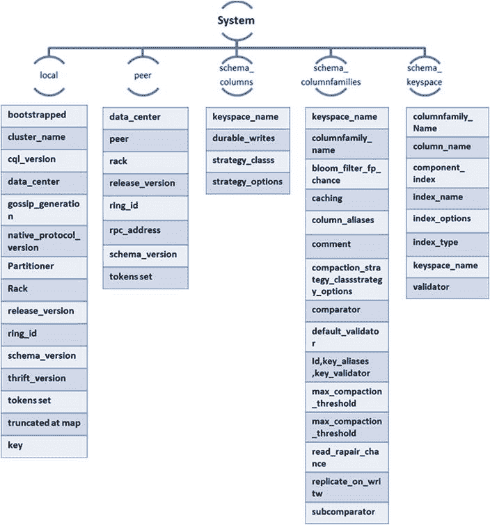
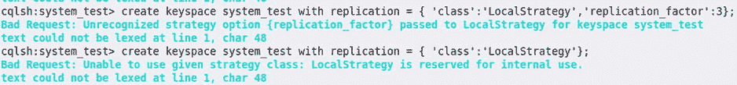
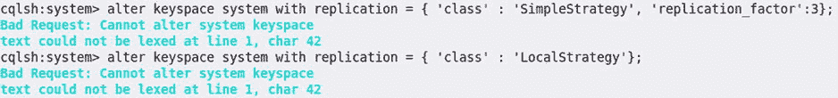
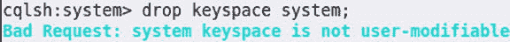

# 4. Cassandra 数据安全

数据库安全意味着保护敏感数据和数据库应用程序免受未经授权的访问。数据的可扩展性和高可用性固然是好事，但数据安全也同样重要！例如，金融及其他公共行业需要可扩展、高可用且安全的数据库。话虽如此，各种类型的组织，尤其是金融和政府机构，都会优先考虑安全性。

自 Cassandra 1.2.2 版本起，我们可以通过两种方式保护 Cassandra 中的数据：访问控制与加密。Cassandra 支持授权和认证功能。

本章将涵盖以下主题：

* Cassandra 的 `system` 和 `system_auth` 键空间
* 管理用户权限
* 节点间及客户端-服务器 SSL 加密

### 认证与授权

认证意味着对试图访问数据存储的用户进行控制。用户身份必须在与数据库建立安全连接时得到验证。认证主要有三种基本类型：

* 内部认证：通常由数据存储通过用户 ID 和密码等凭据来管理用户登录。
* 外部认证：例如 `Kerberos`，这类网络协议通过票据系统来验证客户端身份。
* 客户端-服务器加密：客户端到服务器或节点到节点的加密是另一种在集群间传输数据的方式。通过加密，客户端的或节点的公共信任证书必须安装在其他节点上。

认证过程仅限于用户验证和身份识别。

处理用户访问控制被称为授权。数据库授权意味着管理用户在模式、表和列上的角色与权限。

Cassandra 的内部认证是一种 SSL 加密机制，我们将通过实际示例来探讨。

#### system 和 system_auth 键空间

`system` 键空间包含有关可用列族、列和集群的信息。`system_auth` 键空间主要包含认证信息、用户凭据和权限。我们将在后续示例中讨论它们。`system` 键空间下的表/列族包括：

* `schema_keyspace`
* `schema_columns`
* `schema_columnfamilies`
* `local`
* `peers`

图 4-1 展示了 `system` 键空间的层级结构，其中根节点是 `system` 键空间，下级节点是列族，每个表代表通过那些列族定义的列。



图 4-1. System 键空间及其底层列族与对应列

在我们开始使用 `system` 和 `system_auth` 键空间管理认证与授权之前，让我们先通过本节探讨一下 `system` 键空间是否可以被修改！

##### system 键空间是不可修改的

在深入探讨授权和认证之前，我们先来操作一下 `system` 键空间，以验证外部用户是否可以修改它。由于它是 Cassandra 存储架构内部管理的键空间，外部用户不可能更新/修改 `system` 键空间。接下来的简单练习就是尝试这些负面场景以进行验证。在设计模式时，并不需要对 Cassandra 进行此类调整，但既然我们讨论的是安全性，就让我们看看 `system` 键空间有多安全！

`system` 键空间默认提供读取访问权限。让我们通过一些练习尝试访问它。

`system` 键空间配置了 `LocalStrategy` 作为复制选项。

* 首先，尝试创建一个复制策略为 `LocalStrategy` 的键空间：

```
create keyspace system_test with replication = { 'class':'localstrategy','replication_factor':3};
```

```
create keyspace system_test with replication = { 'class':'LocalStrategy'};
```

图 4-2 显示我们无法使用 `LocalStrategy` 创建另一个键空间。

* 现在，尝试修改/删除 `system` 键空间：



图 4-2. `LocalStrategy` 不供公开使用

```
alter keyspace system with replication = { 'class' : 'LocalStrategy'};
alter keyspace system with replication = { 'class' : 'SimpleStrategy', 'replication_factor':3};
```

图 4-3 显示无法更改 `system` 键空间的策略。



图 4-3. 无法更改 `system` 键空间的策略类

这意味着我们也无法修改 `system` 键空间。

* 接下来，尝试删除 `system` 键空间：

```
drop keyspace system;
```

图 4-4 显示我们同样无法删除 `system` 键空间！



图 4-4. 删除 `system` 键空间是不可行的

通过这些示例，我们可以得出结论：修改 `system` 键空间是不被允许的；不过，我们可以修改 `system` 键空间下列族中存在的数据。


