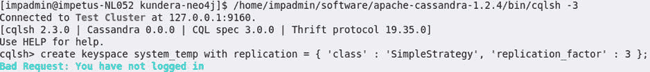
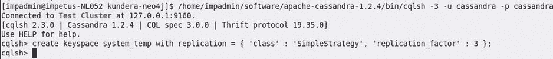
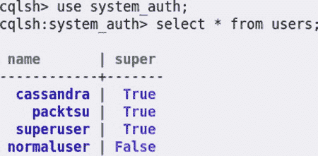
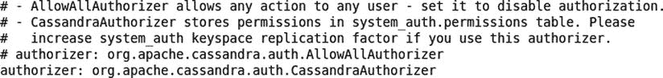
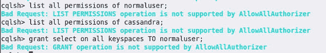
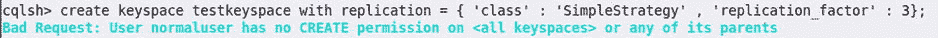
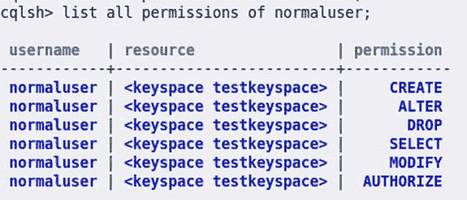
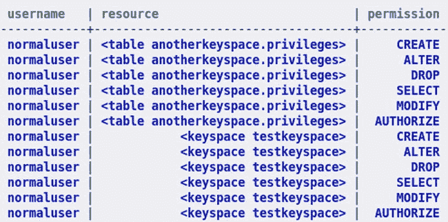
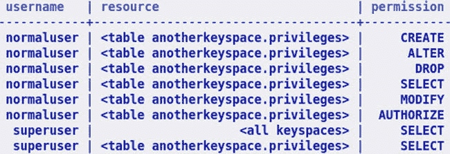

# 使用已启用身份验证的 `system_auth` 键空间

Cassandra 的二进制发行版带有两个身份验证器：`AllowAllAuthenticator` 和 `PasswordAuthenticator`。启用 `PasswordAuthenticator` 后，Cassandra 根据用户名和哈希密码验证用户身份。这些用户凭据存储在 `system_auth.credentials` 表中。

在本教程中，我们将讨论使用 `PasswordAuthenticator` 管理用户凭据和访问 `system_auth` 键空间。启用身份验证后，我们需要在连接 Cassandra 服务器时提供用户名和密码。Cassandra 在此键空间的 `credentials` 表中存储用户名和哈希密码。

开始之前，我们需要在 `cassandra.yaml` 中启用身份验证，如下所示：

`authenticator: org.apache.cassandra.auth.PasswordAuthenticator`

现在已启用身份验证，您可以完成以下步骤：

首先，让我们尝试在不提供用户名/密码的情况下连接服务器并创建一个键空间：

`create keyspace system_temp with replication = { 'class' : 'SimpleStrategy', 'replication_factor' : 3 };`

执行上述命令时，将产生图 4-5 所示的错误。

现在，使用用户名和密码连接并创建键空间：



图 4-5. 连接失败，因为在尝试创建键空间之前我们没有进行身份验证

```
// 使用用户名和密码连接。
$CASSANDRA_HOME/bin/cqlsh -3 -u cassandra -p cassandra
// 创建键空间。
create keyspace system_temp with replication = { 'class' : 'SimpleStrategy', 'replication_factor' : 3 };
```

图 4-6 显示了成功连接。

接下来，让我们创建一个超级用户和一个非超级用户：



图 4-6. 使用用户凭据成功连接后

```
create user normaluser with password 'normal';
create user 'superuser' with password 'superuser' superuser;
```

它会将用户信息存储在 `users` 表中，如图 4-7 所示。



图 4-7. 已注册用户列表

此外，您可以查看 `credentials` 表中的密码和其他信息。

至此我们得出结论，我们可以使用身份验证创建和管理用户凭据。

在之前的教程中，我们成功创建了一个超级用户和一个非超级用户。下一个教程将讨论为这两类用户管理并访问不同列族上的用户凭据。

### 管理用户权限

Cassandra 提供了管理经过身份验证的用户权限和凭据的机制。在本教程中，我们将进一步探讨管理/访问用户权限。`cassandra.yaml` 中配置的默认授权器是 `AllowAllAuthorizer`。

首先，让我们尝试使用 `normaluser` 进行身份验证，并使用 `AllowAllAuthorizer` 管理其权限：

```
// 使用 cqlsh 连接。
$CASSANDRA_HOME/bin/cqlsh -3 -u normaluser -p normal
// 列出用户权限。
list all permissions of normaluser;
list all permissions of cassandra;
// 授予 normaluser 权限。
grant select on all keyspaces to normaluser;
```

这会导致图 4-8 中所示的授权错误。因此，我们需要在 `cassandra.yaml` 中启用授权器。

现在，让我们尝试使用 `normaluser` 创建键空间：



图 4-9. 在 `cassandra.yaml` 中启用 `CassandraAuthorizer`

让我们在 `cassandra.yaml` 中启用授权器配置并重启服务器。图 4-9 显示了如何在 `cassandra.yaml` 中启用 `CassandraAuthorizer`。



图 4-8. 不允许使用 `AllowAllAuthorizer` 管理权限

```
create keyspace testkeyspace with replication = { 'class' : 'SimpleStrategy', 'replication_factor' : 3};
```

再次出现错误（见图 4-10），因为尚未授予 `normaluser` 创建权限。



图 4-10. 错误提示 `normaluser` 没有创建键空间的权限

此外，`normaluser` 不能为自己授予权限。只有 `superuser` 可以！

因此，让我们使用 `superuser` 登录：

```
$CASSANDRA_HOME/bin/cqlsh -3 -u superuser -p superuser
```

现在，创建一个键空间并授予 `normaluser` 权限：

```
// 创建键空间。
create keyspace testkeyspace with replication = { 'class' : 'SimpleStrategy' , 'replication_factor' : 3};
// 授予 normaluser 对 'testkeyspace' 的所有权限。
grant all on keyspace testkeyspace to normaluser;
```

向 `normaluser` 授予权限后，服务器会将其权限存储在 `system_auth` 键空间下的 `permissions` 表中。

让我们查看 `normaluser` 的所有已授予权限（见图 4-11）。

```
// 列出所有权限。
list all permissions of normaluser;
```

让我们创建另一个键空间 `anotherkeyspace`，并在其下创建一个名为 `privileges` 的表：



图 4-11. `normaluser` 当前的权限

```
// 创建键空间。
create keyspace anotherkeyspace with replication = { 'class' : 'SimpleStrategy' , 'replication_factor' : 3};
// 创建表。
create table privileges (user_id text PRIMARY KEY, read_write boolean);
```

让我们授予 `normaluser` 对 `privileges` 表的所有权限：

`grant all on table anotherkeyspace.privileges to normaluser;`

现在，让我们再次列出 `normaluser` 的所有权限（见图 4-12）。

```
// 列出所有权限。
list all permissions of normaluser;
```

接下来，让我们授予 `superuser` 对所有键空间的所有权限：



图 4-12. `normaluser` 的新权限列表

`grant select on all keyspaces to 'superuser';`

现在授予 `superuser` 对 `privileges` 表的 `select` 权限：

`grant select on anotherkeyspace.privileges to 'superuser';`

让我们查看所有授予给 `privileges` 表的权限（见图 4-13）。

`list all permissions on privileges;`

我们还可以使用 `NORECURSIVE` 说明符显示特定资源的权限（见图 4-14）。



图 4-13.


