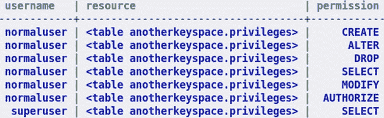
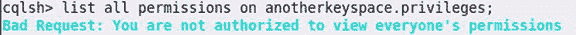
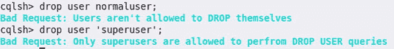
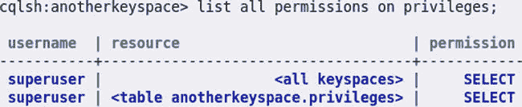
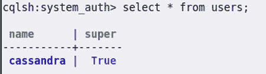
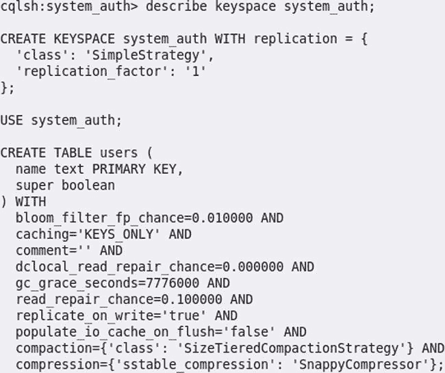
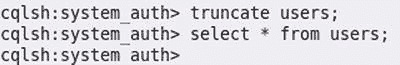
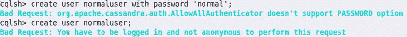

# 权限与父资源上的权限管理

`list all permissions on privileges NORECURSIVE;`

让我们使用`normaluser`连接，并尝试查看`privileges`表上赋予的所有权限。



**图 4-14.** 所有用户在`privileges`表上被赋予的权限列表

`list all permissions on anotherkeyspace.privileges;`

我们再次收到"未授权"错误（见图 4-15）。`normaluser`已被赋予`privileges`表上的所有权限，但它无法查看所有人的权限。不过，`normaluser`可以执行之前提到的其他允许的操作。

我们还可以尝试让`normaluser`删除自身和`superuser`（见图 4-16）。



**图 4-15.** `normaluser`在`anotherkeyspace`上没有获得权限

`drop user normaluser;`  
`drop user 'superuser';`

图 4-16 所示的结果表明，`normaluser`无法删除、撤销或查看其他用户的权限。但`superuser`可以！

那么，让我们以`superuser`身份连接，并尝试撤销赋予特定用户（此处为`normaluser`）的权限，操作如下：



**图 4-16.** 非超级用户不允许删除用户

`revoke all permissions on privileges from normaluser;`  
`list all permissions on privileges;`

图 4-17 显示操作成功。



**图 4-17.** 超级用户在`privileges`表上的权限

通过这一系列步骤，我们得出结论：

-   非超级用户无法管理、访问或查看其他用户的权限。
-   权限可以在键空间和特定表/列族上授予。
-   超级用户可以管理或访问其他用户的权限。

## 使用 `AllowAllAuthorizer` 访问 `system_auth`

默认情况下，Cassandra 中禁用了身份验证，并且在`cassandra.yaml`配置中将`AllowAllAuthenticator`配置为身份验证器。在前一节中，我们探索了使用`PasswordAuthenticator`的各种授权技术。在本节中，我们将探讨使用`AllowAllAuthorizer`管理用户权限是否可行。本指南将帮助您了解`AllowAllAuthorizer`不适用的情况。这纯粹是为了实验目的。

如上所述，`system_auth`键空间包含用户凭证和权限详情。在本指南中，我们将尝试在无需身份验证的情况下访问`system_auth`键空间并管理用户凭证。

首先，让我们描述`system_auth`键空间（见图 4-18）。

```
// 描述键空间。
describe keyspace system_auth;
```

首先，让我们尝试删除`users`表中的所有数据（见图 4-20）：



**图 4-19.** `users`表中的默认用户

让我们探索`users`表，如图 4-19 所示。



**图 4-18.** 描述的`system_auth`键空间

`truncate users;`

我们成功截断了`users`表，但现在让我们看看是否可以删除它。



**图 4-20.** 被截断的`users`表

`drop table users;`

图 4-21 显示我们不能这样做，因为这是一个系统表，受 Cassandra 限制，外部用户无法操作。

接下来，重启 Cassandra 服务器以验证`users`表是否为空（见图 4-22）：


**图 4-21.** 不允许删除`users`表

`select * from users;`


**图 4-22.** 默认用户`cassandra`已预填充

在启用`AllowAllAuthorizer`的情况下对`system_auth`键空间所做的更改将被 Cassandra 忽略。因此，步骤 3 中所做的更改将不会生效，Cassandra 将填充步骤 2 中所示的默认设置。

让我们尝试创建一个用户：

`create user normaluser with password 'normal';`  
`create user normaluser;`

如图 4-23 所示，在 Cassandra 中，使用`AllowAllAuthenticator`创建用户是不允许的。然而，正如我们之前所见，使用`PasswordAuthenticator`是可能的。

我们可以为复制策略修改`system_auth`键空间，如下所示：



**图 4-23.** 尝试在未登录时使用`AllowAllAuthenticator`创建用户

`alter keyspace system_auth with replication = {'class':'SimpleStrategy','replication_factor':3};`

通过本指南，我们得出结论：我们可以修改`system_auth`键空间，但不能使用`AllowAllAuthenticator`（禁用身份验证）创建用户。在 Cassandra 服务器上使用默认用户凭证进行身份验证时，必须将一致性级别配置为`QUORUM`。

接下来，我们讨论 SSL 加密以及在启用加密时连接`cqlsh`和 Thrift 客户端的话题。


